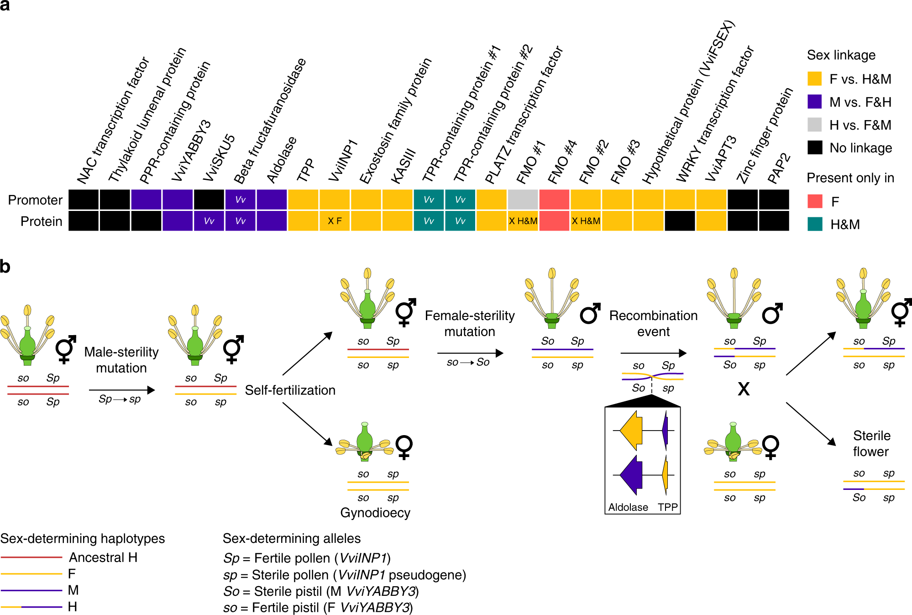
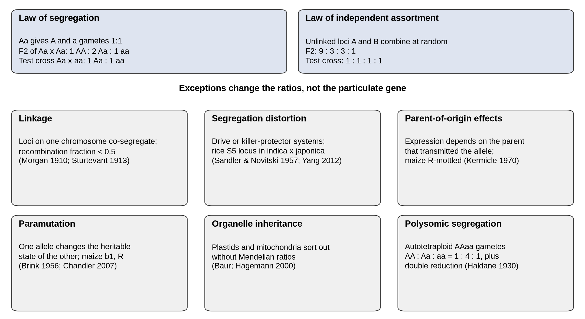
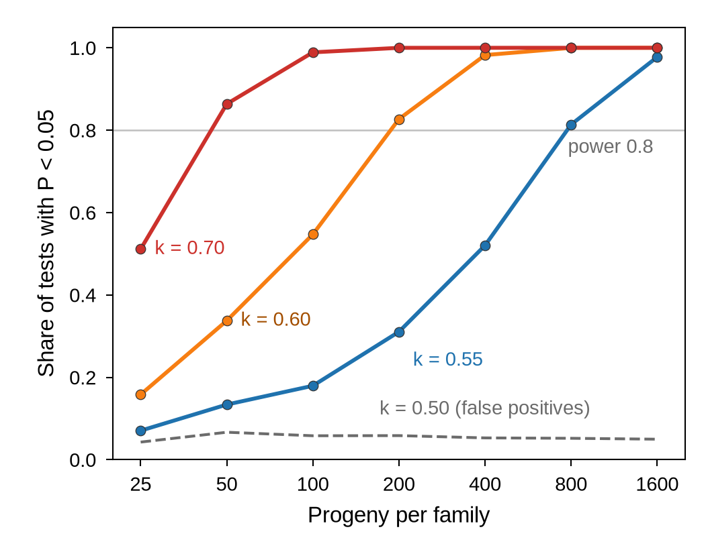

# Chapter 1. Mendelian inheritance and its exceptions

**Status: Verified.** Particulate inheritance with 1:1 segregation and independent assortment of unlinked loci is one of the best-supported results in biology. Every known exception (linkage, segregation distortion, parent-of-origin effects, paramutation, organelle inheritance, polysomic segregation) changes the ratios, not the particulate gene.

## 1.1 Statement and history

Mendel crossed pea varieties that differed in single characters and counted the offspring. Two rules came out of those counts. A heterozygote transmits each of its two alleles to half of its gametes (segregation), and alleles at different characters are transmitted independently of each other (independent assortment). The paper of 1866 was rediscovered around 1900, and its interpretation has been argued over ever since. van Dijk, Weissing and Ellis traced Mendel’s interest in inheritance to the plant-improvement culture of his region [1], and van Dijk and colleagues argued that his later Hieracium work was not a failed attempt to repeat the pea ratios [2].

The chromosome theory gave the rules a physical basis: chromosome pairs separate at meiosis in the way the factors do [3]. Morgan found a factor that followed the X chromosome in Drosophila [4], and Sturtevant used the frequency of co-inheritance to place six sex-linked factors in a line, the first genetic map [5]. Linkage was therefore the first and largest exception to independent assortment, and it was explained, not ignored.

Fisher re-analysed Mendel’s counts in 1936 and argued that they fitted the expected ratios too well [6]. The charge has been weighed many times. Hartl and Fairbanks examined the allegation of falsification [7]; Pires and Branco assumed an unconscious bias in the experiments and gave a probability model that fits the data without contradicting Fisher’s analysis [8]; Weeden found an underlying bias towards the expected ratios but could not tell whether it came from misclassifying ambiguous plants or from deliberate falsification [9]; Ellis and colleagues re-examined the varieties and the counts and concluded that the segregation ratios do not differ remarkably from expectation [10]; and Radick argued that the debate about fraud should give way to a wider look at Mendel’s legacy [11]. None of these papers questions the laws themselves.

## 1.2 What the theory predicts

- An F1 heterozygote Aa crossed to itself gives 1 AA : 2 Aa : 1 aa, and 3:1 phenotypes when A is dominant.
- A test cross Aa x aa gives 1:1.
- Two unlinked loci give 9:3:3:1 in the F2 and 1:1:1:1 in a test cross.
- Linked loci depart from these ratios in proportion to their distance, and the departure is the same in reciprocal crosses.
- The gene is a discrete unit that can be isolated; the character differences Mendel scored should map to specific DNA changes.

## 1.3 Evidence for

The strongest modern support is molecular: the genes behind Mendel’s own characters have been cloned. The wrinkled-seed allele r carries a transposon-like insertion in the gene for starch-branching enzyme I [12]. The stem-length gene Le encodes a gibberellin 3-beta-hydroxylase, and the dwarf allele carries a single amino-acid change [13, 14]. The cotyledon colour gene I encodes a stay-green protein needed for chlorophyll breakdown [15, 16]. The white-flower gene A encodes a transcription factor of the anthocyanin pathway [17]. Ellis and colleagues summarised the state of Mendel’s genes at the 150-year mark [18], Sussmilch and colleagues discussed candidates for the three remaining characters [19], and Feng and colleagues explained the last three: an approximately 100-kb deletion upstream of a chlorophyll synthase gene gives the yellow pod, a MYB gene with an Ogre insertion and a CLE peptide gene with a premature stop explain the edible-pod alleles, and a 5-bp exonic deletion in a CIK-like co-receptor kinase gene, with a modifier locus, is associated with the fasciated stem [20]. Each of these single-gene characters segregates as a Mendelian unit and maps to one locus.

In crops the same logic is used daily. Grape berry colour behaves as a single locus in crosses: Kobayashi and colleagues found a retrotransposon insertion in VvmybA1 associated with white skin [21], and Walker and colleagues showed that white berries arose through mutations of two similar, adjacent MYB regulatory genes [22]. The major source of seedlessness in table grapes is associated with a missense mutation in the MADS-box gene VviAGL11 [23].

## 1.4 Evidence against, and the exceptions

No result has overturned particulate inheritance, but several classes of results show that the ratios are not universal.

- **Linkage.** Loci on one chromosome co-segregate [4, 5]. Independent assortment is a special case for distant or unlinked loci.
- **Segregation distortion and meiotic drive.** Sandler and Novitski named meiotic drive: heterozygotes that produce two kinds of gametes in unequal frequencies, which changes gene frequencies in populations [24]. Drivers are genetic variants that selfishly raise their own transmission, often at a cost to the rest of the genome [25]. In rice, a killer-protector system of three tightly linked genes at the S5 locus causes both hybrid sterility and segregation distortion between indica and japonica [26]. Mapping studies need explicit statistics for distortion; Coulton and colleagues used simulated genotypes to compare tests and multiple-testing corrections [27].
- **Parent-of-origin effects.** In maize endosperm, the R-mottled phenotype appears only when the R allele comes through the pollen parent, which Kermicle showed depends on the mode of sexual transmission and not only on dosage [28].
- **Paramutation.** Brink described a directed and potentially reversible change at the maize R locus [29]; paramutation is now understood as an epigenetic transfer of state from one allele to another, heritable for generations, with RNA as a mediator in maize and mice [30].
- **Organelle inheritance.** Baur’s work on variegated Pelargonium showed that plastids carry hereditary factors, sort out randomly, and in that species are transmitted by both egg and sperm; Hagemann argued that Baur alone deserves credit for the theory of plastid inheritance [31].
- **Polysomic segregation.** In autopolyploids gametes carry two alleles, and the gametic series differ from diploid expectations [32]; double reduction adds a further departure that equilibrium tests must model [33].

## 1.5 Status and reasoning

**Verified.** The prediction that the characters Mendel scored are single, separable units has been met at the DNA level for all seven of his pea characters [18, 20], and the ratios are reproduced in sexual eukaryotes generally. The exceptions are themselves Mendelian in the sense that they are caused by identifiable genes, chromosomes or organelles. What is not verified is the stronger reading that every locus segregates 1:1 in every cross; drive and killer systems show that it does not [24, 26].

## 1.6 Plants, crops and grapevine

- **Grapevine sex.** Wild Vitis are dioecious and cultivated grapevine is hermaphrodite. Massonnet and colleagues resolved twenty sex-determining-region (SDR) haplotypes, identified a candidate male-sterility mutation in VviINP1 and a potential female-sterility function linked to VviYABBY3, and proposed that dioecy was lost during domestication through a rare recombination between male and female haplotypes (Figure 1.1) [34]. Badouin and colleagues assembled the X, Y and modified Y (Yh) haplotypes of wild and cultivated grapevine and proposed candidate genes for male and female sterility [35], and Zou and colleagues found that the SDR boundaries are conserved across the genus and that at least two independent recombination events gave hermaphrodite haplotypes [36]. Sex is therefore a Mendelian two-allele system in crosses, with the alleles being haplotypes of a short linked region.
- **Berry colour and seedlessness** are single-locus or major-locus traits [21, 22, 23]; they are used as Mendelian markers in breeding.
- **Clonal perennials.** A grapevine cultivar is one seedling propagated by cuttings, so Mendelian ratios are seen only in crosses and selfs, not in a vineyard. Segregation tests must use seedling families, and the somatic variants found among clones of one cultivar are not segregants.

## 1.7 How to test it with public data

- **Data.** Any public F1, F2 or selfed mapping family with sequencing reads in SRA or ENA, for example grapevine biparental families used for linkage maps. Parents must be sequenced as well.
- **Tools.** Read mapping and joint calling (for example BWA-MEM2 with GATK or bcftools), then per-marker genotype counts.
- **Analysis.** For each marker heterozygous in one parent, test the observed allele ratio against 1:1 (or 1:2:1 in an F2) with a chi-square or exact test, correct for multiple testing, and plot the statistic along each chromosome. Distorted blocks that persist after removing low-depth calls point to drive, gametic selection or a structural variant. The script [`scripts/ch01_mendel_figures.py`](../scripts/ch01_mendel_figures.py) shows how power depends on family size (Figure 1.3): a 55:45 distortion is missed in most families of 100 but found in most families of 800.
- **What would break the theory.** A locus whose alleles blend or change state in every generation without any identifiable epigenetic or genetic cause.

## 1.8 Open questions

- How often do drive and killer-protector systems act in crop hybrids, and do they limit where breeding can bring in wild alleles?
- How stable are paramutation-like states in clonally propagated perennials, where meiosis is rare?
- How do recombination-suppressed sex regions such as the grape SDR keep their haplotypes intact over long periods?

## 1.9 Common mistakes

- Treating a 3:1 phenotype ratio as proof of a single gene: two linked genes or a dominant suppressor can give the same ratio in small families.
- Reading distortion in a mapping family as biology before checking genotype calling, depth and parentage.
- Calling clone-to-clone differences in a cultivar “segregation”.

## Figures

**Figure 1.1.** Model of the evolution of sex determination in grapevine. Reproduced unchanged from Massonnet M, Cochetel N, Minio A, et al. (2020) The genetic basis of sex determination in grapes. *Nature Communications* 11:2902, Figure 6. https://doi.org/10.1038/s41467-020-16700-z. Licence: CC BY 4.0 (https://creativecommons.org/licenses/by/4.0/).

**Figure 1.2.** Mendel’s two laws and six classes of exceptions. Schematic drawn for this book.

**Figure 1.3.** Power of a 1:1 chi-square test to detect segregation distortion (k is the transmitted share of one allele) as family size grows. Simulated data, 20,000 runs per point; made with [`scripts/ch01_mendel_figures.py`](../scripts/ch01_mendel_figures.py).

## References

1. van Dijk PJ, Weissing FJ, Ellis THN (2018) How Mendel’s Interest in Inheritance Grew out of Plant Improvement. *Genetics* 210:347-355. https://doi.org/10.1534/genetics.118.300916
2. van Dijk PJ, Ellis THN (2016) The Full Breadth of Mendel’s Genetics. *Genetics* 204:1327-1336. https://doi.org/10.1534/genetics.116.196626
3. SUTTON WS (1903) THE CHROMOSOMES IN HEREDITY. *The Biological Bulletin* 4:231-250. https://doi.org/10.2307/1535741
4. Morgan TH (1910) Sex Limited Inheritance in Drosophila. *Science* 32:120-122. https://doi.org/10.1126/science.32.812.120
5. Sturtevant AH (1913) The linear arrangement of six sex‐linked factors in Drosophila, as shown by their mode of association. *Journal of Experimental Zoology* 14:43-59. https://doi.org/10.1002/jez.1400140104
6. Fisher RA (1936) Has Mendel's work been rediscovered?. *Annals of Science* 1:115-137. https://doi.org/10.1080/00033793600200111
7. Hartl DL, Fairbanks DJ (2007) Mud Sticks: On the Alleged Falsification of Mendel's Data. *Genetics* 175:975-979. https://doi.org/10.1093/genetics/175.3.975
8. Pires AM, Branco JA (2010) A Statistical Model to Explain the Mendel–Fisher Controversy. *Statistical Science* 25:545-565. https://doi.org/10.1214/10-sts342
9. Weeden NF (2016) Are Mendel’s Data Reliable? The Perspective of a Pea Geneticist. *Journal of Heredity* 107:635-646. https://doi.org/10.1093/jhered/esw058
10. Ellis THN, Hofer JMI, Swain MT, et al. (2019) Mendel’s pea crosses: varieties, traits and statistics. *Hereditas* 156:33. https://doi.org/10.1186/s41065-019-0111-y
11. Radick G (2015) Beyond the “Mendel-Fisher controversy”. *Science* 350:159-160. https://doi.org/10.1126/science.aab3846
12. Bhattacharyya MK, Smith AM, Ellis THN, et al. (1990) The wrinkled-seed character of pea described by Mendel is caused by a transposon-like insertion in a gene encoding starch-branching enzyme. *Cell* 60:115-122. https://doi.org/10.1016/0092-8674(90)90721-P
13. Lester DR, Ross JJ, Davies PJ, et al. (1997) Mendel's stem length gene (Le) encodes a gibberellin 3 beta-hydroxylase. *The Plant Cell* 9:1435-1443. https://doi.org/10.1105/tpc.9.8.1435
14. Martin DN, Proebsting WM, Hedden P (1997) Mendel’s dwarfing gene: cDNAs from the Le alleles and function of the expressed proteins. *Proceedings of the National Academy of Sciences* 94:8907-8911. https://doi.org/10.1073/pnas.94.16.8907
15. Armstead I, Donnison I, Aubry S, et al. (2007) Cross-Species Identification of Mendel's I Locus. *Science* 315:73-73. https://doi.org/10.1126/science.1132912
16. Sato Y, Morita R, Nishimura M, et al. (2007) Mendel's green cotyledon gene encodes a positive regulator of the chlorophyll-degrading pathway. *Proceedings of the National Academy of Sciences* 104:14169-14174. https://doi.org/10.1073/pnas.0705521104
17. Hellens RP, Moreau C, Lin-Wang K, et al. (2010) Identification of Mendel's White Flower Character. *PLoS ONE* 5:e13230. https://doi.org/10.1371/journal.pone.0013230
18. Ellis THN, Hofer JMI, Timmerman-Vaughan GM, et al. (2011) Mendel, 150 years on. *Trends in Plant Science* 16:590-596. https://doi.org/10.1016/j.tplants.2011.06.006
19. Sussmilch FC, Ross JJ, Reid JB (2022) Mendel: From genes to genome. *Plant Physiology* 190:2103-2114. https://doi.org/10.1093/plphys/kiac424
20. Feng C, Chen B, Hofer J, et al. (2025) Genomic and genetic insights into Mendel’s pea genes. *Nature* 642:980-989. https://doi.org/10.1038/s41586-025-08891-6
21. Kobayashi S, Goto-Yamamoto N, Hirochika H (2004) Retrotransposon-Induced Mutations in Grape Skin Color. *Science* 304:982-982. https://doi.org/10.1126/science.1095011
22. Walker AR, Lee E, Bogs J, et al. (2007) White grapes arose through the mutation of two similar and adjacent regulatory genes. *The Plant Journal* 49:772-785. https://doi.org/10.1111/j.1365-313X.2006.02997.x
23. Royo C, Torres-Pérez R, Mauri N, et al. (2018) The Major Origin of Seedless Grapes Is Associated with a Missense Mutation in the MADS-Box Gene VviAGL11. *Plant Physiology* 177:1234-1253. https://doi.org/10.1104/pp.18.00259
24. Sandler L, Novitski E (1957) Meiotic Drive as an Evolutionary Force. *The American Naturalist* 91:105-110. https://doi.org/10.1086/281969
25. Lindholm AK, Dyer KA, Firman RC, et al. (2016) The Ecology and Evolutionary Dynamics of Meiotic Drive. *Trends in Ecology &amp; Evolution* 31:315-326. https://doi.org/10.1016/j.tree.2016.02.001
26. Yang J, Zhao X, Cheng K, et al. (2012) A Killer-Protector System Regulates Both Hybrid Sterility and Segregation Distortion in Rice. *Science* 337:1336-1340. https://doi.org/10.1126/science.1223702
27. Coulton A, Przewieslik-Allen AM, Burridge AJ, et al. (2020) Segregation distortion: Utilizing simulated genotyping data to evaluate statistical methods. *PLOS ONE* 15:e0228951. https://doi.org/10.1371/journal.pone.0228951
28. Kermicle JL (1970) DEPENDENCE OF THE R-MOTTLED ALEURONE PHENOTYPE IN MAIZE ON MODE OF SEXUAL TRANSMISSION. *Genetics* 66:69-85. https://doi.org/10.1093/genetics/66.1.69
29. Brink RA (1956) A GENETIC CHANGE ASSOCIATED WITH THE R LOCUS IN MAIZE WHICH IS DIRECTED AND POTENTIALLY REVERSIBLE. *Genetics* 41:872-889. https://doi.org/10.1093/genetics/41.6.872
30. Chandler VL (2007) Paramutation: From Maize to Mice. *Cell* 128:641-645. https://doi.org/10.1016/j.cell.2007.02.007
31. Hagemann R (2000) Erwin Baur or Carl Correns: who really created the theory of plastid inheritance?. *Journal of Heredity* 91:435-440. https://doi.org/10.1093/jhered/91.6.435
32. Haldane JBS (1930) Theoretical genetics of autopolyploids. *Journal of Genetics* 22:359-372. https://doi.org/10.1007/BF02984197
33. Gerard D (2023) Double Reduction Estimation and Equilibrium Tests in Natural Autopolyploid Populations. *Biometrics* 79:2143-2156. https://doi.org/10.1111/biom.13722
34. Massonnet M, Cochetel N, Minio A, et al. (2020) The genetic basis of sex determination in grapes. *Nature Communications* 11:2902. https://doi.org/10.1038/s41467-020-16700-z
35. Badouin H, Velt A, Gindraud F, et al. (2020) The wild grape genome sequence provides insights into the transition from dioecy to hermaphroditism during grape domestication. *Genome Biology* 21:223. https://doi.org/10.1186/s13059-020-02131-y
36. Zou C, Massonnet M, Minio A, et al. (2021) Multiple independent recombinations led to hermaphroditism in grapevine. *Proceedings of the National Academy of Sciences* 118:e2023548118. https://doi.org/10.1073/pnas.2023548118
