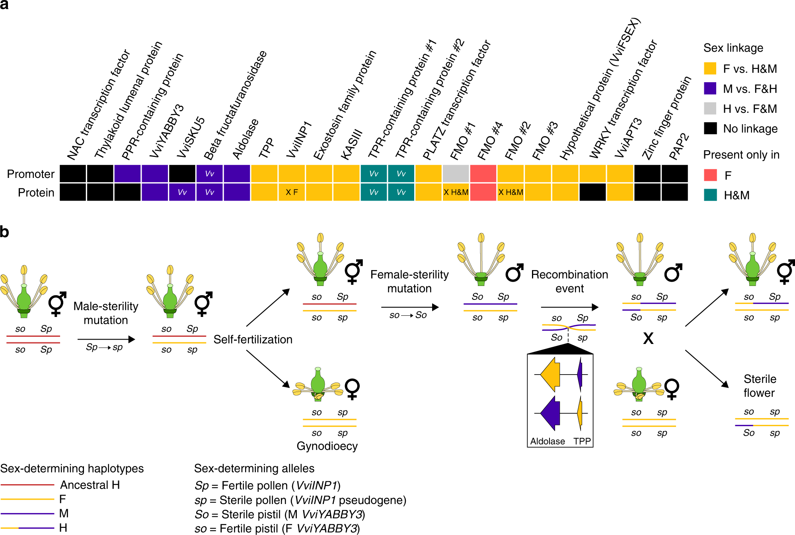
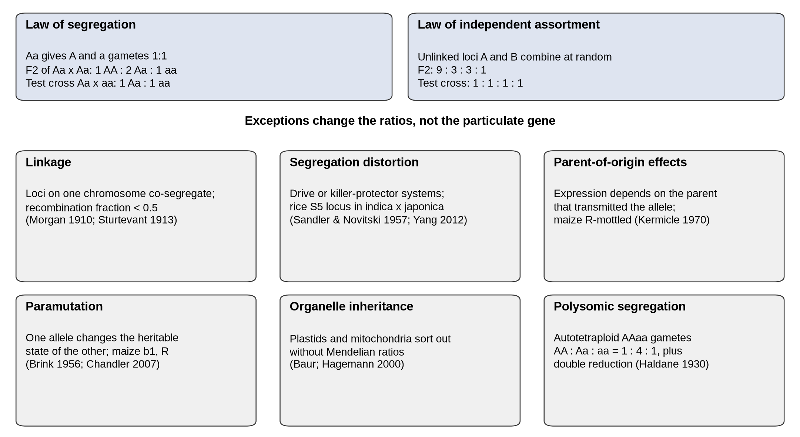
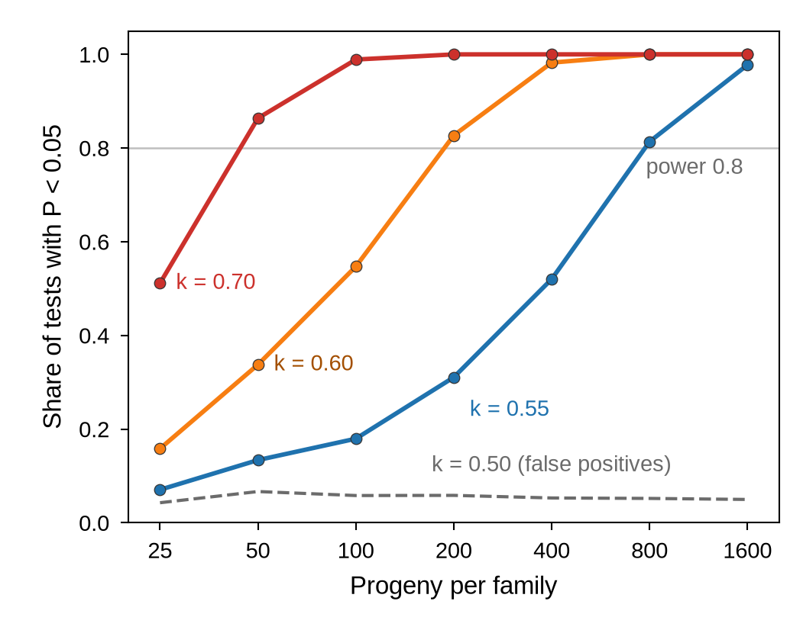

# 第 1 章 孟德尔遗传及其例外

**地位：已验证。** 颗粒式遗传、1:1 分离以及不连锁位点的自由组合，是生物学中证据最充分的结论之一。目前已知的各种例外（连锁、分离偏离、亲本来源效应、副突变、细胞器遗传、多体分离）改变的是比例，而不是“基因是离散单位”这一点。

本仓库相关条目：[mendelian-segregation](../../theories/mendelian-segregation/THEORY.md)。

## 1.1 内容与历史

孟德尔用只在单个性状上不同的豌豆品种杂交并计数后代，从计数中得出两条规律：杂合子把两个等位基因各传给一半配子（分离律）；不同性状的等位基因彼此独立传递（自由组合律）。1866 年的论文在 1900 年前后被重新发现，对它的解读至今仍有争论。van Dijk、Weissing 和 Ellis 认为孟德尔对遗传的兴趣来自当地的植物改良传统 [1]；van Dijk 等认为他后来的山柳菊研究并不是重复豌豆比例的失败尝试 [2]。

染色体学说为这些规律提供了物质基础：减数分裂时同源染色体的分离方式与“因子”的分离方式一致 [3]。Morgan 在果蝇中发现一个随 X 染色体传递的因子 [4]，Sturtevant 用共同遗传的频率把六个性连锁因子排成一条直线，得到第一张遗传图谱 [5]。因此连锁是自由组合律最早、也最大的例外，而且得到了解释。

Fisher 在 1936 年重新分析孟德尔的数据，认为它们与期望比例吻合得过好 [6]。这一指控被反复检验：Hartl 和 Fairbanks 检视了“造假”的说法 [7]；Pires 和 Branco 假设实验中存在无意识偏差，给出一个既拟合数据又不与 Fisher 分析矛盾的概率模型 [8]；Weeden 发现数据存在偏向期望比例的偏差，但无法判断它来自对模糊植株的错分还是有意造假 [9]；Ellis 等重新考察了当时的品种和计数，认为分离比例并没有明显偏离期望 [10]；Radick 则主张把关于造假的争论转向对孟德尔遗产的更广泛审视 [11]。这些论文都没有质疑定律本身。

## 1.2 理论预测

- F1 杂合子 Aa 自交得到 1 AA : 2 Aa : 1 aa，A 为显性时表型为 3:1。
- 测交 Aa x aa 得到 1:1。
- 两个不连锁位点在 F2 中为 9:3:3:1，测交为 1:1:1:1。
- 连锁位点按距离偏离上述比例，且正反交偏离相同。
- 基因是可分离的离散单位；孟德尔记录的性状差异应能对应到具体的 DNA 变化。

## 1.3 支持证据

最有力的现代证据来自分子层面：孟德尔本人研究的性状基因已被克隆。皱粒等位基因 r 在淀粉分支酶 I 基因中带有类转座子插入 [12]。茎长基因 Le 编码赤霉素 3β-羟化酶，矮秆等位基因只有一个氨基酸变化 [13, 14]。子叶颜色基因 I 编码叶绿素降解所需的 stay-green 蛋白 [15, 16]。白花基因 A 编码花青素途径的转录因子 [17]。Ellis 等在 150 周年时总结了孟德尔基因的研究现状 [18]，Sussmilch 等讨论了其余三个性状的候选基因 [19]，Feng 等解释了最后三个性状：叶绿素合酶基因上游约 100 kb 的缺失导致黄色豆荚；一个带 Ogre 插入的 MYB 基因和一个带提前终止密码子的 CLE 肽基因解释了可食荚等位基因；CIK 类共受体激酶基因外显子中 5 bp 的缺失与一个修饰位点共同关联带化茎 [20]。这些单基因性状都作为孟德尔单位分离，并定位到单个位点。

作物育种每天都在用同样的逻辑。葡萄果皮颜色在杂交中表现为单个位点：Kobayashi 等发现 VvmybA1 中的反转录转座子插入与白色果皮相关 [21]，Walker 等证明白色葡萄来自两个相邻、相似的 MYB 调控基因的突变 [22]。鲜食葡萄无核性的主要来源与 MADS-box 基因 VviAGL11 的一个错义突变相关 [23]。

## 1.4 反面证据与例外

没有任何结果推翻颗粒式遗传，但有几类结果说明这些比例并非普遍成立。

- **连锁。** 同一条染色体上的位点共同分离 [4, 5]。自由组合只是远距离或不连锁位点的特例。
- **分离偏离与减数分裂驱动。** Sandler 和 Novitski 提出“减数分裂驱动”：杂合子产生两类配子的比例不等，从而改变群体中的基因频率 [24]。驱动因子是自私地提高自身传递率的遗传变异，往往以基因组其余部分为代价 [25]。水稻 S5 位点由三个紧密连锁基因组成的“杀手-保护者”系统，同时造成籼粳杂种不育和分离偏离 [26]。作图研究需要专门的偏离统计；Coulton 等用模拟基因型比较了各种检验和多重检验校正 [27]。
- **亲本来源效应。** 在玉米胚乳中，R-mottled 表型只在 R 等位基因经花粉亲本传递时出现；Kermicle 证明这取决于有性传递的方式，而不只是剂量 [28]。
- **副突变。** Brink 描述了玉米 R 位点上一种定向且可能可逆的变化 [29]；现在认为副突变是一个等位基因把表达状态表观地传给另一个等位基因，并可遗传多代，在玉米和小鼠中 RNA 起介导作用 [30]。
- **细胞器遗传。** Baur 对花叶天竺葵的研究表明质体携带遗传因子、随机分配，并且在该物种中经卵和精子双亲传递；Hagemann 认为质体遗传理论的功劳应只归于 Baur [31]。
- **多体分离。** 同源多倍体的配子带两个等位基因，配子系列不同于二倍体期望 [32]；双减数又带来进一步偏离，平衡检验必须把它纳入模型 [33]。

## 1.5 地位与理由

**已验证。** “孟德尔记录的性状是单个、可分离的单位”这一预测，已在 DNA 层面对他全部七个豌豆性状得到证实 [18, 20]，分离比例在有性真核生物中普遍重现。各种例外本身也是孟德尔式的：它们都由可识别的基因、染色体或细胞器引起。没有得到验证的是更强的说法，即每个位点在每个杂交中都 1:1 分离；驱动和杀手系统说明并非如此 [24, 26]。

## 1.6 植物、作物与葡萄

- **葡萄性别。** 野生葡萄雌雄异株，栽培葡萄为两性花。Massonnet 等解析了 20 个性别决定区（SDR）单倍型，找到 VviINP1 中的候选雄性不育突变和与 VviYABBY3 相关的可能雌性不育功能，并提出驯化中雄性与雌性单倍型之间的一次罕见重组导致了雌雄异株的丧失（图 1.1）[34]。Badouin 等组装了野生和栽培葡萄的 X、Y 和修饰型 Y（Yh）单倍型，并提出雄性和雌性不育的候选基因 [35]；Zou 等发现 SDR 边界在整个葡萄属中保守，两性单倍型至少来自两次独立的重组 [36]。因此在杂交中，性别是一个两等位基因的孟德尔系统，只是“等位基因”是一小段连锁区域的单倍型。
- **果色与无核性** 是单位点或主效位点性状 [21, 22, 23]，在育种中作为孟德尔标记使用。
- **克隆繁殖的多年生作物。** 一个葡萄品种就是一株实生苗经扦插繁殖而来，所以孟德尔比例只能在杂交和自交后代中看到，在葡萄园里看不到。分离检验必须用实生后代家系；同一品种不同克隆之间的体细胞变异不是分离产物。

## 1.7 用公开数据检验

- **数据。** SRA 或 ENA 中任何带测序数据的 F1、F2 或自交作图家系，例如用于构建连锁图的葡萄双亲家系；亲本也必须测序。
- **工具。** 比对与联合变异检测（例如 BWA-MEM2 加 GATK 或 bcftools），然后统计每个标记的基因型数。
- **分析。** 对每个在一个亲本中杂合的标记，用卡方或精确检验比较观测比例与 1:1（F2 中为 1:2:1），做多重检验校正，并沿每条染色体作图。去除低深度位点后仍然存在的偏离区段，提示驱动、配子选择或结构变异。脚本 [`scripts/ch01_mendel_figures.py`](../scripts/ch01_mendel_figures.py) 展示检验功效如何随家系大小变化（图 1.3）：55:45 的偏离在 100 株的家系中多数检测不到，在 800 株的家系中多数能检测到。
- **什么结果会推翻理论。** 某个位点的等位基因在每代都融合或改变状态，却找不到任何遗传或表观遗传原因。

## 1.8 未解决的问题

- 驱动和杀手-保护者系统在作物杂种中有多常见？它们是否限制了育种引入野生等位基因的位置？
- 在减数分裂很少的克隆繁殖多年生作物中，类似副突变的状态有多稳定？
- 像葡萄 SDR 这样重组被抑制的性别区域，如何长期保持单倍型完整？

## 1.9 常见错误

- 把 3:1 的表型比例当作单基因的证明：在小家系中，两个连锁基因或一个显性抑制基因也能给出同样的比例。
- 在检查基因型检测、深度和亲缘关系之前，就把作图家系中的偏离解读为生物学现象。
- 把同一品种克隆之间的差异叫作“分离”。

## 图

**图 1.1.** 葡萄性别决定演化模型。原样转载自 Massonnet M, Cochetel N, Minio A, et al. (2020) The genetic basis of sex determination in grapes. *Nature Communications* 11:2902, Figure 6. https://doi.org/10.1038/s41467-020-16700-z。许可：CC BY 4.0（https://creativecommons.org/licenses/by/4.0/）。

**图 1.2.** 孟德尔两条定律与六类例外。本书绘制的示意图（图中文字为英文）。

**图 1.3.** 1:1 卡方检验检测分离偏离的功效随家系大小的变化（k 为某一等位基因的传递比例）。模拟数据，每点 20,000 次；由 [`scripts/ch01_mendel_figures.py`](../scripts/ch01_mendel_figures.py) 生成。

## 参考文献

1. van Dijk PJ, Weissing FJ, Ellis THN (2018) How Mendel’s Interest in Inheritance Grew out of Plant Improvement. *Genetics* 210:347-355. https://doi.org/10.1534/genetics.118.300916
2. van Dijk PJ, Ellis THN (2016) The Full Breadth of Mendel’s Genetics. *Genetics* 204:1327-1336. https://doi.org/10.1534/genetics.116.196626
3. SUTTON WS (1903) THE CHROMOSOMES IN HEREDITY. *The Biological Bulletin* 4:231-250. https://doi.org/10.2307/1535741
4. Morgan TH (1910) Sex Limited Inheritance in Drosophila. *Science* 32:120-122. https://doi.org/10.1126/science.32.812.120
5. Sturtevant AH (1913) The linear arrangement of six sex‐linked factors in Drosophila, as shown by their mode of association. *Journal of Experimental Zoology* 14:43-59. https://doi.org/10.1002/jez.1400140104
6. Fisher RA (1936) Has Mendel's work been rediscovered? *Annals of Science* 1:115-137. https://doi.org/10.1080/00033793600200111
7. Hartl DL, Fairbanks DJ (2007) Mud Sticks: On the Alleged Falsification of Mendel's Data. *Genetics* 175:975-979. https://doi.org/10.1093/genetics/175.3.975
8. Pires AM, Branco JA (2010) A Statistical Model to Explain the Mendel–Fisher Controversy. *Statistical Science* 25:545-565. https://doi.org/10.1214/10-sts342
9. Weeden NF (2016) Are Mendel’s Data Reliable? The Perspective of a Pea Geneticist. *Journal of Heredity* 107:635-646. https://doi.org/10.1093/jhered/esw058
10. Ellis THN, Hofer JMI, Swain MT, et al. (2019) Mendel’s pea crosses: varieties, traits and statistics. *Hereditas* 156:33. https://doi.org/10.1186/s41065-019-0111-y
11. Radick G (2015) Beyond the “Mendel-Fisher controversy”. *Science* 350:159-160. https://doi.org/10.1126/science.aab3846
12. Bhattacharyya MK, Smith AM, Ellis THN, et al. (1990) The wrinkled-seed character of pea described by Mendel is caused by a transposon-like insertion in a gene encoding starch-branching enzyme. *Cell* 60:115-122. https://doi.org/10.1016/0092-8674(90)90721-P
13. Lester DR, Ross JJ, Davies PJ, et al. (1997) Mendel's stem length gene (Le) encodes a gibberellin 3 beta-hydroxylase. *The Plant Cell* 9:1435-1443. https://doi.org/10.1105/tpc.9.8.1435
14. Martin DN, Proebsting WM, Hedden P (1997) Mendel’s dwarfing gene: cDNAs from the Le alleles and function of the expressed proteins. *Proceedings of the National Academy of Sciences* 94:8907-8911. https://doi.org/10.1073/pnas.94.16.8907
15. Armstead I, Donnison I, Aubry S, et al. (2007) Cross-Species Identification of Mendel's I Locus. *Science* 315:73-73. https://doi.org/10.1126/science.1132912
16. Sato Y, Morita R, Nishimura M, et al. (2007) Mendel's green cotyledon gene encodes a positive regulator of the chlorophyll-degrading pathway. *Proceedings of the National Academy of Sciences* 104:14169-14174. https://doi.org/10.1073/pnas.0705521104
17. Hellens RP, Moreau C, Lin-Wang K, et al. (2010) Identification of Mendel's White Flower Character. *PLoS ONE* 5:e13230. https://doi.org/10.1371/journal.pone.0013230
18. Ellis THN, Hofer JMI, Timmerman-Vaughan GM, et al. (2011) Mendel, 150 years on. *Trends in Plant Science* 16:590-596. https://doi.org/10.1016/j.tplants.2011.06.006
19. Sussmilch FC, Ross JJ, Reid JB (2022) Mendel: From genes to genome. *Plant Physiology* 190:2103-2114. https://doi.org/10.1093/plphys/kiac424
20. Feng C, Chen B, Hofer J, et al. (2025) Genomic and genetic insights into Mendel’s pea genes. *Nature* 642:980-989. https://doi.org/10.1038/s41586-025-08891-6
21. Kobayashi S, Goto-Yamamoto N, Hirochika H (2004) Retrotransposon-Induced Mutations in Grape Skin Color. *Science* 304:982-982. https://doi.org/10.1126/science.1095011
22. Walker AR, Lee E, Bogs J, et al. (2007) White grapes arose through the mutation of two similar and adjacent regulatory genes. *The Plant Journal* 49:772-785. https://doi.org/10.1111/j.1365-313X.2006.02997.x
23. Royo C, Torres-Pérez R, Mauri N, et al. (2018) The Major Origin of Seedless Grapes Is Associated with a Missense Mutation in the MADS-Box Gene VviAGL11. *Plant Physiology* 177:1234-1253. https://doi.org/10.1104/pp.18.00259
24. Sandler L, Novitski E (1957) Meiotic Drive as an Evolutionary Force. *The American Naturalist* 91:105-110. https://doi.org/10.1086/281969
25. Lindholm AK, Dyer KA, Firman RC, et al. (2016) The Ecology and Evolutionary Dynamics of Meiotic Drive. *Trends in Ecology &amp; Evolution* 31:315-326. https://doi.org/10.1016/j.tree.2016.02.001
26. Yang J, Zhao X, Cheng K, et al. (2012) A Killer-Protector System Regulates Both Hybrid Sterility and Segregation Distortion in Rice. *Science* 337:1336-1340. https://doi.org/10.1126/science.1223702
27. Coulton A, Przewieslik-Allen AM, Burridge AJ, et al. (2020) Segregation distortion: Utilizing simulated genotyping data to evaluate statistical methods. *PLOS ONE* 15:e0228951. https://doi.org/10.1371/journal.pone.0228951
28. Kermicle JL (1970) DEPENDENCE OF THE R-MOTTLED ALEURONE PHENOTYPE IN MAIZE ON MODE OF SEXUAL TRANSMISSION. *Genetics* 66:69-85. https://doi.org/10.1093/genetics/66.1.69
29. Brink RA (1956) A GENETIC CHANGE ASSOCIATED WITH THE R LOCUS IN MAIZE WHICH IS DIRECTED AND POTENTIALLY REVERSIBLE. *Genetics* 41:872-889. https://doi.org/10.1093/genetics/41.6.872
30. Chandler VL (2007) Paramutation: From Maize to Mice. *Cell* 128:641-645. https://doi.org/10.1016/j.cell.2007.02.007
31. Hagemann R (2000) Erwin Baur or Carl Correns: who really created the theory of plastid inheritance? *Journal of Heredity* 91:435-440. https://doi.org/10.1093/jhered/91.6.435
32. Haldane JBS (1930) Theoretical genetics of autopolyploids. *Journal of Genetics* 22:359-372. https://doi.org/10.1007/BF02984197
33. Gerard D (2023) Double Reduction Estimation and Equilibrium Tests in Natural Autopolyploid Populations. *Biometrics* 79:2143-2156. https://doi.org/10.1111/biom.13722
34. Massonnet M, Cochetel N, Minio A, et al. (2020) The genetic basis of sex determination in grapes. *Nature Communications* 11:2902. https://doi.org/10.1038/s41467-020-16700-z
35. Badouin H, Velt A, Gindraud F, et al. (2020) The wild grape genome sequence provides insights into the transition from dioecy to hermaphroditism during grape domestication. *Genome Biology* 21:223. https://doi.org/10.1186/s13059-020-02131-y
36. Zou C, Massonnet M, Minio A, et al. (2021) Multiple independent recombinations led to hermaphroditism in grapevine. *Proceedings of the National Academy of Sciences* 118:e2023548118. https://doi.org/10.1073/pnas.2023548118
