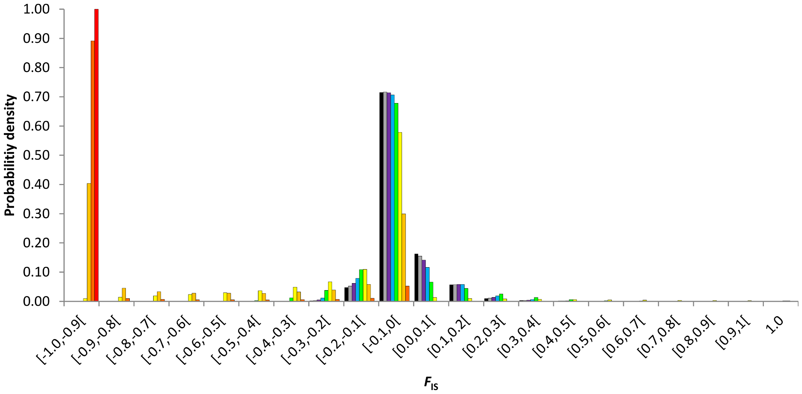
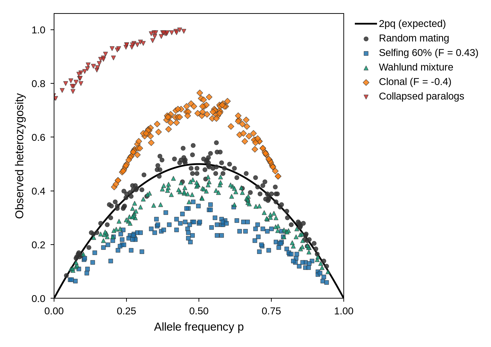
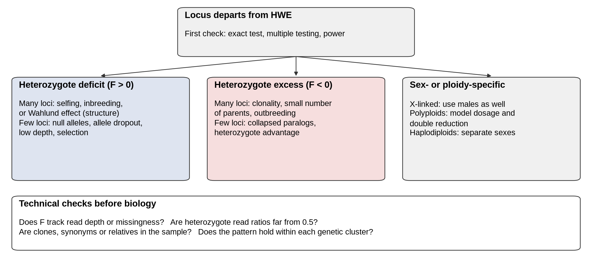

# Chapter 2. The Hardy–Weinberg principle

**Status: Verified (as a null model).** Under random mating in a large population with no selection, mutation or migration, genotype frequencies reach p², 2pq and q² after one generation and stay there. The algebra is exact. Its value in practice is as a null model: departures are expected in real populations and tell us about mating system, structure, selection or genotyping error.

Related notes in this repository: [inbreeding-depression](../../skills/genomics-theory-mining/theories/inbreeding-depression/THEORY.md), [baker-law](../../skills/genomics-theory-mining/theories/baker-law/THEORY.md).

## 2.1 Statement and history

In 1908 the mathematician G. H. Hardy answered a question raised by biologists: why does a dominant allele not spread until it reaches three-quarters of the population? He showed that with random mating, allele frequencies p and q stay constant and genotype frequencies settle at p², 2pq and q² [1]. Wilhelm Weinberg reached the same result in the same year; Stern drew attention to Weinberg’s priority [2], and Crow and Edwards traced the history, including the earlier attempts by Castle and Pearson [3, 4]. Mayo summarised a century of the principle and its uses [5].

The principle was quickly extended. Wright defined the inbreeding coefficient F, which lowers heterozygosity to 2pq(1−F) [6]. Wahlund showed that pooling samples from subpopulations with different allele frequencies produces an apparent deficit of heterozygotes [7]. Haldane worked out the gametic series and equilibria for autopolyploids, where the diploid formula does not apply [8].

## 2.2 What the principle predicts

- One generation of random mating restores p², 2pq, q² from any starting genotype frequencies at an autosomal locus.
- Allele frequencies do not change in the absence of drift, selection, mutation or migration: Mendelian inheritance by itself conserves variation.
- Inbreeding or selfing lowers the share of heterozygotes by the factor (1−F) without changing allele frequencies.
- A pooled sample from structured populations shows a heterozygote deficit (the Wahlund effect).
- Clonal reproduction freezes genotypes; heterozygosity can then exceed 2pq.
- X-linked loci, polyploids and loci under selection need their own expectations.

## 2.3 Evidence for

The principle is a theorem of Mendelian transmission, so the evidence for it is the evidence that its derivation holds where its assumptions hold. Large random-mating samples, such as control groups in human genotyping studies, fit it at the great majority of well-called loci. That is why a departure from Hardy–Weinberg proportions is used as a quality-control filter for genotype data [9, 10]. For the X chromosome, males are informative too, and a difference in allele frequency between the sexes signals a departure [11].

The extensions are verified as well. Heterozygote deficits from selfing and population structure follow the F and Wahlund formulas, and exact theory now exists for the distribution of FIS in small, partly clonal populations [12, 13].

## 2.4 Evidence against, and limits

The principle is not contradicted, but its tests are often misused.

- **Low power.** Salanti and colleagues found that most genetic association studies of 2002 were too small to detect even moderate inbreeding, and that some departures in control groups were not reported [14].
- **Wrong test.** The simple chi-square test has inflated type I error at low minor-allele counts, even in samples of 1,000 people; exact tests fix this [10].
- **Confused causes.** Waples showed that many studies do not separate statistical from biological significance, or genotyping errors from structure, selection and mating system [15].
- **Heterozygote excess.** In 137,842 human genomes, Abramovs and colleagues found 161 variants with heterozygote excess; call quality and sample size limited the approach, but the set was enriched in recessive-disease genes and included known cases of heterozygote advantage at HBB and CFTR [16].
- **Paralogs.** Collapsed duplicate loci look like loci with too many heterozygotes and skewed read ratios. McKinney and colleagues used these two properties to flag paralogs in genotyping-by-sequencing data [17].
- **Polyploids.** Genotype calls from sequencing reads are biased by allelic bias, overdispersion and outliers [18], and equilibrium tests in autopolyploids must allow for double reduction [19].

## 2.5 Status and reasoning

**Verified as a null model.** The derivation is exact and has been confirmed wherever its assumptions hold. No natural population meets all the assumptions exactly, so a departure is information, not a refutation. The useful question is always which assumption failed, and the answer depends on the sign of the departure, how many loci share it, and whether it tracks read depth (Figure 2.3).

## 2.6 Plants, crops and grapevine

- **Selfing crops** show genome-wide heterozygote deficits set by the selfing rate; a heterozygote count of 2pq would itself be the surprise.
- **Clonal and partly clonal species.** Balloux and colleagues showed that high rates of clonal reproduction raise heterozygosity and lower FST [13], and Stoeckel and Masson gave the full distribution of FIS under partial asexuality (Figure 2.1) [12]. Negative FIS across many loci is a signature of clonality; Halkett and colleagues surveyed methods to detect rare sex in mostly clonal organisms [20].
- **Grapevine.** Cultivated grapevine is propagated by cuttings, so a germplasm collection holds clones and synonyms, and a single cultivar is effectively one diploid genotype. In 4,370 accessions typed with 20 SSR markers, Laucou and colleagues found 2,836 distinct profiles and a mean heterozygosity of 0.76 among vinifera cultivars, and they set a threshold to separate clonal variation from different cultivars [21]. Lacombe and colleagues used the same markers to resolve the full parentage of 828 cultivars [22]. Myles and colleagues reported high diversity, rapid decay of linkage disequilibrium and a complex network of close pedigree relationships in more than 1,000 cultivated and wild samples [23, 24]. LD in wild French sylvestris decays much faster than in cultivars [25]. Dong and colleagues analysed 3,525 cultivated and wild accessions and proposed two concurrent domestications about 11,000 years ago [26]. A panel designed for association studies has to deal with structure and relatedness before any test of Hardy–Weinberg proportions makes sense [27]. Xiao and colleagues compared crossing, selfing and cloning in a Pinot Noir pedigree: selfing reduces heterozygosity, cloning increases it, and successive selfing still leaves heterozygous regions where deleterious variants sit in repulsion [28].
- **Practical consequence.** Pool unrelated cultivars only after removing clones and synonyms; treat the sample as structured; and expect heterozygosity in clonal collections to exceed random-mating values at many loci.

## 2.7 How to test it with public data

- **Data.** A public variant call set for a crop diversity panel, for example the grapevine resequencing panels in [26] or [29], with sample metadata on origin and use.
- **Tools.** PLINK `--hardy` or VCFtools `--hardy` for exact tests in diploids; the `HardyWeinberg` R package for X-linked markers [11]; `updog` and `hwep` for genotyping and equilibrium tests in autopolyploids [18, 19].
- **Analysis.** (1) Remove clones and synonyms by identity-by-state. (2) Split by genetic cluster. (3) Run exact tests per cluster and compute FIS per locus. (4) Plot FIS against read depth and against heterozygote read-ratio deviation: loci with excess heterozygotes and skewed read ratios are paralog candidates [17]. (5) Compare the genome-wide FIS distribution with the expectations for selfing or clonality. The script [`scripts/ch02_hwe_figures.py`](../scripts/ch02_hwe_figures.py) simulates these patterns (Figure 2.2).
- **What would break the principle.** A random-mating, unstructured, well-genotyped sample in which many loci depart in the same direction with no selection, mating-system or technical cause. This has not been found.

## 2.8 Open questions

- How can tests for equilibrium be made reliable in polyploid crops with low-depth sequencing?
- How much of the heterozygote excess in clonal crops reflects selection against homozygotes for linked deleterious variants, rather than clonality alone?
- How should HWE filters be set in panels that mix clones, wild samples and hybrids, so that they remove errors without removing real biology?

## 2.9 Common mistakes

- Using HWE as a filter in a structured or clonal sample and so discarding true loci.
- Reading a heterozygote excess as balancing selection before excluding paralogs and genotyping error.
- Reporting “consistent with HWE” from a test that had no power.

## Figures

**Figure 2.1.** Discrete probability distributions of FIS at equilibrium as a function of the rate of asexuality c (c = 0, black; 0.3, grey; 0.5, purple; 0.7, blue; 0.9, green; 0.99, yellow; 0.999, light orange; 0.9999, dark orange). Reproduced unchanged from Stoeckel S, Masson J-P (2014) The exact distributions of FIS under partial asexuality in small finite populations with mutation. *PLoS ONE* 9:e85228, Figure 1. https://doi.org/10.1371/journal.pone.0085228. Licence: CC BY 4.0 (https://creativecommons.org/licenses/by/4.0/).

**Figure 2.2.** Observed heterozygosity against allele frequency under random mating and four departures: selfing, a Wahlund mixture, clonality, and collapsed paralogs. Simulated data (200 individuals per locus); made with [`scripts/ch02_hwe_figures.py`](../scripts/ch02_hwe_figures.py).

**Figure 2.3.** How to read a departure from Hardy–Weinberg proportions. Schematic drawn for this book, after the steps in [15].

## References

1. Hardy GH (1908) Mendelian Proportions in a Mixed Population. *Science* 28:49-50. https://doi.org/10.1126/science.28.706.49
2. Stern C (1943) The Hardy-Weinberg Law. *Science* 97:137-138. https://doi.org/10.1126/science.97.2510.137
3. Crow JF (1988) Eighty years ago: the beginnings of population genetics. *Genetics* 119:473-476. https://doi.org/10.1093/genetics/119.3.473
4. Edwards AWF (2008) G. H. Hardy (1908) and Hardy–Weinberg Equilibrium. *Genetics* 179:1143-1150. https://doi.org/10.1534/genetics.104.92940
5. Mayo O (2008) A Century of Hardy–Weinberg Equilibrium. *Twin Research and Human Genetics* 11:249-256. https://doi.org/10.1375/twin.11.3.249
6. Wright S (1922) Coefficients of Inbreeding and Relationship. *The American Naturalist* 56:330-338. https://doi.org/10.1086/279872
7. WAHLUND S (1928) ZUSAMMENSETZUNG VON POPULATIONEN UND KORRELATIONSERSCHEINUNGEN VOM STANDPUNKT DER VERERBUNGSLEHRE AUS BETRACHTET. *Hereditas* 11:65-106. https://doi.org/10.1111/j.1601-5223.1928.tb02483.x
8. Haldane JBS (1930) Theoretical genetics of autopolyploids. *Journal of Genetics* 22:359-372. https://doi.org/10.1007/BF02984197
9. Anderson CA, Pettersson FH, Clarke GM, et al. (2010) Data quality control in genetic case-control association studies. *Nature Protocols* 5:1564-1573. https://doi.org/10.1038/nprot.2010.116
10. Wigginton JE, Cutler DJ, Abecasis GR (2005) A Note on Exact Tests of Hardy-Weinberg Equilibrium. *The American Journal of Human Genetics* 76:887-893. https://doi.org/10.1086/429864
11. Graffelman J, Weir BS (2016) Testing for Hardy–Weinberg equilibrium at biallelic genetic markers on the X chromosome. *Heredity* 116:558-568. https://doi.org/10.1038/hdy.2016.20
12. Stoeckel S, Masson JP (2014) The Exact Distributions of FIS under Partial Asexuality in Small Finite Populations with Mutation. *PLoS ONE* 9:e85228. https://doi.org/10.1371/journal.pone.0085228
13. Balloux F, Lehmann L, de Meeûs T (2003) The Population Genetics of Clonal and Partially Clonal Diploids. *Genetics* 164:1635-1644. https://doi.org/10.1093/genetics/164.4.1635
14. Salanti G, Amountza G, Ntzani EE, et al. (2005) Hardy–Weinberg equilibrium in genetic association studies: an empirical evaluation of reporting, deviations, and power. *European Journal of Human Genetics* 13:840-848. https://doi.org/10.1038/sj.ejhg.5201410
15. Waples RS (2015) Testing for Hardy–Weinberg Proportions: Have We Lost the Plot?. *Journal of Heredity* 106:1-19. https://doi.org/10.1093/jhered/esu062
16. Abramovs N, Brass A, Tassabehji M (2020) Hardy-Weinberg Equilibrium in the Large Scale Genomic Sequencing Era. *Frontiers in Genetics* 11:210. https://doi.org/10.3389/fgene.2020.00210
17. McKinney GJ, Waples RK, Seeb LW, et al. (2017) Paralogs are revealed by proportion of heterozygotes and deviations in read ratios in genotyping‐by‐sequencing data from natural populations. *Molecular Ecology Resources* 17:656-669. https://doi.org/10.1111/1755-0998.12613
18. Gerard D, Ferrão LFV, Garcia AAF, et al. (2018) Genotyping Polyploids from Messy Sequencing Data. *Genetics* 210:789-807. https://doi.org/10.1534/genetics.118.301468
19. Gerard D (2023) Double Reduction Estimation and Equilibrium Tests in Natural Autopolyploid Populations. *Biometrics* 79:2143-2156. https://doi.org/10.1111/biom.13722
20. HALKETT F, SIMON J, BALLOUX F (2005) Tackling the population genetics of clonal and partially clonal organisms. *Trends in Ecology &amp; Evolution* 20:194-201. https://doi.org/10.1016/j.tree.2005.01.001
21. Laucou V, Lacombe T, Dechesne F, et al. (2011) High throughput analysis of grape genetic diversity as a tool for germplasm collection management. *Theoretical and Applied Genetics* 122:1233-1245. https://doi.org/10.1007/s00122-010-1527-y
22. Lacombe T, Boursiquot JM, Laucou V, et al. (2013) Large-scale parentage analysis in an extended set of grapevine cultivars (Vitis vinifera L.). *Theoretical and Applied Genetics* 126:401-414. https://doi.org/10.1007/s00122-012-1988-2
23. Myles S, Chia JM, Hurwitz B, et al. (2010) Rapid Genomic Characterization of the Genus Vitis. *PLoS ONE* 5:e8219. https://doi.org/10.1371/journal.pone.0008219
24. Myles S, Boyko AR, Owens CL, et al. (2011) Genetic structure and domestication history of the grape. *Proceedings of the National Academy of Sciences* 108:3530-3535. https://doi.org/10.1073/pnas.1009363108
25. Barnaud A, Laucou V, This P, et al. (2010) Linkage disequilibrium in wild French grapevine, Vitis vinifera L. subsp. silvestris. *Heredity* 104:431-437. https://doi.org/10.1038/hdy.2009.143
26. Dong Y, Duan S, Xia Q, et al. (2023) Dual domestications and origin of traits in grapevine evolution. *Science* 379:892-901. https://doi.org/10.1126/science.add8655
27. Nicolas SD, Péros JP, Lacombe T, et al. (2016) Genetic diversity, linkage disequilibrium and power of a large grapevine (Vitis vinifera L) diversity panel newly designed for association studies. *BMC Plant Biology* 16:74. https://doi.org/10.1186/s12870-016-0754-z
28. Xiao H, Wang Y, Liu W, et al. (2025) Impacts of reproductive systems on grapevine genome and breeding. *Nature Communications* 16:2031. https://doi.org/10.1038/s41467-025-56817-7
29. Liang Z, Duan S, Sheng J, et al. (2019) Whole-genome resequencing of 472 Vitis accessions for grapevine diversity and demographic history analyses. *Nature Communications* 10:1190. https://doi.org/10.1038/s41467-019-09135-8
