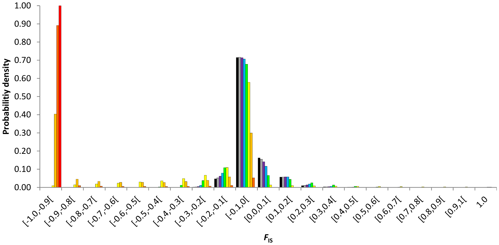
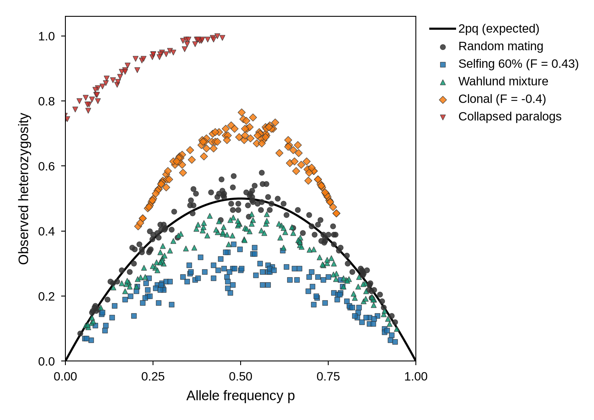
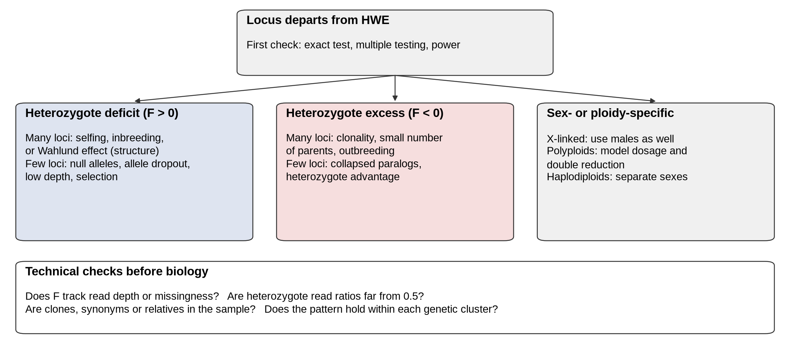

# 第 2 章 哈迪–温伯格定律

**地位：已验证（作为零模型）。** 在一个随机交配、足够大、没有选择、突变和迁移的群体中，基因型频率经过一代就达到 p²、2pq、q² 并保持不变。这一代数关系是精确的。它在实际中的价值是作为零模型：真实群体出现偏离是正常的，偏离本身反映交配系统、群体结构、选择或基因型检测错误。

本仓库相关条目：[inbreeding-depression](../../theories/inbreeding-depression/THEORY.md)、[baker-law](../../theories/baker-law/THEORY.md)、[hardy-weinberg-equilibrium](../../theories/hardy-weinberg-equilibrium/THEORY.md)。

## 2.1 内容与历史

1908 年，数学家 G. H. Hardy 回答了生物学家提出的一个问题：为什么显性等位基因不会一直扩散到群体的四分之三？他证明在随机交配下，等位基因频率 p 和 q 保持不变，基因型频率稳定在 p²、2pq、q² [1]。Wilhelm Weinberg 同年得到同样的结果；Stern 指出了 Weinberg 的优先权 [2]，Crow 和 Edwards 梳理了这段历史，包括 Castle 和 Pearson 更早的尝试 [3, 4]。Mayo 总结了这一定律一百年来的用途 [5]。

这一定律很快被推广。Wright 定义了近交系数 F，杂合度降为 2pq(1−F) [6]。Wahlund 证明把等位基因频率不同的亚群体样本混在一起，会出现表观的杂合子不足 [7]。Haldane 推导了同源多倍体的配子系列和平衡，这时二倍体公式不再适用 [8]。

## 2.2 预测

- 对常染色体位点，无论起始基因型频率如何，一代随机交配就恢复 p²、2pq、q²。
- 没有漂变、选择、突变和迁移时，等位基因频率不变：孟德尔遗传本身保存变异。
- 近交或自交按 (1−F) 的比例降低杂合子比例，但不改变等位基因频率。
- 结构化群体的混合样本出现杂合子不足（Wahlund 效应）。
- 克隆繁殖冻结基因型，杂合度可能高于 2pq。
- X 连锁位点、多倍体和受选择的位点各自需要不同的期望。

## 2.3 支持证据

这一定律是孟德尔传递的定理，因此支持它的证据就是：在其假设成立的地方，推导都成立。大样本的随机交配群体，例如人类基因分型研究中的对照组，在绝大多数检测良好的位点上都符合它。这正是偏离哈迪–温伯格比例被用作基因型数据质控过滤条件的原因 [9, 10]。对 X 染色体，雄性样本也有信息，两性之间等位基因频率的差异就提示偏离 [11]。

推广形式同样得到验证。自交和群体结构造成的杂合子不足符合 F 和 Wahlund 公式；小规模、部分克隆群体中 FIS 的分布也已有精确理论 [12, 13]。

## 2.4 反面证据与局限

这一定律本身没有被推翻，但它的检验常被误用。

- **功效不足。** Salanti 等发现 2002 年的多数遗传关联研究样本太小，连中等程度的近交都检测不到，而且对照组中的一些偏离没有报告 [14]。
- **检验方法不对。** 简单卡方检验在次要等位基因计数较少时 I 类错误率膨胀，即使样本有 1,000 人；精确检验解决了这个问题 [10]。
- **原因混淆。** Waples 指出许多研究没有区分统计显著与生物学意义，也没有区分基因型错误与结构、选择和交配系统 [15]。
- **杂合子过剩。** Abramovs 等在 137,842 个人类基因组中找到 161 个杂合子过剩的变异；分型质量和样本量限制了这一方法，但这些变异富集于隐性遗传病基因，并包括 HBB 和 CFTR 上已知的杂合子优势例子 [16]。
- **旁系同源位点。** 被合并的重复位点看起来像杂合子过多、读段比例偏斜的位点。McKinney 等利用这两个特征在简化基因组测序数据中标记旁系同源位点 [17]。
- **多倍体。** 测序数据的基因型检测受等位基因偏差、过度离散和离群值影响 [18]，同源多倍体的平衡检验必须考虑双减数 [19]。

## 2.5 地位与理由

**作为零模型已验证。** 推导是精确的，在其假设成立处都得到确认。没有哪个自然群体完全满足所有假设，所以偏离提供的是信息，而不是反驳。真正有用的问题总是“哪条假设不成立”，答案取决于偏离的方向、有多少位点共享这种偏离，以及偏离是否随读段深度变化（图 2.3）。

## 2.6 植物、作物与葡萄

- **自交作物** 在全基因组范围内表现出由自交率决定的杂合子不足；如果杂合子数恰好等于 2pq，反而值得怀疑。
- **克隆和部分克隆物种。** Balloux 等证明高比例的克隆繁殖会提高杂合度、降低 FST [13]；Stoeckel 和 Masson 给出了部分无性繁殖下 FIS 的完整分布（图 2.1）[12]。多个位点 FIS 为负是克隆性的标志；Halkett 等综述了在以克隆繁殖为主的生物中检测偶发有性生殖的方法 [20]。
- **葡萄。** 栽培葡萄靠扦插繁殖，所以种质圃里有克隆和同物异名，一个品种实际上就是一个二倍体基因型。Laucou 等用 20 个 SSR 标记分析 4,370 份材料，得到 2,836 个不同的指纹，酿酒葡萄品种平均杂合度为 0.76，并设定了区分克隆变异与不同品种的阈值 [21]。Lacombe 等用同一套标记解析了 828 个品种的完整亲本 [22]。Myles 等在 1,000 多份栽培和野生样本中发现多样性高、连锁不平衡衰减快，以及复杂的近亲系谱网络 [23, 24]。法国野生葡萄的 LD 衰减比栽培品种快得多 [25]。Dong 等分析了 3,525 份栽培和野生材料，提出约 11,000 年前的两次同时驯化 [26]。用于关联分析的群体必须先处理结构和亲缘关系，哈迪–温伯格检验才有意义 [27]。Xiao 等在黑皮诺系谱中比较了杂交、自交和克隆：自交降低杂合度，克隆提高杂合度，连续自交后在有害变异处于互斥相的区域仍保留杂合 [28]。
- **实际做法。** 先去除克隆和同物异名，再合并不相关的品种；把样本当作结构化群体处理；并预期克隆种质中许多位点的杂合度高于随机交配的期望。

## 2.7 用公开数据检验

- **数据。** 作物多样性群体的公开变异集，例如 [26] 或 [29] 中的葡萄重测序群体，以及样本来源和用途的元数据。
- **工具。** 二倍体用 PLINK `--hardy` 或 VCFtools `--hardy` 做精确检验；X 连锁标记用 R 包 `HardyWeinberg` [11]；同源多倍体用 `updog` 和 `hwep` 做基因型检测和平衡检验 [18, 19]。
- **分析。** (1) 按状态同一性去除克隆和同物异名。(2) 按遗传类群拆分。(3) 在每个类群内做精确检验并计算每个位点的 FIS。(4) 把 FIS 对读段深度、对杂合子读段比例偏差作图：杂合子过多且读段比例偏斜的位点是旁系同源位点候选 [17]。(5) 把全基因组 FIS 分布与自交或克隆的期望比较。脚本 [`scripts/ch02_hwe_figures.py`](../scripts/ch02_hwe_figures.py) 模拟了这些模式（图 2.2）。
- **什么结果会推翻它。** 一个随机交配、无结构、分型良好的样本中，许多位点朝同一方向偏离，却找不到选择、交配系统或技术原因。目前没有发现这种情况。

## 2.8 未解决的问题

- 在低深度测序的多倍体作物中，如何让平衡检验可靠？
- 克隆作物中的杂合子过剩，有多少来自对连锁有害变异纯合子的选择，而不仅是克隆性？
- 在混有克隆、野生样本和杂种的群体中，HWE 过滤阈值该怎么设，才能去除错误而不去掉真实的生物学信号？

## 2.9 常见错误

- 在结构化或克隆样本中用 HWE 做过滤，从而丢掉真实位点。
- 在排除旁系同源位点和分型错误之前，就把杂合子过剩解读为平衡选择。
- 用一个毫无功效的检验报告“符合 HWE”。

## 图

**图 2.1.** 平衡时 FIS 的离散概率分布随无性繁殖率 c 的变化（c = 0，黑；0.3，灰；0.5，紫；0.7，蓝；0.9，绿；0.99，黄；0.999，浅橙；0.9999，深橙）。原样转载自 Stoeckel S, Masson J-P (2014) The exact distributions of FIS under partial asexuality in small finite populations with mutation. *PLoS ONE* 9:e85228, Figure 1. https://doi.org/10.1371/journal.pone.0085228。许可：CC BY 4.0（https://creativecommons.org/licenses/by/4.0/）。

**图 2.2.** 随机交配与四种偏离（自交、Wahlund 混合、克隆、合并的旁系同源位点）下观测杂合度与等位基因频率的关系。模拟数据（每个位点 200 个个体）；由 [`scripts/ch02_hwe_figures.py`](../scripts/ch02_hwe_figures.py) 生成。

**图 2.3.** 如何解读偏离哈迪–温伯格比例。本书绘制的示意图，步骤参照 [15]。

## 参考文献

1. Hardy GH (1908) Mendelian Proportions in a Mixed Population. *Science* 28:49-50. https://doi.org/10.1126/science.28.706.49
2. Stern C (1943) The Hardy-Weinberg Law. *Science* 97:137-138. https://doi.org/10.1126/science.97.2510.137
3. Crow JF (1988) Eighty years ago: the beginnings of population genetics. *Genetics* 119:473-476. https://doi.org/10.1093/genetics/119.3.473
4. Edwards AWF (2008) G. H. Hardy (1908) and Hardy–Weinberg Equilibrium. *Genetics* 179:1143-1150. https://doi.org/10.1534/genetics.104.92940
5. Mayo O (2008) A Century of Hardy–Weinberg Equilibrium. *Twin Research and Human Genetics* 11:249-256. https://doi.org/10.1375/twin.11.3.249
6. Wright S (1922) Coefficients of Inbreeding and Relationship. *The American Naturalist* 56:330-338. https://doi.org/10.1086/279872
7. WAHLUND S (1928) ZUSAMMENSETZUNG VON POPULATIONEN UND KORRELATIONSERSCHEINUNGEN VOM STANDPUNKT DER VERERBUNGSLEHRE AUS BETRACHTET. *Hereditas* 11:65-106. https://doi.org/10.1111/j.1601-5223.1928.tb02483.x
8. Haldane JBS (1930) Theoretical genetics of autopolyploids. *Journal of Genetics* 22:359-372. https://doi.org/10.1007/BF02984197
9. Anderson CA, Pettersson FH, Clarke GM, et al. (2010) Data quality control in genetic case-control association studies. *Nature Protocols* 5:1564-1573. https://doi.org/10.1038/nprot.2010.116
10. Wigginton JE, Cutler DJ, Abecasis GR (2005) A Note on Exact Tests of Hardy-Weinberg Equilibrium. *The American Journal of Human Genetics* 76:887-893. https://doi.org/10.1086/429864
11. Graffelman J, Weir BS (2016) Testing for Hardy–Weinberg equilibrium at biallelic genetic markers on the X chromosome. *Heredity* 116:558-568. https://doi.org/10.1038/hdy.2016.20
12. Stoeckel S, Masson JP (2014) The Exact Distributions of FIS under Partial Asexuality in Small Finite Populations with Mutation. *PLoS ONE* 9:e85228. https://doi.org/10.1371/journal.pone.0085228
13. Balloux F, Lehmann L, de Meeûs T (2003) The Population Genetics of Clonal and Partially Clonal Diploids. *Genetics* 164:1635-1644. https://doi.org/10.1093/genetics/164.4.1635
14. Salanti G, Amountza G, Ntzani EE, et al. (2005) Hardy–Weinberg equilibrium in genetic association studies: an empirical evaluation of reporting, deviations, and power. *European Journal of Human Genetics* 13:840-848. https://doi.org/10.1038/sj.ejhg.5201410
15. Waples RS (2015) Testing for Hardy–Weinberg Proportions: Have We Lost the Plot? *Journal of Heredity* 106:1-19. https://doi.org/10.1093/jhered/esu062
16. Abramovs N, Brass A, Tassabehji M (2020) Hardy-Weinberg Equilibrium in the Large Scale Genomic Sequencing Era. *Frontiers in Genetics* 11:210. https://doi.org/10.3389/fgene.2020.00210
17. McKinney GJ, Waples RK, Seeb LW, et al. (2017) Paralogs are revealed by proportion of heterozygotes and deviations in read ratios in genotyping‐by‐sequencing data from natural populations. *Molecular Ecology Resources* 17:656-669. https://doi.org/10.1111/1755-0998.12613
18. Gerard D, Ferrão LFV, Garcia AAF, et al. (2018) Genotyping Polyploids from Messy Sequencing Data. *Genetics* 210:789-807. https://doi.org/10.1534/genetics.118.301468
19. Gerard D (2023) Double Reduction Estimation and Equilibrium Tests in Natural Autopolyploid Populations. *Biometrics* 79:2143-2156. https://doi.org/10.1111/biom.13722
20. HALKETT F, SIMON J, BALLOUX F (2005) Tackling the population genetics of clonal and partially clonal organisms. *Trends in Ecology &amp; Evolution* 20:194-201. https://doi.org/10.1016/j.tree.2005.01.001
21. Laucou V, Lacombe T, Dechesne F, et al. (2011) High throughput analysis of grape genetic diversity as a tool for germplasm collection management. *Theoretical and Applied Genetics* 122:1233-1245. https://doi.org/10.1007/s00122-010-1527-y
22. Lacombe T, Boursiquot JM, Laucou V, et al. (2013) Large-scale parentage analysis in an extended set of grapevine cultivars (Vitis vinifera L.). *Theoretical and Applied Genetics* 126:401-414. https://doi.org/10.1007/s00122-012-1988-2
23. Myles S, Chia JM, Hurwitz B, et al. (2010) Rapid Genomic Characterization of the Genus Vitis. *PLoS ONE* 5:e8219. https://doi.org/10.1371/journal.pone.0008219
24. Myles S, Boyko AR, Owens CL, et al. (2011) Genetic structure and domestication history of the grape. *Proceedings of the National Academy of Sciences* 108:3530-3535. https://doi.org/10.1073/pnas.1009363108
25. Barnaud A, Laucou V, This P, et al. (2010) Linkage disequilibrium in wild French grapevine, Vitis vinifera L. subsp. silvestris. *Heredity* 104:431-437. https://doi.org/10.1038/hdy.2009.143
26. Dong Y, Duan S, Xia Q, et al. (2023) Dual domestications and origin of traits in grapevine evolution. *Science* 379:892-901. https://doi.org/10.1126/science.add8655
27. Nicolas SD, Péros JP, Lacombe T, et al. (2016) Genetic diversity, linkage disequilibrium and power of a large grapevine (Vitis vinifera L) diversity panel newly designed for association studies. *BMC Plant Biology* 16:74. https://doi.org/10.1186/s12870-016-0754-z
28. Xiao H, Wang Y, Liu W, et al. (2025) Impacts of reproductive systems on grapevine genome and breeding. *Nature Communications* 16:2031. https://doi.org/10.1038/s41467-025-56817-7
29. Liang Z, Duan S, Sheng J, et al. (2019) Whole-genome resequencing of 472 Vitis accessions for grapevine diversity and demographic history analyses. *Nature Communications* 10:1190. https://doi.org/10.1038/s41467-019-09135-8
