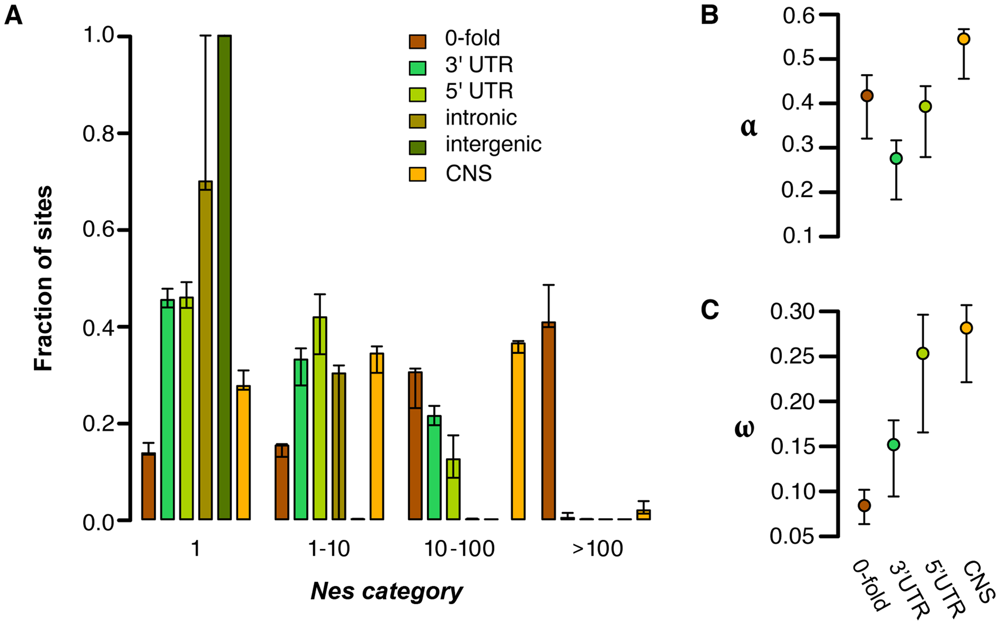
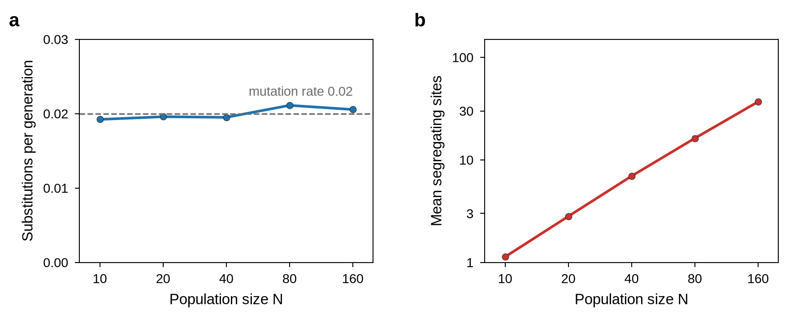
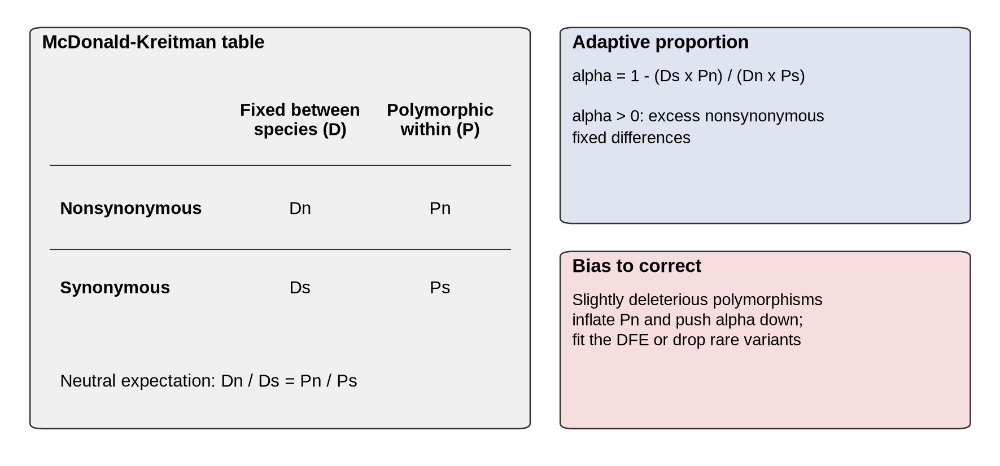

# Chapter 3. The neutral theory of molecular evolution

**Status: Partly verified.** The core predictions hold: most variants that reach fixation or appear as polymorphism are neutral or slightly deleterious rather than advantageous, the neutral substitution rate equals the mutation rate, and functionally constrained sites evolve more slowly. What is not settled is how much adaptive substitution and linked selection add, and how far neutral models can be used as the default for polymorphism. Two recent perspectives disagree on this point [1, 2].

Related notes in this repository: [neutral-theory](../../theories/neutral-theory/THEORY.md), [mcdonald-kreitman](../../theories/mcdonald-kreitman/THEORY.md), [kimura-1962-fixation-probability](../../theories/kimura-1962-fixation-probability/THEORY.md), [kimura-ohta-1971-polymorphism-phase](../../theories/kimura-ohta-1971-polymorphism-phase/THEORY.md), [infinite-sites-watterson](../../theories/infinite-sites-watterson/THEORY.md).

## 3.1 Statement and history

Electrophoresis in the mid-1960s showed that natural populations carry far more protein variation than expected: in Drosophila pseudoobscura [3] and in human enzymes [4]. In 1968 Kimura calculated the rate of evolution in terms of nucleotide substitutions and argued that it was so high that many of the mutations involved must be neutral [5]. King and Jukes reached a similar view from protein sequence comparisons and called it non-Darwinian evolution [6]. Kimura and Ohta then proposed that protein polymorphism is a phase of molecular evolution: random drift of neutral mutations in finite populations accounts for the variation within species as well as the substitutions between them [7].

The theory does not claim that most mutations are neutral. It claims that most new mutations are either deleterious and removed, or neutral; that advantageous mutations are rare; and that the variants seen as polymorphism or divergence are mostly neutral. Kimura restated it in 1991 with compensatory neutral evolution added [8], and Ohta and Gillespie described how it changed into its nearly neutral form (Chapter 4) [9].

## 3.2 What the theory predicts

- **Rate equals mutation rate.** For neutral alleles, the substitution rate per generation equals the mutation rate, independent of population size; diversity, in contrast, scales with Neμ (Figure 3.2).
- **Constraint slows evolution.** Sites under stronger functional constraint (for example nonsynonymous versus synonymous sites) evolve more slowly.
- **Polymorphism and divergence are linked.** The ratio of nonsynonymous to synonymous change should be the same within and between species. This is the basis of the McDonald–Kreitman (MK) test (Figure 3.3) [10].
- **Diversity tracks population size.** Neutral diversity should be proportional to Ne.

## 3.3 Evidence for

- **Constraint.** In eleven Adh sequences from Drosophila melanogaster, Kreitman found 43 polymorphisms, of which only one changed an amino acid, implying that most amino-acid changes at this locus are deleterious [11].
- **Distribution of fitness effects (DFE).** Across species and regions, advantageous mutations are rare and the DFE of deleterious mutations is complex [12]. In the outcrossing plant Capsella grandiflora, selection is strong in coding regions and weak in most noncoding regions; nearly all intergenic sites are close to neutral (Figure 3.1) [13].
- **Plants with modest Ne.** An MK-type analysis that models slightly deleterious mutations found little evidence of adaptive amino-acid substitution in nine plant species pairs, except sunflowers [14]. In Arabidopsis, synonymous divergence predicts silent polymorphism, pointing to mutation-rate variation, and rates of protein divergence correlate mostly with gene expression [15].
- **Primates and humans.** In 44 animal species pairs, the proportion of adaptive substitutions was high in most groups but not in humans and primates [16].
- **Defenders of the theory** argue that many claims of positive selection rest on methods with high false-positive rates [17], and that the foundations laid by Kimura and Ohta remain correct [2].

## 3.4 Evidence against

- **Excess adaptive substitution.** McDonald and Kreitman found more fixed replacement differences at Adh between Drosophila species than the polymorphism data predicted, and proposed adaptive fixation [10]. Smith and Eyre-Walker estimated that 45% of amino-acid substitutions between D. simulans and D. yakuba were fixed by selection [18]. Sella and colleagues argued that in Drosophila adaptation may be common and strong enough that linkage to adaptive mutations affects the fate of neutral alleles as much as drift does [19].
- **Widespread adaptive substitution in animals.** Galtier found a major contribution of adaptive evolution to amino-acid substitution across metazoan phyla [16]. Williamson and colleagues found reduced neutral diversity around recent functional substitutions in Capsella, a sign of recent sweeps [13].
- **Lewontin’s paradox.** Neutral diversity does not scale with census population size across species as simply as expected; Leffler and colleagues called for this riddle to be revisited [20]. In 76 animal species, diversity was best predicted by life-history traits related to parental investment, not by geographic range [21]. Linked selection is one proposed explanation (Chapter 8).
- **A selectionist programme.** Hahn argued for a selection theory of molecular evolution [22], and Kern and Hahn argued that genome-scale data reject the universality of the neutral theory [1].

## 3.5 Status and reasoning

**Partly verified.** The parts of the theory about constraint and the rarity of advantageous mutations are among the most repeated results in molecular evolution [12]. The claim that adaptive substitutions are rare among fixed differences is species-dependent: it fits humans and many plants [14, 16] but not Drosophila or many animals [16, 18]. Even there, much of the variation in the adaptive proportion α among species comes from the rate of fixation of slightly deleterious changes rather than from the rate of adaptive change [16, 23], which is a nearly neutral prediction. Rousselle and colleagues found that the adaptive substitution rate tracks diversity among closely related low-diversity species but not at larger taxonomic scales [24]. Johri and colleagues recommended that inference should start from a baseline model that includes mutation, recombination, demography, purifying selection and background selection [25]. This is the practical form of the debate: neutrality is the null to be rejected, but the null must include the deleterious mutations and linked effects that the theory itself predicts.

## 3.6 Plants, crops and grapevine

- **Plants show lower adaptive proportions than Drosophila.** The pattern in Gossmann and colleagues has been linked to modest plant Ne [14]. In Capsella, positive and negative selection on noncoding sequence appear much rarer than in animal genomes [13].
- **Arabidopsis.** The 1,135 genomes panel gives a standard data set for tests of neutrality and demography in a selfing plant [26].
- **Rice.** Deleterious variants in Asian rice were examined for signals of a potential cost of domestication (Chapter 10) [27].
- **Grapevine.** Zhou and colleagues inferred a protracted population decline before domestication and found that cultivated grapes carry more deleterious mutations in heterozygous state than their wild ancestors, partly because clonal propagation shelters recessive mutations [28]. Liang and colleagues resequenced 472 Vitis accessions covering 48 species and inferred a recent expansion and contraction of Ne in domesticated grapes [29]. Any neutrality test in grape must therefore separate demography and clonal sheltering from selection.

## 3.7 How to test it with public data

- **Data.** Polymorphism from a resequencing panel of one species (for example [29] or [26]) and divergence to an outgroup species with a public genome.
- **Tools.** Site-frequency spectra at 0-fold and 4-fold degenerate sites, then DFE-based MK estimators such as DFE-alpha, polyDFE or Grapes, with demography fitted to synonymous sites as the background.
- **Analysis.** (1) Classify coding sites as 0-fold and 4-fold. (2) Build site-frequency spectra. (3) Fit the DFE of nonsynonymous mutations. (4) Estimate α and ωa with bootstrap intervals. (5) Repeat in bins of recombination rate; a positive slope of diversity with recombination points to linked selection. The script [`scripts/ch03_neutral_figures.py`](../scripts/ch03_neutral_figures.py) simulates the neutral expectation that the substitution rate equals the mutation rate while diversity grows with N (Figure 3.2).
- **What would refute the strong form.** Estimates of α near 1 across most species and site classes after correcting for slightly deleterious mutations and demography. Current estimates do not show this.

## 3.8 Open questions

- How much of genome-wide diversity is shaped by linked selection, and does this explain Lewontin’s paradox?
- How reliable are α estimates when demography is complex, as in crops with bottlenecks and clonal propagation?
- How much adaptive substitution happens in noncoding regulatory DNA of plants?

## 3.9 Common mistakes

- Reading “neutral theory” as “most mutations are neutral”. The theory says most fixed or segregating variants are neutral; most new mutations in coding DNA are deleterious.
- Treating a significant MK test as evidence of adaptation without modelling slightly deleterious polymorphism.
- Taking long-term Ne as the census size of a crop.

## Figures

**Figure 3.1.** Estimates of negative and positive selection on coding and noncoding sites in *Capsella grandiflora*. A) Proportion of sites in each bin of purifying selection strength, by site type; B) proportion of divergent sites fixed by positive selection; C) rate of adaptive substitution relative to neutral divergence. Error bars are 95% bootstrap intervals. Reproduced unchanged from Williamson RJ, Josephs EB, Platts AE, et al. (2014) Evidence for widespread positive and negative selection in coding and conserved noncoding regions of *Capsella grandiflora*. *PLoS Genetics* 10:e1004622, Figure 1. https://doi.org/10.1371/journal.pgen.1004622. Licence: CC BY 4.0 (https://creativecommons.org/licenses/by/4.0/).

**Figure 3.2.** Neutral Wright–Fisher simulation: the substitution rate stays close to the mutation rate for all population sizes, while the number of segregating sites grows with N. Simulated data; made with [`scripts/ch03_neutral_figures.py`](../scripts/ch03_neutral_figures.py).

**Figure 3.3.** The McDonald–Kreitman table and the estimate of the adaptive proportion α. Schematic drawn for this book, after [10] and [18].

## References

1. Kern AD, Hahn MW (2018) The Neutral Theory in Light of Natural Selection. *Molecular Biology and Evolution* 35:1366-1371. https://doi.org/10.1093/molbev/msy092
2. Jensen JD, Payseur BA, Stephan W, et al. (2019) The importance of the Neutral Theory in 1968 and 50 years on: A response to Kern and Hahn 2018. *Evolution* 73:111-114. https://doi.org/10.1111/evo.13650
3. Lewontin RC, Hubby JL (1966) A MOLECULAR APPROACH TO THE STUDY OF GENIC HETEROZYGOSITY IN NATURAL POPULATIONS. II. AMOUNT OF VARIATION AND DEGREE OF HETEROZYGOSITY IN NATURAL POPULATIONS OF DROSOPHILA PSEUDOOBSCURA. *Genetics* 54:595-609. https://doi.org/10.1093/genetics/54.2.595
4. Harris H (1966) C. Genetics of Man Enzyme polymorphisms in man. *Proceedings of the Royal Society of London. Series B. Biological Sciences* 164:298-310. https://doi.org/10.1098/rspb.1966.0032
5. KIMURA M (1968) Evolutionary Rate at the Molecular Level. *Nature* 217:624-626. https://doi.org/10.1038/217624a0
6. King JL, Jukes TH (1969) Non-Darwinian Evolution. *Science* 164:788-798. https://doi.org/10.1126/science.164.3881.788
7. KIMURA M, OHTA T (1971) Protein Polymorphism as a Phase of Molecular Evolution. *Nature* 229:467-469. https://doi.org/10.1038/229467a0
8. Kimura M (1991) Recent development of the neutral theory viewed from the Wrightian tradition of theoretical population genetics. *Proceedings of the National Academy of Sciences* 88:5969-5973. https://doi.org/10.1073/pnas.88.14.5969
9. Ohta T, Gillespie JH (1996) Development of Neutral and Nearly Neutral Theories. *Theoretical Population Biology* 49:128-142. https://doi.org/10.1006/tpbi.1996.0007
10. McDonald JH, Kreitman M (1991) Adaptive protein evolution at the Adh locus in Drosophila. *Nature* 351:652-654. https://doi.org/10.1038/351652a0
11. Kreitman M (1983) Nucleotide polymorphism at the alcohol dehydrogenase locus of Drosophila melanogaster. *Nature* 304:412-417. https://doi.org/10.1038/304412a0
12. Eyre-Walker A, Keightley PD (2007) The distribution of fitness effects of new mutations. *Nature Reviews Genetics* 8:610-618. https://doi.org/10.1038/nrg2146
13. Williamson RJ, Josephs EB, Platts AE, et al. (2014) Evidence for Widespread Positive and Negative Selection in Coding and Conserved Noncoding Regions of Capsella grandiflora. *PLoS Genetics* 10:e1004622. https://doi.org/10.1371/journal.pgen.1004622
14. Gossmann TI, Song BH, Windsor AJ, et al. (2010) Genome Wide Analyses Reveal Little Evidence for Adaptive Evolution in Many Plant Species. *Molecular Biology and Evolution* 27:1822-1832. https://doi.org/10.1093/molbev/msq079
15. Slotte T, Bataillon T, Hansen TT, et al. (2011) Genomic Determinants of Protein Evolution and Polymorphism in Arabidopsis. *Genome Biology and Evolution* 3:1210-1219. https://doi.org/10.1093/gbe/evr094
16. Galtier N (2016) Adaptive Protein Evolution in Animals and the Effective Population Size Hypothesis. *PLOS Genetics* 12:e1005774. https://doi.org/10.1371/journal.pgen.1005774
17. Nei M, Suzuki Y, Nozawa M (2010) The Neutral Theory of Molecular Evolution in the Genomic Era. *Annual Review of Genomics and Human Genetics* 11:265-289. https://doi.org/10.1146/annurev-genom-082908-150129
18. Smith NGC, Eyre-Walker A (2002) Adaptive protein evolution in Drosophila. *Nature* 415:1022-1024. https://doi.org/10.1038/4151022a
19. Sella G, Petrov DA, Przeworski M, et al. (2009) Pervasive Natural Selection in the Drosophila Genome? *PLoS Genetics* 5:e1000495. https://doi.org/10.1371/journal.pgen.1000495
20. Leffler EM, Bullaughey K, Matute DR, et al. (2012) Revisiting an Old Riddle: What Determines Genetic Diversity Levels within Species? *PLoS Biology* 10:e1001388. https://doi.org/10.1371/journal.pbio.1001388
21. Romiguier J, Gayral P, Ballenghien M, et al. (2014) Comparative population genomics in animals uncovers the determinants of genetic diversity. *Nature* 515:261-263. https://doi.org/10.1038/nature13685
22. Hahn MW (2008) TOWARD A SELECTION THEORY OF MOLECULAR EVOLUTION. *Evolution* 62:255-265. https://doi.org/10.1111/j.1558-5646.2007.00308.x
23. Moutinho AF, Bataillon T, Dutheil JY (2020) Variation of the adaptive substitution rate between species and within genomes. *Evolutionary Ecology* 34:315-338. https://doi.org/10.1007/s10682-019-10026-z
24. Rousselle M, Simion P, Tilak MK, et al. (2020) Is adaptation limited by mutation? A timescale-dependent effect of genetic diversity on the adaptive substitution rate in animals. *PLOS Genetics* 16:e1008668. https://doi.org/10.1371/journal.pgen.1008668
25. Johri P, Aquadro CF, Beaumont M, et al. (2022) Recommendations for improving statistical inference in population genomics. *PLOS Biology* 20:e3001669. https://doi.org/10.1371/journal.pbio.3001669
26. Alonso-Blanco C, Andrade J, Becker C, et al. (2016) 1,135 Genomes Reveal the Global Pattern of Polymorphism in Arabidopsis thaliana. *Cell* 166:481-491. https://doi.org/10.1016/j.cell.2016.05.063
27. Liu Q, Zhou Y, Morrell PL, et al. (2017) Deleterious variants in Asian rice and the potential cost of domestication. *Molecular Biology and Evolution*:msw296. https://doi.org/10.1093/molbev/msw296
28. Zhou Y, Massonnet M, Sanjak JS, et al. (2017) Evolutionary genomics of grape ( Vitis vinifera ssp. vinifera ) domestication. *Proceedings of the National Academy of Sciences* 114:11715-11720. https://doi.org/10.1073/pnas.1709257114
29. Liang Z, Duan S, Sheng J, et al. (2019) Whole-genome resequencing of 472 Vitis accessions for grapevine diversity and demographic history analyses. *Nature Communications* 10:1190. https://doi.org/10.1038/s41467-019-09135-8
