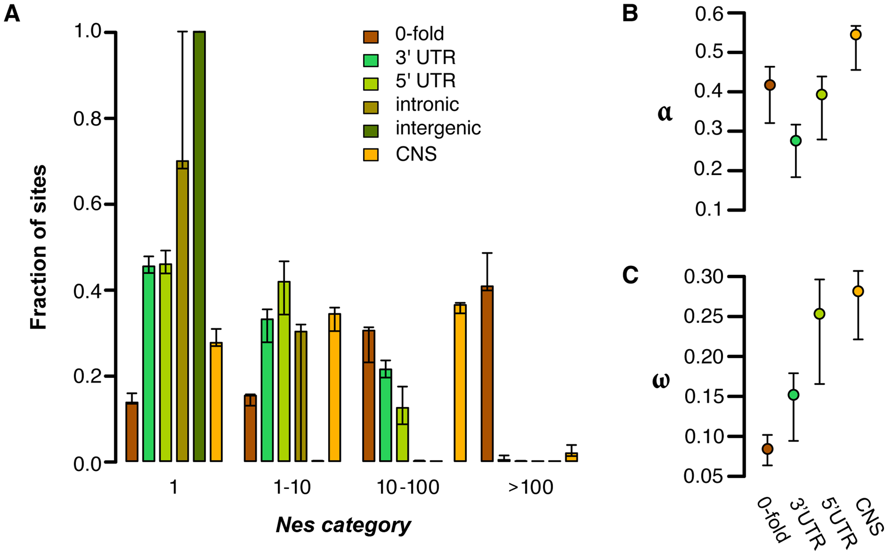
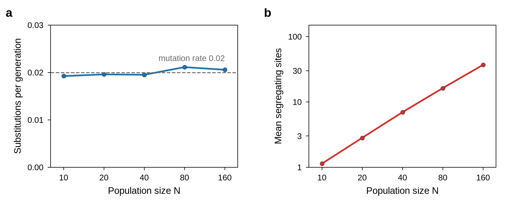
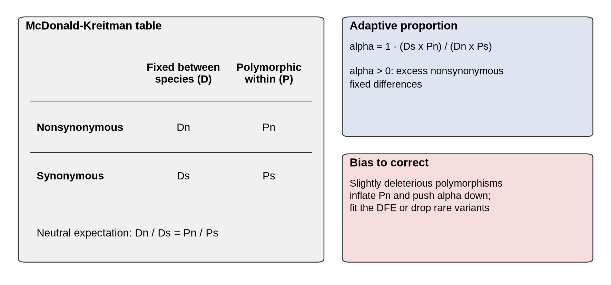

# 第 3 章 分子进化中性理论

**地位：部分验证。** 核心预测成立：达到固定或以多态形式出现的变异，大多是中性或轻微有害的，而不是有利的；中性替代速率等于突变速率；功能受约束的位点进化更慢。尚未解决的是适应性替代和连锁选择额外贡献了多少，以及中性模型能在多大程度上作为多态的默认解释。近年的两篇观点文章在这一点上意见相反 [1, 2]。

本仓库相关条目：[neutral-theory](../../skills/genomics-theory-mining/theories/neutral-theory/THEORY.md)、[mcdonald-kreitman](../../skills/genomics-theory-mining/theories/mcdonald-kreitman/THEORY.md)、[kimura-1962-fixation-probability](../../skills/genomics-theory-mining/theories/kimura-1962-fixation-probability/THEORY.md)、[kimura-ohta-1971-polymorphism-phase](../../skills/genomics-theory-mining/theories/kimura-ohta-1971-polymorphism-phase/THEORY.md)、[infinite-sites-watterson](../../skills/genomics-theory-mining/theories/infinite-sites-watterson/THEORY.md)。

## 3.1 内容与历史

1960 年代中期的电泳研究表明，自然群体中的蛋白质变异远多于预期：拟暗果蝇如此 [3]，人类的酶也如此 [4]。1968 年木村资生按核苷酸替代计算进化速率，认为速率之高说明其中许多突变必定是中性的 [5]。King 和 Jukes 从蛋白质序列比较得出类似看法，称之为“非达尔文进化” [6]。木村和太田随后提出蛋白质多态是分子进化的一个阶段：有限群体中中性突变的随机漂变，既解释物种之间的替代，也解释物种内部的变异 [7]。

中性理论并不是说大多数突变都是中性的。它的意思是：大多数新突变要么有害并被清除，要么是中性的；有利突变很少；我们看到的多态和分化大多是中性的。木村在 1991 年重新表述了这一理论并加入补偿性中性进化 [8]；太田和 Gillespie 叙述了它如何演变为近中性形式（第 4 章）[9]。

## 3.2 预测

- **替代速率等于突变速率。** 中性等位基因每代的替代速率等于突变速率，与群体大小无关；而多样性随 Neμ 增大（图 3.2）。
- **约束减慢进化。** 功能约束更强的位点（例如非同义位点相对同义位点）进化更慢。
- **多态与分化相联系。** 物种内部与物种之间非同义变化与同义变化的比例应相同，这是 McDonald–Kreitman（MK）检验的基础（图 3.3）[10]。
- **多样性随群体大小变化。** 中性多样性应与 Ne 成正比。

## 3.3 支持证据

- **约束。** Kreitman 在 11 条黑腹果蝇 Adh 序列中找到 43 个多态，只有一个改变氨基酸，说明这个位点上的大多数氨基酸变化是有害的 [11]。
- **适合度效应分布（DFE）。** 在各物种和各类区域中，有利突变都很少，有害突变的 DFE 很复杂 [12]。在异交植物大花荠（Capsella grandiflora）中，编码区选择强，多数非编码区选择弱，几乎所有基因间位点都接近中性（图 3.1）[13]。
- **Ne 不大的植物。** 一种考虑轻微有害突变的 MK 类分析，在九对植物物种中都没有发现多少适应性氨基酸替代，向日葵除外 [14]。在拟南芥中，同义分化能预测沉默多态，提示突变速率差异的作用，蛋白质分化速率主要与基因表达相关 [15]。
- **灵长类与人类。** 在 44 对动物物种中，多数类群的适应性替代比例很高，但人类和灵长类不是 [16]。
- **中性理论的支持者** 认为许多正选择的结论依赖假阳性率高的方法 [17]，并认为木村和太田奠定的基础仍然正确 [2]。

## 3.4 反面证据

- **适应性替代过多。** McDonald 和 Kreitman 发现果蝇物种之间 Adh 的固定替换差异多于多态数据的预测，提出这是有利突变的适应性固定 [10]。Smith 和 Eyre-Walker 估计拟果蝇与亚库巴果蝇之间 45% 的氨基酸替代由选择固定 [18]。Sella 等认为在果蝇中适应可能常见且强，以至于与适应性突变的连锁对中性等位基因命运的影响不亚于漂变 [19]。
- **动物中普遍的适应性替代。** Galtier 发现在后生动物各门中，适应性进化对氨基酸替代都有重要贡献 [16]。Williamson 等在大花荠中发现近期功能性替代周围中性多样性降低，这是近期选择清扫的迹象 [13]。
- **Lewontin 悖论。** 中性多样性并不像预期那样简单地随普查群体大小变化；Leffler 等呼吁重新研究这个老问题 [20]。在 76 种动物中，多样性最好的预测因子是与亲代投入相关的生活史性状，而不是地理分布范围 [21]。连锁选择是一种可能的解释（第 8 章）。
- **选择论的主张。** Hahn 主张建立分子进化的选择理论 [22]，Kern 和 Hahn 认为基因组尺度的数据否定了中性理论的普遍性 [1]。

## 3.5 地位与理由

**部分验证。** 理论中关于约束和有利突变稀少的部分，是分子进化中重复最多的结果之一 [12]。“固定差异中适应性替代很少”这一说法因物种而异：符合人类和许多植物 [14, 16]，但不符合果蝇和许多动物 [16, 18]。即使在后者中，物种间适应性比例 α 的差异也主要来自轻微有害变化的固定速率，而不是适应性变化的速率 [16, 23]，这正是近中性理论的预测。Rousselle 等发现适应性替代速率在近缘的低多样性物种之间随多样性变化，但在更大的分类尺度上没有这种关系 [24]。Johri 等建议推断应从包含突变、重组、群体历史、纯化选择和背景选择的基线模型出发 [25]。这就是争论的实际形式：中性是要被拒绝的零假设，但这个零假设必须包含理论本身预测的有害突变和连锁效应。

## 3.6 植物、作物与葡萄

- **植物的适应性比例低于果蝇。** Gossmann 等的结果被归因于植物 Ne 不大 [14]。在大花荠中，非编码序列上的正选择和负选择都比动物基因组少得多 [13]。
- **拟南芥。** 1,135 个基因组的群体为自交植物的中性和群体历史检验提供了标准数据 [26]。
- **水稻。** 研究者检查了亚洲栽培稻中的有害变异，寻找可能的“驯化代价”信号（第 10 章）[27]。
- **葡萄。** Zhou 等推断驯化前存在长期的群体衰退，并发现栽培葡萄比野生祖先携带更多杂合状态的有害突变，部分原因是克隆繁殖掩蔽了隐性突变 [28]。Liang 等对涵盖 48 个种的 472 份葡萄属材料重测序，推断驯化葡萄的 Ne 近期经历了扩张和收缩 [29]。因此，在葡萄中做任何中性检验，都要把群体历史和克隆掩蔽与选择分开。

## 3.7 用公开数据检验

- **数据。** 一个物种的重测序群体多态数据（例如 [29] 或 [26]），以及到一个有公开基因组的外类群的分化数据。
- **工具。** 0 倍和 4 倍简并位点的位点频率谱，然后用基于 DFE 的 MK 估计方法，如 DFE-alpha、polyDFE 或 Grapes，并以同义位点拟合的群体历史为背景。
- **分析。** (1) 把编码位点分为 0 倍和 4 倍简并。(2) 构建位点频率谱。(3) 拟合非同义突变的 DFE。(4) 估计 α 和 ωa 及其自助法区间。(5) 按重组率分组重复；多样性随重组率升高提示连锁选择。脚本 [`scripts/ch03_neutral_figures.py`](../scripts/ch03_neutral_figures.py) 模拟了中性期望：替代速率等于突变速率，而多样性随 N 增大（图 3.2）。
- **什么结果会推翻强形式。** 在校正轻微有害突变和群体历史之后，多数物种和位点类别的 α 都接近 1。目前的估计并非如此。

## 3.8 未解决的问题

- 全基因组多样性有多少由连锁选择塑造？这能否解释 Lewontin 悖论？
- 当群体历史复杂时，例如经历瓶颈和克隆繁殖的作物，α 的估计有多可靠？
- 植物非编码调控 DNA 中有多少适应性替代？

## 3.9 常见错误

- 把“中性理论”理解为“大多数突变是中性的”。理论说的是大多数固定或分离中的变异是中性的；编码区的大多数新突变是有害的。
- 不对轻微有害多态建模，就把显著的 MK 检验当作适应的证据。
- 把长期 Ne 当作作物的普查数量。

## 图

**图 3.1.** 大花荠编码与非编码位点上负选择和正选择的估计。A）各类位点在不同纯化选择强度区间中的比例；B）由正选择固定的分化位点比例；C）相对中性分化的适应性替代速率。误差线为 95% 自助法区间。原样转载自 Williamson RJ, Josephs EB, Platts AE, et al. (2014) Evidence for widespread positive and negative selection in coding and conserved noncoding regions of *Capsella grandiflora*. *PLoS Genetics* 10:e1004622, Figure 1. https://doi.org/10.1371/journal.pgen.1004622。许可：CC BY 4.0（https://creativecommons.org/licenses/by/4.0/）。

**图 3.2.** 中性 Wright–Fisher 模拟：各种群体大小下替代速率都接近突变速率，而分离位点数随 N 增加。模拟数据；由 [`scripts/ch03_neutral_figures.py`](../scripts/ch03_neutral_figures.py) 生成。

**图 3.3.** McDonald–Kreitman 表与适应性比例 α 的估计。本书绘制的示意图，参照 [10] 和 [18]。

## 参考文献

1. Kern AD, Hahn MW (2018) The Neutral Theory in Light of Natural Selection. *Molecular Biology and Evolution* 35:1366-1371. https://doi.org/10.1093/molbev/msy092
2. Jensen JD, Payseur BA, Stephan W, et al. (2019) The importance of the Neutral Theory in 1968 and 50 years on: A response to Kern and Hahn 2018. *Evolution* 73:111-114. https://doi.org/10.1111/evo.13650
3. Lewontin RC, Hubby JL (1966) A MOLECULAR APPROACH TO THE STUDY OF GENIC HETEROZYGOSITY IN NATURAL POPULATIONS. II. AMOUNT OF VARIATION AND DEGREE OF HETEROZYGOSITY IN NATURAL POPULATIONS OF DROSOPHILA PSEUDOOBSCURA. *Genetics* 54:595-609. https://doi.org/10.1093/genetics/54.2.595
4. Harris H (1966) C. Genetics of Man Enzyme polymorphisms in man. *Proceedings of the Royal Society of London. Series B. Biological Sciences* 164:298-310. https://doi.org/10.1098/rspb.1966.0032
5. KIMURA M (1968) Evolutionary Rate at the Molecular Level. *Nature* 217:624-626. https://doi.org/10.1038/217624a0
6. King JL, Jukes TH (1969) Non-Darwinian Evolution. *Science* 164:788-798. https://doi.org/10.1126/science.164.3881.788
7. KIMURA M, OHTA T (1971) Protein Polymorphism as a Phase of Molecular Evolution. *Nature* 229:467-469. https://doi.org/10.1038/229467a0
8. Kimura M (1991) Recent development of the neutral theory viewed from the Wrightian tradition of theoretical population genetics. *Proceedings of the National Academy of Sciences* 88:5969-5973. https://doi.org/10.1073/pnas.88.14.5969
9. Ohta T, Gillespie JH (1996) Development of Neutral and Nearly Neutral Theories. *Theoretical Population Biology* 49:128-142. https://doi.org/10.1006/tpbi.1996.0007
10. McDonald JH, Kreitman M (1991) Adaptive protein evolution at the Adh locus in Drosophila. *Nature* 351:652-654. https://doi.org/10.1038/351652a0
11. Kreitman M (1983) Nucleotide polymorphism at the alcohol dehydrogenase locus of Drosophila melanogaster. *Nature* 304:412-417. https://doi.org/10.1038/304412a0
12. Eyre-Walker A, Keightley PD (2007) The distribution of fitness effects of new mutations. *Nature Reviews Genetics* 8:610-618. https://doi.org/10.1038/nrg2146
13. Williamson RJ, Josephs EB, Platts AE, et al. (2014) Evidence for Widespread Positive and Negative Selection in Coding and Conserved Noncoding Regions of Capsella grandiflora. *PLoS Genetics* 10:e1004622. https://doi.org/10.1371/journal.pgen.1004622
14. Gossmann TI, Song BH, Windsor AJ, et al. (2010) Genome Wide Analyses Reveal Little Evidence for Adaptive Evolution in Many Plant Species. *Molecular Biology and Evolution* 27:1822-1832. https://doi.org/10.1093/molbev/msq079
15. Slotte T, Bataillon T, Hansen TT, et al. (2011) Genomic Determinants of Protein Evolution and Polymorphism in Arabidopsis. *Genome Biology and Evolution* 3:1210-1219. https://doi.org/10.1093/gbe/evr094
16. Galtier N (2016) Adaptive Protein Evolution in Animals and the Effective Population Size Hypothesis. *PLOS Genetics* 12:e1005774. https://doi.org/10.1371/journal.pgen.1005774
17. Nei M, Suzuki Y, Nozawa M (2010) The Neutral Theory of Molecular Evolution in the Genomic Era. *Annual Review of Genomics and Human Genetics* 11:265-289. https://doi.org/10.1146/annurev-genom-082908-150129
18. Smith NGC, Eyre-Walker A (2002) Adaptive protein evolution in Drosophila. *Nature* 415:1022-1024. https://doi.org/10.1038/4151022a
19. Sella G, Petrov DA, Przeworski M, et al. (2009) Pervasive Natural Selection in the Drosophila Genome?. *PLoS Genetics* 5:e1000495. https://doi.org/10.1371/journal.pgen.1000495
20. Leffler EM, Bullaughey K, Matute DR, et al. (2012) Revisiting an Old Riddle: What Determines Genetic Diversity Levels within Species?. *PLoS Biology* 10:e1001388. https://doi.org/10.1371/journal.pbio.1001388
21. Romiguier J, Gayral P, Ballenghien M, et al. (2014) Comparative population genomics in animals uncovers the determinants of genetic diversity. *Nature* 515:261-263. https://doi.org/10.1038/nature13685
22. Hahn MW (2008) TOWARD A SELECTION THEORY OF MOLECULAR EVOLUTION. *Evolution* 62:255-265. https://doi.org/10.1111/j.1558-5646.2007.00308.x
23. Moutinho AF, Bataillon T, Dutheil JY (2020) Variation of the adaptive substitution rate between species and within genomes. *Evolutionary Ecology* 34:315-338. https://doi.org/10.1007/s10682-019-10026-z
24. Rousselle M, Simion P, Tilak MK, et al. (2020) Is adaptation limited by mutation? A timescale-dependent effect of genetic diversity on the adaptive substitution rate in animals. *PLOS Genetics* 16:e1008668. https://doi.org/10.1371/journal.pgen.1008668
25. Johri P, Aquadro CF, Beaumont M, et al. (2022) Recommendations for improving statistical inference in population genomics. *PLOS Biology* 20:e3001669. https://doi.org/10.1371/journal.pbio.3001669
26. Alonso-Blanco C, Andrade J, Becker C, et al. (2016) 1,135 Genomes Reveal the Global Pattern of Polymorphism in Arabidopsis thaliana. *Cell* 166:481-491. https://doi.org/10.1016/j.cell.2016.05.063
27. Liu Q, Zhou Y, Morrell PL, et al. (2017) Deleterious variants in Asian rice and the potential cost of domestication. *Molecular Biology and Evolution*:msw296. https://doi.org/10.1093/molbev/msw296
28. Zhou Y, Massonnet M, Sanjak JS, et al. (2017) Evolutionary genomics of grape ( Vitis vinifera ssp. vinifera ) domestication. *Proceedings of the National Academy of Sciences* 114:11715-11720. https://doi.org/10.1073/pnas.1709257114
29. Liang Z, Duan S, Sheng J, et al. (2019) Whole-genome resequencing of 472 Vitis accessions for grapevine diversity and demographic history analyses. *Nature Communications* 10:1190. https://doi.org/10.1038/s41467-019-09135-8
