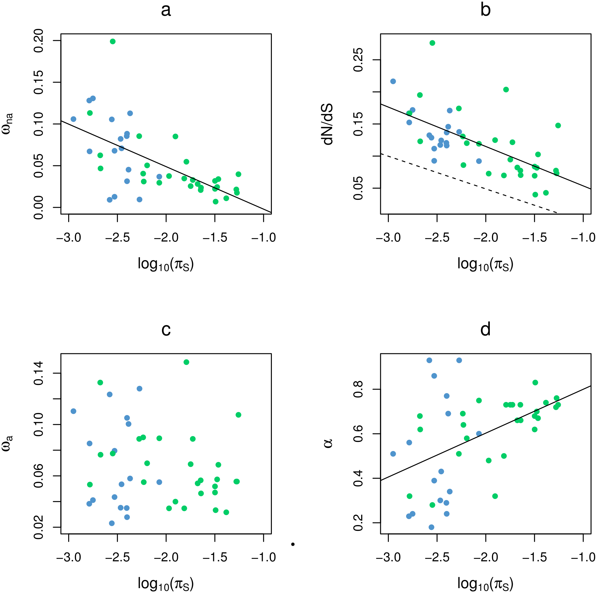
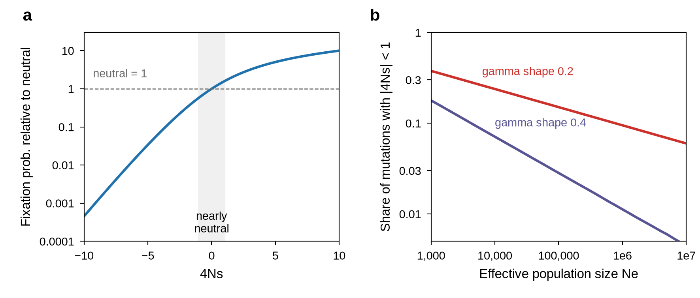

# Chapter 4. The nearly neutral theory

**Status: Partly verified.** The central prediction, that the efficacy of selection against slightly deleterious mutations rises with effective population size (Ne), is supported by comparisons across mammals, animals and plants and between selfing and outcrossing relatives. What remains open is the shape of the distribution of fitness effects (DFE) on which every quantitative prediction depends, what Ne means across long timescales, and how to separate near neutrality from linked selection.

Related notes in this repository: [nearly-neutral-theory](../../skills/genomics-theory-mining/theories/nearly-neutral-theory/THEORY.md), [ohta-1972-population-size-rate](../../skills/genomics-theory-mining/theories/ohta-1972-population-size-rate/THEORY.md), [drift-barrier-hypothesis](../../skills/genomics-theory-mining/theories/drift-barrier-hypothesis/THEORY.md), [mutational-genetic-load](../../skills/genomics-theory-mining/theories/mutational-genetic-load/THEORY.md).

## 4.1 Statement and history

Ohta suggested in 1972 that much molecular evolution involves nearly neutral mutations whose selection coefficients vary in time and space [1], and in 1973 that slightly deleterious substitutions should be fixed faster in small populations [2]. The key quantity is the product Ne·s. A mutation behaves as effectively neutral when |Ne·s| is of order 1 or less; the same mutation is purged in a large population and can drift to fixation in a small one. Ohta summarised the theory in 1992 [3] and later extended it to gene regulation, arguing that the range of near neutrality depends on Ne and that drift can matter for regulatory evolution [4]. Ohta and Gillespie placed it in the history of neutral theories [5], and Akashi and colleagues summarised its structure and evidence in 2012 [6].

Lynch and Conery extended the logic from single mutations to genome architecture: duplicate genes, introns and mobile elements may have spread passively when long-term Ne fell as organisms became larger [7]. This drift-barrier argument is treated in Chapter 18 [8].

## 4.2 What the theory predicts

- **Rate depends on Ne.** Species with small Ne should fix more slightly deleterious nonsynonymous changes, so dN/dS should be higher in small-Ne lineages.
- **Polymorphism depends on Ne.** πN/πS should fall as Ne (or πS) rises.
- **Mating system matters.** Selfing reduces Ne, so selfers should show weaker selection on slightly deleterious mutations than their outcrossing relatives [9].
- **Bottlenecks shift load.** Populations that pass through bottlenecks, including domesticated crops, may carry more segregating or fixed slightly deleterious variants (Chapter 10).
- **Adaptive proportions follow.** The estimated proportion of adaptive substitutions α should rise with Ne, partly because nonadaptive substitutions become rarer.

## 4.3 Evidence for

- **Mammals.** Using body mass as a proxy for low Ne, Popadin and colleagues found that large mammals have a 43% higher ratio of nonsynonymous to synonymous substitution in mitochondrial genes than small mammals [10].
- **Animals.** In 44 animal species pairs, the non-adaptive rate of amino-acid substitution fell with species diversity, while the adaptive rate did not change; the variation in α among species was driven mainly by slightly deleterious fixations (Figure 4.1) [11].
- **Plants and animals together.** In 34 animal and 28 plant species, log(πN/πS) fell linearly with log(πS), as predicted. The slope was weaker in plants, which was traced to a higher mutation rate in long-lived plants [12].
- **Selfers.** Selection on synonymous codons is weaker in selfing Arabidopsis thaliana and Capsella rubella than in their outcrossing relatives [13]. In Eichhornia paniculata, the transition to selfing brought a larger fraction of effectively neutral sites (Nes < 1) and, at the same time, stronger purging of recessive deleterious mutations [14]. The C. rubella genome showed genomic consequences of a shift to selfing less than 200,000 years ago [15].
- **Drosophila versus Arabidopsis.** Wright and Andolfatto attributed the weaker constraint and fewer canonical signatures of positive selection in Arabidopsis to its smaller Ne and stronger population structure [16].

## 4.4 Evidence against, and difficulties

- **The DFE is not one shape.** Galtier found that a gamma DFE fits poorly across animals because the shape parameter differs strongly among taxa; adding a class of lethal mutations fixed this, and the inferred power of drift varied at least 500-fold between species [17]. Huber and colleagues found that the DFE differs between species in a way best fitted by Fisher’s geometric model, with humans having a higher share of strongly deleterious mutations than Drosophila [18].
- **Load and recent demography.** Lohmueller and colleagues reported proportionally more deleterious variation in Europeans than in Africans [19], but Simons and colleagues argued that the deleterious load is insensitive to recent population history [20], and Do and colleagues found no evidence that selection has been less effective at removing deleterious mutations in Europeans [21]. Recent bottlenecks change the frequency spectrum before they change the per-genome load.
- **Other forces mimic it.** Akashi and colleagues noted that adaptive evolution, linked selection, changes in the DFE and weak selection can explain the same patterns, and that the model is sensitive to parameters [6]. Ellegren and Galtier surveyed why diversity varies among species and within genomes [22].

## 4.5 Status and reasoning

**Partly verified.** The qualitative prediction that the efficacy of selection scales with Ne is repeatedly confirmed [10, 11, 12, 13]. The quantitative theory is not: estimates of how many mutations are nearly neutral depend on the assumed DFE [17, 18], and the predicted effect of recent bottlenecks on load has not been found in human data [20, 21]. Figure 4.2 shows why the DFE shape matters: under a gamma DFE with a fixed mean, the share of mutations in the nearly neutral band changes by large factors with the shape parameter.

## 4.6 Plants, crops and grapevine

- **Mating system** is the plant equivalent of the body-size comparison in mammals [9, 13, 14]. Selfing in maize exposes recessive variants and allows purging [23].
- **Domestication.** Lu and colleagues proposed that the bottleneck and selection of domestication cause deleterious mutations to accumulate in rice, a cost of domestication [24]. Moyers and colleagues summarised the evidence in animals and plants [25], and Dwivedi and colleagues discussed how deleterious variants could be identified and removed in breeding, noting that some may be favoured in domesticates [26].
- **Clonal crops.** In cassava, the domestication bottleneck and clonal propagation increased the number of deleterious alleles by 26%, and limited recombination prevented them from being purged; breeding has masked the most damaging recessive mutations in heterozygous state [27].
- **Grapevine.** Cultivated grapes carry more deleterious mutations in heterozygous state than their wild ancestors, partly because clonal propagation shelters recessive mutations [28]. Xiao and colleagues found continuous gene flow from European wild grapes into cultivated grapes over the past ~2,000 years, with both adaptive and maladaptive introgression [29]. In a long-lived clonal crop, Ne, generation time and the number of sexual generations since domestication all differ from an annual crop, so each must be stated before a nearly neutral prediction is tested.

## 4.7 How to test it with public data

- **Data.** Public resequencing panels for pairs of related species that differ in mating system or Ne (for example selfing and outcrossing Capsella, or wild and cultivated grapevine [30, 31]).
- **Tools.** 0-fold and 4-fold site classes; πN and πS by population; DFE inference (polyDFE, fastDFE, DFE-alpha); deleteriousness predictors such as SIFT or GERP only as a secondary check.
- **Analysis.** (1) Compute πN/πS and πS per population. (2) Plot log(πN/πS) against log(πS) across species or populations, as in [12]. (3) Fit the DFE with and without a lethal class [17]. (4) Compare the share of sites with |Nes| < 1. (5) For a clonal crop, compare the derived-allele frequency spectrum of predicted deleterious variants between wild and cultivated samples and report homozygous and heterozygous counts separately. The script [`scripts/ch04_nearly_neutral_figures.py`](../scripts/ch04_nearly_neutral_figures.py) computes Kimura’s fixation probability and the nearly neutral share under gamma DFEs (Figure 4.2).
- **What would break the theory.** No relationship between πN/πS and Ne across species once mutation rate and demography are accounted for.

## 4.8 Open questions

- What is the shape of the DFE in plants, and does it differ between annual and perennial species?
- What does Ne mean for a clonally propagated crop with few sexual generations since domestication?
- How much of the Ne effect on dN/dS comes from linked selection rather than drift?

## 4.9 Common mistakes

- Confusing Ne with census size; a crop grown on millions of hectares may have a small long-term Ne.
- Treating a predicted deleterious variant as a measured fitness loss.
- Comparing load between populations using only counts of derived alleles without separating homozygous and heterozygous states.

## Figures

**Figure 4.1.** Effect of species neutral genetic diversity on protein divergence parameters. Each dot is one species pair (blue: vertebrates; green: invertebrates). a: non-adaptive rate; b: non-synonymous/synonymous ratio; c: adaptive rate; d: proportion of adaptive non-synonymous substitutions. X-axis: synonymous heterozygosity of the focal species. Reproduced unchanged from Galtier N (2016) Adaptive protein evolution in animals and the effective population size hypothesis. *PLoS Genetics* 12:e1005774, Figure 3. https://doi.org/10.1371/journal.pgen.1005774. Licence: CC BY 4.0 (https://creativecommons.org/licenses/by/4.0/).

**Figure 4.2.** (a) Relative fixation probability of a new mutation, S/(1−e^−S) with S = 4Ns; the band |S| < 1 is shaded. (b) Share of new mutations with |4Ns| < 1 under gamma DFEs (shape 0.2 and 0.4, mean |s| = 0.01) as Ne grows. Computed values; made with [`scripts/ch04_nearly_neutral_figures.py`](../scripts/ch04_nearly_neutral_figures.py).

## References

1. Ohta T (1972) Population size and rate of evolution. *Journal of Molecular Evolution* 1:305-314. https://doi.org/10.1007/BF01653959
2. OHTA T (1973) Slightly Deleterious Mutant Substitutions in Evolution. *Nature* 246:96-98. https://doi.org/10.1038/246096a0
3. Ohta T (1992) The Nearly Neutral Theory of Molecular Evolution. *Annual Review of Ecology and Systematics* 23:263-286. https://doi.org/10.1146/annurev.es.23.110192.001403
4. Ohta T (2002) Near-neutrality in evolution of genes and gene regulation. *Proceedings of the National Academy of Sciences* 99:16134-16137. https://doi.org/10.1073/pnas.252626899
5. Ohta T, Gillespie JH (1996) Development of Neutral and Nearly Neutral Theories. *Theoretical Population Biology* 49:128-142. https://doi.org/10.1006/tpbi.1996.0007
6. Akashi H, Osada N, Ohta T (2012) Weak Selection and Protein Evolution. *Genetics* 192:15-31. https://doi.org/10.1534/genetics.112.140178
7. Lynch M, Conery JS (2003) The Origins of Genome Complexity. *Science* 302:1401-1404. https://doi.org/10.1126/science.1089370
8. Lynch M, Ackerman MS, Gout JF, et al. (2016) Genetic drift, selection and the evolution of the mutation rate. *Nature Reviews Genetics* 17:704-714. https://doi.org/10.1038/nrg.2016.104
9. Glémin S (2007) Mating Systems and the Efficacy of Selection at the Molecular Level. *Genetics* 177:905-916. https://doi.org/10.1534/genetics.107.073601
10. Popadin K, Polishchuk LV, Mamirova L, et al. (2007) Accumulation of slightly deleterious mutations in mitochondrial protein-coding genes of large versus small mammals. *Proceedings of the National Academy of Sciences* 104:13390-13395. https://doi.org/10.1073/pnas.0701256104
11. Galtier N (2016) Adaptive Protein Evolution in Animals and the Effective Population Size Hypothesis. *PLOS Genetics* 12:e1005774. https://doi.org/10.1371/journal.pgen.1005774
12. Chen J, Glémin S, Lascoux M (2017) Genetic Diversity and the Efficacy of Purifying Selection across Plant and Animal Species. *Molecular Biology and Evolution* 34:1417-1428. https://doi.org/10.1093/molbev/msx088
13. Qiu S, Zeng K, Slotte T, et al. (2011) Reduced Efficacy of Natural Selection on Codon Usage Bias in Selfing Arabidopsis and Capsella Species. *Genome Biology and Evolution* 3:868-880. https://doi.org/10.1093/gbe/evr085
14. Arunkumar R, Ness RW, Wright SI, et al. (2015) The Evolution of Selfing Is Accompanied by Reduced Efficacy of Selection and Purging of Deleterious Mutations. *Genetics* 199:817-829. https://doi.org/10.1534/genetics.114.172809
15. Slotte T, Hazzouri KM, Ågren JA, et al. (2013) The Capsella rubella genome and the genomic consequences of rapid mating system evolution. *Nature Genetics* 45:831-835. https://doi.org/10.1038/ng.2669
16. Wright SI, Andolfatto P (2008) The Impact of Natural Selection on the Genome: Emerging Patterns in Drosophila and Arabidopsis. *Annual Review of Ecology, Evolution, and Systematics* 39:193-213. https://doi.org/10.1146/annurev.ecolsys.39.110707.173342
17. Galtier N, Rousselle M (2020) How Much Does Ne Vary Among Species?. *Genetics* 216:559-572. https://doi.org/10.1534/genetics.120.303622
18. Huber CD, Kim BY, Marsden CD, et al. (2017) Determining the factors driving selective effects of new nonsynonymous mutations. *Proceedings of the National Academy of Sciences* 114:4465-4470. https://doi.org/10.1073/pnas.1619508114
19. Lohmueller KE, Indap AR, Schmidt S, et al. (2008) Proportionally more deleterious genetic variation in European than in African populations. *Nature* 451:994-997. https://doi.org/10.1038/nature06611
20. Simons YB, Turchin MC, Pritchard JK, et al. (2014) The deleterious mutation load is insensitive to recent population history. *Nature Genetics* 46:220-224. https://doi.org/10.1038/ng.2896
21. Do R, Balick D, Li H, et al. (2015) No evidence that selection has been less effective at removing deleterious mutations in Europeans than in Africans. *Nature Genetics* 47:126-131. https://doi.org/10.1038/ng.3186
22. Ellegren H, Galtier N (2016) Determinants of genetic diversity. *Nature Reviews Genetics* 17:422-433. https://doi.org/10.1038/nrg.2016.58
23. Roessler K, Muyle A, Diez CM, et al. (2019) The genome-wide dynamics of purging during selfing in maize. *Nature Plants* 5:980-990. https://doi.org/10.1038/s41477-019-0508-7
24. Lu J, Tang T, Tang H, et al. (2006) The accumulation of deleterious mutations in rice genomes: a hypothesis on the cost of domestication. *Trends in Genetics* 22:126-131. https://doi.org/10.1016/j.tig.2006.01.004
25. Moyers BT, Morrell PL, McKay JK (2018) Genetic Costs of Domestication and Improvement. *Journal of Heredity* 109:103-116. https://doi.org/10.1093/jhered/esx069
26. Dwivedi SL, Heslop-Harrison P, Spillane C, et al. (2023) Evolutionary dynamics and adaptive benefits of deleterious mutations in crop gene pools. *Trends in Plant Science* 28:685-697. https://doi.org/10.1016/j.tplants.2023.01.006
27. Ramu P, Esuma W, Kawuki R, et al. (2017) Cassava haplotype map highlights fixation of deleterious mutations during clonal propagation. *Nature Genetics* 49:959-963. https://doi.org/10.1038/ng.3845
28. Zhou Y, Massonnet M, Sanjak JS, et al. (2017) Evolutionary genomics of grape ( Vitis vinifera ssp. vinifera ) domestication. *Proceedings of the National Academy of Sciences* 114:11715-11720. https://doi.org/10.1073/pnas.1709257114
29. Xiao H, Liu Z, Wang N, et al. (2023) Adaptive and maladaptive introgression in grapevine domestication. *Proceedings of the National Academy of Sciences* 120:e2222041120. https://doi.org/10.1073/pnas.2222041120
30. Liang Z, Duan S, Sheng J, et al. (2019) Whole-genome resequencing of 472 Vitis accessions for grapevine diversity and demographic history analyses. *Nature Communications* 10:1190. https://doi.org/10.1038/s41467-019-09135-8
31. Dong Y, Duan S, Xia Q, et al. (2023) Dual domestications and origin of traits in grapevine evolution. *Science* 379:892-901. https://doi.org/10.1126/science.add8655
