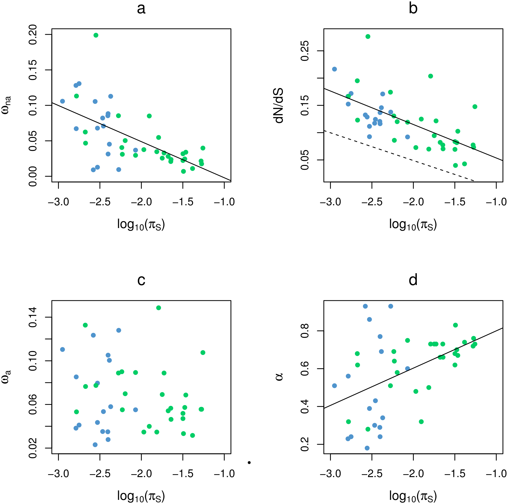
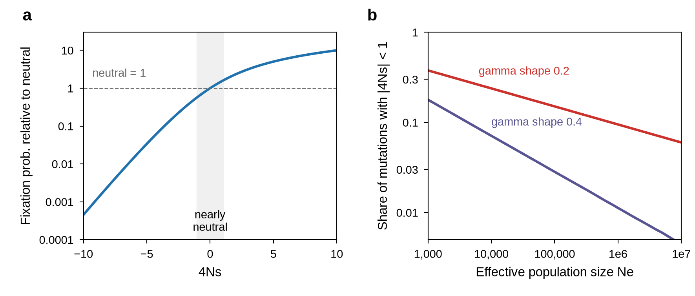

# 第 4 章 近中性理论

**地位：部分验证。** 核心预测——针对轻微有害突变的选择效率随有效群体大小（Ne）提高——在哺乳类、动物和植物之间的比较中，以及自交与异交近缘种的比较中都得到支持。尚未解决的是：所有定量预测都依赖的适合度效应分布（DFE）是什么形状，长时间尺度上的 Ne 是什么含义，以及如何把近中性与连锁选择区分开。

本仓库相关条目：[nearly-neutral-theory](../../theories/nearly-neutral-theory/THEORY.md)、[ohta-1972-population-size-rate](../../theories/ohta-1972-population-size-rate/THEORY.md)、[drift-barrier-hypothesis](../../theories/drift-barrier-hypothesis/THEORY.md)、[mutational-genetic-load](../../theories/mutational-genetic-load/THEORY.md)。

## 4.1 内容与历史

太田朋子在 1972 年提出，分子进化中有大量近中性突变的替代，其选择系数随时间和地区变化 [1]；1973 年又提出轻微有害替代在小群体中应固定得更快 [2]。关键量是 Ne·s 的乘积。当 |Ne·s| 约为 1 或更小时，突变表现为有效中性；同一个突变在大群体中被清除，在小群体中却可能漂变到固定。太田在 1992 年综述了这一理论 [3]，后来又把它推广到基因调控，认为近中性的范围取决于 Ne，漂变对调控进化也可能重要 [4]。太田和 Gillespie 把它放在中性理论的发展史中 [5]，Akashi 等在 2012 年综述了它的结构与证据 [6]。

Lynch 和 Conery 把这一逻辑从单个突变推广到基因组结构：重复基因、内含子和可移动元件可能是在生物体变大、长期 Ne 下降时被动扩散的 [7]。这一漂变壁垒论证在第 18 章讨论 [8]。

## 4.2 预测

- **速率依赖 Ne。** Ne 小的物种应固定更多轻微有害的非同义变化，因此小 Ne 谱系的 dN/dS 应更高。
- **多态依赖 Ne。** πN/πS 应随 Ne（或 πS）升高而下降。
- **交配系统有影响。** 自交降低 Ne，因此自交种对轻微有害突变的选择应弱于异交近缘种 [9]。
- **瓶颈改变负荷。** 经历瓶颈的群体，包括驯化作物，可能携带更多分离或固定的轻微有害变异（第 10 章）。
- **适应性比例随之变化。** 估计的适应性替代比例 α 应随 Ne 升高，部分原因是非适应性替代变少。

## 4.3 支持证据

- **哺乳类。** Popadin 等以体重作为低 Ne 的代理，发现大型哺乳动物线粒体基因的非同义/同义替代比比小型哺乳动物高 43% [10]。
- **动物。** 在 44 对动物物种中，氨基酸的非适应性替代速率随物种多样性升高而下降，而适应性替代速率不变；物种间 α 的差异主要由轻微有害变化的固定驱动（图 4.1）[11]。
- **植物与动物合并分析。** 在 34 种动物和 28 种植物中，log(πN/πS) 随 log(πS) 线性下降，符合预测；植物的斜率较弱，这被归因于长寿命植物突变速率较高 [12]。
- **自交种。** 自交的拟南芥和红荠（Capsella rubella）对同义密码子的选择弱于其异交近缘种 [13]。在 Eichhornia paniculata 中，向自交的转变使有效中性位点（Nes < 1）的比例增大，同时更强地清除隐性有害突变 [14]。红荠基因组显示了不到 20 万年前转为自交带来的基因组后果 [15]。
- **果蝇与拟南芥。** Wright 和 Andolfatto 把拟南芥较弱的约束和较少的经典正选择信号归因于其较小的 Ne 和较强的群体结构 [16]。

## 4.4 反面证据与难点

- **DFE 并非单一形状。** Galtier 发现 gamma 分布的 DFE 在动物间拟合不好，因为形状参数在类群之间差异很大；加入一类致死突变后问题基本解决，推断的漂变强度在物种之间至少相差 500 倍 [17]。Huber 等发现物种间 DFE 的差异最符合 Fisher 几何模型，人类强有害突变的比例高于果蝇 [18]。
- **负荷与近期群体历史。** Lohmueller 等报告欧洲人群中有害变异的比例高于非洲人群 [19]，但 Simons 等认为有害负荷对近期群体历史不敏感 [20]，Do 等也没有发现欧洲人群清除有害突变的效率更低 [21]。近期瓶颈先改变频率谱，再改变每个基因组的负荷。
- **其他力量可以模仿它。** Akashi 等指出，适应性进化、连锁选择、DFE 变化和弱选择都能解释同样的模式，而且模型对参数敏感 [6]。Ellegren 和 Galtier 综述了物种之间和基因组内部多样性差异的原因 [22]。

## 4.5 地位与理由

**部分验证。** “选择效率随 Ne 增大”这一定性预测反复得到确认 [10, 11, 12, 13]。定量理论则没有：有多少突变是近中性的，取决于假设的 DFE [17, 18]；近期瓶颈对负荷的预测效应在人类数据中没有发现 [20, 21]。图 4.2 说明 DFE 形状为什么重要：在均值固定的 gamma DFE 下，落在近中性带中的突变比例随形状参数成倍变化。

## 4.6 植物、作物与葡萄

- **交配系统** 是植物中相当于哺乳类体重比较的天然实验 [9, 13, 14]。玉米自交暴露隐性变异，使其得以被清除 [23]。
- **驯化。** Lu 等提出驯化的瓶颈和选择导致水稻中有害突变积累，即“驯化代价” [24]。Moyers 等综述了动物和植物中的证据 [25]，Dwivedi 等讨论了育种中如何识别和去除有害变异，并指出其中一些在驯化种中可能受青睐 [26]。
- **克隆作物。** 在木薯中，驯化瓶颈和克隆繁殖使有害等位基因数增加了 26%，有限的重组使它们无法被清除；育种通过让最严重的隐性突变处于杂合状态来掩蔽它们 [27]。
- **葡萄。** 栽培葡萄比野生祖先携带更多杂合状态的有害突变，部分原因是克隆繁殖掩蔽了隐性突变 [28]。Xiao 等发现过去约 2,000 年间欧洲野生葡萄持续向栽培葡萄渐渗，其中既有适应性的也有不利的渐渗 [29]。在长寿命的克隆作物中，Ne、世代时间以及驯化以来的有性世代数都不同于一年生作物，检验近中性预测之前必须先说明这几个量。

## 4.7 用公开数据检验

- **数据。** 交配系统或 Ne 不同的近缘物种对的公开重测序数据（例如自交与异交的荠属，或野生与栽培葡萄 [30, 31]）。
- **工具。** 0 倍和 4 倍简并位点分类；按群体计算 πN 和 πS；DFE 推断（polyDFE、fastDFE、DFE-alpha）；SIFT 或 GERP 等有害性预测只作为辅助检查。
- **分析。** (1) 计算每个群体的 πN/πS 和 πS。(2) 像 [12] 那样，在物种或群体之间把 log(πN/πS) 对 log(πS) 作图。(3) 分别在有无致死类别的情况下拟合 DFE [17]。(4) 比较 |Nes| < 1 的位点比例。(5) 对克隆作物，比较野生与栽培样本中预测有害变异的衍生等位基因频率谱，并分别报告纯合和杂合计数。脚本 [`scripts/ch04_nearly_neutral_figures.py`](../scripts/ch04_nearly_neutral_figures.py) 计算木村固定概率和 gamma DFE 下的近中性比例（图 4.2）。
- **什么结果会推翻理论。** 在考虑突变速率和群体历史之后，物种之间 πN/πS 与 Ne 毫无关系。

## 4.8 未解决的问题

- 植物 DFE 是什么形状？一年生与多年生物种之间是否不同？
- 对驯化以来只有很少有性世代的克隆繁殖作物，Ne 意味着什么？
- Ne 对 dN/dS 的影响有多少来自连锁选择而不是漂变？

## 4.9 常见错误

- 把 Ne 与普查数量混为一谈；种植面积达数百万公顷的作物，长期 Ne 可能很小。
- 把预测有害的变异当作测得的适合度损失。
- 只用衍生等位基因计数比较群体负荷，而不区分纯合与杂合状态。

## 图

**图 4.1.** 物种中性遗传多样性对蛋白质分化参数的影响。每个点为一对物种（蓝：脊椎动物；绿：无脊椎动物）。a：非适应性速率；b：非同义/同义比；c：适应性速率；d：适应性非同义替代的比例。横轴：焦点物种的同义杂合度。原样转载自 Galtier N (2016) Adaptive protein evolution in animals and the effective population size hypothesis. *PLoS Genetics* 12:e1005774, Figure 3. https://doi.org/10.1371/journal.pgen.1005774。许可：CC BY 4.0（https://creativecommons.org/licenses/by/4.0/）。

**图 4.2.** (a) 新突变的相对固定概率 S/(1−e^−S)，S = 4Ns；阴影为 |S| < 1。(b) gamma DFE（形状 0.2 和 0.4，平均 |s| = 0.01）下 |4Ns| < 1 的新突变比例随 Ne 的变化。计算值；由 [`scripts/ch04_nearly_neutral_figures.py`](../scripts/ch04_nearly_neutral_figures.py) 生成。

## 参考文献

1. Ohta T (1972) Population size and rate of evolution. *Journal of Molecular Evolution* 1:305-314. https://doi.org/10.1007/BF01653959
2. OHTA T (1973) Slightly Deleterious Mutant Substitutions in Evolution. *Nature* 246:96-98. https://doi.org/10.1038/246096a0
3. Ohta T (1992) The Nearly Neutral Theory of Molecular Evolution. *Annual Review of Ecology and Systematics* 23:263-286. https://doi.org/10.1146/annurev.es.23.110192.001403
4. Ohta T (2002) Near-neutrality in evolution of genes and gene regulation. *Proceedings of the National Academy of Sciences* 99:16134-16137. https://doi.org/10.1073/pnas.252626899
5. Ohta T, Gillespie JH (1996) Development of Neutral and Nearly Neutral Theories. *Theoretical Population Biology* 49:128-142. https://doi.org/10.1006/tpbi.1996.0007
6. Akashi H, Osada N, Ohta T (2012) Weak Selection and Protein Evolution. *Genetics* 192:15-31. https://doi.org/10.1534/genetics.112.140178
7. Lynch M, Conery JS (2003) The Origins of Genome Complexity. *Science* 302:1401-1404. https://doi.org/10.1126/science.1089370
8. Lynch M, Ackerman MS, Gout JF, et al. (2016) Genetic drift, selection and the evolution of the mutation rate. *Nature Reviews Genetics* 17:704-714. https://doi.org/10.1038/nrg.2016.104
9. Glémin S (2007) Mating Systems and the Efficacy of Selection at the Molecular Level. *Genetics* 177:905-916. https://doi.org/10.1534/genetics.107.073601
10. Popadin K, Polishchuk LV, Mamirova L, et al. (2007) Accumulation of slightly deleterious mutations in mitochondrial protein-coding genes of large versus small mammals. *Proceedings of the National Academy of Sciences* 104:13390-13395. https://doi.org/10.1073/pnas.0701256104
11. Galtier N (2016) Adaptive Protein Evolution in Animals and the Effective Population Size Hypothesis. *PLOS Genetics* 12:e1005774. https://doi.org/10.1371/journal.pgen.1005774
12. Chen J, Glémin S, Lascoux M (2017) Genetic Diversity and the Efficacy of Purifying Selection across Plant and Animal Species. *Molecular Biology and Evolution* 34:1417-1428. https://doi.org/10.1093/molbev/msx088
13. Qiu S, Zeng K, Slotte T, et al. (2011) Reduced Efficacy of Natural Selection on Codon Usage Bias in Selfing Arabidopsis and Capsella Species. *Genome Biology and Evolution* 3:868-880. https://doi.org/10.1093/gbe/evr085
14. Arunkumar R, Ness RW, Wright SI, et al. (2015) The Evolution of Selfing Is Accompanied by Reduced Efficacy of Selection and Purging of Deleterious Mutations. *Genetics* 199:817-829. https://doi.org/10.1534/genetics.114.172809
15. Slotte T, Hazzouri KM, Ågren JA, et al. (2013) The Capsella rubella genome and the genomic consequences of rapid mating system evolution. *Nature Genetics* 45:831-835. https://doi.org/10.1038/ng.2669
16. Wright SI, Andolfatto P (2008) The Impact of Natural Selection on the Genome: Emerging Patterns in Drosophila and Arabidopsis. *Annual Review of Ecology, Evolution, and Systematics* 39:193-213. https://doi.org/10.1146/annurev.ecolsys.39.110707.173342
17. Galtier N, Rousselle M (2020) How Much Does Ne Vary Among Species? *Genetics* 216:559-572. https://doi.org/10.1534/genetics.120.303622
18. Huber CD, Kim BY, Marsden CD, et al. (2017) Determining the factors driving selective effects of new nonsynonymous mutations. *Proceedings of the National Academy of Sciences* 114:4465-4470. https://doi.org/10.1073/pnas.1619508114
19. Lohmueller KE, Indap AR, Schmidt S, et al. (2008) Proportionally more deleterious genetic variation in European than in African populations. *Nature* 451:994-997. https://doi.org/10.1038/nature06611
20. Simons YB, Turchin MC, Pritchard JK, et al. (2014) The deleterious mutation load is insensitive to recent population history. *Nature Genetics* 46:220-224. https://doi.org/10.1038/ng.2896
21. Do R, Balick D, Li H, et al. (2015) No evidence that selection has been less effective at removing deleterious mutations in Europeans than in Africans. *Nature Genetics* 47:126-131. https://doi.org/10.1038/ng.3186
22. Ellegren H, Galtier N (2016) Determinants of genetic diversity. *Nature Reviews Genetics* 17:422-433. https://doi.org/10.1038/nrg.2016.58
23. Roessler K, Muyle A, Diez CM, et al. (2019) The genome-wide dynamics of purging during selfing in maize. *Nature Plants* 5:980-990. https://doi.org/10.1038/s41477-019-0508-7
24. Lu J, Tang T, Tang H, et al. (2006) The accumulation of deleterious mutations in rice genomes: a hypothesis on the cost of domestication. *Trends in Genetics* 22:126-131. https://doi.org/10.1016/j.tig.2006.01.004
25. Moyers BT, Morrell PL, McKay JK (2018) Genetic Costs of Domestication and Improvement. *Journal of Heredity* 109:103-116. https://doi.org/10.1093/jhered/esx069
26. Dwivedi SL, Heslop-Harrison P, Spillane C, et al. (2023) Evolutionary dynamics and adaptive benefits of deleterious mutations in crop gene pools. *Trends in Plant Science* 28:685-697. https://doi.org/10.1016/j.tplants.2023.01.006
27. Ramu P, Esuma W, Kawuki R, et al. (2017) Cassava haplotype map highlights fixation of deleterious mutations during clonal propagation. *Nature Genetics* 49:959-963. https://doi.org/10.1038/ng.3845
28. Zhou Y, Massonnet M, Sanjak JS, et al. (2017) Evolutionary genomics of grape ( Vitis vinifera ssp. vinifera ) domestication. *Proceedings of the National Academy of Sciences* 114:11715-11720. https://doi.org/10.1073/pnas.1709257114
29. Xiao H, Liu Z, Wang N, et al. (2023) Adaptive and maladaptive introgression in grapevine domestication. *Proceedings of the National Academy of Sciences* 120:e2222041120. https://doi.org/10.1073/pnas.2222041120
30. Liang Z, Duan S, Sheng J, et al. (2019) Whole-genome resequencing of 472 Vitis accessions for grapevine diversity and demographic history analyses. *Nature Communications* 10:1190. https://doi.org/10.1038/s41467-019-09135-8
31. Dong Y, Duan S, Xia Q, et al. (2023) Dual domestications and origin of traits in grapevine evolution. *Science* 379:892-901. https://doi.org/10.1126/science.add8655
