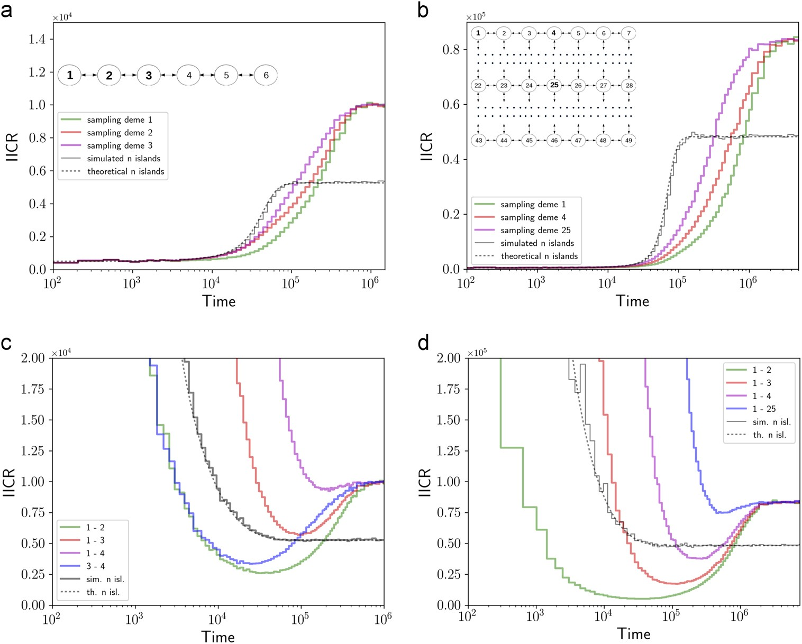
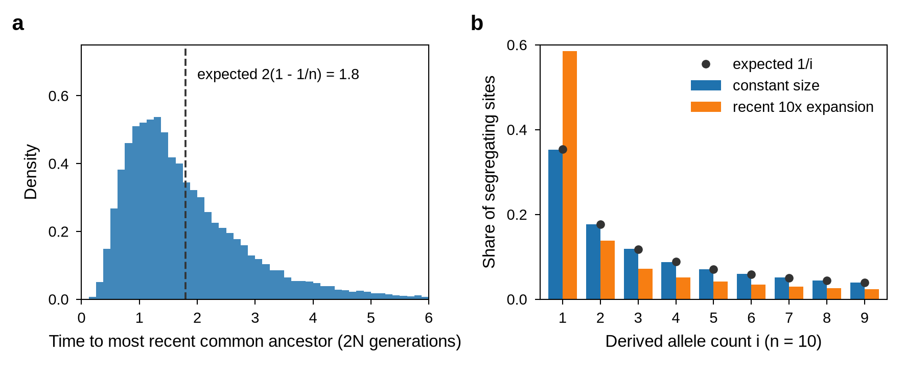
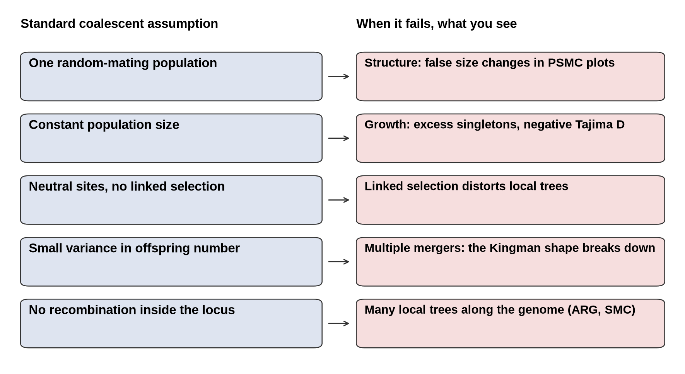

# Chapter 5. The coalescent

**Status: Verified (mathematical framework).** The coalescent is the large-population limit of the standard models of reproduction, and its predictions for neutral variation in a randomly mating population of constant size follow by derivation. It is the basis of most simulation and demographic inference. What is not settled is how often real species meet its assumptions: population structure, linked selection, skewed offspring numbers and clonal reproduction all change the genealogy, and a history inferred from a misspecified model can be precise and wrong.

Related notes in this repository: [coalescent](../../skills/genomics-theory-mining/theories/coalescent/THEORY.md), [infinite-sites-watterson](../../skills/genomics-theory-mining/theories/infinite-sites-watterson/THEORY.md), [tajima-1983-nucleon-genealogy](../../skills/genomics-theory-mining/theories/tajima-1983-nucleon-genealogy/THEORY.md), [ewens-sampling-formula](../../skills/genomics-theory-mining/theories/ewens-sampling-formula/THEORY.md), [tajima-d](../../skills/genomics-theory-mining/theories/tajima-d/THEORY.md), [stepping-stone-model](../../skills/genomics-theory-mining/theories/stepping-stone-model/THEORY.md).

## 5.1 Statement and history

The coalescent turns population genetics backwards in time. Instead of following allele frequencies forward, it follows the ancestry of a sample of n gene copies until they meet in a single common ancestor. In a population of 2N gene copies, each pair of lineages merges (coalesces) with probability about 1/(2N) per generation, so with k lineages the waiting time to the next merger is roughly exponential with rate k(k−1)/2 in units of 2N generations. Mutations are then placed on the branches of the tree.

Earlier sampling theory set up the questions. Ewens derived the sampling distribution of allele counts at a selectively neutral locus and used it to test neutrality [1]. Watterson obtained the distribution of the number of segregating sites in a sample from a population with recurrent mutation and no recombination [2]. Kingman defined the coalescent as a stochastic process in 1982 [3] and later described how the ideas formed between 1974 and 1982 [4]. In 1983 Hudson studied an infinite-site model with crossing-over and derived the variance of the number of segregating sites with recombination [5], and Tajima developed a theory of the expected relationship among DNA sequences sampled under mutation and drift, including the number of nucleotide differences between them [6]. Tajima then compared the two estimates of variation, segregating sites and pairwise differences, to build a test of the neutral mutation hypothesis [7]. Rosenberg and Nordborg summarised the coalescent as a coherent statistical framework for polymorphism data [8].

## 5.2 What the theory predicts

- **Tree shape.** For n = 10, the expected time to the most recent common ancestor is 2(1 − 1/n) = 1.8 units of 2N generations, and more than half of it is spent waiting for the last two lineages to merge (Figure 5.2a).
- **Variation.** Under infinite sites, the expected number of segregating sites is θ times the sum of 1/i for i = 1 to n − 1, and the expected pairwise difference is θ [2, 6].
- **Site frequency spectrum.** The expected number of sites with i derived copies is proportional to 1/i (Figure 5.2b). Population growth adds singletons; decline or structure adds intermediate-frequency variants; Tajima’s D summarises the difference [7].
- **Recombination.** Along a chromosome the genealogy changes at recombination breakpoints, so a genome carries many correlated local trees [5]. This is the basis of the sequentially Markovian approximation [9].
- **Demography leaves a trace.** Because the coalescence rate at time t is inversely proportional to population size at that time, the distribution of coalescence times in one genome carries information about past size [10].

## 5.3 Evidence for

- **It is a limit theorem.** The coalescent is derived, not fitted: for large N, the genealogies of the Wright–Fisher and related models converge to it [3, 4]. Its predictions for segregating sites, pairwise differences and allele counts were obtained independently from forward theory [1, 2, 6].
- **Simulation.** Hudson’s ms program generates samples under a Wright–Fisher neutral model with infinite sites, recombination, gene conversion, migration and changing population size, and became the reference for checking statistics [11]. Kelleher and colleagues made exact coalescent simulation practical for millions of samples and introduced a compact store for correlated trees along a genome [12].
- **Inference from whole genomes.** PSMC inferred human population sizes between about ten thousand and a million years ago from single diploid genomes [10]. MSMC used the first coalescence among several genomes to reach more recent times and to estimate population separation, and found that the separation of non-African ancestors from Yoruba ancestors began long before 50,000 years ago [13]. SMC++ analyses hundreds of unphased genomes [14].
- **Genealogies at scale.** Tree sequences can now be inferred for whole genomes: tsinfer handles four orders of magnitude more sequences than earlier exact methods [15], and Relate estimates genealogies, branch lengths and mutation ages for more than 10,000 sequences [16]. These methods are built on the coalescent and recover simulated histories, which is a strong internal check.
- **Practice in non-model species.** Beichman and colleagues surveyed coalescent-based demographic inference for non-model organisms [17], and Mather and colleagues gave a practical guide to SMC methods [18].

## 5.4 Evidence against, and difficulties

- **Structure mimics size change.** Mazet and colleagues showed that population structure alone can generate signals of population size change, and that a bottleneck inferred from an n-island model under a panmictic model can be precise and meaningless [19]. Chikhi and colleagues extended this with the inverse instantaneous coalescence rate (IICR), showing that the same sample from a structured population of constant size gives different apparent histories depending on where the two genes were sampled (Figure 5.1) [20].
- **Skewed offspring numbers.** When a few individuals contribute a large share of the next generation, the genealogy is described by a different limit process with multiple mergers. Eldon and Wakeley found five possible limit processes, only one of which corresponds to the usual model, and the others make very different predictions about diversity [21].
- **Linked selection.** Background selection and biased gene conversion together affect as much as 95% of human variants; synonymous and non-transcribed sites are also affected, and using them for demographic inference can produce strong biases [22]. Chapter 8 treats linked selection.
- **Approximations.** The full coalescent with recombination is hard to use for likelihood inference; the SMC replaces it with a simpler model whose accuracy has to be checked [9]. Phasing switch errors can badly distort histories inferred from phased genomes [14].
- **Interpretation.** SMC plots are easy to over-read; their time and size axes depend on the mutation rate and generation time, and their shape depends on sample choice [18].

## 5.5 Status and reasoning

**Verified as a mathematical framework.** The coalescent is an exact consequence of the models it starts from and its neutral predictions are confirmed by simulation and by the agreement of independent statistics [3, 11, 12]. Its application to a given species is a different matter: whenever structure, linked selection, skewed reproduction or clonality are present, a history inferred under the standard model should be treated as a hypothesis, not a result [19, 20, 21, 22].

## 5.6 Plants, crops and grapevine

- **Selfing and structure.** In Arabidopsis thaliana the first phase of the 1001 Genomes Project sequenced 80 strains from diverse habitats [23]; strong structure and selfing mean that the effective number of independent lineages is smaller than the number of plants sampled.
- **Domestication histories.** In maize, the domestication bottleneck reduced the efficiency of purifying selection, while young alleles show stronger purifying selection because present-day populations are very large; recent demographic change can have effects that conflict with expectations based on long-term Ne alone [24].
- **Grapevine.** Zhou and colleagues inferred a long population decline in grapes before domestication and suggested it reflects low-intensity cultivation [25]. In 472 Vitis accessions Liang and colleagues inferred a recent expansion and contraction of effective size in domesticated grapevines and a distinct history for cultivars from the pan-Black Sea region [26]. Dong and colleagues dated two concurrent domestications to about 11,000 years ago in Western Asia and the Caucasus [27]. All three depend on a mutation rate and a generation time (Chapter 6), and the grapevine sample is structured and partly clonal, so declines and expansions in SMC plots should be checked against structured models before they are read as changes in size [19, 20].
- **Clonal propagation.** A clone adds many mitotic generations without meiosis. The coalescent counts sexual generations; somatic generations add mutations without recombination, so a cultivar propagated for centuries is not one more generation in the population genealogy.

## 5.7 How to test it with public data

- **Data.** A public resequencing panel with population labels, such as the 1001 Genomes data [23] or published grapevine panels [26, 27].
- **Tools.** msprime and ms for simulation [11, 12]; PSMC, MSMC and SMC++ for size history [10, 13, 14]; tsinfer and Relate for genealogies [15, 16].
- **Analysis.** (1) Compute the site frequency spectrum, Watterson’s θ, π and Tajima’s D in putatively neutral regions far from genes. (2) Run an SMC method on several individuals from different subpopulations. (3) Simulate the inferred history and an alternative structured model of constant size, and check whether both reproduce the observed SFS and IICR [20]. (4) Report the mutation rate and generation time used. The script [`scripts/ch05_coalescent_figures.py`](../scripts/ch05_coalescent_figures.py) simulates coalescent trees and spectra (Figure 5.2).
- **What would break the framework.** Nothing in data can falsify the mathematics; what data can show is that a given species departs from its assumptions, for example a spectrum that no single-population history fits.

## 5.8 Open questions

- How much of the apparent bottleneck in crop demographic histories reflects structure and selection rather than size?
- Which coalescent model fits species with high fecundity and skewed reproduction, including many trees and marine organisms?
- How should somatic generations in clonal crops be added to the genealogy?

## 5.9 Common mistakes

- Reading a PSMC curve as census size, or as size of one population when the samples come from a structured species.
- Using genic or low-recombination regions for demographic inference without considering linked selection.
- Changing the mutation rate or generation time between studies and then comparing dates.
- Treating a negative Tajima’s D as proof of expansion; selection and sampling also produce it.

## Figures

**Figure 5.1.** Inferred population size changes (IICR) for one- and two-dimensional stepping-stone models of constant size. In a and b the two genes were sampled in the same deme; in c and d in different demes. a, c: one-dimensional model; b, d: two-dimensional model. For comparison, each panel shows a comparable n-island model (simulated and theoretical IICR). Reproduced unchanged from Chikhi L, Rodríguez W, Grusea S, et al. (2018) The IICR (inverse instantaneous coalescence rate) as a summary of genomic diversity: insights into demographic inference and model choice. *Heredity* 120:13–24, Figure 1. https://doi.org/10.1038/s41437-017-0005-6. Licence: CC BY 4.0 (https://creativecommons.org/licenses/by/4.0/).

**Figure 5.2.** (a) Time to the most recent common ancestor for n = 10 in 20,000 simulated coalescent trees; dashed line, the expectation 2(1 − 1/n). (b) Share of segregating sites by derived allele count, constant size versus a tenfold larger population in the recent 0.5 units of 2N generations; points, the neutral expectation proportional to 1/i. Simulation; made with [`scripts/ch05_coalescent_figures.py`](../scripts/ch05_coalescent_figures.py).

**Figure 5.3.** Assumptions of the standard coalescent and what is seen when each fails. Schematic; made with [`scripts/ch05_coalescent_figures.py`](../scripts/ch05_coalescent_figures.py).

## References

1. Ewens WJ (1972) The sampling theory of selectively neutral alleles. *Theoretical Population Biology* 3:87-112. https://doi.org/10.1016/0040-5809(72)90035-4
2. Watterson GA (1975) On the number of segregating sites in genetical models without recombination. *Theoretical Population Biology* 7:256-276. https://doi.org/10.1016/0040-5809(75)90020-9
3. Kingman JFC (1982) The coalescent. *Stochastic Processes and their Applications* 13:235-248. https://doi.org/10.1016/0304-4149(82)90011-4
4. Kingman JFC (2000) Origins of the Coalescent: 1974-1982. *Genetics* 156:1461-1463. https://doi.org/10.1093/genetics/156.4.1461
5. Hudson RR (1983) Properties of a neutral allele model with intragenic recombination. *Theoretical Population Biology* 23:183-201. https://doi.org/10.1016/0040-5809(83)90013-8
6. Tajima F (1983) EVOLUTIONARY RELATIONSHIP OF DNA SEQUENCES IN FINITE POPULATIONS. *Genetics* 105:437-460. https://doi.org/10.1093/genetics/105.2.437
7. Tajima F (1989) Statistical method for testing the neutral mutation hypothesis by DNA polymorphism. *Genetics* 123:585-595. https://doi.org/10.1093/genetics/123.3.585
8. Rosenberg NA, Nordborg M (2002) Genealogical trees, coalescent theory and the analysis of genetic polymorphisms. *Nature Reviews Genetics* 3:380-390. https://doi.org/10.1038/nrg795
9. McVean GAT, Cardin NJ (2005) Approximating the coalescent with recombination. *Philosophical Transactions of the Royal Society B: Biological Sciences* 360:1387-1393. https://doi.org/10.1098/rstb.2005.1673
10. Li H, Durbin R (2011) Inference of human population history from individual whole-genome sequences. *Nature* 475:493-496. https://doi.org/10.1038/nature10231
11. Hudson RR (2002) Generating samples under a Wright–Fisher neutral model of genetic variation. *Bioinformatics* 18:337-338. https://doi.org/10.1093/bioinformatics/18.2.337
12. Kelleher J, Etheridge AM, McVean G (2016) Efficient Coalescent Simulation and Genealogical Analysis for Large Sample Sizes. *PLOS Computational Biology* 12:e1004842. https://doi.org/10.1371/journal.pcbi.1004842
13. Schiffels S, Durbin R (2014) Inferring human population size and separation history from multiple genome sequences. *Nature Genetics* 46:919-925. https://doi.org/10.1038/ng.3015
14. Terhorst J, Kamm JA, Song YS (2017) Robust and scalable inference of population history from hundreds of unphased whole genomes. *Nature Genetics* 49:303-309. https://doi.org/10.1038/ng.3748
15. Kelleher J, Wong Y, Wohns AW, et al. (2019) Inferring whole-genome histories in large population datasets. *Nature Genetics* 51:1330-1338. https://doi.org/10.1038/s41588-019-0483-y
16. Speidel L, Forest M, Shi S, et al. (2019) A method for genome-wide genealogy estimation for thousands of samples. *Nature Genetics* 51:1321-1329. https://doi.org/10.1038/s41588-019-0484-x
17. Beichman AC, Huerta-Sanchez E, Lohmueller KE (2018) Using Genomic Data to Infer Historic Population Dynamics of Nonmodel Organisms. *Annual Review of Ecology, Evolution, and Systematics* 49:433-456. https://doi.org/10.1146/annurev-ecolsys-110617-062431
18. Mather N, Traves SM, Ho SYW (2020) A practical introduction to sequentially Markovian coalescent methods for estimating demographic history from genomic data. *Ecology and Evolution* 10:579-589. https://doi.org/10.1002/ece3.5888
19. Mazet O, Rodríguez W, Grusea S, et al. (2016) On the importance of being structured: instantaneous coalescence rates and human evolution—lessons for ancestral population size inference?. *Heredity* 116:362-371. https://doi.org/10.1038/hdy.2015.104
20. Chikhi L, Rodríguez W, Grusea S, et al. (2018) The IICR (inverse instantaneous coalescence rate) as a summary of genomic diversity: insights into demographic inference and model choice. *Heredity* 120:13-24. https://doi.org/10.1038/s41437-017-0005-6
21. Eldon B, Wakeley J (2006) Coalescent Processes When the Distribution of Offspring Number Among Individuals Is Highly Skewed. *Genetics* 172:2621-2633. https://doi.org/10.1534/genetics.105.052175
22. Pouyet F, Aeschbacher S, Thiéry A, et al. (2018) Background selection and biased gene conversion affect more than 95% of the human genome and bias demographic inferences. *eLife* 7:e36317. https://doi.org/10.7554/eLife.36317
23. Cao J, Schneeberger K, Ossowski S, et al. (2011) Whole-genome sequencing of multiple Arabidopsis thaliana populations. *Nature Genetics* 43:956-963. https://doi.org/10.1038/ng.911
24. Beissinger TM, Wang L, Crosby K, et al. (2016) Recent demography drives changes in linked selection across the maize genome. *Nature Plants* 2:16084. https://doi.org/10.1038/nplants.2016.84
25. Zhou Y, Massonnet M, Sanjak JS, et al. (2017) Evolutionary genomics of grape ( Vitis vinifera ssp. vinifera ) domestication. *Proceedings of the National Academy of Sciences* 114:11715-11720. https://doi.org/10.1073/pnas.1709257114
26. Liang Z, Duan S, Sheng J, et al. (2019) Whole-genome resequencing of 472 Vitis accessions for grapevine diversity and demographic history analyses. *Nature Communications* 10:1190. https://doi.org/10.1038/s41467-019-09135-8
27. Dong Y, Duan S, Xia Q, et al. (2023) Dual domestications and origin of traits in grapevine evolution. *Science* 379:892-901. https://doi.org/10.1126/science.add8655
