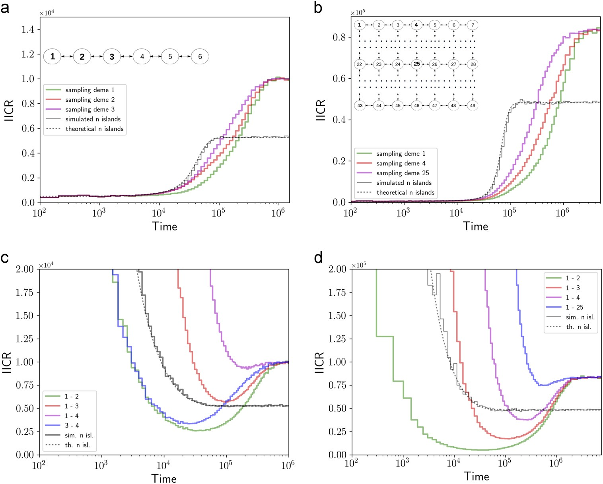
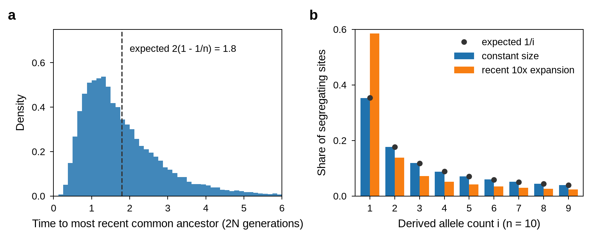
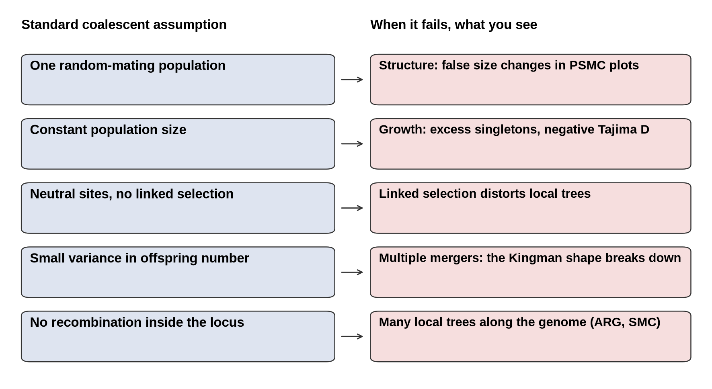

# 第 5 章 溯祖理论

**地位：已验证（数学框架）。** 溯祖是标准繁殖模型在大群体下的极限，它对随机交配、大小恒定群体中性变异的预测可以直接推导出来。大多数模拟和群体历史推断都建立在它之上。尚未解决的是真实物种多大程度上满足它的假设：群体结构、连锁选择、后代数偏斜和无性繁殖都会改变谱系，而在设定错误的模型下推断出的历史可能既精确又错误。

本仓库相关条目：[coalescent](../../skills/genomics-theory-mining/theories/coalescent/THEORY.md)、[infinite-sites-watterson](../../skills/genomics-theory-mining/theories/infinite-sites-watterson/THEORY.md)、[tajima-1983-nucleon-genealogy](../../skills/genomics-theory-mining/theories/tajima-1983-nucleon-genealogy/THEORY.md)、[ewens-sampling-formula](../../skills/genomics-theory-mining/theories/ewens-sampling-formula/THEORY.md)、[tajima-d](../../skills/genomics-theory-mining/theories/tajima-d/THEORY.md)、[stepping-stone-model](../../skills/genomics-theory-mining/theories/stepping-stone-model/THEORY.md)。

## 5.1 内容与历史

溯祖把群体遗传学倒过来看。它不追踪等位基因频率向前的变化，而是追踪 n 个基因拷贝样本的祖先，直到它们汇合到一个共同祖先。在 2N 个基因拷贝的群体中，每对谱系每代合并（溯祖）的概率约为 1/(2N)，因此有 k 条谱系时，到下一次合并的等待时间近似服从速率为 k(k−1)/2 的指数分布（时间单位为 2N 代）。然后把突变放到树的枝上。

更早的抽样理论提出了问题。Ewens 推导了选择中性位点等位基因计数的抽样分布，并用它检验中性 [1]。Watterson 得到了在有反复突变、无重组的群体中样本分离位点数的分布 [2]。Kingman 在 1982 年把溯祖定义为一个随机过程 [3]，后来回顾了这些想法在 1974–1982 年间如何形成 [4]。1983 年，Hudson 研究了带交换的无限位点模型，推导了有重组时分离位点数的方差 [5]；Tajima 建立了在突变与漂变下抽样 DNA 序列之间预期关系的理论，包括序列间核苷酸差异数 [6]。Tajima 随后比较了分离位点数和两两差异这两种变异估计，构建了中性突变假说的检验 [7]。Rosenberg 和 Nordborg 把溯祖概括为分析多态数据的统一统计框架 [8]。

## 5.2 预测

- **树的形状。** n = 10 时，到最近共同祖先的期望时间为 2(1 − 1/n) = 1.8 个 2N 代单位，其中一半以上花在等待最后两条谱系合并上（图 5.2a）。
- **变异量。** 在无限位点模型下，分离位点数的期望为 θ 乘以 i = 1 到 n − 1 的 1/i 之和，两两差异的期望为 θ [2, 6]。
- **位点频率谱。** 含 i 个衍生拷贝的位点数期望与 1/i 成正比（图 5.2b）。群体扩张增加单例；下降或结构增加中频变异；Tajima’s D 概括了这种差异 [7]。
- **重组。** 沿染色体，谱系在重组断点处改变，因此一个基因组带有许多相关的局部树 [5]。这是序贯马尔可夫近似的基础 [9]。
- **群体历史留下痕迹。** 时间 t 处的溯祖速率与当时群体大小成反比，因此一个基因组中溯祖时间的分布带有过去群体大小的信息 [10]。

## 5.3 支持证据

- **它是极限定理。** 溯祖是推导出来的，不是拟合出来的：N 很大时，Wright–Fisher 及相关模型的谱系收敛于它 [3, 4]。它对分离位点数、两两差异和等位基因计数的预测也由正向理论独立得到 [1, 2, 6]。
- **模拟。** Hudson 的 ms 程序在无限位点 Wright–Fisher 中性模型下生成样本，可包含重组、基因转换、迁移和群体大小变化，成为检验统计量的参照 [11]。Kelleher 等使对数百万样本的精确溯祖模拟变得可行，并提出了沿基因组存储相关树的紧凑格式 [12]。
- **从全基因组推断。** PSMC 用单个二倍体基因组推断了约一万到一百万年前的人类群体大小 [10]。MSMC 利用多个基因组之间的第一次溯祖，延伸到更近的时间并估计群体分离，发现非洲以外祖先与约鲁巴祖先的分离早在 5 万年前之前就已开始 [13]。SMC++ 可分析数百个未定相基因组 [14]。
- **大规模谱系。** 现在可以为全基因组推断树序列：tsinfer 能处理的序列数比早期精确方法多四个数量级 [15]，Relate 可为超过 10,000 条序列估计谱系、枝长和突变年龄 [16]。这些方法都以溯祖为基础，并能恢复模拟的历史，这是有力的内部检验。
- **非模式物种中的应用。** Beichman 等概述了非模式生物中基于溯祖的群体历史推断 [17]，Mather 等给出了 SMC 方法的实用指南 [18]。

## 5.4 反面证据与难点

- **结构模仿群体大小变化。** Mazet 等表明，仅群体结构就能产生群体大小变化的信号；在随机交配模型下分析 n 岛模型数据，推断出的瓶颈可能精确却没有意义 [19]。Chikhi 等用逆瞬时溯祖速率（IICR）推广了这一点：同一个大小恒定的结构群体，两条基因取自哪里不同，表观历史就不同（图 5.1）[20]。
- **后代数偏斜。** 当少数个体贡献了下一代的大部分时，谱系由另一种带多重合并的极限过程描述。Eldon 和 Wakeley 找到五种可能的极限过程，只有一种对应常规模型，其余对多样性的预测差别很大 [21]。
- **连锁选择。** 背景选择和偏向性基因转换合起来影响多达 95% 的人类变异；同义位点和非转录区也受影响，用它们推断群体历史可能产生严重偏差 [22]。连锁选择见第 8 章。
- **近似。** 完整的带重组溯祖很难用于似然推断；SMC 用更简单的模型代替它，其准确性需要检验 [9]。定相切换错误会严重扭曲从已定相基因组推断的历史 [14]。
- **解读。** SMC 曲线容易被过度解读；时间轴和大小轴取决于突变率和世代时间，形状取决于样本选择 [18]。

## 5.5 地位与理由

**作为数学框架已验证。** 溯祖是其出发模型的精确推论，其中性预测得到模拟以及独立统计量之间一致性的确认 [3, 11, 12]。把它用于某个具体物种是另一回事：只要存在结构、连锁选择、偏斜繁殖或无性繁殖，在标准模型下推断的历史都应作为假说而非结论 [19, 20, 21, 22]。

## 5.6 植物、作物与葡萄

- **自交与结构。** 拟南芥 1001 基因组计划第一阶段测序了来自不同生境的 80 个株系 [23]；强烈的结构和自交意味着独立谱系的有效数量少于采样植株数。
- **驯化历史。** 在玉米中，驯化瓶颈降低了纯化选择的效率，而年轻等位基因显示更强的纯化选择，因为现今群体非常大；近期的群体变化可能产生与仅基于长期 Ne 的预期相矛盾的效应 [24]。
- **葡萄。** Zhou 等推断葡萄在驯化前经历了长期的群体下降，并认为这反映了低强度的栽培 [25]。Liang 等在 472 份葡萄属材料中推断栽培葡萄近期有效群体大小先扩张后收缩，环黑海地区品种有独特的历史 [26]。Dong 等把两次同时发生的驯化定在约 11,000 年前的西亚和高加索 [27]。这三项都依赖突变率和世代时间（第 6 章），而葡萄样本有结构且部分为克隆，因此 SMC 曲线中的下降和扩张应先与结构模型对照，再解读为群体大小变化 [19, 20]。
- **无性繁殖。** 一个克隆增加了许多不经减数分裂的有丝分裂世代。溯祖计数的是有性世代；体细胞世代增加突变但没有重组，因此一个繁殖了几百年的品种并不等于群体谱系中多出一代。

## 5.7 用公开数据检验

- **数据。** 带群体标签的公开重测序数据，例如 1001 基因组数据 [23] 或已发表的葡萄群体数据 [26, 27]。
- **工具。** 模拟用 msprime 和 ms [11, 12]；群体大小历史用 PSMC、MSMC 和 SMC++ [10, 13, 14]；谱系用 tsinfer 和 Relate [15, 16]。
- **分析。** (1) 在远离基因的推测中性区域计算位点频率谱、Watterson θ、π 和 Tajima’s D。(2) 对来自不同亚群的若干个体运行 SMC 方法。(3) 模拟推断出的历史以及一个大小恒定的结构模型，检查二者能否都重现观察到的 SFS 和 IICR [20]。(4) 报告所用突变率和世代时间。脚本 [`scripts/ch05_coalescent_figures.py`](../scripts/ch05_coalescent_figures.py) 模拟溯祖树和频率谱（图 5.2）。
- **什么结果会推翻这一框架。** 数据不能证伪数学本身；数据能显示的是某个物种偏离了它的假设，例如没有任何单群体历史能拟合的频率谱。

## 5.8 未解决的问题

- 作物群体历史中表观的瓶颈有多少反映的是结构和选择而非群体大小？
- 对高繁殖力、繁殖偏斜的物种（包括许多树木和海洋生物），哪种溯祖模型合适？
- 克隆作物的体细胞世代应如何加入谱系？

## 5.9 常见错误

- 把 PSMC 曲线读作普查群体大小，或在样本来自结构物种时把它读作单一群体的大小。
- 用基因区或低重组区推断群体历史而不考虑连锁选择。
- 不同研究使用不同的突变率或世代时间，然后直接比较年代。
- 把负的 Tajima’s D 当作扩张的证明；选择和抽样也会产生它。

## 图

**图 5.1.** 大小恒定的一维和二维踏脚石模型的推断群体大小变化（IICR）。a 和 b 中两条基因取自同一个 deme；c 和 d 中取自不同 deme。a、c：一维模型；b、d：二维模型。各图同时给出可比的 n 岛模型（模拟与理论 IICR）作对照。原样转载自 Chikhi L, Rodríguez W, Grusea S, et al. (2018) The IICR (inverse instantaneous coalescence rate) as a summary of genomic diversity: insights into demographic inference and model choice. *Heredity* 120:13–24, Figure 1. https://doi.org/10.1038/s41437-017-0005-6。许可：CC BY 4.0（https://creativecommons.org/licenses/by/4.0/）。

**图 5.2.** (a) 20,000 棵模拟溯祖树中 n = 10 时到最近共同祖先的时间；虚线为期望值 2(1 − 1/n)。(b) 按衍生等位基因计数划分的分离位点比例：恒定大小，对比最近 0.5 个 2N 代单位内群体大十倍；点为与 1/i 成正比的中性期望。模拟；由 [`scripts/ch05_coalescent_figures.py`](../scripts/ch05_coalescent_figures.py) 生成。

**图 5.3.** 标准溯祖的假设，以及每一项不成立时看到的现象。示意图；由 [`scripts/ch05_coalescent_figures.py`](../scripts/ch05_coalescent_figures.py) 生成。

## 参考文献

1. Ewens WJ (1972) The sampling theory of selectively neutral alleles. *Theoretical Population Biology* 3:87-112. https://doi.org/10.1016/0040-5809(72)90035-4
2. Watterson GA (1975) On the number of segregating sites in genetical models without recombination. *Theoretical Population Biology* 7:256-276. https://doi.org/10.1016/0040-5809(75)90020-9
3. Kingman JFC (1982) The coalescent. *Stochastic Processes and their Applications* 13:235-248. https://doi.org/10.1016/0304-4149(82)90011-4
4. Kingman JFC (2000) Origins of the Coalescent: 1974-1982. *Genetics* 156:1461-1463. https://doi.org/10.1093/genetics/156.4.1461
5. Hudson RR (1983) Properties of a neutral allele model with intragenic recombination. *Theoretical Population Biology* 23:183-201. https://doi.org/10.1016/0040-5809(83)90013-8
6. Tajima F (1983) EVOLUTIONARY RELATIONSHIP OF DNA SEQUENCES IN FINITE POPULATIONS. *Genetics* 105:437-460. https://doi.org/10.1093/genetics/105.2.437
7. Tajima F (1989) Statistical method for testing the neutral mutation hypothesis by DNA polymorphism. *Genetics* 123:585-595. https://doi.org/10.1093/genetics/123.3.585
8. Rosenberg NA, Nordborg M (2002) Genealogical trees, coalescent theory and the analysis of genetic polymorphisms. *Nature Reviews Genetics* 3:380-390. https://doi.org/10.1038/nrg795
9. McVean GAT, Cardin NJ (2005) Approximating the coalescent with recombination. *Philosophical Transactions of the Royal Society B: Biological Sciences* 360:1387-1393. https://doi.org/10.1098/rstb.2005.1673
10. Li H, Durbin R (2011) Inference of human population history from individual whole-genome sequences. *Nature* 475:493-496. https://doi.org/10.1038/nature10231
11. Hudson RR (2002) Generating samples under a Wright–Fisher neutral model of genetic variation. *Bioinformatics* 18:337-338. https://doi.org/10.1093/bioinformatics/18.2.337
12. Kelleher J, Etheridge AM, McVean G (2016) Efficient Coalescent Simulation and Genealogical Analysis for Large Sample Sizes. *PLOS Computational Biology* 12:e1004842. https://doi.org/10.1371/journal.pcbi.1004842
13. Schiffels S, Durbin R (2014) Inferring human population size and separation history from multiple genome sequences. *Nature Genetics* 46:919-925. https://doi.org/10.1038/ng.3015
14. Terhorst J, Kamm JA, Song YS (2017) Robust and scalable inference of population history from hundreds of unphased whole genomes. *Nature Genetics* 49:303-309. https://doi.org/10.1038/ng.3748
15. Kelleher J, Wong Y, Wohns AW, et al. (2019) Inferring whole-genome histories in large population datasets. *Nature Genetics* 51:1330-1338. https://doi.org/10.1038/s41588-019-0483-y
16. Speidel L, Forest M, Shi S, et al. (2019) A method for genome-wide genealogy estimation for thousands of samples. *Nature Genetics* 51:1321-1329. https://doi.org/10.1038/s41588-019-0484-x
17. Beichman AC, Huerta-Sanchez E, Lohmueller KE (2018) Using Genomic Data to Infer Historic Population Dynamics of Nonmodel Organisms. *Annual Review of Ecology, Evolution, and Systematics* 49:433-456. https://doi.org/10.1146/annurev-ecolsys-110617-062431
18. Mather N, Traves SM, Ho SYW (2020) A practical introduction to sequentially Markovian coalescent methods for estimating demographic history from genomic data. *Ecology and Evolution* 10:579-589. https://doi.org/10.1002/ece3.5888
19. Mazet O, Rodríguez W, Grusea S, et al. (2016) On the importance of being structured: instantaneous coalescence rates and human evolution—lessons for ancestral population size inference? *Heredity* 116:362-371. https://doi.org/10.1038/hdy.2015.104
20. Chikhi L, Rodríguez W, Grusea S, et al. (2018) The IICR (inverse instantaneous coalescence rate) as a summary of genomic diversity: insights into demographic inference and model choice. *Heredity* 120:13-24. https://doi.org/10.1038/s41437-017-0005-6
21. Eldon B, Wakeley J (2006) Coalescent Processes When the Distribution of Offspring Number Among Individuals Is Highly Skewed. *Genetics* 172:2621-2633. https://doi.org/10.1534/genetics.105.052175
22. Pouyet F, Aeschbacher S, Thiéry A, et al. (2018) Background selection and biased gene conversion affect more than 95% of the human genome and bias demographic inferences. *eLife* 7:e36317. https://doi.org/10.7554/eLife.36317
23. Cao J, Schneeberger K, Ossowski S, et al. (2011) Whole-genome sequencing of multiple Arabidopsis thaliana populations. *Nature Genetics* 43:956-963. https://doi.org/10.1038/ng.911
24. Beissinger TM, Wang L, Crosby K, et al. (2016) Recent demography drives changes in linked selection across the maize genome. *Nature Plants* 2:16084. https://doi.org/10.1038/nplants.2016.84
25. Zhou Y, Massonnet M, Sanjak JS, et al. (2017) Evolutionary genomics of grape ( Vitis vinifera ssp. vinifera ) domestication. *Proceedings of the National Academy of Sciences* 114:11715-11720. https://doi.org/10.1073/pnas.1709257114
26. Liang Z, Duan S, Sheng J, et al. (2019) Whole-genome resequencing of 472 Vitis accessions for grapevine diversity and demographic history analyses. *Nature Communications* 10:1190. https://doi.org/10.1038/s41467-019-09135-8
27. Dong Y, Duan S, Xia Q, et al. (2023) Dual domestications and origin of traits in grapevine evolution. *Science* 379:892-901. https://doi.org/10.1126/science.add8655
