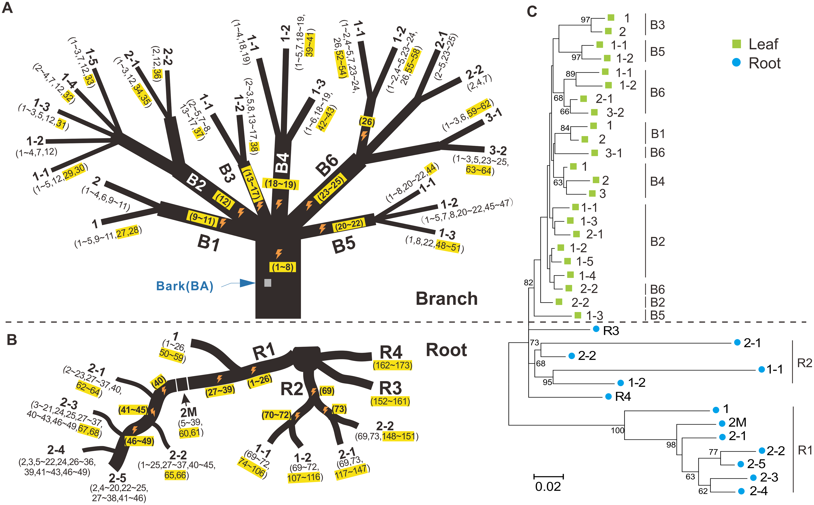
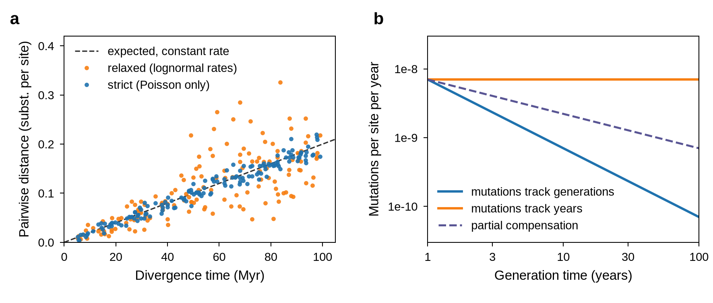

# Chapter 6. The molecular clock

**Status: Partly verified.** Molecular divergence does accumulate roughly in proportion to time within a gene and a group of related lineages, which makes molecular dating possible. A strict, universal clock is rejected: rates differ among genes, lineages and life histories, and apparent rates depend on the timescale over which they are measured. Modern dating therefore uses relaxed clocks and careful calibration, and plant results show that generation time and growth shape per-year rates in ways that are still being worked out.

Related notes in this repository: [molecular-clock](../../theories/molecular-clock/THEORY.md), [ohta-1972-population-size-rate](../../theories/ohta-1972-population-size-rate/THEORY.md), [kimura-ohta-1971-polymorphism-phase](../../theories/kimura-ohta-1971-polymorphism-phase/THEORY.md), [nearly-neutral-theory](../../theories/nearly-neutral-theory/THEORY.md).

## 6.1 Statement and history

Comparisons of protein sequences in the early 1960s, such as cytochrome c across species [1], suggested that the number of amino acid differences between two species grows with the time since they diverged. Zuckerkandl and Pauling described molecules as documents of evolutionary history that can be used to build a molecular phylogeny [2]. Ohta and Kimura argued that the uniformity of the rate of amino acid substitution across diverse lines is compatible with the random fixation of neutral or very slightly deleterious mutations [3]. Under strict neutrality the substitution rate equals the neutral mutation rate per unit time, which gives the clock its theoretical basis (Chapter 3).

Bromham and Penny summarised how the constancy of rate was explained by neutrality and listed the sources of rate variation that theory predicts [4]. Kumar described four decades of use of the clock as a tool for timescales and as a null model for rates of evolution and mutation [5].

## 6.2 What the theory predicts

- **Linearity.** For a given gene, the expected number of substitutions between two lineages grows linearly with divergence time; the variance follows a Poisson process under the strictest model (Figure 6.2a).
- **Generation time.** If mutations arise mainly at DNA replication in the germline, lineages with shorter generation times should evolve faster per year, especially at synonymous sites [6].
- **Population size.** Under the nearly neutral theory, slightly deleterious substitutions are fixed faster in small populations, so nonsynonymous rates should depend on Ne more than synonymous rates do [3].
- **Calibration.** If the clock holds, one well-dated node fixes the rate and dates all others.

## 6.3 Evidence for

- **Approximate clocks are real.** Divergence grows with time across many genes and groups; this is what makes the clock useful as a dating tool and null model [4, 5].
- **Relaxed clocks work.** Models that let rates evolve along the tree make dating possible without assuming equal rates: a Bayesian model for the evolution of the rate itself [7], penalized likelihood smoothing of rates [8], relaxed phylogenetics that estimate trees and dates together under uncertain rates and calibrations [9], and Bayesian dating with multiple loci and soft fossil bounds [10]. Ho and Duchêne compared these methods and how to choose among them [11].
- **Direct mutation rates.** Mutation accumulation lines give the rate per generation directly. In Arabidopsis thaliana, five lines kept by single-seed descent for 30 generations gave 7 × 10⁻⁹ base substitutions per site per generation, mostly G:C to A:T transitions [12]; a second study after 25 generations gave 6.95 × 10⁻⁹, with mutations more frequent in transposable elements and centromeric regions [13].
- **Plant dating in practice.** Bayesian clock dating placed the crown of the Ampelopsis clade of Vitaceae at 41.2 Ma (95% HPD 23.4–61.0 Ma) [14], and whole plastomes have been used to resolve relationships in Vitis [15].

## 6.4 Evidence against, and difficulties

- **Lineage effects.** Wu and Li found higher substitution rates in rodents than in humans, with a larger difference at synonymous than nonsynonymous sites, and suggested shorter generation times as a simple explanation [6].
- **Life history in plants.** In five large angiosperm clades, rates of molecular evolution were consistently lower in trees and shrubs than in related herbs, which also had higher variance in rate [16]. Gaut and colleagues summarised rate variation among sites, genes and plant lineages, with perennials evolving more slowly than annuals [17]. Lanfear and colleagues described methods to measure rates and their correlates with species traits [18].
- **Time-dependency.** Ho and colleagues found that rates estimated over short timescales are higher than long-term rates, so extrapolating rates across timescales is invalid; this matters for studies of populations, domestication and conservation [19].
- **Calibration conflicts.** Scally and Durbin discussed how a lower than expected human mutation rate from direct estimates changes the timescale of human evolution [20]. Pedigree or mutation-accumulation rates and phylogenetic rates measure different things.
- **Strict clock rejected in practice.** Drummond and colleagues described the strict clock and the clock-free unrooted tree as two biologically unrealistic extremes, with real evolution in between [9].

## 6.5 Status and reasoning

**Partly verified.** Divergence accumulates with time and relaxed-clock dating is a reliable tool when calibrations are good [9, 10, 11]. The strict clock fails: rates vary with lineage, life history and timescale [6, 16, 19]. In plants it is not yet clear whether mutations track generations, cell divisions or absolute time; recent tree data point in different directions (Section 6.6), so a per-year rate borrowed from another species is an assumption that should be stated.

## 6.6 Plants, crops and grapevine

- **Long-lived trees.** A 234-year-old oak carried only a few fixed somatic single-nucleotide variants, whose order could be traced along nested branches, suggesting that shoot meristem stem cells are well protected [21]. In a Populus trichocarpa tree with two stems evolving independently for 330 years, per-year somatic mutation and epimutation rates were lower than in annuals [22]. A Eucalyptus tree 100 times larger than Arabidopsis had a per-generation mutation rate only ten times greater [23].
- **Time or growth?** In two Shorea species, the somatic mutation rate per metre of growth was 3.7-fold higher in the slower-growing species, giving the same rate per year; the authors concluded that somatic mutations accumulate with absolute time [24]. Johannes integrated tree studies and found that the per-year rate scales inversely with generation time (μY ∝ G⁻¹), the same power law as in mammals [25]. These are not strictly in conflict, since one compares growth rates and the other generation times, but they imply different per-year clocks (Figure 6.2b).
- **Inside one plant.** Sequencing 754 genomes from tissues of eight species, Wang and colleagues found that mutation accumulates more slowly per unit time in shoot apical meristems than in roots in perennials, but not in annuals (Figure 6.1) [26].
- **Grapevine clones.** Clones accumulate somatic mutations during centuries of propagation. In Chardonnay, 1,620 markers distinguished 15 clones [27]; in 15 Zinfandel clones somatic mutations accumulated in individual clones and subsets of clones [28]; in 23 Pinot noir clones, somatic variation (67,277 SNPs and 4,037 structural variants) was dominated by rare variants and depleted from coding regions, and about 12% of the genome lay in long runs of homozygosity [29]. These variants measure clonal time, not sexual generations.
- **Dating domestication.** Grape domestication dates [30, 31] depend on the mutation rate per generation and the generation time chosen. A short generation time with a per-generation rate from an annual can give dates far from those obtained with tree-like values, so both must be reported and their effect shown.

## 6.7 How to test it with public data

- **Data.** Coding sequences or plastomes for a group with fossil calibrations; for rates, published mutation accumulation or somatic mutation data [12, 13, 22].
- **Tools.** BEAST-type relaxed clocks [9], MCMCTree [10], penalized likelihood (r8s, treePL) [8].
- **Analysis.** (1) Fit strict and relaxed clocks and compare by marginal likelihood. (2) Check rate against life history (herb versus woody) [16]. (3) Run dating with and without each calibration to find conflicts. (4) For population-level dating, show how dates change across plausible mutation rates and generation times. The script [`scripts/ch06_molecular_clock_figures.py`](../scripts/ch06_molecular_clock_figures.py) simulates strict and relaxed clocks (Figure 6.2).
- **What would break the theory.** No relationship between divergence and time within a gene and clade, after saturation is corrected.

## 6.8 Open questions

- Do plant mutations accumulate with cell divisions, years or generations, and does the answer differ between meristem types?
- How should somatic mutations in clonal crops enter a population-level clock?
- How large is the time-dependency effect for nuclear genomes of plants?

## 6.9 Common mistakes

- Using a single per-year rate for annuals, trees and clonal crops alike.
- Taking a rate from deep phylogenetic calibration and applying it to population splits within thousands of years, or the reverse [19].
- Reporting a date without its interval and without stating the rate and generation time.
- Treating somatic variants among clones as if they were population polymorphisms.

## Figures

**Figure 6.1.** Pattern of somatic mutations in the branch leaves and roots of a peach tree. (A) Somatic mutations identified in leaves; each mutation is a number, the first ontogenetic presence is highlighted in yellow, and lightning symbols mark the putative position of shared mutations. (B) Somatic mutations identified in roots. (C) Ontogenetic trees built from all mutations in branches (green) and roots (blue). Reproduced unchanged from Wang L, Ji Y, Hu Y, et al. (2019) The architecture of intra-organism mutation rate variation in plants. *PLoS Biology* 17:e3000191, Figure 1. https://doi.org/10.1371/journal.pbio.3000191. Licence: CC BY 4.0 (https://creativecommons.org/licenses/by/4.0/).

**Figure 6.2.** (a) Pairwise distance against divergence time for 150 simulated lineage pairs under a strict clock (Poisson variation only) and a relaxed clock (lognormal lineage rates, σ = 0.5). (b) Per-year mutation rate against generation time under three models: mutations track generations (slope −1), track years (flat), or partial compensation; illustration with a reference rate of 7 × 10⁻⁹ per site per generation. Made with [`scripts/ch06_molecular_clock_figures.py`](../scripts/ch06_molecular_clock_figures.py).

## References

1. Margoliash E (1963) PRIMARY STRUCTURE AND EVOLUTION OF CYTOCHROME C. *Proceedings of the National Academy of Sciences* 50:672-679. https://doi.org/10.1073/pnas.50.4.672
2. Zuckerkandl E, Pauling L (1965) Molecules as documents of evolutionary history. *Journal of Theoretical Biology* 8:357-366. https://doi.org/10.1016/0022-5193(65)90083-4
3. Ohta T, Kimura M (1971) On the constancy of the evolutionary rate of cistrons. *Journal of Molecular Evolution* 1:18-25. https://doi.org/10.1007/BF01659391
4. Bromham L, Penny D (2003) The modern molecular clock. *Nature Reviews Genetics* 4:216-224. https://doi.org/10.1038/nrg1020
5. Kumar S (2005) Molecular clocks: four decades of evolution. *Nature Reviews Genetics* 6:654-662. https://doi.org/10.1038/nrg1659
6. Wu CI, Li WH (1985) Evidence for higher rates of nucleotide substitution in rodents than in man. *Proceedings of the National Academy of Sciences* 82:1741-1745. https://doi.org/10.1073/pnas.82.6.1741
7. Thorne JL, Kishino H, Painter IS (1998) Estimating the rate of evolution of the rate of molecular evolution. *Molecular Biology and Evolution* 15:1647-1657. https://doi.org/10.1093/oxfordjournals.molbev.a025892
8. Sanderson MJ (2002) Estimating Absolute Rates of Molecular Evolution and Divergence Times: A Penalized Likelihood Approach. *Molecular Biology and Evolution* 19:101-109. https://doi.org/10.1093/oxfordjournals.molbev.a003974
9. Drummond AJ, Ho SYW, Phillips MJ, et al. (2006) Relaxed Phylogenetics and Dating with Confidence. *PLoS Biology* 4:e88. https://doi.org/10.1371/journal.pbio.0040088
10. Yang Z, Rannala B (2006) Bayesian Estimation of Species Divergence Times Under a Molecular Clock Using Multiple Fossil Calibrations with Soft Bounds. *Molecular Biology and Evolution* 23:212-226. https://doi.org/10.1093/molbev/msj024
11. Ho SYW, Duchêne S (2014) Molecular‐clock methods for estimating evolutionary rates and timescales. *Molecular Ecology* 23:5947-5965. https://doi.org/10.1111/mec.12953
12. Ossowski S, Schneeberger K, Lucas-Lledó JI, et al. (2010) The Rate and Molecular Spectrum of Spontaneous Mutations in Arabidopsis thaliana. *Science* 327:92-94. https://doi.org/10.1126/science.1180677
13. Weng ML, Becker C, Hildebrandt J, et al. (2019) Fine-Grained Analysis of Spontaneous Mutation Spectrum and Frequency in Arabidopsis thaliana. *Genetics* 211:703-714. https://doi.org/10.1534/genetics.118.301721
14. Nie ZL, Sun H, Manchester SR, et al. (2012) Evolution of the intercontinental disjunctions in six continents in the Ampelopsis clade of the grape family (Vitaceae). *BMC Evolutionary Biology* 12:17. https://doi.org/10.1186/1471-2148-12-17
15. Wen J, Harris A, Kalburgi Y, et al. (2018) Chloroplast phylogenomics of the New World grape species ( Vitis , Vitaceae). *Journal of Systematics and Evolution* 56:297-308. https://doi.org/10.1111/jse.12447
16. Smith SA, Donoghue MJ (2008) Rates of Molecular Evolution Are Linked to Life History in Flowering Plants. *Science* 322:86-89. https://doi.org/10.1126/science.1163197
17. Gaut B, Yang L, Takuno S, et al. (2011) The Patterns and Causes of Variation in Plant Nucleotide Substitution Rates. *Annual Review of Ecology, Evolution, and Systematics* 42:245-266. https://doi.org/10.1146/annurev-ecolsys-102710-145119
18. Lanfear R, Welch JJ, Bromham L (2010) Watching the clock: Studying variation in rates of molecular evolution between species. *Trends in Ecology &amp; Evolution* 25:495-503. https://doi.org/10.1016/j.tree.2010.06.007
19. Ho SYW, Phillips MJ, Cooper A, et al. (2005) Time Dependency of Molecular Rate Estimates and Systematic Overestimation of Recent Divergence Times. *Molecular Biology and Evolution* 22:1561-1568. https://doi.org/10.1093/molbev/msi145
20. Scally A, Durbin R (2012) Revising the human mutation rate: implications for understanding human evolution. *Nature Reviews Genetics* 13:745-753. https://doi.org/10.1038/nrg3295
21. Schmid-Siegert E, Sarkar N, Iseli C, et al. (2017) Low number of fixed somatic mutations in a long-lived oak tree. *Nature Plants* 3:926-929. https://doi.org/10.1038/s41477-017-0066-9
22. Hofmeister BT, Denkena J, Colomé-Tatché M, et al. (2020) A genome assembly and the somatic genetic and epigenetic mutation rate in a wild long-lived perennial Populus trichocarpa. *Genome Biology* 21:259. https://doi.org/10.1186/s13059-020-02162-5
23. Orr AJ, Padovan A, Kainer D, et al. (2020) A phylogenomic approach reveals a low somatic mutation rate in a long-lived plant. *Proceedings of the Royal Society B: Biological Sciences* 287:20192364. https://doi.org/10.1098/rspb.2019.2364
24. Satake A, Imai R, Fujino T, et al. (2024) Somatic mutation rates scale with time not growth rate in long-lived tropical trees. *eLife* 12:RP88456. https://doi.org/10.7554/elife.88456.3
25. Johannes F (2024) Allometric scaling of somatic mutation and epimutation rates in trees. *Evolution* 79:1-5. https://doi.org/10.1093/evolut/qpae150
26. Wang L, Ji Y, Hu Y, et al. (2019) The architecture of intra-organism mutation rate variation in plants. *PLOS Biology* 17:e3000191. https://doi.org/10.1371/journal.pbio.3000191
27. Roach MJ, Johnson DL, Bohlmann J, et al. (2018) Population sequencing reveals clonal diversity and ancestral inbreeding in the grapevine cultivar Chardonnay. *PLOS Genetics* 14:e1007807. https://doi.org/10.1371/journal.pgen.1007807
28. Vondras AM, Minio A, Blanco-Ulate B, et al. (2019) The genomic diversification of grapevine clones. *BMC Genomics* 20:972. https://doi.org/10.1186/s12864-019-6211-2
29. Callipo P, Robinson H, Schmidt M, et al. (2026) A dual genome-methylome map of clonal evolution in grapevine. *Genome Biology* 27:221. https://doi.org/10.1186/s13059-026-04184-x
30. Zhou Y, Massonnet M, Sanjak JS, et al. (2017) Evolutionary genomics of grape ( Vitis vinifera ssp. vinifera ) domestication. *Proceedings of the National Academy of Sciences* 114:11715-11720. https://doi.org/10.1073/pnas.1709257114
31. Dong Y, Duan S, Xia Q, et al. (2023) Dual domestications and origin of traits in grapevine evolution. *Science* 379:892-901. https://doi.org/10.1126/science.add8655
