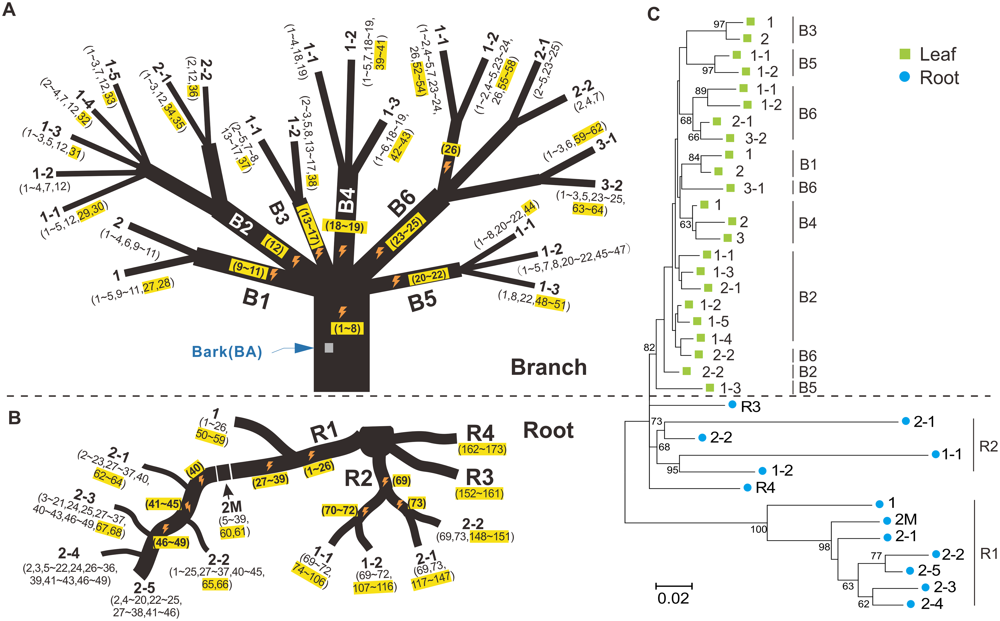
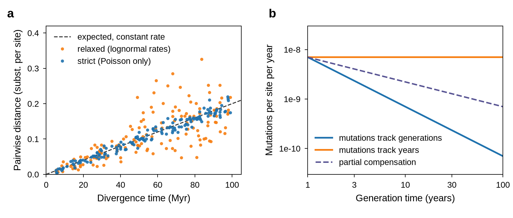

# 第 6 章 分子钟

**地位：部分验证。** 在同一基因、一组相关谱系之内，分子分化大致与时间成比例地积累，这使分子定年成为可能。严格、普适的分子钟被否定：速率在基因、谱系和生活史之间不同，表观速率还取决于测量所用的时间尺度。因此现代定年使用宽松分子钟和谨慎的校准；植物的结果显示，世代时间和生长方式以仍在研究中的方式影响每年的速率。

本仓库相关条目：[molecular-clock](../../theories/molecular-clock/THEORY.md)、[ohta-1972-population-size-rate](../../theories/ohta-1972-population-size-rate/THEORY.md)、[kimura-ohta-1971-polymorphism-phase](../../theories/kimura-ohta-1971-polymorphism-phase/THEORY.md)、[nearly-neutral-theory](../../theories/nearly-neutral-theory/THEORY.md)。

## 6.1 内容与历史

20 世纪 60 年代初的蛋白质序列比较，例如不同物种细胞色素 c 的比较 [1]，提示两物种间氨基酸差异数随分化时间增加。Zuckerkandl 和 Pauling 把分子描述为进化历史的文献，可用于构建分子系统发育 [2]。太田和木村认为，不同谱系间氨基酸替代速率的均一性与中性或极轻微有害突变的随机固定相容 [3]。在严格中性下，替代速率等于单位时间的中性突变率，这给分子钟提供了理论基础（第 3 章）。

Bromham 和 Penny 概述了速率恒定性如何由中性解释，并列出理论预测的速率变异来源 [4]。Kumar 回顾了四十年来分子钟作为时间尺度工具和进化速率、突变率零模型的应用 [5]。

## 6.2 预测

- **线性。** 对给定基因，两谱系间替代数的期望随分化时间线性增加；在最严格的模型下方差服从泊松过程（图 6.2a）。
- **世代时间。** 如果突变主要在生殖系 DNA 复制时产生，世代时间短的谱系每年进化应更快，同义位点尤其如此 [6]。
- **群体大小。** 按近中性理论，轻微有害替代在小群体中固定更快，因此非同义速率应比同义速率更依赖 Ne [3]。
- **校准。** 如果分子钟成立，一个年代可靠的节点就能确定速率并给出其他所有节点的年代。

## 6.3 支持证据

- **近似分子钟确实存在。** 在许多基因和类群中分化随时间增加，这正是分子钟可作为定年工具和零模型的原因 [4, 5]。
- **宽松分子钟有效。** 允许速率沿树演化的模型使不假设等速率的定年成为可能：速率本身演化的贝叶斯模型 [7]，速率的惩罚似然平滑 [8]，在速率和校准不确定时同时估计树和年代的宽松系统发育 [9]，以及使用多个位点和软化石边界的贝叶斯定年 [10]。Ho 和 Duchêne 比较了这些方法及如何选择 [11]。
- **直接测得的突变率。** 突变积累系直接给出每代速率。在拟南芥中，五个单粒传 30 代的品系给出每位点每代 7 × 10⁻⁹ 个碱基替代，多数为 G:C 到 A:T 转换 [12]；另一项 25 代后的研究给出 6.95 × 10⁻⁹，突变在转座元件和着丝粒区更频繁 [13]。
- **植物定年实例。** 贝叶斯分子钟定年把葡萄科蛇葡萄类群的冠群定在 41.2 Ma（95% HPD 23.4–61.0 Ma）[14]，全叶绿体基因组被用于解析葡萄属内的关系 [15]。

## 6.4 反面证据与难点

- **谱系效应。** Wu 和 Li 发现啮齿类的替代速率高于人类，同义位点的差异大于非同义位点，并认为世代时间较短是简单的解释 [6]。
- **植物生活史。** 在五个大的被子植物类群中，乔木和灌木的分子进化速率一致地低于相关的草本，草本的速率方差也更大 [16]。Gaut 等概述了位点、基因和植物谱系之间的速率变异，多年生植物比一年生植物进化慢 [17]。Lanfear 等介绍了测量速率及其与物种性状相关性的方法 [18]。
- **时间依赖性。** Ho 等发现短时间尺度估计的速率高于长期速率，因此跨时间尺度外推速率是无效的；这对群体、驯化和保护研究都有影响 [19]。
- **校准冲突。** Scally 和 Durbin 讨论了直接估计得到的人类突变率低于预期，如何改变人类进化的时间尺度 [20]。系谱或突变积累速率与系统发育速率测量的是不同的东西。
- **严格分子钟在实践中被否定。** Drummond 等把严格分子钟和无钟的无根树描述为两个生物学上不现实的极端，真实进化介于二者之间 [9]。

## 6.5 地位与理由

**部分验证。** 分化随时间积累，校准可靠时宽松分子钟定年是可靠的工具 [9, 10, 11]。严格分子钟不成立：速率随谱系、生活史和时间尺度变化 [6, 16, 19]。在植物中，突变究竟跟随世代、细胞分裂还是绝对时间还不清楚；最近的树木数据指向不同方向（6.6 节），因此从别的物种借来的每年速率是一个应当说明的假设。

## 6.6 植物、作物与葡萄

- **长寿树木。** 一棵 234 年的栎树只带有少数固定的体细胞单核苷酸变异，其出现顺序可沿嵌套的枝条追踪，说明茎尖分生组织干细胞受到很好的保护 [21]。在一棵两根主干独立演化 330 年的毛果杨中，每年的体细胞突变率和表观突变率低于一年生植物 [22]。一棵比拟南芥大 100 倍的桉树，每代突变率只高十倍 [23]。
- **时间还是生长？** 在两种娑罗双属树木中，每米生长的体细胞突变率在生长较慢的物种中高 3.7 倍，因而每年的速率相同；作者认为体细胞突变随绝对时间积累 [24]。Johannes 整合树木研究，发现每年速率与世代时间成反比（μY ∝ G⁻¹），与哺乳动物的幂律相同 [25]。二者并不严格冲突，因为一个比较的是生长速度，一个比较的是世代时间，但它们意味着不同的每年分子钟（图 6.2b）。
- **同一植株内部。** Wang 等测序了八个物种不同组织的 754 个基因组，发现多年生植物茎尖分生组织单位时间的突变积累慢于根，而一年生植物没有这种差异（图 6.1）[26]。
- **葡萄克隆。** 克隆在几百年的繁殖中积累体细胞突变。在霞多丽中，1,620 个标记可区分 15 个克隆 [27]；在 15 个仙粉黛克隆中，体细胞突变在单个克隆和部分克隆中积累 [28]；在 23 个黑比诺克隆中，体细胞变异（67,277 个 SNP 和 4,037 个结构变异）以稀有变异为主并在编码区减少，约 12% 的基因组位于长纯合片段中 [29]。这些变异度量的是克隆时间，而不是有性世代。
- **驯化定年。** 葡萄驯化年代 [30, 31] 取决于所选的每代突变率和世代时间。用一年生植物的每代速率配短世代时间，得到的年代可能与用树木参数得到的相差很远，因此两者都必须报告并展示其影响。

## 6.7 用公开数据检验

- **数据。** 有化石校准的类群的编码序列或叶绿体基因组；速率方面，已发表的突变积累或体细胞突变数据 [12, 13, 22]。
- **工具。** BEAST 类宽松分子钟 [9]、MCMCTree [10]、惩罚似然（r8s、treePL）[8]。
- **分析。** (1) 拟合严格和宽松分子钟，用边际似然比较。(2) 检查速率与生活史（草本与木本）的关系 [16]。(3) 逐个加入和去掉校准点定年，找出冲突。(4) 对群体层面的定年，展示年代如何随合理的突变率和世代时间变化。脚本 [`scripts/ch06_molecular_clock_figures.py`](../scripts/ch06_molecular_clock_figures.py) 模拟严格和宽松分子钟（图 6.2）。
- **什么结果会推翻这一理论。** 校正饱和后，同一基因、同一类群内分化与时间没有关系。

## 6.8 未解决的问题

- 植物突变是随细胞分裂、年份还是世代积累？不同分生组织类型的答案是否不同？
- 克隆作物的体细胞突变应如何进入群体层面的分子钟？
- 植物核基因组的时间依赖效应有多大？

## 6.9 常见错误

- 对一年生植物、树木和克隆作物使用同一个每年速率。
- 把深层系统发育校准得到的速率用于几千年内的群体分化，或者反过来 [19]。
- 报告年代而不给区间，也不说明速率和世代时间。
- 把克隆之间的体细胞变异当作群体多态。

## 图

**图 6.1.** 一棵桃树枝条叶片和根中的体细胞突变格局。(A) 叶片中鉴定的体细胞突变；每个突变用一个数字表示，首次出现处以黄色标出，闪电符号表示共享突变的推测位置。(B) 根中鉴定的体细胞突变。(C) 用枝条（绿）和根（蓝）中全部突变构建的个体发育树。原样转载自 Wang L, Ji Y, Hu Y, et al. (2019) The architecture of intra-organism mutation rate variation in plants. *PLoS Biology* 17:e3000191, Figure 1. https://doi.org/10.1371/journal.pbio.3000191。许可：CC BY 4.0（https://creativecommons.org/licenses/by/4.0/）。

**图 6.2.** (a) 150 对模拟谱系的两两距离与分化时间：严格分子钟（仅泊松变异）与宽松分子钟（对数正态谱系速率，σ = 0.5）。(b) 三种模型下每年突变率与世代时间的关系：突变跟随世代（斜率 −1）、跟随年份（水平）或部分补偿；示意，参考速率为每位点每代 7 × 10⁻⁹。由 [`scripts/ch06_molecular_clock_figures.py`](../scripts/ch06_molecular_clock_figures.py) 生成。

## 参考文献

1. Margoliash E (1963) PRIMARY STRUCTURE AND EVOLUTION OF CYTOCHROME C. *Proceedings of the National Academy of Sciences* 50:672-679. https://doi.org/10.1073/pnas.50.4.672
2. Zuckerkandl E, Pauling L (1965) Molecules as documents of evolutionary history. *Journal of Theoretical Biology* 8:357-366. https://doi.org/10.1016/0022-5193(65)90083-4
3. Ohta T, Kimura M (1971) On the constancy of the evolutionary rate of cistrons. *Journal of Molecular Evolution* 1:18-25. https://doi.org/10.1007/BF01659391
4. Bromham L, Penny D (2003) The modern molecular clock. *Nature Reviews Genetics* 4:216-224. https://doi.org/10.1038/nrg1020
5. Kumar S (2005) Molecular clocks: four decades of evolution. *Nature Reviews Genetics* 6:654-662. https://doi.org/10.1038/nrg1659
6. Wu CI, Li WH (1985) Evidence for higher rates of nucleotide substitution in rodents than in man. *Proceedings of the National Academy of Sciences* 82:1741-1745. https://doi.org/10.1073/pnas.82.6.1741
7. Thorne JL, Kishino H, Painter IS (1998) Estimating the rate of evolution of the rate of molecular evolution. *Molecular Biology and Evolution* 15:1647-1657. https://doi.org/10.1093/oxfordjournals.molbev.a025892
8. Sanderson MJ (2002) Estimating Absolute Rates of Molecular Evolution and Divergence Times: A Penalized Likelihood Approach. *Molecular Biology and Evolution* 19:101-109. https://doi.org/10.1093/oxfordjournals.molbev.a003974
9. Drummond AJ, Ho SYW, Phillips MJ, et al. (2006) Relaxed Phylogenetics and Dating with Confidence. *PLoS Biology* 4:e88. https://doi.org/10.1371/journal.pbio.0040088
10. Yang Z, Rannala B (2006) Bayesian Estimation of Species Divergence Times Under a Molecular Clock Using Multiple Fossil Calibrations with Soft Bounds. *Molecular Biology and Evolution* 23:212-226. https://doi.org/10.1093/molbev/msj024
11. Ho SYW, Duchêne S (2014) Molecular‐clock methods for estimating evolutionary rates and timescales. *Molecular Ecology* 23:5947-5965. https://doi.org/10.1111/mec.12953
12. Ossowski S, Schneeberger K, Lucas-Lledó JI, et al. (2010) The Rate and Molecular Spectrum of Spontaneous Mutations in Arabidopsis thaliana. *Science* 327:92-94. https://doi.org/10.1126/science.1180677
13. Weng ML, Becker C, Hildebrandt J, et al. (2019) Fine-Grained Analysis of Spontaneous Mutation Spectrum and Frequency in Arabidopsis thaliana. *Genetics* 211:703-714. https://doi.org/10.1534/genetics.118.301721
14. Nie ZL, Sun H, Manchester SR, et al. (2012) Evolution of the intercontinental disjunctions in six continents in the Ampelopsis clade of the grape family (Vitaceae). *BMC Evolutionary Biology* 12:17. https://doi.org/10.1186/1471-2148-12-17
15. Wen J, Harris A, Kalburgi Y, et al. (2018) Chloroplast phylogenomics of the New World grape species ( Vitis , Vitaceae). *Journal of Systematics and Evolution* 56:297-308. https://doi.org/10.1111/jse.12447
16. Smith SA, Donoghue MJ (2008) Rates of Molecular Evolution Are Linked to Life History in Flowering Plants. *Science* 322:86-89. https://doi.org/10.1126/science.1163197
17. Gaut B, Yang L, Takuno S, et al. (2011) The Patterns and Causes of Variation in Plant Nucleotide Substitution Rates. *Annual Review of Ecology, Evolution, and Systematics* 42:245-266. https://doi.org/10.1146/annurev-ecolsys-102710-145119
18. Lanfear R, Welch JJ, Bromham L (2010) Watching the clock: Studying variation in rates of molecular evolution between species. *Trends in Ecology &amp; Evolution* 25:495-503. https://doi.org/10.1016/j.tree.2010.06.007
19. Ho SYW, Phillips MJ, Cooper A, et al. (2005) Time Dependency of Molecular Rate Estimates and Systematic Overestimation of Recent Divergence Times. *Molecular Biology and Evolution* 22:1561-1568. https://doi.org/10.1093/molbev/msi145
20. Scally A, Durbin R (2012) Revising the human mutation rate: implications for understanding human evolution. *Nature Reviews Genetics* 13:745-753. https://doi.org/10.1038/nrg3295
21. Schmid-Siegert E, Sarkar N, Iseli C, et al. (2017) Low number of fixed somatic mutations in a long-lived oak tree. *Nature Plants* 3:926-929. https://doi.org/10.1038/s41477-017-0066-9
22. Hofmeister BT, Denkena J, Colomé-Tatché M, et al. (2020) A genome assembly and the somatic genetic and epigenetic mutation rate in a wild long-lived perennial Populus trichocarpa. *Genome Biology* 21:259. https://doi.org/10.1186/s13059-020-02162-5
23. Orr AJ, Padovan A, Kainer D, et al. (2020) A phylogenomic approach reveals a low somatic mutation rate in a long-lived plant. *Proceedings of the Royal Society B: Biological Sciences* 287:20192364. https://doi.org/10.1098/rspb.2019.2364
24. Satake A, Imai R, Fujino T, et al. (2024) Somatic mutation rates scale with time not growth rate in long-lived tropical trees. *eLife* 12:RP88456. https://doi.org/10.7554/elife.88456.3
25. Johannes F (2024) Allometric scaling of somatic mutation and epimutation rates in trees. *Evolution* 79:1-5. https://doi.org/10.1093/evolut/qpae150
26. Wang L, Ji Y, Hu Y, et al. (2019) The architecture of intra-organism mutation rate variation in plants. *PLOS Biology* 17:e3000191. https://doi.org/10.1371/journal.pbio.3000191
27. Roach MJ, Johnson DL, Bohlmann J, et al. (2018) Population sequencing reveals clonal diversity and ancestral inbreeding in the grapevine cultivar Chardonnay. *PLOS Genetics* 14:e1007807. https://doi.org/10.1371/journal.pgen.1007807
28. Vondras AM, Minio A, Blanco-Ulate B, et al. (2019) The genomic diversification of grapevine clones. *BMC Genomics* 20:972. https://doi.org/10.1186/s12864-019-6211-2
29. Callipo P, Robinson H, Schmidt M, et al. (2026) A dual genome-methylome map of clonal evolution in grapevine. *Genome Biology* 27:221. https://doi.org/10.1186/s13059-026-04184-x
30. Zhou Y, Massonnet M, Sanjak JS, et al. (2017) Evolutionary genomics of grape ( Vitis vinifera ssp. vinifera ) domestication. *Proceedings of the National Academy of Sciences* 114:11715-11720. https://doi.org/10.1073/pnas.1709257114
31. Dong Y, Duan S, Xia Q, et al. (2023) Dual domestications and origin of traits in grapevine evolution. *Science* 379:892-901. https://doi.org/10.1126/science.add8655
