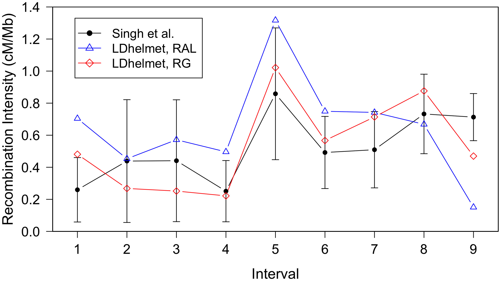
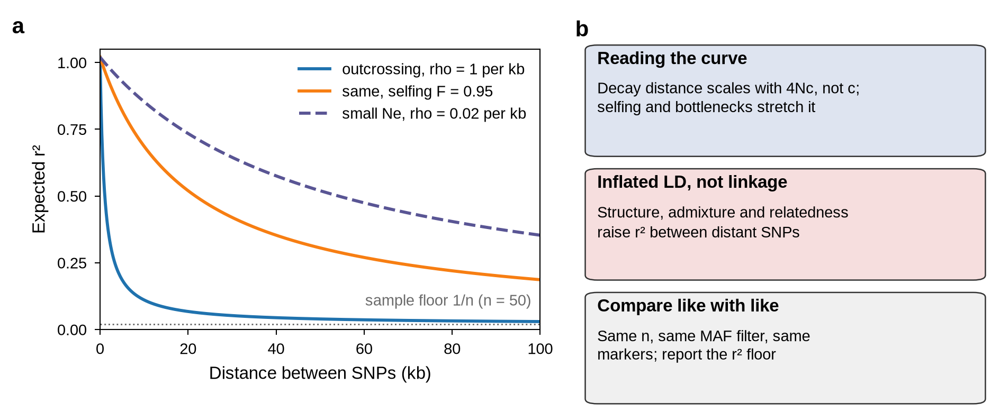

# Chapter 7. Recombination landscapes and linkage disequilibrium

**Status: Verified.** The theory that linkage disequilibrium (LD) is built by drift and broken by recombination, with an expected r² set by 4Nc, is confirmed by simulation and by data, and LD-based recombination maps agree with pedigree and crossover maps at broad scales. Recombination is concentrated in hotspots in many species; in mammals PRDM9 directs most of them, while plants lack PRDM9 and place crossovers near gene promoters. What remains open is how to separate recombination from demography and selection in LD maps, and why crossover landscapes differ so much among species.

Related notes in this repository: [hill-robertson-interference](../../theories/hill-robertson-interference/THEORY.md), [barton-1995-linkage-limits](../../theories/barton-1995-linkage-limits/THEORY.md), [gene-conversion](../../theories/gene-conversion/THEORY.md), [otto-barton-1997-recombination-modifier](../../theories/otto-barton-1997-recombination-modifier/THEORY.md).

## 7.1 Statement and history

Lewontin studied how selection and linkage interact in multilocus systems [1]. Hill and Robertson analysed the joint effect of population size N and recombination fraction c on LD between a pair of loci: starting from linkage equilibrium, the mean of D stays zero, but the mean of D² rises and then falls as loci fix, and the correlation r² within lines depends on N and c [2]. Sved used an identity-by-descent argument to relate LD to the probability that a chromosome segment is homozygous by descent, which gives the approximation E[r²] ≈ 1/(1 + 4Nc) [3]. Hudson’s coalescent with recombination links LD to genealogies (Chapter 5) [4].

Pritchard and Przeworski compared these predictions with human data [5]; Slatkin described LD as a sensitive indicator of the forces that structure a genome and as a tool for mapping [6]; Flint-Garcia and colleagues summarised the structure of LD in plants and its role in association mapping [7].

## 7.2 What the theory predicts

- **Decay with distance.** Expected r² falls with physical distance at a rate set by 4Nc, not by c alone, and approaches a floor set by sample size (Figure 7.2).
- **Mating system and history.** Selfing reduces effective recombination, and bottlenecks reduce N, so both extend LD.
- **Fine-scale maps from LD.** If rates vary along the genome, LD patterns among many SNPs can be used to estimate a population-scaled recombination map, which should agree with pedigree or crossover maps up to scaling.
- **Heterogeneity.** If crossovers are concentrated, most recombination should fall in a small share of the genome.

## 7.3 Evidence for

- **Hotspots in humans.** From SNP data in European and African samples, McVean and colleagues found local rate variation over four orders of magnitude, with 50% of recombination in less than 10% of the sequence and hotspots on average every 200 kb or less [8]. Myers and colleagues mapped more than 25,000 hotspots and proposed a two-stage model in which hotspots are stochastic within constrained large-scale rates [9]. Methods that model hotspots explicitly improve these estimates [10].
- **Agreement with pedigrees.** A pedigree map from 1,257 meioses correlated recombination with cytogenetic bands and sequence features and showed differences between maternal and paternal maps [11]. In Drosophila, the LD-based method LDhelmet gave maps that agree with experimental genetic maps (Figure 7.1) [12].
- **PRDM9.** Studies in humans and mice identified the histone methyltransferase PRDM9 as a major determinant of meiotic recombination hotspots [13, 14]. Demography-aware maps for 26 human populations confirmed that PRDM9 variation drives differences in the recombination landscape among populations [15].
- **Plants.** In Arabidopsis thaliana, which lacks PRDM9, crossovers increase towards gene promoters and terminators, and hotspots are associated with H2A.Z, H3K4me3, low nucleosome density and low DNA methylation [16]. LD among 19 accessions showed hotspots preferentially in intergenic regions [17]. In global samples LD decays within about 1 cM or 250 kb [18], and in a sample of 96 individuals within 50 kb [19]; an ultra-high-density map of more than 17,000 crossovers showed suppression over structural variants [20].

## 7.4 Evidence against, and difficulties

- **LD maps are not pure recombination maps.** Selection, demography and population structure all shape LD. Spence and Song developed a demography-aware method because cross-population comparisons were confounded by history [15]; Chan and colleagues tested robustness to positive selection by simulation [12].
- **Large-scale variation.** Across 62 animal, plant and fungal species, crossover rates are reduced in chromosome centres relative to their ends, more so in long chromosomes, and the pattern is poorly explained by centromere position [21]. Stapley and colleagues described large variation in recombination rate and distribution among taxa, populations, individuals and sexes [22]. Uniform-rate models therefore mislead.
- **Hotspot turnover.** Meiotic drive acts against PRDM9 binding motifs (weakly, in the human estimate), and PRDM9 variation changes the recombination landscape between populations [14, 15], so a map from one population may not fit another.
- **Genome size and chromatin.** In plants, larger genomes have lower crossover frequency per megabase, and chromatin marks influence where crossovers occur [23].

## 7.5 Status and reasoning

**Verified.** The drift–recombination theory of LD is confirmed by simulation and by data, and LD-based maps agree with pedigree and experimental maps at broad scales [8, 11, 12]. Hotspots and their main determinants are well established in mammals and in Arabidopsis [13, 16]. The open problems concern inference, not the theory: separating recombination from demography and selection, and explaining large differences among species [15, 21].

## 7.6 Plants, crops and grapevine

- **Plants recombine differently.** Gaut and colleagues argued that recombination is generally higher and more variable in plants than in animals and plays a central role in plant genome evolution [24]. More than 80 plant meiosis genes are now known [25]. Crossover numbers can be increased: in Arabidopsis hybrids mutant for recq4 and figl1, crossovers rose several-fold, and the usual male excess in recombination was reversed [26].
- **Mating system.** Arabidopsis is a selfer, yet LD decays within tens to hundreds of kilobases because of historical outcrossing and recombination [18, 19].
- **Grapevine.** In wild French grapevine, LD was no longer significant beyond 1.4 cM, while an earlier study of cultivated grapevine found significant LD up to 16.8 cM, about 12 times further; domestication bottlenecks and vegetative propagation were proposed as causes [27]. In over 1,000 samples from the USDA collection, LD decayed rapidly in cultivated grapes, consistent with a weak bottleneck followed by thousands of years of vegetative propagation, but cultivars were connected by a dense network of close pedigree relationships [28]. In a panel of 279 cultivars, LD extent ranged from 9 to 458 kb depending on genetic pool and genomic region [29]. The different numbers come from different samples, markers and LD statistics; they are not directly comparable.
- **Why clonality matters.** Vegetative propagation freezes existing LD for as long as a cultivar is propagated; only sexual generations break it. Close kinship among cultivars inflates r² unless relatedness is modelled.

## 7.7 How to test it with public data

- **Data.** Phased or unphased SNPs from a resequencing panel with known sample relationships; a genetic map from a cross for comparison.
- **Tools.** PLINK or PopLDdecay for r² decay; LDhat, LDhelmet or pyrho for fine-scale maps [10, 12, 15].
- **Analysis.** (1) Remove close relatives or model kinship. (2) Compute r² against distance with a fixed sample size and minor allele frequency filter, and fit the Hill–Robertson or Sved expectation [2, 3]. (3) Estimate a fine-scale map and compare it with a genetic map at 1 Mb resolution. (4) Test enrichment of hotspots near promoters [16]. The script [`scripts/ch07_recombination_ld_figures.py`](../scripts/ch07_recombination_ld_figures.py) draws the expected decay curves (Figure 7.2).
- **What would break the theory.** LD that does not decline with distance in a randomly mating sample, or LD maps that disagree with pedigree maps at broad scales after demography is modelled.

## 7.8 Open questions

- How fast do plant crossover hotspots turn over, given that they depend on chromatin rather than on PRDM9?
- How should LD in clonal crops be modelled when sexual generations are few and pedigrees are dense?
- Can raised crossover rates in breeding lines be used without breaking favourable haplotypes?

## 7.9 Common mistakes

- Comparing LD decay distances between studies that differ in sample size, MAF filter or marker type.
- Reading high r² between distant markers as tight linkage when it comes from structure or kinship.
- Converting ρ = 4Nc to c with an Ne that does not apply to the sample.
- Treating a hotspot map from one population as valid for another.

## Figures

**Figure 7.1.** Comparison of LDhelmet estimates with the experimental genetic map of Singh and colleagues in Drosophila melanogaster. Black, the experimental map with confidence intervals; blue, the LDhelmet estimate for the North American sample (RAL); red, the estimate for the African sample (RG). LDhelmet estimates were converted to cM/Mb by normalising them to the same total genetic distance. Reproduced unchanged from Chan AH, Jenkins PA, Song YS (2012) Genome-wide fine-scale recombination rate variation in Drosophila melanogaster. *PLoS Genetics* 8:e1003090, Figure 5. https://doi.org/10.1371/journal.pgen.1003090. Licence: CC BY 4.0 (https://creativecommons.org/licenses/by/4.0/).

**Figure 7.2.** (a) Expected r² against distance under the Sved approximation 1/(1 + 4Nc) plus 1/n for a sample of n = 50, for an outcrossing population with ρ = 4Nc = 1 per kb, the same population with selfing (F = 0.95, effective c scaled by 1 − F), and a small population with ρ = 0.02 per kb. (b) Points to check when reading an LD decay plot. Computed values; made with [`scripts/ch07_recombination_ld_figures.py`](../scripts/ch07_recombination_ld_figures.py).

## References

1. Lewontin RC (1964) THE INTERACTION OF SELECTION AND LINKAGE. I. GENERAL CONSIDERATIONS; HETEROTIC MODELS. *Genetics* 49:49-67. https://doi.org/10.1093/genetics/49.1.49
2. Hill WG, Robertson A (1968) Linkage disequilibrium in finite populations. *Theoretical and Applied Genetics* 38:226-231. https://doi.org/10.1007/BF01245622
3. Sved JA (1971) Linkage disequilibrium and homozygosity of chromosome segments in finite populations. *Theoretical Population Biology* 2:125-141. https://doi.org/10.1016/0040-5809(71)90011-6
4. Hudson RR (1983) Properties of a neutral allele model with intragenic recombination. *Theoretical Population Biology* 23:183-201. https://doi.org/10.1016/0040-5809(83)90013-8
5. Pritchard JK, Przeworski M (2001) Linkage Disequilibrium in Humans: Models and Data. *The American Journal of Human Genetics* 69:1-14. https://doi.org/10.1086/321275
6. Slatkin M (2008) Linkage disequilibrium — understanding the evolutionary past and mapping the medical future. *Nature Reviews Genetics* 9:477-485. https://doi.org/10.1038/nrg2361
7. Flint-Garcia SA, Thornsberry JM, Buckler ES (2003) Structure of Linkage Disequilibrium in Plants. *Annual Review of Plant Biology* 54:357-374. https://doi.org/10.1146/annurev.arplant.54.031902.134907
8. McVean GAT, Myers SR, Hunt S, et al. (2004) The Fine-Scale Structure of Recombination Rate Variation in the Human Genome. *Science* 304:581-584. https://doi.org/10.1126/science.1092500
9. Myers S, Bottolo L, Freeman C, et al. (2005) A Fine-Scale Map of Recombination Rates and Hotspots Across the Human Genome. *Science* 310:321-324. https://doi.org/10.1126/science.1117196
10. Auton A, McVean G (2007) Recombination rate estimation in the presence of hotspots. *Genome Research* 17:1219-1227. https://doi.org/10.1101/gr.6386707
11. Kong A, Gudbjartsson DF, Sainz J, et al. (2002) A high-resolution recombination map of the human genome. *Nature Genetics* 31:241-247. https://doi.org/10.1038/ng917
12. Chan AH, Jenkins PA, Song YS (2012) Genome-Wide Fine-Scale Recombination Rate Variation in Drosophila melanogaster. *PLoS Genetics* 8:e1003090. https://doi.org/10.1371/journal.pgen.1003090
13. Baudat F, Buard J, Grey C, et al. (2010) PRDM9 Is a Major Determinant of Meiotic Recombination Hotspots in Humans and Mice. *Science* 327:836-840. https://doi.org/10.1126/science.1183439
14. Myers S, Bowden R, Tumian A, et al. (2010) Drive Against Hotspot Motifs in Primates Implicates the PRDM9 Gene in Meiotic Recombination. *Science* 327:876-879. https://doi.org/10.1126/science.1182363
15. Spence JP, Song YS (2019) Inference and analysis of population-specific fine-scale recombination maps across 26 diverse human populations. *Science Advances* 5:eaaw9206. https://doi.org/10.1126/sciadv.aaw9206
16. Choi K, Zhao X, Kelly KA, et al. (2013) Arabidopsis meiotic crossover hot spots overlap with H2A.Z nucleosomes at gene promoters. *Nature Genetics* 45:1327-1336. https://doi.org/10.1038/ng.2766
17. Kim S, Plagnol V, Hu TT, et al. (2007) Recombination and linkage disequilibrium in Arabidopsis thaliana. *Nature Genetics* 39:1151-1155. https://doi.org/10.1038/ng2115
18. Nordborg M, Borevitz JO, Bergelson J, et al. (2002) The extent of linkage disequilibrium in Arabidopsis thaliana. *Nature Genetics* 30:190-193. https://doi.org/10.1038/ng813
19. Nordborg M, Hu TT, Ishino Y, et al. (2005) The Pattern of Polymorphism in Arabidopsis thaliana. *PLoS Biology* 3:e196. https://doi.org/10.1371/journal.pbio.0030196
20. Rowan BA, Heavens D, Feuerborn TR, et al. (2019) An Ultra High-Density Arabidopsis thaliana Crossover Map That Refines the Influences of Structural Variation and Epigenetic Features. *Genetics* 213:771-787. https://doi.org/10.1534/genetics.119.302406
21. Haenel Q, Laurentino TG, Roesti M, et al. (2018) Meta‐analysis of chromosome‐scale crossover rate variation in eukaryotes and its significance to evolutionary genomics. *Molecular Ecology* 27:2477-2497. https://doi.org/10.1111/mec.14699
22. Stapley J, Feulner PGD, Johnston SE, et al. (2017) Variation in recombination frequency and distribution across eukaryotes: patterns and processes. *Philosophical Transactions of the Royal Society B: Biological Sciences* 372:20160455. https://doi.org/10.1098/rstb.2016.0455
23. Henderson IR (2012) Control of meiotic recombination frequency in plant genomes. *Current Opinion in Plant Biology* 15:556-561. https://doi.org/10.1016/j.pbi.2012.09.002
24. Gaut BS, Wright SI, Rizzon C, et al. (2007) Recombination: an underappreciated factor in the evolution of plant genomes. *Nature Reviews Genetics* 8:77-84. https://doi.org/10.1038/nrg1970
25. Mercier R, Mézard C, Jenczewski E, et al. (2015) The Molecular Biology of Meiosis in Plants. *Annual Review of Plant Biology* 66:297-327. https://doi.org/10.1146/annurev-arplant-050213-035923
26. Fernandes JB, Séguéla-Arnaud M, Larchevêque C, et al. (2018) Unleashing meiotic crossovers in hybrid plants. *Proceedings of the National Academy of Sciences* 115:2431-2436. https://doi.org/10.1073/pnas.1713078114
27. Barnaud A, Laucou V, This P, et al. (2010) Linkage disequilibrium in wild French grapevine, Vitis vinifera L. subsp. silvestris. *Heredity* 104:431-437. https://doi.org/10.1038/hdy.2009.143
28. Myles S, Boyko AR, Owens CL, et al. (2011) Genetic structure and domestication history of the grape. *Proceedings of the National Academy of Sciences* 108:3530-3535. https://doi.org/10.1073/pnas.1009363108
29. Nicolas SD, Péros JP, Lacombe T, et al. (2016) Genetic diversity, linkage disequilibrium and power of a large grapevine (Vitis vinifera L) diversity panel newly designed for association studies. *BMC Plant Biology* 16:74. https://doi.org/10.1186/s12870-016-0754-z
