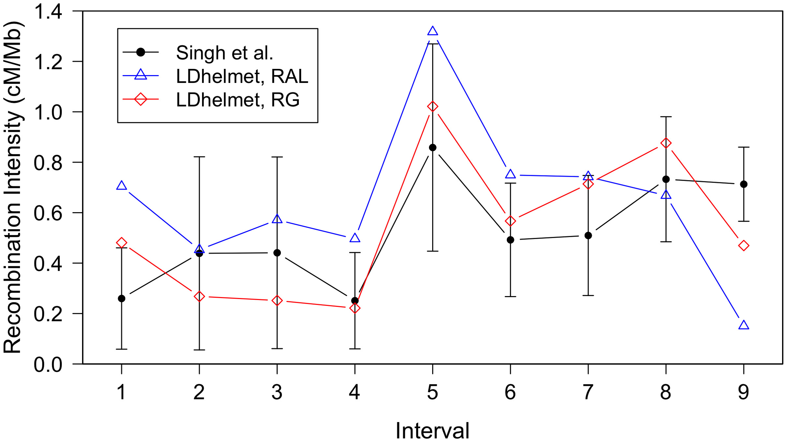
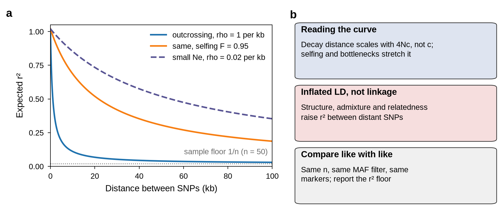

# 第 7 章 重组景观与连锁不平衡

**地位：已验证。** 连锁不平衡（LD）由漂变产生、被重组打破、期望 r² 由 4Nc 决定，这一理论得到模拟和数据的确认；基于 LD 的重组图谱在大尺度上与系谱图谱和交换图谱一致。在许多物种中重组集中于热点；哺乳动物中多数热点由 PRDM9 决定，而植物没有 PRDM9，交换集中在基因启动子附近。尚未解决的是如何在 LD 图谱中把重组与群体历史和选择分开，以及为什么不同物种的交换景观差别如此之大。

本仓库相关条目：[hill-robertson-interference](../../theories/hill-robertson-interference/THEORY.md)、[barton-1995-linkage-limits](../../theories/barton-1995-linkage-limits/THEORY.md)、[gene-conversion](../../theories/gene-conversion/THEORY.md)、[otto-barton-1997-recombination-modifier](../../theories/otto-barton-1997-recombination-modifier/THEORY.md)。

## 7.1 内容与历史

Lewontin 研究了多位点系统中选择与连锁的相互作用 [1]。Hill 和 Robertson 分析了群体大小 N 和重组率 c 对一对位点间 LD 的共同影响：从连锁平衡出发，D 的均值保持为零，但 D² 的均值先上升，随位点固定再下降，品系内的相关 r² 取决于 N 和 c [2]。Sved 用同源相同（IBD）的论证把 LD 与染色体片段同源纯合的概率联系起来，得到近似式 E[r²] ≈ 1/(1 + 4Nc) [3]。Hudson 的带重组溯祖把 LD 与谱系联系起来（第 5 章）[4]。

Pritchard 和 Przeworski 把这些预测与人类数据比较 [5]；Slatkin 把 LD 描述为反映塑造基因组的各种力的灵敏指标和定位工具 [6]；Flint-Garcia 等概述了植物 LD 的结构及其在关联定位中的作用 [7]。

## 7.2 预测

- **随距离衰减。** 期望 r² 随物理距离下降，下降速度由 4Nc 而非 c 单独决定，并趋近由样本量决定的下限（图 7.2）。
- **交配系统与历史。** 自交降低有效重组，瓶颈降低 N，二者都会延长 LD。
- **由 LD 得到精细图谱。** 如果重组率沿基因组变化，许多 SNP 之间的 LD 格局可用于估计按群体标度的重组图谱，它应与系谱或交换图谱在比例上一致。
- **异质性。** 如果交换高度集中，大部分重组应落在基因组的一小部分中。

## 7.3 支持证据

- **人类的热点。** McVean 等用欧洲和非洲样本的 SNP 数据发现局部重组率变化跨四个数量级，50% 的重组发生在不到 10% 的序列中，平均每 200 kb 或更短就有一个热点 [8]。Myers 等定位了超过 25,000 个热点，并提出两阶段模型：热点是随机出现的，而大尺度速率受到约束 [9]。显式建模热点的方法改进了这些估计 [10]。
- **与系谱一致。** 基于 1,257 次减数分裂的系谱图谱显示重组与细胞遗传学带型和序列特征相关，母本与父本图谱存在差异 [11]。在果蝇中，基于 LD 的 LDhelmet 方法得到的图谱与实验遗传图谱大体一致（图 7.1）[12]。
- **PRDM9。** 人和小鼠的研究确定组蛋白甲基转移酶 PRDM9 是减数分裂重组热点的主要决定因子 [13, 14]。26 个人类群体的考虑群体历史的图谱证实，PRDM9 变异驱动了群体间重组景观的差异 [15]。
- **植物。** 拟南芥没有 PRDM9，其交换向基因启动子和终止子方向增加，热点与 H2A.Z、H3K4me3、低核小体密度和低 DNA 甲基化相关 [16]。19 个株系的 LD 显示热点偏好出现在基因间区 [17]。在全球样本中 LD 在约 1 cM 或 250 kb 内衰减 [18]，在 96 个个体的样本中在 50 kb 内衰减 [19]；包含超过 17,000 个交换的超高密度图谱显示结构变异处交换受到抑制 [20]。

## 7.4 反面证据与难点

- **LD 图谱不是纯粹的重组图谱。** 选择、群体历史和群体结构都塑造 LD。Spence 和 Song 开发考虑群体历史的方法，正是因为跨群体比较被历史混淆 [15]；Chan 等用模拟检验了方法对正选择的稳健性 [12]。
- **大尺度变化。** 在 62 个动物、植物和真菌物种中，染色体中部的交换率相对两端降低，长染色体尤其明显，而着丝粒位置解释不了这一格局 [21]。Stapley 等描述了重组率及其分布在类群、群体、个体和性别之间的巨大差异 [22]。因此均匀速率模型会产生误导。
- **热点更替。** 减数分裂驱动作用于 PRDM9 结合基序（在人类的估计中效应较弱），PRDM9 变异也会改变群体间的重组景观 [14, 15]，因此一个群体的图谱不一定适用于另一个群体。
- **基因组大小与染色质。** 在植物中，基因组越大，每兆碱基的交换频率越低，染色质标记影响交换发生的位置 [23]。

## 7.5 地位与理由

**已验证。** LD 的漂变–重组理论得到模拟和数据的确认，基于 LD 的图谱在大尺度上与系谱和实验图谱一致 [8, 11, 12]。热点及其主要决定因子在哺乳动物和拟南芥中已经明确 [13, 16]。尚未解决的问题在推断而非理论本身：如何把重组与群体历史和选择分开，以及如何解释物种间的巨大差异 [15, 21]。

## 7.6 植物、作物与葡萄

- **植物的重组不同。** Gaut 等认为植物的重组总体上比动物更高、更多变，并在植物基因组进化中起核心作用 [24]。目前已知 80 多个植物减数分裂基因 [25]。交换数可以被提高：在 recq4 figl1 突变的拟南芥杂种中，交换增加了数倍，通常的雄性重组偏多也被逆转 [26]。
- **交配系统。** 拟南芥是自交植物，但由于历史上的异交和重组，LD 仍在几十到几百 kb 内衰减 [18, 19]。
- **葡萄。** 在法国野生葡萄中，LD 超过 1.4 cM 后不再显著，而此前对栽培葡萄的研究发现显著 LD 可延伸到 16.8 cM，约远 12 倍；作者认为原因是驯化瓶颈和营养繁殖 [27]。在美国农业部种质库的 1,000 多份样本中，栽培葡萄的 LD 衰减很快，符合弱瓶颈加数千年营养繁殖的情形，但品种之间由密集的近亲系谱网络相连 [28]。在 279 个品种的群体中，LD 范围随遗传库和基因组区域在 9 到 458 kb 之间 [29]。这些数字来自不同的样本、标记和 LD 统计量，不能直接比较。
- **为什么克隆繁殖重要。** 营养繁殖使一个品种被繁殖期间已有的 LD 保持不变；只有有性世代才会打破它。品种间的近亲关系会抬高 r²，除非对亲缘关系建模。

## 7.7 用公开数据检验

- **数据。** 样本亲缘关系已知的重测序群体的已定相或未定相 SNP；一个杂交群体的遗传图谱用于比较。
- **工具。** r² 衰减用 PLINK 或 PopLDdecay；精细图谱用 LDhat、LDhelmet 或 pyrho [10, 12, 15]。
- **分析。** (1) 去除近亲或对亲缘关系建模。(2) 在固定样本量和次要等位基因频率过滤下计算 r² 随距离的变化，拟合 Hill–Robertson 或 Sved 期望 [2, 3]。(3) 估计精细图谱，并在 1 Mb 分辨率上与遗传图谱比较。(4) 检验热点在启动子附近的富集 [16]。脚本 [`scripts/ch07_recombination_ld_figures.py`](../scripts/ch07_recombination_ld_figures.py) 画出期望衰减曲线（图 7.2）。
- **什么结果会推翻这一理论。** 在随机交配样本中 LD 不随距离下降，或在对群体历史建模后 LD 图谱与系谱图谱在大尺度上不一致。

## 7.8 未解决的问题

- 植物交换热点依赖染色质而不是 PRDM9，它们更替得有多快？
- 当有性世代很少、系谱很密时，克隆作物的 LD 应如何建模？
- 能否在育种系中利用提高的交换率而不打破有利单倍型？

## 7.9 常见错误

- 比较样本量、MAF 过滤或标记类型不同的研究之间的 LD 衰减距离。
- 把远距离标记间的高 r² 读作紧密连锁，而它其实来自结构或亲缘关系。
- 用不适用于该样本的 Ne 把 ρ = 4Nc 换算成 c。
- 把一个群体的热点图谱当作对另一个群体也成立。

## 图

**图 7.1.** 黑腹果蝇中 LDhelmet 估计与 Singh 等实验遗传图谱的比较。黑色为带置信区间的实验图谱；蓝色为北美样本（RAL）的 LDhelmet 估计；红色为非洲样本（RG）的估计。LDhelmet 估计按相同总遗传距离归一化换算为 cM/Mb。原样转载自 Chan AH, Jenkins PA, Song YS (2012) Genome-wide fine-scale recombination rate variation in Drosophila melanogaster. *PLoS Genetics* 8:e1003090, Figure 5. https://doi.org/10.1371/journal.pgen.1003090。许可：CC BY 4.0（https://creativecommons.org/licenses/by/4.0/）。

**图 7.2.** (a) Sved 近似 1/(1 + 4Nc) 加 1/n（样本 n = 50）下期望 r² 随距离的变化：异交群体 ρ = 4Nc = 每 kb 1；同一群体自交（F = 0.95，有效 c 乘以 1 − F）；小群体 ρ = 每 kb 0.02。(b) 解读 LD 衰减图时要检查的要点。计算值；由 [`scripts/ch07_recombination_ld_figures.py`](../scripts/ch07_recombination_ld_figures.py) 生成。

## 参考文献

1. Lewontin RC (1964) THE INTERACTION OF SELECTION AND LINKAGE. I. GENERAL CONSIDERATIONS; HETEROTIC MODELS. *Genetics* 49:49-67. https://doi.org/10.1093/genetics/49.1.49
2. Hill WG, Robertson A (1968) Linkage disequilibrium in finite populations. *Theoretical and Applied Genetics* 38:226-231. https://doi.org/10.1007/BF01245622
3. Sved JA (1971) Linkage disequilibrium and homozygosity of chromosome segments in finite populations. *Theoretical Population Biology* 2:125-141. https://doi.org/10.1016/0040-5809(71)90011-6
4. Hudson RR (1983) Properties of a neutral allele model with intragenic recombination. *Theoretical Population Biology* 23:183-201. https://doi.org/10.1016/0040-5809(83)90013-8
5. Pritchard JK, Przeworski M (2001) Linkage Disequilibrium in Humans: Models and Data. *The American Journal of Human Genetics* 69:1-14. https://doi.org/10.1086/321275
6. Slatkin M (2008) Linkage disequilibrium — understanding the evolutionary past and mapping the medical future. *Nature Reviews Genetics* 9:477-485. https://doi.org/10.1038/nrg2361
7. Flint-Garcia SA, Thornsberry JM, Buckler ES (2003) Structure of Linkage Disequilibrium in Plants. *Annual Review of Plant Biology* 54:357-374. https://doi.org/10.1146/annurev.arplant.54.031902.134907
8. McVean GAT, Myers SR, Hunt S, et al. (2004) The Fine-Scale Structure of Recombination Rate Variation in the Human Genome. *Science* 304:581-584. https://doi.org/10.1126/science.1092500
9. Myers S, Bottolo L, Freeman C, et al. (2005) A Fine-Scale Map of Recombination Rates and Hotspots Across the Human Genome. *Science* 310:321-324. https://doi.org/10.1126/science.1117196
10. Auton A, McVean G (2007) Recombination rate estimation in the presence of hotspots. *Genome Research* 17:1219-1227. https://doi.org/10.1101/gr.6386707
11. Kong A, Gudbjartsson DF, Sainz J, et al. (2002) A high-resolution recombination map of the human genome. *Nature Genetics* 31:241-247. https://doi.org/10.1038/ng917
12. Chan AH, Jenkins PA, Song YS (2012) Genome-Wide Fine-Scale Recombination Rate Variation in Drosophila melanogaster. *PLoS Genetics* 8:e1003090. https://doi.org/10.1371/journal.pgen.1003090
13. Baudat F, Buard J, Grey C, et al. (2010) PRDM9 Is a Major Determinant of Meiotic Recombination Hotspots in Humans and Mice. *Science* 327:836-840. https://doi.org/10.1126/science.1183439
14. Myers S, Bowden R, Tumian A, et al. (2010) Drive Against Hotspot Motifs in Primates Implicates the PRDM9 Gene in Meiotic Recombination. *Science* 327:876-879. https://doi.org/10.1126/science.1182363
15. Spence JP, Song YS (2019) Inference and analysis of population-specific fine-scale recombination maps across 26 diverse human populations. *Science Advances* 5:eaaw9206. https://doi.org/10.1126/sciadv.aaw9206
16. Choi K, Zhao X, Kelly KA, et al. (2013) Arabidopsis meiotic crossover hot spots overlap with H2A.Z nucleosomes at gene promoters. *Nature Genetics* 45:1327-1336. https://doi.org/10.1038/ng.2766
17. Kim S, Plagnol V, Hu TT, et al. (2007) Recombination and linkage disequilibrium in Arabidopsis thaliana. *Nature Genetics* 39:1151-1155. https://doi.org/10.1038/ng2115
18. Nordborg M, Borevitz JO, Bergelson J, et al. (2002) The extent of linkage disequilibrium in Arabidopsis thaliana. *Nature Genetics* 30:190-193. https://doi.org/10.1038/ng813
19. Nordborg M, Hu TT, Ishino Y, et al. (2005) The Pattern of Polymorphism in Arabidopsis thaliana. *PLoS Biology* 3:e196. https://doi.org/10.1371/journal.pbio.0030196
20. Rowan BA, Heavens D, Feuerborn TR, et al. (2019) An Ultra High-Density Arabidopsis thaliana Crossover Map That Refines the Influences of Structural Variation and Epigenetic Features. *Genetics* 213:771-787. https://doi.org/10.1534/genetics.119.302406
21. Haenel Q, Laurentino TG, Roesti M, et al. (2018) Meta‐analysis of chromosome‐scale crossover rate variation in eukaryotes and its significance to evolutionary genomics. *Molecular Ecology* 27:2477-2497. https://doi.org/10.1111/mec.14699
22. Stapley J, Feulner PGD, Johnston SE, et al. (2017) Variation in recombination frequency and distribution across eukaryotes: patterns and processes. *Philosophical Transactions of the Royal Society B: Biological Sciences* 372:20160455. https://doi.org/10.1098/rstb.2016.0455
23. Henderson IR (2012) Control of meiotic recombination frequency in plant genomes. *Current Opinion in Plant Biology* 15:556-561. https://doi.org/10.1016/j.pbi.2012.09.002
24. Gaut BS, Wright SI, Rizzon C, et al. (2007) Recombination: an underappreciated factor in the evolution of plant genomes. *Nature Reviews Genetics* 8:77-84. https://doi.org/10.1038/nrg1970
25. Mercier R, Mézard C, Jenczewski E, et al. (2015) The Molecular Biology of Meiosis in Plants. *Annual Review of Plant Biology* 66:297-327. https://doi.org/10.1146/annurev-arplant-050213-035923
26. Fernandes JB, Séguéla-Arnaud M, Larchevêque C, et al. (2018) Unleashing meiotic crossovers in hybrid plants. *Proceedings of the National Academy of Sciences* 115:2431-2436. https://doi.org/10.1073/pnas.1713078114
27. Barnaud A, Laucou V, This P, et al. (2010) Linkage disequilibrium in wild French grapevine, Vitis vinifera L. subsp. silvestris. *Heredity* 104:431-437. https://doi.org/10.1038/hdy.2009.143
28. Myles S, Boyko AR, Owens CL, et al. (2011) Genetic structure and domestication history of the grape. *Proceedings of the National Academy of Sciences* 108:3530-3535. https://doi.org/10.1073/pnas.1009363108
29. Nicolas SD, Péros JP, Lacombe T, et al. (2016) Genetic diversity, linkage disequilibrium and power of a large grapevine (Vitis vinifera L) diversity panel newly designed for association studies. *BMC Plant Biology* 16:74. https://doi.org/10.1186/s12870-016-0754-z
