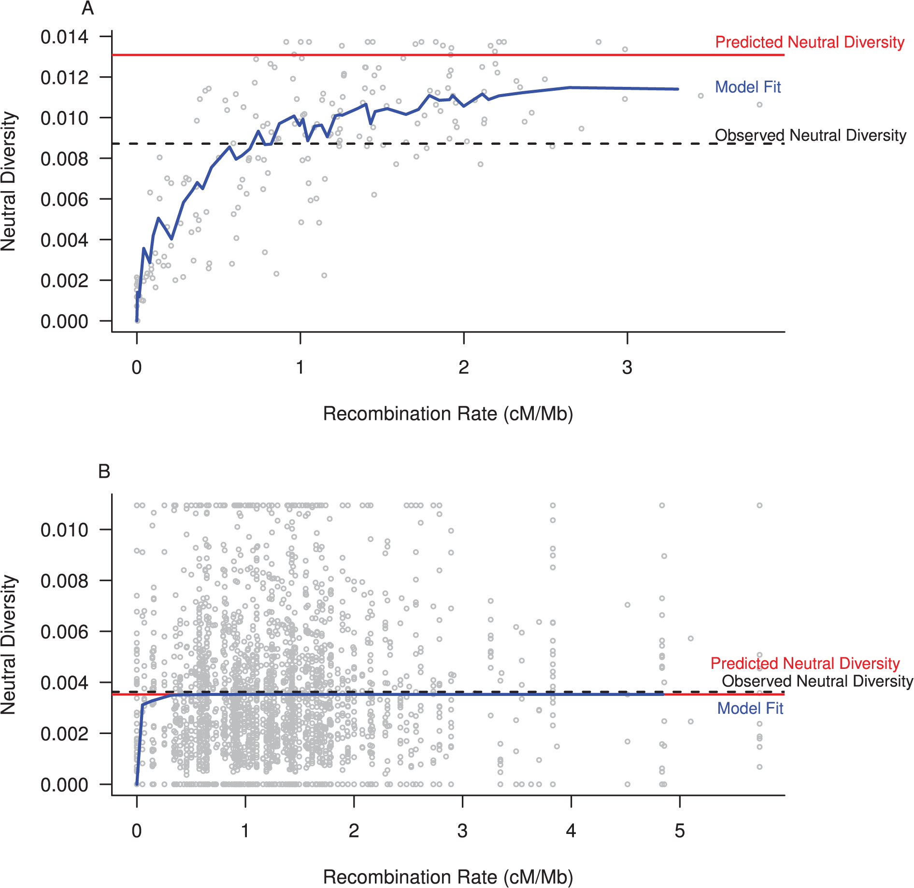
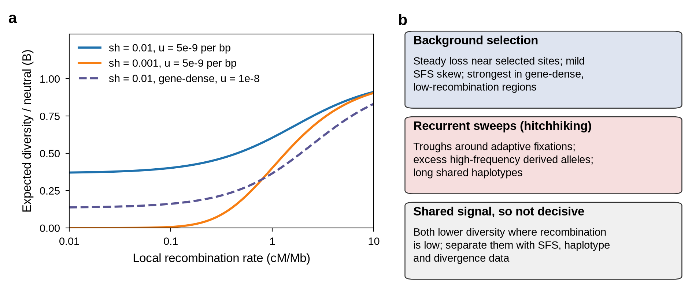

# Chapter 8. Linked selection and Lewontin’s paradox

**Status: Verified (phenomenon); relative contributions and Lewontin’s paradox Contested.** Selection at one site reduces neutral diversity at linked sites; the positive correlation between diversity and recombination rate has been found in Drosophila, humans, birds and plants, and models of background selection and sweeps predict much of the variation in diversity along genomes. What is disputed is how much comes from background selection versus sweeps in each species, and whether linked selection can explain why diversity varies so little among species compared with population size (Lewontin’s paradox).

Related notes in this repository: [background-selection](../../theories/background-selection/THEORY.md), [hudson-kaplan-bgs-with-recombination](../../theories/hudson-kaplan-bgs-with-recombination/THEORY.md), [nordborg-charlesworth-bgs-map](../../theories/nordborg-charlesworth-bgs-map/THEORY.md), [hitchhiking-sweeps](../../theories/hitchhiking-sweeps/THEORY.md), [genetic-draft](../../theories/genetic-draft/THEORY.md), [hill-robertson-interference](../../theories/hill-robertson-interference/THEORY.md), [begun-aquadro-recombination-diversity](../../theories/begun-aquadro-recombination-diversity/THEORY.md).

## 8.1 Statement and history

Maynard Smith and Haigh showed that when a favourable substitution occurs, average heterozygosity at linked neutral loci is reduced to an extent that falls with distance; in large populations this effect could matter more than random fixation and might explain why polymorphism varies less than expected among populations of different size [1]. Kaplan, Hudson and Langley used the coalescent to describe the steady-state effect of such hitchhiking on the number of neutral polymorphic sites [2]. Charlesworth, Morgan and Charlesworth showed that selection against deleterious mutations also reduces linked neutral variability, because a new neutral variant persists only in gametes free of deleterious alleles; they called this background selection (BGS) [3]. Nordborg, Charlesworth and Charlesworth derived an approximate equation for BGS with an arbitrary genetic map and distribution of selection coefficients, which failed only with very weak selection and tight linkage [4].

Hill and Robertson had shown earlier, in simulations of selection on two linked loci in small populations, that the process is specified by N·i·α, N·i·β and Nc, so that linkage limits the response to selection [5]. Gillespie proposed that recurrent sweeps act like a form of drift at linked sites (pseudohitchhiking or genetic draft), whose coalescent has multiple mergers and a different frequency spectrum [6].

## 8.2 What the theory predicts

- **Diversity tracks recombination.** Neutral diversity should be lower in regions of low recombination and high density of selected sites, while divergence between species is not reduced by linked selection alone (Figure 8.2a).
- **Different footprints.** BGS reduces diversity with a mild skew of the frequency spectrum; sweeps leave local troughs, an excess of high-frequency derived alleles and long haplotypes (Figure 8.2b).
- **Population size.** If linked selection is more effective in large populations, it should compress the range of diversity among species, which is one proposed solution to Lewontin’s paradox.
- **Efficacy of selection.** Hill–Robertson interference should reduce the efficacy of selection in low-recombination regions [7].

## 8.3 Evidence for

- **Drosophila.** Begun and Aquadro found that nucleotide diversity across 20 gene regions of D. melanogaster correlates with recombination rate, while divergence does not [8]. Comeron built a genome-wide BGS map from annotations and recombination rates, without using polymorphism data, and found that BGS shapes variation across the whole genome, including long introns and intergenic regions [9]. Elyashiv and colleagues jointly inferred the parameters of BGS and sweeps and concluded that linked selection reduces diversity in D. melanogaster more than previously appreciated [10]. Sella and colleagues argued that much of the Drosophila genome is under purifying selection and that a large fraction of differences between species are adaptive [11].
- **Humans.** Neutral diversity is reduced near conserved features, an average reduction of 19–26% on the autosomes and 12–40% on the X chromosome [12]. A BGS model explains about 60% of the variance in diversity at the megabase scale; adding sweeps does not improve the fit, and about 80% of the relevant deleterious mutations are in non-exonic regions [13]. BGS and biased gene conversion together affect up to 95% of human variants [14].
- **Across species.** In 40 species of obligately sexual eukaryotes, Corbett-Detig and colleagues used the relationship between diversity and recombination to estimate how much selection reduces linked neutral diversity, and found that the reduction is larger in species with larger census size (Figure 8.1) [15].
- **Birds.** In 200 genomes of four Ficedula flycatcher species, a heterogeneous landscape of differentiation emerged within species and was shaped by linked selection and recombination rate variation [16]. Burri argued that long-term linked selection can mimic footprints of positive selection in genome scans [17].

## 8.4 Evidence against, and difficulties

- **Lewontin’s paradox is not solved by linked selection alone.** With diversity from 172 metazoan taxa and new census size estimates, Buffalo found a significant relationship between diversity and census size and a negative relationship between map length and census size, but showed that even strong and abundant linked selection is unlikely to explain the narrow range of diversity [18]. Charlesworth and Jensen argued that direct selection and hitchhiking are unlikely to be sufficient, and highlighted population size change: many species may be far from the high equilibrium diversity their census sizes imply [19]. The marine alga Emiliania huxleyi, with an astronomically large population, shows an extreme case of the paradox [20].
- **Distinguishing modes.** The long controversy between BGS and hitchhiking left fundamental questions open, especially for regions of low recombination [21]. Charlesworth and Jensen stressed how hard it is to separate the footprints of sweeps, BGS, associative overdominance and Hill–Robertson interference [22]. Estimates differ between species: sweeps add little in humans [13] but appear pervasive in Drosophila [10].
- **Species differences.** Cutter and Payseur noted extreme disparities among species in the strength of the diversity–recombination correlation and discussed why [23].
- **Model limits.** BGS formulas assume strongly selected mutations; weaker mutations interfere with one another, and the standard approximations then overestimate the effect [4, 7].

## 8.5 Status and reasoning

**Verified as a phenomenon; contested in its quantitative role.** That selection reduces linked neutral diversity is supported in every well-studied species group [8, 9, 12, 15], and BGS models predict much of the variation along the human genome [13]. The relative weight of BGS and sweeps differs between species [10, 13], and linked selection appears insufficient to explain Lewontin’s paradox on its own [18, 19].

## 8.6 Plants, crops and grapevine

- **Arabidopsis.** The level of polymorphism varies too much among genomic regions to fit standard neutral models, and is negatively correlated with gene density, as expected under linked selection [24]. Strong selfing reduces effective recombination, which should enlarge the regions affected by each selected site.
- **Maize.** Patterns of diversity in and near genes show little evidence of selection on beneficial amino acid substitutions; the domestication bottleneck reduced the efficiency of purifying selection, and present-day expansion has strengthened it on young alleles, so the strength of linked selection changes with demography [25].
- **Grapevine.** Cultivated grapes carry more heterozygous deleterious mutations than wild grapes, partly because clonal propagation shelters recessive mutations [26], and introgression from wild grapes brought both adaptive alleles and additional deleterious load [27]. In a clonal crop, selected sites stay linked to their neighbours for as long as a cultivar is propagated, so the regions affected by linked selection should be larger than recombination maps from sexual crosses suggest.
- **Domestication scans.** Stephan noted that the work to distinguish BGS and hitchhiking produced practical tools for finding genes involved in adaptation and domestication [21]. A domestication scan should use a BGS-based null model rather than a uniform neutral one [9, 17].

## 8.7 How to test it with public data

- **Data.** Population resequencing data, a genetic map and a gene annotation for the same species; an outgroup for divergence.
- **Tools.** Windowed π and divergence (pixy, scikit-allel), recombination maps from Chapter 7, BGS maps or composite likelihood models of linked selection [10, 13].
- **Analysis.** (1) Compute π, divergence and gene density in windows of 100 kb to 1 Mb. (2) Correlate π with recombination rate and gene density, controlling for divergence as a proxy for mutation rate [8]. (3) Fit a model with BGS only and with BGS plus sweeps and compare fits [13, 15]. (4) For demographic inference, use regions of high recombination far from genes [14]. The script [`scripts/ch08_linked_selection_figures.py`](../scripts/ch08_linked_selection_figures.py) computes expected BGS reductions (Figure 8.2).
- **What would break the theory.** No correlation between diversity and recombination once mutation rate and gene density are accounted for, in a species with variable recombination.

## 8.8 Open questions

- How much of Lewontin’s paradox reflects populations being far from equilibrium rather than selection?
- How strong is linked selection in clonal crops, where sexual recombination is rare?
- Can BGS maps built from annotation alone replace the need for neutral reference regions?

## 8.9 Common mistakes

- Using genic or low-recombination regions as neutral references for demographic inference.
- Reading every diversity trough as a selective sweep; BGS and low mutation rates also produce troughs.
- Interpreting the diversity–recombination correlation without checking whether recombination is mutagenic (divergence also correlated).
- Treating census size as the population size that sets diversity.

## Figures

**Figure 8.1.** Estimating the impact of selection on linked neutral variation. A population genetic model with hitchhiking and background selection was fitted to neutral diversity and recombination rate in 500 kb windows. Grey points, windows; blue, model fit; red, predicted neutral diversity in the absence of selection; dashed, observed neutral diversity. A, Drosophila melanogaster (large population); B, Przewalski’s horse (small population). Reproduced unchanged from Corbett-Detig RB, Hartl DL, Sackton TB (2015) Natural selection constrains neutral diversity across a wide range of species. *PLoS Biology* 13:e1002112, Figure 1. https://doi.org/10.1371/journal.pbio.1002112. Licence: CC BY 4.0 (https://creativecommons.org/licenses/by/4.0/).

**Figure 8.2.** (a) Expected neutral diversity relative to its neutral value (B) for a site in the middle of a 2 Mb region with evenly spread deleterious mutations, as a function of local recombination rate, from B = exp(−U / (sh + R(1 − sh))) with U = 2Lu and R = cL. The formula ignores interference among selected sites, so values near zero for weak selection (sh = 0.001) are not realistic. (b) How background selection and sweeps differ and what they share. Computed values; made with [`scripts/ch08_linked_selection_figures.py`](../scripts/ch08_linked_selection_figures.py).

## References

1. Maynard Smith J, Haigh J (1974) The hitch-hiking effect of a favourable gene. *Genetical Research* 23:23-35. https://doi.org/10.1017/s0016672300014634
2. Kaplan NL, Hudson RR, Langley CH (1989) The "hitchhiking effect" revisited. *Genetics* 123:887-899. https://doi.org/10.1093/genetics/123.4.887
3. Charlesworth B, Morgan MT, Charlesworth D (1993) The effect of deleterious mutations on neutral molecular variation. *Genetics* 134:1289-1303. https://doi.org/10.1093/genetics/134.4.1289
4. Nordborg M, Charlesworth B, Charlesworth D (1996) The effect of recombination on background selection. *Genetical Research* 67:159-174. https://doi.org/10.1017/s0016672300033619
5. Hill WG, Robertson A (1966) The effect of linkage on limits to artificial selection. *Genetical Research* 8:269-294. https://doi.org/10.1017/s0016672300010156
6. Gillespie JH (2000) Genetic Drift in an Infinite Population: The Pseudohitchhiking Model. *Genetics* 155:909-919. https://doi.org/10.1093/genetics/155.2.909
7. Charlesworth B (2012) The Effects of Deleterious Mutations on Evolution at Linked Sites. *Genetics* 190:5-22. https://doi.org/10.1534/genetics.111.134288
8. Begun DJ, Aquadro CF (1992) Levels of naturally occurring DNA polymorphism correlate with recombination rates in D. melanogaster. *Nature* 356:519-520. https://doi.org/10.1038/356519a0
9. Comeron JM (2014) Background Selection as Baseline for Nucleotide Variation across the Drosophila Genome. *PLoS Genetics* 10:e1004434. https://doi.org/10.1371/journal.pgen.1004434
10. Elyashiv E, Sattath S, Hu TT, et al. (2016) A Genomic Map of the Effects of Linked Selection in Drosophila. *PLOS Genetics* 12:e1006130. https://doi.org/10.1371/journal.pgen.1006130
11. Sella G, Petrov DA, Przeworski M, et al. (2009) Pervasive Natural Selection in the Drosophila Genome? *PLoS Genetics* 5:e1000495. https://doi.org/10.1371/journal.pgen.1000495
12. McVicker G, Gordon D, Davis C, et al. (2009) Widespread Genomic Signatures of Natural Selection in Hominid Evolution. *PLoS Genetics* 5:e1000471. https://doi.org/10.1371/journal.pgen.1000471
13. Murphy DA, Elyashiv E, Amster G, et al. (2023) Broad-scale variation in human genetic diversity levels is predicted by purifying selection on coding and non-coding elements. *eLife* 12:e76065. https://doi.org/10.7554/eLife.76065
14. Pouyet F, Aeschbacher S, Thiéry A, et al. (2018) Background selection and biased gene conversion affect more than 95% of the human genome and bias demographic inferences. *eLife* 7:e36317. https://doi.org/10.7554/eLife.36317
15. Corbett-Detig RB, Hartl DL, Sackton TB (2015) Natural Selection Constrains Neutral Diversity across A Wide Range of Species. *PLOS Biology* 13:e1002112. https://doi.org/10.1371/journal.pbio.1002112
16. Burri R, Nater A, Kawakami T, et al. (2015) Linked selection and recombination rate variation drive the evolution of the genomic landscape of differentiation across the speciation continuum of Ficedula flycatchers. *Genome Research* 25:1656-1665. https://doi.org/10.1101/gr.196485.115
17. Burri R (2017) Interpreting differentiation landscapes in the light of long-term linked selection. *Evolution Letters* 1:118-131. https://doi.org/10.1002/evl3.14
18. Buffalo V (2021) Quantifying the relationship between genetic diversity and population size suggests natural selection cannot explain Lewontin’s Paradox. *eLife* 10:e67509. https://doi.org/10.7554/eLife.67509
19. Charlesworth B, Jensen JD (2022) How Can We Resolve Lewontin’s Paradox? *Genome Biology and Evolution* 14:evac096. https://doi.org/10.1093/gbe/evac096
20. Filatov DA (2019) Extreme Lewontin’s Paradox in Ubiquitous Marine Phytoplankton Species. *Molecular Biology and Evolution* 36:4-14. https://doi.org/10.1093/molbev/msy195
21. Stephan W (2010) Genetic hitchhiking versus background selection: the controversy and its implications. *Philosophical Transactions of the Royal Society B: Biological Sciences* 365:1245-1253. https://doi.org/10.1098/rstb.2009.0278
22. Charlesworth B, Jensen JD (2021) Effects of Selection at Linked Sites on Patterns of Genetic Variability. *Annual Review of Ecology, Evolution, and Systematics* 52:177-197. https://doi.org/10.1146/annurev-ecolsys-010621-044528
23. Cutter AD, Payseur BA (2013) Genomic signatures of selection at linked sites: unifying the disparity among species. *Nature Reviews Genetics* 14:262-274. https://doi.org/10.1038/nrg3425
24. Nordborg M, Hu TT, Ishino Y, et al. (2005) The Pattern of Polymorphism in Arabidopsis thaliana. *PLoS Biology* 3:e196. https://doi.org/10.1371/journal.pbio.0030196
25. Beissinger TM, Wang L, Crosby K, et al. (2016) Recent demography drives changes in linked selection across the maize genome. *Nature Plants* 2:16084. https://doi.org/10.1038/nplants.2016.84
26. Zhou Y, Massonnet M, Sanjak JS, et al. (2017) Evolutionary genomics of grape ( Vitis vinifera ssp. vinifera ) domestication. *Proceedings of the National Academy of Sciences* 114:11715-11720. https://doi.org/10.1073/pnas.1709257114
27. Xiao H, Liu Z, Wang N, et al. (2023) Adaptive and maladaptive introgression in grapevine domestication. *Proceedings of the National Academy of Sciences* 120:e2222041120. https://doi.org/10.1073/pnas.2222041120
