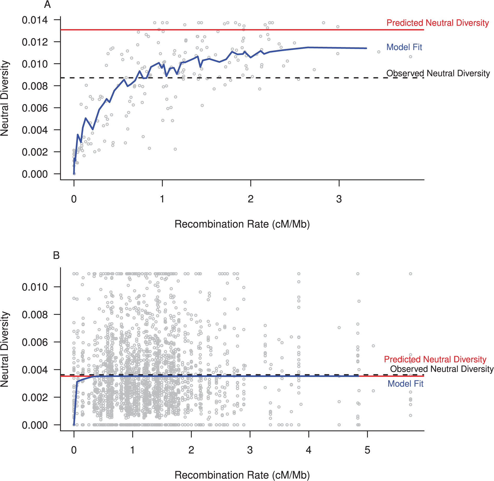
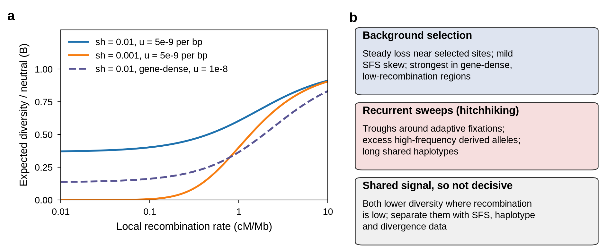

# 第 8 章 连锁选择与 Lewontin 悖论

**地位：现象已验证；相对贡献与 Lewontin 悖论有争议。** 一个位点上的选择会降低连锁位点的中性多样性；多样性与重组率的正相关已在果蝇、人类、鸟类和植物中发现，背景选择和清除模型能预测基因组上多样性变化的很大一部分。有争议的是：在每个物种中背景选择和清除各占多少，以及连锁选择能否解释为什么物种间多样性的变化范围远小于群体大小的变化范围（Lewontin 悖论）。

本仓库相关条目：[background-selection](../../skills/genomics-theory-mining/theories/background-selection/THEORY.md)、[hudson-kaplan-bgs-with-recombination](../../skills/genomics-theory-mining/theories/hudson-kaplan-bgs-with-recombination/THEORY.md)、[nordborg-charlesworth-bgs-map](../../skills/genomics-theory-mining/theories/nordborg-charlesworth-bgs-map/THEORY.md)、[hitchhiking-sweeps](../../skills/genomics-theory-mining/theories/hitchhiking-sweeps/THEORY.md)、[genetic-draft](../../skills/genomics-theory-mining/theories/genetic-draft/THEORY.md)、[hill-robertson-interference](../../skills/genomics-theory-mining/theories/hill-robertson-interference/THEORY.md)、[begun-aquadro-recombination-diversity](../../skills/genomics-theory-mining/theories/begun-aquadro-recombination-diversity/THEORY.md)。

## 8.1 内容与历史

Maynard Smith 和 Haigh 表明，当一个有利替代发生时，连锁中性位点的平均杂合度会降低，降低程度随距离减弱；在大群体中这一效应可能比随机固定更重要，或许能解释为什么不同大小群体的多态性差别小于预期 [1]。Kaplan、Hudson 和 Langley 用溯祖描述了这种搭便车对中性多态位点数的稳态效应 [2]。Charlesworth、Morgan 和 Charlesworth 表明，针对有害突变的选择也会降低连锁中性变异，因为新的中性变异只有在不带有害等位基因的配子中才能长期存在；他们称之为背景选择（BGS）[3]。Nordborg、Charlesworth 和 Charlesworth 推导了适用于任意遗传图谱和任意选择系数分布的 BGS 近似方程，只有在选择很弱且连锁很紧时才失效 [4]。

更早，Hill 和 Robertson 在小群体两连锁位点选择的模拟中表明，选择过程由 N·i·α、N·i·β 和 Nc 决定，因此连锁限制了选择响应 [5]。Gillespie 提出反复的清除对连锁位点的作用类似一种漂变（伪搭便车或遗传牵连），其溯祖带有多重合并，频率谱也不同 [6]。

## 8.2 预测

- **多样性跟随重组。** 在低重组、选择位点密集的区域，中性多样性应更低，而物种间分化不会仅因连锁选择而降低（图 8.2a）。
- **不同的足迹。** BGS 降低多样性，频率谱轻度偏斜；清除留下局部低谷、高频衍生等位基因过多和长单倍型（图 8.2b）。
- **群体大小。** 如果连锁选择在大群体中更有效，它应压缩物种间多样性的范围，这是 Lewontin 悖论的一种候选解释。
- **选择效率。** Hill–Robertson 干扰应降低低重组区的选择效率 [7]。

## 8.3 支持证据

- **果蝇。** Begun 和 Aquadro 发现黑腹果蝇 20 个基因区的核苷酸多样性与重组率相关，而分化与重组率无关 [8]。Comeron 只用注释和重组率、不用多态数据构建了全基因组 BGS 图谱，发现 BGS 塑造了整个基因组的变异，包括长内含子和基因间区 [9]。Elyashiv 等联合推断了 BGS 和清除的参数，认为连锁选择对黑腹果蝇多样性的降低比以前认为的更大 [10]。Sella 等认为果蝇基因组的很大部分受纯化选择，物种间差异中很大一部分是适应性的 [11]。
- **人类。** 保守元件附近中性多样性降低，常染色体平均降低 19–26%，X 染色体降低 12–40% [12]。BGS 模型解释了兆碱基尺度上约 60% 的多样性方差；加入清除并不改善拟合，相关有害突变约 80% 位于非外显子区 [13]。BGS 和偏向性基因转换合起来影响多达 95% 的人类变异 [14]。
- **跨物种。** 在 40 个专性有性真核生物中，Corbett-Detig 等利用多样性与重组的关系估计选择使连锁中性多样性降低了多少，发现普查群体越大的物种降低越多（图 8.1）[15]。
- **鸟类。** 在四种姬鹟的 200 个基因组中，种内就出现了异质的分化景观，它由连锁选择和重组率变异塑造 [16]。Burri 认为长期连锁选择可在基因组扫描中模仿正选择的足迹 [17]。

## 8.4 反面证据与难点

- **Lewontin 悖论不能单靠连锁选择解决。** Buffalo 用 172 个后生动物类群的多样性和新估计的普查群体大小，发现多样性与普查大小显著相关，图谱长度与普查大小负相关，但表明即使连锁选择很强、很普遍，也不太可能解释多样性范围之窄 [18]。Charlesworth 和 Jensen 认为直接选择和搭便车不太可能足够，并强调群体大小变化：许多物种可能远未达到其普查大小所对应的高平衡多样性 [19]。群体大到天文数字的海洋藻类赫氏颗石藻是这一悖论的极端例子 [20]。
- **区分不同模式。** BGS 与搭便车之间的长期争论留下了基本问题，尤其是低重组区 [21]。Charlesworth 和 Jensen 强调了区分清除、BGS、关联超显性和 Hill–Robertson 干扰足迹的困难 [22]。不同物种的估计不同：清除在人类中贡献很小 [13]，在果蝇中却似乎很普遍 [10]。
- **物种差异。** Cutter 和 Payseur 指出，多样性–重组相关的强度在物种间差异极大，并讨论了原因 [23]。
- **模型的局限。** BGS 公式假设有害突变选择足够强；较弱的突变彼此干扰，此时标准近似会高估其效应 [4, 7]。

## 8.5 地位与理由

**现象已验证；定量作用有争议。** 选择降低连锁中性多样性在所有研究充分的类群中都得到支持 [8, 9, 12, 15]，BGS 模型预测了人类基因组上多样性变化的很大部分 [13]。BGS 与清除的相对权重因物种而异 [10, 13]，而连锁选择单独看来不足以解释 Lewontin 悖论 [18, 19]。

## 8.6 植物、作物与葡萄

- **拟南芥。** 基因组区域间的多态水平变化太大，不符合标准中性模型，并与基因密度负相关，符合连锁选择的预期 [24]。强烈自交降低有效重组，应使每个选择位点影响的区域变大。
- **玉米。** 基因内及附近的多样性格局几乎没有显示对有利氨基酸替代的选择；驯化瓶颈降低了纯化选择的效率，而现今的扩张又使年轻等位基因上的纯化选择变强，因此连锁选择的强度随群体历史变化 [25]。
- **葡萄。** 栽培葡萄比野生葡萄携带更多杂合有害突变，部分原因是克隆繁殖掩护了隐性突变 [26]；来自野生葡萄的渐渗既带来适应性等位基因，也带来额外的有害负荷 [27]。在克隆作物中，只要品种一直被繁殖，选择位点就与其邻近位点保持连锁，因此受连锁选择影响的区域应比有性杂交得到的重组图谱所提示的更大。
- **驯化扫描。** Stephan 指出，区分 BGS 与搭便车的工作产生了寻找适应和驯化相关基因的实用工具 [21]。驯化扫描应使用基于 BGS 的零模型，而不是均匀的中性模型 [9, 17]。

## 8.7 用公开数据检验

- **数据。** 同一物种的群体重测序数据、遗传图谱和基因注释；一个外类群用于计算分化。
- **工具。** 窗口 π 和分化（pixy、scikit-allel），第 7 章的重组图谱，BGS 图谱或连锁选择的复合似然模型 [10, 13]。
- **分析。** (1) 在 100 kb 到 1 Mb 的窗口中计算 π、分化和基因密度。(2) 把 π 与重组率和基因密度做相关，并以分化作为突变率的代理加以控制 [8]。(3) 分别拟合只有 BGS 和 BGS 加清除的模型并比较拟合 [13, 15]。(4) 推断群体历史时使用远离基因的高重组区 [14]。脚本 [`scripts/ch08_linked_selection_figures.py`](../scripts/ch08_linked_selection_figures.py) 计算 BGS 的期望降低（图 8.2）。
- **什么结果会推翻这一理论。** 在重组率有变化的物种中，控制突变率和基因密度后多样性与重组无相关。

## 8.8 未解决的问题

- Lewontin 悖论有多少反映的是群体远离平衡，而不是选择？
- 在有性重组很少的克隆作物中，连锁选择有多强？
- 仅由注释构建的 BGS 图谱能否取代对中性参照区的需要？

## 8.9 常见错误

- 把基因区或低重组区当作群体历史推断的中性参照。
- 把每个多样性低谷都读作选择清除；BGS 和低突变率也会产生低谷。
- 解释多样性–重组相关时不检查重组是否致突变（分化是否也相关）。
- 把普查群体大小当作决定多样性的群体大小。

## 图

**图 8.1.** 估计选择对连锁中性变异的影响。把包含搭便车和背景选择的群体遗传模型拟合到 500 kb 窗口的中性多样性和重组率上。灰点为窗口；蓝色为模型拟合；红色为无选择时的预测中性多样性；虚线为观察到的中性多样性。A 为群体很大的黑腹果蝇，B 为群体很小的普氏野马。原样转载自 Corbett-Detig RB, Hartl DL, Sackton TB (2015) Natural selection constrains neutral diversity across a wide range of species. *PLoS Biology* 13:e1002112, Figure 1. https://doi.org/10.1371/journal.pbio.1002112。许可：CC BY 4.0（https://creativecommons.org/licenses/by/4.0/）。

**图 8.2.** (a) 2 Mb 区域中部位点的期望中性多样性相对中性值（B）随局部重组率的变化，区域内有害突变均匀分布，按 B = exp(−U / (sh + R(1 − sh)))，U = 2Lu，R = cL 计算。该公式忽略选择位点之间的干扰，因此弱选择（sh = 0.001）下接近零的值不现实。(b) 背景选择与清除的差别和共同点。计算值；由 [`scripts/ch08_linked_selection_figures.py`](../scripts/ch08_linked_selection_figures.py) 生成。

## 参考文献

1. Maynard Smith J, Haigh J (1974) The hitch-hiking effect of a favourable gene. *Genetical Research* 23:23-35. https://doi.org/10.1017/s0016672300014634
2. Kaplan NL, Hudson RR, Langley CH (1989) The "hitchhiking effect" revisited. *Genetics* 123:887-899. https://doi.org/10.1093/genetics/123.4.887
3. Charlesworth B, Morgan MT, Charlesworth D (1993) The effect of deleterious mutations on neutral molecular variation. *Genetics* 134:1289-1303. https://doi.org/10.1093/genetics/134.4.1289
4. Nordborg M, Charlesworth B, Charlesworth D (1996) The effect of recombination on background selection. *Genetical Research* 67:159-174. https://doi.org/10.1017/s0016672300033619
5. Hill WG, Robertson A (1966) The effect of linkage on limits to artificial selection. *Genetical Research* 8:269-294. https://doi.org/10.1017/s0016672300010156
6. Gillespie JH (2000) Genetic Drift in an Infinite Population: The Pseudohitchhiking Model. *Genetics* 155:909-919. https://doi.org/10.1093/genetics/155.2.909
7. Charlesworth B (2012) The Effects of Deleterious Mutations on Evolution at Linked Sites. *Genetics* 190:5-22. https://doi.org/10.1534/genetics.111.134288
8. Begun DJ, Aquadro CF (1992) Levels of naturally occurring DNA polymorphism correlate with recombination rates in D. melanogaster. *Nature* 356:519-520. https://doi.org/10.1038/356519a0
9. Comeron JM (2014) Background Selection as Baseline for Nucleotide Variation across the Drosophila Genome. *PLoS Genetics* 10:e1004434. https://doi.org/10.1371/journal.pgen.1004434
10. Elyashiv E, Sattath S, Hu TT, et al. (2016) A Genomic Map of the Effects of Linked Selection in Drosophila. *PLOS Genetics* 12:e1006130. https://doi.org/10.1371/journal.pgen.1006130
11. Sella G, Petrov DA, Przeworski M, et al. (2009) Pervasive Natural Selection in the Drosophila Genome? *PLoS Genetics* 5:e1000495. https://doi.org/10.1371/journal.pgen.1000495
12. McVicker G, Gordon D, Davis C, et al. (2009) Widespread Genomic Signatures of Natural Selection in Hominid Evolution. *PLoS Genetics* 5:e1000471. https://doi.org/10.1371/journal.pgen.1000471
13. Murphy DA, Elyashiv E, Amster G, et al. (2023) Broad-scale variation in human genetic diversity levels is predicted by purifying selection on coding and non-coding elements. *eLife* 12:e76065. https://doi.org/10.7554/eLife.76065
14. Pouyet F, Aeschbacher S, Thiéry A, et al. (2018) Background selection and biased gene conversion affect more than 95% of the human genome and bias demographic inferences. *eLife* 7:e36317. https://doi.org/10.7554/eLife.36317
15. Corbett-Detig RB, Hartl DL, Sackton TB (2015) Natural Selection Constrains Neutral Diversity across A Wide Range of Species. *PLOS Biology* 13:e1002112. https://doi.org/10.1371/journal.pbio.1002112
16. Burri R, Nater A, Kawakami T, et al. (2015) Linked selection and recombination rate variation drive the evolution of the genomic landscape of differentiation across the speciation continuum of Ficedula flycatchers. *Genome Research* 25:1656-1665. https://doi.org/10.1101/gr.196485.115
17. Burri R (2017) Interpreting differentiation landscapes in the light of long-term linked selection. *Evolution Letters* 1:118-131. https://doi.org/10.1002/evl3.14
18. Buffalo V (2021) Quantifying the relationship between genetic diversity and population size suggests natural selection cannot explain Lewontin’s Paradox. *eLife* 10:e67509. https://doi.org/10.7554/eLife.67509
19. Charlesworth B, Jensen JD (2022) How Can We Resolve Lewontin’s Paradox? *Genome Biology and Evolution* 14:evac096. https://doi.org/10.1093/gbe/evac096
20. Filatov DA (2019) Extreme Lewontin’s Paradox in Ubiquitous Marine Phytoplankton Species. *Molecular Biology and Evolution* 36:4-14. https://doi.org/10.1093/molbev/msy195
21. Stephan W (2010) Genetic hitchhiking versus background selection: the controversy and its implications. *Philosophical Transactions of the Royal Society B: Biological Sciences* 365:1245-1253. https://doi.org/10.1098/rstb.2009.0278
22. Charlesworth B, Jensen JD (2021) Effects of Selection at Linked Sites on Patterns of Genetic Variability. *Annual Review of Ecology, Evolution, and Systematics* 52:177-197. https://doi.org/10.1146/annurev-ecolsys-010621-044528
23. Cutter AD, Payseur BA (2013) Genomic signatures of selection at linked sites: unifying the disparity among species. *Nature Reviews Genetics* 14:262-274. https://doi.org/10.1038/nrg3425
24. Nordborg M, Hu TT, Ishino Y, et al. (2005) The Pattern of Polymorphism in Arabidopsis thaliana. *PLoS Biology* 3:e196. https://doi.org/10.1371/journal.pbio.0030196
25. Beissinger TM, Wang L, Crosby K, et al. (2016) Recent demography drives changes in linked selection across the maize genome. *Nature Plants* 2:16084. https://doi.org/10.1038/nplants.2016.84
26. Zhou Y, Massonnet M, Sanjak JS, et al. (2017) Evolutionary genomics of grape ( Vitis vinifera ssp. vinifera ) domestication. *Proceedings of the National Academy of Sciences* 114:11715-11720. https://doi.org/10.1073/pnas.1709257114
27. Xiao H, Liu Z, Wang N, et al. (2023) Adaptive and maladaptive introgression in grapevine domestication. *Proceedings of the National Academy of Sciences* 120:e2222041120. https://doi.org/10.1073/pnas.2222041120
