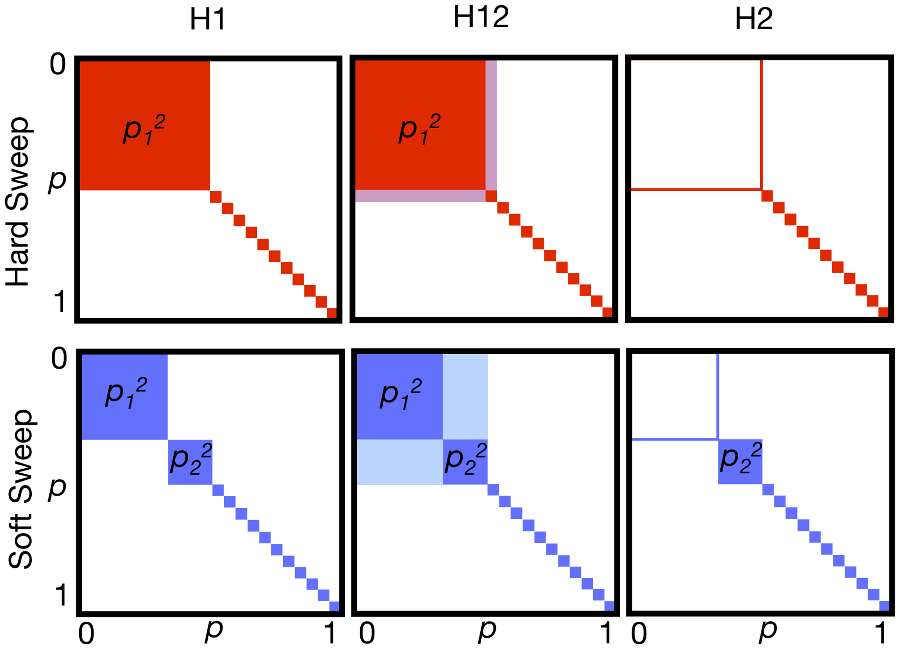
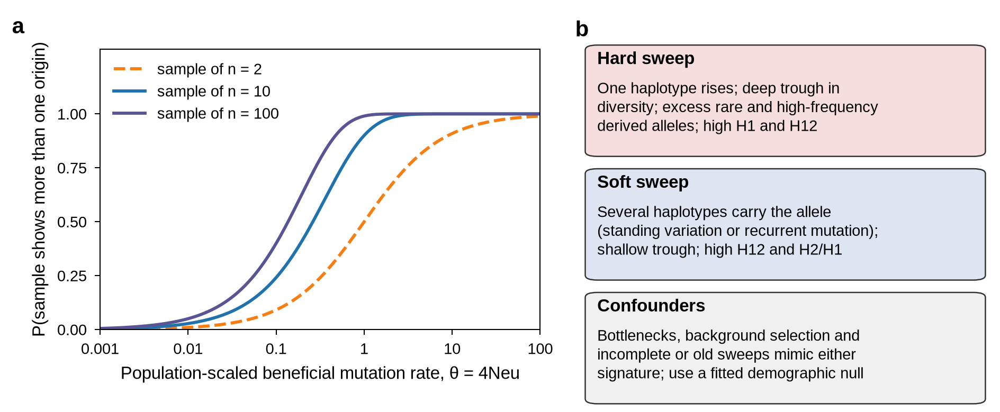

# Chapter 9. Hard and soft sweeps

**Status: Verified (selective sweeps occur); hard versus soft sweep frequency Contested.** Strong positive selection leaves a local footprint of reduced diversity, a skewed frequency spectrum and long haplotypes, and classic cases such as lactase persistence and the maize domestication gene tb1 are confirmed by functional work. Theory also shows that adaptation from standing variation or recurrent mutation can produce soft sweeps with weaker footprints. Whether soft sweeps dominate adaptation in humans, Drosophila or crops is disputed, because demography and background selection can produce the same patterns.

Related notes in this repository: [hitchhiking-sweeps](../../theories/hitchhiking-sweeps/THEORY.md), [soft-sweep](../../theories/soft-sweep/THEORY.md), [kaplan-coalescent-hitchhiking](../../theories/kaplan-coalescent-hitchhiking/THEORY.md), [braverman-hitchhiking-sfs](../../theories/braverman-hitchhiking-sfs/THEORY.md), [wiehe-stephan-hitchhiking-alpha-v](../../theories/wiehe-stephan-hitchhiking-alpha-v/THEORY.md), [genetic-draft](../../theories/genetic-draft/THEORY.md), [fay-wu-h](../../theories/fay-wu-h/THEORY.md).

## 9.1 Statement and history

Maynard Smith and Haigh showed that when a favourable substitution occurs, heterozygosity at linked neutral loci is reduced, by an amount that falls with recombination distance from the selected site [1]. Kaplan, Hudson and Langley described this hitchhiking effect with the coalescent and showed that in regions of low crossing over, strongly selected substitutions can substantially reduce the number of polymorphic sites [2]. Fay and Wu showed that hitchhiking also produces an excess of high-frequency derived variants, a pattern they measured with the statistic H [3]. Kim and Stephan, and later Nielsen and colleagues, turned the spatial pattern of reduced variation and skewed frequency spectrum into composite likelihood tests that also estimate the location and strength of selection [4, 5]. A different family of tests looks for long haplotypes around alleles that rose in frequency too fast for recombination to break them down [6, 7, 8].

These models describe a hard sweep: a single new mutation that rises from one copy to fixation. Hermisson and Pennings asked what happens when selection acts on alleles already present in the population. Using diffusion theory, they found that adaptation from standing variation is favoured when selection is weak or when the selection coefficient and mutation rate are both high, and that sweeps in which several copies of the allele contribute, which they called soft sweeps, have weaker footprints [9]. Pennings and Hermisson then showed with coalescent theory that recurrent mutation or migration during the selective phase can also make soft sweeps likely for realistic mutation rates [10]. Przeworski, Coop and Wall showed that selection on standing variation can leave a weak signature and often removes rare alleles, unlike the pattern that genome scans had been designed to find [11].

## 9.2 What the theory predicts

- **Footprint of a hard sweep.** Reduced diversity centred on the selected site, an excess of rare and of high-frequency derived alleles nearby, and one long haplotype at high frequency [3, 4, 7].
- **Footprint of a soft sweep.** Several haplotypes at high frequency, each carrying the adaptive allele, so diversity is reduced less and haplotype homozygosity is spread over two or more haplotypes (Figure 9.1) [10, 12].
- **When soft sweeps are expected.** With recurrent mutation, soft sweeps become common in samples once the population-scaled beneficial mutation rate θ = 4Neu approaches 0.1 and dominate when θ is above 1 (Figure 9.2a); they are also expected when the allele was already present before selection began [9, 10].
- **Reliability of scans.** Empirical genome scans should miss many targets of selection, and more of them when the favoured allele is recessive or was previously neutral standing variation [13].

## 9.3 Evidence for

- **Human case studies.** Long-range haplotype tests identified strong candidate sweeps, including genes for skin pigmentation and hair-follicle development, and pairs of genes in the same pathway selected in the same population [6, 8]. Lactase persistence in east Africa arose from mutations different from the European one, on different haplotypes, and the African alleles show extended haplotype homozygosity consistent with a sweep within the last ~7,000 years [14]. Voight and colleagues found widespread signals of recent selection on alleles that had not yet reached fixation [7].
- **Soft sweeps in Drosophila.** At the insecticide-resistance locus Ace in D. melanogaster, multiple resistance alleles evolved quickly and repeatedly within populations, which implies an effective population size large enough that adaptation is not limited by mutation [15]. Garud and colleagues developed the H12 and H2/H1 statistics and found that the top 50 peaks in North American flies are more easily produced by soft than by hard sweeps (Figure 9.1) [12].
- **Machine learning.** S/HIC and its unphased successor diploS/HIC classify windows as hard sweep, soft sweep, linked or neutral and are robust to misspecified demography [16, 17]. Applied to six human populations, S/HIC suggested that soft sweeps account for most recent adaptation [18].
- **Theory overviews.** Stephan, and Hermisson and Pennings, summarise how sweep models extend to population structure, interference among sweeps and adaptation from standing variation [19, 20].

## 9.4 Evidence against, and difficulties

- **Hard sweeps may be rare in humans.** In 179 human genomes, the trough in diversity around human-specific amino acid substitutions is no deeper than around synonymous substitutions, suggesting that classic sweeps were not the dominant mode of human adaptation over the last ~250,000 years [21]. Pritchard, Pickrell and Coop argued that polygenic adaptation, which leaves no classic sweep signature, may be more important [22].
- **Soft sweep claims are disputed.** Jensen argued that empirical and experimental evidence does not yet support models in which adaptation is not limited by mutation [23]. Harris, Sackman and Jensen re-examined three studies that reported pervasive soft sweeps and found that the methods give very high false-positive rates under hard sweep and neutral models with realistic demography [24].
- **Demography.** Empirical outlier scans miss many, in some cases most, targets of selection; the false-discovery rate is higher after a bottleneck, for recessive alleles and for selection on standing variation, so the loci found are an unrepresentative subset [13]. Harris and colleagues found that hard sweeps under a well-fitted demographic history can explain data that had been read as soft sweeps [24].
- **Background selection.** Purifying selection at linked sites also reduces diversity and skews the frequency spectrum, so sweep scans need a null model that includes it (Chapter 8) [19].

## 9.5 Status and reasoning

**Sweeps are verified; the relative frequency of hard and soft sweeps is contested.** Individual sweeps are confirmed by functional and phenotypic work [14, 25], and theory for soft sweeps is well established [9, 10]. Genome-wide claims that one mode dominates conflict with each other [18, 21, 24], and the answer depends on demographic models that are themselves uncertain.

## 9.6 Plants, crops and grapevine

- **Maize.** Wang and colleagues found that the effects of selection on teosinte branched1 (tb1) during maize domestication were limited to the regulatory region of the gene and could not be detected in its protein-coding region; high recombination and a prolonged domestication period probably limited them [26]. Studer, Zhao, Ross-Ibarra and Doebley later showed that a Hopscotch transposon insertion in this regulatory region enhances tb1 expression and partly explains the greater apical dominance of maize; the insertion predates domestication by at least 10,000 years, so selection acted on standing variation [25]. Genome-wide, Hufford and colleagues found evidence for recovery of diversity after domestication, likely introgression from wild relatives, and stronger selection during domestication than during improvement [27].
- **Grapevine.** Across 472 Vitis accessions, Liang and colleagues found selective sweeps associated with berry edibility and stress resistance [28]. In 345 wild and cultivated grapes, Xiao and colleagues inferred with machine learning that soft sweeps were the dominant signal of artificial selection, and that genes for aromatic compounds were enriched in regions that were both selected and introgressed from wild European grapes [29].
- **Clonal crops.** In a clonally propagated crop, a cultivar is a single genotype, so a sweep happens among cultivars by breeders choosing parents, not within a population. Scans across cultivars therefore mix selection, pedigree structure and introgression, and need a demographic null that includes them [28, 29].

## 9.7 How to test it with public data

- **Data.** Phased population genomes from public resources: the 1000 Genomes Project for humans, the Drosophila Genetic Reference Panel, maize HapMap panels, or published grapevine resequencing panels [28, 29].
- **Tools.** SweepFinder2 or SweeD for composite likelihood tests [5]; selscan for iHS and related haplotype statistics [7]; H12 and H2/H1 [12]; diploS/HIC for unphased data [17]; msprime or discoal simulations under a fitted demographic model.
- **Analysis.** (1) Fit a demographic model to putatively neutral sites far from genes. (2) Simulate neutral data and hard and soft sweeps under that model. (3) Compute the scan statistics on real and simulated data and set thresholds from the simulations, not from empirical percentiles [13]. (4) Classify candidate windows as hard or soft only if simulations show that the classes can be separated for your sample size and demography [24]. The script [`scripts/ch09_sweeps_figures.py`](../scripts/ch09_sweeps_figures.py) computes the probability that a sample shows more than one origin of an adaptive allele (Figure 9.2).
- **What would break the theory.** A strong, functionally confirmed adaptive allele with no reduction of linked diversity and no haplotype structure, in a region with normal recombination.

## 9.8 Open questions

- What share of adaptation proceeds by hard sweeps, soft sweeps or polygenic shifts in different species [18, 22, 24]?
- Can hard and soft sweeps be told apart once demography, background selection and sweep age are uncertain?
- How should sweep scans be done in clonal perennial crops where recombination happens only in breeding crosses?

## 9.9 Common mistakes

- Using empirical outliers as proof of selection without a simulated neutral distribution [13].
- Calling a sweep soft because several haplotypes are present, without checking that an old hard sweep or a bottleneck could give the same result [24].
- Treating a reduction of diversity alone as a sweep; background selection, low mutation rate and low recombination also reduce it.
- Reporting candidate genes as domestication genes without functional or association evidence.

## Figures

**Figure 9.1.** Haplotype homozygosity statistics for hard (red, top row) and soft (blue, bottom row) sweeps. Each square has sides that represent haplotype frequencies from 0 to 1. H1 is the sum of squared haplotype frequencies (the coloured area); H12 combines the two most common haplotypes before squaring, so it detects hard and soft sweeps with more similar power; H2 excludes the most common haplotype and is larger for soft sweeps, so H2/H1 helps to tell the two apart. Reproduced unchanged from Garud NR, Messer PW, Buzbas EO, Petrov DA (2015) Recent selective sweeps in North American Drosophila melanogaster show signatures of soft sweeps. *PLoS Genetics* 11:e1005004, Figure 4. https://doi.org/10.1371/journal.pgen.1005004. Licence: CC BY 4.0 (https://creativecommons.org/licenses/by/4.0/).

**Figure 9.2.** (a) Probability that a sample of n copies, taken when an adaptive allele from recurrent mutation reaches fixation, carries more than one independent origin of the allele, as a function of θ = 4Neu, from the Ewens sampling formula: 1 − ∏ i / (i + θ) for i = 1 … n − 1, following Pennings and Hermisson (2006). (b) The footprints of hard and soft sweeps and what can mimic them. Computed values; made with [`scripts/ch09_sweeps_figures.py`](../scripts/ch09_sweeps_figures.py).

## References

1. Maynard Smith J, Haigh J (1974) The hitch-hiking effect of a favourable gene. *Genetical Research* 23:23-35. https://doi.org/10.1017/s0016672300014634
2. Kaplan NL, Hudson RR, Langley CH (1989) The "hitchhiking effect" revisited. *Genetics* 123:887-899. https://doi.org/10.1093/genetics/123.4.887
3. Fay JC, Wu CI (2000) Hitchhiking Under Positive Darwinian Selection. *Genetics* 155:1405-1413. https://doi.org/10.1093/genetics/155.3.1405
4. Kim Y, Stephan W (2002) Detecting a Local Signature of Genetic Hitchhiking Along a Recombining Chromosome. *Genetics* 160:765-777. https://doi.org/10.1093/genetics/160.2.765
5. Nielsen R, Williamson S, Kim Y, et al. (2005) Genomic scans for selective sweeps using SNP data. *Genome Research* 15:1566-1575. https://doi.org/10.1101/gr.4252305
6. Sabeti PC, Reich DE, Higgins JM, et al. (2002) Detecting recent positive selection in the human genome from haplotype structure. *Nature* 419:832-837. https://doi.org/10.1038/nature01140
7. Voight BF, Kudaravalli S, Wen X, et al. (2006) A Map of Recent Positive Selection in the Human Genome. *PLoS Biology* 4:e72. https://doi.org/10.1371/journal.pbio.0040072
8. Sabeti PC, Varilly P, Fry B, et al. (2007) Genome-wide detection and characterization of positive selection in human populations. *Nature* 449:913-918. https://doi.org/10.1038/nature06250
9. Hermisson J, Pennings PS (2005) Soft Sweeps. *Genetics* 169:2335-2352. https://doi.org/10.1534/genetics.104.036947
10. Pennings PS, Hermisson J (2006) Soft Sweeps II—Molecular Population Genetics of Adaptation from Recurrent Mutation or Migration. *Molecular Biology and Evolution* 23:1076-1084. https://doi.org/10.1093/molbev/msj117
11. Przeworski M, Coop G, Wall JD (2005) THE SIGNATURE OF POSITIVE SELECTION ON STANDING GENETIC VARIATION. *Evolution* 59:2312-2323. https://doi.org/10.1111/j.0014-3820.2005.tb00941.x
12. Garud NR, Messer PW, Buzbas EO, et al. (2015) Recent Selective Sweeps in North American Drosophila melanogaster Show Signatures of Soft Sweeps. *PLOS Genetics* 11:e1005004. https://doi.org/10.1371/journal.pgen.1005004
13. Teshima KM, Coop G, Przeworski M (2006) How reliable are empirical genomic scans for selective sweeps? *Genome Research* 16:702-712. https://doi.org/10.1101/gr.5105206
14. Tishkoff SA, Reed FA, Ranciaro A, et al. (2007) Convergent adaptation of human lactase persistence in Africa and Europe. *Nature Genetics* 39:31-40. https://doi.org/10.1038/ng1946
15. Karasov T, Messer PW, Petrov DA (2010) Evidence that Adaptation in Drosophila Is Not Limited by Mutation at Single Sites. *PLoS Genetics* 6:e1000924. https://doi.org/10.1371/journal.pgen.1000924
16. Schrider DR, Kern AD (2016) S/HIC: Robust Identification of Soft and Hard Sweeps Using Machine Learning. *PLOS Genetics* 12:e1005928. https://doi.org/10.1371/journal.pgen.1005928
17. Kern AD, Schrider DR (2018) diploS/HIC: An Updated Approach to Classifying Selective Sweeps. *G3 Genes|Genomes|Genetics* 8:1959-1970. https://doi.org/10.1534/g3.118.200262
18. Schrider DR, Kern AD (2017) Soft Sweeps Are the Dominant Mode of Adaptation in the Human Genome. *Molecular Biology and Evolution* 34:1863-1877. https://doi.org/10.1093/molbev/msx154
19. Stephan W (2019) Selective Sweeps. *Genetics* 211:5-13. https://doi.org/10.1534/genetics.118.301319
20. Hermisson J, Pennings PS (2017) Soft sweeps and beyond: understanding the patterns and probabilities of selection footprints under rapid adaptation. *Methods in Ecology and Evolution* 8:700-716. https://doi.org/10.1111/2041-210x.12808
21. Hernandez RD, Kelley JL, Elyashiv E, et al. (2011) Classic Selective Sweeps Were Rare in Recent Human Evolution. *Science* 331:920-924. https://doi.org/10.1126/science.1198878
22. Pritchard JK, Pickrell JK, Coop G (2010) The Genetics of Human Adaptation: Hard Sweeps, Soft Sweeps, and Polygenic Adaptation. *Current Biology* 20:R208-R215. https://doi.org/10.1016/j.cub.2009.11.055
23. Jensen JD (2014) On the unfounded enthusiasm for soft selective sweeps. *Nature Communications* 5:5281. https://doi.org/10.1038/ncomms6281
24. Harris RB, Sackman A, Jensen JD (2018) On the unfounded enthusiasm for soft selective sweeps II: Examining recent evidence from humans, flies, and viruses. *PLOS Genetics* 14:e1007859. https://doi.org/10.1371/journal.pgen.1007859
25. Studer A, Zhao Q, Ross-Ibarra J, et al. (2011) Identification of a functional transposon insertion in the maize domestication gene tb1. *Nature Genetics* 43:1160-1163. https://doi.org/10.1038/ng.942
26. Wang RL, Stec A, Hey J, et al. (1999) The limits of selection during maize domestication. *Nature* 398:236-239. https://doi.org/10.1038/18435
27. Hufford MB, Xu X, van Heerwaarden J, et al. (2012) Comparative population genomics of maize domestication and improvement. *Nature Genetics* 44:808-811. https://doi.org/10.1038/ng.2309
28. Liang Z, Duan S, Sheng J, et al. (2019) Whole-genome resequencing of 472 Vitis accessions for grapevine diversity and demographic history analyses. *Nature Communications* 10:1190. https://doi.org/10.1038/s41467-019-09135-8
29. Xiao H, Liu Z, Wang N, et al. (2023) Adaptive and maladaptive introgression in grapevine domestication. *Proceedings of the National Academy of Sciences* 120:e2222041120. https://doi.org/10.1073/pnas.2222041120
