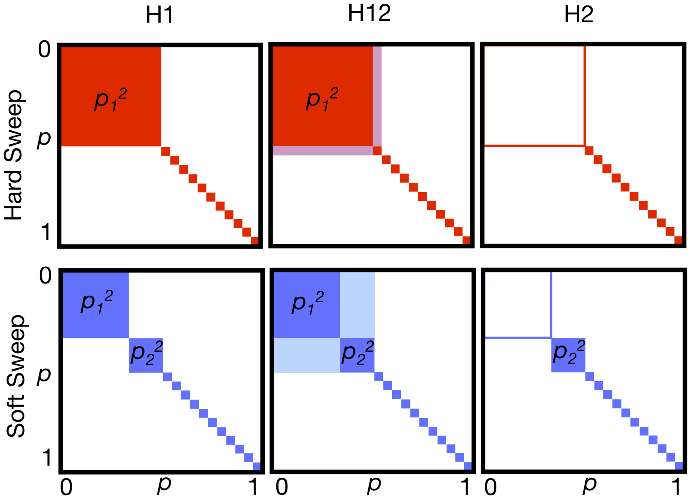
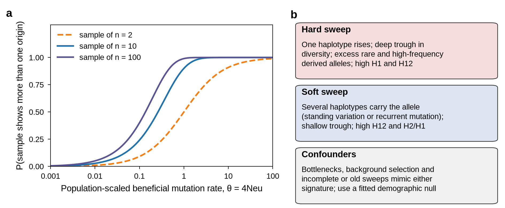

# 第 9 章 硬扫荡与软扫荡

**地位：选择清除的存在已验证；硬扫荡与软扫荡各占多少有争议。** 强正选择会在局部留下多样性降低、频率谱偏斜和长单倍型的足迹；乳糖酶持续性和玉米驯化基因 tb1 等经典例子已由功能研究确认。理论还表明，来自现存变异或反复突变的适应会产生足迹较弱的软扫荡。软扫荡是否主导人类、果蝇或作物的适应仍有争议，因为群体历史和背景选择可以产生同样的模式。

本仓库相关条目：[hitchhiking-sweeps](../../theories/hitchhiking-sweeps/THEORY.md)、[soft-sweep](../../theories/soft-sweep/THEORY.md)、[kaplan-coalescent-hitchhiking](../../theories/kaplan-coalescent-hitchhiking/THEORY.md)、[braverman-hitchhiking-sfs](../../theories/braverman-hitchhiking-sfs/THEORY.md)、[wiehe-stephan-hitchhiking-alpha-v](../../theories/wiehe-stephan-hitchhiking-alpha-v/THEORY.md)、[genetic-draft](../../theories/genetic-draft/THEORY.md)、[fay-wu-h](../../theories/fay-wu-h/THEORY.md)。

## 9.1 内容与历史

Maynard Smith 和 Haigh 表明，当一个有利替代发生时，连锁中性位点的杂合度会降低，降低程度随与选择位点的重组距离增大而减弱 [1]。Kaplan、Hudson 和 Langley 用溯祖描述了这种搭便车效应，并表明在低交换区，强选择替代可大幅减少多态位点数 [2]。Fay 和 Wu 表明搭便车还会造成高频衍生变异过多，并用统计量 H 来度量 [3]。Kim 和 Stephan，以及后来的 Nielsen 等，把多样性降低和频率谱偏斜的空间模式变成复合似然检验，同时估计选择的位置和强度 [4, 5]。另一类检验寻找围绕某个等位基因的长单倍型：该等位基因频率上升太快，重组来不及把单倍型打断 [6, 7, 8]。

这些模型描述的是硬扫荡：一个新突变从单个拷贝上升到固定。Hermisson 和 Pennings 追问，如果选择作用于群体中已有的等位基因会怎样。他们用扩散理论发现，当选择较弱、或选择系数和突变率都较高时，来自现存变异的适应占优；有多个拷贝共同参与的清除（他们称为软扫荡）足迹更弱 [9]。Pennings 和 Hermisson 随后用溯祖理论表明，选择阶段中的反复突变或迁移在现实突变率下也会使软扫荡变得常见 [10]。Przeworski、Coop 和 Wall 表明，对现存变异的选择留下的信号较弱，且常常使稀有等位基因减少，这与基因组扫描原本要找的模式不同 [11]。

## 9.2 预测

- **硬扫荡的足迹。** 以选择位点为中心的多样性降低，附近稀有和高频衍生等位基因过多，以及一条高频长单倍型 [3, 4, 7]。
- **软扫荡的足迹。** 有几条高频单倍型都携带适应性等位基因，因此多样性降低较少，单倍型纯合度分散在两条或更多单倍型上（图 9.1）[10, 12]。
- **何时预期软扫荡。** 在反复突变下，当群体标度的有利突变率 θ = 4Neu 接近 0.1 时，样本中软扫荡变得常见，θ 大于 1 时占主导（图 9.2a）；如果选择开始前等位基因已经存在，也预期出现软扫荡 [9, 10]。
- **扫描的可靠性。** 经验基因组扫描应会漏掉许多选择目标，当受青睐的等位基因是隐性的、或原本是中性的现存变异时漏得更多 [13]。

## 9.3 支持证据

- **人类个案。** 长程单倍型检验找到了强的候选清除，包括与皮肤色素和毛囊发育有关的基因，以及同一群体中受选择的同一通路的成对基因 [6, 8]。东非的乳糖酶持续性来自与欧洲不同的突变，位于不同的单倍型背景上，非洲等位基因显示延伸的单倍型纯合度，符合过去约 7,000 年内的一次清除 [14]。Voight 等在尚未固定的等位基因上发现了广泛的近期选择信号 [7]。
- **果蝇中的软扫荡。** 在黑腹果蝇的杀虫剂抗性位点 Ace 上，多个抗性等位基因在群体内迅速且反复地产生，这意味着有效群体足够大，适应不受突变限制 [15]。Garud 等提出了 H12 和 H2/H1 统计量，发现北美果蝇中排名前 50 的峰更容易由软扫荡而不是硬扫荡产生（图 9.1）[12]。
- **机器学习。** S/HIC 及其适用于未定相数据的后继方法 diploS/HIC 把窗口分为硬扫荡、软扫荡、连锁或中性，对群体历史设定错误不敏感 [16, 17]。用于六个人类群体时，S/HIC 提示软扫荡占近期适应的大部分 [18]。
- **理论综述。** Stephan，以及 Hermisson 和 Pennings，总结了清除模型如何扩展到群体结构、清除之间的干扰和来自现存变异的适应 [19, 20]。

## 9.4 反面证据与难点

- **人类中硬扫荡可能很少。** 在 179 个人类基因组中，人类特有氨基酸替代周围的多样性低谷并不比同义替代周围更深，提示在过去约 25 万年里经典清除不是人类适应的主要方式 [21]。Pritchard、Pickrell 和 Coop 认为不留下经典清除信号的多基因适应可能更重要 [22]。
- **软扫荡的结论有争议。** Jensen 认为现有的经验和实验证据还不支持适应不受突变限制的模型 [23]。Harris、Sackman 和 Jensen 重新检查了三项报告软扫荡普遍存在的研究，发现在现实群体历史下，这些方法在硬扫荡和中性模型下的假阳性率都非常高 [24]。
- **群体历史。** 经验离群值扫描会漏掉许多、有时是大部分选择目标；在瓶颈之后、对隐性等位基因以及对现存变异的选择，假发现率更高，因此找到的位点是有偏的子集 [13]。Harris 等发现，在拟合良好的群体历史下，硬扫荡就能解释原先被读作软扫荡的数据 [24]。
- **背景选择。** 连锁位点上的纯化选择同样降低多样性并使频率谱偏斜，因此清除扫描需要包含它的零模型（第 8 章）[19]。

## 9.5 地位与理由

**选择清除已验证；硬扫荡与软扫荡的相对频率有争议。** 个别清除已由功能和表型研究确认 [14, 25]，软扫荡理论也已确立 [9, 10]。关于哪种方式在全基因组上占主导的结论相互冲突 [18, 21, 24]，答案取决于本身就不确定的群体历史模型。

## 9.6 植物、作物与葡萄

- **玉米。** Wang 等发现，玉米驯化中对 teosinte branched1（tb1）的选择效应只限于该基因的调控区，在蛋白编码区检测不到；高重组率和漫长的驯化期可能限制了这一效应 [26]。Studer、Zhao、Ross-Ibarra 和 Doebley 后来表明，该调控区中的一个 Hopscotch 转座子插入增强了 tb1 的表达，部分解释了玉米更强的顶端优势；该插入比驯化早至少 10,000 年，因此选择作用于现存变异 [25]。在全基因组层面，Hufford 等发现了驯化后多样性恢复、可能来自野生近缘种的渐渗，以及驯化期的选择强于改良期的证据 [27]。
- **葡萄。** 在 472 份葡萄属材料中，Liang 等发现了与浆果可食性和抗逆性有关的选择清除 [28]。在 345 份野生和栽培葡萄中，Xiao 等用机器学习推断软扫荡是人工选择的主要信号，并发现芳香化合物合成基因富集在既受选择又来自欧洲野生葡萄渐渗的区域 [29]。
- **克隆作物。** 在克隆繁殖的作物中，一个品种就是一个基因型，所以清除是通过育种者选择亲本在品种之间发生的，而不是在一个群体之内发生。因此跨品种的扫描混合了选择、系谱结构和渐渗，需要包含它们的群体历史零模型 [28, 29]。

## 9.7 用公开数据检验

- **数据。** 公开资源中的定相群体基因组：人类的千人基因组计划、果蝇遗传参考群体（DGRP）、玉米 HapMap，或已发表的葡萄重测序群体 [28, 29]。
- **工具。** 复合似然检验用 SweepFinder2 或 SweeD [5]；iHS 等单倍型统计量用 selscan [7]；H12 和 H2/H1 [12]；未定相数据用 diploS/HIC [17]；在拟合的群体历史模型下用 msprime 或 discoal 模拟。
- **分析。** (1) 用远离基因的近中性位点拟合群体历史模型。(2) 在该模型下模拟中性数据以及硬扫荡和软扫荡。(3) 在真实和模拟数据上计算扫描统计量，并按模拟而不是经验百分位设定阈值 [13]。(4) 只有当模拟显示在你的样本量和群体历史下两类可以区分时，才把候选窗口归为硬扫荡或软扫荡 [24]。脚本 [`scripts/ch09_sweeps_figures.py`](../scripts/ch09_sweeps_figures.py) 计算样本中适应性等位基因有多于一个起源的概率（图 9.2）。
- **什么结果会推翻这一理论。** 在重组正常的区域中，一个功能已确认的强适应性等位基因周围既没有连锁多样性降低，也没有单倍型结构。

## 9.8 未解决的问题

- 在不同物种中，适应有多大比例经由硬扫荡、软扫荡或多基因变化完成 [18, 22, 24]？
- 当群体历史、背景选择和清除年龄都不确定时，还能区分硬扫荡和软扫荡吗？
- 在只有育种杂交时才发生重组的克隆多年生作物中，清除扫描应该怎么做？

## 9.9 常见错误

- 不用模拟的中性分布，就把经验离群值当作选择的证明 [13]。
- 因为看到几条单倍型就称之为软扫荡，而不检查古老的硬扫荡或瓶颈能否给出同样结果 [24]。
- 只凭多样性降低就认定清除；背景选择、低突变率和低重组也会使多样性降低。
- 没有功能或关联证据就把候选基因报告为驯化基因。

## 图

**图 9.1.** 硬扫荡（红色，上排）和软扫荡（蓝色，下排）的单倍型纯合度统计量。每个正方形的边代表从 0 到 1 的单倍型频率。H1 是单倍型频率平方之和（着色面积）；H12 先把最常见的两条单倍型合并再求平方，因此检测硬扫荡和软扫荡的功效更接近；H2 排除最常见的单倍型，在软扫荡中更大，所以 H2/H1 有助于区分两者。原样转载自 Garud NR, Messer PW, Buzbas EO, Petrov DA (2015) Recent selective sweeps in North American Drosophila melanogaster show signatures of soft sweeps. *PLoS Genetics* 11:e1005004, Figure 4. https://doi.org/10.1371/journal.pgen.1005004。许可：CC BY 4.0（https://creativecommons.org/licenses/by/4.0/）。

**图 9.2.** (a) 来自反复突变的适应性等位基因达到固定时取 n 个拷贝的样本，其中该等位基因有多于一个独立起源的概率随 θ = 4Neu 的变化，按 Ewens 抽样公式 1 − ∏ i / (i + θ)（i = 1 … n − 1）计算，依照 Pennings 和 Hermisson (2006)。(b) 硬扫荡和软扫荡的足迹以及能模仿它们的因素。计算值；由 [`scripts/ch09_sweeps_figures.py`](../scripts/ch09_sweeps_figures.py) 生成。

## 参考文献

1. Maynard Smith J, Haigh J (1974) The hitch-hiking effect of a favourable gene. *Genetical Research* 23:23-35. https://doi.org/10.1017/s0016672300014634
2. Kaplan NL, Hudson RR, Langley CH (1989) The "hitchhiking effect" revisited. *Genetics* 123:887-899. https://doi.org/10.1093/genetics/123.4.887
3. Fay JC, Wu CI (2000) Hitchhiking Under Positive Darwinian Selection. *Genetics* 155:1405-1413. https://doi.org/10.1093/genetics/155.3.1405
4. Kim Y, Stephan W (2002) Detecting a Local Signature of Genetic Hitchhiking Along a Recombining Chromosome. *Genetics* 160:765-777. https://doi.org/10.1093/genetics/160.2.765
5. Nielsen R, Williamson S, Kim Y, et al. (2005) Genomic scans for selective sweeps using SNP data. *Genome Research* 15:1566-1575. https://doi.org/10.1101/gr.4252305
6. Sabeti PC, Reich DE, Higgins JM, et al. (2002) Detecting recent positive selection in the human genome from haplotype structure. *Nature* 419:832-837. https://doi.org/10.1038/nature01140
7. Voight BF, Kudaravalli S, Wen X, et al. (2006) A Map of Recent Positive Selection in the Human Genome. *PLoS Biology* 4:e72. https://doi.org/10.1371/journal.pbio.0040072
8. Sabeti PC, Varilly P, Fry B, et al. (2007) Genome-wide detection and characterization of positive selection in human populations. *Nature* 449:913-918. https://doi.org/10.1038/nature06250
9. Hermisson J, Pennings PS (2005) Soft Sweeps. *Genetics* 169:2335-2352. https://doi.org/10.1534/genetics.104.036947
10. Pennings PS, Hermisson J (2006) Soft Sweeps II—Molecular Population Genetics of Adaptation from Recurrent Mutation or Migration. *Molecular Biology and Evolution* 23:1076-1084. https://doi.org/10.1093/molbev/msj117
11. Przeworski M, Coop G, Wall JD (2005) THE SIGNATURE OF POSITIVE SELECTION ON STANDING GENETIC VARIATION. *Evolution* 59:2312-2323. https://doi.org/10.1111/j.0014-3820.2005.tb00941.x
12. Garud NR, Messer PW, Buzbas EO, et al. (2015) Recent Selective Sweeps in North American Drosophila melanogaster Show Signatures of Soft Sweeps. *PLOS Genetics* 11:e1005004. https://doi.org/10.1371/journal.pgen.1005004
13. Teshima KM, Coop G, Przeworski M (2006) How reliable are empirical genomic scans for selective sweeps? *Genome Research* 16:702-712. https://doi.org/10.1101/gr.5105206
14. Tishkoff SA, Reed FA, Ranciaro A, et al. (2007) Convergent adaptation of human lactase persistence in Africa and Europe. *Nature Genetics* 39:31-40. https://doi.org/10.1038/ng1946
15. Karasov T, Messer PW, Petrov DA (2010) Evidence that Adaptation in Drosophila Is Not Limited by Mutation at Single Sites. *PLoS Genetics* 6:e1000924. https://doi.org/10.1371/journal.pgen.1000924
16. Schrider DR, Kern AD (2016) S/HIC: Robust Identification of Soft and Hard Sweeps Using Machine Learning. *PLOS Genetics* 12:e1005928. https://doi.org/10.1371/journal.pgen.1005928
17. Kern AD, Schrider DR (2018) diploS/HIC: An Updated Approach to Classifying Selective Sweeps. *G3 Genes|Genomes|Genetics* 8:1959-1970. https://doi.org/10.1534/g3.118.200262
18. Schrider DR, Kern AD (2017) Soft Sweeps Are the Dominant Mode of Adaptation in the Human Genome. *Molecular Biology and Evolution* 34:1863-1877. https://doi.org/10.1093/molbev/msx154
19. Stephan W (2019) Selective Sweeps. *Genetics* 211:5-13. https://doi.org/10.1534/genetics.118.301319
20. Hermisson J, Pennings PS (2017) Soft sweeps and beyond: understanding the patterns and probabilities of selection footprints under rapid adaptation. *Methods in Ecology and Evolution* 8:700-716. https://doi.org/10.1111/2041-210x.12808
21. Hernandez RD, Kelley JL, Elyashiv E, et al. (2011) Classic Selective Sweeps Were Rare in Recent Human Evolution. *Science* 331:920-924. https://doi.org/10.1126/science.1198878
22. Pritchard JK, Pickrell JK, Coop G (2010) The Genetics of Human Adaptation: Hard Sweeps, Soft Sweeps, and Polygenic Adaptation. *Current Biology* 20:R208-R215. https://doi.org/10.1016/j.cub.2009.11.055
23. Jensen JD (2014) On the unfounded enthusiasm for soft selective sweeps. *Nature Communications* 5:5281. https://doi.org/10.1038/ncomms6281
24. Harris RB, Sackman A, Jensen JD (2018) On the unfounded enthusiasm for soft selective sweeps II: Examining recent evidence from humans, flies, and viruses. *PLOS Genetics* 14:e1007859. https://doi.org/10.1371/journal.pgen.1007859
25. Studer A, Zhao Q, Ross-Ibarra J, et al. (2011) Identification of a functional transposon insertion in the maize domestication gene tb1. *Nature Genetics* 43:1160-1163. https://doi.org/10.1038/ng.942
26. Wang RL, Stec A, Hey J, et al. (1999) The limits of selection during maize domestication. *Nature* 398:236-239. https://doi.org/10.1038/18435
27. Hufford MB, Xu X, van Heerwaarden J, et al. (2012) Comparative population genomics of maize domestication and improvement. *Nature Genetics* 44:808-811. https://doi.org/10.1038/ng.2309
28. Liang Z, Duan S, Sheng J, et al. (2019) Whole-genome resequencing of 472 Vitis accessions for grapevine diversity and demographic history analyses. *Nature Communications* 10:1190. https://doi.org/10.1038/s41467-019-09135-8
29. Xiao H, Liu Z, Wang N, et al. (2023) Adaptive and maladaptive introgression in grapevine domestication. *Proceedings of the National Academy of Sciences* 120:e2222041120. https://doi.org/10.1073/pnas.2222041120
