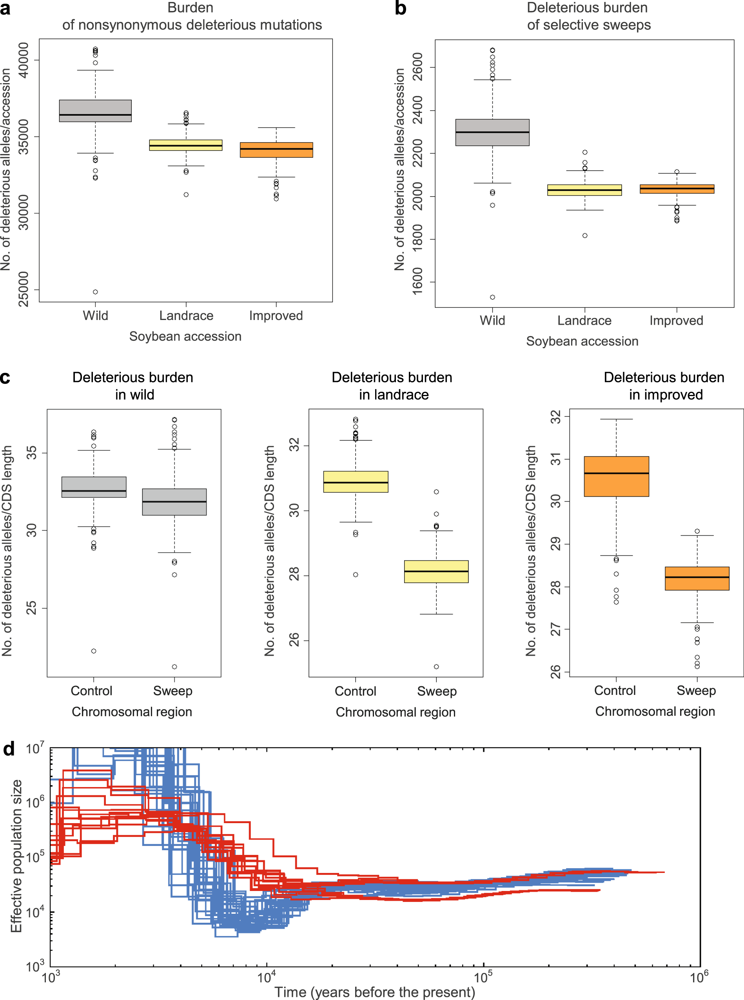
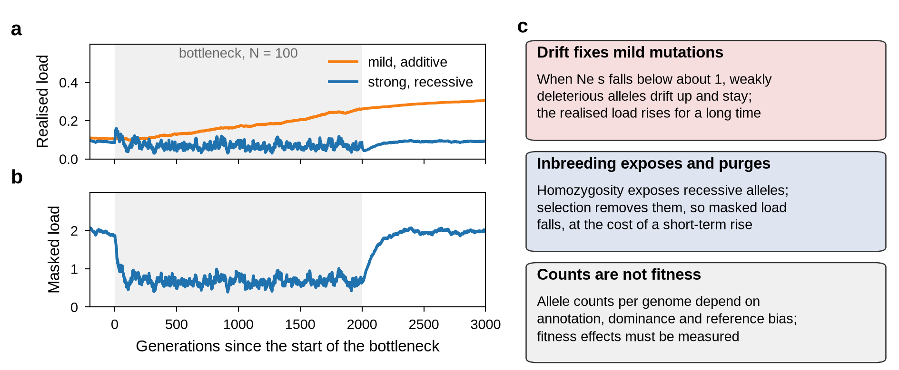

# Chapter 10. Genetic load and the cost of domestication

**Status: Partly verified.** That recurrent deleterious mutation lowers mean fitness, and that this mutation load depends mainly on the mutation rate, is a well-established result of theory, and inbreeding depression shows that populations carry many recessive deleterious alleles. The cost of domestication, an increase in the number or frequency of deleterious variants in crops and livestock, is supported in rice, cassava, sunflower, maize and grapevine, but not in soybean or in several animal breeds, and the usual genomic measures count predicted deleterious alleles rather than measured fitness.

Related notes in this repository: [mutational-genetic-load](../../skills/genomics-theory-mining/theories/mutational-genetic-load/THEORY.md), [mutation-selection-balance](../../skills/genomics-theory-mining/theories/mutation-selection-balance/THEORY.md), [haldane-cost-of-selection](../../skills/genomics-theory-mining/theories/haldane-cost-of-selection/THEORY.md), [inbreeding-depression](../../skills/genomics-theory-mining/theories/inbreeding-depression/THEORY.md), [kondrashov-1995-dangerous-range-vsd](../../skills/genomics-theory-mining/theories/kondrashov-1995-dangerous-range-vsd/THEORY.md).

## 10.1 Statement and history

Haldane argued that in a species at equilibrium, deleterious genes are removed by selection as fast as mutation produces them, so the loss of fitness is roughly equal to the sum of all mutation rates and independent of how harmful each mutation is; he estimated it at about 5 per cent and called it the price paid for the capacity for further evolution [1]. Twenty years later he treated the substitution of favourable alleles as a second cost, the cost of natural selection, and suggested that each substitution takes about 300 generations on average, which would limit the rate of adaptive evolution [2]. Agrawal and Whitlock define mutation load as the reduction in individual fitness caused by segregating deleterious alleles, most of small effect, and note that inbreeding, synergistic epistasis, population structure and harsh environments can all lower it by removing more mutations per selective death [3].

Inbreeding depression is the most visible part of this load. Charlesworth and Charlesworth concluded that recessive or partially recessive deleterious alleles, some maintained by mutation and some by balancing selection, are the main cause, and that overdominance seems unimportant in most cases [4]. Hedrick and Garcia-Dorado summarise how purging and genetic rescue mitigate fitness decline during inbreeding, and why neither is a reliable remedy [5].

The idea of a cost of domestication came from rice genomes: Lu and colleagues found more amino acid substitutions during rice domestication than expected from comparisons among wild species, disproportionately radical ones, and proposed that artificial selection raised the frequency of linked deleterious mutations [6]. Moyers, Morrell and McKay later defined the hypothesis as an increase in the number, frequency or proportion of deleterious variants in domesticated species [7].

## 10.2 What the theory predicts

- **Load and mutation rate.** At equilibrium, load from mutations that are not completely recessive is close to the genomic deleterious mutation rate, almost independent of their effect sizes [1, 3].
- **Bottlenecks.** A bottleneck lets mildly deleterious alleles drift up, because selection is ineffective when Ne s is below about 1, so the realised load rises and stays high; strongly deleterious recessive alleles are exposed in homozygotes and purged (Figure 10.2) [8].
- **Domestication.** Bottlenecks, selfing and hitchhiking with selected alleles should raise the number and frequency of deleterious variants in domesticates [6, 7]. Clonal propagation should shelter recessive alleles in heterozygotes [9].
- **Introgression.** Gene flow from a wild relative with larger long-term Ne should lower the load of a domesticate at the introgressed regions [10].

## 10.3 Evidence for

- **Rice.** Domesticated japonica and indica individuals contain about 3–4% more deleterious alleles than wild O. rufipogon, with deleterious variants enriched in low-recombination regions and rising in frequency within putative sweeps; simulations point to the shift to selfing as the main driver [11].
- **Cassava.** In 241 accessions, the bottleneck and clonal propagation increased the number of deleterious alleles by 26% and fixed many deleterious amino acid changes; limited recombination made purging ineffective, and breeding has kept yield by masking recessive mutations in heterozygotes [12].
- **Sunflower and relatives.** In domesticated sunflower, the remaining variation is biased towards nonsynonymous and predicted deleterious mutations, which accumulate in low-recombination regions, and similar patterns appear in globe artichoke and cardoon [13].
- **Maize.** A protracted domestication bottleneck and serial founder effects increased deleterious alleles in maize relative to teosinte, most strongly in Andean maize; introgression from Zea mays ssp. mexicana in the highlands reduced them [10].
- **Barley and soybean cultivars.** Individual cultivars carry hundreds of deleterious SNPs on average, and known phenotype-altering variants are more often predicted to be deleterious than the genome-wide average [14].
- **Wild animals.** In Alpine ibex, the well-documented recolonisation bottlenecks purged highly deleterious mutations while mildly deleterious ones accumulated, even in populations of about 1,000 individuals [8].

## 10.4 Evidence against, and difficulties

- **Soybean.** In 781 accessions, domesticated soybean carries 7.1% fewer deleterious mutations than wild soybean, with a further 1.4% reduction from landraces to improved lines, and domestication sweep regions show reduced deleterious burden (Figure 10.1) [15].
- **Animals.** Bosse and colleagues argued, with data from commercial pig and chicken lines, that domestication by itself is not a prerequisite for genetic erosion [16].
- **Humans.** European Americans carry more homozygous damaging genotypes and a higher share of nonsynonymous variants than African Americans [17], but the average burden of damaging mutations per individual is very similar [18], and no higher load is found in non-Africans when the accumulation of nonsynonymous substitutions is measured directly [19]. Henn and colleagues stress that load estimates depend on assumed dominance and selection coefficients, which are poorly known [20].
- **Measurement.** Counts of predicted deleterious alleles depend on annotation tools, reference bias and dominance, and conditionally deleterious variants can even be favoured in crops [14, 21]. The demographic histories needed to interpret load are themselves being revised [22].
- **The substitution cost.** Haldane’s limit on the rate of adaptive substitution depends on assumptions about how selection acts on many loci at once [2]; the related note in this repository discusses these assumptions.

## 10.5 Status and reasoning

**Partly verified.** Mutation load, inbreeding depression from recessive alleles and purging are supported by theory and data [1, 4, 8]. An increased deleterious burden after domestication is found in several crops [10, 11, 12, 13] but not in soybean [15] or in some livestock [16], and in most cases what is measured is a count of predicted deleterious alleles, not a fitness loss [20].

## 10.6 Plants, crops and grapevine

- **Grapevine.** Cultivated grapes carry more deleterious mutations in heterozygous form than their wild ancestors, partly because clonal propagation shelters recessive mutations [9]. Structural variants are under strong purifying selection, particularly inversions and translocations, yet accumulate as recessive heterozygotes in clonal lineages [23]. Introgression from wild European grapes brought adaptive alleles but also raised the deleterious burden, mostly hidden in heterozygotes [24]. In a Pinot Noir pedigree, crossing and cloning concealed, while selfing purged, most deleterious and structural burden [25].
- **Potato.** A clonal tetraploid crop with severe inbreeding depression: 151 diploid potatoes carried about 345,000 predicted deleterious substitutions, enriched near centromeres, and segregation distortion in F2 populations located deleterious recessive alleles [26]. Genome design that tracked homozygosity and deleterious mutations produced fertile inbred lines and vigorous hybrids [27], and deleterious mutations inferred from a deep Solanaceae phylogeny improved genomic prediction of yield [28].
- **Selfing crops.** In maize lines selfed for six generations, heterozygous putatively deleterious SNPs were lost preferentially, more quickly where recombination is high [29]. In Eichhornia paniculata, selfing populations show reduced efficacy of selection together with purging of recessive deleterious mutations [30]. Linkage drag can bring load back: wild introgressions in sunflower inbred lines reduced load in coding sequence but mostly lowered yield and quality [31].

## 10.7 How to test it with public data

- **Data.** Resequencing of a crop and its wild progenitor, with an outgroup; for example rice and O. rufipogon, cassava HapMap, soybean and Glycine soja, or wild and cultivated grapes [11, 12, 15, 24].
- **Tools.** SIFT, PROVEAN or GERP for annotation, or a phylogenetic likelihood ratio test such as BAD_Mutations [14]; SLiM for forward simulations with dominance; ROH callers for inbreeding.
- **Analysis.** (1) Polarise alleles with an outgroup and annotate derived alleles. (2) Count derived deleterious alleles per genome, separately as homozygous and heterozygous, and compare with synonymous counts in the same individuals [18, 19]. (3) Compare crop and wild groups with the same sample size and the same reference genome, or a graph reference, to limit reference bias. (4) Fit a demographic model and simulate under it, with additive and recessive mutations, to see whether the observed difference requires a change in selection [20]. The script [`scripts/ch10_genetic_load_figures.py`](../scripts/ch10_genetic_load_figures.py) simulates realised and masked load through a bottleneck (Figure 10.2).
- **What would break the theory.** Domesticates with smaller Ne, selfing or clonal propagation consistently showing no more, or fewer, deleterious alleles than wild relatives, across annotation methods.

## 10.8 Open questions

- How much of the predicted load reduces yield or fitness in the field?
- Why does soybean show a lower burden after domestication when rice, which also became selfing, shows a higher one [11, 15]?
- How should breeders of clonal crops such as grapevine and potato use selfing or genome design to purge load without losing heterozygosity at useful loci [25, 27]?

## 10.9 Common mistakes

- Treating the number of predicted deleterious alleles as a fitness measure [20].
- Comparing groups that differ in sample size, sequencing depth or distance to the reference genome.
- Ignoring dominance: heterozygous recessive alleles cost little until inbreeding exposes them.
- Equating load with inbreeding depression; mildly deleterious additive alleles contribute to load but little to inbreeding depression.

## Figures

**Figure 10.1.** Mutation burden in wild and domesticated soybean. (a) Number of deleterious nonsynonymous alleles per accession in wild (Glycine soja, n = 345), landrace (n = 332) and improved (n = 86) soybean. (b) The same in domestication sweep regions. (c) Deleterious alleles per 100 kb of coding sequence in sweep and control regions, by group. (d) Effective population size through time inferred by PSMC for pairs of domesticated (blue) and wild (red) genomes. Each plot shows the median and interquartile range, with whiskers at 1.5 times the interquartile range. Reproduced unchanged from Kim M-S, Lozano R, Kim JH, Bae DN, Kim S-T, Park J-H, Choi MS, Kim J, Ok H-C, Park S-K, Gore MA, Moon J-K, Jeong S-C (2021) The patterns of deleterious mutations during the domestication of soybean. *Nature Communications* 12:97, Figure 4. https://doi.org/10.1038/s41467-020-20337-3. Licence: CC BY 4.0 (https://creativecommons.org/licenses/by/4.0/).

**Figure 10.2.** Wright–Fisher simulation of 5,000 mildly deleterious additive loci (s = 0.002, h = 0.5) and 5,000 strongly deleterious, nearly recessive loci (s = 0.5, h = 0.02), with mutation rate 10⁻⁵ per locus, through a bottleneck from N = 5,000 to N = 100 for 2,000 generations (grey). (a) Realised load, the sum over loci of 2pq·hs + q²s. (b) Masked load of the recessive class, s·pq(1 − 2h), which inbreeding would expose. (c) What the simulation shows and what it leaves out. Loci are unlinked; values are illustrative. Made with [`scripts/ch10_genetic_load_figures.py`](../scripts/ch10_genetic_load_figures.py).

## References

1. Haldane JBS (1937) The Effect of Variation of Fitness. *The American Naturalist* 71:337-349. https://doi.org/10.1086/280722
2. Haldane JBS (1957) The cost of natural selection. *Journal of Genetics* 55:511-524. https://doi.org/10.1007/BF02984069
3. Agrawal AF, Whitlock MC (2012) Mutation Load: The Fitness of Individuals in Populations Where Deleterious Alleles Are Abundant. *Annual Review of Ecology, Evolution, and Systematics* 43:115-135. https://doi.org/10.1146/annurev-ecolsys-110411-160257
4. Charlesworth B, Charlesworth D (1999) The genetic basis of inbreeding depression. *Genetical Research* 74:329-340. https://doi.org/10.1017/s0016672399004152
5. Hedrick PW, Garcia-Dorado A (2016) Understanding Inbreeding Depression, Purging, and Genetic Rescue. *Trends in Ecology & Evolution* 31:940-952. https://doi.org/10.1016/j.tree.2016.09.005
6. Lu J, Tang T, Tang H, et al. (2006) The accumulation of deleterious mutations in rice genomes: a hypothesis on the cost of domestication. *Trends in Genetics* 22:126-131. https://doi.org/10.1016/j.tig.2006.01.004
7. Moyers BT, Morrell PL, McKay JK (2018) Genetic Costs of Domestication and Improvement. *Journal of Heredity* 109:103-116. https://doi.org/10.1093/jhered/esx069
8. Grossen C, Guillaume F, Keller LF, et al. (2020) Purging of highly deleterious mutations through severe bottlenecks in Alpine ibex. *Nature Communications* 11:1001. https://doi.org/10.1038/s41467-020-14803-1
9. Zhou Y, Massonnet M, Sanjak JS, et al. (2017) Evolutionary genomics of grape ( Vitis vinifera ssp. vinifera ) domestication. *Proceedings of the National Academy of Sciences* 114:11715-11720. https://doi.org/10.1073/pnas.1709257114
10. Wang L, Beissinger TM, Lorant A, et al. (2017) The interplay of demography and selection during maize domestication and expansion. *Genome Biology* 18:215. https://doi.org/10.1186/s13059-017-1346-4
11. Liu Q, Zhou Y, Morrell PL, et al. (2017) Deleterious variants in Asian rice and the potential cost of domestication. *Molecular Biology and Evolution*:msw296. https://doi.org/10.1093/molbev/msw296
12. Ramu P, Esuma W, Kawuki R, et al. (2017) Cassava haplotype map highlights fixation of deleterious mutations during clonal propagation. *Nature Genetics* 49:959-963. https://doi.org/10.1038/ng.3845
13. Renaut S, Rieseberg LH (2015) The Accumulation of Deleterious Mutations as a Consequence of Domestication and Improvement in Sunflowers and Other Compositae Crops. *Molecular Biology and Evolution* 32:2273-2283. https://doi.org/10.1093/molbev/msv106
14. Kono TJY, Fu F, Mohammadi M, et al. (2016) The Role of Deleterious Substitutions in Crop Genomes. *Molecular Biology and Evolution* 33:2307-2317. https://doi.org/10.1093/molbev/msw102
15. Kim MS, Lozano R, Kim JH, et al. (2021) The patterns of deleterious mutations during the domestication of soybean. *Nature Communications* 12:97. https://doi.org/10.1038/s41467-020-20337-3
16. Bosse M, Megens H, Derks MFL, et al. (2019) Deleterious alleles in the context of domestication, inbreeding, and selection. *Evolutionary Applications* 12:6-17. https://doi.org/10.1111/eva.12691
17. Lohmueller KE, Indap AR, Schmidt S, et al. (2008) Proportionally more deleterious genetic variation in European than in African populations. *Nature* 451:994-997. https://doi.org/10.1038/nature06611
18. Simons YB, Turchin MC, Pritchard JK, et al. (2014) The deleterious mutation load is insensitive to recent population history. *Nature Genetics* 46:220-224. https://doi.org/10.1038/ng.2896
19. Do R, Balick D, Li H, et al. (2015) No evidence that selection has been less effective at removing deleterious mutations in Europeans than in Africans. *Nature Genetics* 47:126-131. https://doi.org/10.1038/ng.3186
20. Henn BM, Botigué LR, Bustamante CD, et al. (2015) Estimating the mutation load in human genomes. *Nature Reviews Genetics* 16:333-343. https://doi.org/10.1038/nrg3931
21. Dwivedi SL, Heslop-Harrison P, Spillane C, et al. (2023) Evolutionary dynamics and adaptive benefits of deleterious mutations in crop gene pools. *Trends in Plant Science* 28:685-697. https://doi.org/10.1016/j.tplants.2023.01.006
22. Gaut BS, Seymour DK, Liu Q, et al. (2018) Demography and its effects on genomic variation in crop domestication. *Nature Plants* 4:512-520. https://doi.org/10.1038/s41477-018-0210-1
23. Zhou Y, Minio A, Massonnet M, et al. (2019) The population genetics of structural variants in grapevine domestication. *Nature Plants* 5:965-979. https://doi.org/10.1038/s41477-019-0507-8
24. Xiao H, Liu Z, Wang N, et al. (2023) Adaptive and maladaptive introgression in grapevine domestication. *Proceedings of the National Academy of Sciences* 120:e2222041120. https://doi.org/10.1073/pnas.2222041120
25. Xiao H, Wang Y, Liu W, et al. (2025) Impacts of reproductive systems on grapevine genome and breeding. *Nature Communications* 16:2031. https://doi.org/10.1038/s41467-025-56817-7
26. Zhang C, Wang P, Tang D, et al. (2019) The genetic basis of inbreeding depression in potato. *Nature Genetics* 51:374-378. https://doi.org/10.1038/s41588-018-0319-1
27. Zhang C, Yang Z, Tang D, et al. (2021) Genome design of hybrid potato. *Cell* 184:3873-3883.e12. https://doi.org/10.1016/j.cell.2021.06.006
28. Wu Y, Li D, Hu Y, et al. (2023) Phylogenomic discovery of deleterious mutations facilitates hybrid potato breeding. *Cell* 186:2313-2328.e15. https://doi.org/10.1016/j.cell.2023.04.008
29. Roessler K, Muyle A, Diez CM, et al. (2019) The genome-wide dynamics of purging during selfing in maize. *Nature Plants* 5:980-990. https://doi.org/10.1038/s41477-019-0508-7
30. Arunkumar R, Ness RW, Wright SI, et al. (2015) The Evolution of Selfing Is Accompanied by Reduced Efficacy of Selection and Purging of Deleterious Mutations. *Genetics* 199:817-829. https://doi.org/10.1534/genetics.114.172809
31. Huang K, Jahani M, Gouzy J, et al. (2023) The genomics of linkage drag in inbred lines of sunflower. *Proceedings of the National Academy of Sciences* 120:e2205783119. https://doi.org/10.1073/pnas.2205783119
