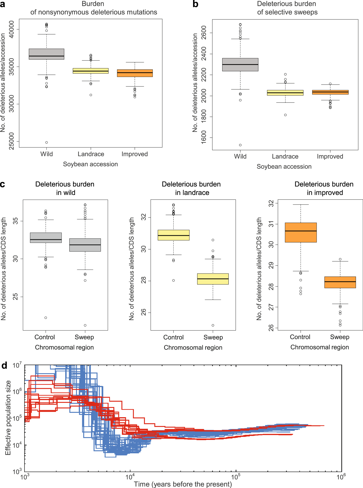
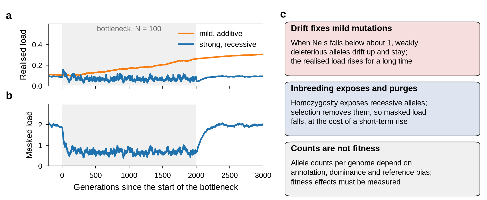

# 第 10 章 遗传负荷与驯化代价

**地位：部分验证。** 反复出现的有害突变会降低平均适合度，且这种突变负荷主要取决于突变率，这是理论上已确立的结果；近交衰退表明群体携带许多隐性有害等位基因。驯化代价，即作物和家畜中有害变异的数目或频率增加，在水稻、木薯、向日葵、玉米和葡萄中得到支持，但在大豆和若干动物品种中不成立；而且常用的基因组指标统计的是预测的有害等位基因，而不是测得的适合度。

本仓库相关条目：[mutational-genetic-load](../../theories/mutational-genetic-load/THEORY.md)、[mutation-selection-balance](../../theories/mutation-selection-balance/THEORY.md)、[haldane-cost-of-selection](../../theories/haldane-cost-of-selection/THEORY.md)、[inbreeding-depression](../../theories/inbreeding-depression/THEORY.md)、[kondrashov-1995-dangerous-range-vsd](../../theories/kondrashov-1995-dangerous-range-vsd/THEORY.md)。

## 10.1 内容与历史

Haldane 认为，在处于平衡的物种中，选择清除有害基因的速度与突变产生它们的速度相同，因此适合度损失大致等于所有突变率之和，而与每个突变的危害大小无关；他估计约为 5%，并称之为物种为保持进一步进化的能力所付出的代价 [1]。二十年后，他把有利等位基因的替代当作第二种代价，即自然选择的代价，并提出每次替代平均约需 300 代，这会限制适应性进化的速度 [2]。Agrawal 和 Whitlock 把突变负荷定义为分离中的有害等位基因（多数效应很小）造成的个体适合度降低，并指出近交、协同上位、群体结构和严酷环境都能通过让每次选择性死亡清除更多突变来降低负荷 [3]。

近交衰退是这种负荷最显眼的部分。Charlesworth 和 Charlesworth 认为，隐性或部分隐性的有害等位基因（有的由突变维持，有的由平衡选择维持）是主要原因，超显性在多数情况下似乎不重要 [4]。Hedrick 和 Garcia-Dorado 总结了清除（purging）和遗传拯救如何缓解近交期间的适合度下降，以及为什么两者都不是可靠的办法 [5]。

驯化代价的想法来自水稻基因组：Lu 等发现，水稻驯化期间的氨基酸替代多于野生种之间比较的预期，且激进型替代尤其多，他们提出人工选择提高了连锁有害突变的频率 [6]。Moyers、Morrell 和 McKay 后来把这一假说定义为驯化物种中有害变异的数目、频率或比例增加 [7]。

## 10.2 预测

- **负荷与突变率。** 在平衡时，不完全隐性突变造成的负荷接近基因组有害突变率，几乎与效应大小无关 [1, 3]。
- **瓶颈。** 瓶颈期间，当 Ne s 低于约 1 时选择失效，轻度有害等位基因随漂变上升，实现负荷升高并保持在高位；强有害的隐性等位基因在纯合子中暴露并被清除（图 10.2）[8]。
- **驯化。** 瓶颈、自交以及与受选等位基因的搭便车应使驯化物种中有害变异的数目和频率增加 [6, 7]。克隆繁殖应把隐性等位基因保护在杂合状态中 [9]。
- **渐渗。** 来自长期 Ne 更大的野生近缘种的基因流应降低驯化物种在渐渗区域的负荷 [10]。

## 10.3 支持证据

- **水稻。** 驯化的粳稻和籼稻个体比野生普通野生稻多约 3–4% 的有害等位基因，有害变异富集在低重组区，并在推定的清除区内频率上升；模拟表明转向自交是主要驱动因素 [11]。
- **木薯。** 在 241 份材料中，瓶颈和克隆繁殖使有害等位基因数增加了 26%，并固定了许多有害氨基酸变化；有限的重组使清除失效，育种通过把隐性突变掩盖在杂合子中维持了产量 [12]。
- **向日葵及其近缘种。** 在驯化向日葵中，剩余变异偏向非同义和预测有害的突变，它们在低重组区积累；朝鲜蓟和刺菜蓟中也有类似模式 [13]。
- **玉米。** 漫长的驯化瓶颈和连续的奠基者效应使玉米相对类蜀黍的有害等位基因增加，在安第斯玉米中最明显；高地中来自 Zea mays ssp. mexicana 的渐渗降低了它们 [10]。
- **大麦和大豆品种。** 单个品种平均携带数百个有害 SNP，已知改变表型的变异被预测为有害的比例高于全基因组平均 [14]。
- **野生动物。** 在阿尔卑斯羱羊中，记录详细的再引入瓶颈清除了高度有害的突变，同时轻度有害突变积累，即使在约 1,000 个体的群体中也是如此 [8]。

## 10.4 反面证据与难点

- **大豆。** 在 781 份材料中，驯化大豆的有害突变比野生大豆少 7.1%，从地方品种到改良品种又减少 1.4%，驯化清除区的有害负担也较低（图 10.1）[15]。
- **动物。** Bosse 等用商业猪和鸡品系的数据认为，驯化本身并不是遗传侵蚀的前提 [16]。
- **人类。** 欧裔美国人携带的纯合有害基因型更多，非同义变异比例也高于非裔美国人 [17]；但每个个体有害突变的平均负担非常相近 [18]，直接测量非同义替代的积累时，也没有发现非洲以外群体负荷更高 [19]。Henn 等强调，负荷估计取决于所假设的显性度和选择系数，而这些参数了解很少 [20]。
- **测量。** 预测有害等位基因的计数取决于注释工具、参考基因组偏差和显性度，条件性有害的变异在作物中甚至可能受青睐 [14, 21]。解释负荷所需的群体历史本身也在修订之中 [22]。
- **替代代价。** Haldane 对适应性替代速度的限制取决于选择如何同时作用于许多位点的假设 [2]；本仓库的相关条目讨论了这些假设。

## 10.5 地位与理由

**部分验证。** 突变负荷、由隐性等位基因引起的近交衰退以及清除都有理论和数据支持 [1, 4, 8]。驯化后有害负担增加见于若干作物 [10, 11, 12, 13]，但大豆中没有 [15]，部分家畜中也没有 [16]；而且多数情况下测的是预测的有害等位基因计数，而不是适合度损失 [20]。

## 10.6 植物、作物与葡萄

- **葡萄。** 栽培葡萄杂合状态的有害突变多于其野生祖先，部分原因是克隆繁殖保护了隐性突变 [9]。结构变异受到强纯化选择，倒位和易位尤甚，但仍以隐性杂合形式在克隆谱系中积累 [23]。来自欧洲野生葡萄的渐渗带来了适应性等位基因，也提高了有害负担，且大多隐藏在杂合子中 [24]。在一个黑比诺系谱中，杂交和克隆掩盖了大部分有害和结构负担，而自交则清除了它们 [25]。
- **马铃薯。** 这是一个近交衰退严重的克隆四倍体作物：151 份二倍体马铃薯携带约 345,000 个预测有害替代，富集在着丝粒附近，F2 群体中的分离偏差定位了有害隐性等位基因 [26]。追踪纯合度和有害突变的基因组设计培育出了可育的自交系和有活力的杂种 [27]；从深层茄科系统发育推断的有害突变提高了产量的基因组预测精度 [28]。
- **自交作物。** 在连续自交六代的玉米品系中，杂合的推定有害 SNP 优先丢失，在高重组区丢失更快 [29]。在 Eichhornia paniculata 中，自交群体的选择效率降低，同时隐性有害突变被清除 [30]。连锁累赘会把负荷带回来：向日葵自交系中的野生渐渗降低了编码序列中的负荷，但大多降低了产量和品质 [31]。

## 10.7 用公开数据检验

- **数据。** 作物及其野生祖先的重测序数据，加一个外类群；例如水稻和普通野生稻、木薯 HapMap、大豆和野大豆，或野生和栽培葡萄 [11, 12, 15, 24]。
- **工具。** 注释用 SIFT、PROVEAN 或 GERP，或 BAD_Mutations 这样的系统发育似然比检验 [14]；带显性度的正向模拟用 SLiM；近交用 ROH 检测工具。
- **分析。** (1) 用外类群确定等位基因的祖先状态并注释衍生等位基因。(2) 分别按纯合和杂合统计每个基因组的衍生有害等位基因数，并与同一些个体中的同义计数比较 [18, 19]。(3) 在样本量相同、参考基因组相同（或使用图参考）的条件下比较作物组和野生组，以限制参考偏差。(4) 拟合群体历史模型并在其下以加性和隐性突变模拟，看观察到的差异是否需要选择发生变化 [20]。脚本 [`scripts/ch10_genetic_load_figures.py`](../scripts/ch10_genetic_load_figures.py) 模拟瓶颈中的实现负荷和掩盖负荷（图 10.2）。
- **什么结果会推翻这一理论。** Ne 更小、自交或克隆繁殖的驯化物种，在各种注释方法下都一致地显示有害等位基因不多于、甚至少于野生近缘种。

## 10.8 未解决的问题

- 预测的负荷中有多少会在田间降低产量或适合度？
- 为什么同样转向自交的水稻驯化后负担更高，而大豆更低 [11, 15]？
- 葡萄和马铃薯等克隆作物的育种者应如何利用自交或基因组设计清除负荷，同时不丢失有用位点的杂合性 [25, 27]？

## 10.9 常见错误

- 把预测有害等位基因的数目当作适合度指标 [20]。
- 比较样本量、测序深度或与参考基因组距离不同的群体。
- 忽略显性度：杂合的隐性等位基因在近交使其暴露之前代价很小。
- 把负荷等同于近交衰退；轻度有害的加性等位基因对负荷有贡献，但对近交衰退贡献很小。

## 图

**图 10.1.** 野生和驯化大豆的突变负担。(a) 野大豆（Glycine soja，n = 345）、地方品种（n = 332）和改良品种（n = 86）每份材料的有害非同义等位基因数。(b) 驯化清除区中的同一指标。(c) 各组在清除区和对照区中每 100 kb 编码序列的有害等位基因数。(d) PSMC 推断的驯化（蓝色）和野生（红色）基因组对的有效群体大小随时间的变化。每个图显示中位数和四分位距，须线为四分位距的 1.5 倍。原样转载自 Kim M-S, Lozano R, Kim JH, Bae DN, Kim S-T, Park J-H, Choi MS, Kim J, Ok H-C, Park S-K, Gore MA, Moon J-K, Jeong S-C (2021) The patterns of deleterious mutations during the domestication of soybean. *Nature Communications* 12:97, Figure 4. https://doi.org/10.1038/s41467-020-20337-3。许可：CC BY 4.0（https://creativecommons.org/licenses/by/4.0/）。

**图 10.2.** 5,000 个轻度有害加性位点（s = 0.002，h = 0.5）和 5,000 个强有害近隐性位点（s = 0.5，h = 0.02）的 Wright–Fisher 模拟，每位点突变率 10⁻⁵，经历从 N = 5,000 降到 N = 100、持续 2,000 代的瓶颈（灰色）。(a) 实现负荷，即各位点 2pq·hs + q²s 之和。(b) 隐性类的掩盖负荷 s·pq(1 − 2h)，近交会使其暴露。(c) 模拟显示了什么、遗漏了什么。位点之间不连锁；数值仅作示意。由 [`scripts/ch10_genetic_load_figures.py`](../scripts/ch10_genetic_load_figures.py) 生成。

## 参考文献

1. Haldane JBS (1937) The Effect of Variation of Fitness. *The American Naturalist* 71:337-349. https://doi.org/10.1086/280722
2. Haldane JBS (1957) The cost of natural selection. *Journal of Genetics* 55:511-524. https://doi.org/10.1007/BF02984069
3. Agrawal AF, Whitlock MC (2012) Mutation Load: The Fitness of Individuals in Populations Where Deleterious Alleles Are Abundant. *Annual Review of Ecology, Evolution, and Systematics* 43:115-135. https://doi.org/10.1146/annurev-ecolsys-110411-160257
4. Charlesworth B, Charlesworth D (1999) The genetic basis of inbreeding depression. *Genetical Research* 74:329-340. https://doi.org/10.1017/s0016672399004152
5. Hedrick PW, Garcia-Dorado A (2016) Understanding Inbreeding Depression, Purging, and Genetic Rescue. *Trends in Ecology & Evolution* 31:940-952. https://doi.org/10.1016/j.tree.2016.09.005
6. Lu J, Tang T, Tang H, et al. (2006) The accumulation of deleterious mutations in rice genomes: a hypothesis on the cost of domestication. *Trends in Genetics* 22:126-131. https://doi.org/10.1016/j.tig.2006.01.004
7. Moyers BT, Morrell PL, McKay JK (2018) Genetic Costs of Domestication and Improvement. *Journal of Heredity* 109:103-116. https://doi.org/10.1093/jhered/esx069
8. Grossen C, Guillaume F, Keller LF, et al. (2020) Purging of highly deleterious mutations through severe bottlenecks in Alpine ibex. *Nature Communications* 11:1001. https://doi.org/10.1038/s41467-020-14803-1
9. Zhou Y, Massonnet M, Sanjak JS, et al. (2017) Evolutionary genomics of grape ( Vitis vinifera ssp. vinifera ) domestication. *Proceedings of the National Academy of Sciences* 114:11715-11720. https://doi.org/10.1073/pnas.1709257114
10. Wang L, Beissinger TM, Lorant A, et al. (2017) The interplay of demography and selection during maize domestication and expansion. *Genome Biology* 18:215. https://doi.org/10.1186/s13059-017-1346-4
11. Liu Q, Zhou Y, Morrell PL, et al. (2017) Deleterious variants in Asian rice and the potential cost of domestication. *Molecular Biology and Evolution*:msw296. https://doi.org/10.1093/molbev/msw296
12. Ramu P, Esuma W, Kawuki R, et al. (2017) Cassava haplotype map highlights fixation of deleterious mutations during clonal propagation. *Nature Genetics* 49:959-963. https://doi.org/10.1038/ng.3845
13. Renaut S, Rieseberg LH (2015) The Accumulation of Deleterious Mutations as a Consequence of Domestication and Improvement in Sunflowers and Other Compositae Crops. *Molecular Biology and Evolution* 32:2273-2283. https://doi.org/10.1093/molbev/msv106
14. Kono TJY, Fu F, Mohammadi M, et al. (2016) The Role of Deleterious Substitutions in Crop Genomes. *Molecular Biology and Evolution* 33:2307-2317. https://doi.org/10.1093/molbev/msw102
15. Kim MS, Lozano R, Kim JH, et al. (2021) The patterns of deleterious mutations during the domestication of soybean. *Nature Communications* 12:97. https://doi.org/10.1038/s41467-020-20337-3
16. Bosse M, Megens H, Derks MFL, et al. (2019) Deleterious alleles in the context of domestication, inbreeding, and selection. *Evolutionary Applications* 12:6-17. https://doi.org/10.1111/eva.12691
17. Lohmueller KE, Indap AR, Schmidt S, et al. (2008) Proportionally more deleterious genetic variation in European than in African populations. *Nature* 451:994-997. https://doi.org/10.1038/nature06611
18. Simons YB, Turchin MC, Pritchard JK, et al. (2014) The deleterious mutation load is insensitive to recent population history. *Nature Genetics* 46:220-224. https://doi.org/10.1038/ng.2896
19. Do R, Balick D, Li H, et al. (2015) No evidence that selection has been less effective at removing deleterious mutations in Europeans than in Africans. *Nature Genetics* 47:126-131. https://doi.org/10.1038/ng.3186
20. Henn BM, Botigué LR, Bustamante CD, et al. (2015) Estimating the mutation load in human genomes. *Nature Reviews Genetics* 16:333-343. https://doi.org/10.1038/nrg3931
21. Dwivedi SL, Heslop-Harrison P, Spillane C, et al. (2023) Evolutionary dynamics and adaptive benefits of deleterious mutations in crop gene pools. *Trends in Plant Science* 28:685-697. https://doi.org/10.1016/j.tplants.2023.01.006
22. Gaut BS, Seymour DK, Liu Q, et al. (2018) Demography and its effects on genomic variation in crop domestication. *Nature Plants* 4:512-520. https://doi.org/10.1038/s41477-018-0210-1
23. Zhou Y, Minio A, Massonnet M, et al. (2019) The population genetics of structural variants in grapevine domestication. *Nature Plants* 5:965-979. https://doi.org/10.1038/s41477-019-0507-8
24. Xiao H, Liu Z, Wang N, et al. (2023) Adaptive and maladaptive introgression in grapevine domestication. *Proceedings of the National Academy of Sciences* 120:e2222041120. https://doi.org/10.1073/pnas.2222041120
25. Xiao H, Wang Y, Liu W, et al. (2025) Impacts of reproductive systems on grapevine genome and breeding. *Nature Communications* 16:2031. https://doi.org/10.1038/s41467-025-56817-7
26. Zhang C, Wang P, Tang D, et al. (2019) The genetic basis of inbreeding depression in potato. *Nature Genetics* 51:374-378. https://doi.org/10.1038/s41588-018-0319-1
27. Zhang C, Yang Z, Tang D, et al. (2021) Genome design of hybrid potato. *Cell* 184:3873-3883.e12. https://doi.org/10.1016/j.cell.2021.06.006
28. Wu Y, Li D, Hu Y, et al. (2023) Phylogenomic discovery of deleterious mutations facilitates hybrid potato breeding. *Cell* 186:2313-2328.e15. https://doi.org/10.1016/j.cell.2023.04.008
29. Roessler K, Muyle A, Diez CM, et al. (2019) The genome-wide dynamics of purging during selfing in maize. *Nature Plants* 5:980-990. https://doi.org/10.1038/s41477-019-0508-7
30. Arunkumar R, Ness RW, Wright SI, et al. (2015) The Evolution of Selfing Is Accompanied by Reduced Efficacy of Selection and Purging of Deleterious Mutations. *Genetics* 199:817-829. https://doi.org/10.1534/genetics.114.172809
31. Huang K, Jahani M, Gouzy J, et al. (2023) The genomics of linkage drag in inbred lines of sunflower. *Proceedings of the National Academy of Sciences* 120:e2205783119. https://doi.org/10.1073/pnas.2205783119
