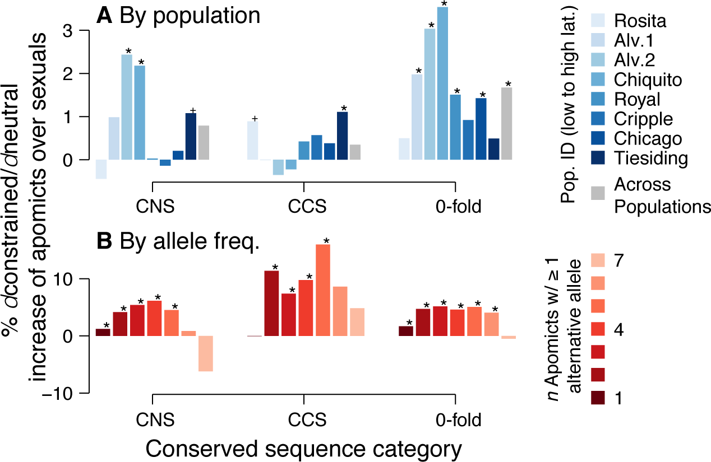
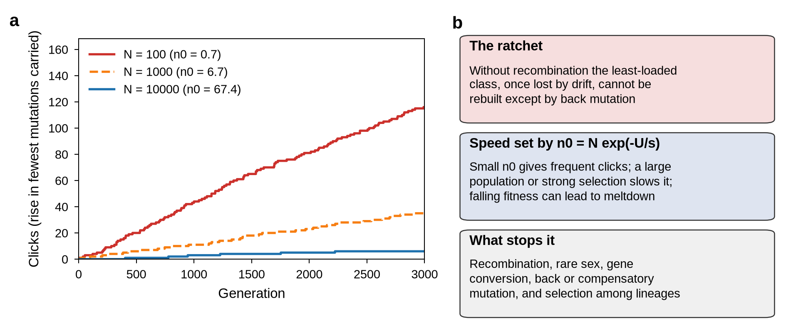

# Chapter 11. Muller’s ratchet and the advantages of sex

**Status: Muller’s ratchet Verified in non-recombining genomes; the advantages of sex Partly verified.** In small asexual populations the class of genomes with the fewest deleterious mutations is lost by drift and cannot be rebuilt, and this ratchet has been shown in RNA viruses, bacteria, a nascent Y chromosome and, as faster accumulation of harmful changes, in endosymbionts, mitochondria and asexual plants and animals. That sex is maintained because recombination helps selection, against deleterious mutations, for beneficial ones or against parasites, is supported by experiments, but which mechanism is strong enough to pay the twofold cost of sex in nature is not settled, and several asexual lineages show no excess load.

Related notes in this repository: [muller-ratchet](../../skills/genomics-theory-mining/theories/muller-ratchet/THEORY.md), [organelle-plastid-muller-ratchet](../../skills/genomics-theory-mining/theories/organelle-plastid-muller-ratchet/THEORY.md), [two-fold-cost-of-sex](../../skills/genomics-theory-mining/theories/two-fold-cost-of-sex/THEORY.md), [hill-robertson-interference](../../skills/genomics-theory-mining/theories/hill-robertson-interference/THEORY.md), [clonal-interference](../../skills/genomics-theory-mining/theories/clonal-interference/THEORY.md), [mutation-accumulation](../../skills/genomics-theory-mining/theories/mutation-accumulation/THEORY.md), [meselson-effect](../../skills/genomics-theory-mining/theories/meselson-effect/THEORY.md), [y-chromosome-degeneration](../../skills/genomics-theory-mining/theories/y-chromosome-degeneration/THEORY.md).

## 11.1 Statement and history

Muller argued in 1964 that a population without recombination accumulates deleterious mutations irreversibly: once every genome carries at least one mutation, the mutation-free class can be restored only by back mutation [1]. Felsenstein showed that the long argument over whether recombination is advantageous turned on population size: models with finite populations found an advantage, and infinite-population models did not, because the advantage comes from breaking down random linkage disequilibrium generated by drift, the Hill–Robertson effect [2]. Haigh analysed the ratchet quantitatively; the key quantity is the size of the least-loaded class, n0 = N exp(−U/s), for population size N, genomic deleterious mutation rate U and selection coefficient s [3]. Gordo and Charlesworth derived an approximation for the rate of the ratchet when n0 is large and showed that it can still turn at a significant rate when n0 is well above 100 [4]. Lynch and colleagues described mutational meltdown: falling fitness reduces population size, which speeds the ratchet [5].

Other theories of the advantage of sex followed. Kondrashov proposed that if the deleterious mutation rate per genome per generation exceeds 1, the greater efficiency of selection against these mutations in sexual populations could maintain sex [6]. Peck showed that in a large asexual population, frequent deleterious mutations make a new beneficial mutation much more likely to be lost, so sexual populations can adapt faster, the ruby in the rubbish effect [7]. Under the Red Queen hypothesis, coevolving parasites keep favouring new combinations of host alleles [8]. West, Lively and Read argued that mutational and environmental mechanisms may act together [9], and Otto summarised how models with drift, spatial structure and fluctuating selection have clarified the conditions under which sex is favoured [10].

## 11.2 What the theory predicts

- **Clicks.** In an asexual population, the minimum number of mutations per genome rises in steps, fastest when n0 is small, so small populations, high U and weak s speed the ratchet (Figure 11.2) [3, 4].
- **Molecular signature.** Non-recombining genomes, such as asexual lineages, Y and neo-Y chromosomes, mitochondria and endosymbionts, should show faster evolution at functional sites and a higher ratio of nonsynonymous to synonymous change than their recombining relatives [11, 12].
- **Rescue.** Recombination, even rare sex, gene conversion, back or compensatory mutation and selection among lineages should slow or stop the ratchet [13, 14].
- **Advantage of sex grows with population size.** Hill–Robertson interference among many selected sites gives sex and recombination an advantage that increases with population size, unlike the ratchet itself [15].

## 11.3 Evidence for

- **Experiments.** In 20 lineages of the RNA bacteriophage φ6, Chao found a significant decrease in fitness due to the ratchet [16]. Salmonella typhimurium grown under strong drift accumulated mutations, and after 1,700 generations 1% of 444 lineages had an obvious loss of fitness [17]. In Drosophila, a nascent non-recombining Y chromosome decayed under experimental selection, and recombination reduced the decay [13].
- **Sex speeds adaptation.** In experimental yeast populations, sex changed which mutations fixed by reducing clonal interference, and kept strongly deleterious mutations from hitchhiking to fixation alongside beneficial ones [18]. Coevolution with a bacterial pathogen increased outcrossing in Caenorhabditis elegans and drove obligately selfing populations to extinction [8].
- **Sex chromosomes.** The neo-Y chromosome of Drosophila miranda has lost about half of its genes in about 1.75 million years, and the rate of loss-of-function mutation accumulation can largely be explained by the ratchet [19].
- **Endosymbionts and organelles.** Five independently derived endosymbiont clades show faster 16S rDNA evolution than free-living relatives [11]. Animal mitochondrial tRNA genes accumulate substitutions faster than nuclear ones, consistent with the chance fixation of mildly deleterious mutations [12]. Natural isolates of Caenorhabditis briggsae carry nonsynonymous substitutions and heteroplasmic deletions in mitochondria, and deletion levels correlate negatively with fecundity [20].
- **Asexual animals and plants.** Six asexual Timema stick-insect lineages accumulated coding mutations 3.6 to 13.4 times faster than sexual relatives [21]. In Oenothera, ten transitions to a functionally asexual genetic system were associated with more deleterious mutations [22]. In eight sympatric pairs of sexual and apomictic Boechera, apomicts carry more derived mutations and keep the ancestral allele less often at conserved sites (Figure 11.1) [23].

## 11.4 Evidence against, and difficulties

- **Selection slows the ratchet.** Allen and colleagues found evidence that selection limits the ratchet in primary endosymbionts, which would explain why their genomes degrade without widespread extinction [14]. Neiman and Taylor concluded that asexuality per se may not be the main cause of high mitochondrial load, because very little recombination is needed to counter accumulation [24].
- **No excess load in some asexuals.** In apomictic Ranunculus auricomus, no genome-wide signal of mutation accumulation was found, except in a few genes related to reproduction [25, 26]. In clonal hybrid fish whose ages range from F1 to about 300,000 years, mutations accumulated with clone age, but without the predicted increase in nonsynonymous changes or loss of fitness [27]. Hojsgaard and Hörandl argued that a little facultative sex can expose and purge deleterious mutations [26].
- **Epistasis.** Synergistic epistasis was once thought to halt the ratchet; simulations with a distribution of mutation effects, rather than a single effect, showed that it does not [28].
- **Which mechanism pays the twofold cost?** The ratchet works only in small populations or genomes without recombination [15], the deterministic mutation theory needs a deleterious mutation rate above 1 per genome [6], and the Red Queen has been shown experimentally in few systems [8]. Evidence that any single mechanism is strong enough in natural populations is limited [9, 10].

## 11.5 Status and reasoning

**Muller’s ratchet: verified in non-recombining genomes. Advantages of sex: partly verified.** The ratchet has been reproduced in experiments [13, 16, 17] and explains degeneration of neo-Y chromosomes [19]; faster accumulation of deleterious changes is found in many asexual lineages [21, 22, 23], with exceptions [25, 27]. Experiments show that sex speeds adaptation and resists parasites [8, 18], but the relative importance of these mechanisms in maintaining sex in nature is not established [10].

## 11.6 Plants, crops and grapevine

- **Apomictic plants.** Boechera shows the predicted accumulation in apomicts [23], while Ranunculus auricomus does not, perhaps because of facultative sex and polyploidy [25, 26].
- **Clonal crops.** Cassava, after domestication and clonal propagation, carries many fixed deleterious amino acid changes, and limited recombination has made purging ineffective [29]. Cultivated grapes carry more heterozygous deleterious mutations than wild grapes, partly because clonal propagation shelters recessive mutations [30]. In a Pinot Noir pedigree, cloning concealed deleterious and structural variants that selfing then purged [31].
- **Somatic mutation.** A clone is not frozen: somatic mutations accumulate in plants and can reach the gametes [32]. The white-berried Tempranillo Blanco arose from its black-berried ancestor by a catastrophic somatic rearrangement that deleted one copy of 313 genes, including the functional MYB genes for berry-skin pigmentation [33]. A grapevine cultivar propagated for centuries is therefore a non-recombining lineage in which mutations can accumulate and a slow ratchet can act.

## 11.7 How to test it with public data

- **Data.** Genomes or transcriptomes of sexual and asexual relatives sampled in matched pairs, for example Boechera, Oenothera or Timema [21, 22, 23]; mitochondrial and nuclear genes of the same species [12]; or clones of a grapevine cultivar and its seedlings.
- **Tools.** Codeml or HyPhy for dN/dS on lineages; SnpEff or SIFT for derived alleles; forward simulation of asexual populations in SLiM or the chapter script.
- **Analysis.** (1) Polarise mutations with an outgroup. (2) Compare the ratio of mutations at constrained sites to those at neutral sites between sexual and asexual lineages of similar age [23]. (3) Check for hidden sex or gene conversion, which slow the ratchet [26]. (4) Simulate the expected number of clicks for plausible N, U and s to see whether the observed excess requires the ratchet or only reduced Ne. The script [`scripts/ch11_muller_ratchet_figures.py`](../scripts/ch11_muller_ratchet_figures.py) simulates clicks for three population sizes (Figure 11.2).
- **What would break the theory.** Long-lived, strictly asexual lineages with small populations and no gene conversion showing no excess of deleterious changes over sexual relatives.

## 11.8 Open questions

- How often is the ratchet stopped by compensatory mutation or selection among lineages rather than by recombination [14, 20]?
- How much facultative sex is enough to prevent decay in apomictic and clonal plants [26]?
- Which mechanism, or combination, maintains sex despite its twofold cost [9, 10]?

## 11.9 Common mistakes

- Reading every excess of nonsynonymous change in an asexual lineage as the ratchet; reduced Ne and relaxed selection produce it without clicks.
- Forgetting that the ratchet speed depends on n0 = N exp(−U/s), not on N alone.
- Treating clonal crops as frozen genomes; somatic mutation and occasional sexual crosses change them [32].
- Assuming a single advantage of sex must explain all cases.

## Figures

**Figure 11.1.** Signatures of relaxed purifying selection in apomictic Boechera. The ratio of divergence at constrained sites to divergence at neutral sites, shown as the percentage increase in apomicts over sexuals, for conserved noncoding sequence (CNS), conserved coding sequence (CCS) and zero-fold degenerate sites (0-fold). (A) By population, from low to high latitude. (B) By the number of the seven southern apomictic genotypes that carry the derived allele. Stars and crosses mark significance categories defined in the original article. Reproduced unchanged from Lovell JT, Williamson RJ, Wright SI, McKay JK, Sharbel TF (2017) Mutation accumulation in an asexual relative of Arabidopsis. *PLoS Genetics* 13:e1006550, Figure 4. https://doi.org/10.1371/journal.pgen.1006550. Licence: CC BY 4.0 (https://creativecommons.org/licenses/by/4.0/).

**Figure 11.2.** (a) Simulated clicks of Muller’s ratchet in haploid asexual populations of size 100, 1,000 and 10,000, with genomic deleterious mutation rate U = 0.1, selection coefficient s = 0.02 and multiplicative fitness, starting from mutation–selection balance. A click is a rise in the smallest number of mutations carried by any individual; n0 = N exp(−U/s) is the expected size of the least-loaded class. (b) What drives and what stops the ratchet. Made with [`scripts/ch11_muller_ratchet_figures.py`](../scripts/ch11_muller_ratchet_figures.py), seed 20261126.

## References

1. Muller HJ (1964) The relation of recombination to mutational advance. *Mutation Research* 1:2-9. https://doi.org/10.1016/0027-5107(64)90047-8
2. Felsenstein J (1974) THE EVOLUTIONARY ADVANTAGE OF RECOMBINATION. *Genetics* 78:737-756. https://doi.org/10.1093/genetics/78.2.737
3. Haigh J (1978) The accumulation of deleterious genes in a population—Muller's Ratchet. *Theoretical Population Biology* 14:251-267. https://doi.org/10.1016/0040-5809(78)90027-8
4. Gordo I, Charlesworth B (2000) The Degeneration of Asexual Haploid Populations and the Speed of Muller's Ratchet. *Genetics* 154:1379-1387. https://doi.org/10.1093/genetics/154.3.1379
5. Lynch M, Bürger R, Butcher D, et al. (1993) The Mutational Meltdown in Asexual Populations. *Journal of Heredity* 84:339-344. https://doi.org/10.1093/oxfordjournals.jhered.a111354
6. Kondrashov AS (1988) Deleterious mutations and the evolution of sexual reproduction. *Nature* 336:435-440. https://doi.org/10.1038/336435a0
7. Peck JR (1994) A ruby in the rubbish: beneficial mutations, deleterious mutations and the evolution of sex. *Genetics* 137:597-606. https://doi.org/10.1093/genetics/137.2.597
8. Morran LT, Schmidt OG, Gelarden IA, et al. (2011) Running with the Red Queen: Host-Parasite Coevolution Selects for Biparental Sex. *Science* 333:216-218. https://doi.org/10.1126/science.1206360
9. West, Lively, Read (1999) A pluralist approach to sex and recombination. *Journal of Evolutionary Biology* 12:1003-1012. https://doi.org/10.1046/j.1420-9101.1999.00119.x
10. Otto S (2009) The Evolutionary Enigma of Sex. *The American Naturalist* 174:S1-S14. https://doi.org/10.1086/599084
11. Moran NA (1996) Accelerated evolution and Muller's rachet in endosymbiotic bacteria. *Proceedings of the National Academy of Sciences* 93:2873-2878. https://doi.org/10.1073/pnas.93.7.2873
12. Lynch M (1996) Mutation accumulation in transfer RNAs: molecular evidence for Muller's ratchet in mitochondrial genomes. *Molecular Biology and Evolution* 13:209-220. https://doi.org/10.1093/oxfordjournals.molbev.a025557
13. Rice WR (1994) Degeneration of a Nonrecombining Chromosome. *Science* 263:230-232. https://doi.org/10.1126/science.8284674
14. Allen JM, Light JE, Perotti MA, et al. (2009) Mutational Meltdown in Primary Endosymbionts: Selection Limits Muller's Ratchet. *PLoS ONE* 4:e4969. https://doi.org/10.1371/journal.pone.0004969
15. Keightley PD, Otto SP (2006) Interference among deleterious mutations favours sex and recombination in finite populations. *Nature* 443:89-92. https://doi.org/10.1038/nature05049
16. Chao L (1990) Fitness of RNA virus decreased by Muller's ratchet. *Nature* 348:454-455. https://doi.org/10.1038/348454a0
17. Andersson DI, Hughes D (1996) Muller's ratchet decreases fitness of a DNA-based microbe. *Proceedings of the National Academy of Sciences* 93:906-907. https://doi.org/10.1073/pnas.93.2.906
18. McDonald MJ, Rice DP, Desai MM (2016) Sex speeds adaptation by altering the dynamics of molecular evolution. *Nature* 531:233-236. https://doi.org/10.1038/nature17143
19. Kaiser VB, Charlesworth B (2010) Muller's Ratchet and the Degeneration of theDrosophila mirandaNeo-YChromosome. *Genetics* 185:339-348. https://doi.org/10.1534/genetics.109.112789
20. Howe DK, Denver DR (2008) Muller's Ratchet and compensatory mutation in Caenorhabditis briggsae mitochondrial genome evolution. *BMC Evolutionary Biology* 8:62. https://doi.org/10.1186/1471-2148-8-62
21. Henry L, Schwander T, Crespi BJ (2012) Deleterious Mutation Accumulation in Asexual Timema Stick Insects. *Molecular Biology and Evolution* 29:401-408. https://doi.org/10.1093/molbev/msr237
22. Hollister JD, Greiner S, Wang W, et al. (2015) Recurrent Loss of Sex Is Associated with Accumulation of Deleterious Mutations in Oenothera. *Molecular Biology and Evolution* 32:896-905. https://doi.org/10.1093/molbev/msu345
23. Lovell JT, Williamson RJ, Wright SI, et al. (2017) Mutation Accumulation in an Asexual Relative of Arabidopsis. *PLOS Genetics* 13:e1006550. https://doi.org/10.1371/journal.pgen.1006550
24. Neiman M, Taylor DR (2009) The causes of mutation accumulation in mitochondrial genomes. *Proceedings of the Royal Society B: Biological Sciences* 276:1201-1209. https://doi.org/10.1098/rspb.2008.1758
25. Pellino M, Hojsgaard D, Schmutzer T, et al. (2013) Asexual genome evolution in the apomictic Ranunculus auricomus complex: examining the effects of hybridization and mutation accumulation. *Molecular Ecology* 22:5908-5921. https://doi.org/10.1111/mec.12533
26. Hojsgaard D, Hörandl E (2015) A little bit of sex matters for genome evolution in asexual plants. *Frontiers in Plant Science* 6. https://doi.org/10.3389/fpls.2015.00082
27. Kočí J, Röslein J, Pačes J, et al. (2020) No evidence for accumulation of deleterious mutations and fitness degradation in clonal fish hybrids: Abandoning sex without regrets. *Molecular Ecology* 29:3038-3055. https://doi.org/10.1111/mec.15539
28. Butcher D (1995) Muller's ratchet, epistasis and mutation effects. *Genetics* 141:431-437. https://doi.org/10.1093/genetics/141.1.431
29. Ramu P, Esuma W, Kawuki R, et al. (2017) Cassava haplotype map highlights fixation of deleterious mutations during clonal propagation. *Nature Genetics* 49:959-963. https://doi.org/10.1038/ng.3845
30. Zhou Y, Massonnet M, Sanjak JS, et al. (2017) Evolutionary genomics of grape ( Vitis vinifera ssp. vinifera ) domestication. *Proceedings of the National Academy of Sciences* 114:11715-11720. https://doi.org/10.1073/pnas.1709257114
31. Xiao H, Wang Y, Liu W, et al. (2025) Impacts of reproductive systems on grapevine genome and breeding. *Nature Communications* 16:2031. https://doi.org/10.1038/s41467-025-56817-7
32. Schoen DJ, Schultz ST (2019) Somatic Mutation and Evolution in Plants. *Annual Review of Ecology, Evolution, and Systematics* 50:49-73. https://doi.org/10.1146/annurev-ecolsys-110218-024955
33. Carbonell-Bejerano P, Royo C, Torres-Pérez R, et al. (2017) Catastrophic Unbalanced Genome Rearrangements Cause Somatic Loss of Berry Color in Grapevine. *Plant Physiology* 175:786-801. https://doi.org/10.1104/pp.17.00715
