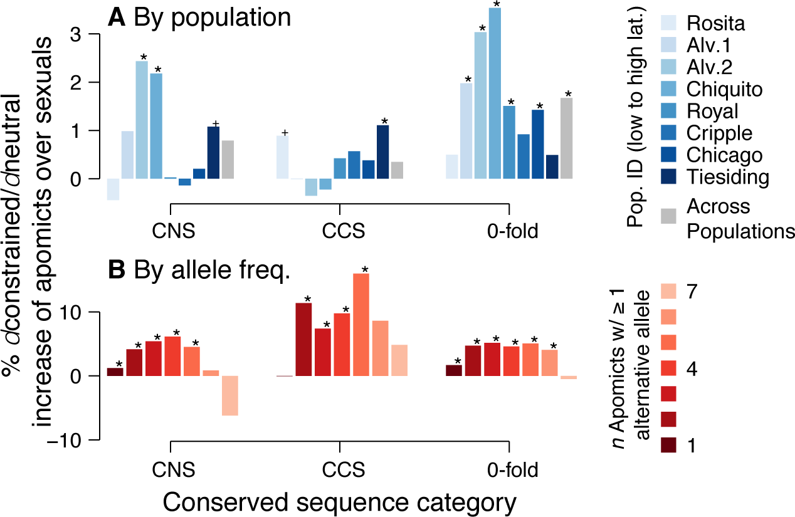
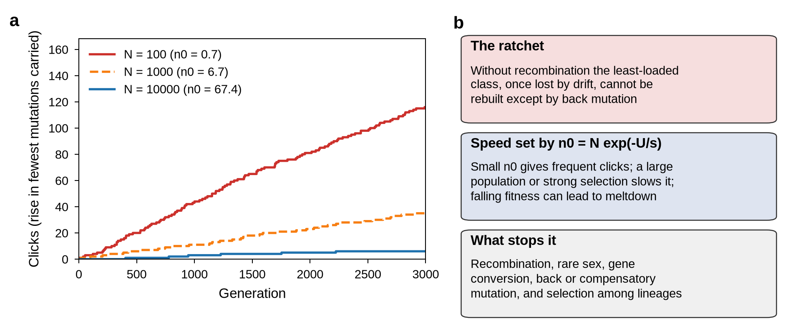

# 第 11 章 Muller 棘轮与有性生殖的优势

**地位：Muller 棘轮在不重组基因组中已验证；有性生殖的优势部分验证。** 在小的无性群体中，携带有害突变最少的那一类基因组会因漂变丢失且无法重建；这种棘轮已在 RNA 病毒、细菌和新生 Y 染色体中得到实验证明，在内共生菌、线粒体以及无性动植物中也表现为有害变化积累更快。有性生殖之所以得以维持，是因为重组帮助了选择（对抗有害突变、促进有利突变或对抗寄生者），这一点有实验支持；但在自然界中哪种机制强到足以支付有性生殖的两倍代价尚无定论，而且若干无性谱系并没有显示多余的负荷。

本仓库相关条目：[muller-ratchet](../../theories/muller-ratchet/THEORY.md)、[organelle-plastid-muller-ratchet](../../theories/organelle-plastid-muller-ratchet/THEORY.md)、[two-fold-cost-of-sex](../../theories/two-fold-cost-of-sex/THEORY.md)、[hill-robertson-interference](../../theories/hill-robertson-interference/THEORY.md)、[clonal-interference](../../theories/clonal-interference/THEORY.md)、[mutation-accumulation](../../theories/mutation-accumulation/THEORY.md)、[meselson-effect](../../theories/meselson-effect/THEORY.md)、[y-chromosome-degeneration](../../theories/y-chromosome-degeneration/THEORY.md)。

## 11.1 内容与历史

Muller 在 1964 年提出，没有重组的群体会不可逆地积累有害突变：一旦每个基因组都至少带有一个突变，无突变类只能靠回复突变恢复 [1]。Felsenstein 表明，关于重组是否有利的长期争论取决于群体大小：有限群体模型发现了优势，无限群体模型则没有，因为优势来自打破由漂变产生的随机连锁不平衡，即 Hill–Robertson 效应 [2]。Haigh 定量分析了棘轮；关键量是负荷最少类的大小 n0 = N exp(−U/s)，其中 N 为群体大小，U 为基因组有害突变率，s 为选择系数 [3]。Gordo 和 Charlesworth 推导了 n0 较大时棘轮速度的近似，并表明 n0 远大于 100 时棘轮仍能以显著的速度转动 [4]。Lynch 等描述了突变熔毁：适合度下降使群体变小，进而使棘轮加速 [5]。

此后出现了关于有性生殖优势的其他理论。Kondrashov 提出，如果每个基因组每代的有害突变率超过 1，有性群体中对这些突变更高效的选择就可能维持有性生殖 [6]。Peck 表明，在很大的无性群体中，频繁的有害突变使新的有利突变更容易丢失，因此有性群体适应更快，即“垃圾中的红宝石”效应 [7]。按照红皇后假说，协同进化的寄生者不断青睐宿主等位基因的新组合 [8]。West、Lively 和 Read 认为突变机制和环境机制可能共同起作用 [9]；Otto 总结了包含漂变、空间结构和波动选择的模型如何阐明有性生殖受青睐的条件 [10]。

## 11.2 预测

- **转动。** 在无性群体中，每个基因组的最少突变数阶梯式上升，n0 小时最快，因此小群体、高 U 和弱 s 会使棘轮加速（图 11.2）[3, 4]。
- **分子特征。** 无性谱系、Y 和新 Y 染色体、线粒体和内共生菌等不重组的基因组，应比其重组的近缘种在功能位点上进化更快，非同义与同义变化之比更高 [11, 12]。
- **挽救。** 重组（即使是罕见的有性生殖）、基因转换、回复或补偿突变以及谱系间的选择应能减慢或停止棘轮 [13, 14]。
- **有性生殖的优势随群体增大。** 许多选择位点之间的 Hill–Robertson 干扰给有性生殖和重组带来的优势随群体大小增加，这与棘轮本身不同 [15]。

## 11.3 支持证据

- **实验。** Chao 在 20 个 RNA 噬菌体 φ6 谱系中发现，棘轮导致适合度显著下降 [16]。在强漂变条件下培养的鼠伤寒沙门氏菌积累了突变，1,700 代后 444 个谱系中有 1% 出现明显的适合度损失 [17]。在果蝇中，新生的不重组 Y 染色体在实验选择下退化，重组减轻了退化 [13]。
- **有性生殖加快适应。** 在实验酵母群体中，有性生殖通过减轻克隆干扰改变了被固定的突变，并阻止明显有害的突变随有利突变搭便车而固定 [18]。与一种细菌病原体协同进化使秀丽隐杆线虫的异交增加，并使专性自交群体走向灭绝 [8]。
- **性染色体。** 米兰达果蝇（Drosophila miranda）的新 Y 染色体在约 175 万年内丢失了约一半基因，功能丧失突变的积累速度大部分可由棘轮解释 [19]。
- **内共生菌和细胞器。** 五个独立起源的内共生菌支系的 16S rDNA 都比自由生活的近缘种进化更快 [11]。动物线粒体 tRNA 基因积累替代的速度快于核基因，符合轻度有害突变的偶然固定 [12]。Caenorhabditis briggsae 自然分离株的线粒体中有非同义替代和异质性缺失，缺失水平与繁殖力负相关 [20]。
- **无性动物和植物。** 六个无性 Timema 竹节虫谱系积累编码突变的速度是有性近缘种的 3.6 到 13.4 倍 [21]。在月见草属（Oenothera）中，十次向功能性无性遗传系统的转变都伴随更多的有害突变 [22]。在八对同域分布的有性和无融合生殖 Boechera 中，无融合生殖个体携带更多衍生突变，在保守位点上保留祖先等位基因的比例更低（图 11.1）[23]。

## 11.4 反面证据与难点

- **选择减慢棘轮。** Allen 等发现选择限制了初级内共生菌中的棘轮，这可以解释为什么它们的基因组退化却没有普遍灭绝 [14]。Neiman 和 Taylor 认为无性本身可能不是线粒体高负荷的主要原因，因为只需极少的重组就能抵消积累 [24]。
- **部分无性生物没有多余负荷。** 在无融合生殖的 Ranunculus auricomus 中，除少数与生殖有关的基因外，没有发现全基因组的突变积累信号 [25, 26]。在年龄从 F1 到约 30 万年不等的克隆杂种鱼中，突变随克隆年龄积累，但没有出现预测的非同义变化增加或适合度损失 [27]。Hojsgaard 和 Hörandl 认为少量兼性有性生殖就能暴露并清除有害突变 [26]。
- **上位。** 曾经认为协同上位会让棘轮停下；用突变效应分布（而不是单一效应）做的模拟表明并非如此 [28]。
- **哪种机制支付了两倍代价？** 棘轮只在小群体或不重组的基因组中起作用 [15]，确定性突变理论需要每个基因组的有害突变率大于 1 [6]，红皇后只在少数系统中得到实验证明 [8]。证明任何单一机制在自然群体中足够强的证据都很有限 [9, 10]。

## 11.5 地位与理由

**Muller 棘轮：在不重组基因组中已验证。有性生殖的优势：部分验证。** 棘轮已在实验中重现 [13, 16, 17]，并能解释新 Y 染色体的退化 [19]；许多无性谱系中有害变化积累更快 [21, 22, 23]，但也有例外 [25, 27]。实验表明有性生殖能加快适应并抵抗寄生者 [8, 18]，但这些机制在自然界维持有性生殖中的相对重要性尚未确定 [10]。

## 11.6 植物、作物与葡萄

- **无融合生殖植物。** Boechera 显示了无融合生殖个体中预测的积累 [23]，而 Ranunculus auricomus 没有，可能与兼性有性生殖和多倍性有关 [25, 26]。
- **克隆作物。** 木薯经过驯化和克隆繁殖后携带许多已固定的有害氨基酸变化，有限的重组使清除失效 [29]。栽培葡萄杂合状态的有害突变多于野生葡萄，部分原因是克隆繁殖保护了隐性突变 [30]。在一个黑比诺系谱中，克隆掩盖的有害变异和结构变异随后被自交清除 [31]。
- **体细胞突变。** 克隆并不是冻结的：植物中体细胞突变会积累并可能进入配子 [32]。白色浆果的 Tempranillo Blanco 由黑色浆果的祖先经一次灾难性的体细胞重排产生，重排使 313 个基因缺失一个拷贝，其中包括浆果果皮着色所需的功能性 MYB 基因 [33]。因此，一个被繁殖了几个世纪的葡萄品种就是一个不重组的谱系，其中突变可以积累，缓慢的棘轮可以起作用。

## 11.7 用公开数据检验

- **数据。** 成对取样的有性和无性近缘种的基因组或转录组，例如 Boechera、月见草或 Timema [21, 22, 23]；同一物种的线粒体和核基因 [12]；或一个葡萄品种的克隆及其实生后代。
- **工具。** 用 codeml 或 HyPhy 计算谱系的 dN/dS；用 SnpEff 或 SIFT 注释衍生等位基因；用 SLiM 或本章脚本对无性群体做正向模拟。
- **分析。** (1) 用外类群确定突变方向。(2) 比较年龄相近的有性和无性谱系中受约束位点与中性位点的突变比 [23]。(3) 检查隐蔽的有性生殖或基因转换，它们会减慢棘轮 [26]。(4) 在合理的 N、U 和 s 下模拟预期的转动次数，看观察到的过量是需要棘轮，还是只需 Ne 降低即可解释。脚本 [`scripts/ch11_muller_ratchet_figures.py`](../scripts/ch11_muller_ratchet_figures.py) 模拟三种群体大小下的转动（图 11.2）。
- **什么结果会推翻这一理论。** 群体小、无基因转换、长期严格无性的谱系，与有性近缘种相比没有多余的有害变化。

## 11.8 未解决的问题

- 棘轮有多少次是被补偿突变或谱系间选择而不是重组停住的 [14, 20]？
- 多少兼性有性生殖足以防止无融合生殖和克隆植物的退化 [26]？
- 是哪种机制或机制组合让有性生殖在两倍代价下得以维持 [9, 10]？

## 11.9 常见错误

- 把无性谱系中每一次非同义变化过量都读作棘轮；Ne 降低和选择放松不需要转动也会产生它。
- 忘记棘轮速度取决于 n0 = N exp(−U/s)，而不仅仅是 N。
- 把克隆作物当作冻结的基因组；体细胞突变和偶尔的有性杂交都会改变它们 [32]。
- 认为必须用单一的有性生殖优势来解释所有情况。

## 图

**图 11.1.** 无融合生殖 Boechera 中纯化选择放松的特征。受约束位点分化与中性位点分化之比，以无融合生殖个体相对有性个体的增加百分比表示，分别针对保守非编码序列（CNS）、保守编码序列（CCS）和零倍简并位点（0-fold）。(A) 按群体，从低纬度到高纬度。(B) 按七个南方无融合生殖基因型中携带衍生等位基因的个数。星号和十字表示原文定义的显著性类别。原样转载自 Lovell JT, Williamson RJ, Wright SI, McKay JK, Sharbel TF (2017) Mutation accumulation in an asexual relative of Arabidopsis. *PLoS Genetics* 13:e1006550, Figure 4. https://doi.org/10.1371/journal.pgen.1006550。许可：CC BY 4.0（https://creativecommons.org/licenses/by/4.0/）。

**图 11.2.** (a) 群体大小为 100、1,000 和 10,000 的单倍体无性群体中 Muller 棘轮转动的模拟，基因组有害突变率 U = 0.1，选择系数 s = 0.02，适合度相乘，从突变–选择平衡开始。一次转动是指任何个体所携带的最少突变数上升一次；n0 = N exp(−U/s) 是负荷最少类的期望大小。(b) 推动和阻止棘轮的因素。由 [`scripts/ch11_muller_ratchet_figures.py`](../scripts/ch11_muller_ratchet_figures.py) 生成，随机种子 20261126。

## 参考文献

1. Muller HJ (1964) The relation of recombination to mutational advance. *Mutation Research* 1:2-9. https://doi.org/10.1016/0027-5107(64)90047-8
2. Felsenstein J (1974) THE EVOLUTIONARY ADVANTAGE OF RECOMBINATION. *Genetics* 78:737-756. https://doi.org/10.1093/genetics/78.2.737
3. Haigh J (1978) The accumulation of deleterious genes in a population—Muller's Ratchet. *Theoretical Population Biology* 14:251-267. https://doi.org/10.1016/0040-5809(78)90027-8
4. Gordo I, Charlesworth B (2000) The Degeneration of Asexual Haploid Populations and the Speed of Muller's Ratchet. *Genetics* 154:1379-1387. https://doi.org/10.1093/genetics/154.3.1379
5. Lynch M, Bürger R, Butcher D, et al. (1993) The Mutational Meltdown in Asexual Populations. *Journal of Heredity* 84:339-344. https://doi.org/10.1093/oxfordjournals.jhered.a111354
6. Kondrashov AS (1988) Deleterious mutations and the evolution of sexual reproduction. *Nature* 336:435-440. https://doi.org/10.1038/336435a0
7. Peck JR (1994) A ruby in the rubbish: beneficial mutations, deleterious mutations and the evolution of sex. *Genetics* 137:597-606. https://doi.org/10.1093/genetics/137.2.597
8. Morran LT, Schmidt OG, Gelarden IA, et al. (2011) Running with the Red Queen: Host-Parasite Coevolution Selects for Biparental Sex. *Science* 333:216-218. https://doi.org/10.1126/science.1206360
9. West, Lively, Read (1999) A pluralist approach to sex and recombination. *Journal of Evolutionary Biology* 12:1003-1012. https://doi.org/10.1046/j.1420-9101.1999.00119.x
10. Otto S (2009) The Evolutionary Enigma of Sex. *The American Naturalist* 174:S1-S14. https://doi.org/10.1086/599084
11. Moran NA (1996) Accelerated evolution and Muller's rachet in endosymbiotic bacteria. *Proceedings of the National Academy of Sciences* 93:2873-2878. https://doi.org/10.1073/pnas.93.7.2873
12. Lynch M (1996) Mutation accumulation in transfer RNAs: molecular evidence for Muller's ratchet in mitochondrial genomes. *Molecular Biology and Evolution* 13:209-220. https://doi.org/10.1093/oxfordjournals.molbev.a025557
13. Rice WR (1994) Degeneration of a Nonrecombining Chromosome. *Science* 263:230-232. https://doi.org/10.1126/science.8284674
14. Allen JM, Light JE, Perotti MA, et al. (2009) Mutational Meltdown in Primary Endosymbionts: Selection Limits Muller's Ratchet. *PLoS ONE* 4:e4969. https://doi.org/10.1371/journal.pone.0004969
15. Keightley PD, Otto SP (2006) Interference among deleterious mutations favours sex and recombination in finite populations. *Nature* 443:89-92. https://doi.org/10.1038/nature05049
16. Chao L (1990) Fitness of RNA virus decreased by Muller's ratchet. *Nature* 348:454-455. https://doi.org/10.1038/348454a0
17. Andersson DI, Hughes D (1996) Muller's ratchet decreases fitness of a DNA-based microbe. *Proceedings of the National Academy of Sciences* 93:906-907. https://doi.org/10.1073/pnas.93.2.906
18. McDonald MJ, Rice DP, Desai MM (2016) Sex speeds adaptation by altering the dynamics of molecular evolution. *Nature* 531:233-236. https://doi.org/10.1038/nature17143
19. Kaiser VB, Charlesworth B (2010) Muller's Ratchet and the Degeneration of theDrosophila mirandaNeo-YChromosome. *Genetics* 185:339-348. https://doi.org/10.1534/genetics.109.112789
20. Howe DK, Denver DR (2008) Muller's Ratchet and compensatory mutation in Caenorhabditis briggsae mitochondrial genome evolution. *BMC Evolutionary Biology* 8:62. https://doi.org/10.1186/1471-2148-8-62
21. Henry L, Schwander T, Crespi BJ (2012) Deleterious Mutation Accumulation in Asexual Timema Stick Insects. *Molecular Biology and Evolution* 29:401-408. https://doi.org/10.1093/molbev/msr237
22. Hollister JD, Greiner S, Wang W, et al. (2015) Recurrent Loss of Sex Is Associated with Accumulation of Deleterious Mutations in Oenothera. *Molecular Biology and Evolution* 32:896-905. https://doi.org/10.1093/molbev/msu345
23. Lovell JT, Williamson RJ, Wright SI, et al. (2017) Mutation Accumulation in an Asexual Relative of Arabidopsis. *PLOS Genetics* 13:e1006550. https://doi.org/10.1371/journal.pgen.1006550
24. Neiman M, Taylor DR (2009) The causes of mutation accumulation in mitochondrial genomes. *Proceedings of the Royal Society B: Biological Sciences* 276:1201-1209. https://doi.org/10.1098/rspb.2008.1758
25. Pellino M, Hojsgaard D, Schmutzer T, et al. (2013) Asexual genome evolution in the apomictic Ranunculus auricomus complex: examining the effects of hybridization and mutation accumulation. *Molecular Ecology* 22:5908-5921. https://doi.org/10.1111/mec.12533
26. Hojsgaard D, Hörandl E (2015) A little bit of sex matters for genome evolution in asexual plants. *Frontiers in Plant Science* 6. https://doi.org/10.3389/fpls.2015.00082
27. Kočí J, Röslein J, Pačes J, et al. (2020) No evidence for accumulation of deleterious mutations and fitness degradation in clonal fish hybrids: Abandoning sex without regrets. *Molecular Ecology* 29:3038-3055. https://doi.org/10.1111/mec.15539
28. Butcher D (1995) Muller's ratchet, epistasis and mutation effects. *Genetics* 141:431-437. https://doi.org/10.1093/genetics/141.1.431
29. Ramu P, Esuma W, Kawuki R, et al. (2017) Cassava haplotype map highlights fixation of deleterious mutations during clonal propagation. *Nature Genetics* 49:959-963. https://doi.org/10.1038/ng.3845
30. Zhou Y, Massonnet M, Sanjak JS, et al. (2017) Evolutionary genomics of grape ( Vitis vinifera ssp. vinifera ) domestication. *Proceedings of the National Academy of Sciences* 114:11715-11720. https://doi.org/10.1073/pnas.1709257114
31. Xiao H, Wang Y, Liu W, et al. (2025) Impacts of reproductive systems on grapevine genome and breeding. *Nature Communications* 16:2031. https://doi.org/10.1038/s41467-025-56817-7
32. Schoen DJ, Schultz ST (2019) Somatic Mutation and Evolution in Plants. *Annual Review of Ecology, Evolution, and Systematics* 50:49-73. https://doi.org/10.1146/annurev-ecolsys-110218-024955
33. Carbonell-Bejerano P, Royo C, Torres-Pérez R, et al. (2017) Catastrophic Unbalanced Genome Rearrangements Cause Somatic Loss of Berry Color in Grapevine. *Plant Physiology* 175:786-801. https://doi.org/10.1104/pp.17.00715
