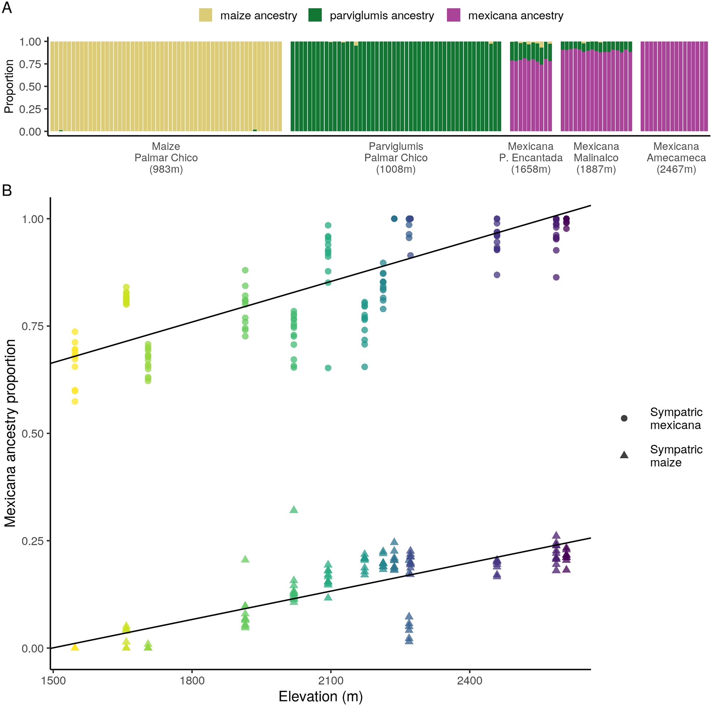
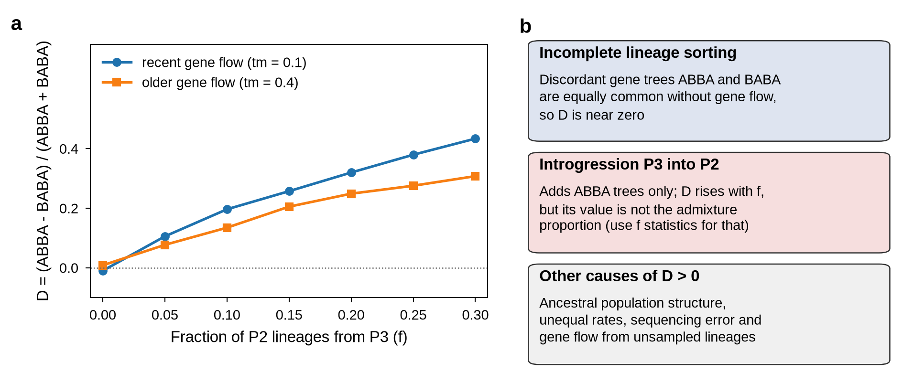

# Chapter 12. Introgression and hybrid speciation

**Status: Introgression Verified; homoploid hybrid speciation Partly verified.** Genome data show that gene flow between species is common, that introgressed alleles can be adaptive, as for EPAS1 in Tibetans, mimicry genes in Heliconius and highland adaptation in maize, and that much introgressed ancestry is removed by selection. Hybridization can also found new species, most clearly through allopolyploidy in plants; hybrid speciation without a change in ploidy has strong support in only a few cases, such as the wild sunflowers and the Italian sparrow.

Related notes in this repository: [introgression-hybrid-swarm](../../skills/genomics-theory-mining/theories/introgression-hybrid-swarm/THEORY.md), [rieseberg-complementary-gene-hybrid-speciation](../../skills/genomics-theory-mining/theories/rieseberg-complementary-gene-hybrid-speciation/THEORY.md), [hybrid-zone-dynamics](../../skills/genomics-theory-mining/theories/hybrid-zone-dynamics/THEORY.md), [barton-hybrid-sink-barrier](../../skills/genomics-theory-mining/theories/barton-hybrid-sink-barrier/THEORY.md), [bateson-dobzhansky-muller-incompatibilities](../../skills/genomics-theory-mining/theories/bateson-dobzhansky-muller-incompatibilities/THEORY.md), [allopolyploidy-secondary-polyploidy](../../skills/genomics-theory-mining/theories/allopolyploidy-secondary-polyploidy/THEORY.md).

## 12.1 Statement and history

Introgression is the movement of alleles from one species or population into another through hybridization and repeated backcrossing. Botanists long believed that hybridization, especially followed by chromosome doubling (allopolyploidy), was an important source of new species, while it was seen as unimportant in animals; Mallet summarised new genetic evidence that hybrid speciation without polyploidy is also more common than thought in plants and animals [1]. Abbott and colleagues described the opposite effects of hybridization on speciation: it can slow or reverse divergence through gene flow, accelerate it through adaptive introgression, or create a species almost at once through allopolyploidy [2]. Harrison and Larson stressed that species boundaries are semipermeable, with gene exchange varying across the genome [3].

Genome-wide tests for introgression came from human evolution. The draft Neandertal genome showed that Neandertals share more variants with present-day Eurasians than with sub-Saharan Africans, implying gene flow into the ancestors of non-Africans [4]. Durand and colleagues derived the expectation of the D statistic, which compares the two discordant gene trees ABBA and BABA in a four-taxon tree; it is insensitive to ancestral population sizes but assumes randomly mating ancestral populations [5]. Patterson and colleagues released these and related f statistics as ADMIXTOOLS [6].

## 12.2 What the theory predicts

- **Asymmetric gene trees.** Without gene flow, incomplete lineage sorting makes ABBA and BABA site patterns equally common; gene flow between P3 and P2 creates an excess of ABBA, so D > 0 (Figure 12.2) [5].
- **Selection sorts introgressed ancestry.** If foreign alleles are often deleterious in the new background, introgressed ancestry should be depleted in low-recombination regions and near selected genes [7, 8]. If some are adaptive, they should rise to high frequency where they help, for example along an environmental gradient (Figure 12.1) [9].
- **Hybrid speciation.** A homoploid hybrid species should carry a mosaic of parental genomes, be reproductively isolated from both parents, and owe that isolation to hybridization [10].

## 12.3 Evidence for

- **Archaic introgression in humans.** Tibetans carry an EPAS1 haplotype, linked to high-altitude adaptation, that was introduced from Denisovans or a related population; its pattern makes incomplete lineage sorting an unlikely explanation [11].
- **Mimicry in Heliconius.** Three co-mimics, H. melpomene, H. timareta and H. elevatus, have exchanged genes at the two regions that control mimicry pattern [12].
- **Animals generally.** Hedrick compared adaptive introgression with new mutation and standing variation and listed examples including MHC genes, pesticide resistance in mice, black coat colour in wolves and beak traits in Darwin’s finches [13]. Edelman and Mallet concluded that introgression is an important source of variation for adaptation, especially when species expand their range or face changing environments [14].
- **Selection against introgression.** In three swordtail hybrid populations, ancestry from the minor parent is more common in regions of high recombination and with fewer selected sites, and the same pattern appears in human and archaic admixture [7]. Simulations show that deleterious variation alone can produce such correlations, and that admixture can temporarily lower the load of a small population [8].
- **Homoploid hybrid species.** In wild sunflowers, species in the most extreme habitats are ancient hybrids, and most of their trait differences can be recreated by complementary gene action in synthetic hybrids, with the same combinations of parental chromosome segments [15]. The Italian sparrow genome is a mosaic of its two parent species, with novel divergence concentrated on the Z chromosome and in genes for traits that separate the species [16].

## 12.4 Evidence against, and difficulties

- **Hybrid speciation is rarely proven.** Schumer, Rosenthal and Andolfatto proposed criteria for homoploid hybrid speciation and concluded that, although hybridization is common, strong evidence for its role in speciation is limited to a few cases [10].
- **D is not a map of introgression.** In small genomic windows, D is inflated where effective population size is low, so its outliers cluster in regions of low diversity; the related ƒd statistic is better for locating introgressed loci [17]. D can also be raised by ancestral population structure [5].
- **Neutral or harmful introgression.** Much introgressed ancestry is removed by selection [7], and introgressed segments can carry deleterious variants or reduce yield [18, 19].
- **Separating introgression from shared ancestry.** Shared haplotypes can result from incomplete lineage sorting; tests need haplotype length, divergence or explicit models [11, 17].

## 12.5 Status and reasoning

**Introgression: verified. Homoploid hybrid speciation: partly verified.** Gene flow between species is detected with several independent methods and in many groups [4, 12, 14], and adaptive introgression is supported by functional and environmental evidence [9, 11]. Hybrid speciation without polyploidy meets strict criteria in only a few systems [10, 15, 16].

## 12.6 Plants, crops and grapevine

- **Plants.** Suarez-Gonzalez, Lexer and Cronk argue that plant studies of adaptive introgression should combine four lines of evidence, introgression, selection, phenotype and fitness, and that the last two are rarely measured [20].
- **Maize.** Using 189 individuals from nine sympatric maize–mexicana populations, Hufford and colleagues found introgression in both directions, except near cross-incompatibility and domestication loci, and evidence suggestive of adaptive mexicana alleles in highland maize [21]. Calfee and colleagues found that most mexicana ancestry in maize entered over 1,000 generations ago, is depleted in low-recombination regions and near domestication genes, and increases with elevation (Figure 12.1) [9]. Yang and colleagues traced modern maize to admixture between ancient maize and mexicana in the highlands of Mexico about 4,000 years after domestication began [22]. Mexicana introgression also lowers the prevalence of deleterious alleles in highland maize [23].
- **Sunflower.** Wild introgressions brought more than 3,000 new genes into cultivated sunflower and lowered load in coding sequence but mostly reduced yield and quality, and introgressions from more distant species were more often harmful [19].
- **Grapevine.** Myles and colleagues found evidence of introgression from local wild grapes as cultivated grapes moved into Europe [24]. With 3,525 accessions, Dong and colleagues inferred that grapes domesticated in Western Asia introgressed with ancient wild western ecotypes as they spread into Europe [25]. Xiao and colleagues found continuous gene flow from European wild grapes into wine grapes over the past ~2,000 years; introgressed regions were enriched for aroma genes but also raised the deleterious burden [18]. Because grape cultivars are propagated clonally, an introgressed segment present in a widely planted cultivar is copied without recombination for as long as the cultivar is grown.

## 12.7 How to test it with public data

- **Data.** Whole genomes from at least three ingroup taxa and an outgroup, for example maize, mexicana and parviglumis with Tripsacum, or cultivated, European wild and Asian wild grapes with another Vitis species [9, 18].
- **Tools.** ADMIXTOOLS for D and f statistics [6]; Dsuite or ABBABABAwindows for ƒd in windows [17]; local ancestry callers such as ELAI, Ancestry_HMM or RFMix; msprime simulations for null models.
- **Analysis.** (1) Compute genome-wide D with block jackknife standard errors [5]. (2) Locate introgressed regions with ƒd or local ancestry, not with windowed D [17]. (3) Test whether introgressed ancestry correlates with recombination and gene density [7, 9]. (4) For candidate adaptive introgression, require high frequency in the recipient, long haplotypes and an environmental or phenotypic link [20]. The script [`scripts/ch12_introgression_figures.py`](../scripts/ch12_introgression_figures.py) simulates D under incomplete lineage sorting and gene flow (Figure 12.2).
- **What would break the theory.** For introgression: D statistics that become zero once ancestral structure and rate variation are modelled, in all cases thought to show gene flow. For hybrid speciation: hybrid lineages that are not reproductively isolated from their parents.

## 12.8 Open questions

- How often does introgression supply adaptive alleles compared with standing variation and new mutation [13, 14]?
- How many proposed homoploid hybrid species meet strict criteria [10]?
- In clonal crops such as grapevine, how much introgressed load is hidden in heterozygotes, and can breeding separate it from useful wild alleles [18]?

## 12.9 Common mistakes

- Reading the value of D as the proportion of admixture.
- Using windowed D to locate introgressed genes [17].
- Calling any hybrid lineage a hybrid species without evidence that hybridization caused reproductive isolation [10].
- Assuming introgressed alleles at high frequency are adaptive without a null model that includes demography and selection against introgression [8].

## Figures

**Figure 12.1.** Distribution of mexicana ancestry by elevation. (A) Genome-wide ancestry estimates (NGSAdmix) for reference maize, mexicana and parviglumis individuals, grouped by sampling location. (B) Genome-wide mexicana ancestry for sympatric maize (triangles) and mexicana (circles) individuals (n = 305) along an elevational gradient, coloured by sampling location; lines show the best linear fit for each subspecies. Reproduced unchanged from Calfee E, Gates D, Lorant A, Perkins MT, Coop G, Ross-Ibarra J (2021) Selective sorting of ancestral introgression in maize and teosinte along an elevational cline. *PLoS Genetics* 17:e1009810, Figure 2. https://doi.org/10.1371/journal.pgen.1009810. Licence: CC BY 4.0 (https://creativecommons.org/licenses/by/4.0/).

**Figure 12.2.** (a) Expected D = (ABBA − BABA)/(ABBA + BABA) from a coalescent simulation of one lineage from each of P1, P2, P3 and an outgroup, tree ((P1,P2),P3),O with splits at 0.5, 1.0 and 3.0 (units of 2N generations), when a fraction f of P2 lineages is traced to P3 at time 0.1 or 0.4. Site patterns are proportional to the lengths of the internal branches shared by P2 and P3 (ABBA) or P1 and P3 (BABA), summed over 50,000 loci. Without gene flow D is close to zero; small deviations are sampling noise. (b) What raises D besides introgression. Made with [`scripts/ch12_introgression_figures.py`](../scripts/ch12_introgression_figures.py), seed 20261126.

## References

1. Mallet J (2007) Hybrid speciation. *Nature* 446:279-283. https://doi.org/10.1038/nature05706
2. Abbott R, Albach D, Ansell S, et al. (2013) Hybridization and speciation. *Journal of Evolutionary Biology* 26:229-246. https://doi.org/10.1111/j.1420-9101.2012.02599.x
3. Harrison RG, Larson EL (2014) Hybridization, Introgression, and the Nature of Species Boundaries. *Journal of Heredity*. https://doi.org/10.1093/jhered/esu033
4. Green RE, Krause J, Briggs AW, et al. (2010) A Draft Sequence of the Neandertal Genome. *Science* 328:710-722. https://doi.org/10.1126/science.1188021
5. Durand EY, Patterson N, Reich D, et al. (2011) Testing for Ancient Admixture between Closely Related Populations. *Molecular Biology and Evolution* 28:2239-2252. https://doi.org/10.1093/molbev/msr048
6. Patterson N, Moorjani P, Luo Y, et al. (2012) Ancient Admixture in Human History. *Genetics* 192:1065-1093. https://doi.org/10.1534/genetics.112.145037
7. Schumer M, Xu C, Powell DL, et al. (2018) Natural selection interacts with recombination to shape the evolution of hybrid genomes. *Science* 360:656-660. https://doi.org/10.1126/science.aar3684
8. Kim BY, Huber CD, Lohmueller KE (2018) Deleterious variation shapes the genomic landscape of introgression. *PLOS Genetics* 14:e1007741. https://doi.org/10.1371/journal.pgen.1007741
9. Calfee E, Gates D, Lorant A, et al. (2021) Selective sorting of ancestral introgression in maize and teosinte along an elevational cline. *PLOS Genetics* 17:e1009810. https://doi.org/10.1371/journal.pgen.1009810
10. Schumer M, Rosenthal GG, Andolfatto P (2014) HOW COMMON IS HOMOPLOID HYBRID SPECIATION? *Evolution* 68:1553-1560. https://doi.org/10.1111/evo.12399
11. Huerta-Sánchez E, Jin X, Asan, et al. (2014) Altitude adaptation in Tibetans caused by introgression of Denisovan-like DNA. *Nature* 512:194-197. https://doi.org/10.1038/nature13408
12. The Heliconius Genome Consortium (2012) Butterfly genome reveals promiscuous exchange of mimicry adaptations among species. *Nature* 487:94-98. https://doi.org/10.1038/nature11041
13. Hedrick PW (2013) Adaptive introgression in animals: examples and comparison to new mutation and standing variation as sources of adaptive variation. *Molecular Ecology* 22:4606-4618. https://doi.org/10.1111/mec.12415
14. Edelman NB, Mallet J (2021) Prevalence and Adaptive Impact of Introgression. *Annual Review of Genetics* 55:265-283. https://doi.org/10.1146/annurev-genet-021821-020805
15. Rieseberg LH, Raymond O, Rosenthal DM, et al. (2003) Major Ecological Transitions in Wild Sunflowers Facilitated by Hybridization. *Science* 301:1211-1216. https://doi.org/10.1126/science.1086949
16. Elgvin TO, Trier CN, Tørresen OK, et al. (2017) The genomic mosaicism of hybrid speciation. *Science Advances* 3:e1602996. https://doi.org/10.1126/sciadv.1602996
17. Martin SH, Davey JW, Jiggins CD (2015) Evaluating the Use of ABBA–BABA Statistics to Locate Introgressed Loci. *Molecular Biology and Evolution* 32:244-257. https://doi.org/10.1093/molbev/msu269
18. Xiao H, Liu Z, Wang N, et al. (2023) Adaptive and maladaptive introgression in grapevine domestication. *Proceedings of the National Academy of Sciences* 120:e2222041120. https://doi.org/10.1073/pnas.2222041120
19. Huang K, Jahani M, Gouzy J, et al. (2023) The genomics of linkage drag in inbred lines of sunflower. *Proceedings of the National Academy of Sciences* 120:e2205783119. https://doi.org/10.1073/pnas.2205783119
20. Suarez-Gonzalez A, Lexer C, Cronk QCB (2018) Adaptive introgression: a plant perspective. *Biology Letters* 14:20170688. https://doi.org/10.1098/rsbl.2017.0688
21. Hufford MB, Lubinksy P, Pyhäjärvi T, et al. (2013) The Genomic Signature of Crop-Wild Introgression in Maize. *PLoS Genetics* 9:e1003477. https://doi.org/10.1371/journal.pgen.1003477
22. Yang N, Wang Y, Liu X, et al. (2023) Two teosintes made modern maize. *Science* 382:eadg8940. https://doi.org/10.1126/science.adg8940
23. Wang L, Beissinger TM, Lorant A, et al. (2017) The interplay of demography and selection during maize domestication and expansion. *Genome Biology* 18:215. https://doi.org/10.1186/s13059-017-1346-4
24. Myles S, Boyko AR, Owens CL, et al. (2011) Genetic structure and domestication history of the grape. *Proceedings of the National Academy of Sciences* 108:3530-3535. https://doi.org/10.1073/pnas.1009363108
25. Dong Y, Duan S, Xia Q, et al. (2023) Dual domestications and origin of traits in grapevine evolution. *Science* 379:892-901. https://doi.org/10.1126/science.add8655
