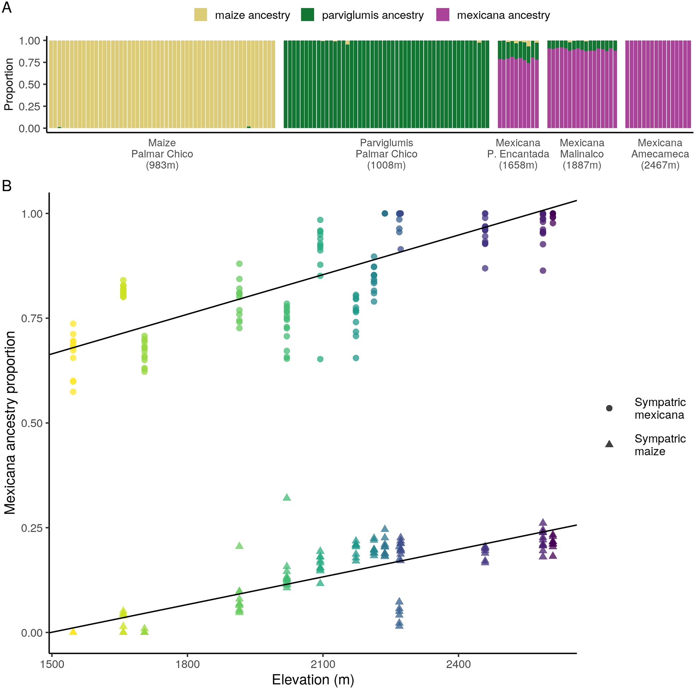
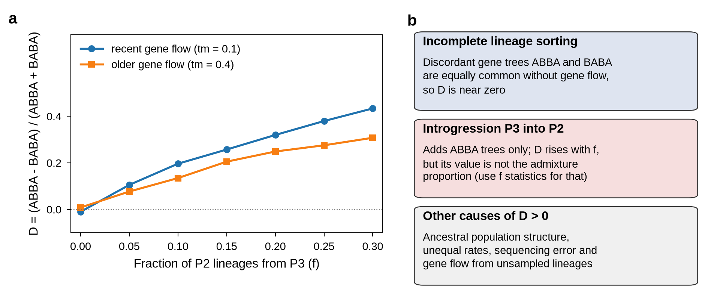

# 第 12 章 渐渗与杂交物种形成

**地位：渐渗已验证；同倍体杂交物种形成部分验证。** 基因组数据表明物种间基因流很常见，渐渗的等位基因可以是适应性的，如藏族人的 EPAS1、Heliconius 的拟态基因和玉米的高地适应；同时，大量渐渗祖先成分会被选择清除。杂交也可以产生新物种，在植物中以异源多倍化最为明确；不改变倍性的杂交物种形成只在少数案例中有强证据，如野生向日葵和意大利麻雀。

本仓库相关条目：[introgression-hybrid-swarm](../../theories/introgression-hybrid-swarm/THEORY.md)、[rieseberg-complementary-gene-hybrid-speciation](../../theories/rieseberg-complementary-gene-hybrid-speciation/THEORY.md)、[hybrid-zone-dynamics](../../theories/hybrid-zone-dynamics/THEORY.md)、[barton-hybrid-sink-barrier](../../theories/barton-hybrid-sink-barrier/THEORY.md)、[bateson-dobzhansky-muller-incompatibilities](../../theories/bateson-dobzhansky-muller-incompatibilities/THEORY.md)、[allopolyploidy-secondary-polyploidy](../../theories/allopolyploidy-secondary-polyploidy/THEORY.md)。

## 12.1 内容与历史

渐渗是指等位基因通过杂交和反复回交从一个物种或群体进入另一个物种或群体。植物学家长期认为杂交（尤其是随后发生染色体加倍，即异源多倍化）是新物种的重要来源，而在动物中杂交被认为不重要；Mallet 总结了新的遗传证据，表明不伴随多倍化的杂交物种形成在植物和动物中都比想象的更常见 [1]。Abbott 等描述了杂交对物种形成的相反作用：它可以通过基因流减缓或逆转分化，可以通过适应性渐渗加速分化，也可以通过异源多倍化几乎瞬间产生一个物种 [2]。Harrison 和 Larson 强调物种边界是半透性的，基因交换在基因组上各处不同 [3]。

全基因组渐渗检验来自人类进化研究。尼安德特人基因组草图表明，尼安德特人与现代欧亚人共享的变异多于与撒哈拉以南非洲人共享的，意味着曾有基因流进入非洲以外人群的祖先 [4]。Durand 等推导了 D 统计量的期望，它比较四分类群树中两种不一致的基因树 ABBA 和 BABA；它对祖先群体大小不敏感，但假设祖先群体随机交配 [5]。Patterson 等把这些统计量和相关的 f 统计量发布为 ADMIXTOOLS [6]。

## 12.2 预测

- **基因树不对称。** 没有基因流时，不完全谱系分选使 ABBA 和 BABA 位点模式同样常见；P3 与 P2 之间的基因流造成 ABBA 过量，因此 D > 0（图 12.2）[5]。
- **选择对渐渗祖先成分的分选。** 如果外来等位基因在新背景中常常有害，渐渗祖先成分应在低重组区和受选择基因附近减少 [7, 8]。如果其中一些是适应性的，它们应在有利的地方上升到高频，例如沿环境梯度（图 12.1）[9]。
- **杂交物种形成。** 一个同倍体杂交物种应携带亲本基因组的镶嵌，与两个亲本都有生殖隔离，且这种隔离源于杂交 [10]。

## 12.3 支持证据

- **人类中的古人类渐渗。** 藏族人携带一个与高海拔适应有关的 EPAS1 单倍型，它来自丹尼索瓦人或其相关群体；其模式使不完全谱系分选成为不太可能的解释 [11]。
- **Heliconius 的拟态。** 三个共拟态物种 H. melpomene、H. timareta 和 H. elevatus 在控制拟态斑纹的两个区域交换了基因 [12]。
- **动物总体情况。** Hedrick 比较了适应性渐渗与新突变和现存变异，列举了 MHC 基因、小鼠的抗药性、狼的黑色毛色和达尔文雀的喙性状等例子 [13]。Edelman 和 Mallet 认为渐渗是适应的重要变异来源，在物种扩张分布区或面对环境变化时尤其如此 [14]。
- **针对渐渗的选择。** 在三个剑尾鱼杂交群体中，来自次要亲本的祖先成分在高重组、受选择位点较少的区域更常见，人类与古人类的混合中也有同样的模式 [7]。模拟表明仅有害变异就能产生这种相关，且混合可以暂时降低小群体的负荷 [8]。
- **同倍体杂交物种。** 在野生向日葵中，生活在最极端生境的物种是古老的杂种，它们的大部分性状差异可由合成杂种中的互补基因作用重现，且涉及相同的亲本染色体片段组合 [15]。意大利麻雀的基因组是两个亲本物种的镶嵌，新的分化集中在 Z 染色体和区分物种的性状相关基因上 [16]。

## 12.4 反面证据与难点

- **杂交物种形成很少被证实。** Schumer、Rosenthal 和 Andolfatto 提出了同倍体杂交物种形成的判据，认为杂交虽然常见，但其在物种形成中起作用的强证据只限于少数案例 [10]。
- **D 不是渐渗图谱。** 在小的基因组窗口中，D 在有效群体小的地方偏高，因此其离群值聚集在低多样性区；相关的 ƒd 统计量更适合定位渐渗位点 [17]。祖先群体结构也会使 D 升高 [5]。
- **中性或有害的渐渗。** 大量渐渗祖先成分被选择清除 [7]，渐渗片段可能携带有害变异或降低产量 [18, 19]。
- **区分渐渗与共同祖先。** 共享单倍型可能来自不完全谱系分选；检验需要单倍型长度、分化或明确的模型 [11, 17]。

## 12.5 地位与理由

**渐渗：已验证。同倍体杂交物种形成：部分验证。** 物种间基因流已在许多类群中被多种独立方法检测到 [4, 12, 14]，适应性渐渗有功能和环境证据支持 [9, 11]。不伴随多倍化的杂交物种形成只在少数系统中满足严格判据 [10, 15, 16]。

## 12.6 植物、作物与葡萄

- **植物。** Suarez-Gonzalez、Lexer 和 Cronk 认为，植物中的适应性渐渗研究应结合渐渗、选择、表型和适合度四类证据，而后两类很少被测量 [20]。
- **玉米。** Hufford 等用来自九个同域玉米–mexicana 群体的 189 个个体，发现除杂交不亲和位点和驯化位点附近外，两个方向都有渐渗，并有证据提示高地玉米中有适应性的 mexicana 等位基因 [21]。Calfee 等发现玉米中的 mexicana 祖先成分大多在 1,000 多代以前进入，在低重组区和驯化基因附近减少，并随海拔升高而增加（图 12.1）[9]。Yang 等把现代玉米追溯到驯化开始约 4,000 年后，古代玉米与 mexicana 在墨西哥高地的混合 [22]。mexicana 渐渗也降低了高地玉米中有害等位基因的比例 [23]。
- **向日葵。** 野生渐渗给栽培向日葵带来了 3,000 多个新基因，降低了编码序列中的负荷，但大多降低了产量和品质；来自亲缘较远物种的渐渗更常是有害的 [19]。
- **葡萄。** Myles 等发现栽培葡萄进入欧洲时有来自当地野生葡萄的渐渗 [24]。Dong 等用 3,525 份材料推断，西亚驯化的葡萄在传入欧洲时与古老的西部野生生态型发生了渐渗 [25]。Xiao 等发现过去约 2,000 年中欧洲野生葡萄持续向酿酒葡萄发生基因流；渐渗区富集芳香相关基因，但也提高了有害负担 [18]。由于葡萄品种以克隆方式繁殖，一个广泛种植品种中的渐渗片段在该品种被种植期间一直被不经重组地复制。

## 12.7 用公开数据检验

- **数据。** 至少三个内类群和一个外类群的全基因组，例如玉米、mexicana 和 parviglumis 加 Tripsacum，或栽培葡萄、欧洲野生葡萄和亚洲野生葡萄加另一个葡萄属物种 [9, 18]。
- **工具。** D 和 f 统计量用 ADMIXTOOLS [6]；窗口 ƒd 用 Dsuite 或 ABBABABAwindows [17]；局部祖先推断用 ELAI、Ancestry_HMM 或 RFMix；零模型用 msprime 模拟。
- **分析。** (1) 计算全基因组 D 并用分块刀切法估计标准误 [5]。(2) 用 ƒd 或局部祖先而不是窗口 D 定位渐渗区 [17]。(3) 检验渐渗祖先成分是否与重组率和基因密度相关 [7, 9]。(4) 对候选适应性渐渗，要求它在受体中高频、单倍型长，并与环境或表型有联系 [20]。脚本 [`scripts/ch12_introgression_figures.py`](../scripts/ch12_introgression_figures.py) 模拟不完全谱系分选和基因流下的 D（图 12.2）。
- **什么结果会推翻这一理论。** 对渐渗而言：在所有被认为有基因流的案例中，一旦对祖先结构和速率变异建模，D 统计量都变为零。对杂交物种形成而言：杂种谱系与其亲本之间没有生殖隔离。

## 12.8 未解决的问题

- 与现存变异和新突变相比，渐渗提供适应性等位基因的频率有多高 [13, 14]？
- 已提出的同倍体杂交物种中有多少满足严格判据 [10]？
- 在葡萄这样的克隆作物中，有多少渐渗负荷隐藏在杂合子中，育种能否把它与有用的野生等位基因分开 [18]？

## 12.9 常见错误

- 把 D 的数值读作混合比例。
- 用窗口 D 定位渐渗基因 [17]。
- 没有杂交导致生殖隔离的证据，就把任何杂种谱系称为杂交物种 [10]。
- 没有包含群体历史和针对渐渗的选择的零模型，就认定高频渐渗等位基因是适应性的 [8]。

## 图

**图 12.1.** mexicana 祖先成分随海拔的分布。(A) 参照玉米、mexicana 和 parviglumis 个体的全基因组祖先成分估计（NGSAdmix），按采样地点分组。(B) 同域玉米（三角形）和 mexicana（圆点）个体（n = 305）的全基因组 mexicana 祖先成分沿海拔梯度的分布，按采样地点着色；直线为每个亚种的最佳线性拟合。原样转载自 Calfee E, Gates D, Lorant A, Perkins MT, Coop G, Ross-Ibarra J (2021) Selective sorting of ancestral introgression in maize and teosinte along an elevational cline. *PLoS Genetics* 17:e1009810, Figure 2. https://doi.org/10.1371/journal.pgen.1009810。许可：CC BY 4.0（https://creativecommons.org/licenses/by/4.0/）。

**图 12.2.** (a) 溯祖模拟得到的期望 D = (ABBA − BABA)/(ABBA + BABA)：P1、P2、P3 和外类群各取一个谱系，树为 ((P1,P2),P3),O，分化时间为 0.5、1.0 和 3.0（以 2N 代为单位），在时间 0.1 或 0.4 时 P2 谱系中有比例 f 追溯到 P3。位点模式与 P2 和 P3 共享（ABBA）或 P1 和 P3 共享（BABA）的内部枝长成正比，对 50,000 个位点求和。没有基因流时 D 接近零，小的偏差是抽样噪声。(b) 渐渗以外使 D 升高的因素。由 [`scripts/ch12_introgression_figures.py`](../scripts/ch12_introgression_figures.py) 生成，随机种子 20261126。

## 参考文献

1. Mallet J (2007) Hybrid speciation. *Nature* 446:279-283. https://doi.org/10.1038/nature05706
2. Abbott R, Albach D, Ansell S, et al. (2013) Hybridization and speciation. *Journal of Evolutionary Biology* 26:229-246. https://doi.org/10.1111/j.1420-9101.2012.02599.x
3. Harrison RG, Larson EL (2014) Hybridization, Introgression, and the Nature of Species Boundaries. *Journal of Heredity*. https://doi.org/10.1093/jhered/esu033
4. Green RE, Krause J, Briggs AW, et al. (2010) A Draft Sequence of the Neandertal Genome. *Science* 328:710-722. https://doi.org/10.1126/science.1188021
5. Durand EY, Patterson N, Reich D, et al. (2011) Testing for Ancient Admixture between Closely Related Populations. *Molecular Biology and Evolution* 28:2239-2252. https://doi.org/10.1093/molbev/msr048
6. Patterson N, Moorjani P, Luo Y, et al. (2012) Ancient Admixture in Human History. *Genetics* 192:1065-1093. https://doi.org/10.1534/genetics.112.145037
7. Schumer M, Xu C, Powell DL, et al. (2018) Natural selection interacts with recombination to shape the evolution of hybrid genomes. *Science* 360:656-660. https://doi.org/10.1126/science.aar3684
8. Kim BY, Huber CD, Lohmueller KE (2018) Deleterious variation shapes the genomic landscape of introgression. *PLOS Genetics* 14:e1007741. https://doi.org/10.1371/journal.pgen.1007741
9. Calfee E, Gates D, Lorant A, et al. (2021) Selective sorting of ancestral introgression in maize and teosinte along an elevational cline. *PLOS Genetics* 17:e1009810. https://doi.org/10.1371/journal.pgen.1009810
10. Schumer M, Rosenthal GG, Andolfatto P (2014) HOW COMMON IS HOMOPLOID HYBRID SPECIATION? *Evolution* 68:1553-1560. https://doi.org/10.1111/evo.12399
11. Huerta-Sánchez E, Jin X, Asan, et al. (2014) Altitude adaptation in Tibetans caused by introgression of Denisovan-like DNA. *Nature* 512:194-197. https://doi.org/10.1038/nature13408
12. The Heliconius Genome Consortium (2012) Butterfly genome reveals promiscuous exchange of mimicry adaptations among species. *Nature* 487:94-98. https://doi.org/10.1038/nature11041
13. Hedrick PW (2013) Adaptive introgression in animals: examples and comparison to new mutation and standing variation as sources of adaptive variation. *Molecular Ecology* 22:4606-4618. https://doi.org/10.1111/mec.12415
14. Edelman NB, Mallet J (2021) Prevalence and Adaptive Impact of Introgression. *Annual Review of Genetics* 55:265-283. https://doi.org/10.1146/annurev-genet-021821-020805
15. Rieseberg LH, Raymond O, Rosenthal DM, et al. (2003) Major Ecological Transitions in Wild Sunflowers Facilitated by Hybridization. *Science* 301:1211-1216. https://doi.org/10.1126/science.1086949
16. Elgvin TO, Trier CN, Tørresen OK, et al. (2017) The genomic mosaicism of hybrid speciation. *Science Advances* 3:e1602996. https://doi.org/10.1126/sciadv.1602996
17. Martin SH, Davey JW, Jiggins CD (2015) Evaluating the Use of ABBA–BABA Statistics to Locate Introgressed Loci. *Molecular Biology and Evolution* 32:244-257. https://doi.org/10.1093/molbev/msu269
18. Xiao H, Liu Z, Wang N, et al. (2023) Adaptive and maladaptive introgression in grapevine domestication. *Proceedings of the National Academy of Sciences* 120:e2222041120. https://doi.org/10.1073/pnas.2222041120
19. Huang K, Jahani M, Gouzy J, et al. (2023) The genomics of linkage drag in inbred lines of sunflower. *Proceedings of the National Academy of Sciences* 120:e2205783119. https://doi.org/10.1073/pnas.2205783119
20. Suarez-Gonzalez A, Lexer C, Cronk QCB (2018) Adaptive introgression: a plant perspective. *Biology Letters* 14:20170688. https://doi.org/10.1098/rsbl.2017.0688
21. Hufford MB, Lubinksy P, Pyhäjärvi T, et al. (2013) The Genomic Signature of Crop-Wild Introgression in Maize. *PLoS Genetics* 9:e1003477. https://doi.org/10.1371/journal.pgen.1003477
22. Yang N, Wang Y, Liu X, et al. (2023) Two teosintes made modern maize. *Science* 382:eadg8940. https://doi.org/10.1126/science.adg8940
23. Wang L, Beissinger TM, Lorant A, et al. (2017) The interplay of demography and selection during maize domestication and expansion. *Genome Biology* 18:215. https://doi.org/10.1186/s13059-017-1346-4
24. Myles S, Boyko AR, Owens CL, et al. (2011) Genetic structure and domestication history of the grape. *Proceedings of the National Academy of Sciences* 108:3530-3535. https://doi.org/10.1073/pnas.1009363108
25. Dong Y, Duan S, Xia Q, et al. (2023) Dual domestications and origin of traits in grapevine evolution. *Science* 379:892-901. https://doi.org/10.1126/science.add8655
