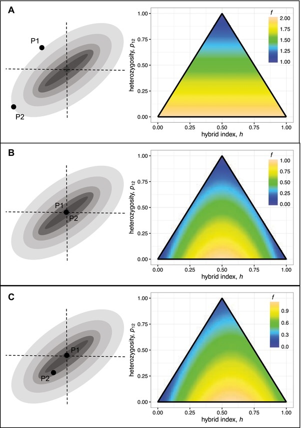
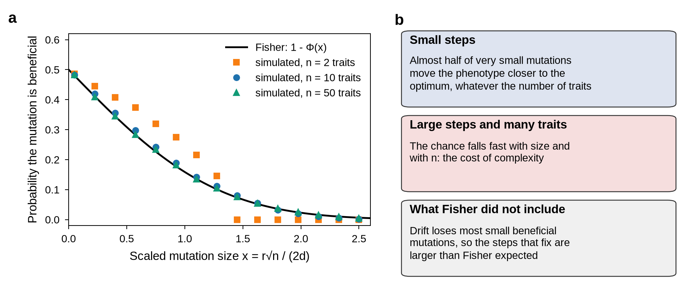

# Chapter 13. Fisher’s fundamental theorem and geometric model

**Status: Fundamental theorem Verified (as an exact statement about the change due to selection); geometric model Partly verified.** Read as Price and Ewens read it, the fundamental theorem is a mathematical result: the part of the change in mean fitness caused by natural selection equals the additive genetic variance in fitness. Field estimates of that variance in plants and animals now show that it is often well above zero. The geometric model correctly predicts that most mutations are harmful, that the chance of benefit falls with mutation size, and that beneficial effects are often near exponential when a population is close to its optimum; its prediction of a strong cost of complexity, and its use as a general model of epistasis, have only partial support.

Related notes in this repository: [fisher-geometric-model](../../skills/genomics-theory-mining/theories/fisher-geometric-model/THEORY.md), [orr-exponential-factors](../../skills/genomics-theory-mining/theories/orr-exponential-factors/THEORY.md), [price-equation](../../skills/genomics-theory-mining/theories/price-equation/THEORY.md), [rockman-qtn-versus-polygenes](../../skills/genomics-theory-mining/theories/rockman-qtn-versus-polygenes/THEORY.md), [berg-coop-polygenic-adaptation](../../skills/genomics-theory-mining/theories/berg-coop-polygenic-adaptation/THEORY.md), [infinitesimal-polygenic](../../skills/genomics-theory-mining/theories/infinitesimal-polygenic/THEORY.md), [haldane-cost-of-selection](../../skills/genomics-theory-mining/theories/haldane-cost-of-selection/THEORY.md).

## 13.1 Statement and history

In *The Genetical Theory of Natural Selection* (1930) R. A. Fisher stated two ideas that shaped the genetics of adaptation. The first is the fundamental theorem of natural selection, in his words: “The rate of increase in fitness of any organism at any time is equal to its genetic variance in fitness at that time.” For decades it was unclear how Fisher derived it or what he meant, because mean fitness obviously does not always rise [1]. Price, followed by Ewens, made clear that Fisher meant a partial change: the change in mean fitness obtained by replacing genotypic fitnesses with their additive genetic values and keeping these fixed while gene frequencies change [1, 2]. Fisher attributed the rest of the change to a deterioration of the “environment”. Read this way, the theorem holds without restrictive assumptions about the mating system, the fitness values or the number of loci, but it describes only that partial change [2]. Frank and Slatkin argued that the textbook reading, mean fitness always increases, is not what Fisher meant, and that the misunderstanding comes partly from the contrast between Fisher’s and Wright’s views of evolution [3]. Frank derived the theorem from the Price equation and showed how it relates to Robertson’s covariance theorem, the Lande–Arnold regression analysis of selection and Hamilton’s rule [4]. Grafen put the theorem back into Fisher’s model of total fitness, with terms for the deterioration of the environment and for density dependence, and showed that it deals only with directional selection on the underlying traits, with further terms for stabilizing selection and new mutational variance [5].

The second idea is a geometric model of adaptation. An organism is a point in a space of n independent traits, with a single optimum; a mutation is a random step of size r. Fisher showed that a very small step has almost a 50% chance of improving fitness, but that the chance falls quickly as r grows relative to the distance to the optimum and as n grows (Figure 13.2). He concluded that adaptation uses mutations of very small effect. Most small beneficial mutations are, however, lost by drift [6], so the steps that fix are larger than Fisher expected. Orr followed a population through a whole adaptive walk to the optimum and found that the effects of the substitutions fall off roughly exponentially, a few of large effect and many of small effect, and that this result is insensitive to the fitness function and the distribution of mutation effects [7, 8]. Orr also calculated the rate of adaptation and found that complex organisms, with more independent traits, adapt much more slowly when mutations have the same size, at least as fast as 1/n, a cost of complexity larger than Fisher had suggested [9].

## 13.2 What the theory predicts

- **The rate of adaptation is set by the additive variance in fitness.** The change in mean absolute fitness due to selection in one generation is VA(W)/W̄, where VA(W) is the additive genetic variance in absolute fitness [1, 10]. Mean fitness need not rise overall, because the environment, dominance and epistasis also change [4, 5].
- **Most mutations are harmful, and large ones are rarely beneficial.** In the geometric model the chance that a random mutation is beneficial is about 1 − Φ(x), with x = r√n/(2d) for a population at distance d from the optimum (Figure 13.2).
- **Fixed effects are roughly exponential.** During an adaptive walk to a fixed optimum, the factors fixed have a roughly exponential distribution of phenotypic effect [7].
- **Complexity costs.** The rate of adaptation falls with the number of independent traits n [9].
- **Epistasis follows from geometry.** Because fitness is a curved function of phenotype, mutations that are beneficial alone can be less beneficial, or harmful, together; the sign of epistasis depends on how far the population is from the optimum [11].
- **Hybrid fitness.** The same landscape predicts heterosis in crosses of inbred lines, breakdown in later generations and Haldane’s rule [12, 13].

## 13.3 Evidence for

- **The theorem as mathematics.** Price, Ewens, Lessard, Frank and Grafen give derivations under very general conditions; there is no dispute about the result once the partial change is defined [1, 2, 4, 5].
- **Additive variance in fitness is real and often large.** In the partridge pea *Chamaecrista fasciculata*, Sheth and colleagues found substantial VA(W) for ongoing adaptation at the home site and at a site outside the range, with genotype-by-environment interaction [14]. In three pedigreed populations of the same plant studied over three years in the wild, Kulbaba and colleagues found significant VA(W) in all populations and years, predicting a rise in mean fitness of 0.83 to 6.12 seeds per individual and, in two cases, rescue of declining populations [15]. In 19 long-term studies of wild birds and mammals, Bonnet and colleagues found that additive variance in relative fitness is often substantial and on average twice the earlier estimates [16]. Older compilations put the gain in mean fitness from selection at 0.1–30% per generation, typically 1–10% [17], and recent estimates from additive variance in fitness are nearly always below 20% and usually below 10% [18].
- **Beneficial mutations behave as the geometric model expects in microbes.** In 60 populations of *Escherichia coli* compensating for an antibiotic-resistance cost, beneficial mutations arose at about 10⁻⁵ per genome per generation and their average effect depended on the distance to the optimum, as the model predicts [19]. In *Pseudomonas aeruginosa*, beneficial rifampicin-resistance mutations were exponentially distributed when the wild type was moderately or highly fit [20]. Fixed beneficial mutations had a distribution with a positive mode, because drift and clonal interference remove most small ones [6].
- **Few traits in practice.** With arbitrary interactions among traits, the distribution of mutation effects looks like that of a model with far fewer independent traits; across species with different gene numbers, mutations tend to be more deleterious, less variable and less skewed in more complex organisms, as predicted, but the differences are limited [21]. Tenaillon summarised the qualitative and quantitative support from experimental evolution [22].
- **Hybrids.** A geometric landscape for hybrid genotypes fitted genomic data from *Mytilus* mussels and published data from *Zea*, *Populus*, *Senecio*, *Mus*, *Teleogryllus* and *Drosophila*, including heterosis in crosses of inbred maize, using landscapes like those in Figure 13.1 [13].

## 13.4 Evidence against, and difficulties

- **The theorem is easy to misread.** It does not say that mean fitness always increases; the change it describes cannot be observed directly, because the “environment” term includes the effects of the population on itself [3, 5].
- **Measuring VA(W) is hard.** Shaw and Shaw argued that the expectation that VA(W) is negligible, together with severe statistical problems in estimating it, explains why there are so few estimates [10].
- **The cost of complexity is not clearly seen.** Welch and Waxman found that modular pleiotropy reduces Orr’s cost only a little, but there is little evidence for or against such a cost in nature [23]. Martin and Lenormand found only limited differences in mutation effects across species of very different complexity [21].
- **Not all distributions are exponential.** When the wild type was far from the optimum, beneficial mutations in *P. aeruginosa* were biased towards large effects, explained by the biochemistry of rifampicin binding rather than by population genetic theory [20].
- **Epistasis depends on details.** Empirical fitness landscapes show that epistasis is common but depends on the fitness measure, the mutations chosen and the environment [24]. Near the optimum the geometric model itself produces rough landscapes with sign epistasis, so it fits many patterns and can be hard to falsify [11].
- **Moving optima.** When the environment changes, the distribution of fixed effects depends on the rate of change relative to the adaptive potential of the population, not only on the landscape [25].
- **Large or small effects?** Many identified causal variants have large effects, and about 22% of 331 identified changes are cis-regulatory [26]; Rockman argued that these discoverable alleles are not representative and that evolution often works through many small-effect variants [27]. In sexual *Drosophila* selected for over 600 generations, adaptation was not associated with classic sweeps of new advantageous mutations [28].

## 13.5 Status and reasoning

**Fundamental theorem: verified as an exact result; geometric model: partly verified.** The theorem, correctly stated as the partial change due to selection, is a proven identity [1, 2, 5], and its key quantity, VA(W), is measurable and often well above zero in plants and animals [15, 16]. The geometric model is a useful approximation: its predictions on the fraction of beneficial mutations, their distribution near the optimum and hybrid fitness are supported in microbes and crosses [13, 19, 20], while the cost of complexity and the exponential distribution of fixed factors are only partly supported [20, 21, 23].

## 13.6 Plants, crops and grapevine

- **Wild plants.** The best direct estimates of VA(W) in plants come from *Chamaecrista fasciculata*, where significant additive variance for lifetime fitness was found across populations, years and sites [14, 15]. In 517 *Arabidopsis thaliana* lines grown with different rainfall in Spain and Germany, selection was strongest at the hot and dry site, where 63% of lines died and selection changed the frequency of about 5% of genome-wide variants [29].
- **Maize domestication.** The teosinte branched1 (tb1) locus is a large-effect QTL for apical dominance; the maize allele is expressed at twice the level of the teosinte allele [30], and a Hopscotch transposon insertion that acts as an enhancer predates domestication by at least 10,000 years, so selection used standing variation [31]. Large-effect loci such as tb1 fit the first steps of an adaptive walk; across 18 domestication traits, landraces have lower heritabilities than teosinte and a larger loss of additive than of dominance variance [32].
- **Heterosis.** Simon and colleagues showed that a geometric model explains heterosis in published yield data from crosses of inbred maize lines [13].
- **Grapevine and clonal perennials.** The theorem applies to sexual generations. A clonally propagated grapevine cultivar has no generation-to-generation response, so in grapes selection acts mainly at the rare seedling generations, among crosses of a few elite cultivars that form a dense pedigree network [33]. Cultivated grapes carry more deleterious mutations in the heterozygous state than wild grapes, in part because clonal propagation shelters recessive mutations [34]. One reading in geometric terms is that a successful heterozygous cultivar sits close to the optimum while its selfed or seedling offspring fall further away.

## 13.7 How to test it with public data

- **Data.** Pedigreed field studies with lifetime fitness (seed set and survival), such as published *Chamaecrista* data [15]; genome-wide selection experiments such as the *Arabidopsis* rainfall experiment [29]; fitness of single and double mutants from microbial experimental evolution [19, 24].
- **Tools.** Aster models or animal models (MCMCglmm, ASReml, brms) for VA(W) [10, 16]; polyDFE or similar tools for distributions of fitness effects; simple simulations of the geometric model.
- **Analysis.** (1) Estimate VA(W) and W̄ and predict the change in mean fitness VA(W)/W̄ [10]. (2) Fit the geometric model to single-mutant and double-mutant fitness to estimate n and the distance to the optimum [11, 22]. (3) Compare the effect sizes of fixed substitutions in adapting lines with an exponential distribution [7]. The script [`scripts/ch13_fisher_geometric_figures.py`](../scripts/ch13_fisher_geometric_figures.py) compares Fisher’s formula with simulated mutations (Figure 13.2).
- **What would break the theory.** For the theorem, nothing empirical: it is an identity, and a failure would mean the partial change was measured wrongly. For the geometric model: beneficial mutation rates and effects that do not change with distance to the optimum, or no relation between pleiotropy and the effects of mutations.

## 13.8 Open questions

- How variable is VA(W) between years and sites, and how much does it predict the real change in mean fitness [15, 18]?
- What is the effective number of traits n for real organisms, and does it differ between plants and animals [9, 21]?
- When do large-effect alleles, such as domestication QTL, dominate adaptation, and when do many small-effect variants [27, 35]?
- Can the geometric model predict heterosis and inbreeding depression in clonal crops such as grapevine [13, 34]?

## 13.9 Common mistakes

- Saying that the theorem proves that mean fitness always increases [3].
- Treating additive variance in a trait as additive variance in fitness.
- Reading the exponential distribution of fixed factors as a distribution of new mutations [7].
- Using a high fraction of large-effect causal alleles in the literature as a measure of their role in evolution [27].
- Assuming that the number of genes measures the complexity n in the geometric model [21].

## Figures

**Figure 13.1.** Fisher’s geometric model generates a flexible series of fitness landscapes for hybrid genotypes. The left-hand panels show a schematic representation of the model, with n = 2 traits, each under optimizing selection of differing strengths. The right-hand panels show how the expected fitness varies for hybrids with different hybrid index h and interpopulation heterozygosity p12. (A) All of the parental divergence is maladaptive, with no tendency for their alleles to be coadapted; hybrid fitness increases with heterozygosity. (B) The parental lines are optimal; the hybrid index is under symmetrical diversifying selection. (C) Only one of the parental lines is maladapted. Reproduced unchanged from Simon A, Bierne N, Welch JJ (2018) Coadapted genomes and selection on hybrids: Fisher’s geometric model explains a variety of empirical patterns. *Evolution Letters* 2:472-498, Figure 2. https://doi.org/10.1002/evl3.66. Licence: CC BY 4.0 (https://creativecommons.org/licenses/by/4.0/).

**Figure 13.2.** (a) Probability that a random mutation of size r is beneficial for a phenotype at distance d from the optimum in n dimensions, against the scaled size x = r√n/(2d). Points: 20,000 random mutations per point for n = 2, 10 and 50; line: Fisher’s large-n result 1 − Φ(x). For n = 2 the approximation is poor and no mutation larger than 2d can be beneficial. (b) What the curve means and what it leaves out; drift removes most small beneficial mutations, so the steps that fix are larger than Fisher expected. Made with [`scripts/ch13_fisher_geometric_figures.py`](../scripts/ch13_fisher_geometric_figures.py), seed 20261126.

## References

1. Price GR (1972) Fisher’s ‘fundamental theorem’ made clear. *Annals of Human Genetics* 36:129-140. https://doi.org/10.1111/j.1469-1809.1972.tb00764.x
2. Lessard S (1997) Fisher’s Fundamental Theorem of Natural Selection Revisited. *Theoretical Population Biology* 52:119-136. https://doi.org/10.1006/tpbi.1997.1324
3. Frank SA, Slatkin M (1992) Fisher’s fundamental theorem of natural selection. *Trends in Ecology & Evolution* 7:92-95. https://doi.org/10.1016/0169-5347(92)90248-A
4. Frank SA (1997) The Price equation, Fisher’s fundamental theorem, kin selection, and causal analysis. *Evolution* 51:1712-1729. https://doi.org/10.1111/j.1558-5646.1997.tb05096.x
5. Grafen A (2021) A simple completion of Fisher’s fundamental theorem of natural selection. *Ecology and Evolution* 11:735-742. https://doi.org/10.1002/ece3.6918
6. Rozen DE, de Visser JAGM, Gerrish PJ (2002) Fitness Effects of Fixed Beneficial Mutations in Microbial Populations. *Current Biology* 12:1040-1045. https://doi.org/10.1016/s0960-9822(02)00896-5
7. Orr HA (1998) The population genetics of adaptation: the distribution of factors fixed during adaptive evolution. *Evolution* 52:935-949. https://doi.org/10.1111/j.1558-5646.1998.tb01823.x
8. Orr HA (2005) The genetic theory of adaptation: a brief history. *Nature Reviews Genetics* 6:119-127. https://doi.org/10.1038/nrg1523
9. Orr HA (2000) Adaptation and the cost of complexity. *Evolution* 54:13-20. https://doi.org/10.1111/j.0014-3820.2000.tb00002.x
10. Shaw RG, Shaw FH (2014) Quantitative genetic study of the adaptive process. *Heredity* 112:13-20. https://doi.org/10.1038/hdy.2013.42
11. Blanquart F, Achaz G, Bataillon T, et al. (2014) Properties of selected mutations and genotypic landscapes under Fisher’s geometric model. *Evolution* 68:3537-3554. https://doi.org/10.1111/evo.12545
12. Fraïsse C, Gunnarsson PA, Roze D, et al. (2016) The genetics of speciation: Insights from Fisher’s geometric model. *Evolution* 70:1450-1464. https://doi.org/10.1111/evo.12968
13. Simon A, Bierne N, Welch JJ (2018) Coadapted genomes and selection on hybrids: Fisher’s geometric model explains a variety of empirical patterns. *Evolution Letters* 2:472-498. https://doi.org/10.1002/evl3.66
14. Sheth SN, Kulbaba MW, Pain RE, et al. (2018) Expression of additive genetic variance for fitness in a population of partridge pea in two field sites. *Evolution* 72:2537-2545. https://doi.org/10.1111/evo.13614
15. Kulbaba MW, Sheth SN, Pain RE, et al. (2019) Additive genetic variance for lifetime fitness and the capacity for adaptation in an annual plant. *Evolution* 73:1746-1758. https://doi.org/10.1111/evo.13830
16. Bonnet T, Morrissey MB, de Villemereuil P, et al. (2022) Genetic variance in fitness indicates rapid contemporary adaptive evolution in wild animals. *Science* 376:1012-1016. https://doi.org/10.1126/science.abk0853
17. Burt A (1995) The evolution of fitness. *Evolution* 49:1-8. https://doi.org/10.1111/j.1558-5646.1995.tb05954.x
18. Hendry AP, Schoen DJ, Wolak ME, et al. (2018) The Contemporary Evolution of Fitness. *Annual Review of Ecology, Evolution, and Systematics* 49:457-476. https://doi.org/10.1146/annurev-ecolsys-110617-062358
19. Sousa A, Magalhães S, Gordo I (2012) Cost of Antibiotic Resistance and the Geometry of Adaptation. *Molecular Biology and Evolution* 29:1417-1428. https://doi.org/10.1093/molbev/msr302
20. MacLean RC, Buckling A (2009) The Distribution of Fitness Effects of Beneficial Mutations in Pseudomonas aeruginosa. *PLoS Genetics* 5:e1000406. https://doi.org/10.1371/journal.pgen.1000406
21. Martin G, Lenormand T (2006) A general multivariate extension of Fisher’s geometrical model and the distribution of mutation fitness effects across species. *Evolution* 60:893-907. https://doi.org/10.1111/j.0014-3820.2006.tb01169.x
22. Tenaillon O (2014) The Utility of Fisher’s Geometric Model in Evolutionary Genetics. *Annual Review of Ecology, Evolution, and Systematics* 45:179-201. https://doi.org/10.1146/annurev-ecolsys-120213-091846
23. Welch JJ, Waxman D (2003) Modularity and the cost of complexity. *Evolution* 57:1723-1734. https://doi.org/10.1111/j.0014-3820.2003.tb00581.x
24. Bank C (2022) Epistasis and Adaptation on Fitness Landscapes. *Annual Review of Ecology, Evolution, and Systematics* 53:457-479. https://doi.org/10.1146/annurev-ecolsys-102320-112153
25. Matuszewski S, Hermisson J, Kopp M (2014) Fisher’s geometric model with a moving optimum. *Evolution* 68:2571-2588. https://doi.org/10.1111/evo.12465
26. Stern DL, Orgogozo V (2008) The loci of evolution: how predictable is genetic evolution? *Evolution* 62:2155-2177. https://doi.org/10.1111/j.1558-5646.2008.00450.x
27. Rockman MV (2012) The QTN program and the alleles that matter for evolution: all that’s gold does not glitter. *Evolution* 66:1-17. https://doi.org/10.1111/j.1558-5646.2011.01486.x
28. Burke MK, Dunham JP, Shahrestani P, et al. (2010) Genome-wide analysis of a long-term evolution experiment with Drosophila. *Nature* 467:587-590. https://doi.org/10.1038/nature09352
29. Exposito-Alonso M, 500 Genomes Field Experiment Team, Burbano HA, et al. (2019) Natural selection on the Arabidopsis thaliana genome in present and future climates. *Nature* 573:126-129. https://doi.org/10.1038/s41586-019-1520-9
30. Doebley J, Stec A, Hubbard L (1997) The evolution of apical dominance in maize. *Nature* 386:485-488. https://doi.org/10.1038/386485a0
31. Studer A, Zhao Q, Ross-Ibarra J, et al. (2011) Identification of a functional transposon insertion in the maize domestication gene tb1. *Nature Genetics* 43:1160-1163. https://doi.org/10.1038/ng.942
32. Yang CJ, Samayoa LF, Bradbury PJ, et al. (2019) The genetic architecture of teosinte catalyzed and constrained maize domestication. *Proceedings of the National Academy of Sciences* 116:5643-5652. https://doi.org/10.1073/pnas.1820997116
33. Myles S, Boyko AR, Owens CL, et al. (2011) Genetic structure and domestication history of the grape. *Proceedings of the National Academy of Sciences* 108:3530-3535. https://doi.org/10.1073/pnas.1009363108
34. Zhou Y, Massonnet M, Sanjak JS, et al. (2017) Evolutionary genomics of grape ( Vitis vinifera ssp. vinifera ) domestication. *Proceedings of the National Academy of Sciences* 114:11715-11720. https://doi.org/10.1073/pnas.1709257114
35. Bomblies K, Peichel CL (2022) Genetics of adaptation. *Proceedings of the National Academy of Sciences* 119:e2122152119. https://doi.org/10.1073/pnas.2122152119
