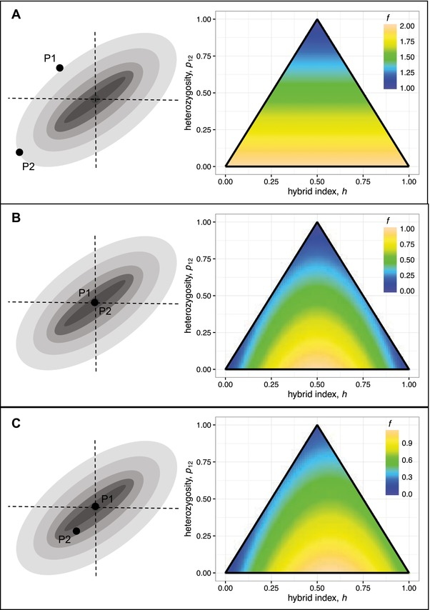
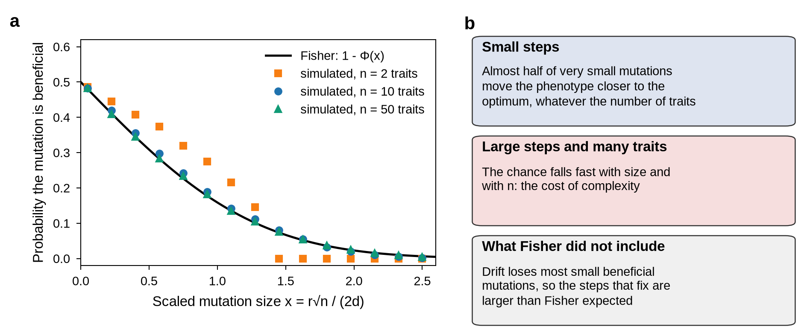

# 第 13 章 Fisher 基本定理与几何模型

**地位：基本定理已验证（作为关于选择所致变化的精确陈述）；几何模型部分验证。** 按 Price 和 Ewens 的理解，基本定理是一个数学结果：平均适合度中由自然选择引起的那部分变化，等于适合度的加性遗传方差。如今对植物和动物野外群体的估计表明，这一方差常常明显大于零。几何模型正确地预测了大多数突变有害、突变越大越难有利、群体接近最适点时有利效应常近似指数分布；它关于强烈的“复杂性代价”的预测，以及把它当作上位性的一般模型，只得到部分支持。

本仓库相关条目：[fisher-geometric-model](../../theories/fisher-geometric-model/THEORY.md)、[orr-exponential-factors](../../theories/orr-exponential-factors/THEORY.md)、[price-equation](../../theories/price-equation/THEORY.md)、[rockman-qtn-versus-polygenes](../../theories/rockman-qtn-versus-polygenes/THEORY.md)、[berg-coop-polygenic-adaptation](../../theories/berg-coop-polygenic-adaptation/THEORY.md)、[infinitesimal-polygenic](../../theories/infinitesimal-polygenic/THEORY.md)、[haldane-cost-of-selection](../../theories/haldane-cost-of-selection/THEORY.md)。

## 13.1 内容与历史

R. A. Fisher 在《自然选择的遗传理论》（1930）中提出了两个影响适应遗传学的思想。第一个是自然选择基本定理，用他的话说：“任何生物在任何时刻适合度的增长速率，等于它在该时刻适合度的遗传方差。”几十年里，人们不清楚 Fisher 是怎样推出它的，也不清楚他究竟指什么，因为平均适合度显然并不总在上升 [1]。Price 以及随后的 Ewens 阐明，Fisher 指的是一种部分变化：把各基因型的适合度换成它们的加性遗传值，并在基因频率变化时保持这些值不变，由此得到的平均适合度变化 [1, 2]。其余的变化被 Fisher 归入“环境”的恶化。这样理解时，该定理不需要对交配系统、适合度参数或位点数作限制性假设，但它只描述那部分变化 [2]。Frank 和 Slatkin 认为，教科书式的理解，即平均适合度总在增加，并不是 Fisher 的原意，误解部分来自 Fisher 与 Wright 进化观的对立 [3]。Frank 用 Price 方程推导出该定理，并说明了它与 Robertson 协方差定理、Lande–Arnold 选择回归分析和 Hamilton 法则的关系 [4]。Grafen 把定理放回 Fisher 的总适合度模型中，加入环境恶化和密度依赖项，并证明它只涉及对底层性状的定向选择，稳定化选择和新的突变方差另有对应的项 [5]。

第二个思想是适应的几何模型。生物是 n 个独立性状空间中的一个点，只有一个最适点；突变是长度为 r 的随机一步。Fisher 证明，极小的一步几乎有 50% 的机会提高适合度，但随着 r 相对于到最适点的距离增大、随着 n 增大，这一机会迅速下降（图 13.2）。他由此认为适应利用的是效应极小的突变。然而大多数效应小的有利突变会因漂变而丢失 [6]，所以最终被固定的步子比 Fisher 预想的大。Orr 追踪了群体走向最适点的整个适应过程，发现被替换因子的效应大致按指数递减，少数效应大、多数效应小，而且这一结果对适合度函数和突变效应分布都不敏感 [7, 8]。Orr 还计算了适应速率，发现当突变大小相同时，独立性状更多的复杂生物适应慢得多，至少按 1/n 下降，这一复杂性代价比 Fisher 设想的更大 [9]。

## 13.2 预测

- **适应速率由适合度的加性方差决定。** 一代中由选择引起的平均绝对适合度变化是 VA(W)/W̄，其中 VA(W) 是绝对适合度的加性遗传方差 [1, 10]。由于环境、显性和上位性也在变化，平均适合度总体上不一定上升 [4, 5]。
- **大多数突变有害，大突变很少有利。** 在几何模型中，对于离最适点距离为 d 的群体，随机突变有利的概率约为 1 − Φ(x)，其中 x = r√n/(2d)（图 13.2）。
- **被固定的效应近似指数分布。** 走向固定最适点的适应过程中，被固定因子的表型效应大致服从指数分布 [7]。
- **复杂性有代价。** 适应速率随独立性状数 n 增加而下降 [9]。
- **上位性来自几何形状。** 由于适合度是表型的弯曲函数，单独有利的突变组合起来可能不那么有利甚至有害；上位性的正负取决于群体离最适点有多远 [11]。
- **杂种适合度。** 同一景观可预测近交系杂交的杂种优势、后代世代的杂种衰退和 Haldane 法则 [12, 13]。

## 13.3 支持证据

- **作为数学的定理。** Price、Ewens、Lessard、Frank 和 Grafen 在非常一般的条件下给出了推导；一旦定义了这部分变化，结果本身没有争议 [1, 2, 4, 5]。
- **适合度的加性方差真实存在且常常较大。** Sheth 等在豆科植物 *Chamaecrista fasciculata* 中发现，在原产地和分布区外的一个地点，都存在可供持续适应的显著 VA(W)，并有基因型与环境互作 [14]。Kulbaba 等在野外三年内研究了同一植物的三个有系谱的群体，所有群体和年份的 VA(W) 都显著，预测平均适合度每个体增加 0.83 到 6.12 粒种子，并在两个例子中预测衰退群体可被“进化拯救” [15]。Bonnet 等对 19 个野生鸟类和哺乳动物的长期研究发现，相对适合度的加性方差常常可观，平均为早先估计的两倍 [16]。较早的汇总认为选择使平均适合度每代提高 0.1–30%，通常为 1–10% [17]；近期基于适合度加性方差的估计几乎都低于 20%，通常低于 10% [18]。
- **微生物中有利突变的表现符合几何模型。** 在 60 个补偿抗生素抗性代价的大肠杆菌群体中，有利突变的出现率约为每基因组每代 10⁻⁵，其平均效应取决于离最适点的距离，与模型预期一致 [19]。在铜绿假单胞菌中，当野生型适合度中等或较高时，有利的利福平抗性突变服从指数分布 [20]。被固定的有利突变的分布众数为正，因为漂变和克隆干涉清除了大多数效应小的突变 [6]。
- **实际有效性状数少。** 当性状之间存在任意相互作用时，突变效应的分布看起来像独立性状少得多的模型；在基因数不同的物种间比较，较复杂生物的突变往往更有害、变异更小、偏斜更小，与预测一致，但差别有限 [21]。Tenaillon 总结了实验进化数据对模型的定性和定量支持 [22]。
- **杂种。** 用类似图 13.1 的杂种基因型几何景观，可以拟合 *Mytilus* 贻贝的基因组数据以及 *Zea*、*Populus*、*Senecio*、*Mus*、*Teleogryllus* 和 *Drosophila* 的已发表数据，包括近交玉米杂交的杂种优势 [13]。

## 13.4 反面证据与难点

- **定理容易被误读。** 它并不说平均适合度总在增加；它描述的那部分变化无法直接观察，因为“环境”项包括群体对自身的影响 [3, 5]。
- **测量 VA(W) 很难。** Shaw 和 Shaw 认为，人们预期 VA(W) 可以忽略，再加上估计它的严重统计困难，是估计值如此之少的原因 [10]。
- **复杂性代价没有被清楚看到。** Welch 和 Waxman 发现模块化多效性只能稍稍减轻 Orr 的代价，但自然界中支持或否定这一代价的证据都很少 [23]。Martin 和 Lenormand 发现，复杂程度差别很大的物种之间，突变效应的差别有限 [21]。
- **并非都是指数分布。** 当野生型离最适点较远时，铜绿假单胞菌的有利突变偏向大效应，这由利福平结合的生化机制而不是群体遗传理论解释 [20]。
- **上位性取决于细节。** 实验适合度景观表明上位性很常见，但取决于适合度的测量方式、所选突变和环境 [24]。在最适点附近，几何模型本身就会产生带符号上位性的崎岖景观，所以它能拟合很多模式，也就难以被证伪 [11]。
- **移动的最适点。** 环境变化时，被固定效应的分布取决于变化速率与群体适应潜力之比，而不只取决于景观 [25]。
- **大效应还是小效应？** 许多已鉴定的因果变异效应较大，331 个已鉴定变化中约 22% 是顺式调控变化 [26]；Rockman 认为这些容易被发现的等位基因并不具代表性，进化常常通过许多小效应变异进行 [27]。在经过 600 多代选择的有性繁殖果蝇中，适应并不伴随新的有利突变的经典清除 [28]。

## 13.5 地位与理由

**基本定理：作为精确结果已验证；几何模型：部分验证。** 正确表述为选择所致部分变化的定理是一个已证明的恒等式 [1, 2, 5]，其关键量 VA(W) 可以测量，并且在植物和动物中常明显大于零 [15, 16]。几何模型是有用的近似：它关于有利突变比例、最适点附近效应分布和杂种适合度的预测在微生物和杂交中得到支持 [13, 19, 20]，而复杂性代价和被固定因子的指数分布只得到部分支持 [20, 21, 23]。

## 13.6 植物、作物与葡萄

- **野生植物。** 植物中对 VA(W) 最好的直接估计来自 *Chamaecrista fasciculata*，在不同群体、年份和地点都发现了终生适合度的显著加性方差 [14, 15]。在西班牙和德国以不同降水量种植的 517 个拟南芥株系中，选择在炎热干燥的地点最强，63% 的株系死亡，选择改变了全基因组约 5% 变异的频率 [29]。
- **玉米驯化。** teosinte branched1（tb1）是控制顶端优势的大效应 QTL；玉米等位基因的表达量是大刍草等位基因的两倍 [30]，一个起增强子作用的 Hopscotch 转座子插入比驯化早至少 10,000 年，所以选择利用的是已有变异 [31]。tb1 这样的大效应位点符合适应过程的最初几步；在 18 个驯化性状中，地方品种的遗传力低于大刍草，加性方差的损失大于显性方差 [32]。
- **杂种优势。** Simon 等表明，几何模型能解释已发表的近交玉米杂交产量数据中的杂种优势 [13]。
- **葡萄与无性繁殖的多年生作物。** 基本定理适用于有性世代。无性繁殖的葡萄品种在代与代之间没有选择响应，所以葡萄中的选择主要发生在少有的实生世代，发生在少数优良品种之间的杂交中，这些品种组成了密集的系谱网络 [33]。栽培葡萄比野生葡萄携带更多杂合状态的有害突变，部分原因是无性繁殖庇护了隐性突变 [34]。用几何模型的话说，一种解读是：一个成功的杂合品种靠近最适点，而它的自交或实生后代会离得更远。

## 13.7 用公开数据检验

- **数据。** 带有终生适合度（结实与存活）的有系谱野外研究，如已发表的 *Chamaecrista* 数据 [15]；全基因组选择实验，如拟南芥降水实验 [29]；微生物实验进化中单突变体和双突变体的适合度 [19, 24]。
- **工具。** 用 aster 模型或动物模型（MCMCglmm、ASReml、brms）估计 VA(W) [10, 16]；用 polyDFE 等工具估计适合度效应分布；几何模型的简单模拟。
- **分析。** (1) 估计 VA(W) 和 W̄，预测平均适合度的变化 VA(W)/W̄ [10]。(2) 用单突变体和双突变体适合度拟合几何模型，估计 n 和到最适点的距离 [11, 22]。(3) 把适应品系中被固定替换的效应大小与指数分布比较 [7]。脚本 [`scripts/ch13_fisher_geometric_figures.py`](../scripts/ch13_fisher_geometric_figures.py) 把 Fisher 公式与模拟突变比较（图 13.2）。
- **什么结果会推翻这一理论。** 对定理而言，没有经验结果可以推翻它：它是恒等式，“失败”只说明那部分变化测错了。对几何模型而言：有利突变的出现率和效应不随离最适点的距离变化，或多效性与突变效应毫无关系。

## 13.8 未解决的问题

- VA(W) 在年份和地点之间变化多大？它能多大程度上预测平均适合度的实际变化 [15, 18]？
- 真实生物的有效性状数 n 是多少？植物和动物是否不同 [9, 21]？
- 什么时候驯化 QTL 这样的大效应等位基因主导适应，什么时候是许多小效应变异 [27, 35]？
- 几何模型能否预测葡萄等无性繁殖作物的杂种优势和近交衰退 [13, 34]？

## 13.9 常见错误

- 说定理证明了平均适合度总在增加 [3]。
- 把某个性状的加性方差当作适合度的加性方差。
- 把被固定因子的指数分布当作新突变的分布 [7]。
- 用文献中大效应因果等位基因比例高来衡量它们在进化中的作用 [27]。
- 以为基因数就是几何模型中的复杂性 n [21]。

## 图

**图 13.1.** Fisher 几何模型为杂种基因型生成一系列灵活的适合度景观。左侧为模型示意图，有 n = 2 个性状，各自受强度不同的最适化选择。右侧显示不同杂种指数 h 和群体间杂合度 p12 的杂种的期望适合度。(A) 亲本间的全部分化都是不适应的，等位基因之间没有协同适应；杂种适合度随杂合度增加。(B) 亲本系处于最适点；杂种指数受到对称的分歧选择。(C) 只有一个亲本系不适应。原样转载自 Simon A, Bierne N, Welch JJ (2018) Coadapted genomes and selection on hybrids: Fisher’s geometric model explains a variety of empirical patterns. *Evolution Letters* 2:472-498, Figure 2. https://doi.org/10.1002/evl3.66。许可：CC BY 4.0（https://creativecommons.org/licenses/by/4.0/）。

**图 13.2.** (a) 在 n 维空间中，离最适点距离为 d 的表型受到大小为 r 的随机突变时，突变有利的概率，横轴为标度后的大小 x = r√n/(2d)。点：n = 2、10 和 50 时每点 20,000 个随机突变；线：Fisher 的大 n 结果 1 − Φ(x)。n = 2 时近似较差，任何大于 2d 的突变都不可能有利。(b) 曲线的含义及其遗漏之处；漂变清除了大多数效应小的有利突变，所以最终被固定的步子比 Fisher 预想的大。用 [`scripts/ch13_fisher_geometric_figures.py`](../scripts/ch13_fisher_geometric_figures.py) 生成，随机种子 20261126。

## 参考文献

1. Price GR (1972) Fisher’s ‘fundamental theorem’ made clear. *Annals of Human Genetics* 36:129-140. https://doi.org/10.1111/j.1469-1809.1972.tb00764.x
2. Lessard S (1997) Fisher’s Fundamental Theorem of Natural Selection Revisited. *Theoretical Population Biology* 52:119-136. https://doi.org/10.1006/tpbi.1997.1324
3. Frank SA, Slatkin M (1992) Fisher’s fundamental theorem of natural selection. *Trends in Ecology & Evolution* 7:92-95. https://doi.org/10.1016/0169-5347(92)90248-A
4. Frank SA (1997) The Price equation, Fisher’s fundamental theorem, kin selection, and causal analysis. *Evolution* 51:1712-1729. https://doi.org/10.1111/j.1558-5646.1997.tb05096.x
5. Grafen A (2021) A simple completion of Fisher’s fundamental theorem of natural selection. *Ecology and Evolution* 11:735-742. https://doi.org/10.1002/ece3.6918
6. Rozen DE, de Visser JAGM, Gerrish PJ (2002) Fitness Effects of Fixed Beneficial Mutations in Microbial Populations. *Current Biology* 12:1040-1045. https://doi.org/10.1016/s0960-9822(02)00896-5
7. Orr HA (1998) The population genetics of adaptation: the distribution of factors fixed during adaptive evolution. *Evolution* 52:935-949. https://doi.org/10.1111/j.1558-5646.1998.tb01823.x
8. Orr HA (2005) The genetic theory of adaptation: a brief history. *Nature Reviews Genetics* 6:119-127. https://doi.org/10.1038/nrg1523
9. Orr HA (2000) Adaptation and the cost of complexity. *Evolution* 54:13-20. https://doi.org/10.1111/j.0014-3820.2000.tb00002.x
10. Shaw RG, Shaw FH (2014) Quantitative genetic study of the adaptive process. *Heredity* 112:13-20. https://doi.org/10.1038/hdy.2013.42
11. Blanquart F, Achaz G, Bataillon T, et al. (2014) Properties of selected mutations and genotypic landscapes under Fisher’s geometric model. *Evolution* 68:3537-3554. https://doi.org/10.1111/evo.12545
12. Fraïsse C, Gunnarsson PA, Roze D, et al. (2016) The genetics of speciation: Insights from Fisher’s geometric model. *Evolution* 70:1450-1464. https://doi.org/10.1111/evo.12968
13. Simon A, Bierne N, Welch JJ (2018) Coadapted genomes and selection on hybrids: Fisher’s geometric model explains a variety of empirical patterns. *Evolution Letters* 2:472-498. https://doi.org/10.1002/evl3.66
14. Sheth SN, Kulbaba MW, Pain RE, et al. (2018) Expression of additive genetic variance for fitness in a population of partridge pea in two field sites. *Evolution* 72:2537-2545. https://doi.org/10.1111/evo.13614
15. Kulbaba MW, Sheth SN, Pain RE, et al. (2019) Additive genetic variance for lifetime fitness and the capacity for adaptation in an annual plant. *Evolution* 73:1746-1758. https://doi.org/10.1111/evo.13830
16. Bonnet T, Morrissey MB, de Villemereuil P, et al. (2022) Genetic variance in fitness indicates rapid contemporary adaptive evolution in wild animals. *Science* 376:1012-1016. https://doi.org/10.1126/science.abk0853
17. Burt A (1995) The evolution of fitness. *Evolution* 49:1-8. https://doi.org/10.1111/j.1558-5646.1995.tb05954.x
18. Hendry AP, Schoen DJ, Wolak ME, et al. (2018) The Contemporary Evolution of Fitness. *Annual Review of Ecology, Evolution, and Systematics* 49:457-476. https://doi.org/10.1146/annurev-ecolsys-110617-062358
19. Sousa A, Magalhães S, Gordo I (2012) Cost of Antibiotic Resistance and the Geometry of Adaptation. *Molecular Biology and Evolution* 29:1417-1428. https://doi.org/10.1093/molbev/msr302
20. MacLean RC, Buckling A (2009) The Distribution of Fitness Effects of Beneficial Mutations in Pseudomonas aeruginosa. *PLoS Genetics* 5:e1000406. https://doi.org/10.1371/journal.pgen.1000406
21. Martin G, Lenormand T (2006) A general multivariate extension of Fisher’s geometrical model and the distribution of mutation fitness effects across species. *Evolution* 60:893-907. https://doi.org/10.1111/j.0014-3820.2006.tb01169.x
22. Tenaillon O (2014) The Utility of Fisher’s Geometric Model in Evolutionary Genetics. *Annual Review of Ecology, Evolution, and Systematics* 45:179-201. https://doi.org/10.1146/annurev-ecolsys-120213-091846
23. Welch JJ, Waxman D (2003) Modularity and the cost of complexity. *Evolution* 57:1723-1734. https://doi.org/10.1111/j.0014-3820.2003.tb00581.x
24. Bank C (2022) Epistasis and Adaptation on Fitness Landscapes. *Annual Review of Ecology, Evolution, and Systematics* 53:457-479. https://doi.org/10.1146/annurev-ecolsys-102320-112153
25. Matuszewski S, Hermisson J, Kopp M (2014) Fisher’s geometric model with a moving optimum. *Evolution* 68:2571-2588. https://doi.org/10.1111/evo.12465
26. Stern DL, Orgogozo V (2008) The loci of evolution: how predictable is genetic evolution? *Evolution* 62:2155-2177. https://doi.org/10.1111/j.1558-5646.2008.00450.x
27. Rockman MV (2012) The QTN program and the alleles that matter for evolution: all that’s gold does not glitter. *Evolution* 66:1-17. https://doi.org/10.1111/j.1558-5646.2011.01486.x
28. Burke MK, Dunham JP, Shahrestani P, et al. (2010) Genome-wide analysis of a long-term evolution experiment with Drosophila. *Nature* 467:587-590. https://doi.org/10.1038/nature09352
29. Exposito-Alonso M, 500 Genomes Field Experiment Team, Burbano HA, et al. (2019) Natural selection on the Arabidopsis thaliana genome in present and future climates. *Nature* 573:126-129. https://doi.org/10.1038/s41586-019-1520-9
30. Doebley J, Stec A, Hubbard L (1997) The evolution of apical dominance in maize. *Nature* 386:485-488. https://doi.org/10.1038/386485a0
31. Studer A, Zhao Q, Ross-Ibarra J, et al. (2011) Identification of a functional transposon insertion in the maize domestication gene tb1. *Nature Genetics* 43:1160-1163. https://doi.org/10.1038/ng.942
32. Yang CJ, Samayoa LF, Bradbury PJ, et al. (2019) The genetic architecture of teosinte catalyzed and constrained maize domestication. *Proceedings of the National Academy of Sciences* 116:5643-5652. https://doi.org/10.1073/pnas.1820997116
33. Myles S, Boyko AR, Owens CL, et al. (2011) Genetic structure and domestication history of the grape. *Proceedings of the National Academy of Sciences* 108:3530-3535. https://doi.org/10.1073/pnas.1009363108
34. Zhou Y, Massonnet M, Sanjak JS, et al. (2017) Evolutionary genomics of grape ( Vitis vinifera ssp. vinifera ) domestication. *Proceedings of the National Academy of Sciences* 114:11715-11720. https://doi.org/10.1073/pnas.1709257114
35. Bomblies K, Peichel CL (2022) Genetics of adaptation. *Proceedings of the National Academy of Sciences* 119:e2122152119. https://doi.org/10.1073/pnas.2122152119
