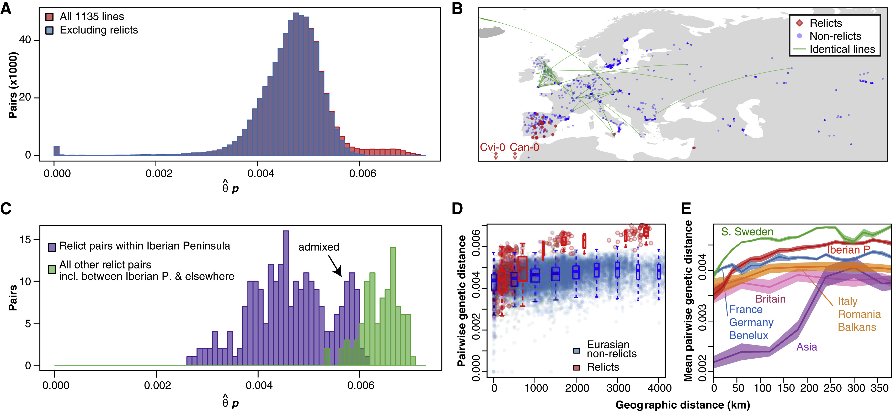
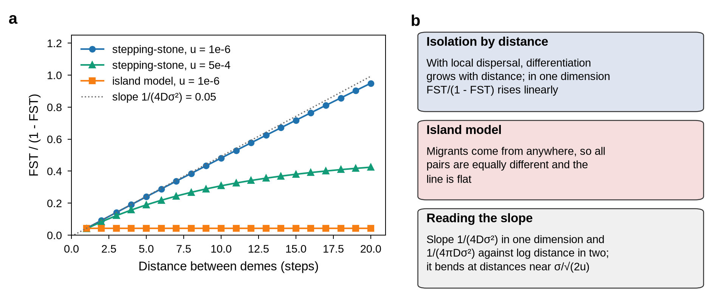

# Chapter 14. Population structure: isolation by distance and shifting balance

**Status: Isolation by distance Verified; shifting balance Contested.** Genetic differentiation that grows with geographic distance is found in plants, animals and humans, and where direct estimates of dispersal exist, Rousset’s regression of FST/(1 − FST) on distance agrees with them better than earlier indirect methods. Wright’s shifting balance theory, in which drift in small demes and selection between demes move a species from one adaptive peak to a higher one, is possible in models, but few observations are explained better by it than by simpler processes, and its third phase faces strong theoretical obstacles.

Related notes in this repository: [isolation-by-distance](../../skills/genomics-theory-mining/theories/isolation-by-distance/THEORY.md), [stepping-stone-model](../../skills/genomics-theory-mining/theories/stepping-stone-model/THEORY.md), [island-model](../../skills/genomics-theory-mining/theories/island-model/THEORY.md), [rousset-ibd-from-pairwise-fst](../../skills/genomics-theory-mining/theories/rousset-ibd-from-pairwise-fst/THEORY.md), [weir-cockerham-fst](../../skills/genomics-theory-mining/theories/weir-cockerham-fst/THEORY.md), [whitlock-fluctuating-fst](../../skills/genomics-theory-mining/theories/whitlock-fluctuating-fst/THEORY.md), [shifting-balance](../../skills/genomics-theory-mining/theories/shifting-balance/THEORY.md), [metapopulation](../../skills/genomics-theory-mining/theories/metapopulation/THEORY.md), [wade-mccauley-extinction-recolonization](../../skills/genomics-theory-mining/theories/wade-mccauley-extinction-recolonization/THEORY.md).

## 14.1 Statement and history

Sewall Wright set out his view of evolution in a subdivided species in *Evolution in Mendelian populations* (1931) [1]. In *Isolation by distance* (1943) he used the simplest model of structure, the island model, in which each subgroup mates at random except for a fraction of migrants drawn at random from the whole species, and contrasted it with a continuous population in which mates come from nearby, so that local differentiation grows with distance [2]. He argued that such local differences matter because they provide a basis for selection between groups, “a more effective mechanism for adaptive advance of the species as a whole than does the mass selection which is all that can occur under panmixia” [2]. His F-statistics, set out in *The genetical structure of populations*, gave a way to measure structure at several levels [3]. Kimura and Weiss formalised the stepping-stone model, in which colonies exchange migrants only with neighbours, and showed how the genetic correlation between colonies decreases with distance [4].

The shifting balance theory has three phases: (I) drift in a small deme carries it across a valley of lower fitness, (II) selection takes it to a new and higher peak, and (III) the deme exports the new gene combination by migration and the species as a whole moves to the higher peak [5].

Modern estimation of structure started with Weir and Cockerham’s estimator of F-statistics [6]. Slatkin showed that M̂ = (1/FST − 1)/4, the gene flow implied by an island model, falls with geographic distance in a regular way in both equilibrium and non-equilibrium populations, nearly independently of the mutation rate when it is small [7]. Rousset derived F-statistics for one-dimensional models and coalescence times for two-dimensional models, and proposed regressing pairwise FST/(1 − FST) on distance along linear habitats, or on the logarithm of distance in two dimensions; the slope estimates the product of population density and the second moment of parental dispersal distance (Figure 14.2) [8].

## 14.2 What the theory predicts

- **Isolation by distance.** With local dispersal, pairwise differentiation rises with distance: linearly in FST/(1 − FST) in one dimension, and linearly against log distance in two, with slope 1/(4Dσ²) or 1/(4πDσ²) (Figure 14.2) [8].
- **Island model as a special case.** If migrants come from anywhere, all pairs are equally different and there is no relation with distance [2, 7].
- **Plants differ by mating and dispersal.** Outcrossing and woody species should be less differentiated, and seed dispersal should set structure for maternally inherited markers [9, 10].
- **Shifting balance.** If phase III works, populations with many small, partly isolated demes should adapt faster on rugged landscapes than large panmictic ones, and new adaptations should spread from local demes across the range [5, 11].

## 14.3 Evidence for

- **Isolation by distance is widespread.** Slatkin detected it in allozyme data from gulls and pocket gophers [7]. In 51 populations of eastern collared lizards, plots of pairwise FST against distance were used to test for regional equilibrium and to weigh gene flow against drift, with results consistent with the regions’ histories [12].
- **Humans.** In 3,000 Europeans genotyped at over half a million sites, a map of Europe emerges from the first two axes of genetic variation, despite low average differentiation [13]. Effective migration surfaces show where similarity decays faster than expected, for example across barriers, in elephants, humans and *Arabidopsis thaliana* [14].
- **Plants.** Sharbel and colleagues found highly significant isolation by distance among 142 *A. thaliana* accessions from Eurasia [15]. In 1,135 sequenced *A. thaliana* lines, genetic distance rises with geographic distance across the whole range for the relict lineages, but for non-relicts only over short distances, and the rate at which it rises differs between regions (Figure 14.1) [16]. Fine-scale studies in plant populations show kinship falling with the logarithm of distance, as the theory predicts in two dimensions, and the slope (the Sp statistic) can be compared across species [17].
- **Plant life history.** In allozyme surveys, outcrossing and woody species had more diversity within populations and less differentiation among them [9]. After phylogenetic correction, nuclear structure is related mainly to the mating system, and organelle structure to seed dispersal and range size [10]. Loveless and Hamrick had argued that the ecology of pollination and seed dispersal sets genetic structure in plants [18].
- **Shifting balance in models.** In a spatially explicit model with local, random migration of discrete individuals, phase III works under a much broader set of conditions than earlier models suggested [19]. Wade and Goodnight argued that local extinction and colonisation are common and that drift within demes converts non-additive into additive variance, increasing the potential for local adaptation [11].

## 14.4 Evidence against, and difficulties

- **FST rarely gives Nm.** The island-model formula FST ≈ 1/(4Nm + 1) rests on many unrealistic assumptions, so FST measures structure well but seldom gives an accurate number of migrants [20].
- **Distance is not the only cause.** Environment can also isolate populations, so differentiation may follow ecological rather than geographic distance; partial Mantel tests handle this poorly, and model-based methods such as BEDASSLE separate the two [21, 22].
- **Equilibrium.** Recent colonisation leaves patterns that differ from equilibrium isolation by distance [7, 12]; in *A. thaliana*, the non-relict lineage spread recently and shows isolation by distance only at short range (Figure 14.1) [16].
- **Shifting balance lacks decisive evidence.** Coyne, Barton and Turelli concluded that phases I and II can occur but that drift is often unnecessary to move between peaks, that barriers to gene flow often stop the spread of adaptations whose fixation needed drift, that it is hard to assemble complex adaptations from peak shifts in different demes, and that few observations from nature are better explained by Wright’s three-phase process than by other processes [5]. The exchange continued without agreement [23, 24].

## 14.5 Status and reasoning

**Isolation by distance: verified. Shifting balance: contested.** The predicted rise of differentiation with distance is found across taxa, and its slope has a precise interpretation [8, 13, 16]. For the shifting balance, models show that it can work under some conditions [19], but the empirical case that it explains adaptation better than other processes is weak [5], and the dispute has not been settled [11, 23, 24].

## 14.6 Plants, crops and grapevine

- **Wild plants.** Plant structure is set by pollen and seed dispersal and the mating system [10, 18]. Selfing *A. thaliana* shows strong isolation by distance among relicts, weaker among the lineage that spread after the last glaciation (Figure 14.1) [16].
- **Maize.** Variation in the proportion of admixture between ancient maize and *Zea mays* ssp. *mexicana* is a key component of maize diversity at individual loci and in additive variation for agronomic traits [25], so a model of discrete populations or of simple distance alone is not enough.
- **Grapevine.** In over 1,000 grape samples, Myles and colleagues found support for a Near East origin and introgression from local wild grapes as cultivation moved into Europe [26]. With 3,525 accessions, Dong and colleagues inferred that harsh Pleistocene climate separated wild grape ecotypes through habitat fragmentation, and that domestication happened at about the same time in Western Asia and the Caucasus [27]. For cultivars, structure is shaped less by distance than by human movement and by a dense network of parent–offspring relationships among elite cultivars [26]; clones of one genotype planted in many regions break the link between geography and genotype.
- **Clonal perennials generally.** Because a clone is spread by people, sampling several plants of the same cultivar inflates apparent clusters; remove clonal duplicates before any analysis of structure [26, 28].

## 14.7 How to test it with public data

- **Data.** Georeferenced genomes, such as the 1,135 *A. thaliana* lines [16], wild grape accessions with collection sites [27], or human panels [13].
- **Tools.** Weir and Cockerham FST [6]; Mantel and Rousset regressions [8]; EEMS [14]; conStruct for continuous and discrete structure [29]; BEDASSLE for environment versus distance [21]; STRUCTURE or ADMIXTURE with care [30, 31, 32].
- **Analysis.** (1) Compute pairwise FST/(1 − FST) between sampling sites and regress it on distance or log distance [8]. (2) Fit models with both continuous and discrete structure before naming clusters [29]. (3) Test environment against geography [21]. The script [`scripts/ch14_population_structure_figures.py`](../scripts/ch14_population_structure_figures.py) computes the equilibrium FST/(1 − FST) for a stepping-stone and an island model (Figure 14.2).
- **What would break the theory.** For isolation by distance: species with limited dispersal and no relation of genetic to geographic distance at equilibrium. For the shifting balance: a documented case where an adaptation needed drift in a small deme and then spread across the species.

## 14.8 Open questions

- How can continuous and discrete structure be separated in species sampled unevenly in space [28, 29]?
- How much of differentiation is due to environment rather than distance [22]?
- Is there any natural case of a complete shifting-balance process [5, 11]?
- In clonal crops such as grapevine, how should structure be modelled when people, not dispersal, move genotypes [26, 27]?

## 14.9 Common mistakes

- Converting FST into a number of migrants per generation [20].
- Reading STRUCTURE or ADMIXTURE clusters as real populations when the data reflect isolation by distance or drift [29, 32].
- Ignoring the effect of uneven sampling on the number of clusters [28].
- Using a non-spatial island model as the null for tests of hierarchy or outlier loci when there is isolation by distance [33].
- Reading gradients in principal components as evidence of past migrations; similar patterns arise from continuous spatial variation alone [34].

## Figures

**Figure 14.1.** Genetic and geographic distances between accessions. (A) The trimodal distribution of pairwise genetic distances among accessions. (B) Geographic locations of relicts (red) and non-relicts (blue) in Eurasia and North Africa, with pairs of nearly identical accessions at least 1 km apart connected by green lines. (C) Genetic distances of relict pairs. (D) Genetic distance increases globally with geographic distance for relicts but for non-relicts only over short distances. (E) At regional scales, the rate at which genetic distance scales with geographic distance varies greatly among geographic regions for non-relicts. Reproduced unchanged from Alonso-Blanco C, Andrade J, Becker C, et al. (1001 Genomes Consortium) (2016) 1,135 genomes reveal the global pattern of polymorphism in *Arabidopsis thaliana*. *Cell* 166:481-491, Figure 3. https://doi.org/10.1016/j.cell.2016.05.063. Licence: CC BY 4.0 (https://creativecommons.org/licenses/by/4.0/).

**Figure 14.2.** (a) Equilibrium FST/(1 − FST) between demes against distance, from the exact identity-by-descent recursion for 2,000 demes of 50 diploids on a ring: stepping-stone migration to neighbours with m = 0.1 and mutation rate 10⁻⁶ or 5 × 10⁻⁴, and an island model with the same m. The dotted line has Rousset’s slope 1/(4Dσ²) = 0.05. With the higher mutation rate the line bends at distances near σ/√(2u), about 10 steps. (b) How to read the slope. Made with [`scripts/ch14_population_structure_figures.py`](../scripts/ch14_population_structure_figures.py); the calculation is deterministic.

## References

1. Wright S (1931) Evolution in Mendelian populations. *Genetics* 16:97-159. https://doi.org/10.1093/genetics/16.2.97
2. Wright S (1943) Isolation by distance. *Genetics* 28:114-138. https://doi.org/10.1093/genetics/28.2.114
3. Wright S (1949) The genetical structure of populations. *Annals of Eugenics* 15:323-354. https://doi.org/10.1111/j.1469-1809.1949.tb02451.x
4. Kimura M, Weiss GH (1964) The stepping stone model of population structure and the decrease of genetic correlation with distance. *Genetics* 49:561-576. https://doi.org/10.1093/genetics/49.4.561
5. Coyne JA, Barton NH, Turelli M (1997) Perspective: a critique of Sewall Wright’s shifting balance theory of evolution. *Evolution* 51:643-671. https://doi.org/10.1111/j.1558-5646.1997.tb03650.x
6. Weir BS, Cockerham CC (1984) Estimating F-statistics for the analysis of population structure. *Evolution* 38:1358-1370. https://doi.org/10.1111/j.1558-5646.1984.tb05657.x
7. Slatkin M (1993) Isolation by distance in equilibrium and non-equilibrium populations. *Evolution* 47:264-279. https://doi.org/10.1111/j.1558-5646.1993.tb01215.x
8. Rousset F (1997) Genetic differentiation and estimation of gene flow from F-statistics under isolation by distance. *Genetics* 145:1219-1228. https://doi.org/10.1093/genetics/145.4.1219
9. Hamrick JL, Godt MJW (1996) Effects of life history traits on genetic diversity in plant species. *Philosophical Transactions of the Royal Society of London. Series B: Biological Sciences* 351:1291-1298. https://doi.org/10.1098/rstb.1996.0112
10. Duminil J, Fineschi S, Hampe A, et al. (2007) Can Population Genetic Structure Be Predicted from Life‐History Traits? *The American Naturalist* 169:662-672. https://doi.org/10.1086/513490
11. Wade MJ, Goodnight CJ (1998) Perspective: the theories of Fisher and Wright in the context of metapopulations: when nature does many small experiments. *Evolution* 52:1537-1553. https://doi.org/10.1111/j.1558-5646.1998.tb02235.x
12. Hutchison DW, Templeton AR (1999) Correlation of pairwise genetic and geographic distance measures: inferring the relative influences of gene flow and drift on the distribution of genetic variability. *Evolution* 53:1898-1914. https://doi.org/10.1111/j.1558-5646.1999.tb04571.x
13. Novembre J, Johnson T, Bryc K, et al. (2008) Genes mirror geography within Europe. *Nature* 456:98-101. https://doi.org/10.1038/nature07331
14. Petkova D, Novembre J, Stephens M (2016) Visualizing spatial population structure with estimated effective migration surfaces. *Nature Genetics* 48:94-100. https://doi.org/10.1038/ng.3464
15. Sharbel TF, Haubold B, Mitchell‐Olds T (2000) Genetic isolation by distance in Arabidopsis thaliana: biogeography and postglacial colonization of Europe. *Molecular Ecology* 9:2109-2118. https://doi.org/10.1046/j.1365-294X.2000.01122.x
16. Alonso-Blanco C, Andrade J, Becker C, et al. (2016) 1,135 Genomes Reveal the Global Pattern of Polymorphism in Arabidopsis thaliana. *Cell* 166:481-491. https://doi.org/10.1016/j.cell.2016.05.063
17. Vekemans X, Hardy OJ (2004) New insights from fine‐scale spatial genetic structure analyses in plant populations. *Molecular Ecology* 13:921-935. https://doi.org/10.1046/j.1365-294X.2004.02076.x
18. Loveless MD, Hamrick JL (1984) Ecological Determinants of Genetic Structure in Plant Populations. *Annual Review of Ecology and Systematics* 15:65-95. https://doi.org/10.1146/annurev.es.15.110184.000433
19. Peck SL, Ellner SP, Gould F (1998) A spatially explicit stochastic model demonstrates the feasibility of Wright’s shifting balance theory. *Evolution* 52:1834-1839. https://doi.org/10.1111/j.1558-5646.1998.tb02260.x
20. Whitlock MC, McCauley DE (1999) Indirect measures of gene flow and migration: FST≠1/(4Nm+1). *Heredity* 82:117-125. https://doi.org/10.1038/sj.hdy.6884960
21. Bradburd GS, Ralph PL, Coop GM (2013) Disentangling the effects of geographic and ecological isolation on genetic differentiation. *Evolution* 67:3258-3273. https://doi.org/10.1111/evo.12193
22. Wang IJ, Bradburd GS (2014) Isolation by environment. *Molecular Ecology* 23:5649-5662. https://doi.org/10.1111/mec.12938
23. Coyne JA, Barton NH, Turelli M (2000) Is Wright’s shifting balance process important in evolution? *Evolution* 54:306-317. https://doi.org/10.1111/j.0014-3820.2000.tb00033.x
24. Goodnight CJ, Wade MJ (2000) The ongoing synthesis: a reply to Coyne, Barton, and Turelli. *Evolution* 54:317-324. https://doi.org/10.1111/j.0014-3820.2000.tb00034.x
25. Yang N, Wang Y, Liu X, et al. (2023) Two teosintes made modern maize. *Science* 382:eadg8940. https://doi.org/10.1126/science.adg8940
26. Myles S, Boyko AR, Owens CL, et al. (2011) Genetic structure and domestication history of the grape. *Proceedings of the National Academy of Sciences* 108:3530-3535. https://doi.org/10.1073/pnas.1009363108
27. Dong Y, Duan S, Xia Q, et al. (2023) Dual domestications and origin of traits in grapevine evolution. *Science* 379:892-901. https://doi.org/10.1126/science.add8655
28. Puechmaille SJ (2016) The program structure does not reliably recover the correct population structure when sampling is uneven: subsampling and new estimators alleviate the problem. *Molecular Ecology Resources* 16:608-627. https://doi.org/10.1111/1755-0998.12512
29. Bradburd GS, Coop GM, Ralph PL (2018) Inferring Continuous and Discrete Population Genetic Structure Across Space. *Genetics* 210:33-52. https://doi.org/10.1534/genetics.118.301333
30. Pritchard JK, Stephens M, Donnelly P (2000) Inference of Population Structure Using Multilocus Genotype Data. *Genetics* 155:945-959. https://doi.org/10.1093/genetics/155.2.945
31. Alexander DH, Novembre J, Lange K (2009) Fast model-based estimation of ancestry in unrelated individuals. *Genome Research* 19:1655-1664. https://doi.org/10.1101/gr.094052.109
32. Lawson DJ, van Dorp L, Falush D (2018) A tutorial on how not to over-interpret STRUCTURE and ADMIXTURE bar plots. *Nature Communications* 9:3258. https://doi.org/10.1038/s41467-018-05257-7
33. Meirmans PG (2012) The trouble with isolation by distance. *Molecular Ecology* 21:2839-2846. https://doi.org/10.1111/j.1365-294X.2012.05578.x
34. Novembre J, Stephens M (2008) Interpreting principal component analyses of spatial population genetic variation. *Nature Genetics* 40:646-649. https://doi.org/10.1038/ng.139
