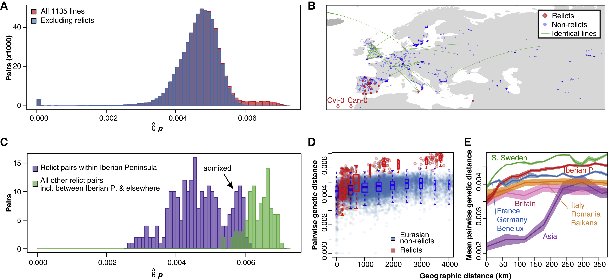
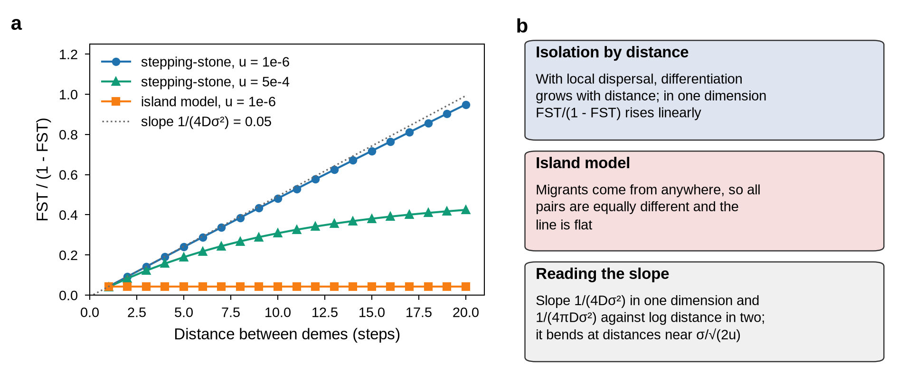

# 第 14 章 群体结构：距离隔离与转移平衡

**地位：距离隔离已验证；转移平衡有争议。** 遗传分化随地理距离增大的现象在植物、动物和人类中都有发现；在有扩散直接估计的地方，Rousset 用 FST/(1 − FST) 对距离回归的方法比早先的间接方法与之更吻合。Wright 的转移平衡理论认为，小亚群中的漂变和亚群间的选择能使物种从一个适应峰移到更高的峰；它在模型中可行，但很少有观察能用它比用更简单的过程解释得更好，而且它的第三阶段面临很强的理论障碍。

本仓库相关条目：[isolation-by-distance](../../skills/genomics-theory-mining/theories/isolation-by-distance/THEORY.md)、[stepping-stone-model](../../skills/genomics-theory-mining/theories/stepping-stone-model/THEORY.md)、[island-model](../../skills/genomics-theory-mining/theories/island-model/THEORY.md)、[rousset-ibd-from-pairwise-fst](../../skills/genomics-theory-mining/theories/rousset-ibd-from-pairwise-fst/THEORY.md)、[weir-cockerham-fst](../../skills/genomics-theory-mining/theories/weir-cockerham-fst/THEORY.md)、[whitlock-fluctuating-fst](../../skills/genomics-theory-mining/theories/whitlock-fluctuating-fst/THEORY.md)、[shifting-balance](../../skills/genomics-theory-mining/theories/shifting-balance/THEORY.md)、[metapopulation](../../skills/genomics-theory-mining/theories/metapopulation/THEORY.md)、[wade-mccauley-extinction-recolonization](../../skills/genomics-theory-mining/theories/wade-mccauley-extinction-recolonization/THEORY.md)。

## 14.1 内容与历史

Sewall Wright 在《孟德尔群体中的进化》（1931）中阐述了他对分成亚群的物种如何进化的看法 [1]。在《距离隔离》（1943）中，他使用最简单的结构模型，即岛屿模型：每个亚群内部随机交配，只有一部分迁入者随机来自整个物种；他把它与配偶来自附近、局部分化随距离增大的连续群体相对照 [2]。他认为这类局部差异很重要，因为它们为亚群间的选择提供了基础，“比随机交配下唯一可能发生的混合选择（mass selection），更有效地推动整个物种的适应进步” [2]。他在《群体的遗传结构》中提出的 F 统计量，提供了在多个层次上度量结构的方法 [3]。Kimura 和 Weiss 将踏脚石模型形式化，在该模型中群落只与相邻群落交换迁入者，并说明了群落间遗传相关如何随距离下降 [4]。

转移平衡理论有三个阶段：(I) 小亚群中的漂变使它越过适合度较低的低谷，(II) 选择把它带到新的更高的峰，(III) 该亚群通过迁移输出新的基因组合，整个物种移到更高的峰 [5]。

结构的现代估计始于 Weir 和 Cockerham 的 F 统计量估计量 [6]。Slatkin 证明，岛屿模型所隐含的基因流 M̂ = (1/FST − 1)/4，在平衡和非平衡群体中都随地理距离规则地下降，在突变率较小时几乎与突变率无关 [7]。Rousset 推导了一维模型中的 F 统计量和二维模型中的溯祖时间，提出对线状生境用成对 FST/(1 − FST) 对距离回归，对二维生境则对距离的对数回归；斜率估计的是群体密度与亲代扩散距离二阶矩的乘积（图 14.2） [8]。

## 14.2 预测

- **距离隔离。** 在局部扩散下，成对分化随距离增大：一维时 FST/(1 − FST) 线性增长，二维时对距离对数线性增长，斜率分别为 1/(4Dσ²) 或 1/(4πDσ²)（图 14.2） [8]。
- **岛屿模型是特例。** 如果迁入者可以来自任何地方，所有成对比较的差异相同，与距离无关 [2, 7]。
- **植物因交配方式和扩散而不同。** 异交和木本物种的分化应较小，种子扩散应决定母系遗传标记的结构 [9, 10]。
- **转移平衡。** 如果第三阶段可行，由许多小而部分隔离的亚群组成的群体在崎岖景观上应比大的随机交配群体适应得更快，新适应应从局部亚群扩散到整个分布区 [5, 11]。

## 14.3 支持证据

- **距离隔离普遍存在。** Slatkin 在海鸥和囊鼠的等位酶数据中检测到距离隔离 [7]。在 51 个东部领蜥群体中，成对 FST 对距离的图被用来检验区域平衡、权衡基因流与漂变，结果与各区域的历史一致 [12]。
- **人类。** 在 3,000 名用超过 50 万个位点分型的欧洲人中，尽管平均分化很低，遗传变异的前两个轴就呈现出一张欧洲地图 [13]。有效迁移曲面显示了相似性衰减比预期快的地方，例如屏障两侧，例子包括大象、人类和拟南芥 [14]。
- **植物。** Sharbel 等在来自欧亚大陆的 142 个拟南芥材料中发现了高度显著的距离隔离 [15]。在 1,135 个测序的拟南芥株系中，孑遗谱系的遗传距离在整个分布区内随地理距离增加，非孑遗谱系则只在短距离内如此，且各区域增长速率不同（图 14.1） [16]。植物群体的细尺度研究表明，亲缘系数随距离对数下降，正如二维理论所预测，其斜率（Sp 统计量）可在物种间比较 [17]。
- **植物生活史。** 在等位酶调查中，异交和木本物种群体内多样性更高、群体间分化更低 [9]。经系统发育校正后，核基因结构主要与交配系统有关，细胞器结构与种子扩散和分布范围有关 [10]。Loveless 和 Hamrick 早已指出，传粉和种子扩散的生态决定了植物的遗传结构 [18]。
- **模型中的转移平衡。** 在一个空间显式、以离散个体局部随机迁移的模型中，第三阶段可在比早先模型所示宽得多的条件下发生 [19]。Wade 和 Goodnight 认为局部灭绝和再定殖很常见，亚群内的漂变把非加性方差转化为加性方差，增加了局部适应的潜力 [11]。

## 14.4 反面证据与难点

- **FST 很少能给出 Nm。** 岛屿模型公式 FST ≈ 1/(4Nm + 1) 依赖许多不现实的假设，所以 FST 能很好地度量结构，却很少能准确给出迁入个体数 [20]。
- **距离不是唯一原因。** 环境也会隔离群体，分化可能追随生态距离而不是地理距离；偏 Mantel 检验处理不好这一点，BEDASSLE 等基于模型的方法可以把两者分开 [21, 22]。
- **平衡问题。** 近期的定殖留下的格局不同于平衡状态的距离隔离 [7, 12]；在拟南芥中，非孑遗谱系是近期扩散的，只在短距离内显示距离隔离（图 14.1） [16]。
- **转移平衡缺乏决定性证据。** Coyne、Barton 和 Turelli 认为第一、第二阶段可以发生，但在峰之间移动常常不需要漂变；需要漂变才能固定的适应常被基因流屏障阻止扩散；由不同亚群的峰转移组装复杂适应很困难；而且自然界中很少有观察用 Wright 的三阶段过程比用其他过程解释得更好 [5]。这场争论此后继续，没有达成一致 [23, 24]。

## 14.5 地位与理由

**距离隔离：已验证。转移平衡：有争议。** 分化随距离增长的预测在各类群中都能看到，其斜率有精确的解释 [8, 13, 16]。对转移平衡而言，模型表明它在某些条件下可行 [19]，但它比其他过程更能解释适应的经验证据很弱 [5]，争论尚未解决 [11, 23, 24]。

## 14.6 植物、作物与葡萄

- **野生植物。** 植物的结构由花粉和种子扩散以及交配系统决定 [10, 18]。自交的拟南芥在孑遗谱系中显示很强的距离隔离，在末次冰期后扩散的谱系中较弱（图 14.1） [16]。
- **玉米。** 古代玉米与 *Zea mays* ssp. *mexicana* 之间混合比例的变化，是玉米单个位点多样性和农艺性状加性变异的关键组成部分 [25]，所以只用离散群体或单纯距离的模型是不够的。
- **葡萄。** Myles 等在 1,000 多份葡萄样品中，支持了近东起源，并发现栽培向欧洲推进时有来自当地野生葡萄的渐渗 [26]。Dong 等用 3,525 份材料推断，更新世的严酷气候通过生境破碎化使野生葡萄生态型分离，驯化大约同时发生在西亚和高加索 [27]。对品种而言，结构较少由距离决定，更多由人的迁移和优良品种之间密集的亲子关系网络决定 [26]；同一基因型的克隆被种在许多地区，打断了地理与基因型之间的联系。
- **无性繁殖的多年生作物。** 由于克隆由人传播，对同一品种取多个植株会夸大表观聚类；任何结构分析之前都应去掉克隆重复 [26, 28]。

## 14.7 用公开数据检验

- **数据。** 带地理坐标的基因组，如 1,135 个拟南芥株系 [16]、有采集地点的野生葡萄材料 [27] 或人类样本 [13]。
- **工具。** Weir 和 Cockerham 的 FST [6]；Mantel 检验和 Rousset 回归 [8]；EEMS [14]；同时处理连续和离散结构的 conStruct [29]；区分环境与距离的 BEDASSLE [21]；谨慎使用 STRUCTURE 或 ADMIXTURE [30, 31, 32]。
- **分析。** (1) 计算采样地点之间的成对 FST/(1 − FST)，对距离或距离对数回归 [8]。(2) 在命名聚类之前，拟合同时含连续和离散结构的模型 [29]。(3) 检验环境与地理的作用 [21]。脚本 [`scripts/ch14_population_structure_figures.py`](../scripts/ch14_population_structure_figures.py) 计算踏脚石模型和岛屿模型的平衡 FST/(1 − FST)（图 14.2）。
- **什么结果会推翻这一理论。** 对距离隔离而言：扩散有限的物种在平衡时遗传距离与地理距离毫无关系。对转移平衡而言：一个有记录的案例，其中某个适应需要小亚群中的漂变，随后扩散到整个物种。

## 14.8 未解决的问题

- 在空间上采样不均匀的物种中，如何把连续结构和离散结构分开 [28, 29]？
- 分化中有多少来自环境而不是距离 [22]？
- 自然界中是否存在完整的转移平衡过程 [5, 11]？
- 在葡萄这类由人而不是扩散移动基因型的无性繁殖作物中，应如何为结构建模 [26, 27]？

## 14.9 常见错误

- 把 FST 换算成每代迁入个体数 [20]。
- 当数据反映的是距离隔离或漂变时，把 STRUCTURE 或 ADMIXTURE 的聚类当成真实群体 [29, 32]。
- 忽略不均匀采样对聚类数的影响 [28]。
- 存在距离隔离时，仍用非空间的岛屿模型作为层次结构或离群位点检验的零模型 [33]。
- 把主成分上的梯度解读为过去迁移的证据；单靠连续的空间变异也会产生类似图案 [34]。

## 图

**图 14.1.** 材料之间的遗传距离和地理距离。(A) 材料间成对遗传距离的三峰分布。(B) 欧亚大陆和北非孑遗（红色）与非孑遗（蓝色）材料的地理位置，相距至少 1 km 的几乎相同材料对用绿线相连。(C) 孑遗材料对的遗传距离。(D) 孑遗材料的遗传距离在全球尺度上随地理距离增加，非孑遗材料只在短距离内如此。(E) 在区域尺度上，非孑遗材料遗传距离随地理距离增长的速率在不同地区差别很大。原样转载自 Alonso-Blanco C, Andrade J, Becker C, et al. (1001 Genomes Consortium) (2016) 1,135 genomes reveal the global pattern of polymorphism in *Arabidopsis thaliana*. *Cell* 166:481-491, Figure 3. https://doi.org/10.1016/j.cell.2016.05.063。许可：CC BY 4.0（https://creativecommons.org/licenses/by/4.0/）。

**图 14.2.** (a) 由精确的同源相同递推得到的平衡 FST/(1 − FST) 与亚群间距离的关系，模型为环上 2,000 个各含 50 个二倍体的亚群：向相邻亚群迁移的踏脚石模型，m = 0.1，突变率为 10⁻⁶ 或 5 × 10⁻⁴；以及 m 相同的岛屿模型。点线的斜率为 Rousset 的 1/(4Dσ²) = 0.05。突变率较高时，曲线在距离接近 σ/√(2u)（约 10 步）处弯曲。(b) 如何解读斜率。用 [`scripts/ch14_population_structure_figures.py`](../scripts/ch14_population_structure_figures.py) 生成；计算是确定性的。

## 参考文献

1. Wright S (1931) Evolution in Mendelian populations. *Genetics* 16:97-159. https://doi.org/10.1093/genetics/16.2.97
2. Wright S (1943) Isolation by distance. *Genetics* 28:114-138. https://doi.org/10.1093/genetics/28.2.114
3. Wright S (1949) The genetical structure of populations. *Annals of Eugenics* 15:323-354. https://doi.org/10.1111/j.1469-1809.1949.tb02451.x
4. Kimura M, Weiss GH (1964) The stepping stone model of population structure and the decrease of genetic correlation with distance. *Genetics* 49:561-576. https://doi.org/10.1093/genetics/49.4.561
5. Coyne JA, Barton NH, Turelli M (1997) Perspective: a critique of Sewall Wright’s shifting balance theory of evolution. *Evolution* 51:643-671. https://doi.org/10.1111/j.1558-5646.1997.tb03650.x
6. Weir BS, Cockerham CC (1984) Estimating F-statistics for the analysis of population structure. *Evolution* 38:1358-1370. https://doi.org/10.1111/j.1558-5646.1984.tb05657.x
7. Slatkin M (1993) Isolation by distance in equilibrium and non-equilibrium populations. *Evolution* 47:264-279. https://doi.org/10.1111/j.1558-5646.1993.tb01215.x
8. Rousset F (1997) Genetic differentiation and estimation of gene flow from F-statistics under isolation by distance. *Genetics* 145:1219-1228. https://doi.org/10.1093/genetics/145.4.1219
9. Hamrick JL, Godt MJW (1996) Effects of life history traits on genetic diversity in plant species. *Philosophical Transactions of the Royal Society of London. Series B: Biological Sciences* 351:1291-1298. https://doi.org/10.1098/rstb.1996.0112
10. Duminil J, Fineschi S, Hampe A, et al. (2007) Can Population Genetic Structure Be Predicted from Life‐History Traits? *The American Naturalist* 169:662-672. https://doi.org/10.1086/513490
11. Wade MJ, Goodnight CJ (1998) Perspective: the theories of Fisher and Wright in the context of metapopulations: when nature does many small experiments. *Evolution* 52:1537-1553. https://doi.org/10.1111/j.1558-5646.1998.tb02235.x
12. Hutchison DW, Templeton AR (1999) Correlation of pairwise genetic and geographic distance measures: inferring the relative influences of gene flow and drift on the distribution of genetic variability. *Evolution* 53:1898-1914. https://doi.org/10.1111/j.1558-5646.1999.tb04571.x
13. Novembre J, Johnson T, Bryc K, et al. (2008) Genes mirror geography within Europe. *Nature* 456:98-101. https://doi.org/10.1038/nature07331
14. Petkova D, Novembre J, Stephens M (2016) Visualizing spatial population structure with estimated effective migration surfaces. *Nature Genetics* 48:94-100. https://doi.org/10.1038/ng.3464
15. Sharbel TF, Haubold B, Mitchell‐Olds T (2000) Genetic isolation by distance in Arabidopsis thaliana: biogeography and postglacial colonization of Europe. *Molecular Ecology* 9:2109-2118. https://doi.org/10.1046/j.1365-294X.2000.01122.x
16. Alonso-Blanco C, Andrade J, Becker C, et al. (2016) 1,135 Genomes Reveal the Global Pattern of Polymorphism in Arabidopsis thaliana. *Cell* 166:481-491. https://doi.org/10.1016/j.cell.2016.05.063
17. Vekemans X, Hardy OJ (2004) New insights from fine‐scale spatial genetic structure analyses in plant populations. *Molecular Ecology* 13:921-935. https://doi.org/10.1046/j.1365-294X.2004.02076.x
18. Loveless MD, Hamrick JL (1984) Ecological Determinants of Genetic Structure in Plant Populations. *Annual Review of Ecology and Systematics* 15:65-95. https://doi.org/10.1146/annurev.es.15.110184.000433
19. Peck SL, Ellner SP, Gould F (1998) A spatially explicit stochastic model demonstrates the feasibility of Wright’s shifting balance theory. *Evolution* 52:1834-1839. https://doi.org/10.1111/j.1558-5646.1998.tb02260.x
20. Whitlock MC, McCauley DE (1999) Indirect measures of gene flow and migration: FST≠1/(4Nm+1). *Heredity* 82:117-125. https://doi.org/10.1038/sj.hdy.6884960
21. Bradburd GS, Ralph PL, Coop GM (2013) Disentangling the effects of geographic and ecological isolation on genetic differentiation. *Evolution* 67:3258-3273. https://doi.org/10.1111/evo.12193
22. Wang IJ, Bradburd GS (2014) Isolation by environment. *Molecular Ecology* 23:5649-5662. https://doi.org/10.1111/mec.12938
23. Coyne JA, Barton NH, Turelli M (2000) Is Wright’s shifting balance process important in evolution? *Evolution* 54:306-317. https://doi.org/10.1111/j.0014-3820.2000.tb00033.x
24. Goodnight CJ, Wade MJ (2000) The ongoing synthesis: a reply to Coyne, Barton, and Turelli. *Evolution* 54:317-324. https://doi.org/10.1111/j.0014-3820.2000.tb00034.x
25. Yang N, Wang Y, Liu X, et al. (2023) Two teosintes made modern maize. *Science* 382:eadg8940. https://doi.org/10.1126/science.adg8940
26. Myles S, Boyko AR, Owens CL, et al. (2011) Genetic structure and domestication history of the grape. *Proceedings of the National Academy of Sciences* 108:3530-3535. https://doi.org/10.1073/pnas.1009363108
27. Dong Y, Duan S, Xia Q, et al. (2023) Dual domestications and origin of traits in grapevine evolution. *Science* 379:892-901. https://doi.org/10.1126/science.add8655
28. Puechmaille SJ (2016) The program structure does not reliably recover the correct population structure when sampling is uneven: subsampling and new estimators alleviate the problem. *Molecular Ecology Resources* 16:608-627. https://doi.org/10.1111/1755-0998.12512
29. Bradburd GS, Coop GM, Ralph PL (2018) Inferring Continuous and Discrete Population Genetic Structure Across Space. *Genetics* 210:33-52. https://doi.org/10.1534/genetics.118.301333
30. Pritchard JK, Stephens M, Donnelly P (2000) Inference of Population Structure Using Multilocus Genotype Data. *Genetics* 155:945-959. https://doi.org/10.1093/genetics/155.2.945
31. Alexander DH, Novembre J, Lange K (2009) Fast model-based estimation of ancestry in unrelated individuals. *Genome Research* 19:1655-1664. https://doi.org/10.1101/gr.094052.109
32. Lawson DJ, van Dorp L, Falush D (2018) A tutorial on how not to over-interpret STRUCTURE and ADMIXTURE bar plots. *Nature Communications* 9:3258. https://doi.org/10.1038/s41467-018-05257-7
33. Meirmans PG (2012) The trouble with isolation by distance. *Molecular Ecology* 21:2839-2846. https://doi.org/10.1111/j.1365-294X.2012.05578.x
34. Novembre J, Stephens M (2008) Interpreting principal component analyses of spatial population genetic variation. *Nature Genetics* 40:646-649. https://doi.org/10.1038/ng.139
