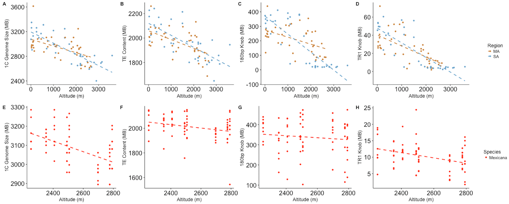
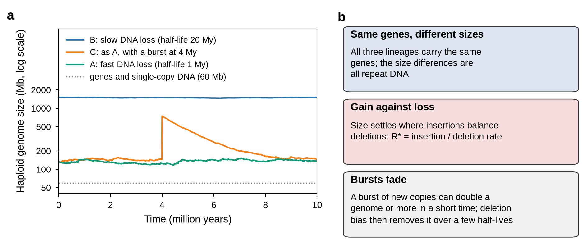

# Chapter 15. The C-value enigma

**Status: Decoupling of genome size from gene number Verified; its causes Partly verified.** Haploid DNA content (the C-value) varies tens of thousands of times among eukaryotes and about 2,400 times among flowering plants, with no relation to organismal complexity or gene number. Genome sequences have shown where the extra DNA is: mostly transposable elements and other repeats, with polyploidy adding further variation. Why some lineages keep more of it is less settled. Differences in the rates of transposon amplification and DNA removal are well documented; selection through cell size and development time (the nucleotype) has good correlational and some population-level support; the role of small effective population size is disputed.

Related notes in this repository: [c-value-junk-dna](../../skills/genomics-theory-mining/theories/c-value-junk-dna/THEORY.md), [cavalier-smith-1978-nucleoskeletal-c-value](../../skills/genomics-theory-mining/theories/cavalier-smith-1978-nucleoskeletal-c-value/THEORY.md), [lynch-conery-2003-genome-complexity](../../skills/genomics-theory-mining/theories/lynch-conery-2003-genome-complexity/THEORY.md), [drift-barrier-hypothesis](../../skills/genomics-theory-mining/theories/drift-barrier-hypothesis/THEORY.md), [selfish-dna](../../skills/genomics-theory-mining/theories/selfish-dna/THEORY.md), [nearly-neutral-theory](../../skills/genomics-theory-mining/theories/nearly-neutral-theory/THEORY.md).

## 15.1 Statement and history

Mirsky and Ris found that the amount of DNA per chromosome set is constant among the cells of an organism and between egg and sperm, but varies among species in a way that is not in proportion to the number of genes and is related to cell mass [1]. Because organisms with similar complexity, and even related species, can differ many-fold in DNA content, the observation became known as the C-value paradox [2, 3]. Gregory preferred the name C-value enigma: genome size varies more than 200,000-fold among eukaryotes and bears no relation to organismal complexity, but the origins of this variation and the reasons for its clearly non-random distribution remain unclear [2].

Two families of explanation were proposed [2]. Mutation-pressure theories see most extra DNA as junk or selfish DNA, spread by its own replication [4, 5], and genome size as the balance of gains and losses (Figure 15.2) [3]. Optimal-DNA theories emphasise the strong correlation of DNA content with cell and nuclear volume. Cavalier-Smith argued that DNA has functions unrelated to coding, setting cell volume through replication origins and nuclear volume through its bulk, so that DNA content is adjusted to cell size [6]. Bennett had already shown that cell cycle and meiosis durations rise with DNA content in plants, and that annual species have less DNA than perennials [7]. Gregory concluded that the evidence favours a nucleotypic view, in which bulk DNA has direct effects on cell size and division rate that selection can act on [2]. Lynch and Conery proposed a third, non-adaptive explanation: genome expansion in eukaryotes is a passive outcome of long-term reductions in effective population size, in which selection is less able to remove slightly harmful mutations that add DNA [8, 9].

## 15.2 What the theory predicts

- **No relation with gene number.** Genome size should vary far more than gene number, and the difference should be repeat DNA [10].
- **Repeat dynamics.** Large genomes should contain many high-copy transposon families and recent bursts, small ones few, and DNA removal by small deletions and recombination should vary among lineages [11, 12].
- **Nucleotype.** Genome size should correlate with cell size, cell cycle duration and the traits that depend on them, such as stomatal size and density and minimum generation time [7, 13].
- **Population size.** If drift drives expansion, genome size should be larger in lineages with smaller effective population size, after phylogenetic correction [8, 9].

## 15.3 Evidence for

- **The range.** Eukaryotic genomes vary more than 60,000-fold in size, not explained by gene number, in comparisons of more than 500 species [10]. In plants, the record is *Paris japonica* with 1C = 152.23 pg, extending the angiosperm range to about 2,400-fold [14, 15]. The Plant DNA C-values database and its animal and fungal counterparts hold values for more than 10,000 species [16, 17].
- **Repeats make the difference.** In maize, nested retrotransposons account for more than 60% of the *Adh1* region and at least half of the nuclear DNA [18]. *Oryza australiensis* gained more than 90,000 retrotransposon copies in the last 3 million years and doubled its genome without polyploidy [19]. In cotton (*Gossypium*), genomes from 880 to 2,460 Mb are 40–65% transposable elements, one family of gypsy-like retrotransposons, Gorge3, accounts for a major fraction of the change, and LTR retrotransposons tripled genome size over the 5–10 million years since the genus arose [20].
- **DNA loss balances gain.** Laupala crickets, with a genome 11 times larger than *Drosophila*, lose DNA more than 40 times more slowly [12]. In rice and *Arabidopsis*, unequal homologous and illegitimate recombination remove retrotransposons quickly; most intact elements in plants are less than 3 million years old [21]. Across five angiosperms, the same mechanisms act with different relative efficiencies, and larger genomes have many families with more than 10,000 copies [11].
- **Small genomes have little intergenic DNA.** The bladderwort *Utricularia gibba* has an 82 Mb genome with a typical number of plant genes and almost no intergenic DNA, despite at least three whole-genome duplications [22].
- **Nucleotype effects.** Across 101 angiosperms, genome size is positively related to guard cell length and epidermal cell area and negatively to stomatal density [13]. Flowering plants alone underwent rapid genome downsizing in the early Cretaceous, which allowed smaller cells and more veins and stomata per leaf area [23]. Large-genome plant genera are less species-rich, large-genome species are rarer in extreme environments and have lower maximum photosynthetic rates [24].
- **Selection within a species.** In maize landraces and highland teosinte, genome size and repeat content fall with altitude in parallel in Mesoamerica and South America, population structure alone cannot explain the clines, and genome size is negatively related to the rate of cell production, which affects flowering time (Figure 15.1) [25, 26].

## 15.4 Evidence against, and difficulties

- **Correlation is not cause.** Most nucleotype evidence is comparative; the relation between genome size and cell size is weak within trees and shrubs [13] and weak in a teosinte experiment, where the effect on cell production was stronger [25].
- **Population size.** After phylogenetic correction, Whitney and Garland found no significant association of Neu (effective population size times mutation rate) with genome size, transposon number or other genomic traits across the species that Lynch and Conery used [9].
- **Selection may not be needed.** Differences in the activity of mechanisms of amplification and deletion could explain current variation in plant genome size without selection, though they do not exclude it [21].
- **Polyploidy confounds.** Genome size changes by whole-genome duplication, and polyploid genomes are plastic in chromosome number, transposon activity and DNA loss, so C-value comparisons must separate ploidy from repeat content [27].

## 15.5 Status and reasoning

**Decoupling from gene number: verified. Causes: partly verified.** The range of genome size, its independence of gene number and its basis in repeats and polyploidy are documented by sequencing and large databases [10, 17, 18, 20]. The balance of transposon gain and DNA loss is shown directly [11, 12, 19]. Nucleotype selection has broad correlational support and a few population-level cases [13, 23, 25], while the effective population size explanation is not supported once phylogeny is controlled [9].

## 15.6 Plants, crops and grapevine

- **Plants as the best test.** Land plants span about 2,400-fold in genome size, and plant data link genome size to stomata, cell size, generation time and ecology [7, 13, 15, 24].
- **Maize.** Maize is a classic large, repeat-rich genome [18]. Genome size is smaller in landraces than in teosintes and, in maize, falls with altitude [26]; Bilinski and colleagues connect this to selection on flowering time through the rate of cell division (Figure 15.1) [25].
- **Rice and cotton.** Retrotransposon bursts doubled the genome of *O. australiensis* [19] and tripled genome size in *Gossypium* lineages [20].
- **Grapevine.** The grapevine reference, from the Pinot Noir-derived line PN40024, revealed an ancestral hexaploidization shared by major groups of flowering plants [28]. The gap-free assembly of PN40024 is 69 Mb longer than the first version and 67% of it is annotated as repeats [29]. In a clonally propagated crop, a new transposon insertion or deletion in one plant is copied to all of its cuttings, so somatic changes in repeats can separate clones of one cultivar; measuring them needs long-read assemblies of several clones.

## 15.7 How to test it with public data

- **Data.** The Plant DNA C-values database [17] and animal and fungal databases [16]; genome assemblies with repeat annotations; flow cytometry and low-coverage sequencing of populations [25].
- **Tools.** RepeatMasker, EDTA or RepeatExplorer for repeat content; LTR insertion dating from the divergence of the two long terminal repeats [21]; phylogenetic comparative methods (phylogenetic generalised least squares) [9].
- **Analysis.** (1) Partition genome size into genes, repeat families and other DNA in related species [20]. (2) Date LTR insertions and estimate deletion rates [11, 21]. (3) Test genome size against cell size or environment within a species while controlling for population structure [25]. The script [`scripts/ch15_c_value_figures.py`](../scripts/ch15_c_value_figures.py) simulates genome size under insertion and deletion (Figure 15.2).
- **What would break the theory.** Large genome size differences between close relatives that are not due to repeats or ploidy; a strong positive relation between gene number and genome size across eukaryotes.

## 15.8 Open questions

- How much of plant genome size variation is shaped by selection on cell size and development, and how much by mechanism alone [21, 25]?
- Why do some lineages lose DNA quickly and others slowly [11, 12]?
- Does effective population size matter once phylogeny and mechanism are controlled [8, 9]?
- How much do repeats vary among clones of one grapevine cultivar [29]?

## 15.9 Common mistakes

- Treating genome size as a measure of complexity or gene number [10].
- Comparing C-values across species without separating polyploidy from repeat content [27].
- Running comparative analyses of genome size without phylogenetic correction [9].
- Assuming that a large genome is all junk, or all functional; the C-value enigma is about the causes and effects of non-coding DNA, not a claim about its function [2].

## Figures

**Figure 15.1.** Genome size and repeat content by altitude in *Zea* taxa. (A-D) Maize landraces from Mesoamerica (MA) or South America (SA). (E-H) Highland teosinte *Z. mays* ssp. *mexicana*. Only teosinte populations above 2000 m that do not show admixture are included. (A,E) total genome size, (B,F) total transposable element content, (C,G) 180 bp knob repeat content, (D,H) TR1 knob repeat content. Dashed lines represent the best fit linear regression. Reproduced unchanged from Bilinski P, Albert PS, Berg JJ, et al. (2018) Parallel altitudinal clines reveal trends in adaptive evolution of genome size in *Zea mays*. *PLoS Genetics* 14:e1007162, Figure 1. https://doi.org/10.1371/journal.pgen.1007162. Licence: CC BY 4.0 (https://creativecommons.org/licenses/by/4.0/).

**Figure 15.2.** (a) Simulated haploid genome size over 10 million years for three lineages with the same 60 Mb of genes and single-copy DNA. Transposable element insertions arrive at random (on average 50 Mb per million years) and repeat DNA is removed by small deletions with a half-life of 1 million years (A) or 20 million years (B); lineage C is A with a burst of 600 Mb of new copies at 4 million years. (b) What the model shows. Made with [`scripts/ch15_c_value_figures.py`](../scripts/ch15_c_value_figures.py), seed 20261126.

## References

1. Mirsky AE, Ris H (1951) The desoxyribonucleic acid content of animal cells and its evolutionary significance. *Journal of General Physiology* 34:451-462. https://doi.org/10.1085/jgp.34.4.451
2. Gregory TR (2001) Coincidence, coevolution, or causation? DNA content, cell size, and the C-value enigma. *Biological Reviews of the Cambridge Philosophical Society* 76:65-101. https://doi.org/10.1017/S1464793100005595
3. Petrov DA (2001) Evolution of genome size: new approaches to an old problem. *Trends in Genetics* 17:23-28. https://doi.org/10.1016/S0168-9525(00)02157-0
4. Orgel LE, Crick FHC (1980) Selfish DNA: the ultimate parasite. *Nature* 284:604-607. https://doi.org/10.1038/284604a0
5. Doolittle WF, Sapienza C (1980) Selfish genes, the phenotype paradigm and genome evolution. *Nature* 284:601-603. https://doi.org/10.1038/284601a0
6. Cavalier-Smith T (1978) Nuclear volume control by nucleoskeletal DNA, selection for cell volume and cell growth rate, and the solution of the DNA C-value paradox. *Journal of Cell Science* 34:247-278. https://doi.org/10.1242/jcs.34.1.247
7. Bennett MD (1972) Nuclear DNA content and minimum generation time in herbaceous plants. *Proceedings of the Royal Society of London. Series B. Biological Sciences* 181:109-135. https://doi.org/10.1098/rspb.1972.0042
8. Lynch M, Conery JS (2003) The Origins of Genome Complexity. *Science* 302:1401-1404. https://doi.org/10.1126/science.1089370
9. Whitney KD, Garland T (2010) Did Genetic Drift Drive Increases in Genome Complexity? *PLoS Genetics* 6:e1001080. https://doi.org/10.1371/journal.pgen.1001080
10. Elliott TA, Gregory TR (2015) What’s in a genome? The C-value enigma and the evolution of eukaryotic genome content. *Philosophical Transactions of the Royal Society B: Biological Sciences* 370:20140331. https://doi.org/10.1098/rstb.2014.0331
11. Vitte C, Bennetzen JL (2006) Analysis of retrotransposon structural diversity uncovers properties and propensities in angiosperm genome evolution. *Proceedings of the National Academy of Sciences* 103:17638-17643. https://doi.org/10.1073/pnas.0605618103
12. Petrov DA, Sangster TA, Johnston JS, et al. (2000) Evidence for DNA Loss as a Determinant of Genome Size. *Science* 287:1060-1062. https://doi.org/10.1126/science.287.5455.1060
13. Beaulieu JM, Leitch IJ, Patel S, et al. (2008) Genome size is a strong predictor of cell size and stomatal density in angiosperms. *New Phytologist* 179:975-986. https://doi.org/10.1111/j.1469-8137.2008.02528.x
14. Pellicer J, Fay MF, Leitch IJ (2010) The largest eukaryotic genome of them all? *Botanical Journal of the Linnean Society* 164:10-15. https://doi.org/10.1111/j.1095-8339.2010.01072.x
15. Pellicer J, Hidalgo O, Dodsworth S, et al. (2018) Genome Size Diversity and Its Impact on the Evolution of Land Plants. *Genes* 9:88. https://doi.org/10.3390/genes9020088
16. Gregory TR, Nicol JA, Tamm H, et al. (2007) Eukaryotic genome size databases. *Nucleic Acids Research* 35:D332-D338. https://doi.org/10.1093/nar/gkl828
17. Pellicer J, Leitch IJ (2020) The Plant DNA C‐values database (release 7.1): an updated online repository of plant genome size data for comparative studies. *New Phytologist* 226:301-305. https://doi.org/10.1111/nph.16261
18. SanMiguel P, Tikhonov A, Jin YK, et al. (1996) Nested Retrotransposons in the Intergenic Regions of the Maize Genome. *Science* 274:765-768. https://doi.org/10.1126/science.274.5288.765
19. Piegu B, Guyot R, Picault N, et al. (2006) Doubling genome size without polyploidization: Dynamics of retrotransposition-driven genomic expansions in Oryza australiensis , a wild relative of rice. *Genome Research* 16:1262-1269. https://doi.org/10.1101/gr.5290206
20. Hawkins JS, Kim H, Nason JD, et al. (2006) Differential lineage-specific amplification of transposable elements is responsible for genome size variation in Gossypium. *Genome Research* 16:1252-1261. https://doi.org/10.1101/gr.5282906
21. Bennetzen JL, Ma J, Devos KM (2005) Mechanisms of Recent Genome Size Variation in Flowering Plants. *Annals of Botany* 95:127-132. https://doi.org/10.1093/aob/mci008
22. Ibarra-Laclette E, Lyons E, Hernández-Guzmán G, et al. (2013) Architecture and evolution of a minute plant genome. *Nature* 498:94-98. https://doi.org/10.1038/nature12132
23. Simonin KA, Roddy AB (2018) Genome downsizing, physiological novelty, and the global dominance of flowering plants. *PLOS Biology* 16:e2003706. https://doi.org/10.1371/journal.pbio.2003706
24. Knight CA, Molinari NA, Petrov DA (2005) The Large Genome Constraint Hypothesis: Evolution, Ecology and Phenotype. *Annals of Botany* 95:177-190. https://doi.org/10.1093/aob/mci011
25. Bilinski P, Albert PS, Berg JJ, et al. (2018) Parallel altitudinal clines reveal trends in adaptive evolution of genome size in Zea mays. *PLOS Genetics* 14:e1007162. https://doi.org/10.1371/journal.pgen.1007162
26. Díez CM, Gaut BS, Meca E, et al. (2013) Genome size variation in wild and cultivated maize along altitudinal gradients. *New Phytologist* 199:264-276. https://doi.org/10.1111/nph.12247
27. Leitch AR, Leitch IJ (2008) Genomic Plasticity and the Diversity of Polyploid Plants. *Science* 320:481-483. https://doi.org/10.1126/science.1153585
28. The French–Italian Public Consortium for Grapevine Genome Characterization (2007) The grapevine genome sequence suggests ancestral hexaploidization in major angiosperm phyla. *Nature* 449:463-467. https://doi.org/10.1038/nature06148
29. Shi X, Cao S, Wang X, et al. (2023) The complete reference genome for grapevine (Vitis vinifera L.) genetics and breeding. *Horticulture Research* 10:uhad061. https://doi.org/10.1093/hr/uhad061
