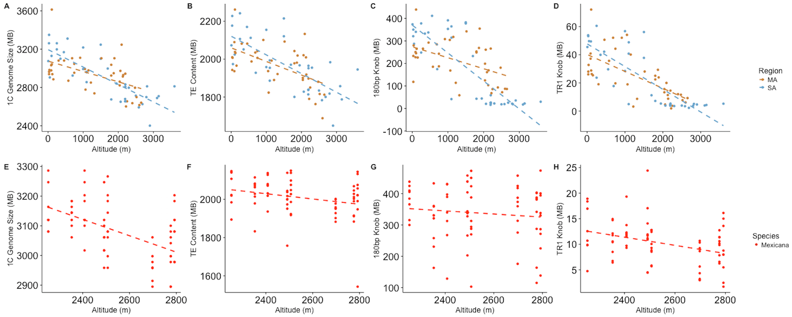
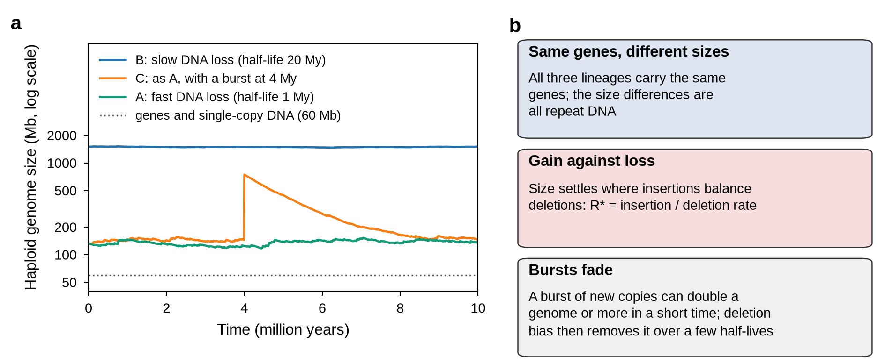

# 第 15 章 C 值之谜

**地位：基因组大小与基因数脱钩已验证；其原因部分验证。** 单倍体 DNA 含量（C 值）在真核生物间相差数万倍，在开花植物间约相差 2,400 倍，与生物复杂性或基因数无关。基因组序列显示了多余 DNA 的所在：主要是转座子和其他重复序列，多倍化带来更多变化。至于为什么有些谱系保留得更多，则较少定论。转座子扩增与 DNA 清除速率的差异有充分记录；通过细胞大小和发育时间起作用的选择（核型效应）有良好的相关性证据，也有少数群体水平的支持；有效群体大小的作用存在争议。

本仓库相关条目：[c-value-junk-dna](../../skills/genomics-theory-mining/theories/c-value-junk-dna/THEORY.md)、[cavalier-smith-1978-nucleoskeletal-c-value](../../skills/genomics-theory-mining/theories/cavalier-smith-1978-nucleoskeletal-c-value/THEORY.md)、[lynch-conery-2003-genome-complexity](../../skills/genomics-theory-mining/theories/lynch-conery-2003-genome-complexity/THEORY.md)、[drift-barrier-hypothesis](../../skills/genomics-theory-mining/theories/drift-barrier-hypothesis/THEORY.md)、[selfish-dna](../../skills/genomics-theory-mining/theories/selfish-dna/THEORY.md)、[nearly-neutral-theory](../../skills/genomics-theory-mining/theories/nearly-neutral-theory/THEORY.md)。

## 15.1 内容与历史

Mirsky 和 Ris 发现，每套染色体的 DNA 量在一个生物的各细胞之间以及卵与精子之间是恒定的，但在物种之间变化，且变化与基因数不成比例，而与细胞质量有关 [1]。由于复杂程度相近的生物、甚至近缘物种的 DNA 含量可相差许多倍，这一观察被称为 C 值悖论 [2, 3]。Gregory 更喜欢称之为 C 值之谜：真核生物基因组大小相差 20 万倍以上，与生物复杂性没有关系，但这种变异的来源及其明显非随机分布的原因仍不清楚 [2]。

已提出的解释分两类 [2]。突变压理论把多余的 DNA 大多看作靠自身复制扩散的垃圾 DNA 或自私 DNA [4, 5]，把基因组大小看作得失之间的平衡（图 15.2） [3]。最适 DNA 理论强调 DNA 含量与细胞体积和细胞核体积的强相关。Cavalier-Smith 认为 DNA 有与编码无关的功能：通过复制起点决定细胞体积，通过自身体积决定核体积，因此 DNA 含量要与细胞大小相适应 [6]。Bennett 更早已表明，植物的细胞周期和减数分裂时长随 DNA 含量增加，一年生物种的 DNA 少于多年生物种 [7]。Gregory 认为证据更支持核型理论：大量 DNA 对细胞大小和分裂速率有直接影响，选择可以作用于此 [2]。Lynch 和 Conery 提出第三种非适应性解释：真核生物基因组扩张是有效群体大小长期下降的被动结果，在这种情况下选择更难清除增加 DNA 的轻微有害突变 [8, 9]。

## 15.2 预测

- **与基因数无关。** 基因组大小的变化应远大于基因数的变化，差别应是重复 DNA [10]。
- **重复序列动态。** 大基因组应包含许多高拷贝的转座子家族和近期爆发，小基因组很少；通过小缺失和重组清除 DNA 的效率应在谱系间不同 [11, 12]。
- **核型效应。** 基因组大小应与细胞大小、细胞周期时长以及依赖它们的性状相关，如气孔大小和密度、最短世代时间 [7, 13]。
- **群体大小。** 如果漂变驱动扩张，经系统发育校正后，有效群体较小的谱系基因组应较大 [8, 9]。

## 15.3 支持证据

- **变化范围。** 在 500 多个物种的比较中，真核生物基因组大小相差 6 万倍以上，不能用基因数解释 [10]。植物中的纪录是 *Paris japonica*，1C = 152.23 pg，使被子植物的范围扩大到约 2,400 倍 [14, 15]。植物 DNA C 值数据库及其动物和真菌对应数据库收录了 1 万多个物种的数据 [16, 17]。
- **差别来自重复序列。** 在玉米中，嵌套的反转录转座子占 *Adh1* 区域的 60% 以上，至少占核 DNA 的一半 [18]。*Oryza australiensis* 在过去 300 万年中增加了 9 万多个反转录转座子拷贝，没有多倍化而使基因组加倍 [19]。在棉属（*Gossypium*）中，880 到 2,460 Mb 的基因组有 40–65% 是转座子；一个 gypsy 类反转录转座子家族 Gorge3 占了变化的主要部分，LTR 反转录转座子在该属出现以来的 500 万到 1,000 万年中使基因组大小增至三倍 [20]。
- **DNA 丢失与增加相平衡。** 基因组比果蝇大 11 倍的 Laupala 蟋蟀，DNA 丢失速度慢 40 倍以上 [12]。在水稻和拟南芥中，不等同源重组和非法重组迅速清除反转录转座子；植物中大多数完整元件不到 300 万年 [21]。在五种被子植物中，同样的机制以不同的相对效率起作用，较大的基因组有许多拷贝数超过 1 万的家族 [11]。
- **小基因组几乎没有基因间 DNA。** 狸藻 *Utricularia gibba* 的基因组只有 82 Mb，基因数与一般植物相当，几乎没有基因间 DNA，尽管经历了至少三次全基因组加倍 [22]。
- **核型效应。** 在 101 种被子植物中，基因组大小与保卫细胞长度和表皮细胞面积正相关，与气孔密度负相关 [13]。只有开花植物在白垩纪早期经历了快速的基因组缩小，使叶片能有更小的细胞和单位面积上更多的叶脉与气孔 [23]。大基因组的植物属物种较少，大基因组物种在极端环境中较少见，最大光合速率较低 [24]。
- **种内的选择。** 在玉米地方品种和高地大刍草中，基因组大小和重复序列含量在中美洲和南美洲都随海拔平行下降，单靠群体结构不能解释这些梯度，基因组大小与影响开花时间的细胞产生速率负相关（图 15.1） [25, 26]。

## 15.4 反面证据与难点

- **相关不等于因果。** 大多数核型证据是比较性的；基因组大小与细胞大小的关系在乔木和灌木中不显著 [13]，在一项大刍草实验中也很弱，那里对细胞产生速率的效应更强 [25]。
- **群体大小。** 经系统发育校正后，Whitney 和 Garland 在 Lynch 和 Conery 所用的物种中，没有发现 Neu（有效群体大小乘以突变率）与基因组大小、转座子数或其他基因组特征的显著关联 [9]。
- **未必需要选择。** 扩增和缺失机制活性的差异就可以解释当前植物基因组大小的变异，不需要选择，尽管也不排除选择 [21]。
- **多倍化造成混杂。** 全基因组加倍会改变基因组大小，多倍体基因组在染色体数、转座子活性和 DNA 丢失方面都很有可塑性，所以比较 C 值时必须把倍性与重复序列含量分开 [27]。

## 15.5 地位与理由

**与基因数脱钩：已验证。原因：部分验证。** 基因组大小的范围、与基因数无关以及以重复序列和多倍化为基础，都有测序和大型数据库为证 [10, 17, 18, 20]。转座子增加与 DNA 丢失的平衡有直接证据 [11, 12, 19]。核型选择有广泛的相关性支持和少数群体水平案例 [13, 23, 25]，而有效群体大小的解释在控制系统发育后得不到支持 [9]。

## 15.6 植物、作物与葡萄

- **植物是最好的检验对象。** 陆地植物基因组大小相差约 2,400 倍，植物数据把基因组大小与气孔、细胞大小、世代时间和生态联系起来 [7, 13, 15, 24]。
- **玉米。** 玉米是典型的大型、富含重复序列的基因组 [18]。地方品种的基因组小于大刍草，而且在玉米中随海拔下降 [26]；Bilinski 等把这与通过细胞分裂速率作用于开花时间的选择联系起来（图 15.1） [25]。
- **水稻和棉花。** 反转录转座子爆发使 *O. australiensis* 的基因组加倍 [19]，使棉属谱系的基因组大小增至三倍 [20]。
- **葡萄。** 葡萄参考基因组来自由黑比诺衍生的 PN40024 系，揭示了开花植物主要类群共有的古六倍化 [28]。PN40024 的无缺口组装比第一版长 69 Mb，其中 67% 注释为重复序列 [29]。在无性繁殖作物中，一株植物中新的转座子插入或缺失会被复制到它的所有插条中，所以重复序列的体细胞变化可以区分同一品种的不同克隆；测量这些变化需要几个克隆的长读长组装。

## 15.7 用公开数据检验

- **数据。** 植物 DNA C 值数据库 [17] 以及动物和真菌数据库 [16]；带重复序列注释的基因组组装；群体的流式细胞术和低覆盖测序数据 [25]。
- **工具。** 用 RepeatMasker、EDTA 或 RepeatExplorer 估计重复序列含量；根据两个长末端重复之间的分歧估计 LTR 插入时间 [21]；系统发育比较方法（系统发育广义最小二乘） [9]。
- **分析。** (1) 在近缘物种中把基因组大小分解为基因、各重复家族和其他 DNA [20]。(2) 估计 LTR 插入时间和缺失速率 [11, 21]。(3) 在控制群体结构的前提下，在种内检验基因组大小与细胞大小或环境的关系 [25]。脚本 [`scripts/ch15_c_value_figures.py`](../scripts/ch15_c_value_figures.py) 模拟插入和缺失下的基因组大小（图 15.2）。
- **什么结果会推翻这一理论。** 近缘物种之间存在不是由重复序列或倍性造成的巨大基因组大小差异；真核生物中基因数与基因组大小强烈正相关。

## 15.8 未解决的问题

- 植物基因组大小的变异中，有多少是由对细胞大小和发育的选择塑造的，又有多少只是机制的结果 [21, 25]？
- 为什么有些谱系丢失 DNA 快，有些慢 [11, 12]？
- 控制系统发育和机制之后，有效群体大小还重要吗 [8, 9]？
- 同一葡萄品种的不同克隆之间，重复序列差异有多大 [29]？

## 15.9 常见错误

- 把基因组大小当作复杂性或基因数的度量 [10]。
- 比较物种间 C 值时不把多倍化与重复序列含量分开 [27]。
- 对基因组大小做比较分析时不作系统发育校正 [9]。
- 以为大基因组全是垃圾或全有功能；C 值之谜讨论的是非编码 DNA 的成因和影响，而不是对其功能的断言 [2]。

## 图

**图 15.1.** *Zea* 各类群中基因组大小和重复序列含量随海拔的变化。(A-D) 来自中美洲（MA）或南美洲（SA）的玉米地方品种。(E-H) 高地大刍草 *Z. mays* ssp. *mexicana*，只包括海拔 2000 m 以上、没有混合的群体。(A,E) 全基因组大小，(B,F) 转座子总含量，(C,G) 180 bp knob 重复含量，(D,H) TR1 knob 重复含量。虚线为最佳拟合线性回归。原样转载自 Bilinski P, Albert PS, Berg JJ, et al. (2018) Parallel altitudinal clines reveal trends in adaptive evolution of genome size in *Zea mays*. *PLoS Genetics* 14:e1007162, Figure 1. https://doi.org/10.1371/journal.pgen.1007162。许可：CC BY 4.0（https://creativecommons.org/licenses/by/4.0/）。

**图 15.2.** (a) 三个谱系在 1,000 万年间的模拟单倍体基因组大小，三者都有相同的 60 Mb 基因和单拷贝 DNA。转座子插入随机到来（平均每百万年 50 Mb），重复 DNA 被小缺失清除，半衰期为 100 万年（A）或 2,000 万年（B）；谱系 C 是在 400 万年时有一次 600 Mb 新拷贝爆发的 A。(b) 模型说明了什么。用 [`scripts/ch15_c_value_figures.py`](../scripts/ch15_c_value_figures.py) 生成，随机种子 20261126。

## 参考文献

1. Mirsky AE, Ris H (1951) The desoxyribonucleic acid content of animal cells and its evolutionary significance. *Journal of General Physiology* 34:451-462. https://doi.org/10.1085/jgp.34.4.451
2. Gregory TR (2001) Coincidence, coevolution, or causation? DNA content, cell size, and the C-value enigma. *Biological Reviews of the Cambridge Philosophical Society* 76:65-101. https://doi.org/10.1017/S1464793100005595
3. Petrov DA (2001) Evolution of genome size: new approaches to an old problem. *Trends in Genetics* 17:23-28. https://doi.org/10.1016/S0168-9525(00)02157-0
4. Orgel LE, Crick FHC (1980) Selfish DNA: the ultimate parasite. *Nature* 284:604-607. https://doi.org/10.1038/284604a0
5. Doolittle WF, Sapienza C (1980) Selfish genes, the phenotype paradigm and genome evolution. *Nature* 284:601-603. https://doi.org/10.1038/284601a0
6. Cavalier-Smith T (1978) Nuclear volume control by nucleoskeletal DNA, selection for cell volume and cell growth rate, and the solution of the DNA C-value paradox. *Journal of Cell Science* 34:247-278. https://doi.org/10.1242/jcs.34.1.247
7. Bennett MD (1972) Nuclear DNA content and minimum generation time in herbaceous plants. *Proceedings of the Royal Society of London. Series B. Biological Sciences* 181:109-135. https://doi.org/10.1098/rspb.1972.0042
8. Lynch M, Conery JS (2003) The Origins of Genome Complexity. *Science* 302:1401-1404. https://doi.org/10.1126/science.1089370
9. Whitney KD, Garland T (2010) Did Genetic Drift Drive Increases in Genome Complexity? *PLoS Genetics* 6:e1001080. https://doi.org/10.1371/journal.pgen.1001080
10. Elliott TA, Gregory TR (2015) What’s in a genome? The C-value enigma and the evolution of eukaryotic genome content. *Philosophical Transactions of the Royal Society B: Biological Sciences* 370:20140331. https://doi.org/10.1098/rstb.2014.0331
11. Vitte C, Bennetzen JL (2006) Analysis of retrotransposon structural diversity uncovers properties and propensities in angiosperm genome evolution. *Proceedings of the National Academy of Sciences* 103:17638-17643. https://doi.org/10.1073/pnas.0605618103
12. Petrov DA, Sangster TA, Johnston JS, et al. (2000) Evidence for DNA Loss as a Determinant of Genome Size. *Science* 287:1060-1062. https://doi.org/10.1126/science.287.5455.1060
13. Beaulieu JM, Leitch IJ, Patel S, et al. (2008) Genome size is a strong predictor of cell size and stomatal density in angiosperms. *New Phytologist* 179:975-986. https://doi.org/10.1111/j.1469-8137.2008.02528.x
14. Pellicer J, Fay MF, Leitch IJ (2010) The largest eukaryotic genome of them all? *Botanical Journal of the Linnean Society* 164:10-15. https://doi.org/10.1111/j.1095-8339.2010.01072.x
15. Pellicer J, Hidalgo O, Dodsworth S, et al. (2018) Genome Size Diversity and Its Impact on the Evolution of Land Plants. *Genes* 9:88. https://doi.org/10.3390/genes9020088
16. Gregory TR, Nicol JA, Tamm H, et al. (2007) Eukaryotic genome size databases. *Nucleic Acids Research* 35:D332-D338. https://doi.org/10.1093/nar/gkl828
17. Pellicer J, Leitch IJ (2020) The Plant DNA C‐values database (release 7.1): an updated online repository of plant genome size data for comparative studies. *New Phytologist* 226:301-305. https://doi.org/10.1111/nph.16261
18. SanMiguel P, Tikhonov A, Jin YK, et al. (1996) Nested Retrotransposons in the Intergenic Regions of the Maize Genome. *Science* 274:765-768. https://doi.org/10.1126/science.274.5288.765
19. Piegu B, Guyot R, Picault N, et al. (2006) Doubling genome size without polyploidization: Dynamics of retrotransposition-driven genomic expansions in Oryza australiensis , a wild relative of rice. *Genome Research* 16:1262-1269. https://doi.org/10.1101/gr.5290206
20. Hawkins JS, Kim H, Nason JD, et al. (2006) Differential lineage-specific amplification of transposable elements is responsible for genome size variation in Gossypium. *Genome Research* 16:1252-1261. https://doi.org/10.1101/gr.5282906
21. Bennetzen JL, Ma J, Devos KM (2005) Mechanisms of Recent Genome Size Variation in Flowering Plants. *Annals of Botany* 95:127-132. https://doi.org/10.1093/aob/mci008
22. Ibarra-Laclette E, Lyons E, Hernández-Guzmán G, et al. (2013) Architecture and evolution of a minute plant genome. *Nature* 498:94-98. https://doi.org/10.1038/nature12132
23. Simonin KA, Roddy AB (2018) Genome downsizing, physiological novelty, and the global dominance of flowering plants. *PLOS Biology* 16:e2003706. https://doi.org/10.1371/journal.pbio.2003706
24. Knight CA, Molinari NA, Petrov DA (2005) The Large Genome Constraint Hypothesis: Evolution, Ecology and Phenotype. *Annals of Botany* 95:177-190. https://doi.org/10.1093/aob/mci011
25. Bilinski P, Albert PS, Berg JJ, et al. (2018) Parallel altitudinal clines reveal trends in adaptive evolution of genome size in Zea mays. *PLOS Genetics* 14:e1007162. https://doi.org/10.1371/journal.pgen.1007162
26. Díez CM, Gaut BS, Meca E, et al. (2013) Genome size variation in wild and cultivated maize along altitudinal gradients. *New Phytologist* 199:264-276. https://doi.org/10.1111/nph.12247
27. Leitch AR, Leitch IJ (2008) Genomic Plasticity and the Diversity of Polyploid Plants. *Science* 320:481-483. https://doi.org/10.1126/science.1153585
28. The French–Italian Public Consortium for Grapevine Genome Characterization (2007) The grapevine genome sequence suggests ancestral hexaploidization in major angiosperm phyla. *Nature* 449:463-467. https://doi.org/10.1038/nature06148
29. Shi X, Cao S, Wang X, et al. (2023) The complete reference genome for grapevine (Vitis vinifera L.) genetics and breeding. *Horticulture Research* 10:uhad061. https://doi.org/10.1093/hr/uhad061
