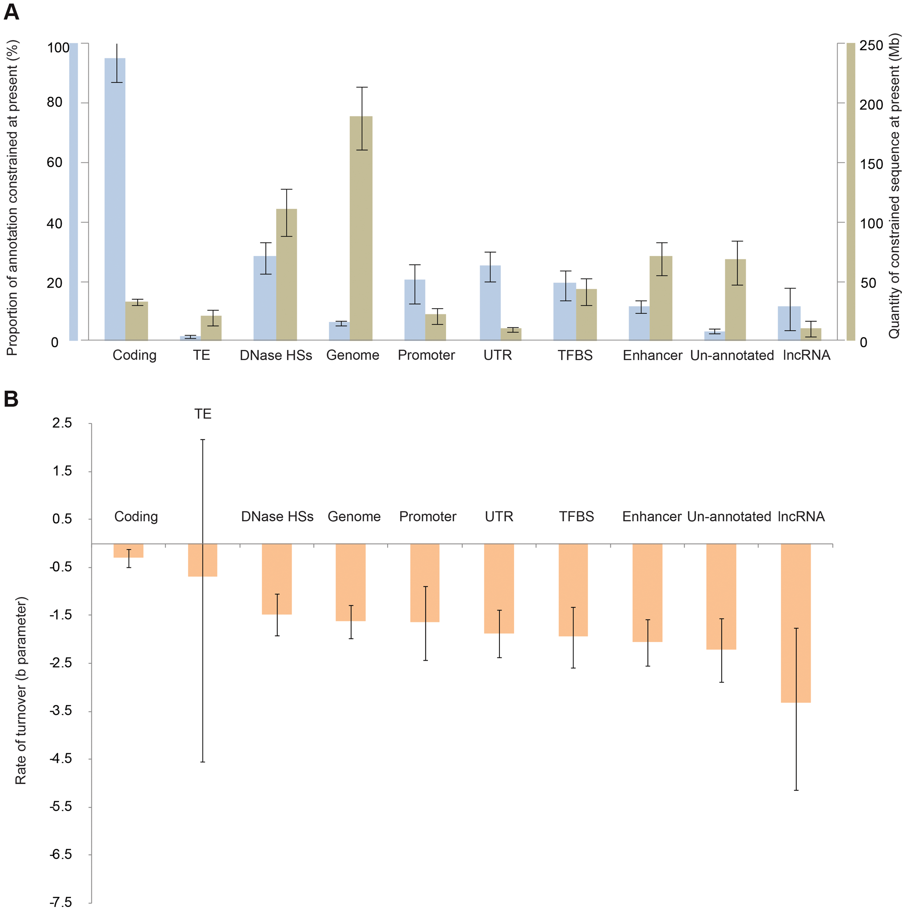
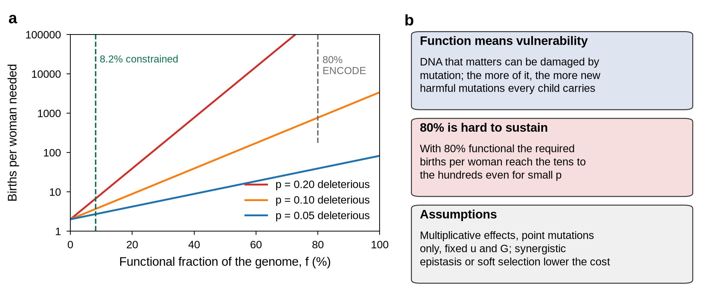

# Chapter 16. Junk DNA and the ENCODE debate

**Status: A large non-functional fraction of the human genome Verified; the reading of ENCODE’s 80% biochemical activity as function Rejected.** Comparative genomics finds that about 5–11% of the human genome is under purifying selection, depending on method and on how fast functional sequence turns over. Mutational load sets an upper limit of about a quarter. Biochemical activity, such as transcription or protein binding, is common across most of the genome but does not by itself show that a sequence has a function that selection maintains. The exact functional fraction remains contested within the range set by these methods.

Related notes in this repository: [c-value-junk-dna](../../theories/c-value-junk-dna/THEORY.md), [selfish-dna](../../theories/selfish-dna/THEORY.md), [mutational-genetic-load](../../theories/mutational-genetic-load/THEORY.md), [nearly-neutral-theory](../../theories/nearly-neutral-theory/THEORY.md), [drift-barrier-hypothesis](../../theories/drift-barrier-hypothesis/THEORY.md).

## 16.1 Statement and history

The idea that a large part of most eukaryotic genomes has no organism-level function rests on old observations and basic genetic principles, among them the C-value paradox (Chapter 15) and mutational load [1, 2]. In 1980 two papers in *Nature* argued that much repetitive DNA spreads because it is good at replicating itself within genomes, not because it helps the organism. Doolittle and Sapienza wrote that selection within genomes will produce DNAs whose only “function” is survival within genomes, such as transposable elements, so that no phenotypic function need be assigned to them [3]; Orgel and Crick called such DNA a parasite and examined it as the natural selection of preferred replicators [4].

In 2012 the ENCODE Consortium mapped transcription, transcription factor binding, chromatin structure and histone modifications across the human genome and wrote that these data “enabled us to assign biochemical functions for 80% of the genome” [5]. It was one of many announcements of the demise of junk DNA [1]. Graur and colleagues replied that it contradicts estimates that less than 10% of the genome is conserved by purifying selection, and that it rests on the causal-role definition of function, applied inconsistently and with an emphasis on statistical sensitivity over specificity [6]. Doolittle asked how the number of ENCODE-style elements would scale in genomes much larger than ours, and argued that the likely answers are that ENCODE’s definition counts many sites that are not functional in the usual biological sense, or that the same functions are spread more diffusely in larger genomes [7]. Several ENCODE investigators later agreed that biochemically active regions cover a much larger fraction of the genome than evolutionarily conserved regions, and that biochemical, evolutionary and genetic evidence must be combined [8].

## 16.2 What the theory predicts

- **Function implies constraint.** DNA with a function maintained by selection should accumulate fewer substitutions and indels than neutral DNA, so the constrained fraction estimates the selected-effect functional fraction [9, 10].
- **Load limits function.** With a fixed mutation rate, the number of new harmful mutations per generation grows with the functional fraction; a maximum tolerable fertility sets an upper limit (Figure 16.2) [11].
- **Most of the genome is dispensable.** Deleting large non-coding regions without conserved elements should often have no visible effect [12].
- **Junk is mostly repeat-derived.** The non-functional fraction should consist largely of transposable elements and their remnants, some of which are co-opted [13, 14].

## 16.3 Evidence for

- **Constraint is a small fraction.** PhastCons conserved elements cover about 3–8% of the human genome but much more of the compact genomes of *Drosophila* (37–53%), *Caenorhabditis elegans* (18–37%) and yeast (47–68%) [9]. With 29 mammals, at least 5.5% of the human genome is under purifying selection [15]. Allowing for turnover, Rands and colleagues estimated 8.2% (7.1–9.2%), and only 2.2% has kept constraint in both human and mouse since their divergence (Figure 16.1) [10]. With 240 mammal genomes, at least 332 million bases (about 10.7%) are constrained; of 101 million significantly constrained single bases, 80% lie outside protein-coding exons and half have no ENCODE annotation [16].
- **Upper limit from load.** For a constant population size, the extra fertility needed to offset mutational load depends on the number of functional sites, the mutation rate and the share of deleterious mutations; Graur concluded that the functional fraction cannot exceed 25% and is probably much lower (Figure 16.2) [11].
- **Deletions.** Mice homozygous for deletions of 1,511 kb and 845 kb of non-coding gene desert, together containing 1,243 sequences conserved between humans and rodents, were indistinguishable from wild type in morphology, reproductive fitness, growth and longevity [12].
- **Repeats.** About half of the human genome is recognised as transposable elements by alignment to consensus sequences, and a more sensitive method suggests 66–69% is repetitive or repeat-derived [13].
- **ENCODE itself.** The 2020 registry of candidate cis-regulatory elements, built from selected data types associated with gene regulation, contains 926,535 human elements covering 7.9% of the genome and 339,815 mouse elements covering 3.4% [17].

## 16.4 Evidence against, and difficulties

- **Turnover hides function.** Functional elements that are short-lived or lineage-specific leave little long-lasting constraint, so pan-mammalian conservation underestimates function; about half of mouse constrained non-coding sequence is predicted not to be shared with rat [10, 18].
- **Neutral reference.** Constraint estimates assume that ancient transposon-derived reference sequences evolve neutrally; Pheasant and Mattick argued that this assumption may be wrong and that much more than 5% of the genome may be functional [19].
- **Co-option.** Transposable elements provide enhancers, promoters, silencers and boundary elements [14], and 280,000 non-coding elements in the 29-mammal alignment were exapted from mobile elements [15]; some “junk” becomes function.
- **What counts as function.** Kellis and colleagues argued that biochemical, evolutionary and genetic approaches give complementary information [8]. Selected effect and causal role definitions answer different questions, and the debate is partly about words [6, 7].

## 16.5 Status and reasoning

**Large non-functional fraction: verified. ENCODE 80% as function: rejected.** Independent comparative methods put the constrained fraction of the human genome at about 5–11% [9, 10, 15, 16], mutational load caps it at about 25% [11], and large non-coding deletions can be harmless [12]. The 80% figure measures biochemical activity, not function maintained by selection; ENCODE’s own later registry covers 7.9% [8, 17]. Where the functional fraction lies within the 5–25% range, and how much is lineage-specific, remains open [10, 18].

## 16.6 Plants, crops and grapevine

- **Crucifers.** In nine Brassicaceae genomes, at least 17% of the *Arabidopsis thaliana* genome appears to be under selection, nearly a quarter of it outside coding regions, much of it in about 90,000 conserved non-coding sequences that population genomics shows are under purifying selection [20]. As in animals, the compact genome has a larger constrained share than the human genome [9].
- **Maize.** Open chromatin (MNase-hypersensitive regions) covers less than 1% of the maize genome but explains about 40% of heritable variance in diverse traits, so less than 3% of the genome may account for most phenotypic variation [21]. Distal cis-regulatory elements act over long distances [22]. Across 13 plant species, distal regulatory elements are common, especially in large genomes, and most have been moved away from their genes by transposon proliferation, while some were created by transposons [23]. A Hopscotch transposon inserted in a regulatory region of tb1 acts as an enhancer and contributed to maize domestication [24].
- **Grapevine.** About two thirds of the gap-free grapevine reference is repetitive [25]. White grapes show how repeat DNA can matter: a retrotransposon insertion in *VvmybA1* is associated with loss of skin colour [26], and together with mutations in the adjacent *VvMYBA2* it underlies a common origin of white cultivars [27]. Such cases show co-option or damage by transposons, not that most repeats are functional.

## 16.7 How to test it with public data

- **Data.** Multi-species alignments (Zoonomia 240 mammals for human [16]; crucifer alignments for *Arabidopsis* [20]); ENCODE and plant chromatin accessibility maps [17, 23]; population variation for within-species constraint.
- **Tools.** phastCons, GERP and phyloP for conservation [9]; indel-based neutral models for turnover [10]; RepeatMasker for repeats [13].
- **Analysis.** (1) Estimate the constrained fraction from alignments, and how it changes with the divergence of the species used [10]. (2) Compare the overlap of biochemical annotations with constraint [8, 16]. (3) Compute the mutational load implied by a given functional fraction [11]. The script [`scripts/ch16_junk_dna_figures.py`](../scripts/ch16_junk_dna_figures.py) does this calculation for the human genome (Figure 16.2).
- **What would break the theory.** Evidence that most of the genome is under selection, for example deletions of large non-conserved regions with consistent fitness effects, or population data showing purifying selection across most non-coding DNA.

## 16.8 Open questions

- How much functional DNA is lineage-specific and missed by conservation [10, 18]?
- How should function be defined so that biochemical and evolutionary data can be compared [7, 8]?
- In large crop genomes such as maize, what fraction of non-coding DNA is under selection [21, 23]?
- In clonal grapevine, are new transposon insertions an important source of variation among clones [25, 26]?

## 16.9 Common mistakes

- Equating biochemical activity with function [6, 8].
- Treating “junk” as a claim that no non-coding DNA matters; the claim concerns most, not all [1].
- Using conservation across distant species as the full functional fraction, ignoring turnover [18].
- Reading a transposon insertion of large effect, such as those at tb1 or the grape colour locus, as evidence that most repeats are functional [24, 26].

## Figures

**Figure 16.1.** Constraint and turnover for different classes of human functional element. A. The total quantities of constrained sequence estimated for the present day by extrapolation for different element types. B. The estimated rate of turnover (b parameter) for different types of constrained element. Reproduced unchanged from Rands CM, Meader S, Ponting CP, Lunter G (2014) 8.2% of the human genome is constrained: variation in rates of turnover across functional element classes in the human lineage. *PLoS Genetics* 10:e1004525, Figure 3. https://doi.org/10.1371/journal.pgen.1004525. Licence: CC BY 4.0 (https://creativecommons.org/licenses/by/4.0/).

**Figure 16.2.** (a) Births per woman needed to keep a population at constant size against the functional fraction of the human genome, when each zygote receives U = 2Gufp new deleterious mutations (G = 3.1 × 10⁹ bp, u = 1.2 × 10⁻⁸ per bp per generation, p the share of mutations in functional DNA that are deleterious) and mean fitness is exp(−U). Dashed lines mark the 8.2% under constraint [10] and ENCODE’s 80% [5]. (b) Reading the curve and its assumptions. A calculation in the spirit of Graur (2017); made with [`scripts/ch16_junk_dna_figures.py`](../scripts/ch16_junk_dna_figures.py); it is deterministic.

## References

1. Palazzo AF, Gregory TR (2014) The Case for Junk DNA. *PLoS Genetics* 10:e1004351. https://doi.org/10.1371/journal.pgen.1004351
2. Eddy SR (2012) The C-value paradox, junk DNA and ENCODE. *Current Biology* 22:R898-R899. https://doi.org/10.1016/j.cub.2012.10.002
3. Doolittle WF, Sapienza C (1980) Selfish genes, the phenotype paradigm and genome evolution. *Nature* 284:601-603. https://doi.org/10.1038/284601a0
4. Orgel LE, Crick FHC (1980) Selfish DNA: the ultimate parasite. *Nature* 284:604-607. https://doi.org/10.1038/284604a0
5. The ENCODE Project Consortium (2012) An integrated encyclopedia of DNA elements in the human genome. *Nature* 489:57-74. https://doi.org/10.1038/nature11247
6. Graur D, Zheng Y, Price N, et al. (2013) On the immortality of television sets: “function” in the human genome according to the evolution-free gospel of ENCODE. *Genome Biology and Evolution* 5:578-590. https://doi.org/10.1093/gbe/evt028
7. Doolittle WF (2013) Is junk DNA bunk? A critique of ENCODE. *Proceedings of the National Academy of Sciences* 110:5294-5300. https://doi.org/10.1073/pnas.1221376110
8. Kellis M, Wold B, Snyder MP, et al. (2014) Defining functional DNA elements in the human genome. *Proceedings of the National Academy of Sciences* 111:6131-6138. https://doi.org/10.1073/pnas.1318948111
9. Siepel A, Bejerano G, Pedersen JS, et al. (2005) Evolutionarily conserved elements in vertebrate, insect, worm, and yeast genomes. *Genome Research* 15:1034-1050. https://doi.org/10.1101/gr.3715005
10. Rands CM, Meader S, Ponting CP, et al. (2014) 8.2% of the human genome is constrained: variation in rates of turnover across functional element classes in the human lineage. *PLoS Genetics* 10:e1004525. https://doi.org/10.1371/journal.pgen.1004525
11. Graur D (2017) An Upper Limit on the Functional Fraction of the Human Genome. *Genome Biology and Evolution* 9:1880-1885. https://doi.org/10.1093/gbe/evx121
12. Nóbrega MA, Zhu Y, Plajzer-Frick I, et al. (2004) Megabase deletions of gene deserts result in viable mice. *Nature* 431:988-993. https://doi.org/10.1038/nature03022
13. de Koning APJ, Gu W, Castoe TA, et al. (2011) Repetitive Elements May Comprise Over Two-Thirds of the Human Genome. *PLoS Genetics* 7:e1002384. https://doi.org/10.1371/journal.pgen.1002384
14. Sundaram V, Wysocka J (2020) Transposable elements as a potent source of diverse cis-regulatory sequences in mammalian genomes. *Philosophical Transactions of the Royal Society B: Biological Sciences* 375:20190347. https://doi.org/10.1098/rstb.2019.0347
15. Lindblad-Toh K, Garber M, Zuk O, et al. (2011) A high-resolution map of human evolutionary constraint using 29 mammals. *Nature* 478:476-482. https://doi.org/10.1038/nature10530
16. Christmas MJ, Kaplow IM, Genereux DP, et al. (2023) Evolutionary constraint and innovation across hundreds of placental mammals. *Science* 380:eabn3943. https://doi.org/10.1126/science.abn3943
17. The ENCODE Project Consortium (2020) Expanded encyclopaedias of DNA elements in the human and mouse genomes. *Nature* 583:699-710. https://doi.org/10.1038/s41586-020-2493-4
18. Ponting CP, Hardison RC (2011) What fraction of the human genome is functional? *Genome Research* 21:1769-1776. https://doi.org/10.1101/gr.116814.110
19. Pheasant M, Mattick JS (2007) Raising the estimate of functional human sequences. *Genome Research* 17:1245-1253. https://doi.org/10.1101/gr.6406307
20. Haudry A, Platts AE, Vello E, et al. (2013) An atlas of over 90,000 conserved noncoding sequences provides insight into crucifer regulatory regions. *Nature Genetics* 45:891-898. https://doi.org/10.1038/ng.2684
21. Rodgers-Melnick E, Vera DL, Bass HW, et al. (2016) Open chromatin reveals the functional maize genome. *Proceedings of the National Academy of Sciences* 113:E3177-E3185. https://doi.org/10.1073/pnas.1525244113
22. Ricci WA, Lu Z, Ji L, et al. (2019) Widespread long-range cis-regulatory elements in the maize genome. *Nature Plants* 5:1237-1249. https://doi.org/10.1038/s41477-019-0547-0
23. Lu Z, Marand AP, Ricci WA, et al. (2019) The prevalence, evolution and chromatin signatures of plant regulatory elements. *Nature Plants* 5:1250-1259. https://doi.org/10.1038/s41477-019-0548-z
24. Studer A, Zhao Q, Ross-Ibarra J, et al. (2011) Identification of a functional transposon insertion in the maize domestication gene tb1. *Nature Genetics* 43:1160-1163. https://doi.org/10.1038/ng.942
25. Shi X, Cao S, Wang X, et al. (2023) The complete reference genome for grapevine (Vitis vinifera L.) genetics and breeding. *Horticulture Research* 10:uhad061. https://doi.org/10.1093/hr/uhad061
26. Kobayashi S, Goto-Yamamoto N, Hirochika H (2004) Retrotransposon-Induced Mutations in Grape Skin Color. *Science* 304:982-982. https://doi.org/10.1126/science.1095011
27. Walker AR, Lee E, Bogs J, et al. (2007) White grapes arose through the mutation of two similar and adjacent regulatory genes. *The Plant Journal* 49:772-785. https://doi.org/10.1111/j.1365-313X.2006.02997.x
