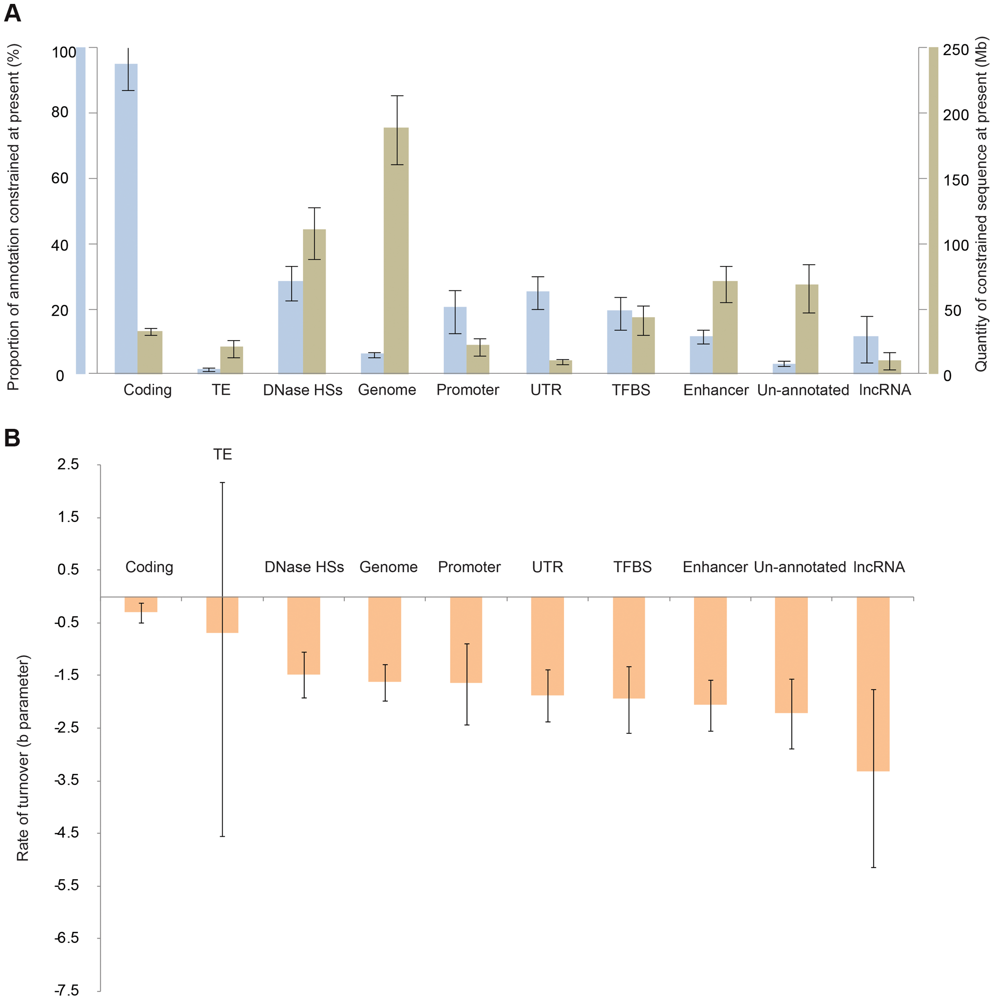
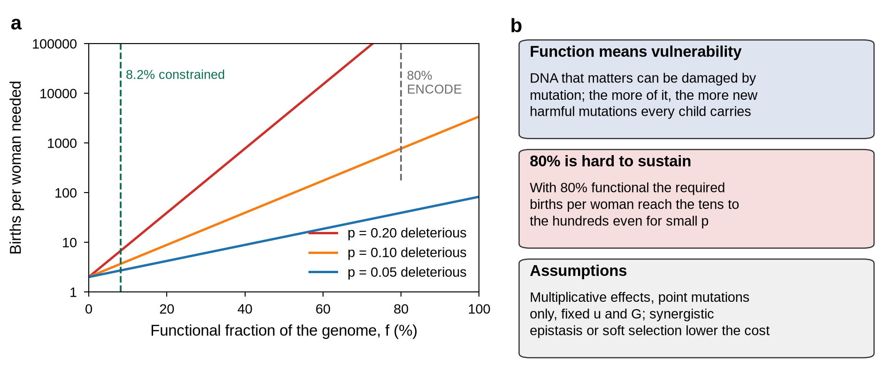

# 第 16 章 垃圾 DNA 与 ENCODE 之争

**地位：人类基因组中有很大的无功能部分已验证；把 ENCODE 的 80% 生化活性解读为功能已被否定。** 比较基因组学发现，人类基因组约 5–11% 处于纯化选择之下，具体数值取决于方法以及功能序列更替的快慢。突变负荷给出的上限约为四分之一。转录或蛋白结合之类的生化活性在基因组大部分区域都很常见，但其本身并不说明一段序列具有由选择维持的功能。在这些方法给出的范围内，功能部分的确切比例仍有争议。

本仓库相关条目：[c-value-junk-dna](../../theories/c-value-junk-dna/THEORY.md)、[selfish-dna](../../theories/selfish-dna/THEORY.md)、[mutational-genetic-load](../../theories/mutational-genetic-load/THEORY.md)、[nearly-neutral-theory](../../theories/nearly-neutral-theory/THEORY.md)、[drift-barrier-hypothesis](../../theories/drift-barrier-hypothesis/THEORY.md)。

## 16.1 内容与历史

大多数真核生物基因组中有很大一部分不具有生物个体层面的功能，这一观点建立在早期观察和基本遗传学原理之上，其中包括 C 值悖论（第 15 章）和突变负荷 [1, 2]。1980 年，《自然》上的两篇论文认为，许多重复 DNA 之所以扩散，是因为它善于在基因组内复制自身，而不是因为它对生物体有益。Doolittle 和 Sapienza 写道，基因组内的选择会产生唯一“功能”就是在基因组内存续的 DNA，例如转座子，因此无须给它们赋予任何表型功能 [3]；Orgel 和 Crick 把这种 DNA 称为寄生者，并把它作为优势复制子的自然选择来分析 [4]。

2012 年，ENCODE 联盟在人类基因组范围内绘制了转录、转录因子结合、染色质结构和组蛋白修饰图谱，并写道这些数据“使我们能够为基因组的 80% 指定生化功能” [5]。这是众多“垃圾 DNA 已死”的宣告之一 [1]。Graur 等回应说，这与纯化选择保守的部分不到基因组 10% 的估计相矛盾，而且它依据的是因果作用定义的功能，应用前后不一致，并且偏重统计敏感性而不是特异性 [6]。Doolittle 问道，在比我们大得多的基因组中，ENCODE 式元件的数量会如何增长；他认为可能的答案是：ENCODE 的定义把许多在通常生物学意义上没有功能的位点计算在内，或者相同的功能在更大的基因组中分布得更分散 [7]。几位 ENCODE 研究者后来同意，生化活性区域覆盖的基因组比例远大于进化保守区域，必须把生化、进化和遗传证据结合起来 [8]。

## 16.2 预测

- **功能意味着约束。** 具有由选择维持的功能的 DNA，积累的替换和插入缺失应少于中性 DNA，所以受约束的部分可以估计选择效应意义上的功能部分 [9, 10]。
- **负荷限制功能。** 突变率固定时，每代新出现的有害突变数随功能部分增加；可承受的最大生育力给出一个上限（图 16.2） [11]。
- **基因组大部分可有可无。** 删除不含保守元件的大段非编码区域往往不应有可见效应 [12]。
- **垃圾大多来自重复序列。** 无功能部分应主要由转座子及其残迹组成，其中一些被征用 [13, 14]。

## 16.3 支持证据

- **受约束的只是一小部分。** PhastCons 保守元件覆盖人类基因组约 3–8%，但在果蝇（37–53%）、秀丽隐杆线虫（18–37%）和酵母（47–68%）的紧凑基因组中比例大得多 [9]。用 29 种哺乳动物，人类基因组至少有 5.5% 处于纯化选择之下 [15]。考虑更替后，Rands 等估计为 8.2%（7.1–9.2%），而自人和小鼠分化以来在两者中都保持约束的只有 2.2%（图 16.1） [10]。用 240 种哺乳动物基因组，至少 3.32 亿个碱基（约 10.7%）受约束；在 1.01 亿个显著受约束的单碱基中，80% 位于蛋白编码外显子之外，一半没有 ENCODE 注释 [16]。
- **来自负荷的上限。** 在群体大小恒定的情况下，抵消突变负荷所需的额外生育力取决于功能位点数、突变率和有害突变所占比例；Graur 得出结论，功能部分不能超过 25%，很可能低得多（图 16.2） [11]。
- **缺失实验。** 纯合缺失 1,511 kb 和 845 kb 非编码基因荒漠（共含 1,243 个人与啮齿类之间保守的序列）的小鼠，在形态、繁殖适合度、生长和寿命上与野生型无法区分 [12]。
- **重复序列。** 通过与共有序列比对，人类基因组约一半被识别为转座子；一种更灵敏的方法表明 66–69% 是重复序列或源自重复序列 [13]。
- **ENCODE 自己的数据。** 2020 年的候选顺式调控元件登记库由与基因调控相关的特定数据类型建成，包含 926,535 个人类元件，覆盖基因组的 7.9%，以及 339,815 个小鼠元件，覆盖 3.4% [17]。

## 16.4 反面证据与难点

- **更替掩盖功能。** 寿命短或谱系特异的功能元件留下的长期约束很少，所以全哺乳动物范围的保守性会低估功能；预测小鼠受约束的非编码序列约一半不与大鼠共有 [10, 18]。
- **中性参照。** 约束估计假定古老的转座子来源参照序列是中性进化的；Pheasant 和 Mattick 认为这一假设可能是错的，功能部分可能远超 5% [19]。
- **征用。** 转座子提供增强子、启动子、沉默子和边界元件 [14]，29 种哺乳动物比对中有 28 万个非编码元件是从可移动元件征用而来 [15]；一些“垃圾”会变成功能。
- **什么算功能。** Kellis 等认为生化、进化和遗传方法提供互补的信息 [8]。选择效应定义与因果作用定义回答的是不同问题，这场争论部分是关于用词的 [6, 7]。

## 16.5 地位与理由

**很大的无功能部分：已验证。ENCODE 80% 即功能：已否定。** 独立的比较方法把人类基因组受约束部分定在约 5–11% [9, 10, 15, 16]，突变负荷把上限定在约 25% [11]，而大段非编码缺失可以无害 [12]。80% 这个数字度量的是生化活性，而不是由选择维持的功能；ENCODE 自己后来的登记库覆盖 7.9% [8, 17]。功能部分在 5–25% 范围内的位置，以及其中多少是谱系特异的，仍未解决 [10, 18]。

## 16.6 植物、作物与葡萄

- **十字花科。** 在九个十字花科基因组中，拟南芥基因组至少有 17% 似乎处于选择之下，其中近四分之一在编码区之外，大部分位于约 9 万个保守非编码序列中，群体基因组学表明它们处于纯化选择之下 [20]。和动物一样，紧凑基因组中受约束的比例大于人类基因组 [9]。
- **玉米。** 开放染色质（MNase 超敏区域）覆盖玉米基因组不到 1%，却解释了多种性状中约 40% 的遗传方差，所以不到 3% 的基因组可能解释了大部分表型变异 [21]。远端顺式调控元件可远距离起作用 [22]。在 13 个植物物种中，远端调控元件很常见，在大基因组中尤其如此，其中大多数是因转座子增殖而被推离其基因，也有一些是由转座子产生的 [23]。插入 tb1 调控区的 Hopscotch 转座子起增强子作用，并促成了玉米驯化 [24]。
- **葡萄。** 无缺口葡萄参考基因组约三分之二是重复序列 [25]。白葡萄说明了重复 DNA 可以多么重要：*VvmybA1* 中的一个反转录转座子插入与果皮失色相关 [26]，它与相邻 *VvMYBA2* 中的突变一起，构成了白色品种的共同起源 [27]。这类案例说明的是转座子的征用或破坏，而不是大多数重复序列有功能。

## 16.7 用公开数据检验

- **数据。** 多物种比对（人类用 Zoonomia 的 240 种哺乳动物 [16]；拟南芥用十字花科比对 [20]）；ENCODE 和植物染色质可及性图谱 [17, 23]；用于种内约束的群体变异数据。
- **工具。** 保守性分析用 phastCons、GERP 和 phyloP [9]；更替分析用基于插入缺失的中性模型 [10]；重复序列用 RepeatMasker [13]。
- **分析。** (1) 从比对估计受约束部分，以及它如何随所用物种的分化程度变化 [10]。(2) 比较生化注释与约束的重叠 [8, 16]。(3) 计算给定功能部分所隐含的突变负荷 [11]。脚本 [`scripts/ch16_junk_dna_figures.py`](../scripts/ch16_junk_dna_figures.py) 对人类基因组做了这一计算（图 16.2）。
- **什么结果会推翻这一理论。** 证明基因组大部分处于选择之下的证据，例如删除大段非保守区域总有适合度效应，或群体数据显示大部分非编码 DNA 都处于纯化选择之下。

## 16.8 未解决的问题

- 有多少功能 DNA 是谱系特异的、被保守性分析漏掉 [10, 18]？
- 应如何定义功能，才能比较生化数据与进化数据 [7, 8]？
- 在玉米这类大型作物基因组中，非编码 DNA 有多大比例处于选择之下 [21, 23]？
- 在无性繁殖的葡萄中，新的转座子插入是否是克隆间变异的重要来源 [25, 26]？

## 16.9 常见错误

- 把生化活性等同于功能 [6, 8]。
- 把“垃圾”理解为没有任何非编码 DNA 重要；这一论断针对的是大部分，而不是全部 [1]。
- 把远缘物种间的保守性当作全部功能部分，忽略更替 [18]。
- 把 tb1 或葡萄颜色位点上那类大效应转座子插入，当作大多数重复序列有功能的证据 [24, 26]。

## 图

**图 16.1.** 不同类别人类功能元件的约束与更替。A. 外推到现今的各元件类型受约束序列总量估计。B. 不同类型受约束元件的估计更替速率（b 参数）。原样转载自 Rands CM, Meader S, Ponting CP, Lunter G (2014) 8.2% of the human genome is constrained: variation in rates of turnover across functional element classes in the human lineage. *PLoS Genetics* 10:e1004525, Figure 3. https://doi.org/10.1371/journal.pgen.1004525。许可：CC BY 4.0（https://creativecommons.org/licenses/by/4.0/）。

**图 16.2.** (a) 每个合子获得 U = 2Gufp 个新有害突变（G = 3.1 × 10⁹ bp，u = 1.2 × 10⁻⁸ 每 bp 每代，p 为功能 DNA 中突变有害的比例）、平均适合度为 exp(−U) 时，维持群体大小恒定所需的每名妇女生育数与人类基因组功能部分的关系。虚线标出受约束的 8.2% [10] 和 ENCODE 的 80% [5]。(b) 如何解读曲线及其假设。按 Graur（2017）的思路计算；用 [`scripts/ch16_junk_dna_figures.py`](../scripts/ch16_junk_dna_figures.py) 生成；计算是确定性的。

## 参考文献

1. Palazzo AF, Gregory TR (2014) The Case for Junk DNA. *PLoS Genetics* 10:e1004351. https://doi.org/10.1371/journal.pgen.1004351
2. Eddy SR (2012) The C-value paradox, junk DNA and ENCODE. *Current Biology* 22:R898-R899. https://doi.org/10.1016/j.cub.2012.10.002
3. Doolittle WF, Sapienza C (1980) Selfish genes, the phenotype paradigm and genome evolution. *Nature* 284:601-603. https://doi.org/10.1038/284601a0
4. Orgel LE, Crick FHC (1980) Selfish DNA: the ultimate parasite. *Nature* 284:604-607. https://doi.org/10.1038/284604a0
5. The ENCODE Project Consortium (2012) An integrated encyclopedia of DNA elements in the human genome. *Nature* 489:57-74. https://doi.org/10.1038/nature11247
6. Graur D, Zheng Y, Price N, et al. (2013) On the immortality of television sets: “function” in the human genome according to the evolution-free gospel of ENCODE. *Genome Biology and Evolution* 5:578-590. https://doi.org/10.1093/gbe/evt028
7. Doolittle WF (2013) Is junk DNA bunk? A critique of ENCODE. *Proceedings of the National Academy of Sciences* 110:5294-5300. https://doi.org/10.1073/pnas.1221376110
8. Kellis M, Wold B, Snyder MP, et al. (2014) Defining functional DNA elements in the human genome. *Proceedings of the National Academy of Sciences* 111:6131-6138. https://doi.org/10.1073/pnas.1318948111
9. Siepel A, Bejerano G, Pedersen JS, et al. (2005) Evolutionarily conserved elements in vertebrate, insect, worm, and yeast genomes. *Genome Research* 15:1034-1050. https://doi.org/10.1101/gr.3715005
10. Rands CM, Meader S, Ponting CP, et al. (2014) 8.2% of the human genome is constrained: variation in rates of turnover across functional element classes in the human lineage. *PLoS Genetics* 10:e1004525. https://doi.org/10.1371/journal.pgen.1004525
11. Graur D (2017) An Upper Limit on the Functional Fraction of the Human Genome. *Genome Biology and Evolution* 9:1880-1885. https://doi.org/10.1093/gbe/evx121
12. Nóbrega MA, Zhu Y, Plajzer-Frick I, et al. (2004) Megabase deletions of gene deserts result in viable mice. *Nature* 431:988-993. https://doi.org/10.1038/nature03022
13. de Koning APJ, Gu W, Castoe TA, et al. (2011) Repetitive Elements May Comprise Over Two-Thirds of the Human Genome. *PLoS Genetics* 7:e1002384. https://doi.org/10.1371/journal.pgen.1002384
14. Sundaram V, Wysocka J (2020) Transposable elements as a potent source of diverse cis-regulatory sequences in mammalian genomes. *Philosophical Transactions of the Royal Society B: Biological Sciences* 375:20190347. https://doi.org/10.1098/rstb.2019.0347
15. Lindblad-Toh K, Garber M, Zuk O, et al. (2011) A high-resolution map of human evolutionary constraint using 29 mammals. *Nature* 478:476-482. https://doi.org/10.1038/nature10530
16. Christmas MJ, Kaplow IM, Genereux DP, et al. (2023) Evolutionary constraint and innovation across hundreds of placental mammals. *Science* 380:eabn3943. https://doi.org/10.1126/science.abn3943
17. The ENCODE Project Consortium (2020) Expanded encyclopaedias of DNA elements in the human and mouse genomes. *Nature* 583:699-710. https://doi.org/10.1038/s41586-020-2493-4
18. Ponting CP, Hardison RC (2011) What fraction of the human genome is functional? *Genome Research* 21:1769-1776. https://doi.org/10.1101/gr.116814.110
19. Pheasant M, Mattick JS (2007) Raising the estimate of functional human sequences. *Genome Research* 17:1245-1253. https://doi.org/10.1101/gr.6406307
20. Haudry A, Platts AE, Vello E, et al. (2013) An atlas of over 90,000 conserved noncoding sequences provides insight into crucifer regulatory regions. *Nature Genetics* 45:891-898. https://doi.org/10.1038/ng.2684
21. Rodgers-Melnick E, Vera DL, Bass HW, et al. (2016) Open chromatin reveals the functional maize genome. *Proceedings of the National Academy of Sciences* 113:E3177-E3185. https://doi.org/10.1073/pnas.1525244113
22. Ricci WA, Lu Z, Ji L, et al. (2019) Widespread long-range cis-regulatory elements in the maize genome. *Nature Plants* 5:1237-1249. https://doi.org/10.1038/s41477-019-0547-0
23. Lu Z, Marand AP, Ricci WA, et al. (2019) The prevalence, evolution and chromatin signatures of plant regulatory elements. *Nature Plants* 5:1250-1259. https://doi.org/10.1038/s41477-019-0548-z
24. Studer A, Zhao Q, Ross-Ibarra J, et al. (2011) Identification of a functional transposon insertion in the maize domestication gene tb1. *Nature Genetics* 43:1160-1163. https://doi.org/10.1038/ng.942
25. Shi X, Cao S, Wang X, et al. (2023) The complete reference genome for grapevine (Vitis vinifera L.) genetics and breeding. *Horticulture Research* 10:uhad061. https://doi.org/10.1093/hr/uhad061
26. Kobayashi S, Goto-Yamamoto N, Hirochika H (2004) Retrotransposon-Induced Mutations in Grape Skin Color. *Science* 304:982-982. https://doi.org/10.1126/science.1095011
27. Walker AR, Lee E, Bogs J, et al. (2007) White grapes arose through the mutation of two similar and adjacent regulatory genes. *The Plant Journal* 49:772-785. https://doi.org/10.1111/j.1365-313X.2006.02997.x
