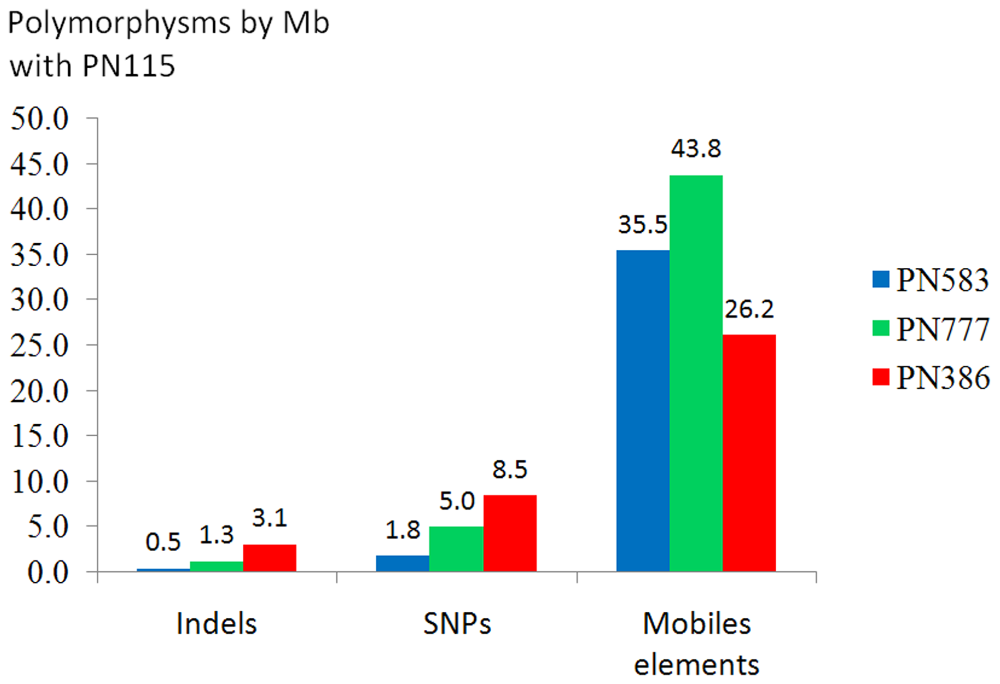
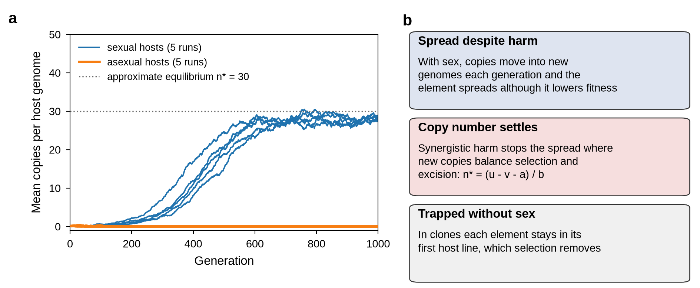

# Chapter 17. Selfish DNA and transposable elements

**Status: Spread of transposable elements as selfish DNA Verified; a regular adaptive role for them Partly verified.** Transposable elements are present in almost all eukaryotes, spread by copying themselves within and between genomes, and are mostly harmful when they insert near genes. Hosts silence them, and selection removes many insertions. Population genomics in plants and animals now measures this directly. Some insertions become useful alleles or regulatory elements, and transposition can respond to stress, but how much of adaptation depends on them is still open.

Related notes in this repository: [selfish-dna](../../skills/genomics-theory-mining/theories/selfish-dna/THEORY.md), [genome-shock](../../skills/genomics-theory-mining/theories/genome-shock/THEORY.md), [c-value-junk-dna](../../skills/genomics-theory-mining/theories/c-value-junk-dna/THEORY.md), [lynch-conery-2003-genome-complexity](../../skills/genomics-theory-mining/theories/lynch-conery-2003-genome-complexity/THEORY.md), [mutation-selection-balance](../../skills/genomics-theory-mining/theories/mutation-selection-balance/THEORY.md).

## 17.1 Statement and history

McClintock described mutable loci in maize that appeared at high frequency in her cultures, affected many characters and changed their expression in variegated patterns; she argued that the same mechanism underlies variegation in all organisms [1]. In 1984 she described how a genome may react to conditions for which it is unprepared [2].

In 1980 two papers in *Nature* gave the selfish DNA view. Doolittle and Sapienza wrote that selection within genomes will produce DNAs with no phenotypic expression whose only “function” is survival within genomes, and that transposable elements and middle-repetitive sequences can be seen in this way [3]. Orgel and Crick examined such DNA as the natural selection of preferred replicators within the genome [4]. Hickey then showed with a population genetic model that selfish sequences need not be neutral to the host: they can have major harmful effects and still spread, because sex carries them into new genomes [5]. Charlesworth and Charlesworth modelled the copy number of an element family under transposition, excision, selection on copy number and drift, and found that a stable equilibrium needs either regulation of transposition or fitness that falls ever faster with copy number [6].

Today transposable elements are classified in a hierarchy based on transposition mechanism, sequence similarity and structure [7]. They are the largest component of many plant genomes, including at least half of the maize genome [8], and their bursts can double a genome without polyploidy [9]. Werren surveyed selfish genetic elements in general as a source of genetic conflict and of new genes, regulation and species [10].

## 17.2 What the theory predicts

- **Sex helps elements spread.** Elements should spread in sexual populations even when they lower fitness, and should be scarce or absent in old asexual lineages (Figure 17.2) [5, 11].
- **Most insertions are harmful.** Insertions should be rare in a population, and fewer near genes than expected from where elements insert [6, 12].
- **Hosts fight back.** Hosts should evolve systems that silence elements, and these systems should carry costs [13, 14].
- **Invasions happen.** Elements should move between species and sweep through new hosts [15].
- **Occasional use.** A minority of insertions should be co-opted as regulatory elements or produce alleles of large effect [16, 17].

## 17.3 Evidence for

- **Invasion and hybrid dysgenesis.** Crosses between *Drosophila melanogaster* strains of type P and M produce sterility, mutation and male recombination only in one direction [18]. P elements are present in 30-50 copies in P strains, are missing from M strains, and transpose in dysgenic hybrids [19]. A P element from *D. willistoni* is identical to the *D. melanogaster* element at all but one base, which points to horizontal transfer between species [15].
- **Sex and asexuality.** Retrotransposon reverse transcriptases were found in all animal phyla tested except bdelloid rotifers, an ancient asexual group [11].
- **Selection keeps insertions rare.** In *Drosophila* most insertions are at low frequency in natural populations, which is read as evidence that each is selected against [12]. Sequencing pools of more than 550 South African flies found that more than 80% of insertions in *D. melanogaster* and *D. simulans* have a frequency below 0.2, with high recent activity of many families [20].
- **Plants.** In 211 *Arabidopsis thaliana* accessions, thousands of recent transpositions involve half of the 326 annotated families; insertions arise throughout the genome but are rapidly purged from gene-rich regions [21]. In more than 1,000 accessions, insertions arise at almost the same rate as base substitutions, and mobilization varies with genetic and environmental factors [22]. In 216 accessions, most of 23,095 TE presence/absence variants are rare and are linked to local extremes of gene expression and DNA methylation [23].
- **Silencing and its cost.** Overlapping epigenetic mechanisms silence elements [13]. In *A. thaliana*, methylated elements near genes reduce gene expression and show signs of purifying selection, so silencing itself has a fitness cost [14]. *A. lyrata*, with two to three times more element copies, has less effective RNA-directed DNA methylation than *A. thaliana* [24].

## 17.4 Evidence against, and difficulties

- **Mating system effects are not simple.** In *Capsella*, one selfing species has slightly more copies and the other markedly fewer than their outcrossing relative, and cross-species comparisons depend on the reference genome used [25]. *A. thaliana*, a selfer, has a smaller genome than *A. lyrata*, mostly through many small deletions [26].
- **Not only parasites.** Elements supply regulatory sequences and have been pervasively co-opted in many genomes [16, 17]. The mutation behind industrial melanism in British peppered moths is a transposable element inserted in the gene *cortex* around 1819 [27]. A *Hopscotch* insertion acts as an enhancer of the maize domestication gene *tb1* [28].
- **Response to stress.** In *Arabidopsis*, heat activates the retrotransposon *ONSEN*, and new insertions appear in the progeny of stressed plants that lack siRNAs, but not of stressed wild-type plants [29]. Transposition rates appear positively selected at the edge of the *A. thaliana* niche [22]. These findings support part of McClintock’s view [2] without showing that elements are maintained because they help hosts.
- **Annotation.** Measured copy numbers depend on how elements are found; annotation methods differ in how many families they recover and need benchmarking against curated libraries [30, 31].

## 17.5 Status and reasoning

**Selfish spread: verified. Regular adaptive role: partly verified.** Element invasion, horizontal transfer, rarity of insertions in populations, purging near genes and host silencing are all observed directly [14, 15, 18, 20, 21]. Their spread does not need a benefit to the host [3, 5]. Many cases of co-option and some large-effect adaptive insertions are known [17, 27, 28], but these are a small fraction of insertions, and whether hosts keep active elements because of such benefits is not established [10, 17].

## 17.6 Plants, crops and grapevine

- **Maize and rice.** Nested retrotransposons make up most of the maize genome [8], and three families doubled the genome of *Oryza australiensis* in 3 million years [9]. In 3,000 rice genomes, more than 50,000 insertion polymorphisms from 32 retrotransposon families are mostly at very low frequency [32].
- **Tomato and citrus.** In 602 tomato accessions, 6,906 insertion polymorphisms come from 337 families; at least 40 are associated with large variation in agronomic or metabolic traits, mostly without a tagging SNP [33]. Blood oranges arose from a *Copia*-like insertion next to the *Ruby* gene, and their cold-dependent colour reflects stress induction of the element [34].
- **Grapevine.** A retrotransposon insertion in *VvmybA1* is associated with the loss of skin colour in white cultivars [35], and together with mutations in the adjacent *VvMYBA2* it underlies the common origin of white grapes [36]. Grape MITEs have been amplified and active during domestication and breeding, are often inserted in untranslated regions and are highly polymorphic among cultivars [37].
- **Clonal perennials.** Clones of a grape cultivar accumulate somatic mutations during repeated vegetative propagation. In three Pinot noir clones, insertion polymorphisms caused by mobile elements were the most common type of change between clones (Figure 17.1), and insertion polymorphism of four highly variable elements was confirmed in all Pinot clones registered in France [38]. Because there is no meiosis to sort insertions into new genomes, an insertion in a clonal lineage stays in that lineage; selection acts on whole clones.

## 17.7 How to test it with public data

- **Data.** Resequencing panels with long or short reads: 1001 Genomes *A. thaliana* [21, 22], 3,000 rice genomes [32], tomato accessions [33], clones of one grape cultivar [38].
- **Tools.** EDTA and RepeatModeler2 to build an element library for a new genome [30, 31]; McClintock to run several insertion callers on short reads [39].
- **Analysis.** (1) Call insertion polymorphisms and their frequencies; compare the site frequency spectrum with that of SNPs [20]. (2) Test for fewer insertions near genes than expected [21]. (3) Compare copy numbers between related outcrossing and selfing or clonal lineages, with a reference-bias control [25]. The script [`scripts/ch17_selfish_dna_figures.py`](../scripts/ch17_selfish_dna_figures.py) simulates the spread of an element in sexual and asexual hosts (Figure 17.2).
- **What would break the theory.** Element families that rise in frequency only when they increase host fitness, or old asexual lineages full of active retrotransposons that spread between individuals.

## 17.8 Open questions

- How often do insertions contribute to adaptation, compared with SNPs [22, 33]?
- How do silencing, selection and mating system together set copy number [24, 25]?
- Is stress-induced transposition a host adaptation, an element adaptation, or a by-product [2, 29]?
- How much clonal variation in grapevine comes from new insertions, and how stable are they [37, 38]?

## 17.9 Common mistakes

- Reading a few co-opted insertions as proof that most elements are useful [17, 40].
- Reading “selfish” as “harmless”; selfish DNA can spread while lowering fitness [5].
- Comparing copy numbers between species with a single reference genome without correcting for reference bias [25].
- Treating an insertion catalogue from one caller as complete [30, 39].

## Figures

**Figure 17.1.** Number of SSR, SNP, indel and mobile element polymorphisms with PN115 per Mb of genome sequence for each clone. In red PN386, in blue PN583 and in green PN777. Reproduced unchanged from Carrier G, Le Cunff L, Dereeper A, et al. (2012) Transposable elements are a major cause of somatic polymorphism in *Vitis vinifera* L. *PLoS ONE* 7:e32973, Figure 3. https://doi.org/10.1371/journal.pone.0032973. Licence: CC BY 4.0 (https://creativecommons.org/licenses/by/4.0/).

**Figure 17.2.** (a) Mean copy number of one element family per host genome after it enters 5% of a population of 1,000 diploid hosts with two copies each; five runs for sexual hosts and five for asexual hosts. Copies transpose at rate u = 0.02 and are excised at rate v = 0.002 per copy per generation, and host fitness is exp(−an − bn²/2) with a = 0.003 and b = 0.0005. The dotted line is the deterministic equilibrium n* = (u − v − a)/b = 30. (b) What the model shows. Made with [`scripts/ch17_selfish_dna_figures.py`](../scripts/ch17_selfish_dna_figures.py), seed 20261126.

## References

1. McClintock B (1950) The origin and behavior of mutable loci in maize. *Proceedings of the National Academy of Sciences* 36:344-355. https://doi.org/10.1073/pnas.36.6.344
2. McClintock B (1984) The Significance of Responses of the Genome to Challenge. *Science* 226:792-801. https://doi.org/10.1126/science.15739260
3. Doolittle WF, Sapienza C (1980) Selfish genes, the phenotype paradigm and genome evolution. *Nature* 284:601-603. https://doi.org/10.1038/284601a0
4. Orgel LE, Crick FHC (1980) Selfish DNA: the ultimate parasite. *Nature* 284:604-607. https://doi.org/10.1038/284604a0
5. Hickey DA (1982) Selfish DNA: a sexually-transmitted nuclear parasite. *Genetics* 101:519-531. https://doi.org/10.1093/genetics/101.3-4.519
6. Charlesworth B, Charlesworth D (1983) The population dynamics of transposable elements. *Genetical Research* 42:1-27. https://doi.org/10.1017/S0016672300021455
7. Wicker T, Sabot F, Hua-Van A, et al. (2007) A unified classification system for eukaryotic transposable elements. *Nature Reviews Genetics* 8:973-982. https://doi.org/10.1038/nrg2165
8. SanMiguel P, Tikhonov A, Jin YK, et al. (1996) Nested Retrotransposons in the Intergenic Regions of the Maize Genome. *Science* 274:765-768. https://doi.org/10.1126/science.274.5288.765
9. Piegu B, Guyot R, Picault N, et al. (2006) Doubling genome size without polyploidization: Dynamics of retrotransposition-driven genomic expansions in Oryza australiensis , a wild relative of rice. *Genome Research* 16:1262-1269. https://doi.org/10.1101/gr.5290206
10. Werren JH (2011) Selfish genetic elements, genetic conflict, and evolutionary innovation. *Proceedings of the National Academy of Sciences* 108:10863-10870. https://doi.org/10.1073/pnas.1102343108
11. Arkhipova I, Meselson M (2000) Transposable elements in sexual and ancient asexual taxa. *Proceedings of the National Academy of Sciences* 97:14473-14477. https://doi.org/10.1073/pnas.97.26.14473
12. Lee YCG, Langley CH (2010) Transposable elements in natural populations of Drosophila melanogaster. *Philosophical Transactions of the Royal Society B: Biological Sciences* 365:1219-1228. https://doi.org/10.1098/rstb.2009.0318
13. Slotkin RK, Martienssen R (2007) Transposable elements and the epigenetic regulation of the genome. *Nature Reviews Genetics* 8:272-285. https://doi.org/10.1038/nrg2072
14. Hollister JD, Gaut BS (2009) Epigenetic silencing of transposable elements: A trade-off between reduced transposition and deleterious effects on neighboring gene expression. *Genome Research* 19:1419-1428. https://doi.org/10.1101/gr.091678.109
15. Daniels SB, Peterson KR, Strausbaugh LD, et al. (1990) Evidence for horizontal transmission of the P transposable element between Drosophila species. *Genetics* 124:339-355. https://doi.org/10.1093/genetics/124.2.339
16. Feschotte C (2008) Transposable elements and the evolution of regulatory networks. *Nature Reviews Genetics* 9:397-405. https://doi.org/10.1038/nrg2337
17. Chuong EB, Elde NC, Feschotte C (2017) Regulatory activities of transposable elements: from conflicts to benefits. *Nature Reviews Genetics* 18:71-86. https://doi.org/10.1038/nrg.2016.139
18. Kidwell MG, Kidwell JF, Sved JA (1977) Hybrid dysgenesis in Drosophila melanogaster: a syndrome of aberrant traits including mutation, sterility and male recombination. *Genetics* 86:813-833. https://doi.org/10.1093/genetics/86.4.813
19. Bingham PM, Kidwell MG, Rubin GM (1982) The molecular basis of P-M hybrid dysgenesis: The role of the P element, a P-strain-specific transposon family. *Cell* 29:995-1004. https://doi.org/10.1016/0092-8674(82)90463-9
20. Kofler R, Nolte V, Schlötterer C (2015) Tempo and Mode of Transposable Element Activity in Drosophila. *PLOS Genetics* 11:e1005406. https://doi.org/10.1371/journal.pgen.1005406
21. Quadrana L, Bortolini Silveira A, Mayhew GF, et al. (2016) The Arabidopsis thaliana mobilome and its impact at the species level. *eLife* 5:e15716. https://doi.org/10.7554/eLife.15716
22. Baduel P, Leduque B, Ignace A, et al. (2021) Genetic and environmental modulation of transposition shapes the evolutionary potential of Arabidopsis thaliana. *Genome Biology* 22:138. https://doi.org/10.1186/s13059-021-02348-5
23. Stuart T, Eichten SR, Cahn J, et al. (2016) Population scale mapping of transposable element diversity reveals links to gene regulation and epigenomic variation. *eLife* 5:e20777. https://doi.org/10.7554/eLife.20777
24. Hollister JD, Smith LM, Guo YL, et al. (2011) Transposable elements and small RNAs contribute to gene expression divergence between Arabidopsis thaliana and Arabidopsis lyrata. *Proceedings of the National Academy of Sciences* 108:2322-2327. https://doi.org/10.1073/pnas.1018222108
25. Ågren J, Wang W, Koenig D, et al. (2014) Mating system shifts and transposable element evolution in the plant genus Capsella. *BMC Genomics* 15:602. https://doi.org/10.1186/1471-2164-15-602
26. Hu TT, Pattyn P, Bakker EG, et al. (2011) The Arabidopsis lyrata genome sequence and the basis of rapid genome size change. *Nature Genetics* 43:476-481. https://doi.org/10.1038/ng.807
27. Hof AEv, Campagne P, Rigden DJ, et al. (2016) The industrial melanism mutation in British peppered moths is a transposable element. *Nature* 534:102-105. https://doi.org/10.1038/nature17951
28. Studer A, Zhao Q, Ross-Ibarra J, et al. (2011) Identification of a functional transposon insertion in the maize domestication gene tb1. *Nature Genetics* 43:1160-1163. https://doi.org/10.1038/ng.942
29. Ito H, Gaubert H, Bucher E, et al. (2011) An siRNA pathway prevents transgenerational retrotransposition in plants subjected to stress. *Nature* 472:115-119. https://doi.org/10.1038/nature09861
30. Ou S, Su W, Liao Y, et al. (2019) Benchmarking transposable element annotation methods for creation of a streamlined, comprehensive pipeline. *Genome Biology* 20:275. https://doi.org/10.1186/s13059-019-1905-y
31. Flynn JM, Hubley R, Goubert C, et al. (2020) RepeatModeler2 for automated genomic discovery of transposable element families. *Proceedings of the National Academy of Sciences* 117:9451-9457. https://doi.org/10.1073/pnas.1921046117
32. Carpentier MC, Manfroi E, Wei FJ, et al. (2019) Retrotranspositional landscape of Asian rice revealed by 3000 genomes. *Nature Communications* 10:24. https://doi.org/10.1038/s41467-018-07974-5
33. Domínguez M, Dugas E, Benchouaia M, et al. (2020) The impact of transposable elements on tomato diversity. *Nature Communications* 11:4058. https://doi.org/10.1038/s41467-020-17874-2
34. Butelli E, Licciardello C, Zhang Y, et al. (2012) Retrotransposons Control Fruit-Specific, Cold-Dependent Accumulation of Anthocyanins in Blood Oranges. *The Plant Cell* 24:1242-1255. https://doi.org/10.1105/tpc.111.095232
35. Kobayashi S, Goto-Yamamoto N, Hirochika H (2004) Retrotransposon-Induced Mutations in Grape Skin Color. *Science* 304:982-982. https://doi.org/10.1126/science.1095011
36. Walker AR, Lee E, Bogs J, et al. (2007) White grapes arose through the mutation of two similar and adjacent regulatory genes. *The Plant Journal* 49:772-785. https://doi.org/10.1111/j.1365-313X.2006.02997.x
37. Benjak A, Boué S, Forneck A, et al. (2009) Recent amplification and impact of MITEs on the genome of grapevine (Vitis vinifera L.). *Genome Biology and Evolution* 1:75-84. https://doi.org/10.1093/gbe/evp009
38. Carrier G, Le Cunff L, Dereeper A, et al. (2012) Transposable Elements Are a Major Cause of Somatic Polymorphism in Vitis vinifera L. *PLoS ONE* 7:e32973. https://doi.org/10.1371/journal.pone.0032973
39. Nelson MG, Linheiro RS, Bergman CM (2017) McClintock: An Integrated Pipeline for Detecting Transposable Element Insertions in Whole-Genome Shotgun Sequencing Data. *G3 Genes|Genomes|Genetics* 7:2763-2778. https://doi.org/10.1534/g3.117.043893
40. Bourque G, Burns KH, Gehring M, et al. (2018) Ten things you should know about transposable elements. *Genome Biology* 19:199. https://doi.org/10.1186/s13059-018-1577-z
