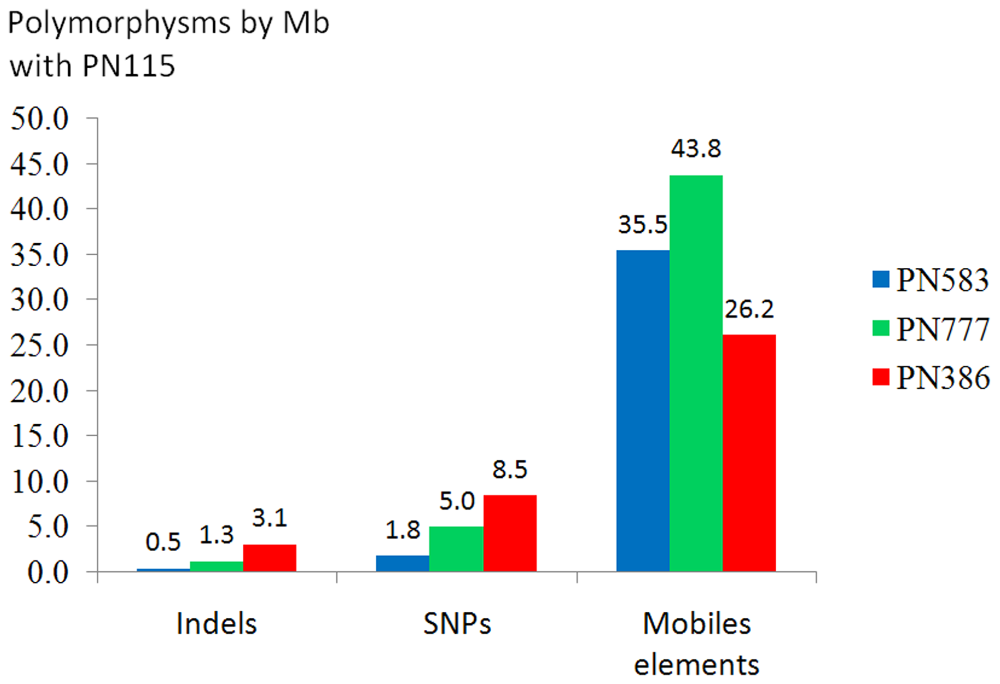
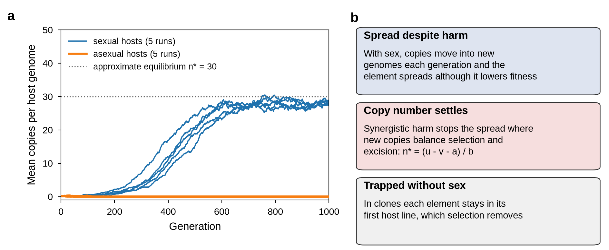

# 第 17 章 自私 DNA 与转座子

**地位：转座子作为自私 DNA 的扩散已验证；转座子经常起适应作用部分验证。** 转座子几乎存在于所有真核生物中，在基因组内和基因组之间复制自身而扩散；插入到基因附近时大多有害。宿主会把它们沉默，选择也会清除许多插入。植物和动物的群体基因组学现在可以直接测量这些过程。有些插入成为有用的等位基因或调控元件，转座也可以对胁迫作出反应，但适应在多大程度上依赖转座子仍未解决。

本仓库相关条目：[selfish-dna](../../skills/genomics-theory-mining/theories/selfish-dna/THEORY.md)、[genome-shock](../../skills/genomics-theory-mining/theories/genome-shock/THEORY.md)、[c-value-junk-dna](../../skills/genomics-theory-mining/theories/c-value-junk-dna/THEORY.md)、[lynch-conery-2003-genome-complexity](../../skills/genomics-theory-mining/theories/lynch-conery-2003-genome-complexity/THEORY.md)、[mutation-selection-balance](../../skills/genomics-theory-mining/theories/mutation-selection-balance/THEORY.md)。

## 17.1 内容与历史

McClintock 描述了玉米中的可变位点：它们在她的材料中高频出现，影响许多性状，并以斑驳的方式改变性状的表达；她认为同一机制是所有生物中斑驳现象的基础 [1]。1984 年她讨论了基因组怎样应对它没有准备的条件 [2]。

1980 年《自然》上的两篇论文提出了自私 DNA 的观点。Doolittle 和 Sapienza 写道，基因组内的选择会产生没有表型表达的 DNA，其唯一的“功能”是在基因组中存续，转座子和中度重复序列可以这样看待 [3]。Orgel 和 Crick 把这类 DNA 看作基因组内偏好复制子的自然选择 [4]。随后 Hickey 用群体遗传模型表明，自私序列对宿主不一定是中性的：它们可以带来很大的害处却仍然扩散，因为有性生殖把它们带进新的基因组 [5]。Charlesworth 和 Charlesworth 在转座、切除、对拷贝数的选择和漂变的共同作用下为一个元件家族的拷贝数建模，发现要有稳定的平衡，转座必须受调控，或者适合度随拷贝数下降得越来越快 [6]。

如今转座子按转座机制、序列相似性和结构分为一个层级体系 [7]。它们是许多植物基因组中最大的组成部分，至少占玉米核 DNA 的一半 [8]；转座子爆发可以在没有多倍化的情况下使基因组加倍 [9]。Werren 综述了广义的自私遗传元件，认为它们是遗传冲突的来源，也是新基因、新调控和新物种的来源 [10]。

## 17.2 预测

- **有性生殖帮助元件扩散。** 即使降低适合度，元件也应在有性群体中扩散，而在古老的无性谱系中稀少或缺失（图 17.2）[5, 11]。
- **大多数插入有害。** 插入在群体中应当稀少，并且在基因附近比按插入位置预期的少 [6, 12]。
- **宿主反击。** 宿主应演化出沉默元件的系统，而这些系统应有代价 [13, 14]。
- **入侵会发生。** 元件应在物种之间转移，并在新宿主中迅速扩散 [15]。
- **偶尔被利用。** 少数插入应被征用为调控元件，或产生效应大的等位基因 [16, 17]。

## 17.3 支持证据

- **入侵与杂种不育。** 黑腹果蝇 P 型与 M 型品系杂交只在一个方向上产生不育、突变和雄性重组 [18]。P 品系中有 30–50 个 P 元件拷贝，M 品系中没有，P 元件在不育杂种中转座 [19]。来自 *D. willistoni* 的一个 P 元件与黑腹果蝇的元件只差一个碱基，指向物种间的水平转移 [15]。
- **有性与无性。** 在所检测的动物各门中都发现了反转录转座子的逆转录酶，只有古老的无性类群蛭形轮虫例外 [11]。
- **选择使插入保持稀少。** 在果蝇中，大多数插入在自然群体中频率很低，这被解读为每个插入都受到负选择的证据 [12]。对 550 多只南非果蝇的混合测序发现，黑腹果蝇和拟果蝇中超过 80% 的插入频率低于 0.2，许多家族近期非常活跃 [20]。
- **植物。** 在 211 个拟南芥株系中，数千次近期转座涉及 326 个已注释家族中的一半；插入发生在整个基因组，但很快从基因密集区被清除 [21]。在 1000 多个株系中，插入的发生率几乎与碱基替换相同，转座活性随遗传和环境因素变化 [22]。在 216 个株系中，23,095 个转座子有无变异大多是罕见的，并与基因表达和 DNA 甲基化的局部极端值相关 [23]。
- **沉默及其代价。** 多种相互重叠的表观遗传机制使元件沉默 [13]。在拟南芥中，基因附近被甲基化的元件降低基因表达，并显示纯化选择的迹象，所以沉默本身有适合度代价 [14]。元件拷贝数高出两到三倍的琴叶拟南芥，其 RNA 指导的 DNA 甲基化不如拟南芥有效 [24]。

## 17.4 反面证据与难点

- **交配系统的作用并不简单。** 在荠属中，一个自交种的拷贝数比异交近缘种略多，另一个明显更少，而且跨物种比较依赖所用的参考基因组 [25]。自交的拟南芥基因组比琴叶拟南芥小，主要是由于大量小片段缺失 [26]。
- **不只是寄生物。** 元件提供调控序列，并在许多基因组中被广泛征用 [16, 17]。英国桦尺蛾工业黑化的突变是约 1819 年插入 *cortex* 基因的一个转座子 [27]。一个 *Hopscotch* 插入是玉米驯化基因 *tb1* 的增强子 [28]。
- **对胁迫的反应。** 在拟南芥中，高温激活反转录转座子 *ONSEN*；在缺乏 siRNA 的受胁迫植株后代中出现新插入，而在受胁迫的野生型后代中没有 [29]。在拟南芥分布区的边缘，转座率似乎受到正选择 [22]。这些发现支持 McClintock 观点的一部分 [2]，但并没有说明元件因为有利于宿主而被保留。
- **注释。** 测得的拷贝数取决于识别元件的方法；各种注释方法找回的家族数不同，需要用人工整理的元件库作基准评估 [30, 31]。

## 17.5 地位与理由

**自私扩散：已验证。经常起适应作用：部分验证。** 元件入侵、水平转移、插入在群体中稀少、在基因附近被清除以及宿主沉默，都已被直接观察到 [14, 15, 18, 20, 21]。它们的扩散不需要对宿主有利 [3, 5]。已知很多被征用的例子和一些效应大的适应性插入 [17, 27, 28]，但它们只占插入的一小部分，宿主是否因为这些好处而保留活跃的元件也没有定论 [10, 17]。

## 17.6 植物、作物与葡萄

- **玉米和水稻。** 嵌套的反转录转座子构成玉米基因组的大部分 [8]，三个家族在 300 万年内使 *Oryza australiensis* 的基因组加倍 [9]。在 3000 份水稻基因组中，来自 32 个反转录转座子家族的 50,000 多个插入多态大多频率很低 [32]。
- **番茄和柑橘。** 在 602 份番茄材料中，6,906 个插入多态来自 337 个家族；至少 40 个与农艺或代谢性状的大幅变异相关，且大多没有可以标记它们的 SNP [33]。血橙源于 *Ruby* 基因旁边的一个 *Copia* 类插入，其依赖低温的着色反映了该元件受胁迫诱导 [34]。
- **葡萄。** *VvmybA1* 中的一个反转录转座子插入与白色品种失去果皮颜色有关 [35]；它与相邻的 *VvMYBA2* 中的突变一起，构成白葡萄共同起源的基础 [36]。葡萄的 MITE 在驯化和育种期间扩增并活跃，常插入非翻译区，并在品种间高度多态 [37]。
- **克隆繁殖的多年生植物。** 一个葡萄品种的各个克隆在反复的营养繁殖中积累体细胞突变。在三个黑皮诺克隆中，转座元件造成的插入多态是克隆之间最常见的变化类型（图 17.1），四个高度可变的元件的插入多态在法国登记的所有黑皮诺克隆中都得到确认 [38]。由于没有减数分裂把插入分配到新的基因组中，克隆谱系中的插入就留在该谱系中；选择作用于整个克隆。

## 17.7 用公开数据检验

- **数据。** 长读长或短读长重测序材料：1001 基因组计划的拟南芥 [21, 22]、3000 份水稻基因组 [32]、番茄材料 [33]、同一葡萄品种的克隆 [38]。
- **工具。** 用 EDTA 和 RepeatModeler2 为新基因组建立元件库 [30, 31]；用 McClintock 在短读长数据上运行多个插入识别程序 [39]。
- **分析。** (1) 识别插入多态及其频率，把位点频率谱与 SNP 的比较 [20]。(2) 检验基因附近的插入是否少于预期 [21]。(3) 比较近缘的异交与自交或克隆谱系的拷贝数，并控制参考基因组偏差 [25]。脚本 [`scripts/ch17_selfish_dna_figures.py`](../scripts/ch17_selfish_dna_figures.py) 模拟一个元件在有性和无性宿主中的扩散（图 17.2）。
- **什么结果会推翻理论。** 元件家族只有在提高宿主适合度时频率才上升；或者古老的无性谱系中充满在个体之间扩散的活跃反转录转座子。

## 17.8 未解决的问题

- 与 SNP 相比，插入对适应的贡献有多频繁 [22, 33]？
- 沉默、选择和交配系统如何共同决定拷贝数 [24, 25]？
- 胁迫诱导的转座是宿主的适应、元件的适应，还是副产物 [2, 29]？
- 葡萄克隆变异中有多少来自新插入，它们有多稳定 [37, 38]？

## 17.9 常见错误

- 把少数被征用的插入当作大多数元件有用的证据 [17, 40]。
- 把“自私”理解为“无害”；自私 DNA 可以在降低适合度的同时扩散 [5]。
- 只用一个参考基因组比较物种间的拷贝数，而不校正参考偏差 [25]。
- 把一个识别程序给出的插入目录当作完整的 [30, 39]。

## 图

**图 17.1.** 各克隆每 Mb 基因组序列中与 PN115 相比的 SSR、SNP、插入缺失和转座元件多态数。红色为 PN386，蓝色为 PN583，绿色为 PN777。原样转载自 Carrier G, Le Cunff L, Dereeper A, et al. (2012) Transposable elements are a major cause of somatic polymorphism in *Vitis vinifera* L. *PLoS ONE* 7:e32973, Figure 3. https://doi.org/10.1371/journal.pone.0032973。许可：CC BY 4.0（https://creativecommons.org/licenses/by/4.0/）。

**图 17.2.** (a) 一个元件家族进入 1000 个二倍体宿主中 5% 的个体（每个带两个拷贝）之后，每个宿主基因组的平均拷贝数；有性宿主和无性宿主各模拟五次。每个拷贝每代以 u = 0.02 的速率转座、以 v = 0.002 的速率被切除，宿主适合度为 exp(−an − bn²/2)，a = 0.003，b = 0.0005。点线为确定性平衡 n* = (u − v − a)/b = 30。(b) 模型说明了什么。用 [`scripts/ch17_selfish_dna_figures.py`](../scripts/ch17_selfish_dna_figures.py) 生成，随机种子 20261126。

## 参考文献

1. McClintock B (1950) The origin and behavior of mutable loci in maize. *Proceedings of the National Academy of Sciences* 36:344-355. https://doi.org/10.1073/pnas.36.6.344
2. McClintock B (1984) The Significance of Responses of the Genome to Challenge. *Science* 226:792-801. https://doi.org/10.1126/science.15739260
3. Doolittle WF, Sapienza C (1980) Selfish genes, the phenotype paradigm and genome evolution. *Nature* 284:601-603. https://doi.org/10.1038/284601a0
4. Orgel LE, Crick FHC (1980) Selfish DNA: the ultimate parasite. *Nature* 284:604-607. https://doi.org/10.1038/284604a0
5. Hickey DA (1982) Selfish DNA: a sexually-transmitted nuclear parasite. *Genetics* 101:519-531. https://doi.org/10.1093/genetics/101.3-4.519
6. Charlesworth B, Charlesworth D (1983) The population dynamics of transposable elements. *Genetical Research* 42:1-27. https://doi.org/10.1017/S0016672300021455
7. Wicker T, Sabot F, Hua-Van A, et al. (2007) A unified classification system for eukaryotic transposable elements. *Nature Reviews Genetics* 8:973-982. https://doi.org/10.1038/nrg2165
8. SanMiguel P, Tikhonov A, Jin YK, et al. (1996) Nested Retrotransposons in the Intergenic Regions of the Maize Genome. *Science* 274:765-768. https://doi.org/10.1126/science.274.5288.765
9. Piegu B, Guyot R, Picault N, et al. (2006) Doubling genome size without polyploidization: Dynamics of retrotransposition-driven genomic expansions in Oryza australiensis , a wild relative of rice. *Genome Research* 16:1262-1269. https://doi.org/10.1101/gr.5290206
10. Werren JH (2011) Selfish genetic elements, genetic conflict, and evolutionary innovation. *Proceedings of the National Academy of Sciences* 108:10863-10870. https://doi.org/10.1073/pnas.1102343108
11. Arkhipova I, Meselson M (2000) Transposable elements in sexual and ancient asexual taxa. *Proceedings of the National Academy of Sciences* 97:14473-14477. https://doi.org/10.1073/pnas.97.26.14473
12. Lee YCG, Langley CH (2010) Transposable elements in natural populations of Drosophila melanogaster. *Philosophical Transactions of the Royal Society B: Biological Sciences* 365:1219-1228. https://doi.org/10.1098/rstb.2009.0318
13. Slotkin RK, Martienssen R (2007) Transposable elements and the epigenetic regulation of the genome. *Nature Reviews Genetics* 8:272-285. https://doi.org/10.1038/nrg2072
14. Hollister JD, Gaut BS (2009) Epigenetic silencing of transposable elements: A trade-off between reduced transposition and deleterious effects on neighboring gene expression. *Genome Research* 19:1419-1428. https://doi.org/10.1101/gr.091678.109
15. Daniels SB, Peterson KR, Strausbaugh LD, et al. (1990) Evidence for horizontal transmission of the P transposable element between Drosophila species. *Genetics* 124:339-355. https://doi.org/10.1093/genetics/124.2.339
16. Feschotte C (2008) Transposable elements and the evolution of regulatory networks. *Nature Reviews Genetics* 9:397-405. https://doi.org/10.1038/nrg2337
17. Chuong EB, Elde NC, Feschotte C (2017) Regulatory activities of transposable elements: from conflicts to benefits. *Nature Reviews Genetics* 18:71-86. https://doi.org/10.1038/nrg.2016.139
18. Kidwell MG, Kidwell JF, Sved JA (1977) Hybrid dysgenesis in Drosophila melanogaster: a syndrome of aberrant traits including mutation, sterility and male recombination. *Genetics* 86:813-833. https://doi.org/10.1093/genetics/86.4.813
19. Bingham PM, Kidwell MG, Rubin GM (1982) The molecular basis of P-M hybrid dysgenesis: The role of the P element, a P-strain-specific transposon family. *Cell* 29:995-1004. https://doi.org/10.1016/0092-8674(82)90463-9
20. Kofler R, Nolte V, Schlötterer C (2015) Tempo and Mode of Transposable Element Activity in Drosophila. *PLOS Genetics* 11:e1005406. https://doi.org/10.1371/journal.pgen.1005406
21. Quadrana L, Bortolini Silveira A, Mayhew GF, et al. (2016) The Arabidopsis thaliana mobilome and its impact at the species level. *eLife* 5:e15716. https://doi.org/10.7554/eLife.15716
22. Baduel P, Leduque B, Ignace A, et al. (2021) Genetic and environmental modulation of transposition shapes the evolutionary potential of Arabidopsis thaliana. *Genome Biology* 22:138. https://doi.org/10.1186/s13059-021-02348-5
23. Stuart T, Eichten SR, Cahn J, et al. (2016) Population scale mapping of transposable element diversity reveals links to gene regulation and epigenomic variation. *eLife* 5:e20777. https://doi.org/10.7554/eLife.20777
24. Hollister JD, Smith LM, Guo YL, et al. (2011) Transposable elements and small RNAs contribute to gene expression divergence between Arabidopsis thaliana and Arabidopsis lyrata. *Proceedings of the National Academy of Sciences* 108:2322-2327. https://doi.org/10.1073/pnas.1018222108
25. Ågren J, Wang W, Koenig D, et al. (2014) Mating system shifts and transposable element evolution in the plant genus Capsella. *BMC Genomics* 15:602. https://doi.org/10.1186/1471-2164-15-602
26. Hu TT, Pattyn P, Bakker EG, et al. (2011) The Arabidopsis lyrata genome sequence and the basis of rapid genome size change. *Nature Genetics* 43:476-481. https://doi.org/10.1038/ng.807
27. Hof AEv, Campagne P, Rigden DJ, et al. (2016) The industrial melanism mutation in British peppered moths is a transposable element. *Nature* 534:102-105. https://doi.org/10.1038/nature17951
28. Studer A, Zhao Q, Ross-Ibarra J, et al. (2011) Identification of a functional transposon insertion in the maize domestication gene tb1. *Nature Genetics* 43:1160-1163. https://doi.org/10.1038/ng.942
29. Ito H, Gaubert H, Bucher E, et al. (2011) An siRNA pathway prevents transgenerational retrotransposition in plants subjected to stress. *Nature* 472:115-119. https://doi.org/10.1038/nature09861
30. Ou S, Su W, Liao Y, et al. (2019) Benchmarking transposable element annotation methods for creation of a streamlined, comprehensive pipeline. *Genome Biology* 20:275. https://doi.org/10.1186/s13059-019-1905-y
31. Flynn JM, Hubley R, Goubert C, et al. (2020) RepeatModeler2 for automated genomic discovery of transposable element families. *Proceedings of the National Academy of Sciences* 117:9451-9457. https://doi.org/10.1073/pnas.1921046117
32. Carpentier MC, Manfroi E, Wei FJ, et al. (2019) Retrotranspositional landscape of Asian rice revealed by 3000 genomes. *Nature Communications* 10:24. https://doi.org/10.1038/s41467-018-07974-5
33. Domínguez M, Dugas E, Benchouaia M, et al. (2020) The impact of transposable elements on tomato diversity. *Nature Communications* 11:4058. https://doi.org/10.1038/s41467-020-17874-2
34. Butelli E, Licciardello C, Zhang Y, et al. (2012) Retrotransposons Control Fruit-Specific, Cold-Dependent Accumulation of Anthocyanins in Blood Oranges. *The Plant Cell* 24:1242-1255. https://doi.org/10.1105/tpc.111.095232
35. Kobayashi S, Goto-Yamamoto N, Hirochika H (2004) Retrotransposon-Induced Mutations in Grape Skin Color. *Science* 304:982-982. https://doi.org/10.1126/science.1095011
36. Walker AR, Lee E, Bogs J, et al. (2007) White grapes arose through the mutation of two similar and adjacent regulatory genes. *The Plant Journal* 49:772-785. https://doi.org/10.1111/j.1365-313X.2006.02997.x
37. Benjak A, Boué S, Forneck A, et al. (2009) Recent amplification and impact of MITEs on the genome of grapevine (Vitis vinifera L.). *Genome Biology and Evolution* 1:75-84. https://doi.org/10.1093/gbe/evp009
38. Carrier G, Le Cunff L, Dereeper A, et al. (2012) Transposable Elements Are a Major Cause of Somatic Polymorphism in Vitis vinifera L. *PLoS ONE* 7:e32973. https://doi.org/10.1371/journal.pone.0032973
39. Nelson MG, Linheiro RS, Bergman CM (2017) McClintock: An Integrated Pipeline for Detecting Transposable Element Insertions in Whole-Genome Shotgun Sequencing Data. *G3 Genes|Genomes|Genetics* 7:2763-2778. https://doi.org/10.1534/g3.117.043893
40. Bourque G, Burns KH, Gehring M, et al. (2018) Ten things you should know about transposable elements. *Genome Biology* 19:199. https://doi.org/10.1186/s13059-018-1577-z
