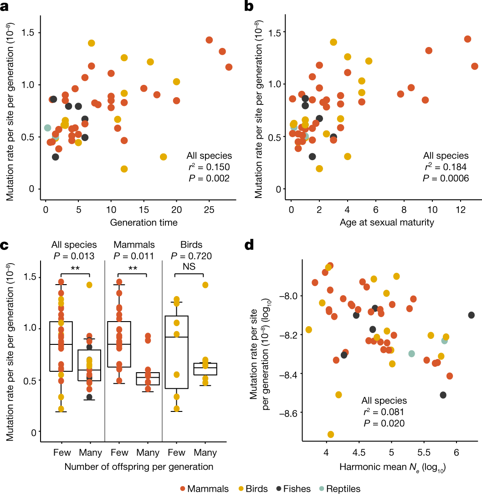
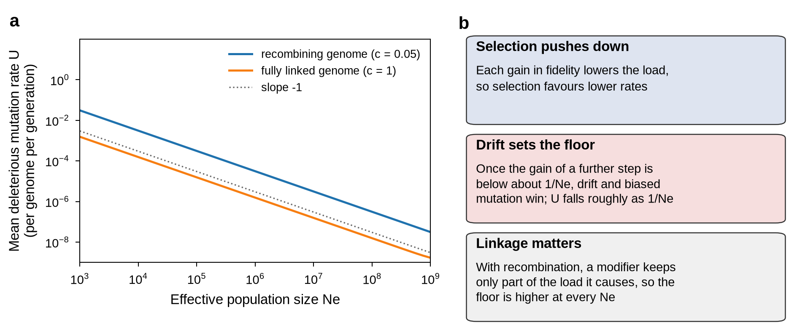

# Chapter 18. The drift-barrier and mutational-hazard hypotheses

**Status: Drift barrier to mutation-rate evolution Partly verified; mutational hazard as the main cause of genome architecture Contested.** The drift-barrier hypothesis says that selection lowers mutation rates until the advantage of a further improvement is too small to be seen against random genetic drift, so that species with smaller effective population sizes (Ne) have higher mutation rates. Comparisons across microbes and across vertebrates find the predicted negative relation, but it is noisy and depends on how Ne is estimated. The related mutational-hazard hypothesis says that extra DNA such as introns and intergenic sequence is a weak mutational liability that accumulates only where drift is strong. It explains some patterns well, but a phylogenetically corrected test found no support, and plant mitochondria contradict its simplest prediction.

Related notes in this repository: [drift-barrier-hypothesis](../../skills/genomics-theory-mining/theories/drift-barrier-hypothesis/THEORY.md), [lynch-conery-2003-genome-complexity](../../skills/genomics-theory-mining/theories/lynch-conery-2003-genome-complexity/THEORY.md), [nearly-neutral-theory](../../skills/genomics-theory-mining/theories/nearly-neutral-theory/THEORY.md), [mutational-genetic-load](../../skills/genomics-theory-mining/theories/mutational-genetic-load/THEORY.md), [mutation-accumulation](../../skills/genomics-theory-mining/theories/mutation-accumulation/THEORY.md).

## 18.1 Statement and history

Kimura asked how natural selection adjusts mutation rates. He re-examined the idea that the rate minimizes the sum of mutational and substitutional load, and the alternative that only selection toward lower rates is effective, so that present rates are at the physical or physiological limit that selection can reach [1]. Drake found that DNA-based microbes whose genomes differ about 6,500-fold in size have mutation rates per genome that vary only about 2.5-fold, around 0.0033 per replication, so that the rate per base pair is inversely proportional to genome size [2]; higher eukaryotes have 0.1-100 mutations per genome per sexual generation [3]. Sniegowski and colleagues argued that most mutations with effects are harmful, that selection for higher rates through beneficial mutations is unlikely to matter in sexual populations, and that the physiological cost of fidelity may set the rate [4].

Lynch proposed instead that selection pushes mutation rates down to a lower limit set by the power of random genetic drift, not by physiological limits [5]. With refined estimates for a bacterium with a tiny genome and a unicellular eukaryote with a large genome, Sung and colleagues concluded that the mutation rate scales negatively with both Ne and the amount of coding DNA, the target for harmful mutations (Figure 18.2) [6]. The hypothesis also explains error-prone polymerases and argues against selection fine-tuning gene-specific mutation rates [7].

The same reasoning applied to genome structure is the mutational-hazard hypothesis. Lynch and Conery argued that the increases in introns, mobile elements and duplicate genes from prokaryotes to multicellular eukaryotes arose passively after long-term reductions in population size [8]. Each novel feature of the eukaryotic gene, such as an intron or a regulatory element, raises the rate of mutation to defective alleles; this disadvantage is weak and can be overwhelmed by drift in species with small Ne [9, 10]. In organelles, where Ne is similar in animals and plants, the size of the hazard depends on the mutation rate, so genomes with low mutation rates should accumulate more non-coding DNA [11]. Lynch extended the argument to complexity in general [12, 13].

## 18.2 What the theory predicts

- **Mutation rate and Ne.** Across species, the mutation rate per generation should fall as Ne rises, with a log-log slope near −1 if Ne is the main factor (Figure 18.2) [6, 7].
- **Target size.** At equal Ne, species with more coding DNA should have lower rates per site [6].
- **Genome size and drift.** Lineages with smaller Ne should carry more introns, mobile elements and intergenic DNA [8, 10].
- **Organelles.** Organelle genomes with low mutation rates should be larger and richer in non-coding DNA than those with high rates [11, 14].

## 18.3 Evidence for

- **Microbes.** Rates per genome are nearly constant across DNA-based microbes [2], and the combination of a small-genome bacterium and a large-genome eukaryote fits a rate that falls with Ne and with coding DNA [6].
- **Vertebrates.** In 151 parent-offspring trios from 68 species of mammals, fishes, birds and reptiles, the rate per generation varied 40-fold; species with larger long-term Ne tended to have lower rates per generation, as the drift barrier predicts (Figure 18.1) [15].
- **Bacterial genomes.** Across bacteria, the genome-wide ratio of replacement to silent substitutions, a measure of drift, falls as genome size rises, so drift promotes genome reduction in bacteria [16]. In 153 prokaryotes, Ne shapes the size of the pan-genome [17].
- **Animal genomes.** In asellid isopods, 11 independent shifts from surface water to groundwater were followed by less effective selection and genomes about 25% larger on average, with no link between genome size and body size or growth rate [18].
- **Organelles.** Silent substitution rates in plant mitochondria are less than a third of those in chloroplasts [19], and plant mitochondrial genomes change rapidly in structure but slowly in sequence [20]. Their large, non-coding-rich genomes, such as the 773,279 bp grape mitochondrial genome [21], fit the hazard prediction for a low mutation rate [11, 14].

## 18.4 Evidence against, and difficulties

- **Phylogeny.** In Lynch and Conery’s set of about 30 species, accounting for phylogeny removed every significant association between Neu and gene number, intron size and number, transposon number or genome size [22].
- **The Ne estimate.** In the vertebrate trios, Ne was estimated from substitution rates to avoid circularity. The relation was found for the harmonic mean of Ne over the past million years, but it was not significant for the most recent time point or for the mean over the past 100,000 years [15]. Generation time, age at maturity and fecundity were the key traits behind the variation in rates [15].
- **Plant mitochondria.** Two *Silene* species with recent large increases in mitochondrial mutation rate have the largest known mitochondrial genomes, 6.7 and 11.3 Mb, full of non-coding DNA, contrary to the hazard prediction [23]. Plant mitochondrial features can instead be explained by DNA repair: gene conversion keeps measured rates in genes low, while break-induced replication expands non-coding regions [24]. Tests of the hazard hypothesis in organelles both agree and disagree with it [14].
- **Is mutation blind?** Monroe and colleagues reported that mutations in *Arabidopsis thaliana* are halved in gene bodies and reduced by two-thirds in essential genes [25], which would mean selection on local rates. Liu and Zhang found that the extra mutations in that analysis were enriched in polynucleotide tracts with low sequencing quality, likely errors, and saw no such pattern in yeast or humans [26].
- **Other limits.** Physiological costs of fidelity could set rates instead of drift [1, 4].

## 18.5 Status and reasoning

**Drift barrier: partly verified. Mutational hazard as the main cause of genome architecture: contested.** The negative relation between mutation rate and Ne is found in microbes and vertebrates [6, 15], and the theory makes clear, testable predictions [7]. But the relation is noisy, depends on the time window used for Ne, and competes with life-history traits [15]. For genome architecture, some comparisons support the role of drift [16, 18], but the phylogenetically corrected test did not [22], and plant mitochondria show that high mutation rates can come with huge genomes [23, 24].

## 18.6 Plants, crops and grapevine

- **Mutation rates.** *A. thaliana* mutation accumulation lines give about 7 × 10⁻⁹ substitutions per site per generation, mostly G:C→A:T transitions [27, 28]; single-nucleotide mutations are more frequent in transposable elements and centromeric regions [28].
- **Somatic mutation in perennials.** In 754 genomes from tissues of eight plant species, perennials accumulated fewer mutations per unit time in shoot apical meristem than in root tips, but annuals did not, consistent with selection on somatic rates where shoot mutations can be transmitted [29]. When the germline of plants is set aside is less certain than once thought [30].
- **Grapevine clones.** In 15 Zinfandel clones, heterozygous somatic mutations were most frequent in intergenic space and more frequent in introns than in exons, repetitive intergenic space was a major source of clone diversity, and clones carried putatively harmful mutations [31]. A long-lived clone is a lineage with a small effective size and no recombination, the conditions under which drift is strongest; harmful somatic mutations can accumulate unless selection among cells and branches removes them.
- **Plant organelles.** Plant mitochondria, including grapevine’s, are the main counterexample and test case for the hazard hypothesis [21, 23, 24].

## 18.7 How to test it with public data

- **Data.** Mutation rates from trios and mutation accumulation lines [15, 28]; diversity data to estimate Ne; genome sizes and intron counts; organelle genomes with substitution rates [23].
- **Tools.** Phylogenetic generalized least squares for comparisons across species [15, 22]; PSMC for long-term Ne [15]; dN/dS as a measure of the efficiency of selection [16, 18].
- **Analysis.** (1) Regress log mutation rate on log Ne with phylogenetic correction and compare time windows for Ne [15]. (2) Test genome size or intron density against dN/dS within a clade with repeated shifts in Ne [18]. (3) In clones of a perennial crop, compare somatic mutation density in genes and in repeats [31]. The script [`scripts/ch18_drift_barrier_figures.py`](../scripts/ch18_drift_barrier_figures.py) computes the stationary mutation rate in a simple drift-barrier model (Figure 18.2).
- **What would break the theory.** A strong positive relation between Ne and mutation rate after phylogenetic correction, or consistently larger non-coding content in lineages with larger Ne.

## 18.8 Open questions

- How much of mutation-rate variation is due to Ne, and how much to generation time and other life-history traits [15]?
- Is genome expansion in small populations general once phylogeny is controlled [18, 22]?
- What explains huge mitochondrial genomes with high mutation rates [23, 24]?
- Do long-lived clonal crops such as grapevine accumulate harmful somatic mutations, and how fast [29, 31]?

## 18.9 Common mistakes

- Comparing species without phylogenetic correction [22].
- Treating Ne estimated from diversity as independent of the mutation rate used to obtain it [15].
- Accepting local mutation-rate differences without checking for sequencing errors [26].
- Assuming the mutational hazard is the only possible cause of extra DNA; repair mechanisms and selfish elements also act [8, 24].

## Figures

**Figure 18.1.** Predictors of interspecific variation in GMRs (germline mutation rates). a–c, Significant positive associations are found using phylogenetic regression (PGLS) between the modelled per-generation mutation rates and three life-history traits: species-specific mean generation time (a), age at sexual maturity (b) and the number of offspring per generation (c). In total there are 55 species with modelled per-generation rates, including 32 mammalian and 15 avian species. In c, the plot shows the median, the interquartile range and the maximum and minimum excluding outliers. d, Species-specific average per-generation mutation rates are negatively associated with the harmonic mean of the effective population size (Ne) over the past 1 million years, using phylogenetic regression (PGLS). Figure reproduced unchanged, caption with one sentence reworded, from Bergeron LA, Besenbacher S, Zheng J, et al. (2023) Evolution of the germline mutation rate across vertebrates. *Nature* 615:285-291, Figure 3. https://doi.org/10.1038/s41586-023-05752-y. Licence: CC BY 4.0 (https://creativecommons.org/licenses/by/4.0/).

**Figure 18.2.** (a) Mean genome-wide deleterious mutation rate U at the stationary state of a drift-barrier model, against Ne. U moves on a ladder of steps of 25%; mutations that worsen fidelity are four times as common as those that improve it, and a step down carries an advantage equal to the share c of the load it removes that stays linked to it (c = 1 fully linked, c = 0.05 recombining). The dotted line has slope −1. (b) What the model shows. Made with [`scripts/ch18_drift_barrier_figures.py`](../scripts/ch18_drift_barrier_figures.py); the calculation is deterministic.

## References

1. Kimura M (1967) On the evolutionary adjustment of spontaneous mutation rates. *Genetical Research* 9:23-34. https://doi.org/10.1017/S0016672300010284
2. Drake JW (1991) A constant rate of spontaneous mutation in DNA-based microbes. *Proceedings of the National Academy of Sciences* 88:7160-7164. https://doi.org/10.1073/pnas.88.16.7160
3. Drake JW, Charlesworth B, Charlesworth D, et al. (1998) Rates of Spontaneous Mutation. *Genetics* 148:1667-1686. https://doi.org/10.1093/genetics/148.4.1667
4. Sniegowski PD, Gerrish PJ, Johnson T, et al. (2000) The evolution of mutation rates: separating causes from consequences. *BioEssays* 22:1057-1066. https://doi.org/10.1002/1521-1878(200012)22:12%3C1057::AID-BIES3%3E3.0.CO;2-W
5. Lynch M (2010) Evolution of the mutation rate. *Trends in Genetics* 26:345-352. https://doi.org/10.1016/j.tig.2010.05.003
6. Sung W, Ackerman MS, Miller SF, et al. (2012) Drift-barrier hypothesis and mutation-rate evolution. *Proceedings of the National Academy of Sciences* 109:18488-18492. https://doi.org/10.1073/pnas.1216223109
7. Lynch M, Ackerman MS, Gout JF, et al. (2016) Genetic drift, selection and the evolution of the mutation rate. *Nature Reviews Genetics* 17:704-714. https://doi.org/10.1038/nrg.2016.104
8. Lynch M, Conery JS (2003) The Origins of Genome Complexity. *Science* 302:1401-1404. https://doi.org/10.1126/science.1089370
9. Lynch M (2002) Intron evolution as a population-genetic process. *Proceedings of the National Academy of Sciences* 99:6118-6123. https://doi.org/10.1073/pnas.092595699
10. Lynch M (2006) The Origins of Eukaryotic Gene Structure. *Molecular Biology and Evolution* 23:450-468. https://doi.org/10.1093/molbev/msj050
11. Lynch M, Koskella B, Schaack S (2006) Mutation Pressure and the Evolution of Organelle Genomic Architecture. *Science* 311:1727-1730. https://doi.org/10.1126/science.1118884
12. Lynch M (2007) The frailty of adaptive hypotheses for the origins of organismal complexity. *Proceedings of the National Academy of Sciences* 104:8597-8604. https://doi.org/10.1073/pnas.0702207104
13. Lynch M, Bobay LM, Catania F, et al. (2011) The Repatterning of Eukaryotic Genomes by Random Genetic Drift. *Annual Review of Genomics and Human Genetics* 12:347-366. https://doi.org/10.1146/annurev-genom-082410-101412
14. Smith DR (2016) The mutational hazard hypothesis of organelle genome evolution: 10 years on. *Molecular Ecology* 25:3769-3775. https://doi.org/10.1111/mec.13742
15. Bergeron LA, Besenbacher S, Zheng J, et al. (2023) Evolution of the germline mutation rate across vertebrates. *Nature* 615:285-291. https://doi.org/10.1038/s41586-023-05752-y
16. Kuo CH, Moran NA, Ochman H (2009) The consequences of genetic drift for bacterial genome complexity. *Genome Research* 19:1450-1454. https://doi.org/10.1101/gr.091785.109
17. Bobay LM, Ochman H (2018) Factors driving effective population size and pan-genome evolution in bacteria. *BMC Evolutionary Biology* 18:153. https://doi.org/10.1186/s12862-018-1272-4
18. Lefébure T, Morvan C, Malard F, et al. (2017) Less effective selection leads to larger genomes. *Genome Research* 27:1016-1028. https://doi.org/10.1101/gr.212589.116
19. Wolfe KH, Li WH, Sharp PM (1987) Rates of nucleotide substitution vary greatly among plant mitochondrial, chloroplast, and nuclear DNAs. *Proceedings of the National Academy of Sciences* 84:9054-9058. https://doi.org/10.1073/pnas.84.24.9054
20. Palmer JD, Herbon LA (1988) Plant mitochondrial DNA evolved rapidly in structure, but slowly in sequence. *Journal of Molecular Evolution* 28:87-97. https://doi.org/10.1007/BF02143500
21. Goremykin VV, Salamini F, Velasco R, et al. (2008) Mitochondrial DNA of Vitis vinifera and the Issue of Rampant Horizontal Gene Transfer. *Molecular Biology and Evolution* 26:99-110. https://doi.org/10.1093/molbev/msn226
22. Whitney KD, Garland T (2010) Did Genetic Drift Drive Increases in Genome Complexity? *PLoS Genetics* 6:e1001080. https://doi.org/10.1371/journal.pgen.1001080
23. Sloan DB, Alverson AJ, Chuckalovcak JP, et al. (2012) Rapid Evolution of Enormous, Multichromosomal Genomes in Flowering Plant Mitochondria with Exceptionally High Mutation Rates. *PLoS Biology* 10:e1001241. https://doi.org/10.1371/journal.pbio.1001241
24. Christensen AC (2013) Plant Mitochondrial Genome Evolution Can Be Explained by DNA Repair Mechanisms. *Genome Biology and Evolution* 5:1079-1086. https://doi.org/10.1093/gbe/evt069
25. Monroe JG, Srikant T, Carbonell-Bejerano P, et al. (2022) Mutation bias reflects natural selection in Arabidopsis thaliana. *Nature* 602:101-105. https://doi.org/10.1038/s41586-021-04269-6
26. Liu H, Zhang J (2022) Is the Mutation Rate Lower in Genomic Regions of Stronger Selective Constraints? *Molecular Biology and Evolution* 39:msac169. https://doi.org/10.1093/molbev/msac169
27. Ossowski S, Schneeberger K, Lucas-Lledó JI, et al. (2010) The Rate and Molecular Spectrum of Spontaneous Mutations in Arabidopsis thaliana. *Science* 327:92-94. https://doi.org/10.1126/science.1180677
28. Weng ML, Becker C, Hildebrandt J, et al. (2019) Fine-Grained Analysis of Spontaneous Mutation Spectrum and Frequency in Arabidopsis thaliana. *Genetics* 211:703-714. https://doi.org/10.1534/genetics.118.301721
29. Wang L, Ji Y, Hu Y, et al. (2019) The architecture of intra-organism mutation rate variation in plants. *PLOS Biology* 17:e3000191. https://doi.org/10.1371/journal.pbio.3000191
30. Lanfear R (2018) Do plants have a segregated germline? *PLOS Biology* 16:e2005439. https://doi.org/10.1371/journal.pbio.2005439
31. Vondras AM, Minio A, Blanco-Ulate B, et al. (2019) The genomic diversification of grapevine clones. *BMC Genomics* 20:972. https://doi.org/10.1186/s12864-019-6211-2
