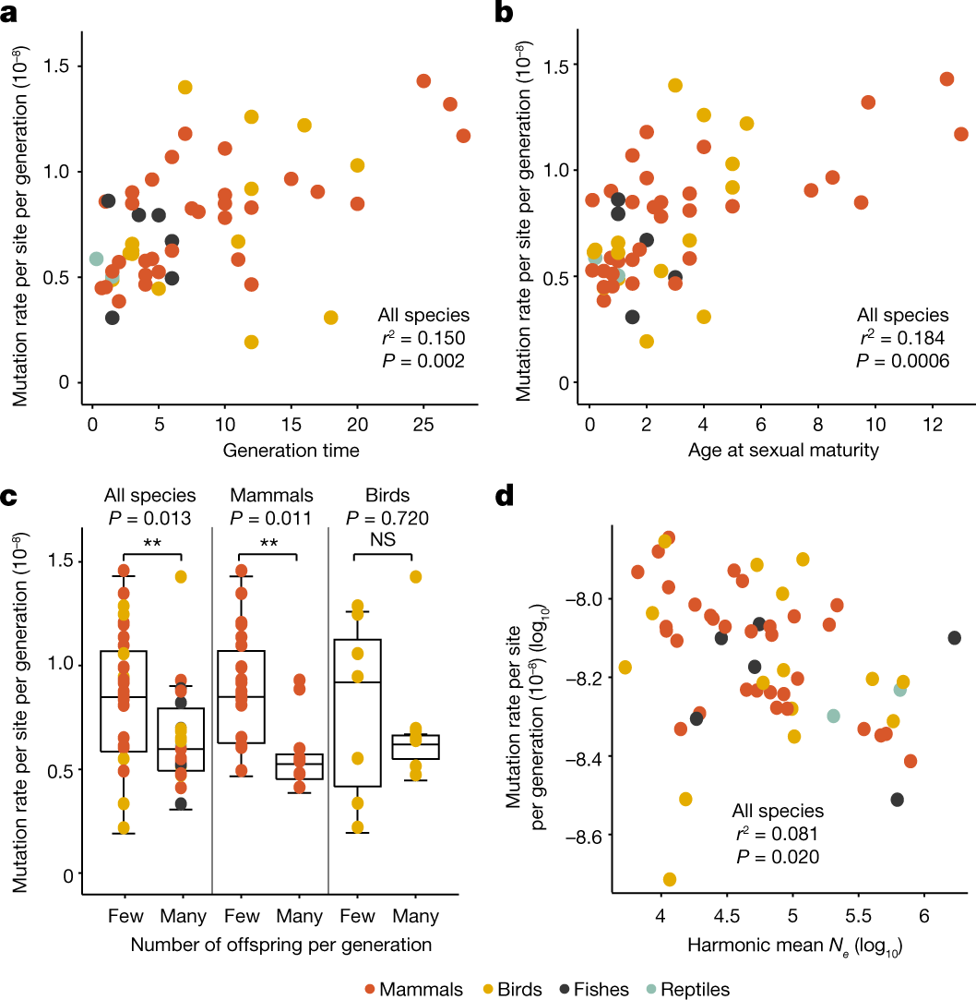
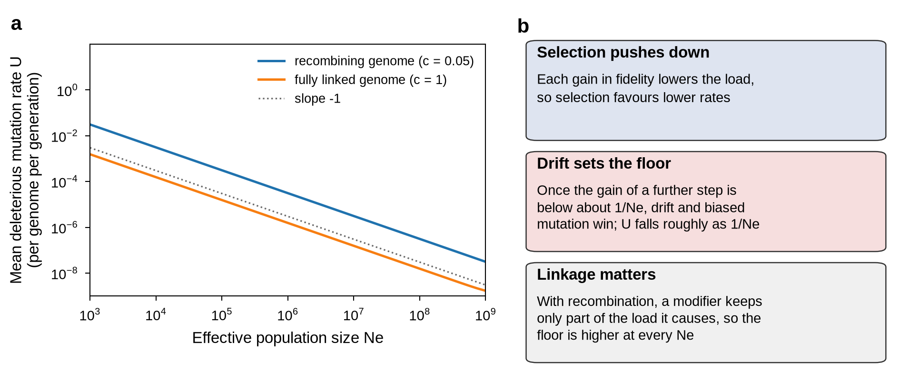

# 第 18 章 漂变壁垒与突变危害假说

**地位：突变率演化的漂变壁垒部分验证；突变危害作为基因组结构的主要原因存在争议。** 漂变壁垒假说认为，选择会把突变率一直压低，直到进一步改进带来的好处小到在随机遗传漂变面前显现不出来；因此有效群体大小（Ne）较小的物种突变率较高。微生物之间和脊椎动物之间的比较都找到了预测的负相关，但关系噪声很大，并取决于 Ne 的估计方法。与之相关的突变危害假说认为，内含子和基因间序列之类的额外 DNA 是一种微弱的突变负担，只在漂变强的地方积累。它能很好地解释一些格局，但一项校正了系统发育的检验没有找到支持，植物线粒体也与其最简单的预测相反。

本仓库相关条目：[drift-barrier-hypothesis](../../theories/drift-barrier-hypothesis/THEORY.md)、[lynch-conery-2003-genome-complexity](../../theories/lynch-conery-2003-genome-complexity/THEORY.md)、[nearly-neutral-theory](../../theories/nearly-neutral-theory/THEORY.md)、[mutational-genetic-load](../../theories/mutational-genetic-load/THEORY.md)、[mutation-accumulation](../../theories/mutation-accumulation/THEORY.md)、[mutational-hazard-hypothesis](../../theories/mutational-hazard-hypothesis/THEORY.md)。

## 18.1 内容与历史

Kimura 讨论了自然选择怎样调节突变率。他重新审视了突变率使突变负荷与替换负荷之和最小的观点，以及另一种观点：只有降低突变率的选择是有效的，因此现有突变率处于选择所能达到的物理或生理极限 [1]。Drake 发现，基因组大小相差约 6500 倍的 DNA 微生物，每个基因组的突变率只相差约 2.5 倍，约为每次复制 0.0033，所以每个碱基对的突变率与基因组大小成反比 [2]；高等真核生物每个基因组每个有性世代有 0.1–100 个突变 [3]。Sniegowski 等认为，有效应的突变大多有害，通过有利突变选择更高突变率的作用在有性群体中不太可能重要，决定突变率的可能是保真的生理代价 [4]。

Lynch 则提出，选择把突变率压到由随机遗传漂变的强度决定的下限，而不是由生理极限决定 [5]。Sung 等根据对一种基因组极小的细菌和一种基因组很大的单细胞真核生物的精确估计得出结论：突变率与 Ne 和编码 DNA 的量（有害突变的靶标）都呈负相关（图 18.2）[6]。这一假说还解释了易错聚合酶的存在，并反对选择精细调节各个基因突变率的观点 [7]。

把同样的推理用于基因组结构，就是突变危害假说。Lynch 和 Conery 认为，从原核生物到多细胞真核生物，内含子、可移动元件和重复基因的增加，是在群体大小长期缩小之后被动发生的 [8]。真核基因的每一个新特征，例如内含子或调控元件，都会提高突变为缺陷等位基因的速率；这一劣势很弱，在 Ne 小的物种中可以被漂变压倒 [9, 10]。在动物和植物中，细胞器的 Ne 相近，危害的大小取决于突变率，所以突变率低的基因组应积累更多非编码 DNA [11]。Lynch 把这一论证推广到一般的复杂性 [12, 13]。

## 18.2 预测

- **突变率与 Ne。** 在物种之间，每代突变率应随 Ne 增大而下降；如果 Ne 是主要因素，双对数斜率接近 −1（图 18.2）[6, 7]。
- **靶标大小。** 在 Ne 相同时，编码 DNA 多的物种每个位点的突变率应更低 [6]。
- **基因组大小与漂变。** Ne 较小的谱系应携带更多内含子、可移动元件和基因间 DNA [8, 10]。
- **细胞器。** 突变率低的细胞器基因组应比突变率高的更大、非编码 DNA 更多 [11, 14]。

## 18.3 支持证据

- **微生物。** DNA 微生物每个基因组的突变率几乎恒定 [2]；基因组小的细菌和基因组大的真核生物合起来，符合突变率随 Ne 和编码 DNA 增加而下降的关系 [6]。
- **脊椎动物。** 在来自 68 种哺乳动物、鱼类、鸟类和爬行动物的 151 个亲子三联体中，每代突变率相差 40 倍；长期 Ne 较大的物种每代突变率往往较低，符合漂变壁垒的预测（图 18.1）[15]。
- **细菌基因组。** 在细菌中，全基因组的替换突变与沉默突变之比（衡量漂变的指标）随基因组增大而下降，说明漂变促进细菌基因组缩小 [16]。在 153 种原核生物中，Ne 影响泛基因组的大小 [17]。
- **动物基因组。** 在栉水虱科等足类中，11 次从地表水到地下水的独立转变之后，选择变得不那么有效，基因组平均增大约 25%，而基因组大小与体型或生长速率无关 [18]。
- **细胞器。** 植物线粒体的沉默替换率不到叶绿体的三分之一 [19]；植物线粒体基因组结构变化快而序列变化慢 [20]。它们庞大且富含非编码 DNA 的基因组，例如 773,279 bp 的葡萄线粒体基因组 [21]，符合低突变率下的危害预测 [11, 14]。

## 18.4 反面证据与难点

- **系统发育。** 在 Lynch 和 Conery 使用的约 30 个物种中，考虑系统发育之后，Neu 与基因数、内含子大小和数目、转座子数目或基因组大小之间的显著关联全部消失 [22]。
- **Ne 的估计。** 在脊椎动物三联体研究中，为避免循环论证，Ne 由替换率估计。这一关系在过去一百万年 Ne 的调和平均上成立，但在最近的时间点或过去 10 万年的平均上不显著 [15]。世代时间、性成熟年龄和繁殖力是突变率变异背后的关键性状 [15]。
- **植物线粒体。** 两种近期线粒体突变率大幅上升的 *Silene* 拥有已知最大的线粒体基因组，分别为 6.7 和 11.3 Mb，充满非编码 DNA，与危害预测相反 [23]。植物线粒体的特点也可以用 DNA 修复来解释：基因转换使基因中测得的突变率保持很低，而断裂诱导复制使非编码区扩张 [24]。在细胞器中检验危害假说的研究，有的与之相符，有的与之矛盾 [14]。
- **突变是盲目的吗？** Monroe 等报告，拟南芥基因体中的突变减少一半，必需基因中减少三分之二 [25]，这意味着选择作用于局部突变率。Liu 和 Zhang 发现，该分析中多出来的突变富集在测序质量低的多核苷酸串中，很可能是测序错误，并且在酵母和人类中没有看到这种格局 [26]。
- **其他限制。** 决定突变率的也可能是保真的生理代价，而不是漂变 [1, 4]。

## 18.5 地位与理由

**漂变壁垒：部分验证。突变危害作为基因组结构的主要原因：存在争议。** 在微生物和脊椎动物中都找到了突变率与 Ne 的负相关 [6, 15]，理论也给出了清楚、可检验的预测 [7]。但这一关系噪声很大，依赖估计 Ne 的时间窗口，还要与生活史性状竞争解释力 [15]。在基因组结构方面，一些比较支持漂变的作用 [16, 18]，但校正系统发育的检验不支持 [22]，植物线粒体也表明高突变率可以与巨大的基因组同时存在 [23, 24]。

## 18.6 植物、作物与葡萄

- **突变率。** 拟南芥突变积累系给出每代每个位点约 7 × 10⁻⁹ 个替换，以 G:C→A:T 转换为主 [27, 28]；单核苷酸突变在转座子和着丝粒区更常见 [28]。
- **多年生植物的体细胞突变。** 在来自八种植物不同组织的 754 个基因组中，多年生植物茎尖分生组织单位时间积累的突变少于根尖，一年生植物则没有这种差别，符合在茎突变可以传给后代时对体细胞突变率的选择 [29]。植物生殖细胞系何时分离，比过去认为的更不确定 [30]。
- **葡萄克隆。** 在 15 个仙粉黛克隆中，杂合体细胞突变在基因间区最常见，在内含子中多于外显子；重复的基因间区是克隆多样性的主要来源，各克隆都带有可能有害的突变 [31]。长期存在的克隆是一个有效大小很小、没有重组的谱系，这正是漂变最强的条件；除非细胞和枝条之间的选择把它们清除，有害的体细胞突变会积累下来。
- **植物细胞器。** 植物线粒体，包括葡萄的线粒体，是危害假说的主要反例和检验对象 [21, 23, 24]。

## 18.7 用公开数据检验

- **数据。** 来自三联体和突变积累系的突变率 [15, 28]；用于估计 Ne 的多样性数据；基因组大小和内含子数；带替换率的细胞器基因组 [23]。
- **工具。** 用于物种间比较的系统发育广义最小二乘法 [15, 22]；估计长期 Ne 的 PSMC [15]；作为选择效率指标的 dN/dS [16, 18]。
- **分析。** (1) 在系统发育校正下用 log 突变率对 log Ne 回归，并比较 Ne 的不同时间窗口 [15]。(2) 在 Ne 多次转变的类群内，检验基因组大小或内含子密度与 dN/dS 的关系 [18]。(3) 在多年生作物的克隆中，比较基因内和重复序列中的体细胞突变密度 [31]。脚本 [`scripts/ch18_drift_barrier_figures.py`](../scripts/ch18_drift_barrier_figures.py) 计算一个简单漂变壁垒模型中的平稳突变率（图 18.2）。
- **什么结果会推翻理论。** 系统发育校正后 Ne 与突变率呈强正相关；或者 Ne 较大的谱系一贯含有更多非编码序列。

## 18.8 未解决的问题

- 突变率的变异中，有多少来自 Ne，有多少来自世代时间等生活史性状 [15]？
- 控制系统发育之后，小群体中的基因组扩张是否普遍 [18, 22]？
- 突变率高的巨大线粒体基因组应怎样解释 [23, 24]？
- 葡萄这样长期克隆繁殖的作物是否积累有害体细胞突变，速度多快 [29, 31]？

## 18.9 常见错误

- 比较物种而不作系统发育校正 [22]。
- 把由多样性估计的 Ne 当作与估计时所用突变率无关的量 [15]。
- 未检查测序错误就接受局部突变率的差异 [26]。
- 认为突变危害是额外 DNA 唯一可能的原因；修复机制和自私元件也在起作用 [8, 24]。

## 图

**图 18.1.** 种间生殖细胞系突变率（GMR）变异的预测因子。a–c，用系统发育回归（PGLS）发现，模拟的每代突变率与三个生活史性状显著正相关：物种平均世代时间（a）、性成熟年龄（b）和每代后代数（c）。共有 55 个物种具有模拟的每代突变率，其中 32 种哺乳动物、15 种鸟类。c 中显示中位数、四分位距以及不含离群值的最大值和最小值。d，用系统发育回归（PGLS），各物种的平均每代突变率与过去 100 万年有效群体大小（Ne）的调和平均负相关。图原样转载、图注一句改写，出自 Bergeron LA, Besenbacher S, Zheng J, et al. (2023) Evolution of the germline mutation rate across vertebrates. *Nature* 615:285-291, Figure 3. https://doi.org/10.1038/s41586-023-05752-y。许可：CC BY 4.0（https://creativecommons.org/licenses/by/4.0/）。

**图 18.2.** (a) 漂变壁垒模型平稳状态下全基因组平均有害突变率 U 与 Ne 的关系。U 以 25% 为一级在阶梯上移动；降低保真度的突变是提高保真度的突变的四倍；下降一级的好处等于它所去掉的负荷中仍与它连锁的比例 c（c = 1 为完全连锁，c = 0.05 为可重组）。点线的斜率为 −1。(b) 模型说明了什么。用 [`scripts/ch18_drift_barrier_figures.py`](../scripts/ch18_drift_barrier_figures.py) 生成；计算是确定性的。

## 参考文献

1. Kimura M (1967) On the evolutionary adjustment of spontaneous mutation rates. *Genetical Research* 9:23-34. https://doi.org/10.1017/S0016672300010284
2. Drake JW (1991) A constant rate of spontaneous mutation in DNA-based microbes. *Proceedings of the National Academy of Sciences* 88:7160-7164. https://doi.org/10.1073/pnas.88.16.7160
3. Drake JW, Charlesworth B, Charlesworth D, et al. (1998) Rates of Spontaneous Mutation. *Genetics* 148:1667-1686. https://doi.org/10.1093/genetics/148.4.1667
4. Sniegowski PD, Gerrish PJ, Johnson T, et al. (2000) The evolution of mutation rates: separating causes from consequences. *BioEssays* 22:1057-1066. https://doi.org/10.1002/1521-1878(200012)22:12%3C1057::AID-BIES3%3E3.0.CO;2-W
5. Lynch M (2010) Evolution of the mutation rate. *Trends in Genetics* 26:345-352. https://doi.org/10.1016/j.tig.2010.05.003
6. Sung W, Ackerman MS, Miller SF, et al. (2012) Drift-barrier hypothesis and mutation-rate evolution. *Proceedings of the National Academy of Sciences* 109:18488-18492. https://doi.org/10.1073/pnas.1216223109
7. Lynch M, Ackerman MS, Gout JF, et al. (2016) Genetic drift, selection and the evolution of the mutation rate. *Nature Reviews Genetics* 17:704-714. https://doi.org/10.1038/nrg.2016.104
8. Lynch M, Conery JS (2003) The Origins of Genome Complexity. *Science* 302:1401-1404. https://doi.org/10.1126/science.1089370
9. Lynch M (2002) Intron evolution as a population-genetic process. *Proceedings of the National Academy of Sciences* 99:6118-6123. https://doi.org/10.1073/pnas.092595699
10. Lynch M (2006) The Origins of Eukaryotic Gene Structure. *Molecular Biology and Evolution* 23:450-468. https://doi.org/10.1093/molbev/msj050
11. Lynch M, Koskella B, Schaack S (2006) Mutation Pressure and the Evolution of Organelle Genomic Architecture. *Science* 311:1727-1730. https://doi.org/10.1126/science.1118884
12. Lynch M (2007) The frailty of adaptive hypotheses for the origins of organismal complexity. *Proceedings of the National Academy of Sciences* 104:8597-8604. https://doi.org/10.1073/pnas.0702207104
13. Lynch M, Bobay LM, Catania F, et al. (2011) The Repatterning of Eukaryotic Genomes by Random Genetic Drift. *Annual Review of Genomics and Human Genetics* 12:347-366. https://doi.org/10.1146/annurev-genom-082410-101412
14. Smith DR (2016) The mutational hazard hypothesis of organelle genome evolution: 10 years on. *Molecular Ecology* 25:3769-3775. https://doi.org/10.1111/mec.13742
15. Bergeron LA, Besenbacher S, Zheng J, et al. (2023) Evolution of the germline mutation rate across vertebrates. *Nature* 615:285-291. https://doi.org/10.1038/s41586-023-05752-y
16. Kuo CH, Moran NA, Ochman H (2009) The consequences of genetic drift for bacterial genome complexity. *Genome Research* 19:1450-1454. https://doi.org/10.1101/gr.091785.109
17. Bobay LM, Ochman H (2018) Factors driving effective population size and pan-genome evolution in bacteria. *BMC Evolutionary Biology* 18:153. https://doi.org/10.1186/s12862-018-1272-4
18. Lefébure T, Morvan C, Malard F, et al. (2017) Less effective selection leads to larger genomes. *Genome Research* 27:1016-1028. https://doi.org/10.1101/gr.212589.116
19. Wolfe KH, Li WH, Sharp PM (1987) Rates of nucleotide substitution vary greatly among plant mitochondrial, chloroplast, and nuclear DNAs. *Proceedings of the National Academy of Sciences* 84:9054-9058. https://doi.org/10.1073/pnas.84.24.9054
20. Palmer JD, Herbon LA (1988) Plant mitochondrial DNA evolved rapidly in structure, but slowly in sequence. *Journal of Molecular Evolution* 28:87-97. https://doi.org/10.1007/BF02143500
21. Goremykin VV, Salamini F, Velasco R, et al. (2008) Mitochondrial DNA of Vitis vinifera and the Issue of Rampant Horizontal Gene Transfer. *Molecular Biology and Evolution* 26:99-110. https://doi.org/10.1093/molbev/msn226
22. Whitney KD, Garland T (2010) Did Genetic Drift Drive Increases in Genome Complexity? *PLoS Genetics* 6:e1001080. https://doi.org/10.1371/journal.pgen.1001080
23. Sloan DB, Alverson AJ, Chuckalovcak JP, et al. (2012) Rapid Evolution of Enormous, Multichromosomal Genomes in Flowering Plant Mitochondria with Exceptionally High Mutation Rates. *PLoS Biology* 10:e1001241. https://doi.org/10.1371/journal.pbio.1001241
24. Christensen AC (2013) Plant Mitochondrial Genome Evolution Can Be Explained by DNA Repair Mechanisms. *Genome Biology and Evolution* 5:1079-1086. https://doi.org/10.1093/gbe/evt069
25. Monroe JG, Srikant T, Carbonell-Bejerano P, et al. (2022) Mutation bias reflects natural selection in Arabidopsis thaliana. *Nature* 602:101-105. https://doi.org/10.1038/s41586-021-04269-6
26. Liu H, Zhang J (2022) Is the Mutation Rate Lower in Genomic Regions of Stronger Selective Constraints? *Molecular Biology and Evolution* 39:msac169. https://doi.org/10.1093/molbev/msac169
27. Ossowski S, Schneeberger K, Lucas-Lledó JI, et al. (2010) The Rate and Molecular Spectrum of Spontaneous Mutations in Arabidopsis thaliana. *Science* 327:92-94. https://doi.org/10.1126/science.1180677
28. Weng ML, Becker C, Hildebrandt J, et al. (2019) Fine-Grained Analysis of Spontaneous Mutation Spectrum and Frequency in Arabidopsis thaliana. *Genetics* 211:703-714. https://doi.org/10.1534/genetics.118.301721
29. Wang L, Ji Y, Hu Y, et al. (2019) The architecture of intra-organism mutation rate variation in plants. *PLOS Biology* 17:e3000191. https://doi.org/10.1371/journal.pbio.3000191
30. Lanfear R (2018) Do plants have a segregated germline? *PLOS Biology* 16:e2005439. https://doi.org/10.1371/journal.pbio.2005439
31. Vondras AM, Minio A, Blanco-Ulate B, et al. (2019) The genomic diversification of grapevine clones. *BMC Genomics* 20:972. https://doi.org/10.1186/s12864-019-6211-2
