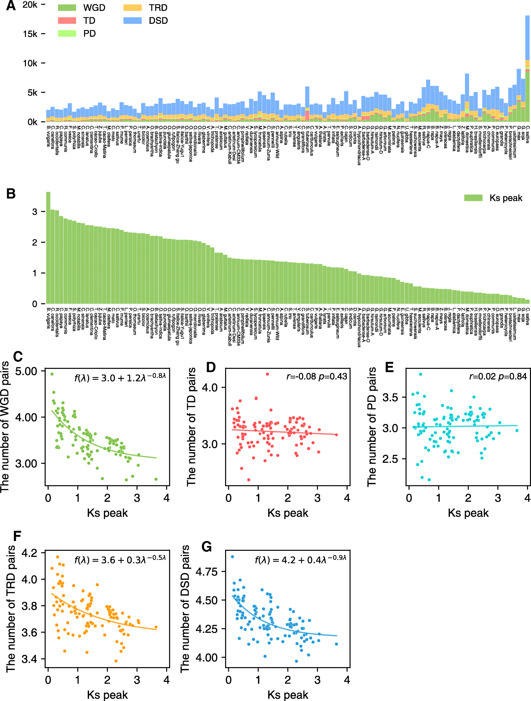
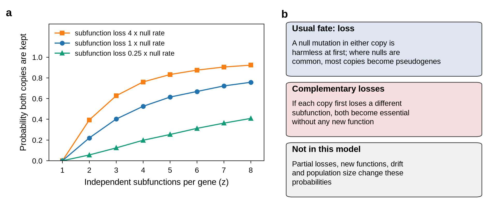

# Chapter 19. Gene duplication: Ohno and subfunctionalization

**Status: Most new duplicates are lost, and duplication is a major source of new genes: Verified. Subfunctionalization as the main way both copies are kept: Partly verified.** Genomes gain duplicate genes at a high rate, and most copies are silenced within a few million years. The survivors are kept for several reasons: one copy gains a new function, the copies divide the functions of the ancestral gene between them, the extra dosage is useful, or a conflict between two functions of one gene is resolved. All of these happen. Which is most common depends on the organism, the kind of duplication and the age of the copies.

Related notes in this repository: [ddc-subfunctionalization](../../skills/genomics-theory-mining/theories/ddc-subfunctionalization/THEORY.md), [he-zhang-2005-subneofunctionalization](../../skills/genomics-theory-mining/theories/he-zhang-2005-subneofunctionalization/THEORY.md), [lynch-conery-2000-duplicate-fate](../../skills/genomics-theory-mining/theories/lynch-conery-2000-duplicate-fate/THEORY.md), [lynch-force-2000-subfunctionalization](../../skills/genomics-theory-mining/theories/lynch-force-2000-subfunctionalization/THEORY.md), [walsh-1995-neo-versus-pseudo](../../skills/genomics-theory-mining/theories/walsh-1995-neo-versus-pseudo/THEORY.md), [kondrashov-2002-purifying-both-paralogs](../../skills/genomics-theory-mining/theories/kondrashov-2002-purifying-both-paralogs/THEORY.md).

## 19.1 Statement and history

Ohno’s book *Evolution by Gene Duplication* made duplication the main source of new genes [1]. In the classical model that followed, one member of a duplicated pair usually degenerates within a few million years by accumulating harmful mutations while the other keeps the original function; on rare occasions one copy acquires a new adaptive function and both are kept [2]. Walsh gave the odds of the two outcomes. If null alleles are neutral and a beneficial allele with selection coefficient s arises at ρ times the rate of nulls, the probability that the beneficial allele is fixed first is ([1 − e⁻ˢ]/[ρS] + 1)⁻¹, with S = 4Ne·s. A pseudogene is the likely fate unless ρS ≫ 1, but in large populations new function can be the expected fate [3].

Two lines of work changed this picture. Hughes argued that copies are not free to change at random: in the tetraploid frog *Xenopus laevis* expressed duplicates are under purifying selection, and one gene often carries two functions before duplication allows each copy to specialize [4]. Force and colleagues proposed the duplication-degeneration-complementation (DDC) model: complementary degenerative mutations in different regulatory elements of the two copies can make both necessary, so that they are kept without any new function [2]. The probability of keeping both copies this way depends on gene structure, linkage, mutation rates and population size; it can be appreciable when the long-term effective population size is about 10⁵ or smaller, especially with more than two independently mutable subfunctions per gene, and partial loss-of-function mutations raise it further [5]. Unless there is selection against duplicates, the probability that a new duplicate becomes established is usually no less than half the neutral value of 1/(4N), and it can be much larger when neofunctionalizing mutations are common [6].

## 19.2 What the theory predicts

- **High birth and death.** Duplicates should arise often and most should be lost soon after [7].
- **Purifying selection on survivors.** Surviving pairs should mostly be under purifying selection, perhaps relaxed at first [7, 8].
- **Fate depends on structure.** Genes with more independent regulatory subfunctions should be kept more often (Figure 19.2) [2, 5].
- **Signatures of each fate.** Neofunctionalization should leave asymmetric rates and a new function in one copy; subfunctionalization should leave complementary expression; dosage sharing should leave reduced expression of each copy [9, 10, 11].

## 19.3 Evidence for

- **Rates of birth and death.** In several eukaryotic genomes duplicates arise at about 0.01 per gene per million years; the vast majority are silenced within a few million years, and the few survivors then experience strong purifying selection [7].
- **Purifying selection on both copies.** In 26 bacterial, six archaeal and seven eukaryotic genomes, most young paralogous pairs have Kn/Ks ≪ 1 and evolve at similar rates without significant asymmetry; selection on them is weaker than on unduplicated orthologs, but there is no phase of neutral evolution [8].
- **New functions.** The primate gene for eosinophil cationic protein arose by duplication of the gene for eosinophil-derived neurotoxin about 31 million years ago and evolved under positive selection, with a rapid rise in arginine residues that probably produced its anti-pathogen function [12]. In yeast, 95% of the cases of accelerated evolution after whole-genome duplication involve only one member of a gene pair [13]. Among young *Drosophila* duplicates, neofunctionalization accounts for almost two-thirds of retained pairs, and new functions nearly always arise in the younger copy [14].
- **Escape from adaptive conflict.** The yeast genes *GAL1* and *GAL3* come from one bifunctional ancestral gene, and duplication allowed the regulation of the two functions to be separated [15]. A duplicated gene of the anthocyanin pathway in morning glories is best explained in the same way [16].
- **Subfunctionalization and mixed fates.** Neither neo- nor subfunctionalization alone explains the patterns of protein interaction in yeast or gene expression in human duplicates; rapid subfunctionalization followed by prolonged neofunctionalization does [9]. In *Arabidopsis*, 85% of 280 pairs of regulatory paralogs differ in expression across organs, and 45% of the comparisons with such an effect show complementary patterns [17]. In cotton polyploids, 10 of 40 homoeologous pairs show silencing or unequal expression in ovules, sometimes reciprocal between organs [18].
- **Dosage.** In mammals, subfunctionalization of expression evolves slowly, and most young duplicates are down-regulated to match the expression of single-copy genes [11]. Reduced expression after duplication helps keep old duplicates that remain functionally similar [19]. In *Paramecium*, dosage constraints are major factors that oppose gene loss after whole-genome duplication [20].

## 19.4 Evidence against, and difficulties

- **No single fate.** The models make different predictions at different stages of a duplicate’s life, and there is no consensus on how duplicates are fixed and kept [10]. The “new” function of one copy is often a secondary property that was always present [21].
- **Neutral subfunctionalization may be rare in some groups.** In mammals, subfunctionalization of expression is rare among young duplicates, possibly because tandem duplicates share regulatory elements [11]; in *Drosophila* the leading fate of young pairs is neofunctionalization [14].
- **Classical model challenged.** Hughes argued against the idea that a redundant copy drifts freely and then finds a new function [4]; copies are under purifying selection from early on [8].
- **Duplication type matters.** Genes kept after whole-genome duplication differ from those kept after small-scale duplication, so one model may not fit both [21, 22].

## 19.5 Status and reasoning

**Loss of most duplicates and duplication as a source of new genes: verified. Subfunctionalization as the main route: partly verified.** The high birth and death of duplicates and the purifying selection on survivors are measured in many genomes [7, 8, 23]. Cases of new function, escape from adaptive conflict and complementary expression are well documented [12, 15, 17]. Subfunctionalization explains many retained pairs, but genome-wide estimates of its share vary with organism and method, and neofunctionalization and dosage sharing are as common or more common in some groups [9, 11, 14].

## 19.6 Plants, crops and grapevine

- **Polyploidy in plant history.** Two groups of ancient gene duplications in the ancestors of seed plants and of angiosperms, around 319 and 192 million years ago, point to whole-genome duplications and enriched regulatory genes for seed and flower development [24]. In *Arabidopsis*, genes for signal transduction and transcription were preferentially kept after ancient polyploidy and genes for DNA repair were preferentially lost; fewer than half of the pairs from the most recent event still have correlated expression [22].
- **Modes of duplication.** In 141 plant genomes, the number of pairs from whole-genome duplication falls exponentially with their age, while tandem and proximal duplicates show no significant decrease over time and are biased toward self-defence functions (Figure 19.1) [23]. Duplicates contribute to crop traits such as grain quality, fruit shape and flowering time [25].
- **Grapevine.** The grapevine genome has not undergone a recent genome duplication, and its haploid content derives from three ancestral genomes, an arrangement shared by many dicotyledons [26]. Gene families tied to aroma have expanded [26]. Grapevine has 69 putatively functional terpene synthase genes, 20 partial ones and 63 probable pseudogenes, with a dense cluster of 45 on chromosome 18 [27]. Its stilbene synthase family has 48 genes, at least 32 potentially functional, whereas most stilbene-producing plants have two to five; both stilbene and chalcone synthase evolution are dominated by purifying selection [28]. The berry colour locus carries two very similar adjacent genes, *VvMYBA1* and *VvMYBA2*, either of which can regulate colour [29].
- **Clonal crops.** In a vegetatively propagated cultivar, each copy in a tandem cluster can be lost by somatic mutation in one clone, so clones can differ in gene copy number as well as in sequence.

## 19.7 How to test it with public data

- **Data.** Chromosome-level genomes with annotations, such as the 141 plant genomes in the Plant Duplicate Gene Database [23]; expression atlases across tissues for paralog pairs [11, 17].
- **Tools.** DupGen_finder to classify duplication modes [23]; MCScanX for synteny and collinearity [30]; WGDI and wgd for whole-genome duplications and Ks distributions [31, 32]; OrthoFinder for gene trees and duplication events [33].
- **Analysis.** (1) Classify duplicates by mode and plot their numbers against Ks [23]. (2) Compare Kn/Ks between copies and with single-copy orthologs [8]. (3) Test expression for complementarity, gain in one copy, or reduced summed expression, using an outgroup to infer the ancestral state [11, 14]. The script [`scripts/ch19_duplication_figures.py`](../scripts/ch19_duplication_figures.py) simulates the DDC model (Figure 19.2).
- **What would break the theory.** Most young duplicates surviving neutrally for long periods, or retained pairs with no sign of new function, divided function or dosage effects.

## 19.8 Open questions

- What share of retained duplicates in plants is due to each fate, and how does it change with age [10, 23]?
- How often is the new function of a copy a secondary property that was already present [21]?
- Why are tandem duplicates in plant defence genes kept at a steady rate [23]?
- How do grapevine terpene and stilbene synthase clusters vary among cultivars and clones [27, 28]?

## 19.9 Common mistakes

- Treating Ohno’s model of a redundant copy free to change as the usual fate [4, 8].
- Inferring subfunctionalization from expression differences without the ancestral state [14].
- Mixing duplicates from whole-genome and small-scale duplication in one analysis [21, 23].
- Counting genes in a family without separating functional genes from pseudogenes and fragments [27].

## Figures

**Figure 19.1.** Changes in abundance of different modes of duplicated gene pairs over time. a The distribution of number of gene pairs derived from different modes of duplication in 141 plant genomes. Genomes with abnormal Ks peaks because fragmented assembly hindered the identification of large syntenic blocks were not included. b The fitted Ks peak corresponding to the most recent WGD for each species. c–g The relationship between the log10-transformed number of different types of gene pairs and Ks peak of WGD genes from different taxa, excluding those taxa with abnormal Ks peaks due to fragmented assembly. c WGD-pairs. d TD-pairs: transposed gene pairs. e PD-pairs: proximal gene pairs. f TRD-pairs: transposed gene pairs. g DSD-pairs: dispersed gene pairs. Exponential fit and linear regression analysis were performed. The exponential equation was annotated in subplots c, f, and g; Pearson correlation coefficient (r) was annotated in subplots d and e. (In the paper, TD-pairs are tandem duplicate pairs; the caption is reproduced as published.) Reproduced unchanged from Qiao X, Li Q, Yin H, et al. (2019) Gene duplication and evolution in recurring polyploidization–diploidization cycles in plants. *Genome Biology* 20:38, Figure 3. https://doi.org/10.1186/s13059-019-1650-2. Licence: CC BY 4.0 (https://creativecommons.org/licenses/by/4.0/).

**Figure 19.2.** (a) Probability that both copies of a new duplicate are kept by subfunctionalization in a DDC model, against the number of independent regulatory subfunctions per gene, z. Degenerative mutations are fixed one at a time: a null mutation of either copy (relative rate 1) or the loss of one subfunction (relative rate r per subfunction, r = 0.25, 1 or 4). A loss is fixed only if another working copy still carries that subfunction. The pair is lost when one copy becomes a null and kept when each copy has lost a subfunction that the other still carries. No new functions arise; 20,000 pairs per point. (b) What the model shows. Made with [`scripts/ch19_duplication_figures.py`](../scripts/ch19_duplication_figures.py), seed 20261126.

## References

1. Ohno S (1970) Evolution by Gene Duplication. *Springer, Berlin*. https://doi.org/10.1007/978-3-642-86659-3
2. Force A, Lynch M, Pickett FB, et al. (1999) Preservation of Duplicate Genes by Complementary, Degenerative Mutations. *Genetics* 151:1531-1545. https://doi.org/10.1093/genetics/151.4.1531
3. Walsh JB (1995) How often do duplicated genes evolve new functions? *Genetics* 139:421-428. https://doi.org/10.1093/genetics/139.1.421
4. Hughes AL (1994) The evolution of functionally novel proteins after gene duplication. *Proceedings of the Royal Society of London. Series B: Biological Sciences* 256:119-124. https://doi.org/10.1098/rspb.1994.0058
5. Lynch M, Force A (2000) The Probability of Duplicate Gene Preservation by Subfunctionalization. *Genetics* 154:459-473. https://doi.org/10.1093/genetics/154.1.459
6. Lynch M, O'Hely M, Walsh B, et al. (2001) The Probability of Preservation of a Newly Arisen Gene Duplicate. *Genetics* 159:1789-1804. https://doi.org/10.1093/genetics/159.4.1789
7. Lynch M, Conery JS (2000) The Evolutionary Fate and Consequences of Duplicate Genes. *Science* 290:1151-1155. https://doi.org/10.1126/science.290.5494.1151
8. Kondrashov FA, Rogozin IB, Wolf YI, et al. (2002) Selection in the evolution of gene duplications. *Genome Biology* 3:research0008.1. https://doi.org/10.1186/gb-2002-3-2-research0008
9. He X, Zhang J (2005) Rapid Subfunctionalization Accompanied by Prolonged and Substantial Neofunctionalization in Duplicate Gene Evolution. *Genetics* 169:1157-1164. https://doi.org/10.1534/genetics.104.037051
10. Innan H, Kondrashov F (2010) The evolution of gene duplications: classifying and distinguishing between models. *Nature Reviews Genetics* 11:97-108. https://doi.org/10.1038/nrg2689
11. Lan X, Pritchard JK (2016) Coregulation of tandem duplicate genes slows evolution of subfunctionalization in mammals. *Science* 352:1009-1013. https://doi.org/10.1126/science.aad8411
12. Zhang J, Rosenberg HF, Nei M (1998) Positive Darwinian selection after gene duplication in primate ribonuclease genes. *Proceedings of the National Academy of Sciences* 95:3708-3713. https://doi.org/10.1073/pnas.95.7.3708
13. Kellis M, Birren BW, Lander ES (2004) Proof and evolutionary analysis of ancient genome duplication in the yeast Saccharomyces cerevisiae. *Nature* 428:617-624. https://doi.org/10.1038/nature02424
14. Assis R, Bachtrog D (2013) Neofunctionalization of young duplicate genes in Drosophila. *Proceedings of the National Academy of Sciences* 110:17409-17414. https://doi.org/10.1073/pnas.1313759110
15. Hittinger CT, Carroll SB (2007) Gene duplication and the adaptive evolution of a classic genetic switch. *Nature* 449:677-681. https://doi.org/10.1038/nature06151
16. Des Marais DL, Rausher MD (2008) Escape from adaptive conflict after duplication in an anthocyanin pathway gene. *Nature* 454:762-765. https://doi.org/10.1038/nature07092
17. Duarte JM, Cui L, Wall PK, et al. (2006) Expression Pattern Shifts Following Duplication Indicative of Subfunctionalization and Neofunctionalization in Regulatory Genes of Arabidopsis. *Molecular Biology and Evolution* 23:469-478. https://doi.org/10.1093/molbev/msj051
18. Adams KL, Cronn R, Percifield R, et al. (2003) Genes duplicated by polyploidy show unequal contributions to the transcriptome and organ-specific reciprocal silencing. *Proceedings of the National Academy of Sciences* 100:4649-4654. https://doi.org/10.1073/pnas.0630618100
19. Qian W, Liao BY, Chang AYF, et al. (2010) Maintenance of duplicate genes and their functional redundancy by reduced expression. *Trends in Genetics* 26:425-430. https://doi.org/10.1016/j.tig.2010.07.002
20. Gout JF, Lynch M (2015) Maintenance and Loss of Duplicated Genes by Dosage Subfunctionalization. *Molecular Biology and Evolution* 32:2141-2148. https://doi.org/10.1093/molbev/msv095
21. Conant GC, Wolfe KH (2008) Turning a hobby into a job: How duplicated genes find new functions. *Nature Reviews Genetics* 9:938-950. https://doi.org/10.1038/nrg2482
22. Blanc G, Wolfe KH (2004) Functional divergence of duplicated genes formed by polyploidy during Arabidopsis evolution. *The Plant Cell* 16:1679-1691. https://doi.org/10.1105/tpc.021410
23. Qiao X, Li Q, Yin H, et al. (2019) Gene duplication and evolution in recurring polyploidization–diploidization cycles in plants. *Genome Biology* 20:38. https://doi.org/10.1186/s13059-019-1650-2
24. Jiao Y, Wickett NJ, Ayyampalayam S, et al. (2011) Ancestral polyploidy in seed plants and angiosperms. *Nature* 473:97-100. https://doi.org/10.1038/nature09916
25. Panchy N, Lehti-Shiu M, Shiu SH (2016) Evolution of Gene Duplication in Plants. *Plant Physiology* 171:2294-2316. https://doi.org/10.1104/pp.16.00523
26. The French–Italian Public Consortium for Grapevine Genome Characterization (2007) The grapevine genome sequence suggests ancestral hexaploidization in major angiosperm phyla. *Nature* 449:463-467. https://doi.org/10.1038/nature06148
27. Martin DM, Aubourg S, Schouwey MB, et al. (2010) Functional Annotation, Genome Organization and Phylogeny of the Grapevine (Vitis vinifera) Terpene Synthase Gene Family Based on Genome Assembly, FLcDNA Cloning, and Enzyme Assays. *BMC Plant Biology* 10:226. https://doi.org/10.1186/1471-2229-10-226
28. Parage C, Tavares R, Réty S, et al. (2012) Structural, Functional, and Evolutionary Analysis of the Unusually Large Stilbene Synthase Gene Family in Grapevine. *Plant Physiology* 160:1407-1419. https://doi.org/10.1104/pp.112.202705
29. Walker AR, Lee E, Bogs J, et al. (2007) White grapes arose through the mutation of two similar and adjacent regulatory genes. *The Plant Journal* 49:772-785. https://doi.org/10.1111/j.1365-313X.2006.02997.x
30. Wang Y, Tang H, DeBarry JD, et al. (2012) MCScanX: a toolkit for detection and evolutionary analysis of gene synteny and collinearity. *Nucleic Acids Research* 40:e49-e49. https://doi.org/10.1093/nar/gkr1293
31. Sun P, Jiao B, Yang Y, et al. (2022) WGDI: A user-friendly toolkit for evolutionary analyses of whole-genome duplications and ancestral karyotypes. *Molecular Plant* 15:1841-1851. https://doi.org/10.1016/j.molp.2022.10.018
32. Zwaenepoel A, Van de Peer Y (2019) wgd—simple command line tools for the analysis of ancient whole-genome duplications. *Bioinformatics* 35:2153-2155. https://doi.org/10.1093/bioinformatics/bty915
33. Emms DM, Kelly S (2019) OrthoFinder: phylogenetic orthology inference for comparative genomics. *Genome Biology* 20:238. https://doi.org/10.1186/s13059-019-1832-y
