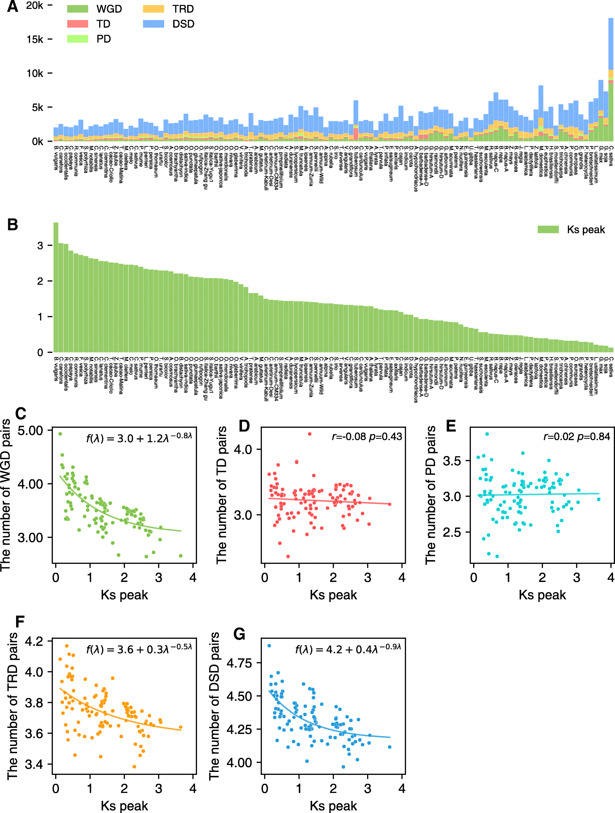
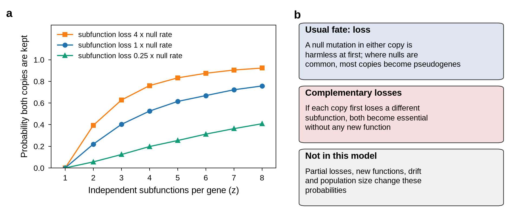

# 第 19 章 基因重复：Ohno 与亚功能化

**地位：大多数新重复基因会丢失、重复是新基因的主要来源：已验证。亚功能化是两个拷贝都被保留的主要途径：部分验证。** 基因组以很高的速率获得重复基因，大多数拷贝在几百万年内失活。幸存者被保留的原因有好几种：一个拷贝获得新功能；两个拷贝分担祖先基因的功能；额外的剂量有用；或者一个基因两种功能之间的冲突得到化解。这些情况都会发生。哪一种最常见，取决于生物、重复的类型和拷贝的年龄。

本仓库相关条目：[ddc-subfunctionalization](../../skills/genomics-theory-mining/theories/ddc-subfunctionalization/THEORY.md)、[he-zhang-2005-subneofunctionalization](../../skills/genomics-theory-mining/theories/he-zhang-2005-subneofunctionalization/THEORY.md)、[lynch-conery-2000-duplicate-fate](../../skills/genomics-theory-mining/theories/lynch-conery-2000-duplicate-fate/THEORY.md)、[lynch-force-2000-subfunctionalization](../../skills/genomics-theory-mining/theories/lynch-force-2000-subfunctionalization/THEORY.md)、[walsh-1995-neo-versus-pseudo](../../skills/genomics-theory-mining/theories/walsh-1995-neo-versus-pseudo/THEORY.md)、[kondrashov-2002-purifying-both-paralogs](../../skills/genomics-theory-mining/theories/kondrashov-2002-purifying-both-paralogs/THEORY.md)。

## 19.1 内容与历史

Ohno 的著作《Evolution by Gene Duplication》把基因重复作为新基因的主要来源 [1]。在随后的经典模型中，重复基因对中的一个成员通常在几百万年内因积累有害突变而退化，另一个保持原有功能；偶尔一个拷贝获得新的适应性功能，两个都被保留 [2]。Walsh 计算了这两种结局的概率。若无效等位基因是中性的，而选择系数为 s 的有利等位基因以无效突变 ρ 倍的速率出现，则有利等位基因先被固定的概率为 ([1 − e⁻ˢ]/[ρS] + 1)⁻¹，其中 S = 4Ne·s。除非 ρS ≫ 1，假基因化是可能的结局；但在大群体中，新功能可以是预期的结局 [3]。

有两条研究线索改变了这一图景。Hughes 认为拷贝并不能随意变化：在四倍体非洲爪蟾中，表达的重复基因受纯化选择；而且一个基因在重复之前常常兼有两种功能，重复之后每个拷贝各自专门化 [4]。Force 等提出了重复—退化—互补（DDC）模型：两个拷贝在不同调控元件上发生互补的退化突变，可以使两者都成为必需，于是它们在没有任何新功能的情况下被保留 [2]。以这种方式保留两个拷贝的概率取决于基因结构、连锁、突变率和群体大小；当长期有效群体大小约为 10⁵ 或更小，特别是每个基因有两个以上可独立突变的亚功能时，这一概率可以相当可观，部分失功能突变会使它进一步提高 [5]。除非有针对重复基因的选择，新重复基因被确立的概率通常不低于中性值 1/(4N) 的一半；新功能化突变常见时，它可以大得多 [6]。

## 19.2 预测

- **高出生率与高死亡率。** 重复基因应频繁产生，大多数很快丢失 [7]。
- **幸存者受纯化选择。** 幸存的基因对应主要受纯化选择，起初也许较为宽松 [7, 8]。
- **结局取决于结构。** 具有更多独立调控亚功能的基因应更常被保留（图 19.2）[2, 5]。
- **每种结局的特征。** 新功能化应留下不对称的速率和一个拷贝中的新功能；亚功能化应留下互补的表达；剂量分担应使每个拷贝的表达降低 [9, 10, 11]。

## 19.3 支持证据

- **出生率与死亡率。** 在几个真核生物基因组中，重复基因以每个基因每百万年约 0.01 的速率产生；绝大多数在几百万年内失活，少数幸存者随后受到很强的纯化选择 [7]。
- **两个拷贝都受纯化选择。** 在 26 个细菌、6 个古菌和 7 个真核生物基因组中，大多数年轻旁系同源对的 Kn/Ks ≪ 1，演化速率相近，没有显著的不对称；它们受到的选择比未重复的直系同源基因弱，但没有中性演化阶段 [8]。
- **新功能。** 灵长类嗜酸性粒细胞阳离子蛋白基因约 3100 万年前由嗜酸性粒细胞衍生神经毒素基因重复产生，在正选择下演化，精氨酸残基迅速增加，可能由此产生了抗病原体功能 [12]。在酵母中，全基因组重复后 95% 的加速演化只涉及基因对中的一个成员 [13]。在果蝇的年轻重复基因中，新功能化解释了将近三分之二被保留的基因对，新功能几乎总是出现在较年轻的拷贝中 [14]。
- **摆脱适应冲突。** 酵母的 *GAL1* 和 *GAL3* 来自一个双功能的祖先基因，重复使两种功能的调控得以分开 [15]。牵牛花花青素途径中一个重复基因的演化，也最好用同样的方式解释 [16]。
- **亚功能化与混合结局。** 单独的新功能化或亚功能化都不能解释酵母重复基因的蛋白互作格局或人类重复基因的表达格局；快速亚功能化之后伴随长期的新功能化则可以 [9]。在拟南芥 280 对调控基因旁系同源对中，85% 在器官之间的表达有差异，具有这种效应的比较中 45% 显示互补格局 [17]。在棉花多倍体中，40 对部分同源基因中有 10 对在胚珠中出现沉默或不等表达，有时在器官之间互为相反 [18]。
- **剂量。** 在哺乳动物中，表达的亚功能化演化缓慢，大多数年轻重复基因被下调到与单拷贝基因相当的表达水平 [11]。重复后表达降低有助于保留功能仍然相似的古老重复基因 [19]。在草履虫中，剂量约束是阻止全基因组重复后基因丢失的主要因素 [20]。

## 19.4 反面证据与难点

- **没有单一的结局。** 各模型在重复基因生命的不同阶段给出不同预测，重复基因怎样被固定和保留还没有共识 [10]。一个拷贝的“新”功能常常是一直存在的次要性质 [21]。
- **在某些类群中中性亚功能化可能少见。** 在哺乳动物中，表达的亚功能化在年轻重复基因中很少见，可能因为串联重复共享调控元件 [11]；在果蝇中，年轻基因对的主要结局是新功能化 [14]。
- **经典模型受到挑战。** Hughes 反对冗余拷贝先自由漂变、再找到新功能的观点 [4]；拷贝从早期就受纯化选择 [8]。
- **重复类型有影响。** 全基因组重复后保留的基因与小规模重复后保留的不同，所以一个模型未必两者都适用 [21, 22]。

## 19.5 地位与理由

**大多数重复基因丢失、重复是新基因的来源：已验证。亚功能化是主要途径：部分验证。** 重复基因的高出生率与高死亡率以及幸存者受纯化选择，已在许多基因组中测得 [7, 8, 23]。新功能、摆脱适应冲突和互补表达的例子都有充分记录 [12, 15, 17]。亚功能化解释了许多被保留的基因对，但全基因组估计的比例因生物和方法而异；在一些类群中，新功能化和剂量分担同样常见甚至更常见 [9, 11, 14]。

## 19.6 植物、作物与葡萄

- **植物历史上的多倍化。** 种子植物和被子植物祖先中的两组古老基因重复，集中在约 3.19 亿年前和 1.92 亿年前，指向两次全基因组重复，并富集了种子和花发育的调控基因 [24]。在拟南芥中，古老多倍化之后信号转导和转录基因被优先保留，DNA 修复基因被优先丢失；最近一次事件产生的基因对中，仍保持相关表达的不到一半 [22]。
- **重复方式。** 在 141 个植物基因组中，全基因组重复产生的基因对数目随年龄呈指数下降，而串联和邻近重复随时间没有显著减少，并偏向自我防御功能（图 19.1）[23]。重复基因对籽粒品质、果实形状和开花时间等作物性状有贡献 [25]。
- **葡萄。** 葡萄基因组没有经历近期的基因组重复，其单倍体内容来自三个祖先基因组，这种排列为许多双子叶植物所共有 [26]。与香气有关的基因家族发生了扩张 [26]。葡萄有 69 个推定有功能的萜烯合酶基因、20 个不完整基因和 63 个可能的假基因，其中 45 个密集成簇位于 18 号染色体 [27]。其芪合酶家族有 48 个基因，至少 32 个可能有功能，而大多数产芪植物只有两到五个；芪合酶和查尔酮合酶的演化都以纯化选择为主 [28]。果实颜色位点带有两个非常相似的相邻基因 *VvMYBA1* 和 *VvMYBA2*，任何一个都能调控颜色 [29]。
- **克隆繁殖的作物。** 在营养繁殖的品种中，串联基因簇中的每个拷贝都可能在某个克隆中因体细胞突变而丢失，所以克隆之间不仅序列不同，基因拷贝数也可能不同。

## 19.7 用公开数据检验

- **数据。** 有注释的染色体水平基因组，例如植物重复基因数据库中的 141 个植物基因组 [23]；旁系同源对在各组织中的表达图谱 [11, 17]。
- **工具。** 用 DupGen_finder 划分重复方式 [23]；用 MCScanX 分析共线性 [30]；用 WGDI 和 wgd 分析全基因组重复和 Ks 分布 [31, 32]；用 OrthoFinder 推断基因树和重复事件 [33]。
- **分析。** (1) 按方式划分重复基因，并把它们的数目对 Ks 作图 [23]。(2) 比较两个拷贝之间以及与单拷贝直系同源基因之间的 Kn/Ks [8]。(3) 用外类群推断祖先状态，检验表达是互补、一个拷贝增益，还是总表达降低 [11, 14]。脚本 [`scripts/ch19_duplication_figures.py`](../scripts/ch19_duplication_figures.py) 模拟 DDC 模型（图 19.2）。
- **什么结果会推翻理论。** 大多数年轻重复基因在中性条件下长期存活；或者被保留的基因对既没有新功能、功能分担，也没有剂量效应的迹象。

## 19.8 未解决的问题

- 植物中被保留的重复基因有多大比例归于每种结局，这一比例如何随年龄变化 [10, 23]？
- 一个拷贝的新功能有多常是早已存在的次要性质 [21]？
- 为什么植物防御基因中的串联重复以稳定的速率被保留 [23]？
- 葡萄萜烯合酶和芪合酶基因簇在品种和克隆之间如何变化 [27, 28]？

## 19.9 常见错误

- 把 Ohno 式的“冗余拷贝可自由变化”当作通常的结局 [4, 8]。
- 没有祖先状态就从表达差异推断亚功能化 [14]。
- 在一个分析中混合全基因组重复和小规模重复产生的重复基因 [21, 23]。
- 统计基因家族的基因数时，不区分有功能的基因、假基因和片段 [27]。

## 图

**图 19.1.** 不同方式产生的重复基因对的丰度随时间的变化。a，141 个植物基因组中不同重复方式产生的基因对数目分布；因组装破碎妨碍了大共线性区段的识别而出现异常 Ks 峰的基因组未包括在内。b，每个物种最近一次 WGD 对应的拟合 Ks 峰。c–g，不同类型基因对数目（取 log10）与不同类群 WGD 基因 Ks 峰的关系，不含因组装破碎而出现异常 Ks 峰的类群。c，WGD 基因对。d，TD 基因对：转座基因对。e，PD 基因对：邻近基因对。f，TRD 基因对：转座基因对。g，DSD 基因对：分散基因对。进行了指数拟合和线性回归分析。c、f、g 中标注了指数方程；d、e 中标注了 Pearson 相关系数（r）。（原文中 TD 基因对是串联重复基因对；图注按原文翻译。）原样转载自 Qiao X, Li Q, Yin H, et al. (2019) Gene duplication and evolution in recurring polyploidization–diploidization cycles in plants. *Genome Biology* 20:38, Figure 3. https://doi.org/10.1186/s13059-019-1650-2。许可：CC BY 4.0（https://creativecommons.org/licenses/by/4.0/）。

**图 19.2.** (a) DDC 模型中新重复基因的两个拷贝都因亚功能化而被保留的概率，与每个基因独立调控亚功能数 z 的关系。退化突变一次固定一个：任一拷贝的无效突变（相对速率 1），或一个亚功能的丢失（每个亚功能的相对速率为 r，r = 0.25、1 或 4）。只有当另一个有功能的拷贝仍带有该亚功能时，丢失才会被固定。一个拷贝成为无效时基因对丢失；当每个拷贝都丢失了另一个拷贝仍带有的某个亚功能时基因对被保留。不产生新功能；每个点 20,000 对。(b) 模型说明了什么。用 [`scripts/ch19_duplication_figures.py`](../scripts/ch19_duplication_figures.py) 生成，随机种子 20261126。

## 参考文献

1. Ohno S (1970) Evolution by Gene Duplication. *Springer, Berlin*. https://doi.org/10.1007/978-3-642-86659-3
2. Force A, Lynch M, Pickett FB, et al. (1999) Preservation of Duplicate Genes by Complementary, Degenerative Mutations. *Genetics* 151:1531-1545. https://doi.org/10.1093/genetics/151.4.1531
3. Walsh JB (1995) How often do duplicated genes evolve new functions? *Genetics* 139:421-428. https://doi.org/10.1093/genetics/139.1.421
4. Hughes AL (1994) The evolution of functionally novel proteins after gene duplication. *Proceedings of the Royal Society of London. Series B: Biological Sciences* 256:119-124. https://doi.org/10.1098/rspb.1994.0058
5. Lynch M, Force A (2000) The Probability of Duplicate Gene Preservation by Subfunctionalization. *Genetics* 154:459-473. https://doi.org/10.1093/genetics/154.1.459
6. Lynch M, O'Hely M, Walsh B, et al. (2001) The Probability of Preservation of a Newly Arisen Gene Duplicate. *Genetics* 159:1789-1804. https://doi.org/10.1093/genetics/159.4.1789
7. Lynch M, Conery JS (2000) The Evolutionary Fate and Consequences of Duplicate Genes. *Science* 290:1151-1155. https://doi.org/10.1126/science.290.5494.1151
8. Kondrashov FA, Rogozin IB, Wolf YI, et al. (2002) Selection in the evolution of gene duplications. *Genome Biology* 3:research0008.1. https://doi.org/10.1186/gb-2002-3-2-research0008
9. He X, Zhang J (2005) Rapid Subfunctionalization Accompanied by Prolonged and Substantial Neofunctionalization in Duplicate Gene Evolution. *Genetics* 169:1157-1164. https://doi.org/10.1534/genetics.104.037051
10. Innan H, Kondrashov F (2010) The evolution of gene duplications: classifying and distinguishing between models. *Nature Reviews Genetics* 11:97-108. https://doi.org/10.1038/nrg2689
11. Lan X, Pritchard JK (2016) Coregulation of tandem duplicate genes slows evolution of subfunctionalization in mammals. *Science* 352:1009-1013. https://doi.org/10.1126/science.aad8411
12. Zhang J, Rosenberg HF, Nei M (1998) Positive Darwinian selection after gene duplication in primate ribonuclease genes. *Proceedings of the National Academy of Sciences* 95:3708-3713. https://doi.org/10.1073/pnas.95.7.3708
13. Kellis M, Birren BW, Lander ES (2004) Proof and evolutionary analysis of ancient genome duplication in the yeast Saccharomyces cerevisiae. *Nature* 428:617-624. https://doi.org/10.1038/nature02424
14. Assis R, Bachtrog D (2013) Neofunctionalization of young duplicate genes in Drosophila. *Proceedings of the National Academy of Sciences* 110:17409-17414. https://doi.org/10.1073/pnas.1313759110
15. Hittinger CT, Carroll SB (2007) Gene duplication and the adaptive evolution of a classic genetic switch. *Nature* 449:677-681. https://doi.org/10.1038/nature06151
16. Des Marais DL, Rausher MD (2008) Escape from adaptive conflict after duplication in an anthocyanin pathway gene. *Nature* 454:762-765. https://doi.org/10.1038/nature07092
17. Duarte JM, Cui L, Wall PK, et al. (2006) Expression Pattern Shifts Following Duplication Indicative of Subfunctionalization and Neofunctionalization in Regulatory Genes of Arabidopsis. *Molecular Biology and Evolution* 23:469-478. https://doi.org/10.1093/molbev/msj051
18. Adams KL, Cronn R, Percifield R, et al. (2003) Genes duplicated by polyploidy show unequal contributions to the transcriptome and organ-specific reciprocal silencing. *Proceedings of the National Academy of Sciences* 100:4649-4654. https://doi.org/10.1073/pnas.0630618100
19. Qian W, Liao BY, Chang AYF, et al. (2010) Maintenance of duplicate genes and their functional redundancy by reduced expression. *Trends in Genetics* 26:425-430. https://doi.org/10.1016/j.tig.2010.07.002
20. Gout JF, Lynch M (2015) Maintenance and Loss of Duplicated Genes by Dosage Subfunctionalization. *Molecular Biology and Evolution* 32:2141-2148. https://doi.org/10.1093/molbev/msv095
21. Conant GC, Wolfe KH (2008) Turning a hobby into a job: How duplicated genes find new functions. *Nature Reviews Genetics* 9:938-950. https://doi.org/10.1038/nrg2482
22. Blanc G, Wolfe KH (2004) Functional divergence of duplicated genes formed by polyploidy during Arabidopsis evolution. *The Plant Cell* 16:1679-1691. https://doi.org/10.1105/tpc.021410
23. Qiao X, Li Q, Yin H, et al. (2019) Gene duplication and evolution in recurring polyploidization–diploidization cycles in plants. *Genome Biology* 20:38. https://doi.org/10.1186/s13059-019-1650-2
24. Jiao Y, Wickett NJ, Ayyampalayam S, et al. (2011) Ancestral polyploidy in seed plants and angiosperms. *Nature* 473:97-100. https://doi.org/10.1038/nature09916
25. Panchy N, Lehti-Shiu M, Shiu SH (2016) Evolution of Gene Duplication in Plants. *Plant Physiology* 171:2294-2316. https://doi.org/10.1104/pp.16.00523
26. The French–Italian Public Consortium for Grapevine Genome Characterization (2007) The grapevine genome sequence suggests ancestral hexaploidization in major angiosperm phyla. *Nature* 449:463-467. https://doi.org/10.1038/nature06148
27. Martin DM, Aubourg S, Schouwey MB, et al. (2010) Functional Annotation, Genome Organization and Phylogeny of the Grapevine (Vitis vinifera) Terpene Synthase Gene Family Based on Genome Assembly, FLcDNA Cloning, and Enzyme Assays. *BMC Plant Biology* 10:226. https://doi.org/10.1186/1471-2229-10-226
28. Parage C, Tavares R, Réty S, et al. (2012) Structural, Functional, and Evolutionary Analysis of the Unusually Large Stilbene Synthase Gene Family in Grapevine. *Plant Physiology* 160:1407-1419. https://doi.org/10.1104/pp.112.202705
29. Walker AR, Lee E, Bogs J, et al. (2007) White grapes arose through the mutation of two similar and adjacent regulatory genes. *The Plant Journal* 49:772-785. https://doi.org/10.1111/j.1365-313X.2006.02997.x
30. Wang Y, Tang H, DeBarry JD, et al. (2012) MCScanX: a toolkit for detection and evolutionary analysis of gene synteny and collinearity. *Nucleic Acids Research* 40:e49-e49. https://doi.org/10.1093/nar/gkr1293
31. Sun P, Jiao B, Yang Y, et al. (2022) WGDI: A user-friendly toolkit for evolutionary analyses of whole-genome duplications and ancestral karyotypes. *Molecular Plant* 15:1841-1851. https://doi.org/10.1016/j.molp.2022.10.018
32. Zwaenepoel A, Van de Peer Y (2019) wgd—simple command line tools for the analysis of ancient whole-genome duplications. *Bioinformatics* 35:2153-2155. https://doi.org/10.1093/bioinformatics/bty915
33. Emms DM, Kelly S (2019) OrthoFinder: phylogenetic orthology inference for comparative genomics. *Genome Biology* 20:238. https://doi.org/10.1186/s13059-019-1832-y
