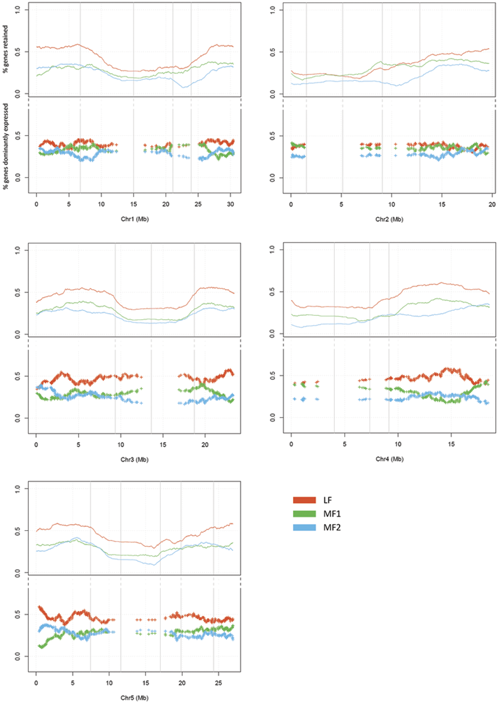
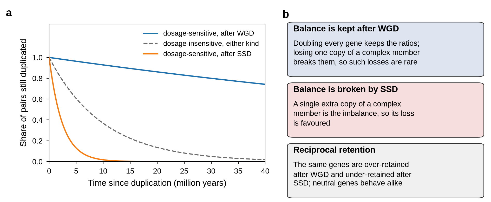

# Chapter 20. The gene balance (dosage) hypothesis

**Status: Dosage-balance effects and reciprocal retention of dosage-sensitive genes Verified; as a general rule for which duplicates are kept, Partly verified.** The gene balance hypothesis says that the products of many genes work in fixed proportions, in complexes, pathways and regulatory networks, so that changing the dose of some genes but not of their partners is harmful. It explains why changing one chromosome is worse than changing the whole genome, and it predicts that genes kept after whole-genome duplication are rarely kept after small-scale duplication, and the reverse. Both patterns are found in plants, animals, yeast and ciliates. Dosage compensation and the variable response of genes to dose limit how far the rule goes.

Related notes in this repository: [gene-balance-dosage](../../skills/genomics-theory-mining/theories/gene-balance-dosage/THEORY.md), [fractionation-diploidization-after-wgd](../../skills/genomics-theory-mining/theories/fractionation-diploidization-after-wgd/THEORY.md), [allopolyploidy-secondary-polyploidy](../../skills/genomics-theory-mining/theories/allopolyploidy-secondary-polyploidy/THEORY.md), [ddc-subfunctionalization](../../skills/genomics-theory-mining/theories/ddc-subfunctionalization/THEORY.md), [kondrashov-2002-purifying-both-paralogs](../../skills/genomics-theory-mining/theories/kondrashov-2002-purifying-both-paralogs/THEORY.md).

## 20.1 Statement and history

The idea of genetic balance goes back to the early days of genetics: adding or removing single chromosomes (aneuploidy) affects the phenotype more than changing the number of whole genomes (ploidy) [1]. Birchler and Newton studied dosage series of chromosome arms that together span about one-third of the maize genome and found that specific proteins correlate mostly negatively with the dose of particular regions, with some positive correlations [2]. In a maize ploidy series from monoploid to tetraploid, by contrast, the transcript level per cell of most of 18 genes is proportional to gene dose, so that expression per genome is about equal [3]. Birchler and colleagues proposed that regulatory mechanisms evolved so that the stoichiometry of the parts of regulatory complexes affects target gene expression; because most dosage-dependent regulators act negatively, this can explain the up-regulation of genes in monosomics and dosage compensation of hemizygous sex chromosomes [4]. Veitia showed that haploinsufficiency of transcription factors often reflects altered stoichiometry and non-linear transcriptional synergy rather than lower expression as such [5].

Papp, Pál and Hurst named the balance hypothesis: an imbalance in the concentrations of subunits of a protein complex can be harmful. In yeast, both under- and overexpression of complex subunits lower fitness, and members of large gene families are rarely involved in complexes, as expected if single-gene duplication of a subunit creates imbalance [6]. Freeling and Thomas argued that tetraploidies and balanced segmental duplications inject genes for subunits of complex machines and cascades, such as transcription factors, while most other duplicates are removed; the retained “functional modules” are by-products of purifying selection [7]. Later reviews joined these strands: gene balance links gene expression, quantitative traits, dosage compensation, aneuploid syndromes, copy number variants and the fate of duplicated genes [8, 9, 10].

## 20.2 What the theory predicts

- **Aneuploidy versus ploidy.** Changing part of the genome should alter expression more widely and harm more than changing the whole genome [1, 11].
- **Reciprocal retention.** Genes in complexes, signalling and transcription should be over-retained after whole-genome duplication and under-retained after small-scale duplication (Figure 20.2) [12, 13].
- **Copy number variation.** Genes kept after whole-genome duplication should rarely vary in copy number in populations [14].
- **Coordinated loss.** Genes of one pathway or complex should be lost together after whole-genome duplication [15].
- **Coordinated response.** Dosage-sensitive genes should respond to a change in ploidy in a coordinated way [16].

## 20.3 Evidence for

- **Aneuploidy in yeast and plants.** Haploid yeast strains with extra copies of almost any chromosome share defects in cell cycle progression, increased glucose uptake and sensitivity to conditions that interfere with protein synthesis and folding, which reflect extra protein production and imbalance in protein composition [17]. In *Arabidopsis thaliana*, the five trisomies show a greater spread of expression changes than diploids, triploids and tetraploids; genes elsewhere in the genome range from no effect to reduced expression approaching the inverse of the imbalance, 2/3 [11].
- **Retention after whole-genome duplication.** After the most recent whole-genome duplication in an *Arabidopsis* ancestor, 28.6% of genes in syntenic blocks kept a pair, one homeolog was preferentially (1.6×) targeted for loss over 85% of the genome, and islands of retention contain connected genes [18]. Modelling the three whole-genome duplications of *Arabidopsis* shows that they account for more than 90% of the increase in transcription factors, signal transducers and developmental genes in the last 350 million years [19]. In *Paramecium tetraurelia*, most of nearly 40,000 genes arose through at least three whole-genome duplications; genes of the same pathway or complex have common patterns of loss, and highly expressed genes are over-retained, which points to dosage constraints [15, 20].
- **Reciprocal retention.** Each mode of duplication retains genes in a biased way, and genes retained after ancient tetraploidy are reciprocally related to genes retained after tandem duplication [12]. Gene families most strongly reciprocally retained in angiosperms show stronger constraints on sequence and expression divergence, and regulatory and signalling families rank above those for multiprotein complexes [13]. In *Arabidopsis*, tomato and maize, retained duplicates from whole-genome duplication are more constrained than those from small-scale duplication, and duplicates with protein interactions are more constrained in both [21].
- **Human ohnologs.** About 30% of human protein-coding genes are related through two whole-genome duplications; these ohnologs have rarely undergone later small-scale duplication, rarely vary in copy number, and 75% of previously reported candidate genes for Down syndrome are ohnologs with no other copy number change [14]. Dosage-sensitive genes are often associated with disease [22].
- **Immediately after doubling.** In synthetic autopolyploids of *A. thaliana*, putatively dosage-balance-sensitive gene groups show smaller and more coordinated responses to genome doubling than dosage-insensitive groups [16].

## 20.4 Evidence against, and difficulties

- **Dosage compensation.** Aneuploidy is common in wild yeast isolates, which express many amplified genes at lower than expected levels; compensation acts at more than 30% of amplified genes, and the compensated genes show elevated rates of gene amplification [23]. Buffering of this kind weakens the cost of imbalance assumed by the hypothesis.
- **Expression is not tied to dose.** After genome doubling in *A. thaliana*, transcriptome size does not simply double, and individual gene responses are highly variable [16]. In the trisomies, transcription factors and their targets often change in discordant ways [11].
- **Other explanations for retention.** Subfunctionalization and neofunctionalization also keep duplicates [24, 25], and dosage effects are one part of a pluralistic framework [26]. Paralogs that persist appear to be favoured from the start mainly by a protein dosage effect, which is a different dosage argument from balance [27].
- **Not permanent.** Dosage constraints can delay loss, but the summed expression of two copies can drift until one copy contributes so little that its loss is no longer opposed [20].

## 20.5 Status and reasoning

**Dosage-balance effects and reciprocal retention: verified. As a general rule for duplicate retention: partly verified.** Stronger effects of aneuploidy than of ploidy are seen in maize, yeast and *Arabidopsis* [2, 11, 17]. Reciprocal retention of regulatory and complex-forming genes is found in angiosperms, vertebrates and ciliates, with the expected constraints on divergence [13, 14, 15, 19]. But compensation buffers many dose changes [23], individual gene responses are variable [16], and other fates explain many retained duplicates [24].

## 20.6 Plants, crops and grapevine

- **Subgenome dominance.** In maize, after a tetraploidy 5-12 million years ago, gene loss has been uneven between the two subgenomes, and genes of the less fractionated subgenome are overexpressed; ongoing fractionation among inbreds adds to maize diversity [28]. In *Brassica rapa*, genes of the least fractionated subgenome (LF) are dominantly expressed over those of the two more fractionated subgenomes (MF1 and MF2), and dominantly expressed genes tend to resist fractionation (Figure 20.1) [29].
- **Retained functions.** In *Arabidopsis*, signal transduction and transcription genes were preferentially retained after ancient polyploidy and DNA repair genes preferentially lost [30]. The gene balance hypothesis helps explain why polyploid crops keep particular gene sets [8, 12].
- **Grapevine.** The grapevine genome has not undergone a recent genome duplication, and its haploid content derives from three ancestral genomes, so the duplicates it keeps date from that old event [31]. The white berry somatic variant Tempranillo Blanco carries a catastrophic genome rearrangement with hemizygous deletion of 313 genes, including the functional copy of the MYB genes for berry skin anthocyanin; the rearranged chromosomes are not transmitted sexually [32].
- **Clonal crops.** A clone can survive partial monosomy because it is propagated vegetatively, so clonal crops can carry dose changes that would be removed in sexual lineages [32]. These are natural tests of how plants tolerate imbalance.

## 20.7 How to test it with public data

- **Data.** Expression in aneuploid and ploidy series [11, 16]; syntenic genes and duplication modes in plant genomes [18, 21]; copy number variants in populations [14, 23]; subgenome-resolved expression in polyploids [28, 29].
- **Tools.** The synteny and duplication tools of Chapter 19; gene ontology enrichment for retained and lost classes [19, 30].
- **Analysis.** (1) Rank gene families by retention after whole-genome versus small-scale duplication and test the ranking for regulatory and complex functions [13]. (2) Compare expression changes on and off the varied chromosome in aneuploids [11]. (3) Test whether genes kept after whole-genome duplication vary less in copy number in a resequenced population [14]. The script [`scripts/ch20_gene_balance_figures.py`](../scripts/ch20_gene_balance_figures.py) computes the expected retention of dosage-sensitive and neutral genes after the two kinds of duplication (Figure 20.2).
- **What would break the theory.** Regulatory and complex genes retained equally after whole-genome and small-scale duplication, or aneuploidy and ploidy changes with similar effects on expression.

## 20.8 Open questions

- How much of the cost of imbalance is removed by dosage compensation, and does this differ between taxa [16, 23]?
- Why do regulatory families show stronger reciprocal retention than complex subunits [13]?
- What drives subgenome dominance, and is it caused by selection against loss of the dominant copy [28, 29]?
- How do vegetatively propagated crops tolerate large hemizygous regions [32]?

## 20.9 Common mistakes

- Treating every retained duplicate as dosage-balanced; other fates are common [24, 26].
- Assuming that expression follows gene dose; responses vary widely [16, 23].
- Comparing retention without separating whole-genome from small-scale duplicates [19, 21].
- Confusing selection for more dosage of one gene with selection for balance among partners [6, 27].

## Figures

**Figure 20.1.** Gene densities and dominance of gene expression in the three subgenomes of B. rapa along the chromosomes of A. thaliana. The vertical grey lines are the separators of the 24 AK blocks. Red lines and crosses represent subgenome LF, while green and blue ones represent subgenomes MF1 and MF2, respectively. Gene densities are indicated above the lines and dominance of gene expression below. Gene densities were estimated by a window of 1,000 genes with a step of 1 gene moving through the reference genome A. thaliana. The ratio of syntenic genes in each of the three B. rapa subgenomes for each window was calculated and plotted. For the gene expression, we used a window of 60 genes with a step of 1 gene sliding through the 1,675 A. thaliana genes that have three retained syntenic orthologs in B. rapa. For each window, we counted the number of genes that have the highest expression among syntenic paralogs for each of the three subgenomes. The expression dominance was then plotted as crossed with the ratio of the highest expressed genes in each subgenome. Reproduced unchanged from Cheng F, Wu J, Fang L, et al. (2012) Biased gene fractionation and dominant gene expression among the subgenomes of *Brassica rapa*. *PLoS ONE* 7:e36442, Figure 3. https://doi.org/10.1371/journal.pone.0036442. Licence: CC BY 4.0 (https://creativecommons.org/licenses/by/4.0/).

**Figure 20.2.** (a) Expected share of duplicate pairs still duplicated over 40 million years. One copy is lost at a neutral rate of 0.1 per million years, scaled by the fixation probability of the loss relative to a neutral change. After a whole-genome duplication, losing one copy of a dosage-sensitive gene creates imbalance (s = 10⁻⁴ against the loss); after a small-scale duplication of such a gene the extra copy is the imbalance, so its loss is favoured with the same s; dosage-insensitive genes are neutral. Ne = 10⁴. (b) What the model shows. Made with [`scripts/ch20_gene_balance_figures.py`](../scripts/ch20_gene_balance_figures.py); the calculation is deterministic.

## References

1. Birchler JA, Veitia RA (2007) The Gene Balance Hypothesis: From Classical Genetics to Modern Genomics. *The Plant Cell* 19:395-402. https://doi.org/10.1105/tpc.106.049338
2. Birchler JA, Newton KJ (1981) Modulation of protein levels in chromosomal dosage series of maize: the biochemical basis of aneuploid syndromes. *Genetics* 99:247-266. https://doi.org/10.1093/genetics/99.2.247
3. Guo M, Davis D, Birchler JA (1996) Dosage Effects on Gene Expression in a Maize Ploidy Series. *Genetics* 142:1349-1355. https://doi.org/10.1093/genetics/142.4.1349
4. Birchler JA, Bhadra U, Bhadra MP, et al. (2001) Dosage-Dependent Gene Regulation in Multicellular Eukaryotes: Implications for Dosage Compensation, Aneuploid Syndromes, and Quantitative Traits. *Developmental Biology* 234:275-288. https://doi.org/10.1006/dbio.2001.0262
5. Veitia RA (2002) Exploring the etiology of haploinsufficiency. *BioEssays* 24:175-184. https://doi.org/10.1002/bies.10023
6. Papp B, Pál C, Hurst LD (2003) Dosage sensitivity and the evolution of gene families in yeast. *Nature* 424:194-197. https://doi.org/10.1038/nature01771
7. Freeling M, Thomas BC (2006) Gene-balanced duplications, like tetraploidy, provide predictable drive to increase morphological complexity. *Genome Research* 16:805-814. https://doi.org/10.1101/gr.3681406
8. Birchler JA, Veitia RA (2010) The gene balance hypothesis: implications for gene regulation, quantitative traits and evolution. *New Phytologist* 186:54-62. https://doi.org/10.1111/j.1469-8137.2009.03087.x
9. Birchler JA, Veitia RA (2012) Gene balance hypothesis: Connecting issues of dosage sensitivity across biological disciplines. *Proceedings of the National Academy of Sciences* 109:14746-14753. https://doi.org/10.1073/pnas.1207726109
10. Veitia RA, Bottani S, Birchler JA (2008) Cellular reactions to gene dosage imbalance: genomic, transcriptomic and proteomic effects. *Trends in Genetics* 24:390-397. https://doi.org/10.1016/j.tig.2008.05.005
11. Hou J, Shi X, Chen C, et al. (2018) Global impacts of chromosomal imbalance on gene expression in Arabidopsis and other taxa. *Proceedings of the National Academy of Sciences* 115:E11321-E11330. https://doi.org/10.1073/pnas.1807796115
12. Freeling M (2009) Bias in Plant Gene Content Following Different Sorts of Duplication: Tandem, Whole-Genome, Segmental, or by Transposition. *Annual Review of Plant Biology* 60:433-453. https://doi.org/10.1146/annurev.arplant.043008.092122
13. Tasdighian S, Van Bel M, Li Z, et al. (2017) Reciprocally Retained Genes in the Angiosperm Lineage Show the Hallmarks of Dosage Balance Sensitivity. *The Plant Cell* 29:2766-2785. https://doi.org/10.1105/tpc.17.00313
14. Makino T, McLysaght A (2010) Ohnologs in the human genome are dosage balanced and frequently associated with disease. *Proceedings of the National Academy of Sciences* 107:9270-9274. https://doi.org/10.1073/pnas.0914697107
15. Aury JM, Jaillon O, Duret L, et al. (2006) Global trends of whole-genome duplications revealed by the ciliate Paramecium tetraurelia. *Nature* 444:171-178. https://doi.org/10.1038/nature05230
16. Song MJ, Potter BI, Doyle JJ, et al. (2020) Gene Balance Predicts Transcriptional Responses Immediately Following Ploidy Change in Arabidopsis thaliana. *The Plant Cell* 32:1434-1448. https://doi.org/10.1105/tpc.19.00832
17. Torres EM, Sokolsky T, Tucker CM, et al. (2007) Effects of Aneuploidy on Cellular Physiology and Cell Division in Haploid Yeast. *Science* 317:916-924. https://doi.org/10.1126/science.1142210
18. Thomas BC, Pedersen B, Freeling M (2006) Following tetraploidy in an Arabidopsis ancestor, genes were removed preferentially from one homeolog leaving clusters enriched in dose-sensitive genes. *Genome Research* 16:934-946. https://doi.org/10.1101/gr.4708406
19. Maere S, De Bodt S, Raes J, et al. (2005) Modeling gene and genome duplications in eukaryotes. *Proceedings of the National Academy of Sciences* 102:5454-5459. https://doi.org/10.1073/pnas.0501102102
20. Gout JF, Lynch M (2015) Maintenance and Loss of Duplicated Genes by Dosage Subfunctionalization. *Molecular Biology and Evolution* 32:2141-2148. https://doi.org/10.1093/molbev/msv095
21. Defoort J, Van de Peer Y, Carretero-Paulet L (2019) The evolution of gene duplicates in angiosperms and the impact of protein-protein interactions and the mechanism of duplication. *Genome Biology and Evolution* evz156. https://doi.org/10.1093/gbe/evz156
22. Rice AM, McLysaght A (2017) Dosage-sensitive genes in evolution and disease. *BMC Biology* 15:78. https://doi.org/10.1186/s12915-017-0418-y
23. Hose J, Yong CM, Sardi M, et al. (2015) Dosage compensation can buffer copy-number variation in wild yeast. *eLife* 4:e05462. https://doi.org/10.7554/eLife.05462
24. Conant GC, Wolfe KH (2008) Turning a hobby into a job: How duplicated genes find new functions. *Nature Reviews Genetics* 9:938-950. https://doi.org/10.1038/nrg2482
25. MacCarthy T, Bergman A (2007) The limits of subfunctionalization. *BMC Evolutionary Biology* 7:213. https://doi.org/10.1186/1471-2148-7-213
26. Conant GC, Birchler JA, Pires JC (2014) Dosage, duplication, and diploidization: clarifying the interplay of multiple models for duplicate gene evolution over time. *Current Opinion in Plant Biology* 19:91-98. https://doi.org/10.1016/j.pbi.2014.05.008
27. Kondrashov FA, Rogozin IB, Wolf YI, et al. (2002) Selection in the evolution of gene duplications. *Genome Biology* 3:research0008.1. https://doi.org/10.1186/gb-2002-3-2-research0008
28. Schnable JC, Springer NM, Freeling M (2011) Differentiation of the maize subgenomes by genome dominance and both ancient and ongoing gene loss. *Proceedings of the National Academy of Sciences* 108:4069-4074. https://doi.org/10.1073/pnas.1101368108
29. Cheng F, Wu J, Fang L, et al. (2012) Biased Gene Fractionation and Dominant Gene Expression among the Subgenomes of Brassica rapa. *PLoS ONE* 7:e36442. https://doi.org/10.1371/journal.pone.0036442
30. Blanc G, Wolfe KH (2004) Functional divergence of duplicated genes formed by polyploidy during Arabidopsis evolution. *The Plant Cell* 16:1679-1691. https://doi.org/10.1105/tpc.021410
31. The French–Italian Public Consortium for Grapevine Genome Characterization (2007) The grapevine genome sequence suggests ancestral hexaploidization in major angiosperm phyla. *Nature* 449:463-467. https://doi.org/10.1038/nature06148
32. Carbonell-Bejerano P, Royo C, Torres-Pérez R, et al. (2017) Catastrophic Unbalanced Genome Rearrangements Cause Somatic Loss of Berry Color in Grapevine. *Plant Physiology* 175:786-801. https://doi.org/10.1104/pp.17.00715
