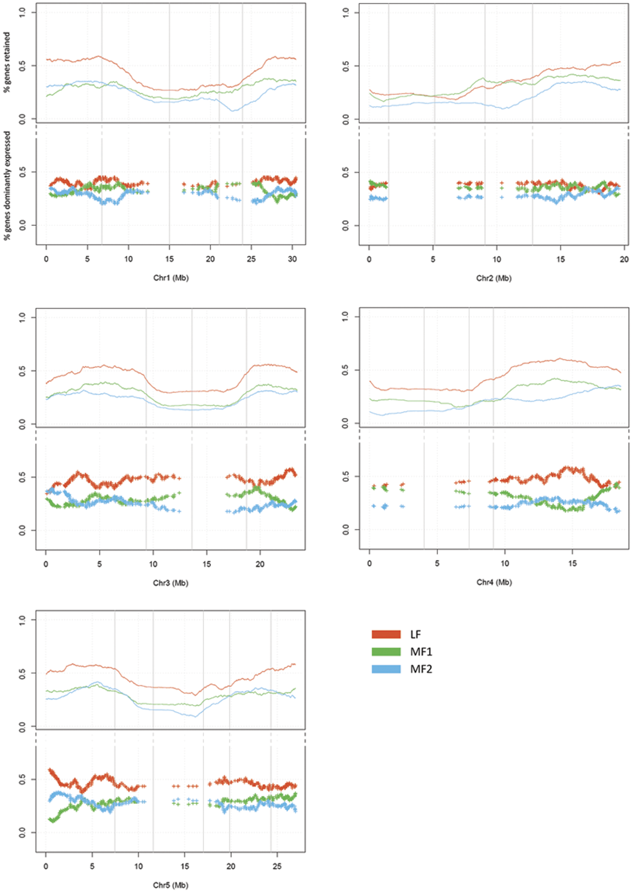
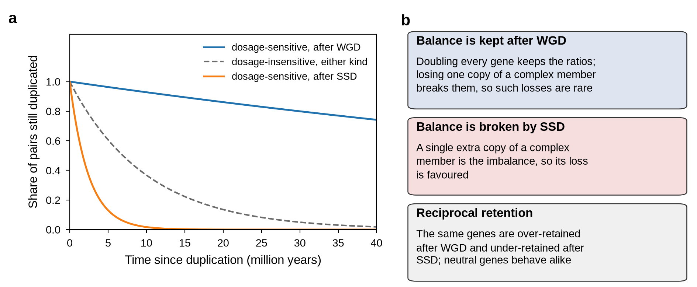

# 第 20 章 基因平衡（剂量）假说

**地位：剂量平衡效应和剂量敏感基因的互补保留已验证；作为哪些重复基因被保留的一般规律，部分验证。** 基因平衡假说认为，许多基因的产物在复合体、通路和调控网络中按固定比例起作用，所以只改变某些基因的剂量而不改变其伙伴的剂量是有害的。它解释了为什么改变一条染色体比改变整个基因组更糟，并预测全基因组重复后保留的基因很少在小规模重复后保留，反之亦然。这两种格局在植物、动物、酵母和纤毛虫中都已发现。剂量补偿以及基因对剂量反应的多变，限制了这条规律的适用范围。

本仓库相关条目：[gene-balance-dosage](../../theories/gene-balance-dosage/THEORY.md)、[fractionation-diploidization-after-wgd](../../theories/fractionation-diploidization-after-wgd/THEORY.md)、[allopolyploidy-secondary-polyploidy](../../theories/allopolyploidy-secondary-polyploidy/THEORY.md)、[ddc-subfunctionalization](../../theories/ddc-subfunctionalization/THEORY.md)、[kondrashov-2002-purifying-both-paralogs](../../theories/kondrashov-2002-purifying-both-paralogs/THEORY.md)。

## 20.1 内容与历史

遗传平衡的概念可以追溯到遗传学的早期：增加或减少单条染色体（非整倍性）对表型的影响大于改变整套基因组的数目（整倍性）[1]。Birchler 和 Newton 研究了合计约占玉米基因组三分之一的若干染色体臂的剂量系列，发现特定蛋白质与特定区段剂量的相关大多为负，也有一些为正 [2]。相反，在从单倍体到四倍体的玉米倍性系列中，18 个基因中大多数的每细胞转录水平与基因剂量成正比，所以每个基因组的表达大致相等 [3]。Birchler 等提出，调控机制的演化使调控复合体各组分的化学计量比影响靶基因表达；由于大多数剂量依赖的调控因子起负作用，这可以解释单体中基因的上调以及半合子性染色体的剂量补偿 [4]。Veitia 指出，转录因子的单倍剂量不足常常反映化学计量比的改变和非线性的转录协同作用，而不只是表达降低本身 [5]。

Papp、Pál 和 Hurst 命名了平衡假说：蛋白复合体各亚基浓度失衡可能有害。在酵母中，复合体亚基表达过低和过高都会降低适合度；大基因家族的成员很少参与复合体，这符合亚基的单基因重复会造成失衡的预期 [6]。Freeling 和 Thomas 认为，四倍化和平衡的片段重复向基因库中注入了编码复杂分子机器和级联组分（例如转录因子）的基因，而其他重复基因大多被清除；保留下来的“功能模块”是纯化选择的副产物 [7]。后来的综述把这些线索联系起来：基因平衡关系到基因表达、数量性状、剂量补偿、非整倍体综合征、拷贝数变异以及重复基因的命运 [8, 9, 10]。

## 20.2 预测

- **非整倍性与整倍性。** 改变基因组的一部分应比改变整个基因组更广泛地改变表达、造成更大的危害 [1, 11]。
- **互补保留。** 复合体、信号转导和转录相关的基因应在全基因组重复后被过多保留，而在小规模重复后被保留得少（图 20.2）[12, 13]。
- **拷贝数变异。** 全基因组重复后保留的基因在群体中应很少发生拷贝数变异 [14]。
- **协同丢失。** 全基因组重复后，同一通路或复合体的基因应一起丢失 [15]。
- **协同反应。** 剂量敏感基因对倍性改变的反应应是协调一致的 [16]。

## 20.3 支持证据

- **酵母和植物中的非整倍性。** 几乎任何一条染色体多一个拷贝的单倍体酵母菌株，都表现出细胞周期进程缺陷、葡萄糖摄取增加，以及对干扰蛋白质合成和折叠的条件更敏感，这反映了额外的蛋白质生产和蛋白质组成的失衡 [17]。在拟南芥中，五种三体的表达变化幅度大于二倍体、三倍体和四倍体；基因组其他部分的基因从没有变化到表达降低，接近失衡的倒数 2/3 [11]。
- **全基因组重复后的保留。** 拟南芥祖先最近一次全基因组重复之后，共线区段中 28.6% 的基因保留了成对拷贝；在 85% 的基因组中，一个部分同源区段被优先（1.6 倍）作为丢失的对象；保留的岛屿含有“连接”基因 [18]。对拟南芥三次全基因组重复的建模表明，过去 3.5 亿年中转录因子、信号转导因子和发育基因的增加有 90% 以上来自这三次事件 [19]。在四膜草履虫中，近 40,000 个基因中的大多数通过至少三次全基因组重复产生；同一通路或复合体的基因有共同的丢失格局，高表达基因被过多保留，指向剂量约束 [15, 20]。
- **互补保留。** 每种重复方式都以有偏的方式保留基因，古老四倍化后保留的基因与古老串联重复后保留的基因呈互补关系 [12]。被子植物中互补保留最强的基因家族，在序列和表达分化上受到更强的约束，而且调控和信号转导家族排在多亚基复合体家族之前 [13]。在拟南芥、番茄和玉米中，全基因组重复保留的重复基因比小规模重复的受到更强约束；无论哪种来源，有蛋白互作的重复基因都受到更强约束 [21]。
- **人类的 ohnolog。** 约 30% 的人类蛋白编码基因通过两次全基因组重复相互关联；这些 ohnolog 很少再经历小规模重复，很少有拷贝数变异；以前报告的唐氏综合征候选基因中 75% 是没有其他拷贝数变化的 ohnolog [14]。剂量敏感基因常与疾病相关 [22]。
- **加倍之后立即出现。** 在拟南芥人工同源多倍体中，推定剂量平衡敏感的基因组对基因组加倍的反应比剂量不敏感的基因组更小、更协调 [16]。

## 20.4 反面证据与难点

- **剂量补偿。** 非整倍性在野生酵母分离株中很常见，许多扩增基因的表达低于预期；剂量补偿作用于 30% 以上的扩增基因，而且受补偿的基因基因扩增的速率更高 [23]。这种缓冲削弱了该假说所假定的失衡代价。
- **表达不与剂量挂钩。** 拟南芥基因组加倍后，转录组大小并不简单加倍，单个基因的反应变化很大 [16]。在三体中，转录因子及其靶基因常常朝不一致的方向变化 [11]。
- **对保留的其他解释。** 亚功能化和新功能化也会保留重复基因 [24, 25]，剂量效应只是一个多元框架的一部分 [26]。持续存在的旁系同源基因似乎从一开始就主要因为蛋白质剂量效应而有利，这是不同于平衡的另一种剂量论证 [27]。
- **并非永久。** 剂量约束可以推迟丢失，但两个拷贝的总表达不变时各自的份额可以漂变，直到一个拷贝的贡献小到其丢失不再受到阻止 [20]。

## 20.5 地位与理由

**剂量平衡效应和互补保留：已验证。作为重复基因保留的一般规律：部分验证。** 在玉米、酵母和拟南芥中都看到非整倍性的效应强于整倍性 [2, 11, 17]。在被子植物、脊椎动物和纤毛虫中都发现了调控基因和复合体基因的互补保留，并伴有预期的分化约束 [13, 14, 15, 19]。但剂量补偿缓冲了许多剂量变化 [23]，单个基因的反应多变 [16]，其他结局也解释了许多被保留的重复基因 [24]。

## 20.6 植物、作物与葡萄

- **亚基因组优势。** 玉米在 500–1200 万年前经历四倍化之后，两个亚基因组之间的基因丢失不均衡，丢失较少的亚基因组的基因表达更高；自交系之间仍在进行的分级丢失增加了玉米的多样性 [28]。在白菜中，丢失最少的亚基因组（LF）的基因对两个丢失较多的亚基因组（MF1 和 MF2）的基因表现出表达优势，表达占优势的基因往往不易丢失（图 20.1）[29]。
- **被保留的功能。** 在拟南芥中，古老多倍化之后信号转导和转录基因被优先保留，DNA 修复基因被优先丢失 [30]。基因平衡假说有助于解释为什么多倍体作物保留特定的基因集合 [8, 12]。
- **葡萄。** 葡萄基因组没有经历近期的基因组重复，其单倍体内容来自三个祖先基因组，所以它保留的重复基因来自那次古老事件 [31]。白色果实体细胞变异株丹魄白带有一次灾难性的基因组重排，造成 313 个基因的半合子缺失，其中包括果皮花青素所需 MYB 基因的有功能拷贝；重排的染色体不经有性生殖传递 [32]。
- **克隆繁殖的作物。** 由于营养繁殖，一个克隆可以在部分单体的状态下存活，所以克隆作物可以携带在有性谱系中会被清除的剂量变化 [32]。这是检验植物如何耐受失衡的天然实验。

## 20.7 用公开数据检验

- **数据。** 非整倍体和倍性系列的表达数据 [11, 16]；植物基因组中的共线基因和重复方式 [18, 21]；群体中的拷贝数变异 [14, 23]；多倍体中按亚基因组区分的表达 [28, 29]。
- **工具。** 第 19 章的共线性和重复分析工具；对被保留和被丢失类别作基因本体富集分析 [19, 30]。
- **分析。** (1) 按全基因组重复与小规模重复后的保留情况给基因家族排序，并检验调控和复合体功能在排序中的位置 [13]。(2) 在非整倍体中比较变化染色体上和其他染色体上的表达变化 [11]。(3) 在重测序群体中检验全基因组重复后保留的基因是否拷贝数变异更少 [14]。脚本 [`scripts/ch20_gene_balance_figures.py`](../scripts/ch20_gene_balance_figures.py) 计算剂量敏感基因和中性基因在两种重复之后的预期保留比例（图 20.2）。
- **什么结果会推翻理论。** 调控基因和复合体基因在全基因组重复和小规模重复之后被同等保留；或者非整倍性和倍性改变对表达的影响相近。

## 20.8 未解决的问题

- 剂量补偿消除了多少失衡代价，在不同类群之间是否不同 [16, 23]？
- 为什么调控家族的互补保留比复合体亚基更强 [13]？
- 是什么造成亚基因组优势，是否源于对优势拷贝丢失的选择 [28, 29]？
- 营养繁殖作物怎样耐受大片的半合子区域 [32]？

## 20.9 常见错误

- 把每个被保留的重复基因都当作剂量平衡的结果；其他结局也很常见 [24, 26]。
- 假定表达随基因剂量变化；实际反应差异很大 [16, 23]。
- 比较保留情况时不区分全基因组重复和小规模重复 [19, 21]。
- 把对单个基因更多剂量的选择与对伙伴之间平衡的选择混为一谈 [6, 27]。

## 图

**图 20.1.** 白菜三个亚基因组沿拟南芥染色体的基因密度和基因表达优势。竖直灰线是 24 个 AK 区块的分隔线。红色线和叉号代表亚基因组 LF，绿色和蓝色分别代表亚基因组 MF1 和 MF2。线的上方表示基因密度，下方表示基因表达优势。基因密度用 1,000 个基因的窗口、以 1 个基因为步长沿参考基因组拟南芥移动估计，计算并绘制每个窗口中三个白菜亚基因组各自的共线基因比例。基因表达方面，用 60 个基因的窗口、以 1 个基因为步长，在白菜中保留了三个共线直系同源基因的 1,675 个拟南芥基因上滑动；对每个窗口，统计每个亚基因组在共线旁系同源基因中表达最高的基因数，再把各亚基因组中表达最高基因的比例以叉号绘出。原样转载自 Cheng F, Wu J, Fang L, et al. (2012) Biased gene fractionation and dominant gene expression among the subgenomes of *Brassica rapa*. *PLoS ONE* 7:e36442, Figure 3. https://doi.org/10.1371/journal.pone.0036442。许可：CC BY 4.0（https://creativecommons.org/licenses/by/4.0/）。

**图 20.2.** (a) 40 百万年间仍保持重复状态的重复基因对的预期比例。一个拷贝以每百万年 0.1 的中性速率丢失，并按该丢失相对于中性变化的固定概率加以缩放。全基因组重复之后，丢失剂量敏感基因的一个拷贝造成失衡（对丢失的选择 s = 10⁻⁴）；这类基因的小规模重复之后，多出的拷贝本身就是失衡，所以它的丢失以同样的 s 受到青睐；剂量不敏感的基因是中性的。Ne = 10⁴。(b) 模型说明了什么。用 [`scripts/ch20_gene_balance_figures.py`](../scripts/ch20_gene_balance_figures.py) 生成；计算是确定性的。

## 参考文献

1. Birchler JA, Veitia RA (2007) The Gene Balance Hypothesis: From Classical Genetics to Modern Genomics. *The Plant Cell* 19:395-402. https://doi.org/10.1105/tpc.106.049338
2. Birchler JA, Newton KJ (1981) Modulation of protein levels in chromosomal dosage series of maize: the biochemical basis of aneuploid syndromes. *Genetics* 99:247-266. https://doi.org/10.1093/genetics/99.2.247
3. Guo M, Davis D, Birchler JA (1996) Dosage Effects on Gene Expression in a Maize Ploidy Series. *Genetics* 142:1349-1355. https://doi.org/10.1093/genetics/142.4.1349
4. Birchler JA, Bhadra U, Bhadra MP, et al. (2001) Dosage-Dependent Gene Regulation in Multicellular Eukaryotes: Implications for Dosage Compensation, Aneuploid Syndromes, and Quantitative Traits. *Developmental Biology* 234:275-288. https://doi.org/10.1006/dbio.2001.0262
5. Veitia RA (2002) Exploring the etiology of haploinsufficiency. *BioEssays* 24:175-184. https://doi.org/10.1002/bies.10023
6. Papp B, Pál C, Hurst LD (2003) Dosage sensitivity and the evolution of gene families in yeast. *Nature* 424:194-197. https://doi.org/10.1038/nature01771
7. Freeling M, Thomas BC (2006) Gene-balanced duplications, like tetraploidy, provide predictable drive to increase morphological complexity. *Genome Research* 16:805-814. https://doi.org/10.1101/gr.3681406
8. Birchler JA, Veitia RA (2010) The gene balance hypothesis: implications for gene regulation, quantitative traits and evolution. *New Phytologist* 186:54-62. https://doi.org/10.1111/j.1469-8137.2009.03087.x
9. Birchler JA, Veitia RA (2012) Gene balance hypothesis: Connecting issues of dosage sensitivity across biological disciplines. *Proceedings of the National Academy of Sciences* 109:14746-14753. https://doi.org/10.1073/pnas.1207726109
10. Veitia RA, Bottani S, Birchler JA (2008) Cellular reactions to gene dosage imbalance: genomic, transcriptomic and proteomic effects. *Trends in Genetics* 24:390-397. https://doi.org/10.1016/j.tig.2008.05.005
11. Hou J, Shi X, Chen C, et al. (2018) Global impacts of chromosomal imbalance on gene expression in Arabidopsis and other taxa. *Proceedings of the National Academy of Sciences* 115:E11321-E11330. https://doi.org/10.1073/pnas.1807796115
12. Freeling M (2009) Bias in Plant Gene Content Following Different Sorts of Duplication: Tandem, Whole-Genome, Segmental, or by Transposition. *Annual Review of Plant Biology* 60:433-453. https://doi.org/10.1146/annurev.arplant.043008.092122
13. Tasdighian S, Van Bel M, Li Z, et al. (2017) Reciprocally Retained Genes in the Angiosperm Lineage Show the Hallmarks of Dosage Balance Sensitivity. *The Plant Cell* 29:2766-2785. https://doi.org/10.1105/tpc.17.00313
14. Makino T, McLysaght A (2010) Ohnologs in the human genome are dosage balanced and frequently associated with disease. *Proceedings of the National Academy of Sciences* 107:9270-9274. https://doi.org/10.1073/pnas.0914697107
15. Aury JM, Jaillon O, Duret L, et al. (2006) Global trends of whole-genome duplications revealed by the ciliate Paramecium tetraurelia. *Nature* 444:171-178. https://doi.org/10.1038/nature05230
16. Song MJ, Potter BI, Doyle JJ, et al. (2020) Gene Balance Predicts Transcriptional Responses Immediately Following Ploidy Change in Arabidopsis thaliana. *The Plant Cell* 32:1434-1448. https://doi.org/10.1105/tpc.19.00832
17. Torres EM, Sokolsky T, Tucker CM, et al. (2007) Effects of Aneuploidy on Cellular Physiology and Cell Division in Haploid Yeast. *Science* 317:916-924. https://doi.org/10.1126/science.1142210
18. Thomas BC, Pedersen B, Freeling M (2006) Following tetraploidy in an Arabidopsis ancestor, genes were removed preferentially from one homeolog leaving clusters enriched in dose-sensitive genes. *Genome Research* 16:934-946. https://doi.org/10.1101/gr.4708406
19. Maere S, De Bodt S, Raes J, et al. (2005) Modeling gene and genome duplications in eukaryotes. *Proceedings of the National Academy of Sciences* 102:5454-5459. https://doi.org/10.1073/pnas.0501102102
20. Gout JF, Lynch M (2015) Maintenance and Loss of Duplicated Genes by Dosage Subfunctionalization. *Molecular Biology and Evolution* 32:2141-2148. https://doi.org/10.1093/molbev/msv095
21. Defoort J, Van de Peer Y, Carretero-Paulet L (2019) The evolution of gene duplicates in angiosperms and the impact of protein-protein interactions and the mechanism of duplication. *Genome Biology and Evolution* evz156. https://doi.org/10.1093/gbe/evz156
22. Rice AM, McLysaght A (2017) Dosage-sensitive genes in evolution and disease. *BMC Biology* 15:78. https://doi.org/10.1186/s12915-017-0418-y
23. Hose J, Yong CM, Sardi M, et al. (2015) Dosage compensation can buffer copy-number variation in wild yeast. *eLife* 4:e05462. https://doi.org/10.7554/eLife.05462
24. Conant GC, Wolfe KH (2008) Turning a hobby into a job: How duplicated genes find new functions. *Nature Reviews Genetics* 9:938-950. https://doi.org/10.1038/nrg2482
25. MacCarthy T, Bergman A (2007) The limits of subfunctionalization. *BMC Evolutionary Biology* 7:213. https://doi.org/10.1186/1471-2148-7-213
26. Conant GC, Birchler JA, Pires JC (2014) Dosage, duplication, and diploidization: clarifying the interplay of multiple models for duplicate gene evolution over time. *Current Opinion in Plant Biology* 19:91-98. https://doi.org/10.1016/j.pbi.2014.05.008
27. Kondrashov FA, Rogozin IB, Wolf YI, et al. (2002) Selection in the evolution of gene duplications. *Genome Biology* 3:research0008.1. https://doi.org/10.1186/gb-2002-3-2-research0008
28. Schnable JC, Springer NM, Freeling M (2011) Differentiation of the maize subgenomes by genome dominance and both ancient and ongoing gene loss. *Proceedings of the National Academy of Sciences* 108:4069-4074. https://doi.org/10.1073/pnas.1101368108
29. Cheng F, Wu J, Fang L, et al. (2012) Biased Gene Fractionation and Dominant Gene Expression among the Subgenomes of Brassica rapa. *PLoS ONE* 7:e36442. https://doi.org/10.1371/journal.pone.0036442
30. Blanc G, Wolfe KH (2004) Functional divergence of duplicated genes formed by polyploidy during Arabidopsis evolution. *The Plant Cell* 16:1679-1691. https://doi.org/10.1105/tpc.021410
31. The French–Italian Public Consortium for Grapevine Genome Characterization (2007) The grapevine genome sequence suggests ancestral hexaploidization in major angiosperm phyla. *Nature* 449:463-467. https://doi.org/10.1038/nature06148
32. Carbonell-Bejerano P, Royo C, Torres-Pérez R, et al. (2017) Catastrophic Unbalanced Genome Rearrangements Cause Somatic Loss of Berry Color in Grapevine. *Plant Physiology* 175:786-801. https://doi.org/10.1104/pp.17.00715
