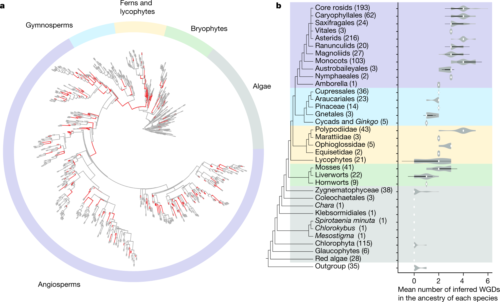
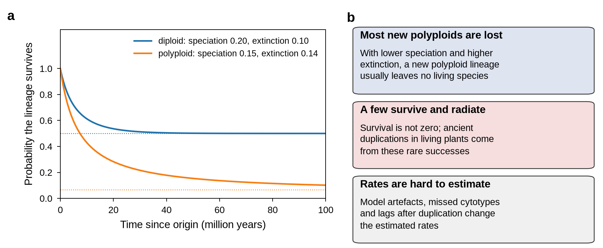

# Chapter 21. Is polyploidy an evolutionary dead end?

**Status: Lower diversification of recently formed polyploids, Partly verified; polyploidy as a long-run dead end for plant lineages, Contested.** The dead-end hypothesis says that polyploids form often but rarely leave many descendants, so that polyploidy is common among living species but contributes little to long-term diversification. Large phylogenetic analyses find lower speciation and higher extinction in recent polyploids, and only a small share of polyploidizations is retained over long periods. Yet every flowering plant descends from ancient genome duplications, many duplications are followed by shifts in diversification, and the methods used to estimate rates have known biases. The answer depends on time scale and on how polyploid lineages are recognized.

Related notes in this repository: [allopolyploidy-secondary-polyploidy](../../theories/allopolyploidy-secondary-polyploidy/THEORY.md), [masterson-1994-stomatal-polyploidy](../../theories/masterson-1994-stomatal-polyploidy/THEORY.md), [felber-bever-1997-triploid-fitness-coexistence](../../theories/felber-bever-1997-triploid-fitness-coexistence/THEORY.md), [fractionation-diploidization-after-wgd](../../theories/fractionation-diploidization-after-wgd/THEORY.md), [gene-balance-dosage](../../theories/gene-balance-dosage/THEORY.md).

## 21.1 Statement and history

G. Ledyard Stebbins and his contemporaries built a model of polyploid evolution that lasted for nearly half a century, in which polyploidy was frequent in plants but of limited long-term importance; from the 1980s new genetic tools replaced much of this framework [1]. Polyploids form at substantial rates: the total rate of autotetraploid formation is estimated to be of the same order as the genic mutation rate, about 10⁻⁵ [2]. Ploidy changes are involved in an estimated 2–4% of speciation events in flowering plants and 7% in ferns [3], and a later estimate combining cytogenetic and phylogenetic databases raised this to 15% of angiosperm and 31% of fern speciation events, with no direct evidence that polyploid lines, once established, diversify faster [4].

Mayrose and colleagues tested the idea quantitatively across hundreds of polyploidization events within genera of vascular plants. Polyploids generally showed lower speciation and higher extinction rates than diploids, which the authors called the first quantitative corroboration of the dead-end hypothesis; only particularly fit polyploid lineages may persist [5]. Comparative genomics gave the opposite impression at deep time scales: ancient whole-genome duplications are found in all major lineages of green plants [6], although retained ancient duplications are exceedingly rare and may have survived only under specific conditions [7]. The two views are reconciled if most new polyploids are lost, while a few succeed and later radiate [8, 9].

## 21.2 What the theory predicts

- **Lower net diversification.** Recently formed polyploid lineages should have lower speciation and higher extinction than their diploid relatives (Figure 21.2) [5].
- **Many formations, few survivors.** Polyploid species should be common among living species and within genera, while ancient duplications retained in genomes should be few [4, 7].
- **No rise in diversification after duplication.** Clades descended from whole-genome duplications should not be richer than their sister clades [10].
- **Early problems.** New polyploids should suffer from meiotic and other disadvantages that must be overcome for establishment [11, 12].

## 21.3 Evidence for

- **Rates in recent polyploids.** Across genera of vascular plants, polyploids show lower speciation and higher extinction than diploids; part of the higher speciation of diploids comes from their ability to speciate by polyploidy [5]. The reply to critics argued that some concerns reflect data limits while others misread the methods [13].
- **High incidence without higher diversification.** About 35% of species within genera are polyploid, but there is no direct evidence that polyploid lines enjoy greater net diversification; their abundance comes from frequent polyploid speciation [4].
- **Few old duplications survive.** Despite frequent formation, retained ancient duplications are very rare in genomes, which suggests that most were lost [7, 8].
- **Early challenges.** Doubling the number of homologs challenges chromosome segregation; in *Arabidopsis arenosa*, ploidy-specific differentiation is concentrated in 39 regions spanning 44 genes, including eight meiosis genes [12], and selective sweeps in tetraploids affect genome-maintenance genes, including the meiosis gene ASYNAPSIS1 [14]. Interactions with diploid progenitors often prevent the establishment of new polyploids [15].

## 21.4 Evidence against, and difficulties

- **Methods.** State-dependent speciation and extinction (SSE) models such as BiSSE [16] have high Type I error rates: they often find a trait-dependent effect when diversification varies for other reasons [17]. Hidden-state models were developed to address this [18]. In Solanaceae, diversification is explained better by breeding system together with a hidden factor than by ploidy [19].
- **Data and estimates.** Critics pointed out that BiSSE is unreliable for trees with fewer than about 300 taxa, that extinction estimates are unreliable, and that many species contain several cytotypes that go unrecognized; in the California flora, 13% of 2,647 species have more than one cytotype [20]. The same critique notes that polyploids have significantly higher speciation in 20% of the genera studied [20].
- **Diversification after ancient duplications.** Shifts in diversification across angiosperms are rarely perfectly associated with whole-genome duplications but commonly follow them after a lag [21, 22]. With 106 duplications placed on the angiosperm tree, 61 are tightly linked to changes in diversification rate and 70 of 99 are followed by higher richness than in the sister clade; 46 appear closely associated with upshifts [10].
- **Clusters in time.** Many ancient plant duplications date close to the Cretaceous–Paleogene boundary, which suggests that polyploidy may have helped plant lineages survive that mass extinction [23, 24]. Polyploids often thrive in harsh or disturbed environments, and stress may be a determining factor in their establishment [25].
- **Adaptive potential.** In laboratory evolution of yeast, tetraploids adapt significantly faster than haploids and diploids [26]. In *Allium*, lineages with high polyploid frequency have higher diversification rates, and 81.7% of edaphic variation can be explained by polyploidization [27]. Across vascular plants, polyploid species generally have higher rates of climatic niche differentiation than their diploid relatives [28], and polyploidy may help introduced plants become invasive [29].

## 21.5 Status and reasoning

**Lower diversification of recently formed polyploids: partly verified. Polyploidy as a long-run dead end: contested.** The best direct test finds lower net diversification in recent polyploids [5], and the rarity of retained ancient duplications fits the idea that most polyploid lineages are lost [7]. But the result rests on SSE methods with known biases and on cytotype data that are incomplete [17, 20]. At the scale of the angiosperm tree, many duplications precede increases in diversification [10, 21], and all seed plants carry ancient duplications [6]. “Dead end” is a fair description of the fate of most new polyploids, not of polyploidy as a whole.

## 21.6 Plants, crops and grapevine

- **Ancient duplications.** Inferred ancient whole-genome duplications are spread across green plants, most densely in angiosperms and ferns (Figure 21.1) [6].
- **Grapevine.** The grapevine genome shows that the ancestor of major angiosperm groups underwent a hexaploidization (the gamma event), yet the living grapevine is diploid and has no recent duplication [30]. Comparison with *Aquilegia* indicates that gamma was a two-step process ending in the hybridization of a tetraploid with a diploid, so the core eudicots have a hybrid origin [31]. Grapevine is therefore the product of a successful ancient polyploid lineage, not of a dead end.
- **Clonal crops.** Across 1,751 species, polyploidy is associated with clonality and perenniality, and polyploidy more likely promotes clonality than the reverse [32]. Clonal propagation lets polyploid genotypes persist without regular sexual reproduction: half of world banana production relies on somaclones of a single triploid genotype, Cavendish [33]. Sugarcane cultivars are highly polyploid and aneuploid [34], and cultivated strawberry is an octoploid formed from four diploid progenitors more than a million years ago [35].
- **Synthetic polyploids.** In grafted perennial crops such as apple and citrus, synthetic tetraploid rootstocks may improve tolerance of biotic and abiotic stress, but their commercial use is still limited [36].

## 21.7 How to test it with public data

- **Data.** Chromosome counts from the Chromosome Counts Database [37]; transcriptome-based duplication inferences and phylogenies of green plants [6]; time-calibrated angiosperm trees [21].
- **Tools.** ChromEvol to infer ploidy changes along a phylogeny [38]; BiSSE and hidden-state SSE models for trait-dependent diversification [16, 18]; wgd for KS distributions of paralogs [39].
- **Analysis.** (1) For a genus with counts and a dated tree, infer ploidy with ChromEvol and fit BiSSE and HiSSE; compare the models, since a ploidy effect that disappears under HiSSE is not convincing [17, 18]. (2) Compare species richness of clades after known duplications with their sister clades [10]. (3) Check how many species in the sample have several cytotypes [20]. The script [`scripts/ch21_polyploidy_figures.py`](../scripts/ch21_polyploidy_figures.py) computes lineage survival under constant speciation and extinction rates (Figure 21.2).
- **What would refute it.** Polyploid lineages with equal or higher net diversification than diploids across many genera when hidden-state models and complete cytotype data are used.

## 21.8 Open questions

- How long is the lag between duplication and diversification, and what happens in it [21, 22]?
- Does stress favour the establishment of polyploids generally, or only during mass extinctions [24, 25]?
- How do new polyploids overcome meiotic problems and competition with their diploid progenitors [12, 15]?
- Does clonality rescue polyploids that would otherwise be lost [32]?

## 21.9 Common mistakes

- Treating the abundance of living polyploids as evidence of higher diversification [4].
- Taking an SSE result at face value without hidden-state or simulation checks [17, 18].
- Counting a species as diploid or polyploid from a single chromosome count when several cytotypes exist [20].
- Confusing the fate of most new polyploids with the success of the rare ancient ones [7, 8].

## Figures

**Figure 21.1.** The distribution of inferred ancient WGDs across lineages of green plants. a, The locations of estimated WGDs are labelled red in the phylogeny of all 1000 Plants (1KP) samples. b, The number of inferred ancient polyploidization events within each lineage is shown in the violin plots. The white dot indicates the median, the thick black bars represent the interquartile range, the thin black lines define the 95% confidence interval and the grey shading represents the density of data points. The sample sizes for each lineage are shown within parentheses along with taxon names on the phylogeny. Reproduced unchanged from One Thousand Plant Transcriptomes Initiative (2019) One thousand plant transcriptomes and the phylogenomics of green plants. *Nature* 574:679–685, Figure 4. https://doi.org/10.1038/s41586-019-1693-2. Licence: CC BY 4.0 (https://creativecommons.org/licenses/by/4.0/). The last sentence of the published caption, which points to supplementary material, is omitted.

**Figure 21.2.** (a) Probability that a lineage founded by one species still has living species after a given time, under constant speciation and extinction rates (per million years). The diploid lineage has speciation 0.20 and extinction 0.10; the polyploid lineage has lower speciation and higher extinction, 0.15 and 0.14, in the direction reported by Mayrose et al. (2011). Dotted lines show the long-run limits, 0.5 and 0.067. The rates are illustrative. (b) What the model shows. Made with [`scripts/ch21_polyploidy_figures.py`](../scripts/ch21_polyploidy_figures.py); the calculation is deterministic.

## References

1. Soltis DE, Visger CJ, Soltis PS (2014) The polyploidy revolution then…and now: Stebbins revisited. *American Journal of Botany* 101:1057-1078. https://doi.org/10.3732/ajb.1400178
2. Ramsey J, Schemske DW (1998) Pathways, mechanisms, and rates of polyploid formation in flowering plants. *Annual Review of Ecology and Systematics* 29:467-501. https://doi.org/10.1146/annurev.ecolsys.29.1.467
3. Otto SP, Whitton J (2000) Polyploid incidence and evolution. *Annual Review of Genetics* 34:401-437. https://doi.org/10.1146/annurev.genet.34.1.401
4. Wood TE, Takebayashi N, Barker MS, et al. (2009) The frequency of polyploid speciation in vascular plants. *Proceedings of the National Academy of Sciences* 106:13875-13879. https://doi.org/10.1073/pnas.0811575106
5. Mayrose I, Zhan SH, Rothfels CJ, et al. (2011) Recently Formed Polyploid Plants Diversify at Lower Rates. *Science* 333:1257. https://doi.org/10.1126/science.1207205
6. One Thousand Plant Transcriptomes Initiative (2019) One thousand plant transcriptomes and the phylogenomics of green plants. *Nature* 574:679-685. https://doi.org/10.1038/s41586-019-1693-2
7. Van de Peer Y, Maere S, Meyer A (2009) The evolutionary significance of ancient genome duplications. *Nature Reviews Genetics* 10:725-732. https://doi.org/10.1038/nrg2600
8. Arrigo N, Barker MS (2012) Rarely successful polyploids and their legacy in plant genomes. *Current Opinion in Plant Biology* 15:140-146. https://doi.org/10.1016/j.pbi.2012.03.010
9. Van de Peer Y, Mizrachi E, Marchal K (2017) The evolutionary significance of polyploidy. *Nature Reviews Genetics* 18:411-424. https://doi.org/10.1038/nrg.2017.26
10. Landis JB, Soltis DE, Li Z, et al. (2018) Impact of whole‐genome duplication events on diversification rates in angiosperms. *American Journal of Botany* 105:348-363. https://doi.org/10.1002/ajb2.1060
11. Comai L (2005) The advantages and disadvantages of being polyploid. *Nature Reviews Genetics* 6:836-846. https://doi.org/10.1038/nrg1711
12. Yant L, Hollister J, Wright K, et al. (2013) Meiotic Adaptation to Genome Duplication in Arabidopsis arenosa. *Current Biology* 23:2151-2156. https://doi.org/10.1016/j.cub.2013.08.059
13. Mayrose I, Zhan SH, Rothfels CJ, et al. (2015) Methods for studying polyploid diversification and the dead end hypothesis: a reply to Soltis et al . (2014). *New Phytologist* 206:27-35. https://doi.org/10.1111/nph.13192
14. Hollister JD, Arnold BJ, Svedin E, et al. (2012) Genetic Adaptation Associated with Genome-Doubling in Autotetraploid Arabidopsis arenosa. *PLoS Genetics* 8:e1003093. https://doi.org/10.1371/journal.pgen.1003093
15. Baduel P, Bray S, Vallejo-Marin M, et al. (2018) The “Polyploid Hop”: Shifting Challenges and Opportunities Over the Evolutionary Lifespan of Genome Duplications. *Frontiers in Ecology and Evolution* 6:117. https://doi.org/10.3389/fevo.2018.00117
16. Maddison WP, Midford PE, Otto SP (2007) Estimating a Binary Character's Effect on Speciation and Extinction. *Systematic Biology* 56:701-710. https://doi.org/10.1080/10635150701607033
17. Rabosky DL, Goldberg EE (2015) Model Inadequacy and Mistaken Inferences of Trait-Dependent Speciation. *Systematic Biology* 64:340-355. https://doi.org/10.1093/sysbio/syu131
18. Beaulieu JM, O’Meara BC (2016) Detecting Hidden Diversification Shifts in Models of Trait-Dependent Speciation and Extinction. *Systematic Biology* 65:583-601. https://doi.org/10.1093/sysbio/syw022
19. Zenil‐Ferguson R, Burleigh JG, Freyman WA, et al. (2019) Interaction among ploidy, breeding system and lineage diversification. *New Phytologist* 224:1252-1265. https://doi.org/10.1111/nph.16184
20. Soltis DE, Segovia‐Salcedo MC, Jordon‐Thaden I, et al. (2014) Are polyploids really evolutionary dead‐ends (again)? A critical reappraisal of Mayrose et al . (2011). *New Phytologist* 202:1105-1117. https://doi.org/10.1111/nph.12756
21. Tank DC, Eastman JM, Pennell MW, et al. (2015) Nested radiations and the pulse of angiosperm diversification: increased diversification rates often follow whole genome duplications. *New Phytologist* 207:454-467. https://doi.org/10.1111/nph.13491
22. Eric Schranz M, Mohammadin S, Edger PP (2012) Ancient whole genome duplications, novelty and diversification: the WGD Radiation Lag-Time Model. *Current Opinion in Plant Biology* 15:147-153. https://doi.org/10.1016/j.pbi.2012.03.011
23. Fawcett JA, Maere S, Van de Peer Y (2009) Plants with double genomes might have had a better chance to survive the Cretaceous–Tertiary extinction event. *Proceedings of the National Academy of Sciences* 106:5737-5742. https://doi.org/10.1073/pnas.0900906106
24. Vanneste K, Maere S, Van de Peer Y (2014) Tangled up in two: a burst of genome duplications at the end of the Cretaceous and the consequences for plant evolution. *Philosophical Transactions of the Royal Society B: Biological Sciences* 369:20130353. https://doi.org/10.1098/rstb.2013.0353
25. Van de Peer Y, Ashman TL, Soltis PS, et al. (2021) Polyploidy: an evolutionary and ecological force in stressful times. *The Plant Cell* 33:11-26. https://doi.org/10.1093/plcell/koaa015
26. Selmecki AM, Maruvka YE, Richmond PA, et al. (2015) Polyploidy can drive rapid adaptation in yeast. *Nature* 519:349-352. https://doi.org/10.1038/nature14187
27. Han T, Zheng Q, Onstein RE, et al. (2020) Polyploidy promotes species diversification of Allium through ecological shifts. *New Phytologist* 225:571-583. https://doi.org/10.1111/nph.16098
28. Baniaga AE, Marx HE, Arrigo N, et al. (2020) Polyploid plants have faster rates of multivariate niche differentiation than their diploid relatives. *Ecology Letters* 23:68-78. https://doi.org/10.1111/ele.13402
29. te Beest M, Le Roux JJ, Richardson DM, et al. (2012) The more the better? The role of polyploidy in facilitating plant invasions. *Annals of Botany* 109:19-45. https://doi.org/10.1093/aob/mcr277
30. The French–Italian Public Consortium for Grapevine Genome Characterization (2007) The grapevine genome sequence suggests ancestral hexaploidization in major angiosperm phyla. *Nature* 449:463-467. https://doi.org/10.1038/nature06148
31. Aköz G, Nordborg M (2019) The Aquilegia genome reveals a hybrid origin of core eudicots. *Genome Biology* 20:256. https://doi.org/10.1186/s13059-019-1888-8
32. Van Drunen WE, Husband BC (2019) Evolutionary associations between polyploidy, clonal reproduction, and perenniality in the angiosperms. *New Phytologist* 224:1266-1277. https://doi.org/10.1111/nph.15999
33. D’Hont A, Denoeud F, Aury JM, et al. (2012) The banana (Musa acuminata) genome and the evolution of monocotyledonous plants. *Nature* 488:213-217. https://doi.org/10.1038/nature11241
34. Garsmeur O, Droc G, Antonise R, et al. (2018) A mosaic monoploid reference sequence for the highly complex genome of sugarcane. *Nature Communications* 9:2638. https://doi.org/10.1038/s41467-018-05051-5
35. Edger PP, Poorten TJ, VanBuren R, et al. (2019) Origin and evolution of the octoploid strawberry genome. *Nature Genetics* 51:541-547. https://doi.org/10.1038/s41588-019-0356-4
36. Ruiz M, Oustric J, Santini J, et al. (2020) Synthetic Polyploidy in Grafted Crops. *Frontiers in Plant Science* 11:540894. https://doi.org/10.3389/fpls.2020.540894
37. Rice A, Glick L, Abadi S, et al. (2015) The Chromosome Counts Database (CCDB) – a community resource of plant chromosome numbers. *New Phytologist* 206:19-26. https://doi.org/10.1111/nph.13191
38. Mayrose I, Barker MS, Otto SP (2010) Probabilistic Models of Chromosome Number Evolution and the Inference of Polyploidy. *Systematic Biology* 59:132-144. https://doi.org/10.1093/sysbio/syp083
39. Zwaenepoel A, Van de Peer Y (2019) wgd—simple command line tools for the analysis of ancient whole-genome duplications. *Bioinformatics* 35:2153-2155. https://doi.org/10.1093/bioinformatics/bty915
