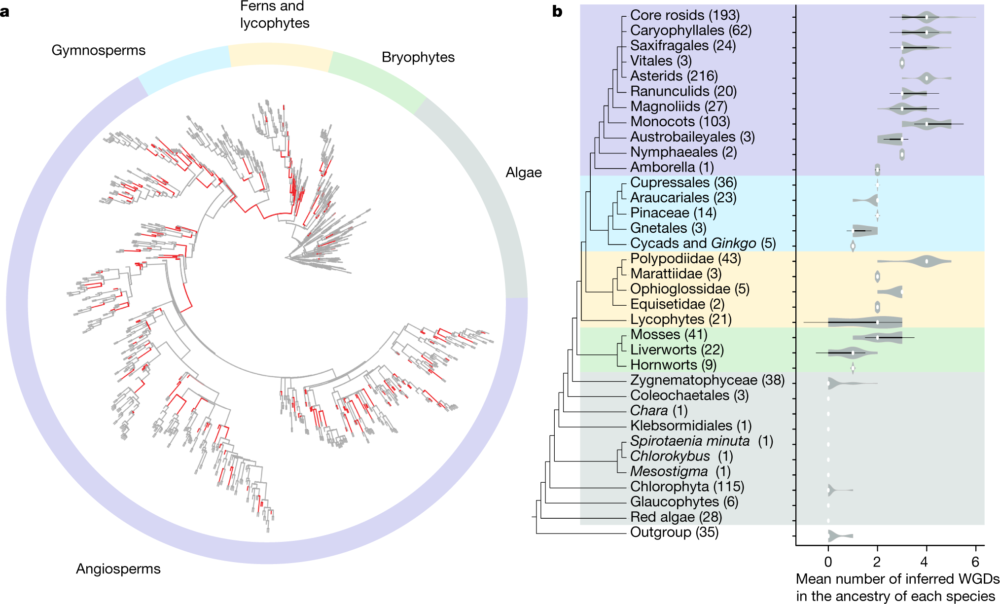
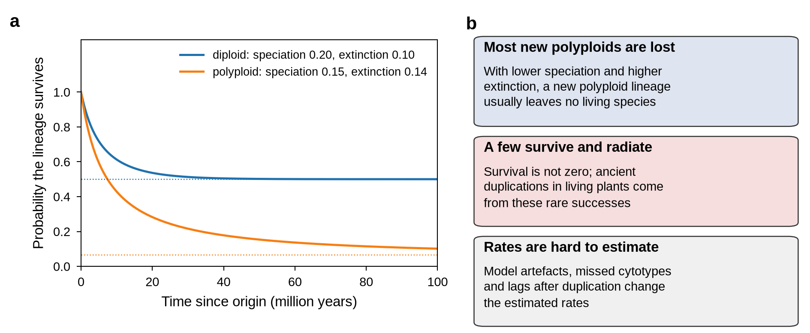

# 第 21 章 多倍化是进化死胡同吗

**地位：新近形成的多倍体分化速率较低，部分验证；多倍化是植物谱系长期的死胡同，有争议。** 死胡同假说认为，多倍体形成得很频繁，却很少留下众多后代，所以多倍体在现存物种中很常见，对长期的物种分化贡献却很小。大规模系统发育分析发现，新近的多倍体物种形成速率较低、灭绝速率较高，而且只有很少一部分多倍化事件被长期保留下来。然而，每一种开花植物都源自古老的基因组重复，许多重复事件之后出现了分化速率的变化，而用来估计速率的方法又有已知的偏差。答案取决于时间尺度，也取决于怎样识别多倍体谱系。

本仓库相关条目：[allopolyploidy-secondary-polyploidy](../../skills/genomics-theory-mining/theories/allopolyploidy-secondary-polyploidy/THEORY.md)、[masterson-1994-stomatal-polyploidy](../../skills/genomics-theory-mining/theories/masterson-1994-stomatal-polyploidy/THEORY.md)、[felber-bever-1997-triploid-fitness-coexistence](../../skills/genomics-theory-mining/theories/felber-bever-1997-triploid-fitness-coexistence/THEORY.md)、[fractionation-diploidization-after-wgd](../../skills/genomics-theory-mining/theories/fractionation-diploidization-after-wgd/THEORY.md)、[gene-balance-dosage](../../skills/genomics-theory-mining/theories/gene-balance-dosage/THEORY.md)。

## 21.1 内容与历史

G. Ledyard Stebbins 及其同时代的学者建立了一个延续了近半个世纪的多倍体进化模型：多倍化在植物中很频繁，但长期意义有限；20 世纪 80 年代以后，新的遗传学工具取代了这一框架的大部分内容 [1]。多倍体的形成速率相当可观：同源四倍体的总形成速率估计与基因突变率同一数量级，约为 10⁻⁵ [2]。据估计，开花植物中 2–4% 的物种形成事件和蕨类中 7% 的物种形成事件伴随倍性变化 [3]；后来结合细胞遗传学和系统发育数据库的估计把这一比例提高到被子植物的 15% 和蕨类的 31%，但没有直接证据表明多倍体谱系一旦建立就分化得更快 [4]。

Mayrose 等在维管植物各属中、涉及数百次多倍化事件的范围内对这一观点作了定量检验。多倍体的物种形成速率总体低于二倍体、灭绝速率高于二倍体，作者称之为对死胡同假说的首次定量证实；只有特别适应的多倍体谱系才可能延续下来 [5]。比较基因组学在深时间尺度上给出了相反的印象：古老的全基因组重复见于绿色植物的所有主要谱系 [6]，但被保留下来的古老重复极其罕见，它们可能只在特定条件下才得以存续 [7]。如果大多数新多倍体消失，而少数成功并在之后辐射，这两种看法就可以调和 [8, 9]。

## 21.2 预测

- **净分化速率较低。** 新近形成的多倍体谱系应比其二倍体近缘种物种形成速率低、灭绝速率高（图 21.2）[5]。
- **形成多，存活少。** 多倍体物种在现存物种中和属内应很常见，而基因组中保留下来的古老重复应很少 [4, 7]。
- **重复之后分化不加快。** 源自全基因组重复的类群不应比其姐妹类群物种更丰富 [10]。
- **早期困难。** 新多倍体应面临减数分裂等方面的劣势，必须克服这些劣势才能建立 [11, 12]。

## 21.3 支持证据

- **新近多倍体的速率。** 在维管植物各属中，多倍体的物种形成速率低于二倍体、灭绝速率高于二倍体；二倍体较高的物种形成速率部分来自它们能够通过多倍化形成新种 [5]。对这些质疑的回应认为，有些质疑反映的是数据的局限，另一些则误解了方法 [13]。
- **发生率高而分化不快。** 属内约 35% 的物种是多倍体，但没有直接证据表明多倍体谱系净分化更快；它们的丰富来自频繁的多倍体物种形成 [4]。
- **古老重复很少存续。** 尽管形成频繁，基因组中被保留的古老重复非常罕见，这说明大多数已经消失 [7, 8]。
- **早期挑战。** 同源染色体数目加倍给染色体分离带来困难；在 *Arabidopsis arenosa* 中，倍性特异的分化集中在跨越 44 个基因的 39 个区域，其中包括 8 个减数分裂基因 [12]；四倍体中的选择性清除涉及基因组维持相关基因，包括减数分裂基因 ASYNAPSIS1 [14]。与二倍体祖先之间的相互作用常常使新多倍体无法建立 [15]。

## 21.4 反面证据与难点

- **方法。** BiSSE 等状态依赖的物种形成与灭绝（SSE）模型 [16] 的 I 类错误率很高：当分化速率因其他原因而变化时，它们常常检出性状依赖的效应 [17]。隐藏状态模型正是为解决这一问题而提出的 [18]。在茄科中，分化速率由繁育系统加上一个隐藏因素解释得比由倍性解释得更好 [19]。
- **数据与估计。** 质疑者指出，BiSSE 对少于约 300 个分类单元的系统树不可靠，灭绝速率的估计不可靠，而且许多物种含有未被识别的多种细胞型；在加利福尼亚植物区系中，2,647 个物种中有 13% 具有不止一种细胞型 [20]。同一篇文章还指出，在所研究的属中有 20% 多倍体的物种形成速率显著更高 [20]。
- **古老重复之后的分化。** 被子植物中分化速率的变化很少与全基因组重复完全对应，但常常在一段滞后期之后跟随重复出现 [21, 22]。在被子植物系统树上定位了 106 次重复，其中 61 次与分化速率的变化紧密关联，99 次中有 70 次之后的类群比姐妹类群物种更丰富；46 次看来与分化速率上升密切相关 [10]。
- **时间上的聚集。** 许多古老的植物重复集中在白垩纪–古近纪界线附近，这提示多倍化可能帮助植物谱系度过了那次大灭绝 [23, 24]。多倍体常常在严酷或受干扰的环境中繁盛，胁迫可能是其建立的决定性因素 [25]。
- **适应潜力。** 在酵母的实验室进化中，四倍体的适应显著快于单倍体和二倍体 [26]。在葱属（*Allium*）中，多倍体频率高的谱系分化速率更高，81.7% 的土壤生境变异可以由多倍化解释 [27]。在维管植物中，多倍体物种的气候生态位分化速率总体高于其二倍体近缘种 [28]，多倍化还可能帮助引入植物成为入侵种 [29]。

## 21.5 地位与理由

**新近形成的多倍体分化速率较低：部分验证。多倍化是长期的死胡同：有争议。** 最直接的检验发现新近多倍体的净分化速率较低 [5]，被保留的古老重复之罕见也符合大多数多倍体谱系消失的看法 [7]。但这一结果依赖于有已知偏差的 SSE 方法和不完整的细胞型数据 [17, 20]。在被子植物系统树的尺度上，许多重复发生在分化速率上升之前 [10, 21]，而所有种子植物都带有古老的重复 [6]。“死胡同”恰当地描述了大多数新多倍体的命运，但不能描述多倍化的整体作用。

## 21.6 植物、作物与葡萄

- **古老重复。** 推断的古老全基因组重复遍布绿色植物，在被子植物和蕨类中最为密集（图 21.1）[6]。
- **葡萄。** 葡萄基因组显示，主要被子植物类群的祖先经历过一次六倍化（γ 事件），而现存的葡萄是二倍体，没有近期重复 [30]。与耧斗菜属（*Aquilegia*）的比较表明，γ 事件分两步完成，最后一步是一个四倍体与一个二倍体的杂交，所以核心真双子叶植物起源于杂交 [31]。因此，葡萄是一个成功的古老多倍体谱系的产物，而不是死胡同。
- **克隆繁殖作物。** 在 1,751 个物种中，多倍化与克隆繁殖和多年生相关联，而且更可能是多倍化促进克隆繁殖，而不是反过来 [32]。克隆繁殖使多倍体基因型不需要经常有性生殖也能延续：全世界一半的香蕉产量依赖单一三倍体基因型 Cavendish 的体细胞克隆 [33]。甘蔗栽培品种是高度多倍体和非整倍体 [34]，栽培草莓则是一百多万年前由四个二倍体祖先形成的八倍体 [35]。
- **人工多倍体。** 在苹果和柑橘等嫁接的多年生作物中，人工四倍体砧木可能提高对生物和非生物胁迫的耐受性，但在商业生产中的应用仍然有限 [36]。

## 21.7 用公开数据检验

- **数据。** 染色体计数数据库（Chromosome Counts Database）中的染色体数 [37]；基于转录组的重复推断和绿色植物系统发育 [6]；有时间标定的被子植物系统树 [21]。
- **工具。** 用 ChromEvol 在系统树上推断倍性变化 [38]；用 BiSSE 和隐藏状态 SSE 模型分析性状依赖的分化 [16, 18]；用 wgd 构建旁系同源基因的 KS 分布 [39]。
- **分析。** (1) 对一个有染色体计数和时间树的属，用 ChromEvol 推断倍性，并拟合 BiSSE 和 HiSSE；比较这些模型，因为在 HiSSE 下消失的倍性效应没有说服力 [17, 18]。(2) 比较已知重复之后的类群与其姐妹类群的物种丰富度 [10]。(3) 检查样本中有多少物种具有多种细胞型 [20]。脚本 [`scripts/ch21_polyploidy_figures.py`](../scripts/ch21_polyploidy_figures.py) 计算物种形成和灭绝速率恒定时谱系的存活概率（图 21.2）。
- **什么结果会推翻理论。** 在使用隐藏状态模型和完整细胞型数据的条件下，许多属中多倍体谱系的净分化速率等于或高于二倍体。

## 21.8 未解决的问题

- 重复与分化之间的滞后期有多长，期间发生了什么 [21, 22]？
- 胁迫是普遍有利于多倍体的建立，还是只在大灭绝期间如此 [24, 25]？
- 新多倍体怎样克服减数分裂问题以及与二倍体祖先的竞争 [12, 15]？
- 克隆繁殖能否挽救原本会消失的多倍体 [32]？

## 21.9 常见错误

- 把现存多倍体之多当作分化更快的证据 [4]。
- 不作隐藏状态或模拟检查就直接接受 SSE 的结果 [17, 18]。
- 在存在多种细胞型时，凭一次染色体计数就把物种定为二倍体或多倍体 [20]。
- 把大多数新多倍体的命运与少数古老多倍体的成功混为一谈 [7, 8]。

## 图

**图 21.1.** 推断的古老全基因组重复在绿色植物各谱系中的分布。a，在全部千种植物（1KP）样本的系统树上，估计的全基因组重复位置以红色标出。b，小提琴图显示每个谱系内推断的古老多倍化事件数。白点表示中位数，粗黑条表示四分位距，细黑线界定 95% 置信区间，灰色阴影表示数据点的密度。系统树上分类单元名称后的括号内为各谱系的样本量。原样转载自 One Thousand Plant Transcriptomes Initiative (2019) One thousand plant transcriptomes and the phylogenomics of green plants. *Nature* 574:679–685, Figure 4. https://doi.org/10.1038/s41586-019-1693-2。许可：CC BY 4.0（https://creativecommons.org/licenses/by/4.0/）。原图注的最后一句指向补充材料，此处略去。

**图 21.2.** (a) 在物种形成和灭绝速率恒定（每百万年）时，由一个物种建立的谱系在给定时间后仍有现存物种的概率。二倍体谱系的物种形成速率为 0.20、灭绝速率为 0.10；多倍体谱系物种形成较低、灭绝较高，分别为 0.15 和 0.14，方向与 Mayrose 等（2011）的报告一致。虚线为长期极限值 0.5 和 0.067。这些速率只作示意。(b) 模型说明了什么。用 [`scripts/ch21_polyploidy_figures.py`](../scripts/ch21_polyploidy_figures.py) 生成；计算是确定性的。

## 参考文献

1. Soltis DE, Visger CJ, Soltis PS (2014) The polyploidy revolution then…and now: Stebbins revisited. *American Journal of Botany* 101:1057-1078. https://doi.org/10.3732/ajb.1400178
2. Ramsey J, Schemske DW (1998) Pathways, mechanisms, and rates of polyploid formation in flowering plants. *Annual Review of Ecology and Systematics* 29:467-501. https://doi.org/10.1146/annurev.ecolsys.29.1.467
3. Otto SP, Whitton J (2000) Polyploid incidence and evolution. *Annual Review of Genetics* 34:401-437. https://doi.org/10.1146/annurev.genet.34.1.401
4. Wood TE, Takebayashi N, Barker MS, et al. (2009) The frequency of polyploid speciation in vascular plants. *Proceedings of the National Academy of Sciences* 106:13875-13879. https://doi.org/10.1073/pnas.0811575106
5. Mayrose I, Zhan SH, Rothfels CJ, et al. (2011) Recently Formed Polyploid Plants Diversify at Lower Rates. *Science* 333:1257. https://doi.org/10.1126/science.1207205
6. One Thousand Plant Transcriptomes Initiative (2019) One thousand plant transcriptomes and the phylogenomics of green plants. *Nature* 574:679-685. https://doi.org/10.1038/s41586-019-1693-2
7. Van de Peer Y, Maere S, Meyer A (2009) The evolutionary significance of ancient genome duplications. *Nature Reviews Genetics* 10:725-732. https://doi.org/10.1038/nrg2600
8. Arrigo N, Barker MS (2012) Rarely successful polyploids and their legacy in plant genomes. *Current Opinion in Plant Biology* 15:140-146. https://doi.org/10.1016/j.pbi.2012.03.010
9. Van de Peer Y, Mizrachi E, Marchal K (2017) The evolutionary significance of polyploidy. *Nature Reviews Genetics* 18:411-424. https://doi.org/10.1038/nrg.2017.26
10. Landis JB, Soltis DE, Li Z, et al. (2018) Impact of whole‐genome duplication events on diversification rates in angiosperms. *American Journal of Botany* 105:348-363. https://doi.org/10.1002/ajb2.1060
11. Comai L (2005) The advantages and disadvantages of being polyploid. *Nature Reviews Genetics* 6:836-846. https://doi.org/10.1038/nrg1711
12. Yant L, Hollister J, Wright K, et al. (2013) Meiotic Adaptation to Genome Duplication in Arabidopsis arenosa. *Current Biology* 23:2151-2156. https://doi.org/10.1016/j.cub.2013.08.059
13. Mayrose I, Zhan SH, Rothfels CJ, et al. (2015) Methods for studying polyploid diversification and the dead end hypothesis: a reply to Soltis et al . (2014). *New Phytologist* 206:27-35. https://doi.org/10.1111/nph.13192
14. Hollister JD, Arnold BJ, Svedin E, et al. (2012) Genetic Adaptation Associated with Genome-Doubling in Autotetraploid Arabidopsis arenosa. *PLoS Genetics* 8:e1003093. https://doi.org/10.1371/journal.pgen.1003093
15. Baduel P, Bray S, Vallejo-Marin M, et al. (2018) The “Polyploid Hop”: Shifting Challenges and Opportunities Over the Evolutionary Lifespan of Genome Duplications. *Frontiers in Ecology and Evolution* 6:117. https://doi.org/10.3389/fevo.2018.00117
16. Maddison WP, Midford PE, Otto SP (2007) Estimating a Binary Character's Effect on Speciation and Extinction. *Systematic Biology* 56:701-710. https://doi.org/10.1080/10635150701607033
17. Rabosky DL, Goldberg EE (2015) Model Inadequacy and Mistaken Inferences of Trait-Dependent Speciation. *Systematic Biology* 64:340-355. https://doi.org/10.1093/sysbio/syu131
18. Beaulieu JM, O’Meara BC (2016) Detecting Hidden Diversification Shifts in Models of Trait-Dependent Speciation and Extinction. *Systematic Biology* 65:583-601. https://doi.org/10.1093/sysbio/syw022
19. Zenil‐Ferguson R, Burleigh JG, Freyman WA, et al. (2019) Interaction among ploidy, breeding system and lineage diversification. *New Phytologist* 224:1252-1265. https://doi.org/10.1111/nph.16184
20. Soltis DE, Segovia‐Salcedo MC, Jordon‐Thaden I, et al. (2014) Are polyploids really evolutionary dead‐ends (again)? A critical reappraisal of Mayrose et al . (2011). *New Phytologist* 202:1105-1117. https://doi.org/10.1111/nph.12756
21. Tank DC, Eastman JM, Pennell MW, et al. (2015) Nested radiations and the pulse of angiosperm diversification: increased diversification rates often follow whole genome duplications. *New Phytologist* 207:454-467. https://doi.org/10.1111/nph.13491
22. Eric Schranz M, Mohammadin S, Edger PP (2012) Ancient whole genome duplications, novelty and diversification: the WGD Radiation Lag-Time Model. *Current Opinion in Plant Biology* 15:147-153. https://doi.org/10.1016/j.pbi.2012.03.011
23. Fawcett JA, Maere S, Van de Peer Y (2009) Plants with double genomes might have had a better chance to survive the Cretaceous–Tertiary extinction event. *Proceedings of the National Academy of Sciences* 106:5737-5742. https://doi.org/10.1073/pnas.0900906106
24. Vanneste K, Maere S, Van de Peer Y (2014) Tangled up in two: a burst of genome duplications at the end of the Cretaceous and the consequences for plant evolution. *Philosophical Transactions of the Royal Society B: Biological Sciences* 369:20130353. https://doi.org/10.1098/rstb.2013.0353
25. Van de Peer Y, Ashman TL, Soltis PS, et al. (2021) Polyploidy: an evolutionary and ecological force in stressful times. *The Plant Cell* 33:11-26. https://doi.org/10.1093/plcell/koaa015
26. Selmecki AM, Maruvka YE, Richmond PA, et al. (2015) Polyploidy can drive rapid adaptation in yeast. *Nature* 519:349-352. https://doi.org/10.1038/nature14187
27. Han T, Zheng Q, Onstein RE, et al. (2020) Polyploidy promotes species diversification of Allium through ecological shifts. *New Phytologist* 225:571-583. https://doi.org/10.1111/nph.16098
28. Baniaga AE, Marx HE, Arrigo N, et al. (2020) Polyploid plants have faster rates of multivariate niche differentiation than their diploid relatives. *Ecology Letters* 23:68-78. https://doi.org/10.1111/ele.13402
29. te Beest M, Le Roux JJ, Richardson DM, et al. (2012) The more the better? The role of polyploidy in facilitating plant invasions. *Annals of Botany* 109:19-45. https://doi.org/10.1093/aob/mcr277
30. The French–Italian Public Consortium for Grapevine Genome Characterization (2007) The grapevine genome sequence suggests ancestral hexaploidization in major angiosperm phyla. *Nature* 449:463-467. https://doi.org/10.1038/nature06148
31. Aköz G, Nordborg M (2019) The Aquilegia genome reveals a hybrid origin of core eudicots. *Genome Biology* 20:256. https://doi.org/10.1186/s13059-019-1888-8
32. Van Drunen WE, Husband BC (2019) Evolutionary associations between polyploidy, clonal reproduction, and perenniality in the angiosperms. *New Phytologist* 224:1266-1277. https://doi.org/10.1111/nph.15999
33. D’Hont A, Denoeud F, Aury JM, et al. (2012) The banana (Musa acuminata) genome and the evolution of monocotyledonous plants. *Nature* 488:213-217. https://doi.org/10.1038/nature11241
34. Garsmeur O, Droc G, Antonise R, et al. (2018) A mosaic monoploid reference sequence for the highly complex genome of sugarcane. *Nature Communications* 9:2638. https://doi.org/10.1038/s41467-018-05051-5
35. Edger PP, Poorten TJ, VanBuren R, et al. (2019) Origin and evolution of the octoploid strawberry genome. *Nature Genetics* 51:541-547. https://doi.org/10.1038/s41588-019-0356-4
36. Ruiz M, Oustric J, Santini J, et al. (2020) Synthetic Polyploidy in Grafted Crops. *Frontiers in Plant Science* 11:540894. https://doi.org/10.3389/fpls.2020.540894
37. Rice A, Glick L, Abadi S, et al. (2015) The Chromosome Counts Database (CCDB) – a community resource of plant chromosome numbers. *New Phytologist* 206:19-26. https://doi.org/10.1111/nph.13191
38. Mayrose I, Barker MS, Otto SP (2010) Probabilistic Models of Chromosome Number Evolution and the Inference of Polyploidy. *Systematic Biology* 59:132-144. https://doi.org/10.1093/sysbio/syp083
39. Zwaenepoel A, Van de Peer Y (2019) wgd—simple command line tools for the analysis of ancient whole-genome duplications. *Bioinformatics* 35:2153-2155. https://doi.org/10.1093/bioinformatics/bty915
