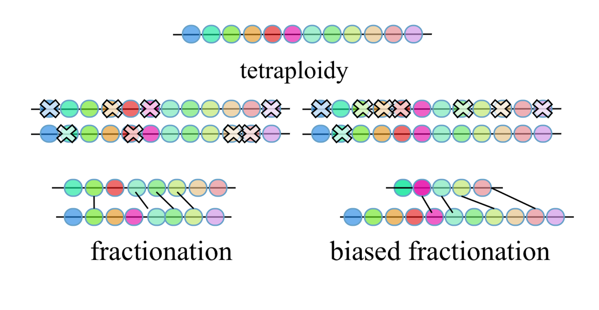
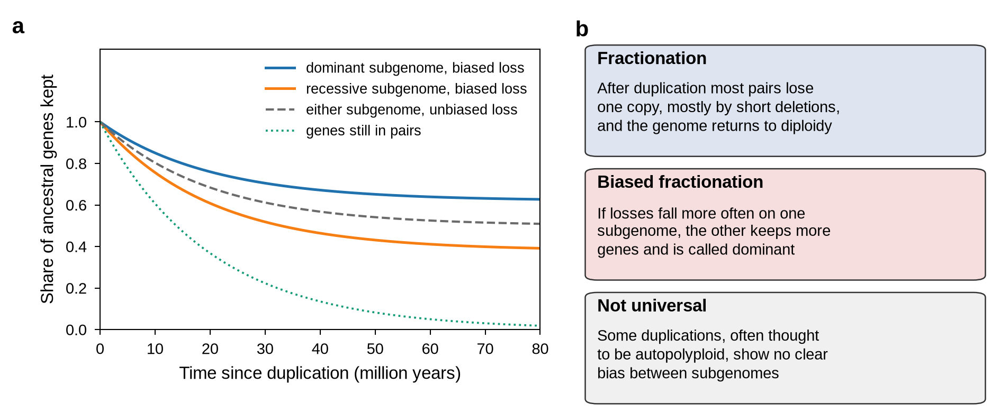

# Chapter 22. Biased fractionation and subgenome dominance

**Status: Biased fractionation and subgenome dominance after many allopolyploidies, Verified; their causes, Partly verified.** After a whole-genome duplication most duplicated genes lose one copy, a process called fractionation. In many polyploids the losses fall more often on one parental subgenome, and the subgenome that keeps more genes is also more highly expressed; this is subgenome (or genome) dominance. The pattern is documented in maize, *Arabidopsis*, *Brassica*, strawberry, *Mimulus* and peanut, and appears within the first generations after hybridization. It is not universal: some duplications, probably autopolyploid, show unbiased loss and equal expression. Transposable elements and their methylation near genes are the leading explanation of dominance, but probably not the only cause.

Related notes in this repository: [fractionation-diploidization-after-wgd](../../skills/genomics-theory-mining/theories/fractionation-diploidization-after-wgd/THEORY.md), [gene-balance-dosage](../../skills/genomics-theory-mining/theories/gene-balance-dosage/THEORY.md), [allopolyploidy-secondary-polyploidy](../../skills/genomics-theory-mining/theories/allopolyploidy-secondary-polyploidy/THEORY.md).

## 22.1 Statement and history

Genome sequences showed that most flowering plants are ancient polyploids whose duplicated genes have largely returned to single copies. Comparing the rosid genomes of *Arabidopsis*, poplar, grape and papaya placed three independent, fractionated tetraploidies among them [1]. In *Arabidopsis*, after the most recent tetraploidy, genes were removed preferentially from one homeolog, leaving clusters of retained, dose-sensitive genes [2]. Models of gene loss across 15 genomes and six duplications showed that losses were random except in resistant regions, and that conserved copies came to be concentrated on one chromosome of a pair [3].

Woodhouse and colleagues showed that after the maize tetraploidy, genes were removed mainly by a short deletion mechanism, single-gene deletions through recombination between short direct repeats, and that deletion was 2.3 times more frequent on one homeolog than on the other (Figure 22.1) [4]. Schnable and colleagues found that the less fractionated maize subgenome is also more highly expressed, and called this genome dominance [5]. Freeling and colleagues proposed that genes are lost from the less expressed subgenome, and that the expression difference may come from a trade-off between transposon repression and gene expression [6]. Garsmeur and colleagues then separated duplications with biased fractionation and genome dominance (Class I), suggested to come from ancient allotetraploidy, from duplications with unbiased fractionation and genome equivalence (Class II), suggested to come from autotetraploidy [7].

## 22.2 What the theory predicts

- **Unequal loss.** After allopolyploidy, one subgenome should keep significantly more genes than the other (Figure 22.2) [4, 7].
- **Expression first.** Genes of the dominant subgenome should be more highly expressed, and expression dominance should arise before gene loss, soon after hybridization [5, 8].
- **Mechanism.** Copies on the recessive subgenome should be lost mainly by short deletions [4].
- **Function.** The less fractionated subgenome should contribute more to phenotypic variation [9].
- **No bias after autopolyploidy.** Duplications that combine similar genomes should show little bias [7].

## 22.3 Evidence for

- **Maize.** After the maize tetraploidy about 5–12 million years ago, gene loss is uneven between the two subgenomes, and genes of the less fractionated subgenome are overexpressed; fractionation is still ongoing among diverse inbreds [5]. The over-fractionated homeolog is also a better target for transposon removal [4]. Paralogs in the least fractionated subgenome account for more phenotypic diversity, and this difference persists in singleton genes after fractionation is complete [9].
- **Brassica.** In *Brassica rapa*, one of the three subgenomes from an ancient hexaploidy retains disproportionately more genes [10]. The least fractionated subgenome has about twice as many orthologs of *Arabidopsis* genes as either of the other two; this fits a two-step model in which the two heavily fractionated subgenomes shared a nucleus for longer before the third was added, and short deletions of one or two genes dominate the losses [11]. Genes on that subgenome are dominantly expressed [12]. In *B. oleracea*, transcriptome and methylome profiles retain relics of genome dominance [13].
- **Many genomes.** A model of post-duplication gene loss applied to 21 genomes finds biased fractionation in yeast, *Arabidopsis* and the grasses; the bias is driven by the co-retention of interacting genes from the same parent, and persists over time in *Arabidopsis* and the grasses but only early on in yeast [14].
- **Instant dominance.** In *Mimulus*, subgenome expression dominance appears immediately after hybridization of divergent genomes and increases significantly over generations; methylation of transposable elements differs between the dominant and recessive subgenomes and mirrors the expression bias [8].
- **Recent polyploids.** Octoploid strawberry has a single dominant subgenome with greater gene content and expression and biased exchanges between homoeologous chromosomes [15]. In peanut, the B subgenome has more genes and general expression dominance, associated with expansion of long terminal repeat elements in the A subgenome [16].

## 22.4 Evidence against, and difficulties

- **Unbiased cases.** The most recent duplication of banana (alpha), together with those of poplar and soybean, shows unbiased gene loss and equal expression [7]. Biased fractionation is therefore not a necessary consequence of whole-genome duplication.
- **Incipient or absent loss in young polyploids.** *Brassica napus* formed about 7,500 years ago; it shows abundant homeologous exchanges, but gene loss and expression divergence are only incipient [17]. In bread wheat, about 30% of homoeologs show nonbalanced expression, and the bias varies between tissues [18].
- **Causes.** Low transposable-element density near genes is associated with the dominant subgenome in several allopolyploids, but TEs are unlikely to be the only cause; genetic incompatibilities among subgenomes may also matter [19, 20].
- **Progenitor inference.** Claims about which progenitor genome dominates depend on correct identification of the diploid progenitors, which has been disputed for strawberry [21].
- **Cause and effect.** Dominance appears immediately in wide hybrids and can persist for tens of millions of years, but it has been difficult to tell whether the chromatin marks measured or the expression differences come first; dominance and heterosis appear to be antagonistic [6, 22].

## 22.5 Status and reasoning

**Biased fractionation and subgenome dominance after many allopolyploidies: verified. Their causes: partly verified.** Uneven loss and greater expression of the less fractionated subgenome are found in maize, *Arabidopsis*, *Brassica*, *Mimulus*, strawberry and peanut, with independent methods [4, 5, 8, 11, 14]. Unbiased loss in banana, poplar and soybean shows that the pattern is not universal [7]. Transposable elements and their methylation near genes are supported by several studies, but other mechanisms are likely [8, 19].

## 22.6 Plants, crops and grapevine

- **Crops.** Subgenome differences shape the major polyploid crops, including *Brassica*, wheat, strawberry and peanut [15, 16, 18, 22].
- **Grapevine as a reference.** The grapevine genome has no recent duplication and preserves the three ancestral genomes of the gamma hexaploidy [23]. This makes grape a standard outgroup for comparing fractionated tetraploidies in other rosids [1]. A reconstruction of the genome of the most recent common ancestor of monocots and eudicots, with 22,899 ancestral genes, gives a further reference for tracing loss after duplication [24]. Synteny with *Aquilegia* suggests that gamma involved an allopolyploidization between a tetraploid and a diploid [25], so the three grape subgenomes are expected to differ in their history of loss, as the *Brassica* subgenomes do [11].
- **Clonal and perennial crops.** Banana, a clonally propagated perennial, belongs to the unbiased class [7]. Perennial and clonal crops therefore do not follow a single rule, and each duplication must be tested.

## 22.7 How to test it with public data

- **Data.** Chromosome-scale genomes of a polyploid and a diploid outgroup, such as maize with sorghum or *Brassica* with *Arabidopsis* [5, 12]; expression data across tissues [18].
- **Tools.** MCScanX or WGDI to find syntenic blocks and assign genes to subgenomes [26, 27]; the CoGe platform for synteny comparisons with outgroups [1]; POInT for modelling post-duplication gene loss along subgenomes [14].
- **Analysis.** (1) Align each subgenome to the outgroup and count ancestral genes retained on each; test for a difference with a paired test across syntenic blocks [4]. (2) Compare expression of retained homeolog pairs and check whether the more retained subgenome is more expressed [5]. (3) Measure transposable element density and methylation near genes on each subgenome [8]. The script [`scripts/ch22_fractionation_figures.py`](../scripts/ch22_fractionation_figures.py) computes expected retention per subgenome under biased and unbiased loss (Figure 22.2).
- **What would refute it.** Equal retention and equal expression of subgenomes across allopolyploids with well-identified progenitors.

## 22.8 Open questions

- What sets up dominance in the first generation: transposable elements, methylation, or incompatibilities [19, 20]?
- Why do some duplications show no bias [7]?
- How does dominance relate to heterosis [6, 22]?
- Did the three gamma subgenomes of grapevine fractionate unequally?

## 22.9 Common mistakes

- Assigning genes to subgenomes without an outgroup or without synteny [1, 26].
- Treating every polyploid as biased; autopolyploid and young polyploids may not be [7, 17].
- Inferring progenitors from too few diploid relatives [21].
- Confusing expression bias in one tissue with genome-wide dominance [18].

## Figures

**Figure 22.1.** Cartoons illustrating random fractionation and biased fractionation. Lines connect homeologous genes retained as pairs, called “retained genes.” Note that retained genes cluster automatically after fractionation. Reproduced unchanged from Woodhouse MR, Schnable JC, Pedersen BS, et al. (2010) Following tetraploidy in maize, a short deletion mechanism removed genes preferentially from one of the two homeologs. *PLoS Biology* 8:e1000409, Figure 2. https://doi.org/10.1371/journal.pbio.1000409. Licence: CC BY 4.0 (https://creativecommons.org/licenses/by/4.0/).

**Figure 22.2.** (a) Expected share of ancestral genes kept on each subgenome after a whole-genome duplication. Pairs lose one copy at 0.05 per million years; under biased loss the lost copy comes from the recessive subgenome with probability 0.62 (about 1.6 losses there for each loss on the dominant subgenome), and under unbiased loss with probability 0.5. Loss of both copies is ignored. The values are illustrative. (b) What the model shows. Made with [`scripts/ch22_fractionation_figures.py`](../scripts/ch22_fractionation_figures.py); the calculation is deterministic.

## References

1. Lyons E, Pedersen B, Kane J, et al. (2008) Finding and Comparing Syntenic Regions among Arabidopsis and the Outgroups Papaya, Poplar, and Grape: CoGe with Rosids. *Plant Physiology* 148:1772-1781. https://doi.org/10.1104/pp.108.124867
2. Thomas BC, Pedersen B, Freeling M (2006) Following tetraploidy in an Arabidopsis ancestor, genes were removed preferentially from one homeolog leaving clusters enriched in dose-sensitive genes. *Genome Research* 16:934-946. https://doi.org/10.1101/gr.4708406
3. Sankoff D, Zheng C, Zhu Q (2010) The collapse of gene complement following whole genome duplication. *BMC Genomics* 11:313. https://doi.org/10.1186/1471-2164-11-313
4. Woodhouse MR, Schnable JC, Pedersen BS, et al. (2010) Following Tetraploidy in Maize, a Short Deletion Mechanism Removed Genes Preferentially from One of the Two Homeologs. *PLoS Biology* 8:e1000409. https://doi.org/10.1371/journal.pbio.1000409
5. Schnable JC, Springer NM, Freeling M (2011) Differentiation of the maize subgenomes by genome dominance and both ancient and ongoing gene loss. *Proceedings of the National Academy of Sciences* 108:4069-4074. https://doi.org/10.1073/pnas.1101368108
6. Freeling M, Woodhouse MR, Subramaniam S, et al. (2012) Fractionation mutagenesis and similar consequences of mechanisms removing dispensable or less-expressed DNA in plants. *Current Opinion in Plant Biology* 15:131-139. https://doi.org/10.1016/j.pbi.2012.01.015
7. Garsmeur O, Schnable JC, Almeida A, et al. (2014) Two Evolutionarily Distinct Classes of Paleopolyploidy. *Molecular Biology and Evolution* 31:448-454. https://doi.org/10.1093/molbev/mst230
8. Edger PP, Smith R, McKain MR, et al. (2017) Subgenome Dominance in an Interspecific Hybrid, Synthetic Allopolyploid, and a 140-Year-Old Naturally Established Neo-Allopolyploid Monkeyflower. *The Plant Cell* 29:2150-2167. https://doi.org/10.1105/tpc.17.00010
9. Renny-Byfield S, Rodgers-Melnick E, Ross-Ibarra J (2017) Gene Fractionation and Function in the Ancient Subgenomes of Maize. *Molecular Biology and Evolution* 34:1825-1832. https://doi.org/10.1093/molbev/msx121
10. The Brassica rapa Genome Sequencing Project Consortium, Wang X, Wang H, et al. (2011) The genome of the mesopolyploid crop species Brassica rapa. *Nature Genetics* 43:1035-1039. https://doi.org/10.1038/ng.919
11. Tang H, Woodhouse MR, Cheng F, et al. (2012) Altered Patterns of Fractionation and Exon Deletions in Brassica rapa Support a Two-Step Model of Paleohexaploidy. *Genetics* 190:1563-1574. https://doi.org/10.1534/genetics.111.137349
12. Cheng F, Wu J, Fang L, et al. (2012) Biased Gene Fractionation and Dominant Gene Expression among the Subgenomes of Brassica rapa. *PLoS ONE* 7:e36442. https://doi.org/10.1371/journal.pone.0036442
13. Parkin IA, Koh C, Tang H, et al. (2014) Transcriptome and methylome profiling reveals relics of genome dominance in the mesopolyploid Brassica oleracea. *Genome Biology* 15:R77. https://doi.org/10.1186/gb-2014-15-6-r77
14. Emery M, Willis MMS, Hao Y, et al. (2018) Preferential retention of genes from one parental genome after polyploidy illustrates the nature and scope of the genomic conflicts induced by hybridization. *PLOS Genetics* 14:e1007267. https://doi.org/10.1371/journal.pgen.1007267
15. Edger PP, Poorten TJ, VanBuren R, et al. (2019) Origin and evolution of the octoploid strawberry genome. *Nature Genetics* 51:541-547. https://doi.org/10.1038/s41588-019-0356-4
16. Zhuang W, Chen H, Yang M, et al. (2019) The genome of cultivated peanut provides insight into legume karyotypes, polyploid evolution and crop domestication. *Nature Genetics* 51:865-876. https://doi.org/10.1038/s41588-019-0402-2
17. Chalhoub B, Denoeud F, Liu S, et al. (2014) Early allopolyploid evolution in the post-Neolithic Brassica napus oilseed genome. *Science* 345:950-953. https://doi.org/10.1126/science.1253435
18. Ramírez-González RH, Borrill P, Lang D, et al. (2018) The transcriptional landscape of polyploid wheat. *Science* 361:eaar6089. https://doi.org/10.1126/science.aar6089
19. Alger EI, Edger PP (2020) One subgenome to rule them all: underlying mechanisms of subgenome dominance. *Current Opinion in Plant Biology* 54:108-113. https://doi.org/10.1016/j.pbi.2020.03.004
20. Bird KA, VanBuren R, Puzey JR, et al. (2018) The causes and consequences of subgenome dominance in hybrids and recent polyploids. *New Phytologist* 220:87-93. https://doi.org/10.1111/nph.15256
21. Liston A, Wei N, Tennessen JA, et al. (2020) Revisiting the origin of octoploid strawberry. *Nature Genetics* 52:2-4. https://doi.org/10.1038/s41588-019-0543-3
22. Cheng F, Wu J, Cai X, et al. (2018) Gene retention, fractionation and subgenome differences in polyploid plants. *Nature Plants* 4:258-268. https://doi.org/10.1038/s41477-018-0136-7
23. The French–Italian Public Consortium for Grapevine Genome Characterization (2007) The grapevine genome sequence suggests ancestral hexaploidization in major angiosperm phyla. *Nature* 449:463-467. https://doi.org/10.1038/nature06148
24. Murat F, Armero A, Pont C, et al. (2017) Reconstructing the genome of the most recent common ancestor of flowering plants. *Nature Genetics* 49:490-496. https://doi.org/10.1038/ng.3813
25. Aköz G, Nordborg M (2019) The Aquilegia genome reveals a hybrid origin of core eudicots. *Genome Biology* 20:256. https://doi.org/10.1186/s13059-019-1888-8
26. Wang Y, Tang H, DeBarry JD, et al. (2012) MCScanX: a toolkit for detection and evolutionary analysis of gene synteny and collinearity. *Nucleic Acids Research* 40:e49-e49. https://doi.org/10.1093/nar/gkr1293
27. Sun P, Jiao B, Yang Y, et al. (2022) WGDI: A user-friendly toolkit for evolutionary analyses of whole-genome duplications and ancestral karyotypes. *Molecular Plant* 15:1841-1851. https://doi.org/10.1016/j.molp.2022.10.018
