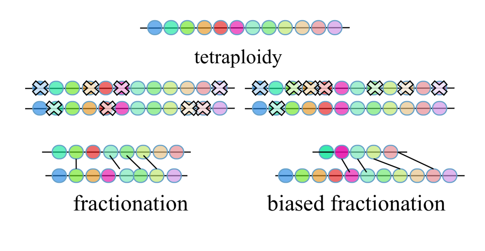
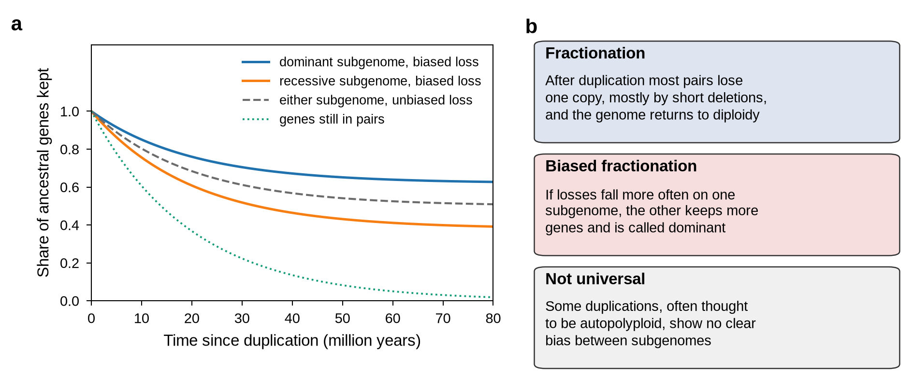

# 第 22 章 偏向性分级丢失与亚基因组优势

**地位：许多异源多倍化之后的偏向性分级丢失与亚基因组优势已验证；其成因部分验证。** 全基因组重复之后，大多数重复基因会丢失一个拷贝，这一过程称为分级丢失（fractionation）。在许多多倍体中，丢失更多地落在某一个亲本亚基因组上，而保留基因较多的亚基因组表达也较高，这就是亚基因组（或基因组）优势。这一格局在玉米、拟南芥属、芸薹属、草莓、沟酸浆属和花生中都有记录，并在杂交后的最初几代就已出现。它并不普遍：有些重复事件（可能是同源多倍化）表现为无偏的丢失和相等的表达。转座子及其在基因附近的甲基化是对优势的主要解释，但可能不是唯一原因。

本仓库相关条目：[fractionation-diploidization-after-wgd](../../skills/genomics-theory-mining/theories/fractionation-diploidization-after-wgd/THEORY.md)、[gene-balance-dosage](../../skills/genomics-theory-mining/theories/gene-balance-dosage/THEORY.md)、[allopolyploidy-secondary-polyploidy](../../skills/genomics-theory-mining/theories/allopolyploidy-secondary-polyploidy/THEORY.md)。

## 22.1 内容与历史

基因组测序表明，大多数开花植物是古多倍体，其重复基因大多已回到单拷贝状态。比较拟南芥、杨树、葡萄和番木瓜这几个蔷薇类基因组，可以在它们之间定位三次独立的、已发生分级丢失的四倍化 [1]。在拟南芥中，最近一次四倍化之后，基因被优先从一个部分同源区段上删除，留下了富含剂量敏感基因的保留簇 [2]。对 15 个基因组、6 次重复事件的基因丢失建模表明，除了一些抗丢失的区域外，丢失是随机的，而被保留的拷贝倾向于集中在一对染色体中的一条上 [3]。

Woodhouse 等发现，玉米四倍化之后，基因主要通过一种短缺失机制被删除，即短正向重复之间的重组造成单基因缺失，而且缺失在一个部分同源区段上的发生频率是另一个的 2.3 倍（图 22.1）[4]。Schnable 等发现，玉米中丢失较少的亚基因组表达也较高，称之为基因组优势 [5]。Freeling 等提出，基因从表达较低的亚基因组上丢失，而表达差异可能来自转座子抑制与基因表达之间的权衡 [6]。Garsmeur 等随后区分了两类重复：具有偏向性分级丢失和基因组优势的一类（I 类），推测来自古老的异源四倍化；以及分级丢失无偏、基因组等同的一类（II 类），推测来自同源四倍化 [7]。

## 22.2 预测

- **丢失不均。** 异源多倍化之后，一个亚基因组保留的基因应显著多于另一个（图 22.2）[4, 7]。
- **表达在先。** 优势亚基因组的基因表达应较高，且表达优势应在基因丢失之前、杂交后不久出现 [5, 8]。
- **机制。** 隐性亚基因组上的拷贝应主要通过短缺失丢失 [4]。
- **功能。** 丢失较少的亚基因组应对表型变异贡献更大 [9]。
- **同源多倍化无偏。** 合并相似基因组的重复事件应几乎没有偏向 [7]。

## 22.3 支持证据

- **玉米。** 玉米约 5–12 百万年前的四倍化之后，两个亚基因组的基因丢失不均，丢失较少的亚基因组的基因过量表达；在不同自交系之间分级丢失仍在进行 [5]。丢失较多的部分同源区段也更容易发生转座子的清除 [4]。丢失最少的亚基因组中的旁系同源基因解释了更多的表型多样性，而且在分级丢失完成之后的单拷贝基因中这种差异依然存在 [9]。
- **芸薹属。** 在白菜（*Brassica rapa*）中，古老六倍化留下的三个亚基因组之一保留的基因明显更多 [10]。丢失最少的亚基因组所含拟南芥基因的直系同源基因约为另外两个的两倍；这符合一个两步模型：两个丢失较多的亚基因组在同一个细胞核中共处了更长时间，第三个才加入，而丢失以一到两个基因的短缺失为主 [11]。该亚基因组上的基因表达占优势 [12]。在甘蓝（*B. oleracea*）中，转录组和甲基化组谱仍保留着基因组优势的遗迹 [13]。
- **许多基因组。** 将一个重复后基因丢失模型应用于 21 个基因组，在酵母、拟南芥属和禾本科中发现了偏向性分级丢失；这种偏向由来自同一亲本的相互作用基因的共同保留驱动，在拟南芥属和禾本科中长期持续，在酵母中只出现在早期 [14]。
- **即时出现的优势。** 在沟酸浆属（*Mimulus*）中，亚基因组表达优势在分化基因组杂交后立即出现，并在之后的世代中显著增强；转座子甲基化在优势和隐性亚基因组之间不同，并与表达偏向相对应 [8]。
- **新近的多倍体。** 八倍体草莓有一个优势亚基因组，其基因含量和表达都更高，部分同源染色体之间的交换也有偏向 [15]。在花生中，B 亚基因组基因更多、总体表达占优势，这与 A 亚基因组中长末端重复元件的扩张相关联 [16]。

## 22.4 反面证据与难点

- **无偏的例子。** 香蕉最近的一次重复（α），以及杨树和大豆的重复，表现为无偏的基因丢失和相等的表达 [7]。因此，偏向性分级丢失并不是全基因组重复的必然结果。
- **年轻多倍体中丢失刚刚开始或没有发生。** 甘蓝型油菜（*Brassica napus*）约在 7,500 年前形成；它有大量部分同源交换，但基因丢失和表达分化才刚刚开始 [17]。在普通小麦中，约 30% 的部分同源基因表达不平衡，而且偏向随组织而变 [18]。
- **成因。** 在若干异源多倍体中，基因附近转座子密度低与优势亚基因组相关，但转座子不太可能是唯一原因；亚基因组之间的遗传不亲和也可能起作用 [19, 20]。
- **祖先推断。** 关于哪个祖先基因组占优势的结论取决于能否正确识别二倍体祖先，而草莓的祖先识别存在争议 [21]。
- **因与果。** 优势在远缘杂种中立即出现，并可延续数千万年，但很难判断是所测的染色质标记在先还是表达差异在先；优势与杂种优势看来是相互拮抗的 [6, 22]。

## 22.5 地位与理由

**许多异源多倍化之后的偏向性分级丢失与亚基因组优势：已验证。其成因：部分验证。** 在玉米、拟南芥属、芸薹属、沟酸浆属、草莓和花生中，用独立的方法都发现了丢失不均以及丢失较少的亚基因组表达较高 [4, 5, 8, 11, 14]。香蕉、杨树和大豆中的无偏丢失表明这一格局并不普遍 [7]。转座子及其在基因附近的甲基化得到若干研究的支持，但很可能还有其他机制 [8, 19]。

## 22.6 植物、作物与葡萄

- **作物。** 亚基因组差异塑造了主要的多倍体作物，包括芸薹属、小麦、草莓和花生 [15, 16, 18, 22]。
- **作为参照的葡萄。** 葡萄基因组没有近期重复，保留着 γ 六倍化的三个祖先基因组 [23]。这使葡萄成为比较其他蔷薇类植物中已分级丢失的四倍化的标准外类群 [1]。对单子叶和真双子叶植物最近共同祖先基因组的重建含有 22,899 个祖先基因，为追踪重复之后的丢失提供了另一个参照 [24]。与耧斗菜属的共线性比较提示，γ 事件包含一个四倍体与一个二倍体之间的异源多倍化 [25]，所以葡萄的三个亚基因组预期在丢失历史上有所不同，就像芸薹属的亚基因组那样 [11]。
- **克隆繁殖和多年生作物。** 克隆繁殖的多年生植物香蕉属于无偏的一类 [7]。因此，多年生和克隆繁殖作物并不遵循单一规律，每一次重复都需要单独检验。

## 22.7 用公开数据检验

- **数据。** 一个多倍体和一个二倍体外类群的染色体级基因组，例如玉米与高粱，或芸薹属与拟南芥 [5, 12]；跨组织的表达数据 [18]。
- **工具。** 用 MCScanX 或 WGDI 寻找共线区块并把基因分配到亚基因组 [26, 27]；用 CoGe 平台与外类群作共线性比较 [1]；用 POInT 对各亚基因组上重复后的基因丢失建模 [14]。
- **分析。** (1) 将每个亚基因组与外类群比对，统计每个亚基因组上保留的祖先基因，并在共线区块之间用配对检验检验差异 [4]。(2) 比较被保留的部分同源基因对的表达，检查保留较多的亚基因组是否表达较高 [5]。(3) 测量每个亚基因组上基因附近的转座子密度和甲基化水平 [8]。脚本 [`scripts/ch22_fractionation_figures.py`](../scripts/ch22_fractionation_figures.py) 计算偏向和无偏丢失下每个亚基因组的预期保留比例（图 22.2）。
- **什么结果会推翻理论。** 在祖先已被可靠识别的异源多倍体中，各亚基因组的保留和表达都相等。

## 22.8 未解决的问题

- 第一代中是什么建立了优势：转座子、甲基化，还是不亲和 [19, 20]？
- 为什么有些重复事件没有偏向 [7]？
- 优势与杂种优势有什么关系 [6, 22]？
- 葡萄 γ 事件的三个亚基因组是否发生了不均等的分级丢失？

## 22.9 常见错误

- 没有外类群或不用共线性就把基因分配给亚基因组 [1, 26]。
- 把每个多倍体都当作有偏向的；同源多倍体和年轻多倍体可能并非如此 [7, 17]。
- 依据太少的二倍体近缘种推断祖先 [21]。
- 把一个组织中的表达偏向当作全基因组的优势 [18]。

## 图

**图 22.1.** 随机分级丢失与偏向性分级丢失的示意图。连线连接作为基因对被保留下来的部分同源基因，称为“保留基因”。注意，分级丢失之后保留基因会自动聚集成簇。原样转载自 Woodhouse MR, Schnable JC, Pedersen BS, et al. (2010) Following tetraploidy in maize, a short deletion mechanism removed genes preferentially from one of the two homeologs. *PLoS Biology* 8:e1000409, Figure 2. https://doi.org/10.1371/journal.pbio.1000409。许可：CC BY 4.0（https://creativecommons.org/licenses/by/4.0/）。

**图 22.2.** (a) 全基因组重复之后每个亚基因组上保留的祖先基因的预期比例。基因对以每百万年 0.05 的速率丢失一个拷贝；偏向丢失时，丢失的拷贝以 0.62 的概率来自隐性亚基因组（即优势亚基因组每丢失一个，隐性亚基因组约丢失 1.6 个），无偏丢失时概率为 0.5。两个拷贝都丢失的情况忽略不计。这些数值只作示意。(b) 模型说明了什么。用 [`scripts/ch22_fractionation_figures.py`](../scripts/ch22_fractionation_figures.py) 生成；计算是确定性的。

## 参考文献

1. Lyons E, Pedersen B, Kane J, et al. (2008) Finding and Comparing Syntenic Regions among Arabidopsis and the Outgroups Papaya, Poplar, and Grape: CoGe with Rosids. *Plant Physiology* 148:1772-1781. https://doi.org/10.1104/pp.108.124867
2. Thomas BC, Pedersen B, Freeling M (2006) Following tetraploidy in an Arabidopsis ancestor, genes were removed preferentially from one homeolog leaving clusters enriched in dose-sensitive genes. *Genome Research* 16:934-946. https://doi.org/10.1101/gr.4708406
3. Sankoff D, Zheng C, Zhu Q (2010) The collapse of gene complement following whole genome duplication. *BMC Genomics* 11:313. https://doi.org/10.1186/1471-2164-11-313
4. Woodhouse MR, Schnable JC, Pedersen BS, et al. (2010) Following Tetraploidy in Maize, a Short Deletion Mechanism Removed Genes Preferentially from One of the Two Homeologs. *PLoS Biology* 8:e1000409. https://doi.org/10.1371/journal.pbio.1000409
5. Schnable JC, Springer NM, Freeling M (2011) Differentiation of the maize subgenomes by genome dominance and both ancient and ongoing gene loss. *Proceedings of the National Academy of Sciences* 108:4069-4074. https://doi.org/10.1073/pnas.1101368108
6. Freeling M, Woodhouse MR, Subramaniam S, et al. (2012) Fractionation mutagenesis and similar consequences of mechanisms removing dispensable or less-expressed DNA in plants. *Current Opinion in Plant Biology* 15:131-139. https://doi.org/10.1016/j.pbi.2012.01.015
7. Garsmeur O, Schnable JC, Almeida A, et al. (2014) Two Evolutionarily Distinct Classes of Paleopolyploidy. *Molecular Biology and Evolution* 31:448-454. https://doi.org/10.1093/molbev/mst230
8. Edger PP, Smith R, McKain MR, et al. (2017) Subgenome Dominance in an Interspecific Hybrid, Synthetic Allopolyploid, and a 140-Year-Old Naturally Established Neo-Allopolyploid Monkeyflower. *The Plant Cell* 29:2150-2167. https://doi.org/10.1105/tpc.17.00010
9. Renny-Byfield S, Rodgers-Melnick E, Ross-Ibarra J (2017) Gene Fractionation and Function in the Ancient Subgenomes of Maize. *Molecular Biology and Evolution* 34:1825-1832. https://doi.org/10.1093/molbev/msx121
10. The Brassica rapa Genome Sequencing Project Consortium, Wang X, Wang H, et al. (2011) The genome of the mesopolyploid crop species Brassica rapa. *Nature Genetics* 43:1035-1039. https://doi.org/10.1038/ng.919
11. Tang H, Woodhouse MR, Cheng F, et al. (2012) Altered Patterns of Fractionation and Exon Deletions in Brassica rapa Support a Two-Step Model of Paleohexaploidy. *Genetics* 190:1563-1574. https://doi.org/10.1534/genetics.111.137349
12. Cheng F, Wu J, Fang L, et al. (2012) Biased Gene Fractionation and Dominant Gene Expression among the Subgenomes of Brassica rapa. *PLoS ONE* 7:e36442. https://doi.org/10.1371/journal.pone.0036442
13. Parkin IA, Koh C, Tang H, et al. (2014) Transcriptome and methylome profiling reveals relics of genome dominance in the mesopolyploid Brassica oleracea. *Genome Biology* 15:R77. https://doi.org/10.1186/gb-2014-15-6-r77
14. Emery M, Willis MMS, Hao Y, et al. (2018) Preferential retention of genes from one parental genome after polyploidy illustrates the nature and scope of the genomic conflicts induced by hybridization. *PLOS Genetics* 14:e1007267. https://doi.org/10.1371/journal.pgen.1007267
15. Edger PP, Poorten TJ, VanBuren R, et al. (2019) Origin and evolution of the octoploid strawberry genome. *Nature Genetics* 51:541-547. https://doi.org/10.1038/s41588-019-0356-4
16. Zhuang W, Chen H, Yang M, et al. (2019) The genome of cultivated peanut provides insight into legume karyotypes, polyploid evolution and crop domestication. *Nature Genetics* 51:865-876. https://doi.org/10.1038/s41588-019-0402-2
17. Chalhoub B, Denoeud F, Liu S, et al. (2014) Early allopolyploid evolution in the post-Neolithic Brassica napus oilseed genome. *Science* 345:950-953. https://doi.org/10.1126/science.1253435
18. Ramírez-González RH, Borrill P, Lang D, et al. (2018) The transcriptional landscape of polyploid wheat. *Science* 361:eaar6089. https://doi.org/10.1126/science.aar6089
19. Alger EI, Edger PP (2020) One subgenome to rule them all: underlying mechanisms of subgenome dominance. *Current Opinion in Plant Biology* 54:108-113. https://doi.org/10.1016/j.pbi.2020.03.004
20. Bird KA, VanBuren R, Puzey JR, et al. (2018) The causes and consequences of subgenome dominance in hybrids and recent polyploids. *New Phytologist* 220:87-93. https://doi.org/10.1111/nph.15256
21. Liston A, Wei N, Tennessen JA, et al. (2020) Revisiting the origin of octoploid strawberry. *Nature Genetics* 52:2-4. https://doi.org/10.1038/s41588-019-0543-3
22. Cheng F, Wu J, Cai X, et al. (2018) Gene retention, fractionation and subgenome differences in polyploid plants. *Nature Plants* 4:258-268. https://doi.org/10.1038/s41477-018-0136-7
23. The French–Italian Public Consortium for Grapevine Genome Characterization (2007) The grapevine genome sequence suggests ancestral hexaploidization in major angiosperm phyla. *Nature* 449:463-467. https://doi.org/10.1038/nature06148
24. Murat F, Armero A, Pont C, et al. (2017) Reconstructing the genome of the most recent common ancestor of flowering plants. *Nature Genetics* 49:490-496. https://doi.org/10.1038/ng.3813
25. Aköz G, Nordborg M (2019) The Aquilegia genome reveals a hybrid origin of core eudicots. *Genome Biology* 20:256. https://doi.org/10.1186/s13059-019-1888-8
26. Wang Y, Tang H, DeBarry JD, et al. (2012) MCScanX: a toolkit for detection and evolutionary analysis of gene synteny and collinearity. *Nucleic Acids Research* 40:e49-e49. https://doi.org/10.1093/nar/gkr1293
27. Sun P, Jiao B, Yang Y, et al. (2022) WGDI: A user-friendly toolkit for evolutionary analyses of whole-genome duplications and ancestral karyotypes. *Molecular Plant* 15:1841-1851. https://doi.org/10.1016/j.molp.2022.10.018
