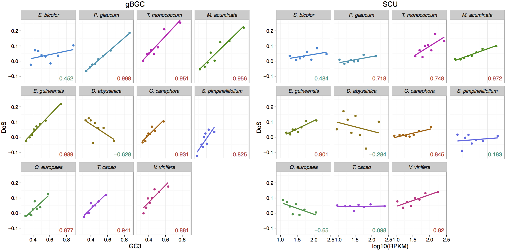
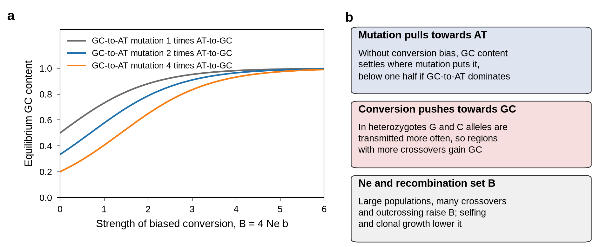

# Chapter 23. GC-biased gene conversion

**Status: GC-biased gene conversion in mammals and birds, Verified; as a widespread force in eukaryotes and plants, Partly verified.** When a heterozygote for a G or C allele and an A or T allele undergoes recombination, mismatch repair in the heteroduplex can convert one allele into the other. If conversion favours G and C, those alleles are transmitted to more than half of the gametes, and the process acts like weak selection for GC in regions with many crossovers. GC-biased gene conversion (gBGC) explains the link between recombination and GC content in human and other mammalian genomes, the GC landscape of birds, and many spurious signals of positive selection. It is supported by indirect evidence in many eukaryotes and plants, but direct tetrad studies in plants and fungi have not found a net bias.

Related notes in this repository: [gc-biased-gene-conversion](../../skills/genomics-theory-mining/theories/gc-biased-gene-conversion/THEORY.md), [gene-conversion](../../skills/genomics-theory-mining/theories/gene-conversion/THEORY.md), [begun-aquadro-recombination-diversity](../../skills/genomics-theory-mining/theories/begun-aquadro-recombination-diversity/THEORY.md), [hill-robertson-interference](../../skills/genomics-theory-mining/theories/hill-robertson-interference/THEORY.md), [nearly-neutral-theory](../../skills/genomics-theory-mining/theories/nearly-neutral-theory/THEORY.md).

## 23.1 Statement and history

Nagylaki showed that biased gene conversion changes allele frequencies in a large population much as selection does: if conversion is biased within a pair of alleles, the disfavoured allele is driven to low frequency, and this can make populations diverge [1]. Most biased conversion events probably happen during meiosis, and they affect the base composition of yeast, invertebrate and mammalian genomes [2]. Galtier and colleagues proposed that biased gene conversion explains the large-scale variation in GC content of mammalian genomes, the isochores [3].

The decisive tests came from substitution patterns. In 14.3 Mb of primate noncoding DNA, the GC content towards which sequences are evolving correlates strongly with crossover rate [4]. In 1 Gb of primate noncoding DNA, equilibrium GC content correlates with crossover rate and is more strongly correlated with male than female crossover rate, which rules out selectionist models of the isochores; the effect is most probably due to biased gene conversion in recombination hotspots [5]. Duret and Galtier summarized the evidence that AT/GC heterozygotes produce more GC than AT gametes, giving GC alleles an advantage in highly recombining regions, and that this both shapes the isochores and promotes the fixation of deleterious AT→GC mutations [6].

## 23.2 What the theory predicts

- **GC follows recombination.** Equilibrium GC content should increase with local crossover rate, in coding and noncoding DNA (Figure 23.2) [4, 5].
- **Transmission bias.** In meioses of AT/GC heterozygotes, GC alleles should be transmitted more than half of the time at conversion tracts [7, 8].
- **Population size and mating.** The strength of gBGC should rise with effective population size and with outcrossing, and fall with selfing or asexuality [9, 10].
- **Footprints in polymorphism.** Weak-to-strong (AT→GC) mutations should segregate at higher frequencies than strong-to-weak ones [11].
- **Interference with selection.** gBGC should accelerate substitutions in hotspots, including AT→GC changes that harm proteins, and mimic positive selection [12, 13].

## 23.3 Evidence for

- **Direct transmission in humans.** Non-crossover gene conversions in 98 human meioses transmit GC alleles at 68% of AT/GC heterozygous sites [7]. Sequencing single crossover molecules from sperm at two hotspots shows that GC alleles are preferentially transmitted during crossing over, opposing the mutational bias of recombination [8].
- **Mammals.** Across 33 mammalian genomes, GC-content evolution at third codon positions depends on body mass and genome size, as expected under gBGC [14]. Across placental mammals, gBGC strength spans two orders of magnitude, lowest in apes, and scales with effective population size and recombination rate [15]. In humans, genome-wide gBGC is in the nearly neutral range, but 1–2% of the genome is subject to strong gBGC because recombination is concentrated in hotspots [11].
- **Birds and other vertebrates.** In 48 bird genomes, lineages with large populations and short generations have higher GC content in coding and noncoding sites, and GC content rises with recombination rate [16]. In 44 vertebrates, GC content at third codon positions is governed by karyotype in a way that fits gBGC, including in reptiles [17].
- **Yeast and eukaryotes generally.** In yeast, the over-transmission of GC alleles is specific to crossovers and points to mismatch repair [18]. Among 17 eukaryotes with a significant relation between GC content and chromosome size, 15 fit gBGC, in all four major groups studied [19].
- **Asexuals.** Obligately asexual stick insects show arrested gBGC compared with their sexual relatives [10].
- **Spurious selection.** Human exons with accelerated evolution contain clusters of weak-to-strong substitutions in regions of high male recombination [12]. gBGC can produce false signals of positive selection in genome scans [13], and it promotes the fixation of deleterious amino acid changes in primates [20] and the spread of disease-causing alleles in human populations [21]. In birds, the expected relation between life-history traits and dN/dS appears only after changes affected by gBGC are separated out [22].

## 23.4 Evidence against, and difficulties

- **No bias in tetrads.** Whole-genome sequencing of all tetrad products in *Saccharomyces*, *Neurospora*, *Chlamydomonas* and *Arabidopsis* found large differences in conversion rates (from 2% of markers converted in yeast to about 0.005% in the two plants) but no significant net AT→GC conversion bias in any species, although three species show a positive GC–recombination correlation [23]. In *Arabidopsis* tetrads, non-crossover conversions are very rare and short [24].
- **Recombination is also mutagenic.** De novo mutations are enriched near crossovers in humans [25], and crossover molecules from sperm carry more de novo mutations than nonrecombinant ones, mostly C:G→T:A transitions and especially at CpG sites [8]. A link between recombination and base composition is therefore not, by itself, proof of conversion bias.
- **Mutation can win.** In rice, GC content of noncoding DNA correlates with recombination, but GC content has declined in rice and its partly outcrossing wild progenitor, which suggests that mutation is stronger than gBGC there [26].
- **Selection on codons is confounded.** In grasses most preferred codons end in G or C, so gBGC and codon selection must be separated using noncoding sites [27].
- **Fitness effects.** gBGC can create a fixation load independent of population size and keep recessive deleterious mutations at intermediate frequency [28]. This makes it a non-adaptive force that is easy to mistake for selection.

## 23.5 Status and reasoning

**gBGC in mammals and birds: verified. As a widespread force in eukaryotes and plants: partly verified.** In humans, transmission bias is measured directly in meioses and sperm [7, 8], and substitution and polymorphism patterns across mammals and birds fit the model quantitatively [5, 11, 15, 16]. Comparative evidence points to gBGC in many eukaryotes [19], and population genomics detects it in most plant species studied [29]. But tetrad sequencing in plants and fungi found no net bias [23], and in rice mutation appears to dominate GC change [26].

## 23.6 Plants, crops and grapevine

- **Seed plants.** GC content of genes varies continuously across more than 200 seed plants, from GC-poor, homogeneous genomes to GC-rich, heterogeneous ones, with several independent episodes of enrichment, and gBGC could play a significant role [30]. Interactions between gene structure, recombination and gBGC may explain most patterns of coding GC content in angiosperms [31].
- **Mating system.** In plants, selfing reduces effective population size and effective recombination and makes heterozygous sites rare, so biased conversion towards GC should act less often [9]. In *Oryza*, equilibrium GC content correlates positively with recombination, and the selfing species *O. sativa* and *O. glaberrima* have lower equilibrium GC content than more outcrossing species [27].
- **Grapevine and perennial crops.** In population transcriptomes of 11 angiosperms, base composition at synonymous sites is far from mutation–drift equilibrium in most genomes, and gBGC is widespread and stronger than selection on codon usage [29]. In grapevine (*Vitis vinifera*), as in most of these species, the direction-of-selection statistic for weak-to-strong changes rises with gene GC content, the signature expected under gBGC (Figure 23.1) [29].
- **Clonal propagation.** gBGC acts only through meiosis. A clonally propagated cultivar experiences no meiosis between generations of cuttings, so gBGC is arrested in the clone, as it is in obligate asexuals [10]; the GC landscape of grapevine was shaped by its sexual ancestors.

## 23.7 How to test it with public data

- **Data.** Recombination maps or crossover data [24, 25]; population polymorphism data with an outgroup for polarization [11, 29]; genome alignments for substitution patterns [5].
- **Tools.** Population genetics models that jointly estimate gBGC, selection and mutation bias from the derived allele frequency spectrum, with polarization errors [11, 29]; phylogenetic models of nonstationary base composition [15, 22].
- **Analysis.** (1) Count weak-to-strong and strong-to-weak polymorphisms and compare their frequency spectra; a shift towards higher frequencies for weak-to-strong changes indicates gBGC [11]. (2) Correlate equilibrium GC content of noncoding regions with local recombination rate [4, 27]. (3) Compare selfing and outcrossing relatives, or sexual and asexual ones [10, 27]. The script [`scripts/ch23_gbgc_figures.py`](../scripts/ch23_gbgc_figures.py) computes equilibrium GC content under mutation bias and gBGC (Figure 23.2).
- **What would refute it.** No transmission bias in large samples of meioses, and no relation between recombination and GC that cannot be explained by mutation.

## 23.8 Open questions

- Why do direct tetrad studies find no bias while population data detect gBGC [23, 29]?
- What is the molecular mechanism: mismatch repair at crossovers, or something else [11, 18]?
- Is gBGC an adaptation that counteracts the mutational load of recombination [8]?
- How much do gBGC and mutation each contribute to GC change in crops [26]?

## 23.9 Common mistakes

- Reading an excess of AT→GC substitutions in a gene as positive selection [12, 13].
- Studying third codon positions alone, where codon selection is confounded with gBGC [27].
- Ignoring polarization errors in derived allele frequency spectra [11].
- Assuming that base composition is at equilibrium [29].

## Figures

**Figure 23.1.** DoS statistics as a function of GC3 and expression level. Correlation between GC3 and DoS computed on WS changes (left panel) or between expression level (measured through RPKM) and DoS computed on UP changes (right). Pearson correlation coefficients are given for each species (red: significant at the 5% level, blue non-significant). Reproduced unchanged from Clément Y, Sarah G, Holtz Y, et al. (2017) Evolutionary forces affecting synonymous variations in plant genomes. *PLoS Genetics* 13:e1006799, Figure 4. https://doi.org/10.1371/journal.pgen.1006799. Licence: CC BY 4.0 (https://creativecommons.org/licenses/by/4.0/).

**Figure 23.2.** (a) Equilibrium GC content as a function of the population-scaled strength of biased conversion, B = 4Ne·b, for mutation from G or C to A or T one, two or four times as frequent as the reverse. GC* = 1 / (1 + λe^(−B)), where λ is the mutation bias. (b) What the model shows. Made with [`scripts/ch23_gbgc_figures.py`](../scripts/ch23_gbgc_figures.py); the calculation is deterministic.

## References

1. Nagylaki T (1983) Evolution of a large population under gene conversion. *Proceedings of the National Academy of Sciences* 80:5941-5945. https://doi.org/10.1073/pnas.80.19.5941
2. Marais G (2003) Biased gene conversion: implications for genome and sex evolution. *Trends in Genetics* 19:330-338. https://doi.org/10.1016/S0168-9525(03)00116-1
3. Galtier N, Piganeau G, Mouchiroud D, et al. (2001) GC-Content Evolution in Mammalian Genomes: The Biased Gene Conversion Hypothesis. *Genetics* 159:907-911. https://doi.org/10.1093/genetics/159.2.907
4. Meunier J, Duret L (2004) Recombination Drives the Evolution of GC-Content in the Human Genome. *Molecular Biology and Evolution* 21:984-990. https://doi.org/10.1093/molbev/msh070
5. Duret L, Arndt PF (2008) The Impact of Recombination on Nucleotide Substitutions in the Human Genome. *PLoS Genetics* 4:e1000071. https://doi.org/10.1371/journal.pgen.1000071
6. Duret L, Galtier N (2009) Biased Gene Conversion and the Evolution of Mammalian Genomic Landscapes. *Annual Review of Genomics and Human Genetics* 10:285-311. https://doi.org/10.1146/annurev-genom-082908-150001
7. Williams AL, Genovese G, Dyer T, et al. (2015) Non-crossover gene conversions show strong GC bias and unexpected clustering in humans. *eLife* 4:e04637. https://doi.org/10.7554/eLife.04637
8. Arbeithuber B, Betancourt AJ, Ebner T, et al. (2015) Crossovers are associated with mutation and biased gene conversion at recombination hotspots. *Proceedings of the National Academy of Sciences* 112:2109-2114. https://doi.org/10.1073/pnas.1416622112
9. Glémin S, Bazin E, Charlesworth D (2006) Impact of mating systems on patterns of sequence polymorphism in flowering plants. *Proceedings of the Royal Society B: Biological Sciences* 273:3011-3019. https://doi.org/10.1098/rspb.2006.3657
10. Bast J, Parker DJ, Dumas Z, et al. (2018) Consequences of Asexuality in Natural Populations: Insights from Stick Insects. *Molecular Biology and Evolution* 35:1668-1677. https://doi.org/10.1093/molbev/msy058
11. Glémin S, Arndt PF, Messer PW, et al. (2015) Quantification of GC-biased gene conversion in the human genome. *Genome Research* 25:1215-1228. https://doi.org/10.1101/gr.185488.114
12. Berglund J, Pollard KS, Webster MT (2009) Hotspots of Biased Nucleotide Substitutions in Human Genes. *PLoS Biology* 7:e1000026. https://doi.org/10.1371/journal.pbio.1000026
13. Ratnakumar A, Mousset S, Glémin S, et al. (2010) Detecting positive selection within genomes: the problem of biased gene conversion. *Philosophical Transactions of the Royal Society B: Biological Sciences* 365:2571-2580. https://doi.org/10.1098/rstb.2010.0007
14. Romiguier J, Ranwez V, Douzery EJP, et al. (2010) Contrasting GC-content dynamics across 33 mammalian genomes: Relationship with life-history traits and chromosome sizes. *Genome Research* 20:1001-1009. https://doi.org/10.1101/gr.104372.109
15. Lartillot N (2013) Phylogenetic Patterns of GC-Biased Gene Conversion in Placental Mammals and the Evolutionary Dynamics of Recombination Landscapes. *Molecular Biology and Evolution* 30:489-502. https://doi.org/10.1093/molbev/mss239
16. Weber CC, Boussau B, Romiguier J, et al. (2014) Evidence for GC-biased gene conversion as a driver of between-lineage differences in avian base composition. *Genome Biology* 15:549. https://doi.org/10.1186/s13059-014-0549-1
17. Figuet E, Ballenghien M, Romiguier J, et al. (2015) Biased Gene Conversion and GC-Content Evolution in the Coding Sequences of Reptiles and Vertebrates. *Genome Biology and Evolution* 7:240-250. https://doi.org/10.1093/gbe/evu277
18. Lesecque Y, Mouchiroud D, Duret L (2013) GC-Biased Gene Conversion in Yeast Is Specifically Associated with Crossovers: Molecular Mechanisms and Evolutionary Significance. *Molecular Biology and Evolution* 30:1409-1419. https://doi.org/10.1093/molbev/mst056
19. Pessia E, Popa A, Mousset S, et al. (2012) Evidence for Widespread GC-biased Gene Conversion in Eukaryotes. *Genome Biology and Evolution* 4:675-682. https://doi.org/10.1093/gbe/evs052
20. Galtier N, Duret L, Glémin S, et al. (2009) GC-biased gene conversion promotes the fixation of deleterious amino acid changes in primates. *Trends in Genetics* 25:1-5. https://doi.org/10.1016/j.tig.2008.10.011
21. Necşulea A, Popa A, Cooper DN, et al. (2011) Meiotic recombination favors the spreading of deleterious mutations in human populations. *Human Mutation* 32:198-206. https://doi.org/10.1002/humu.21407
22. Bolívar P, Guéguen L, Duret L, et al. (2019) GC-biased gene conversion conceals the prediction of the nearly neutral theory in avian genomes. *Genome Biology* 20:5. https://doi.org/10.1186/s13059-018-1613-z
23. Liu H, Huang J, Sun X, et al. (2017) Tetrad analysis in plants and fungi finds large differences in gene conversion rates but no GC bias. *Nature Ecology & Evolution* 2:164-173. https://doi.org/10.1038/s41559-017-0372-7
24. Wijnker E, Velikkakam James G, Ding J, et al. (2013) The genomic landscape of meiotic crossovers and gene conversions in Arabidopsis thaliana. *eLife* 2:e01426. https://doi.org/10.7554/eLife.01426
25. Halldorsson BV, Palsson G, Stefansson OA, et al. (2019) Characterizing mutagenic effects of recombination through a sequence-level genetic map. *Science* 363:eaau1043. https://doi.org/10.1126/science.aau1043
26. Jiang N, Yin D, Ou S, et al. (2026) Rapid GC content evolution in rice through GC-biased gene conversion and selection for translation efficiency. *Nature Communications* 17:8381. https://doi.org/10.1038/s41467-026-75279-z
27. Muyle A, Serres-Giardi L, Ressayre A, et al. (2011) GC-Biased Gene Conversion and Selection Affect GC Content in the Oryza Genus (rice). *Molecular Biology and Evolution* 28:2695-2706. https://doi.org/10.1093/molbev/msr104
28. Glémin S (2010) Surprising Fitness Consequences of GC-Biased Gene Conversion: I. Mutation Load and Inbreeding Depression. *Genetics* 185:939-959. https://doi.org/10.1534/genetics.110.116368
29. Clément Y, Sarah G, Holtz Y, et al. (2017) Evolutionary forces affecting synonymous variations in plant genomes. *PLOS Genetics* 13:e1006799. https://doi.org/10.1371/journal.pgen.1006799
30. Serres-Giardi L, Belkhir K, David J, et al. (2012) Patterns and Evolution of Nucleotide Landscapes in Seed Plants. *The Plant Cell* 24:1379-1397. https://doi.org/10.1105/tpc.111.093674
31. Glémin S, Clément Y, David J, et al. (2014) GC content evolution in coding regions of angiosperm genomes: a unifying hypothesis. *Trends in Genetics* 30:263-270. https://doi.org/10.1016/j.tig.2014.05.002
