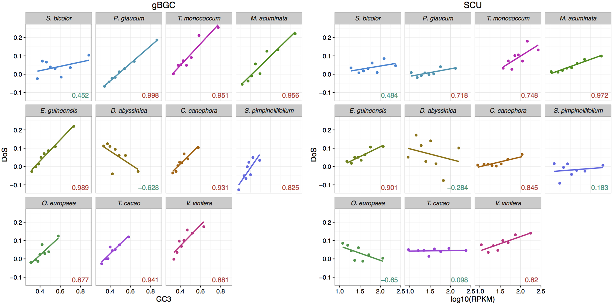
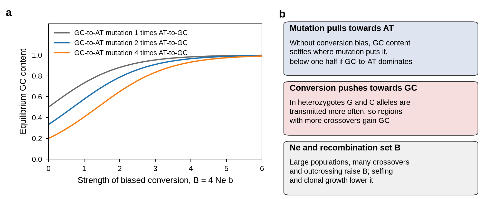

# 第 23 章 GC 偏向基因转换

**地位：哺乳动物和鸟类中的 GC 偏向基因转换已验证；作为真核生物和植物中普遍存在的力量，部分验证。** 当一个携带 G 或 C 等位基因和 A 或 T 等位基因的杂合子发生重组时，异源双链中的错配修复可以把一个等位基因转换成另一个。如果转换偏向 G 和 C，这些等位基因就会进入一半以上的配子，于是在交换频繁的区域，这一过程就像是对 GC 的弱选择。GC 偏向基因转换（gBGC）解释了人类和其他哺乳动物基因组中重组与 GC 含量之间的联系、鸟类的 GC 格局，以及许多假的正选择信号。在许多真核生物和植物中它得到间接证据的支持，但在植物和真菌中直接的四分子研究没有发现净偏向。

本仓库相关条目：[gc-biased-gene-conversion](../../skills/genomics-theory-mining/theories/gc-biased-gene-conversion/THEORY.md)、[gene-conversion](../../skills/genomics-theory-mining/theories/gene-conversion/THEORY.md)、[begun-aquadro-recombination-diversity](../../skills/genomics-theory-mining/theories/begun-aquadro-recombination-diversity/THEORY.md)、[hill-robertson-interference](../../skills/genomics-theory-mining/theories/hill-robertson-interference/THEORY.md)、[nearly-neutral-theory](../../skills/genomics-theory-mining/theories/nearly-neutral-theory/THEORY.md)。

## 23.1 内容与历史

Nagylaki 证明，偏向基因转换在大群体中改变等位基因频率的方式与选择很相似：如果一对等位基因之间的转换有偏向，不受青睐的等位基因就会被推向低频，这可以使群体发生分化 [1]。大多数偏向转换事件可能发生在减数分裂中，它们影响酵母、无脊椎动物和哺乳动物基因组的碱基组成 [2]。Galtier 等提出，偏向基因转换解释了哺乳动物基因组中 GC 含量的大尺度变化，即等容区（isochore）[3]。

决定性的检验来自替换格局。在 14.3 Mb 的灵长类非编码 DNA 中，序列演化所趋向的 GC 含量与交换率强相关 [4]。在 1 Gb 的灵长类非编码 DNA 中，平衡 GC 含量与交换率相关，而且与雄性交换率的相关强于与雌性交换率的相关，这排除了等容区的选择论模型；这一效应最可能来自重组热点中的偏向基因转换 [5]。Duret 和 Galtier 总结了以下证据：AT/GC 杂合子产生的 GC 配子多于 AT 配子，使 GC 等位基因在高重组区域占优势；这既塑造了等容区，也促进了有害的 AT→GC 突变的固定 [6]。

## 23.2 预测

- **GC 随重组变化。** 在编码和非编码 DNA 中，平衡 GC 含量都应随局部交换率升高而升高（图 23.2）[4, 5]。
- **传递偏向。** 在 AT/GC 杂合子的减数分裂中，转换片段处 GC 等位基因的传递应超过一半 [7, 8]。
- **群体大小与交配方式。** gBGC 的强度应随有效群体大小和异交而增强，随自交或无性生殖而减弱 [9, 10]。
- **多态性中的痕迹。** 弱到强（AT→GC）突变的分离频率应高于强到弱突变 [11]。
- **干扰选择。** gBGC 应加快热点中的替换，包括损害蛋白质的 AT→GC 变化，并模仿正选择 [12, 13]。

## 23.3 支持证据

- **人类中的直接传递。** 在 98 次人类减数分裂中，非交换型基因转换在 68% 的 AT/GC 杂合位点上传递 GC 等位基因 [7]。对精子中两个热点的单个交换分子测序表明，交换过程中 GC 等位基因被优先传递，与重组的突变偏向方向相反 [8]。
- **哺乳动物。** 在 33 个哺乳动物基因组中，密码子第三位 GC 含量的演化取决于体重和基因组大小，符合 gBGC 的预期 [14]。在有胎盘哺乳动物中，gBGC 强度跨越两个数量级，在类人猿中最低，并随有效群体大小和重组率变化 [15]。在人类中，全基因组的 gBGC 处于近中性范围，但由于重组集中在热点，1–2% 的基因组受到强 gBGC 的作用 [11]。
- **鸟类和其他脊椎动物。** 在 48 个鸟类基因组中，群体大、世代短的谱系在编码和非编码位点上 GC 含量都更高，GC 含量也随重组率升高 [16]。在 44 种脊椎动物中，密码子第三位 GC 含量受核型支配，方式符合 gBGC，在爬行动物中也是如此 [17]。
- **酵母和一般真核生物。** 在酵母中，GC 等位基因的过量传递特异于交换，指向错配修复 [18]。在 GC 含量与染色体大小显著相关的 17 种真核生物中，有 15 种符合 gBGC，分布于所研究的全部四个主要类群 [19]。
- **无性生物。** 专性无性生殖的竹节虫与其有性近缘种相比，gBGC 处于停止状态 [10]。
- **假的选择信号。** 在人类谱系上加速演化的外显子含有成簇的弱到强替换，位于雄性重组率高的区域 [12]。gBGC 可以在全基因组扫描中产生假的正选择信号 [13]，在灵长类中促进有害氨基酸变化的固定 [20]，并在人类群体中促进致病等位基因的扩散 [21]。在鸟类中，只有把受 gBGC 影响的变化分开之后，生活史性状与 dN/dS 之间的预期关系才会显现 [22]。

## 23.4 反面证据与难点

- **四分子中没有偏向。** 对酿酒酵母属、脉孢菌属、衣藻属和拟南芥属的全部四分子产物进行全基因组测序，发现转换率差别很大（从酵母中 2% 的标记被转换到两种植物中约 0.005%），但没有任何物种存在显著的净 AT→GC 转换偏向，尽管其中三个物种 GC 与重组正相关 [23]。在拟南芥四分子中，非交换型转换极为罕见且很短 [24]。
- **重组本身也致突变。** 在人类中，新生突变富集于交换附近 [25]；来自精子的交换分子携带的新生突变多于未重组分子，主要是 C:G→T:A 转换，在 CpG 位点尤其如此 [8]。所以，重组与碱基组成之间的联系本身并不能证明转换偏向。
- **突变可能占上风。** 在水稻中，非编码 DNA 的 GC 含量与重组相关，但水稻及其部分异交的野生祖先的 GC 含量都在下降，这提示那里突变的作用强于 gBGC [26]。
- **与密码子选择混淆。** 在禾本科中，大多数偏好密码子以 G 或 C 结尾，所以必须利用非编码位点把 gBGC 和密码子选择分开 [27]。
- **适合度效应。** gBGC 可以产生与群体大小无关的固定负荷，并使隐性有害突变长期维持在中等频率 [28]。这使它成为一种很容易被误认为选择的非适应性力量。

## 23.5 地位与理由

**哺乳动物和鸟类中的 gBGC：已验证。作为真核生物和植物中普遍存在的力量：部分验证。** 在人类中，传递偏向已在减数分裂和精子中直接测得 [7, 8]，哺乳动物和鸟类的替换与多态性格局在定量上符合模型 [5, 11, 15, 16]。比较证据表明许多真核生物中存在 gBGC [19]，群体基因组学在所研究的大多数植物物种中检出了它 [29]。但植物和真菌的四分子测序没有发现净偏向 [23]，而在水稻中突变似乎主导了 GC 的变化 [26]。

## 23.6 植物、作物与葡萄

- **种子植物。** 在 200 多种种子植物中，基因的 GC 含量从 GC 贫乏、均一的基因组到 GC 丰富、高度不均一的基因组连续变化，并有若干次独立的富集，gBGC 可能起了重要作用 [30]。基因结构、重组和 gBGC 之间的相互作用可能解释被子植物编码区 GC 含量的大部分格局 [31]。
- **交配系统。** 在植物中，自交降低有效群体大小和有效重组率，使杂合位点变得稀少，所以偏向 GC 的转换应较少发生作用 [9]。在稻属（*Oryza*）中，平衡 GC 含量与重组正相关，而自交的亚洲栽培稻（*O. sativa*）和非洲栽培稻（*O. glaberrima*）的平衡 GC 含量低于异交程度较高的物种 [27]。
- **葡萄与多年生作物。** 在 11 种被子植物的群体转录组中，大多数基因组同义位点的碱基组成远离突变–漂变平衡，gBGC 普遍存在且强于对密码子使用的选择 [29]。在葡萄（*Vitis vinifera*）中，和这些物种中的大多数一样，弱到强变化的选择方向（DoS）统计量随基因 GC 含量升高，这正是 gBGC 预期的特征（图 23.1）[29]。
- **克隆繁殖。** gBGC 只通过减数分裂起作用。克隆繁殖的品种在一代代扦插之间不经过减数分裂，所以在克隆内部 gBGC 停止，就像在专性无性生物中一样 [10]；葡萄的 GC 格局是由其有性祖先塑造的。

## 23.7 用公开数据检验

- **数据。** 重组图谱或交换数据 [24, 25]；带有外类群以确定祖先状态的群体多态性数据 [11, 29]；用于替换格局分析的基因组比对 [5]。
- **工具。** 从衍生等位基因频率谱联合估计 gBGC、选择和突变偏向并考虑祖先状态判定错误的群体遗传模型 [11, 29]；非平稳碱基组成的系统发育模型 [15, 22]。
- **分析。** (1) 统计弱到强和强到弱的多态位点并比较其频率谱；弱到强变化的频率整体偏高表明存在 gBGC [11]。(2) 将非编码区的平衡 GC 含量与局部重组率作相关分析 [4, 27]。(3) 比较自交与异交的近缘种，或有性与无性的近缘种 [10, 27]。脚本 [`scripts/ch23_gbgc_figures.py`](../scripts/ch23_gbgc_figures.py) 计算突变偏向和 gBGC 共同作用下的平衡 GC 含量（图 23.2）。
- **什么结果会推翻理论。** 在大样本减数分裂中没有传递偏向，而且重组与 GC 之间不存在突变无法解释的关系。

## 23.8 未解决的问题

- 为什么直接的四分子研究没有发现偏向，而群体数据却检出了 gBGC [23, 29]？
- 分子机制是什么：交换处的错配修复，还是别的过程 [11, 18]？
- gBGC 是否是一种抵消重组突变负荷的适应 [8]？
- 在作物中，gBGC 和突变各自对 GC 变化贡献多少 [26]？

## 23.9 常见错误

- 把一个基因中过量的 AT→GC 替换解读为正选择 [12, 13]。
- 只研究密码子第三位，而那里的密码子选择与 gBGC 相混淆 [27]。
- 忽略衍生等位基因频率谱中的祖先状态判定错误 [11]。
- 假定碱基组成处于平衡 [29]。

## 图

**图 23.1.** DoS 统计量与 GC3 及表达水平的关系。左图为 GC3 与基于 WS 变化计算的 DoS 之间的相关，右图为表达水平（以 RPKM 衡量）与基于 UP 变化计算的 DoS 之间的相关。图中给出每个物种的 Pearson 相关系数（红色：在 5% 水平显著；蓝色：不显著）。原样转载自 Clément Y, Sarah G, Holtz Y, et al. (2017) Evolutionary forces affecting synonymous variations in plant genomes. *PLoS Genetics* 13:e1006799, Figure 4. https://doi.org/10.1371/journal.pgen.1006799。许可：CC BY 4.0（https://creativecommons.org/licenses/by/4.0/）。

**图 23.2.** (a) 平衡 GC 含量与群体尺度的偏向转换强度 B = 4Ne·b 的关系；G 或 C 突变为 A 或 T 的频率分别是反向突变的一倍、两倍或四倍。GC* = 1 / (1 + λe^(−B))，其中 λ 是突变偏向。(b) 模型说明了什么。用 [`scripts/ch23_gbgc_figures.py`](../scripts/ch23_gbgc_figures.py) 生成；计算是确定性的。

## 参考文献

1. Nagylaki T (1983) Evolution of a large population under gene conversion. *Proceedings of the National Academy of Sciences* 80:5941-5945. https://doi.org/10.1073/pnas.80.19.5941
2. Marais G (2003) Biased gene conversion: implications for genome and sex evolution. *Trends in Genetics* 19:330-338. https://doi.org/10.1016/S0168-9525(03)00116-1
3. Galtier N, Piganeau G, Mouchiroud D, et al. (2001) GC-Content Evolution in Mammalian Genomes: The Biased Gene Conversion Hypothesis. *Genetics* 159:907-911. https://doi.org/10.1093/genetics/159.2.907
4. Meunier J, Duret L (2004) Recombination Drives the Evolution of GC-Content in the Human Genome. *Molecular Biology and Evolution* 21:984-990. https://doi.org/10.1093/molbev/msh070
5. Duret L, Arndt PF (2008) The Impact of Recombination on Nucleotide Substitutions in the Human Genome. *PLoS Genetics* 4:e1000071. https://doi.org/10.1371/journal.pgen.1000071
6. Duret L, Galtier N (2009) Biased Gene Conversion and the Evolution of Mammalian Genomic Landscapes. *Annual Review of Genomics and Human Genetics* 10:285-311. https://doi.org/10.1146/annurev-genom-082908-150001
7. Williams AL, Genovese G, Dyer T, et al. (2015) Non-crossover gene conversions show strong GC bias and unexpected clustering in humans. *eLife* 4:e04637. https://doi.org/10.7554/eLife.04637
8. Arbeithuber B, Betancourt AJ, Ebner T, et al. (2015) Crossovers are associated with mutation and biased gene conversion at recombination hotspots. *Proceedings of the National Academy of Sciences* 112:2109-2114. https://doi.org/10.1073/pnas.1416622112
9. Glémin S, Bazin E, Charlesworth D (2006) Impact of mating systems on patterns of sequence polymorphism in flowering plants. *Proceedings of the Royal Society B: Biological Sciences* 273:3011-3019. https://doi.org/10.1098/rspb.2006.3657
10. Bast J, Parker DJ, Dumas Z, et al. (2018) Consequences of Asexuality in Natural Populations: Insights from Stick Insects. *Molecular Biology and Evolution* 35:1668-1677. https://doi.org/10.1093/molbev/msy058
11. Glémin S, Arndt PF, Messer PW, et al. (2015) Quantification of GC-biased gene conversion in the human genome. *Genome Research* 25:1215-1228. https://doi.org/10.1101/gr.185488.114
12. Berglund J, Pollard KS, Webster MT (2009) Hotspots of Biased Nucleotide Substitutions in Human Genes. *PLoS Biology* 7:e1000026. https://doi.org/10.1371/journal.pbio.1000026
13. Ratnakumar A, Mousset S, Glémin S, et al. (2010) Detecting positive selection within genomes: the problem of biased gene conversion. *Philosophical Transactions of the Royal Society B: Biological Sciences* 365:2571-2580. https://doi.org/10.1098/rstb.2010.0007
14. Romiguier J, Ranwez V, Douzery EJP, et al. (2010) Contrasting GC-content dynamics across 33 mammalian genomes: Relationship with life-history traits and chromosome sizes. *Genome Research* 20:1001-1009. https://doi.org/10.1101/gr.104372.109
15. Lartillot N (2013) Phylogenetic Patterns of GC-Biased Gene Conversion in Placental Mammals and the Evolutionary Dynamics of Recombination Landscapes. *Molecular Biology and Evolution* 30:489-502. https://doi.org/10.1093/molbev/mss239
16. Weber CC, Boussau B, Romiguier J, et al. (2014) Evidence for GC-biased gene conversion as a driver of between-lineage differences in avian base composition. *Genome Biology* 15:549. https://doi.org/10.1186/s13059-014-0549-1
17. Figuet E, Ballenghien M, Romiguier J, et al. (2015) Biased Gene Conversion and GC-Content Evolution in the Coding Sequences of Reptiles and Vertebrates. *Genome Biology and Evolution* 7:240-250. https://doi.org/10.1093/gbe/evu277
18. Lesecque Y, Mouchiroud D, Duret L (2013) GC-Biased Gene Conversion in Yeast Is Specifically Associated with Crossovers: Molecular Mechanisms and Evolutionary Significance. *Molecular Biology and Evolution* 30:1409-1419. https://doi.org/10.1093/molbev/mst056
19. Pessia E, Popa A, Mousset S, et al. (2012) Evidence for Widespread GC-biased Gene Conversion in Eukaryotes. *Genome Biology and Evolution* 4:675-682. https://doi.org/10.1093/gbe/evs052
20. Galtier N, Duret L, Glémin S, et al. (2009) GC-biased gene conversion promotes the fixation of deleterious amino acid changes in primates. *Trends in Genetics* 25:1-5. https://doi.org/10.1016/j.tig.2008.10.011
21. Necşulea A, Popa A, Cooper DN, et al. (2011) Meiotic recombination favors the spreading of deleterious mutations in human populations. *Human Mutation* 32:198-206. https://doi.org/10.1002/humu.21407
22. Bolívar P, Guéguen L, Duret L, et al. (2019) GC-biased gene conversion conceals the prediction of the nearly neutral theory in avian genomes. *Genome Biology* 20:5. https://doi.org/10.1186/s13059-018-1613-z
23. Liu H, Huang J, Sun X, et al. (2017) Tetrad analysis in plants and fungi finds large differences in gene conversion rates but no GC bias. *Nature Ecology & Evolution* 2:164-173. https://doi.org/10.1038/s41559-017-0372-7
24. Wijnker E, Velikkakam James G, Ding J, et al. (2013) The genomic landscape of meiotic crossovers and gene conversions in Arabidopsis thaliana. *eLife* 2:e01426. https://doi.org/10.7554/eLife.01426
25. Halldorsson BV, Palsson G, Stefansson OA, et al. (2019) Characterizing mutagenic effects of recombination through a sequence-level genetic map. *Science* 363:eaau1043. https://doi.org/10.1126/science.aau1043
26. Jiang N, Yin D, Ou S, et al. (2026) Rapid GC content evolution in rice through GC-biased gene conversion and selection for translation efficiency. *Nature Communications* 17:8381. https://doi.org/10.1038/s41467-026-75279-z
27. Muyle A, Serres-Giardi L, Ressayre A, et al. (2011) GC-Biased Gene Conversion and Selection Affect GC Content in the Oryza Genus (rice). *Molecular Biology and Evolution* 28:2695-2706. https://doi.org/10.1093/molbev/msr104
28. Glémin S (2010) Surprising Fitness Consequences of GC-Biased Gene Conversion: I. Mutation Load and Inbreeding Depression. *Genetics* 185:939-959. https://doi.org/10.1534/genetics.110.116368
29. Clément Y, Sarah G, Holtz Y, et al. (2017) Evolutionary forces affecting synonymous variations in plant genomes. *PLOS Genetics* 13:e1006799. https://doi.org/10.1371/journal.pgen.1006799
30. Serres-Giardi L, Belkhir K, David J, et al. (2012) Patterns and Evolution of Nucleotide Landscapes in Seed Plants. *The Plant Cell* 24:1379-1397. https://doi.org/10.1105/tpc.111.093674
31. Glémin S, Clément Y, David J, et al. (2014) GC content evolution in coding regions of angiosperm genomes: a unifying hypothesis. *Trends in Genetics* 30:263-270. https://doi.org/10.1016/j.tig.2014.05.002
