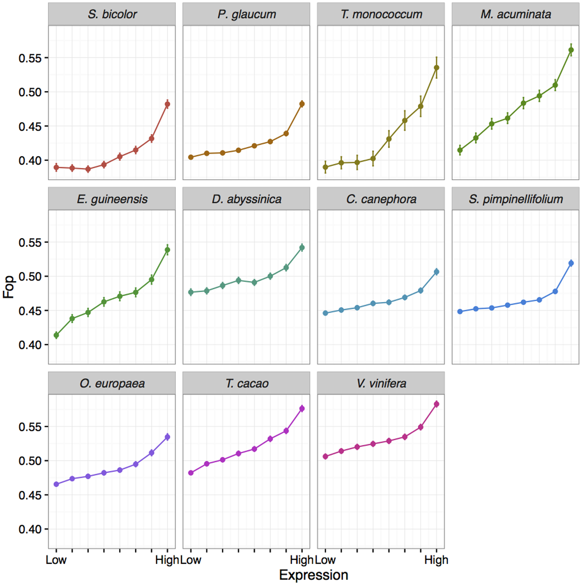
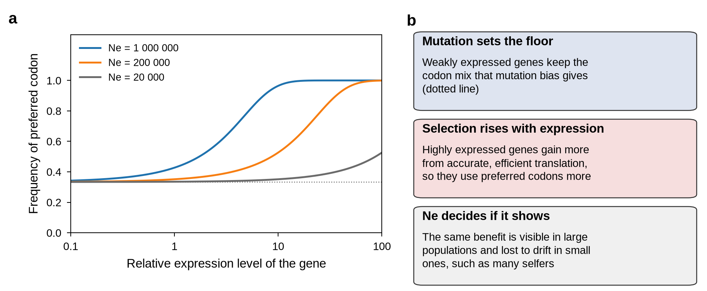

# Chapter 24. Codon usage bias

**Status: Codon usage set by a balance of selection, mutation and drift, with translational selection in highly expressed genes of large populations, Verified; translational selection as the main force in plants and other species with small populations, Partly verified.** Synonymous codons are not used equally. In bacteria, yeast and *Drosophila*, highly expressed genes prefer codons that match abundant tRNAs, and the strength of this preference follows effective population size and growth rate, as the selection–mutation–drift model predicts. Between species, much of the variation comes from mutation bias, and in mammals and many plants codon usage is shaped strongly by GC-biased gene conversion. In plants, translational selection is detectable but usually weak, and weaker in selfers.

Related notes in this repository: [nearly-neutral-theory](../../theories/nearly-neutral-theory/THEORY.md), [hill-robertson-interference](../../theories/hill-robertson-interference/THEORY.md), [gc-biased-gene-conversion](../../theories/gc-biased-gene-conversion/THEORY.md).

## 24.1 Statement and history

The first catalogues of codon usage showed that genes of the same or similar genomes make consistent choices among synonymous codons; Grantham and colleagues proposed that each genome has its own “system” for choosing codons, the genome hypothesis [1]. Ikemura found that in *Escherichia coli* the frequency of codons correlates with the abundance of the corresponding tRNAs, and that the use of optimal codons is closely correlated with the production level of each gene [2]. The same correlation between codon usage and tRNA content holds in yeast, and its strength relates to expression [3]. In yeast, cluster analysis separates highly expressed genes, with much more extreme codon preference, from weakly expressed ones [4]. Theoretical work showed that the extreme bias of some genes can be generated by small selective differences [5].

Bulmer formalized the selection–mutation–drift theory: codon bias is a balance between selection and mutation in a finite population, with greater bias in highly expressed genes because selection for efficient translation is stronger there [6]. Akashi showed that in *Drosophila melanogaster* preferred codons are more frequent at sites conserved for amino acids, which points to selection for translational accuracy [7]. Synonymous sites are therefore under weak selection, and codon bias is maintained by a balance between selection, mutation and drift [8].

## 24.2 What the theory predicts

- **Expression.** Highly expressed genes should use more preferred codons (Figure 24.2) [4, 6].
- **tRNA match.** Preferred codons should match the most abundant tRNAs [2, 9].
- **Population size.** Selection on codons should be stronger in species with large effective population sizes and weaker in small or selfing populations [10, 11].
- **Polymorphism.** Mutations from unpreferred to preferred codons should segregate at higher frequencies than the reverse [12, 13].
- **Mutation floor.** In weakly expressed genes, codon usage should follow mutation bias and base composition [13, 14].

## 24.3 Evidence for

- **Microbes.** The strength of selected codon usage bias in bacteria is highly correlated with growth rate, and the frequency spectra of optimal codons at polymorphic sites fit an equilibrium model; highly expressed genes of *E. coli* are under continuing strong selection, weakly expressed ones under very weak selection [13]. Across 126 genomes, tRNA gene redundancy and genome size together determine how much translational selection acts [15].
- **Animals.** In *Drosophila*, selection favours preferred codons, mutation is biased towards unpreferred ones, and shorter and more highly expressed genes are under stronger selection [12]. Deep population sequencing shows that selection on preferred codons ranges from weak to strong, with strong selection on 10–20% of synonymous sites in preferred codons [16]. Across 30 animal species, translational selection on codon usage is effective in species with large effective population sizes but not in those with small ones, as the nearly neutral theory predicts [10].
- **Mechanisms.** In yeast, preferred codons are not translated faster than unpreferred ones; codon usage in proportion to cognate tRNA concentrations optimizes translational efficiency [17]. Codon optimality is a major determinant of mRNA stability [18]. Selection against misfolded proteins produced by translation errors can explain the covariation of expression, codon usage and evolutionary rate across taxa [19]. A slow “ramp” of translation at the start of genes may reduce ribosomal traffic jams [20].
- **Plants.** In *Arabidopsis thaliana*, codon preferences match the relative abundance of isoaccepting tRNAs and are associated with gene expression [9]. In five *Populus* species, codon bias correlates with expression independently of base composition [21]. In population transcriptomes of 11 angiosperms, the frequency of optimal codons increases with expression in all 11 species (Figure 24.1) [22].

## 24.4 Evidence against, and difficulties

- **Mutation between species.** Much of the variation in codon usage among bacterial species appears to be due to biased mutation [13], and mutation is consistently biased towards AT in bacteria, so the GC content of bacterial genomes cannot come from mutation alone [14].
- **gBGC in mammals.** Synonymous codon usage of human genes is driven not by tRNA abundance but by large-scale GC variation caused by recombination through GC-biased gene conversion, which explains 70% of the variance among genes [23]. In animals generally, gBGC is the main force determining the fate of AT↔GC mutations [10].
- **gBGC in plants.** In the 11 angiosperms, gBGC is widespread and stronger than selection at synonymous sites [22]. In rice, differences in codon usage among genes are highly correlated with GC content and reflect a rapid increase in GC content of some genes [24]; in grasses most preferred codons end in G or C, so the two forces are confounded [25].
- **Other effects of synonymous sites.** In a library of synonymous GFP variants in *E. coli*, codon bias did not correlate with expression; mRNA folding near the ribosome-binding site explained more than half the variation in protein level [26]. In *Neurospora*, codon usage affects gene expression mainly through transcription [27]. In mammals, some synonymous mutations affect splicing or mRNA stability [28]. Synonymous mutations have consequences for many cellular processes, not only for translation [29].
- **Measurement.** Indices of codon bias are affected by background base composition, and the original effective number of codons has several known problems [30, 31].

## 24.5 Status and reasoning

**Selection–mutation–drift balance with translational selection in large populations: verified. Translational selection as the main force in plants and small populations: partly verified.** In microbes and *Drosophila*, codon bias follows expression, tRNA abundance and population size, and polymorphism data show ongoing selection [10, 12, 13, 16]. But between species mutation bias explains much of the variation [13], human codon usage is explained mainly by gBGC [23], and in plants gBGC is stronger than selection although selection is detectable [21, 22].

## 24.6 Plants, crops and grapevine

- **Weak selection in plants.** In *Populus*, 25 codons from 18 amino acids are preferred across five species, and the maximum likelihood estimate of selection on synonymous codons in *P. tremula* is 4Nₑs = 0.720, consistent with weak selection [21].
- **Selfing.** Selection on synonymous codons is significantly weaker in the selfers *A. thaliana* and *Capsella rubella* than in their outcrossing relatives, and the difference is not fully explained by mutational bias or biased gene conversion [11].
- **Grasses and rice.** Codon usage in rice is highly heterogeneous and tracks GC content [24]; in *Oryza*, expression is positively related to GC content at third codon positions, suggesting selection for codons ending in G or C, alongside gBGC [25]. GC content of rice coding regions is shaped by both recombination and selection for GC-rich codons linked to high translation efficiency [32].
- **Grapevine.** In grapevine (*Vitis vinifera*), the frequency of optimal codons rises with expression (Figure 24.1), and the direction-of-selection statistic for unpreferred-to-preferred changes correlates significantly with expression [22]. Grapevine is one of the perennial crops in which translational selection is detectable, although gBGC is the stronger force [22].

## 24.7 How to test it with public data

- **Data.** Coding sequences and expression data for one species (for example RNA-seq in RPKM) [22]; population polymorphism data with an outgroup [10, 12]; tRNA gene counts from the genome [15].
- **Tools.** The codon adaptation index [33] and the effective number of codons [34] with its improved implementation [31]; CAIcal for codon adaptation measures [35]; corrections for background base composition [30].
- **Analysis.** (1) Define preferred codons as those enriched in highly versus weakly expressed genes, controlling for local GC content [21, 24]. (2) Plot the frequency of preferred codons against expression [22]. (3) Compare the site frequency spectra of unpreferred-to-preferred and preferred-to-unpreferred mutations, separating GC-conservative from GC-changing changes so that gBGC is not mistaken for selection [10]. The script [`scripts/ch24_codon_usage_figures.py`](../scripts/ch24_codon_usage_figures.py) computes the expected frequency of preferred codons under the selection–mutation–drift model (Figure 24.2).
- **What would refute it.** No relation between codon preference and expression or tRNA abundance once base composition and gBGC are controlled, in species with large populations.

## 24.8 Open questions

- What determines which codons are preferred, and why are C- and T-ending codons often preferred in animals [8, 10]?
- How much strong selection acts on synonymous sites [16]?
- Through which processes, translation, mRNA stability or transcription, do codons affect fitness [18, 27]?
- How large is translational selection in long-lived perennial crops [21, 22]?

## 24.9 Common mistakes

- Taking codon bias as evidence of selection without controlling for base composition [24, 30].
- Ignoring gBGC when analysing GC-ending codons [10, 23].
- Assuming that synonymous sites are neutral when using them to estimate mutation rates or dN/dS [28].
- Assuming codon usage is at equilibrium after a change in population size [12].

## Figures

**Figure 24.1.** Relationship between the frequency of optimal codons (FOP) and expression in the 11 studied species. For each species, genes have been split into eight categories of expression (based on RPKM) of same size and the mean FOP for each category is plotted with its 95% confidence interval. Reproduced unchanged from Clément Y, Sarah G, Holtz Y, et al. (2017) Evolutionary forces affecting synonymous variations in plant genomes. *PLoS Genetics* 13:e1006799, Figure 3. https://doi.org/10.1371/journal.pgen.1006799. Licence: CC BY 4.0 (https://creativecommons.org/licenses/by/4.0/).

**Figure 24.2.** (a) Expected frequency of the preferred codon for a two-codon amino acid as a function of relative expression, under the selection–mutation–drift model of Bulmer (1991). Mutation to the unpreferred codon is twice as frequent as the reverse, and the advantage of the preferred codon is s = 10⁻⁷ times relative expression. Fop = 1 / (1 + 2e^(−4Ne·s)); curves for Ne = 10⁶, 2 × 10⁵ and 2 × 10⁴. The dotted line is the mutational expectation, 1/3. The values are illustrative. (b) What the model shows. Made with [`scripts/ch24_codon_usage_figures.py`](../scripts/ch24_codon_usage_figures.py); the calculation is deterministic.

## References

1. Grantham R, Gautier C, Gouy M, et al. (1980) Codon catalog usage and the genome hypothesis. *Nucleic Acids Research* 8:197. https://doi.org/10.1093/nar/8.1.197-c
2. Ikemura T (1981) Correlation between the abundance of Escherichia coli transfer RNAs and the occurrence of the respective codons in its protein genes: A proposal for a synonymous codon choice that is optimal for the E. coli translational system. *Journal of Molecular Biology* 151:389-409. https://doi.org/10.1016/0022-2836(81)90003-6
3. Ikemura T (1985) Codon usage and tRNA content in unicellular and multicellular organisms. *Molecular Biology and Evolution* 2:13-34. https://doi.org/10.1093/oxfordjournals.molbev.a040335
4. Sharp PM, Tuohy TMF, Mosurski KR (1986) Codon usage in yeast: cluster analysis clearly differentiates highly and lowly expressed genes. *Nucleic Acids Research* 14:5125-5143. https://doi.org/10.1093/nar/14.13.5125
5. Sharp PM, Li WH (1986) An evolutionary perspective on synonymous codon usage in unicellular organisms. *Journal of Molecular Evolution* 24:28-38. https://doi.org/10.1007/BF02099948
6. Bulmer M (1991) The selection-mutation-drift theory of synonymous codon usage. *Genetics* 129:897-907. https://doi.org/10.1093/genetics/129.3.897
7. Akashi H (1994) Synonymous codon usage in Drosophila melanogaster: natural selection and translational accuracy. *Genetics* 136:927-935. https://doi.org/10.1093/genetics/136.3.927
8. Hershberg R, Petrov DA (2008) Selection on Codon Bias. *Annual Review of Genetics* 42:287-299. https://doi.org/10.1146/annurev.genet.42.110807.091442
9. Wright SI, Yau CBK, Looseley M, et al. (2004) Effects of Gene Expression on Molecular Evolution in Arabidopsis thaliana and Arabidopsis lyrata. *Molecular Biology and Evolution* 21:1719-1726. https://doi.org/10.1093/molbev/msh191
10. Galtier N, Roux C, Rousselle M, et al. (2018) Codon Usage Bias in Animals: Disentangling the Effects of Natural Selection, Effective Population Size, and GC-Biased Gene Conversion. *Molecular Biology and Evolution* 35:1092-1103. https://doi.org/10.1093/molbev/msy015
11. Qiu S, Zeng K, Slotte T, et al. (2011) Reduced Efficacy of Natural Selection on Codon Usage Bias in Selfing Arabidopsis and Capsella Species. *Genome Biology and Evolution* 3:868-880. https://doi.org/10.1093/gbe/evr085
12. Zeng K, Charlesworth B (2009) Estimating Selection Intensity on Synonymous Codon Usage in a Nonequilibrium Population. *Genetics* 183:651-662. https://doi.org/10.1534/genetics.109.101782
13. Sharp PM, Emery LR, Zeng K (2010) Forces that influence the evolution of codon bias. *Philosophical Transactions of the Royal Society B: Biological Sciences* 365:1203-1212. https://doi.org/10.1098/rstb.2009.0305
14. Hershberg R, Petrov DA (2010) Evidence That Mutation Is Universally Biased towards AT in Bacteria. *PLoS Genetics* 6:e1001115. https://doi.org/10.1371/journal.pgen.1001115
15. dos Reis M (2004) Solving the riddle of codon usage preferences: a test for translational selection. *Nucleic Acids Research* 32:5036-5044. https://doi.org/10.1093/nar/gkh834
16. Machado HE, Lawrie DS, Petrov DA (2020) Pervasive Strong Selection at the Level of Codon Usage Bias in Drosophila melanogaster. *Genetics* 214:511-528. https://doi.org/10.1534/genetics.119.302542
17. Qian W, Yang JR, Pearson NM, et al. (2012) Balanced Codon Usage Optimizes Eukaryotic Translational Efficiency. *PLoS Genetics* 8:e1002603. https://doi.org/10.1371/journal.pgen.1002603
18. Presnyak V, Alhusaini N, Chen YH, et al. (2015) Codon Optimality Is a Major Determinant of mRNA Stability. *Cell* 160:1111-1124. https://doi.org/10.1016/j.cell.2015.02.029
19. Drummond DA, Wilke CO (2008) Mistranslation-Induced Protein Misfolding as a Dominant Constraint on Coding-Sequence Evolution. *Cell* 134:341-352. https://doi.org/10.1016/j.cell.2008.05.042
20. Tuller T, Carmi A, Vestsigian K, et al. (2010) An Evolutionarily Conserved Mechanism for Controlling the Efficiency of Protein Translation. *Cell* 141:344-354. https://doi.org/10.1016/j.cell.2010.03.031
21. Ingvarsson PK (2008) Molecular evolution of synonymous codon usage in Populus. *BMC Evolutionary Biology* 8:307. https://doi.org/10.1186/1471-2148-8-307
22. Clément Y, Sarah G, Holtz Y, et al. (2017) Evolutionary forces affecting synonymous variations in plant genomes. *PLOS Genetics* 13:e1006799. https://doi.org/10.1371/journal.pgen.1006799
23. Pouyet F, Mouchiroud D, Duret L, et al. (2017) Recombination, meiotic expression and human codon usage. *eLife* 6:e27344. https://doi.org/10.7554/eLife.27344
24. Wang HC, Hickey DA (2007) Rapid divergence of codon usage patterns within the rice genome. *BMC Evolutionary Biology* 7:S6. https://doi.org/10.1186/1471-2148-7-S1-S6
25. Muyle A, Serres-Giardi L, Ressayre A, et al. (2011) GC-Biased Gene Conversion and Selection Affect GC Content in the Oryza Genus (rice). *Molecular Biology and Evolution* 28:2695-2706. https://doi.org/10.1093/molbev/msr104
26. Kudla G, Murray AW, Tollervey D, et al. (2009) Coding-Sequence Determinants of Gene Expression in Escherichia coli. *Science* 324:255-258. https://doi.org/10.1126/science.1170160
27. Zhou Z, Dang Y, Zhou M, et al. (2016) Codon usage is an important determinant of gene expression levels largely through its effects on transcription. *Proceedings of the National Academy of Sciences* 113:E6117-E6125. https://doi.org/10.1073/pnas.1606724113
28. Chamary JV, Parmley JL, Hurst LD (2006) Hearing silence: non-neutral evolution at synonymous sites in mammals. *Nature Reviews Genetics* 7:98-108. https://doi.org/10.1038/nrg1770
29. Plotkin JB, Kudla G (2011) Synonymous but not the same: the causes and consequences of codon bias. *Nature Reviews Genetics* 12:32-42. https://doi.org/10.1038/nrg2899
30. Novembre JA (2002) Accounting for Background Nucleotide Composition When Measuring Codon Usage Bias. *Molecular Biology and Evolution* 19:1390-1394. https://doi.org/10.1093/oxfordjournals.molbev.a004201
31. Sun X, Yang Q, Xia X (2013) An Improved Implementation of Effective Number of Codons (Nc). *Molecular Biology and Evolution* 30:191-196. https://doi.org/10.1093/molbev/mss201
32. Jiang N, Yin D, Ou S, et al. (2026) Rapid GC content evolution in rice through GC-biased gene conversion and selection for translation efficiency. *Nature Communications* 17:8381. https://doi.org/10.1038/s41467-026-75279-z
33. Sharp PM, Li WH (1987) The codon adaptation index-a measure of directional synonymous codon usage bias, and its potential applications. *Nucleic Acids Research* 15:1281-1295. https://doi.org/10.1093/nar/15.3.1281
34. Wright F (1990) The ‘effective number of codons’ used in a gene. *Gene* 87:23-29. https://doi.org/10.1016/0378-1119(90)90491-9
35. Puigbò P, Bravo IG, Garcia-Vallve S (2008) CAIcal: A combined set of tools to assess codon usage adaptation. *Biology Direct* 3:38. https://doi.org/10.1186/1745-6150-3-38
