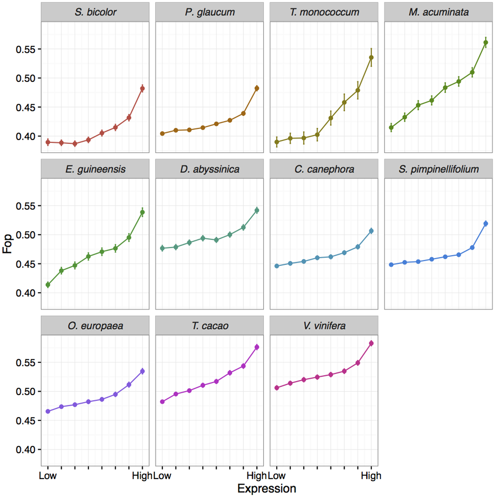
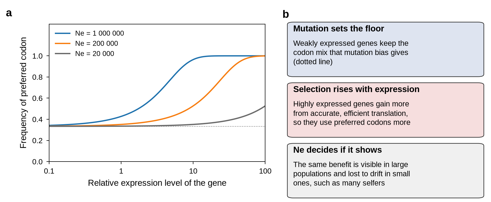

# 第 24 章 密码子使用偏好

**地位：密码子使用由选择、突变和漂变之间的平衡决定，大群体中高表达基因受翻译选择，已验证；翻译选择在植物和其他小群体物种中是主要力量，部分验证。** 同义密码子的使用并不均等。在细菌、酵母和果蝇中，高表达基因偏好与丰富 tRNA 相匹配的密码子，而这种偏好的强度随有效群体大小和生长速率而变，正如选择–突变–漂变模型所预测的那样。在物种之间，大部分差异来自突变偏向；在哺乳动物和许多植物中，密码子使用受到 GC 偏向基因转换的强烈影响。在植物中，翻译选择可以检测到，但通常很弱，在自交物种中更弱。

本仓库相关条目：[nearly-neutral-theory](../../theories/nearly-neutral-theory/THEORY.md)、[hill-robertson-interference](../../theories/hill-robertson-interference/THEORY.md)、[gc-biased-gene-conversion](../../theories/gc-biased-gene-conversion/THEORY.md)、[codon-usage-selection-mutation-drift](../../theories/codon-usage-selection-mutation-drift/THEORY.md)。

## 24.1 内容与历史

最早的密码子使用目录显示，同一基因组或相近基因组中的基因在同义密码子之间作出一致的选择；Grantham 等提出，每个基因组都有自己选择密码子的“系统”，即基因组假说 [1]。Ikemura 发现，在大肠杆菌（*Escherichia coli*）中，密码子的频率与相应 tRNA 的丰度相关，而最优密码子的使用与各基因的产量密切相关 [2]。在酵母中，密码子使用与 tRNA 含量之间同样存在这种相关，其强弱与表达有关 [3]。在酵母中，聚类分析把密码子偏好极端得多的高表达基因与低表达基因分开 [4]。理论研究表明，某些基因的极端偏好可以由很小的选择差异产生 [5]。

Bulmer 把选择–突变–漂变理论形式化：密码子偏好是有限群体中选择与突变之间的平衡，高表达基因偏好更强，因为那里对高效翻译的选择更强 [6]。Akashi 发现，在黑腹果蝇（*Drosophila melanogaster*）中，偏好密码子在氨基酸保守的位点上更为常见，这指向对翻译准确性的选择 [7]。因此，同义位点受到弱选择，密码子偏好由选择、突变和漂变之间的平衡维持 [8]。

## 24.2 预测

- **表达。** 高表达基因应使用更多的偏好密码子（图 24.2）[4, 6]。
- **与 tRNA 匹配。** 偏好密码子应与最丰富的 tRNA 相匹配 [2, 9]。
- **群体大小。** 对密码子的选择在有效群体大的物种中应较强，在小群体或自交群体中应较弱 [10, 11]。
- **多态性。** 从非偏好到偏好密码子的突变的分离频率应高于反向突变 [12, 13]。
- **突变决定下限。** 在低表达基因中，密码子使用应跟随突变偏向和碱基组成 [13, 14]。

## 24.3 支持证据

- **微生物。** 在细菌中，受选择的密码子偏好强度与生长速率高度相关，多态位点上最优密码子的频率谱符合平衡模型；大肠杆菌的高表达基因持续受到强选择，低表达基因受到的选择非常弱 [13]。在 126 个基因组中，tRNA 基因冗余度和基因组大小共同决定翻译选择的作用程度 [15]。
- **动物。** 在果蝇中，选择青睐偏好密码子，突变偏向非偏好密码子，较短和表达较高的基因受到的选择较强 [12]。深度群体测序表明，对偏好密码子的选择从弱到强不等，偏好密码子中 10–20% 的同义位点受到强选择 [16]。在 30 种动物中，对密码子使用的翻译选择在有效群体大的物种中有效，在有效群体小的物种中无效，正如近中性理论所预测的那样 [10]。
- **机制。** 在酵母中，偏好密码子的翻译并不比非偏好密码子快；按同源 tRNA 浓度成比例地使用密码子可以优化翻译效率 [17]。密码子最优性是 mRNA 稳定性的主要决定因素 [18]。对翻译错误所产生的错误折叠蛋白的选择，可以解释各类群中表达、密码子使用和演化速率之间的共变 [19]。基因起始处翻译较慢的“斜坡”可能减少核糖体拥堵 [20]。
- **植物。** 在拟南芥中，密码子偏好与同工 tRNA 的相对丰度相符，并与基因表达相关 [9]。在五种杨属（*Populus*）物种中，密码子偏好与表达相关，且独立于碱基组成 [21]。在 11 种被子植物的群体转录组中，最优密码子频率在全部 11 个物种中都随表达升高（图 24.1）[22]。

## 24.4 反面证据与难点

- **物种之间的突变。** 细菌物种之间密码子使用的差异大多看来源于突变偏向 [13]；细菌中的突变一致偏向 AT，所以细菌基因组的 GC 含量不可能只来自突变 [14]。
- **哺乳动物中的 gBGC。** 人类基因的同义密码子使用不是由 tRNA 丰度驱动，而是由重组通过 GC 偏向基因转换造成的大尺度 GC 变化驱动，后者解释了基因间 70% 的变异 [23]。在一般动物中，gBGC 是决定 AT↔GC 突变命运的主要力量 [10]。
- **植物中的 gBGC。** 在那 11 种被子植物中，同义位点上的 gBGC 普遍存在且强于选择 [22]。在水稻中，基因之间密码子使用的差异与 GC 含量高度相关，反映了部分基因 GC 含量的快速上升 [24]；在禾本科中，大多数偏好密码子以 G 或 C 结尾，所以两种力量相互混淆 [25]。
- **同义位点的其他效应。** 在大肠杆菌的一组同义 GFP 变体中，密码子偏好与表达不相关；核糖体结合位点附近的 mRNA 折叠解释了蛋白水平一半以上的变异 [26]。在脉孢菌（*Neurospora*）中，密码子使用主要通过转录影响基因表达 [27]。在哺乳动物中，有些同义突变影响剪接或 mRNA 稳定性 [28]。同义突变对许多细胞过程都有影响，而不只是翻译 [29]。
- **测量。** 密码子偏好指数受背景碱基组成的影响，原始的有效密码子数也有若干已知问题 [30, 31]。

## 24.5 地位与理由

**大群体中的选择–突变–漂变平衡与翻译选择：已验证。翻译选择在植物和小群体中是主要力量：部分验证。** 在微生物和果蝇中，密码子偏好随表达、tRNA 丰度和群体大小而变，多态性数据显示选择仍在进行 [10, 12, 13, 16]。但在物种之间，突变偏向解释了大部分差异 [13]，人类的密码子使用主要由 gBGC 解释 [23]，在植物中 gBGC 强于选择，尽管选择可以检测到 [21, 22]。

## 24.6 植物、作物与葡萄

- **植物中的弱选择。** 在杨属中，五个物种共同偏好 18 种氨基酸的 25 个密码子；*P. tremula* 中同义密码子所受选择的最大似然估计为 4Nₑs = 0.720，符合弱选择 [21]。
- **自交。** 自交的拟南芥和 *Capsella rubella* 中同义密码子所受的选择显著弱于其异交近缘种，而且这一差异不能完全由突变偏向或偏向基因转换解释 [11]。
- **禾本科与水稻。** 水稻的密码子使用高度不均一并随 GC 含量变化 [24]；在稻属中，表达与密码子第三位 GC 含量正相关，提示存在对以 G 或 C 结尾密码子的选择，同时也存在 gBGC [25]。水稻编码区的 GC 含量同时受重组和对富含 GC 密码子的选择影响，后者与高翻译效率相关 [32]。
- **葡萄。** 在葡萄（*Vitis vinifera*）中，最优密码子频率随表达升高（图 24.1），非偏好到偏好变化的选择方向统计量与表达显著相关 [22]。葡萄是能检测到翻译选择的多年生作物之一，尽管 gBGC 是更强的力量 [22]。

## 24.7 用公开数据检验

- **数据。** 一个物种的编码序列和表达数据（例如以 RPKM 表示的 RNA-seq）[22]；带外类群的群体多态性数据 [10, 12]；基因组中的 tRNA 基因数 [15]。
- **工具。** 密码子适应指数 [33] 和有效密码子数 [34] 及其改进实现 [31]；计算密码子适应度量的 CAIcal [35]；对背景碱基组成的校正 [30]。
- **分析。** (1) 把在高表达基因中相对低表达基因富集的密码子定义为偏好密码子，并控制局部 GC 含量 [21, 24]。(2) 绘制偏好密码子频率与表达的关系 [22]。(3) 比较非偏好到偏好与偏好到非偏好突变的位点频率谱，并把不改变 GC 的变化与改变 GC 的变化分开，以免把 gBGC 误认为选择 [10]。脚本 [`scripts/ch24_codon_usage_figures.py`](../scripts/ch24_codon_usage_figures.py) 计算选择–突变–漂变模型下偏好密码子的预期频率（图 24.2）。
- **什么结果会推翻理论。** 在大群体物种中，控制碱基组成和 gBGC 之后，密码子偏好与表达或 tRNA 丰度之间没有关系。

## 24.8 未解决的问题

- 是什么决定哪些密码子受偏好，为什么在动物中常常是以 C 和 T 结尾的密码子受偏好 [8, 10]？
- 同义位点上有多少强选择 [16]？
- 密码子通过翻译、mRNA 稳定性还是转录影响适合度 [18, 27]？
- 在长寿的多年生作物中，翻译选择有多强 [21, 22]？

## 24.9 常见错误

- 不控制碱基组成就把密码子偏好当作选择的证据 [24, 30]。
- 分析以 GC 结尾的密码子时忽略 gBGC [10, 23]。
- 用同义位点估计突变率或 dN/dS 时假定它们是中性的 [28]。
- 在群体大小改变之后假定密码子使用处于平衡 [12]。

## 图

**图 24.1.** 11 个所研究物种中最优密码子频率（FOP）与表达的关系。在每个物种中，基因按表达（基于 RPKM）分成大小相同的八类，并绘出每一类的平均 FOP 及其 95% 置信区间。原样转载自 Clément Y, Sarah G, Holtz Y, et al. (2017) Evolutionary forces affecting synonymous variations in plant genomes. *PLoS Genetics* 13:e1006799, Figure 3. https://doi.org/10.1371/journal.pgen.1006799。许可：CC BY 4.0（https://creativecommons.org/licenses/by/4.0/）。

**图 24.2.** (a) 按 Bulmer（1991）的选择–突变–漂变模型，双密码子氨基酸中偏好密码子的预期频率与相对表达水平的关系。突变为非偏好密码子的频率是反向突变的两倍，偏好密码子的优势为 s = 10⁻⁷ 乘以相对表达量。Fop = 1 / (1 + 2e^(−4Ne·s))；曲线对应 Ne = 10⁶、2 × 10⁵ 和 2 × 10⁴。虚线为突变预期值 1/3。这些数值只作示意。(b) 模型说明了什么。用 [`scripts/ch24_codon_usage_figures.py`](../scripts/ch24_codon_usage_figures.py) 生成；计算是确定性的。

## 参考文献

1. Grantham R, Gautier C, Gouy M, et al. (1980) Codon catalog usage and the genome hypothesis. *Nucleic Acids Research* 8:197. https://doi.org/10.1093/nar/8.1.197-c
2. Ikemura T (1981) Correlation between the abundance of Escherichia coli transfer RNAs and the occurrence of the respective codons in its protein genes: A proposal for a synonymous codon choice that is optimal for the E. coli translational system. *Journal of Molecular Biology* 151:389-409. https://doi.org/10.1016/0022-2836(81)90003-6
3. Ikemura T (1985) Codon usage and tRNA content in unicellular and multicellular organisms. *Molecular Biology and Evolution* 2:13-34. https://doi.org/10.1093/oxfordjournals.molbev.a040335
4. Sharp PM, Tuohy TMF, Mosurski KR (1986) Codon usage in yeast: cluster analysis clearly differentiates highly and lowly expressed genes. *Nucleic Acids Research* 14:5125-5143. https://doi.org/10.1093/nar/14.13.5125
5. Sharp PM, Li WH (1986) An evolutionary perspective on synonymous codon usage in unicellular organisms. *Journal of Molecular Evolution* 24:28-38. https://doi.org/10.1007/BF02099948
6. Bulmer M (1991) The selection-mutation-drift theory of synonymous codon usage. *Genetics* 129:897-907. https://doi.org/10.1093/genetics/129.3.897
7. Akashi H (1994) Synonymous codon usage in Drosophila melanogaster: natural selection and translational accuracy. *Genetics* 136:927-935. https://doi.org/10.1093/genetics/136.3.927
8. Hershberg R, Petrov DA (2008) Selection on Codon Bias. *Annual Review of Genetics* 42:287-299. https://doi.org/10.1146/annurev.genet.42.110807.091442
9. Wright SI, Yau CBK, Looseley M, et al. (2004) Effects of Gene Expression on Molecular Evolution in Arabidopsis thaliana and Arabidopsis lyrata. *Molecular Biology and Evolution* 21:1719-1726. https://doi.org/10.1093/molbev/msh191
10. Galtier N, Roux C, Rousselle M, et al. (2018) Codon Usage Bias in Animals: Disentangling the Effects of Natural Selection, Effective Population Size, and GC-Biased Gene Conversion. *Molecular Biology and Evolution* 35:1092-1103. https://doi.org/10.1093/molbev/msy015
11. Qiu S, Zeng K, Slotte T, et al. (2011) Reduced Efficacy of Natural Selection on Codon Usage Bias in Selfing Arabidopsis and Capsella Species. *Genome Biology and Evolution* 3:868-880. https://doi.org/10.1093/gbe/evr085
12. Zeng K, Charlesworth B (2009) Estimating Selection Intensity on Synonymous Codon Usage in a Nonequilibrium Population. *Genetics* 183:651-662. https://doi.org/10.1534/genetics.109.101782
13. Sharp PM, Emery LR, Zeng K (2010) Forces that influence the evolution of codon bias. *Philosophical Transactions of the Royal Society B: Biological Sciences* 365:1203-1212. https://doi.org/10.1098/rstb.2009.0305
14. Hershberg R, Petrov DA (2010) Evidence That Mutation Is Universally Biased towards AT in Bacteria. *PLoS Genetics* 6:e1001115. https://doi.org/10.1371/journal.pgen.1001115
15. dos Reis M (2004) Solving the riddle of codon usage preferences: a test for translational selection. *Nucleic Acids Research* 32:5036-5044. https://doi.org/10.1093/nar/gkh834
16. Machado HE, Lawrie DS, Petrov DA (2020) Pervasive Strong Selection at the Level of Codon Usage Bias in Drosophila melanogaster. *Genetics* 214:511-528. https://doi.org/10.1534/genetics.119.302542
17. Qian W, Yang JR, Pearson NM, et al. (2012) Balanced Codon Usage Optimizes Eukaryotic Translational Efficiency. *PLoS Genetics* 8:e1002603. https://doi.org/10.1371/journal.pgen.1002603
18. Presnyak V, Alhusaini N, Chen YH, et al. (2015) Codon Optimality Is a Major Determinant of mRNA Stability. *Cell* 160:1111-1124. https://doi.org/10.1016/j.cell.2015.02.029
19. Drummond DA, Wilke CO (2008) Mistranslation-Induced Protein Misfolding as a Dominant Constraint on Coding-Sequence Evolution. *Cell* 134:341-352. https://doi.org/10.1016/j.cell.2008.05.042
20. Tuller T, Carmi A, Vestsigian K, et al. (2010) An Evolutionarily Conserved Mechanism for Controlling the Efficiency of Protein Translation. *Cell* 141:344-354. https://doi.org/10.1016/j.cell.2010.03.031
21. Ingvarsson PK (2008) Molecular evolution of synonymous codon usage in Populus. *BMC Evolutionary Biology* 8:307. https://doi.org/10.1186/1471-2148-8-307
22. Clément Y, Sarah G, Holtz Y, et al. (2017) Evolutionary forces affecting synonymous variations in plant genomes. *PLOS Genetics* 13:e1006799. https://doi.org/10.1371/journal.pgen.1006799
23. Pouyet F, Mouchiroud D, Duret L, et al. (2017) Recombination, meiotic expression and human codon usage. *eLife* 6:e27344. https://doi.org/10.7554/eLife.27344
24. Wang HC, Hickey DA (2007) Rapid divergence of codon usage patterns within the rice genome. *BMC Evolutionary Biology* 7:S6. https://doi.org/10.1186/1471-2148-7-S1-S6
25. Muyle A, Serres-Giardi L, Ressayre A, et al. (2011) GC-Biased Gene Conversion and Selection Affect GC Content in the Oryza Genus (rice). *Molecular Biology and Evolution* 28:2695-2706. https://doi.org/10.1093/molbev/msr104
26. Kudla G, Murray AW, Tollervey D, et al. (2009) Coding-Sequence Determinants of Gene Expression in Escherichia coli. *Science* 324:255-258. https://doi.org/10.1126/science.1170160
27. Zhou Z, Dang Y, Zhou M, et al. (2016) Codon usage is an important determinant of gene expression levels largely through its effects on transcription. *Proceedings of the National Academy of Sciences* 113:E6117-E6125. https://doi.org/10.1073/pnas.1606724113
28. Chamary JV, Parmley JL, Hurst LD (2006) Hearing silence: non-neutral evolution at synonymous sites in mammals. *Nature Reviews Genetics* 7:98-108. https://doi.org/10.1038/nrg1770
29. Plotkin JB, Kudla G (2011) Synonymous but not the same: the causes and consequences of codon bias. *Nature Reviews Genetics* 12:32-42. https://doi.org/10.1038/nrg2899
30. Novembre JA (2002) Accounting for Background Nucleotide Composition When Measuring Codon Usage Bias. *Molecular Biology and Evolution* 19:1390-1394. https://doi.org/10.1093/oxfordjournals.molbev.a004201
31. Sun X, Yang Q, Xia X (2013) An Improved Implementation of Effective Number of Codons (Nc). *Molecular Biology and Evolution* 30:191-196. https://doi.org/10.1093/molbev/mss201
32. Jiang N, Yin D, Ou S, et al. (2026) Rapid GC content evolution in rice through GC-biased gene conversion and selection for translation efficiency. *Nature Communications* 17:8381. https://doi.org/10.1038/s41467-026-75279-z
33. Sharp PM, Li WH (1987) The codon adaptation index-a measure of directional synonymous codon usage bias, and its potential applications. *Nucleic Acids Research* 15:1281-1295. https://doi.org/10.1093/nar/15.3.1281
34. Wright F (1990) The ‘effective number of codons’ used in a gene. *Gene* 87:23-29. https://doi.org/10.1016/0378-1119(90)90491-9
35. Puigbò P, Bravo IG, Garcia-Vallve S (2008) CAIcal: A combined set of tools to assess codon usage adaptation. *Biology Direct* 3:38. https://doi.org/10.1186/1745-6150-3-38
