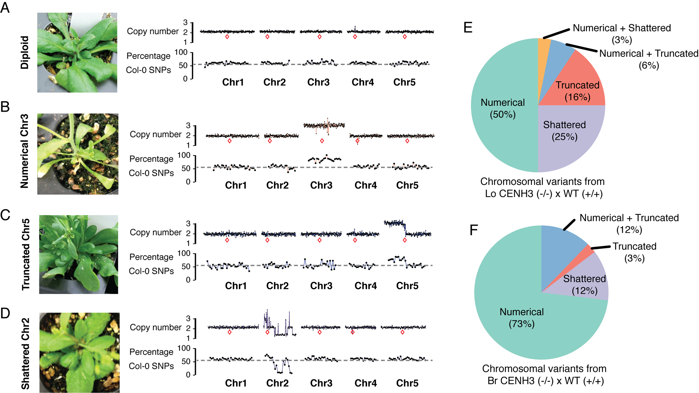
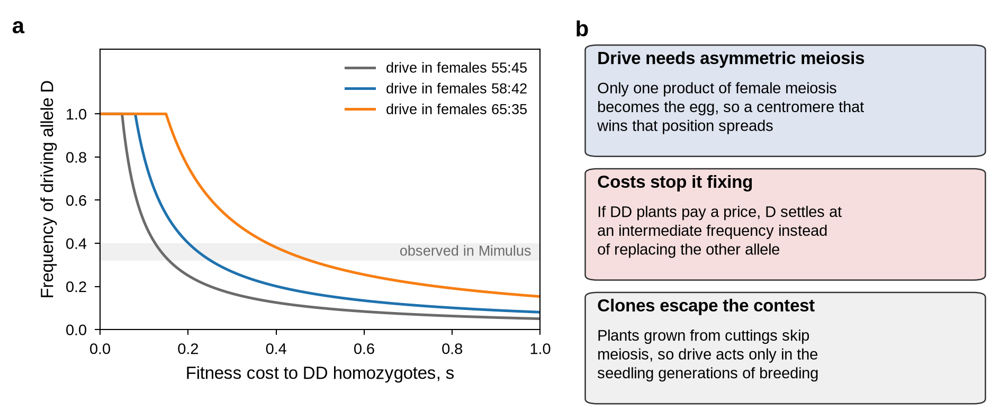

# Chapter 25. Centromere drive

**Status: Centromere drive in female meiosis, Partly verified (demonstrated in mice and monkeyflowers); as the general explanation of rapid centromere evolution, Contested.** Centromeres do the same job in every eukaryote, yet their DNA and some of their proteins evolve very fast. The centromere-drive hypothesis explains this paradox by the asymmetry of female meiosis: only one of the four products becomes the egg, so a centromere that attaches more strongly to the egg side of the spindle is transmitted to more than half of the offspring. Expanding satellite arrays could win this contest, and centromeric proteins would then evolve to restore fair segregation. Biased transmission of stronger centromeres is now shown at the cell level in mice, and a centromere-associated driver is measured in a wild plant population. Whether drive and its suppression explain most centromere evolution is still open.

Related notes in this repository: [selfish-dna](../../theories/selfish-dna/THEORY.md), [molecular-drive](../../theories/molecular-drive/THEORY.md), [bateson-dobzhansky-muller-incompatibilities](../../theories/bateson-dobzhansky-muller-incompatibilities/THEORY.md).

## 25.1 Statement and history

Henikoff, Ahmad and Malik described the centromere paradox: chromosome segregation machinery is highly conserved, but the DNA and the proteins specific to centromeric chromatin evolve rapidly, and centromeres are thought to be specified by chromatin rather than by DNA sequence [1]. They proposed that incompatibilities between rapidly evolving centromeric components could shape centromeric regions and the reproductive isolation of new species [1]. The evidence came from adaptive evolution of the centromeric histone. Cid, the centromeric H3 of *Drosophila*, shows an excess of fixed replacement changes between *D. melanogaster* and *D. simulans*, which Malik and Henikoff explained as a response to changing satellite repeats [2]. The Arabidopsis centromeric H3 variant HTR12 shows the same pattern of adaptive evolution in its N-terminal tail [3], and CENP-C proteins evolve adaptively in plants and mammals, though not in yeast [4].

Talbert, Bryson and Henikoff proposed that CENP-C and some CenH3s suppress meiotic drive of centromeres in female meiosis, which would account for the rapid evolution and complexity of centromeric DNA in plants and animals compared with fungi [4]. Centromeric DNA repeats can thus be thought of as selfish elements competing to reach the egg [5]. Malik summarized the model: centromeres are locked in a conflict over transmission in asymmetric meiosis, cheating centromeres can cause skewed sex ratios or male sterility, and centromeric proteins evolve to suppress these costs [6].

The idea joined an older literature on meiotic drive. Pardo-Manuel de Villena and Sapienza reviewed nonrandom segregation and set out three requirements: an asymmetric meiotic division, functional asymmetry of the spindle poles, and functional heterozygosity at a locus that mediates attachment to the spindle [7]. In maize, the abnormal chromosome 10 drive system was proposed to have spread heterochromatic knobs through the genome [8].

## 25.2 What the theory predicts

- **Biased transmission.** In female meiosis, a centromere with more satellite repeats or more kinetochore protein should go to the egg more often than its weaker homologue [9, 10].
- **A spindle asymmetry.** The two poles of the female meiotic spindle should differ, so that one side retains chromosomes in the egg [7, 11].
- **Costs and balance.** Driving centromeres should carry fitness costs that limit their spread (Figure 25.2) [12, 13].
- **Adaptive evolution of centromeric proteins.** CenH3 and CENP-C should show recurrent positive selection in lineages with asymmetric female meiosis [2, 4].
- **Karyotype change.** Drive should bias which chromosomal rearrangements are fixed and shape karyotype evolution [14, 15].
- **Hybrid problems.** Divergent centromere components should cause segregation errors in hybrids [1, 16].

## 25.3 Evidence for

- **Mice: centromere strength decides the direction of drive.** Stronger centromeres, with more kinetochore protein and altered interactions with spindle microtubules, are preferentially kept in the egg. In laboratory mice, Robertsonian fusions with weaker centromeres go to the polar body, whereas in wild house mouse populations that have accumulated fusions the fusion centromeres are stronger [10].
- **More repeats, more CENP-A.** Centromeres with more satellite repeats house more CENP-A nucleosomes and bias their segregation to the egg [9].
- **The spindle is asymmetric.** CDC42 signalling from the oocyte cortex changes microtubule tyrosination on one side of the spindle, and non-Mendelian segregation depends on this asymmetry [11]. Expanded centromeres recruit microtubule-destabilizing factors that detach them from microtubules that would direct them to the polar body, and drive depends on slow meiotic progression [17, 18].
- **A driving centromere in a wild plant.** In monkeyflower hybrids, a *Mimulus guttatus* allele, D, is transmitted through female meiosis at 98:2, most likely because of divergence in centromere-associated repeats. Within *M. guttatus*, D has a 58:42 advantage, and homozygotes have reduced pollen viability, suggesting balancing selection [12]. In the Iron Mountain population, D is at 32–40%; recessive seed-set costs measured in the wild, together with male costs, predict an equilibrium of 38%, close to the observed value [13].
- **Maize knobs.** Ab10 converts heterochromatic knobs into neocentromeres that are preferentially transmitted to the egg; a cluster of kinesin genes, Kindr, is required for this, and Ab10 drive has been linked to more than 500 Mb of knob repeats [19]. Knob size, frequency and position in wild *Zea* fit the meiotic drive model [8].
- **Karyotypes.** Analysis of 1170 mammalian karyotypes suggests that karyotype evolution is driven by nonrandom segregation in female meiosis [14]. In over 1000 mammals, chromosome number evolves more slowly in species with all-bibrachial or all-monobrachial karyotypes, consistent with drive that switches polarity [15].

## 25.4 Evidence against, and difficulties

- **Adaptive evolution without asymmetric centromeres.** Holocentric chromosomes were expected to prevent centromere drive, but CenH3 in 35 species of holocentric Cyperaceae shows positive selection at a frequency comparable to monocentric clades [20]. Either drive also acts on holocentric chromosomes or CenH3 evolves for other reasons.
- **Other causes of satellite turnover.** In Arabidopsis, centromeres evolve through cycles of satellite homogenization and invasion by ATHILA retrotransposons [21, 22]. Turnover by gene conversion, unequal exchange and transposon invasion does not require drive.
- **Drive is shown for few cases.** Direct measurements of centromere drive come from mouse models and from *Mimulus*; for most species the inference rests on molecular evolution [6, 13].
- **The hybrid link is indirect.** Divergent CENH3 causes segregation errors and genome elimination in Arabidopsis crosses [16, 23], but this shows that centromere divergence can cause hybrid problems, not that drive caused the divergence.

## 25.5 Status and reasoning

**Centromere drive in female meiosis: partly verified. As the general explanation of rapid centromere evolution: contested.** The parts of the mechanism have been demonstrated: satellite expansion raises CENP-A and biases segregation [9], the spindle is asymmetric [11], and a centromere-associated driver is held at equilibrium by measured costs in a wild plant [13]. The claim that drive and its suppression explain the adaptive evolution of CenH3 and CENP-C across eukaryotes remains an inference [4, 6], and positive selection on CenH3 in holocentric plants [20] and transposon-driven centromere cycles [22] show that other forces also act.

## 25.6 Plants, crops and grapevine

- **Monkeyflower and maize.** The two best plant cases of drive are a centromere-associated driver in *Mimulus* [12, 13] and the Ab10 knob system in maize [8, 19].
- **CENH3 and haploid induction.** Altered CENH3 in Arabidopsis produces haploids when crossed to wild type, because the mutant’s chromosomes are eliminated; this can speed up plant breeding [23]. CENH3 from a species as distant as maize can replace the Arabidopsis protein, but variants cause segregation errors and genome elimination in crosses, driven by the fast-evolving N-terminal tail (Figure 25.1) [16].
- **Centromere landscapes.** Long-read assemblies resolve plant centromeres as megabase-scale satellite arrays that are densely methylated and invaded by retrotransposons [21, 22]. Tandem repeats from 282 species show that high-copy centromere repeats occur in almost all animal and plant genomes, with little sequence conservation beyond about 50 million years [24].
- **Grapevine.** Telomere-to-telomere assemblies of the grapevine reference PN40024 annotate 19 centromeres [25], and the gap-free Thompson Seedless assembly predicts all telomeres and centromeres [26]. Among 23 Pinot noir clones, structural variation is largely associated with repetitive DNA, including centromeric repeats [27].
- **Clonal propagation.** Drive acts only in female meiosis. A grapevine cultivar kept by cuttings goes through no meiosis, so centromeres cannot drive in the clone; they can drive only in the seedling generations of breeding, and centromeric differences among clones, such as those found among Pinot noir clones, must arise in mitosis [27].

## 25.7 How to test it with public data

- **Data.** Telomere-to-telomere and long-read genome assemblies with resolved centromeres [21, 22, 25]; tandem repeat catalogues [24]; CenH3 and CENP-C sequences across species [4, 20]; published segregation data from crosses [12].
- **Tools.** Centromere and telomere identification in assemblies, for example quarTeT’s CentroMiner [28]; codon substitution models for positive selection [20]; phylogenetic models of chromosome number [15].
- **Analysis.** (1) Compare satellite array sizes between homologous centromeres and test whether the larger array is overtransmitted in crosses [9, 12]. (2) Test CenH3 for positive selection in clades with and without asymmetric female meiosis [4, 20]. (3) Relate karyotype change to centromere type across a phylogeny [15]. The script [`scripts/ch25_centromere_drive_figures.py`](../scripts/ch25_centromere_drive_figures.py) computes the frequency at which a driver settles when homozygotes pay a fitness cost (Figure 25.2).
- **What would refute it.** Mendelian segregation of homologous centromeres that differ greatly in size in many species, and adaptive evolution of CenH3 that is as common in lineages without asymmetric meiosis.

## 25.8 Open questions

- How common is centromere drive outside mice, *Mimulus* and maize [6]?
- Do holocentric plants experience drive, and if not, why does their CenH3 evolve adaptively [20]?
- How do drive and transposon invasion interact in centromere turnover [22]?
- Do divergent centromeres contribute to reproductive isolation between species [1, 16]?

## 25.9 Common mistakes

- Taking rapid evolution of satellite DNA as proof of drive; homogenization and transposon invasion also change it [22].
- Forgetting that drive needs an asymmetric meiosis and a spindle asymmetry [7, 11].
- Ignoring fitness costs, which can keep a driver at an intermediate frequency [13].
- Treating haploid induction by CENH3 as drive; it is genome elimination after fertilization [23].

## Figures

**Figure 25.1.** Characterization of aneuploid genotypes using whole-genome sequencing. Shown here are pictures of an individual plant alongside its 100kb bin dosage plot and 1 Mb bin SNP analysis across all five chromosomes. The red boxes indicate their relative centromere positions. (A) A diploid Col-0/Ler hybrid individual from a genome elimination cross mediated by LoCENH3. (B–D) The three major aneuploid types represented by examples of each: an individual with a numerical aneuploid chromosome (B), a truncated aneuploid chromosome (C) and a shattered aneuploid chromosome (D). (E–F) Percentage of each type of chromosomal variants of the aneuploids derived from a LoCENH3 (E) and BrCENH3 (F) genome elimination cross. Reproduced unchanged from Maheshwari S, Tan EH, West A, et al. (2015) Naturally occurring differences in CENH3 affect chromosome segregation in zygotic mitosis of hybrids. *PLoS Genetics* 11:e1004970, Figure 3. https://doi.org/10.1371/journal.pgen.1004970. Licence: CC BY 4.0 (https://creativecommons.org/licenses/by/4.0/).

**Figure 25.2.** (a) Frequency at which a driving allele D settles when it is transmitted to a fraction k of the eggs of heterozygous females, is transmitted normally through males, and reduces the fertility of DD homozygotes by s in both sexes, for 55:45, 58:42 and 65:35 drive. The grey band marks the 32–40% frequency of a 58:42 driver in a wild *Mimulus guttatus* population [13]. The cost model is simplified and the values are illustrative. (b) What the model shows. Made with [`scripts/ch25_centromere_drive_figures.py`](../scripts/ch25_centromere_drive_figures.py); the calculation is deterministic.

## References

1. Henikoff S, Ahmad K, Malik HS (2001) The Centromere Paradox: Stable Inheritance with Rapidly Evolving DNA. *Science* 293:1098-1102. https://doi.org/10.1126/science.1062939
2. Malik HS, Henikoff S (2001) Adaptive Evolution of Cid, a Centromere-Specific Histone in Drosophila. *Genetics* 157:1293-1298. https://doi.org/10.1093/genetics/157.3.1293
3. Talbert PB, Masuelli R, Tyagi AP, et al. (2002) Centromeric Localization and Adaptive Evolution of an Arabidopsis Histone H3 Variant. *The Plant Cell* 14:1053-1066. https://doi.org/10.1105/tpc.010425
4. Talbert PB, Bryson TD, Henikoff S (2004) Adaptive evolution of centromere proteins in plants and animals. *Journal of Biology* 3:18. https://doi.org/10.1186/jbiol11
5. Henikoff S, Malik HS (2002) Centromeres: Selfish drivers. *Nature* 417:227. https://doi.org/10.1038/417227a
6. Malik HS (2009) The Centromere-Drive Hypothesis: A Simple Basis for Centromere Complexity. *Progress in Molecular and Subcellular Biology* 48:33-52. https://doi.org/10.1007/978-3-642-00182-6_2
7. Pardo-Manuel de Villena F, Sapienza C (2001) Nonrandom segregation during meiosis: the unfairness of females. *Mammalian Genome* 12:331-339. https://doi.org/10.1007/s003350040003
8. Buckler ES, Phelps-Durr TL, Buckler CSK, et al. (1999) Meiotic Drive of Chromosomal Knobs Reshaped the Maize Genome. *Genetics* 153:415-426. https://doi.org/10.1093/genetics/153.1.415
9. Iwata-Otsubo A, Dawicki-McKenna JM, Akera T, et al. (2017) Expanded Satellite Repeats Amplify a Discrete CENP-A Nucleosome Assembly Site on Chromosomes that Drive in Female Meiosis. *Current Biology* 27:2365-2373.e8. https://doi.org/10.1016/j.cub.2017.06.069
10. Chmátal L, Gabriel SI, Mitsainas GP, et al. (2014) Centromere Strength Provides the Cell Biological Basis for Meiotic Drive and Karyotype Evolution in Mice. *Current Biology* 24:2295-2300. https://doi.org/10.1016/j.cub.2014.08.017
11. Akera T, Chmátal L, Trimm E, et al. (2017) Spindle asymmetry drives non-Mendelian chromosome segregation. *Science* 358:668-672. https://doi.org/10.1126/science.aan0092
12. Fishman L, Saunders A (2008) Centromere-Associated Female Meiotic Drive Entails Male Fitness Costs in Monkeyflowers. *Science* 322:1559-1562. https://doi.org/10.1126/science.1161406
13. Fishman L, Kelly JK (2015) Centromere-associated meiotic drive and female fitness variation in Mimulus. *Evolution* 69:1208-1218. https://doi.org/10.1111/evo.12661
14. Pardo-Manuel de Villena F, Sapienza C (2001) Female Meiosis Drives Karyotypic Evolution in Mammals. *Genetics* 159:1179-1189. https://doi.org/10.1093/genetics/159.3.1179
15. Blackmon H, Justison J, Mayrose I, et al. (2019) Meiotic drive shapes rates of karyotype evolution in mammals. *Evolution* 73:511-523. https://doi.org/10.1111/evo.13682
16. Maheshwari S, Tan EH, West A, et al. (2015) Naturally Occurring Differences in CENH3 Affect Chromosome Segregation in Zygotic Mitosis of Hybrids. *PLOS Genetics* 11:e1004970. https://doi.org/10.1371/journal.pgen.1004970
17. Akera T, Trimm E, Lampson MA (2019) Molecular Strategies of Meiotic Cheating by Selfish Centromeres. *Cell* 178:1132-1144.e10. https://doi.org/10.1016/j.cell.2019.07.001
18. Lampson MA, Black BE (2017) Cellular and Molecular Mechanisms of Centromere Drive. *Cold Spring Harbor Symposia on Quantitative Biology* 82:249-257. https://doi.org/10.1101/sqb.2017.82.034298
19. Dawe RK, Lowry EG, Gent JI, et al. (2018) A Kinesin-14 Motor Activates Neocentromeres to Promote Meiotic Drive in Maize. *Cell* 173:839-850.e18. https://doi.org/10.1016/j.cell.2018.03.009
20. Krátká M, Šmerda J, Lojdová K, et al. (2021) Holocentric Chromosomes Probably Do Not Prevent Centromere Drive in Cyperaceae. *Frontiers in Plant Science* 12:642661. https://doi.org/10.3389/fpls.2021.642661
21. Naish M, Alonge M, Wlodzimierz P, et al. (2021) The genetic and epigenetic landscape of the Arabidopsis centromeres. *Science* 374:eabi7489. https://doi.org/10.1126/science.abi7489
22. Wlodzimierz P, Rabanal FA, Burns R, et al. (2023) Cycles of satellite and transposon evolution in Arabidopsis centromeres. *Nature* 618:557-565. https://doi.org/10.1038/s41586-023-06062-z
23. Ravi M, Chan SWL (2010) Haploid plants produced by centromere-mediated genome elimination. *Nature* 464:615-618. https://doi.org/10.1038/nature08842
24. Melters DP, Bradnam KR, Young HA, et al. (2013) Comparative analysis of tandem repeats from hundreds of species reveals unique insights into centromere evolution. *Genome Biology* 14:R10. https://doi.org/10.1186/gb-2013-14-1-r10
25. Shi X, Cao S, Wang X, et al. (2023) The complete reference genome for grapevine (Vitis vinifera L.) genetics and breeding. *Horticulture Research* 10:uhad061. https://doi.org/10.1093/hr/uhad061
26. Wang X, Tu M, Wang Y, et al. (2024) Telomere-to-telomere and gap-free genome assembly of a susceptible grapevine species (Thompson Seedless) to facilitate grape functional genomics. *Horticulture Research* 11:uhad260. https://doi.org/10.1093/hr/uhad260
27. Callipo P, Robinson H, Schmidt M, et al. (2026) A dual genome-methylome map of clonal evolution in grapevine. *Genome Biology* 27:221. https://doi.org/10.1186/s13059-026-04184-x
28. Lin Y, Ye C, Li X, et al. (2023) quarTeT: a telomere-to-telomere toolkit for gap-free genome assembly and centromeric repeat identification. *Horticulture Research* 10:uhad127. https://doi.org/10.1093/hr/uhad127
