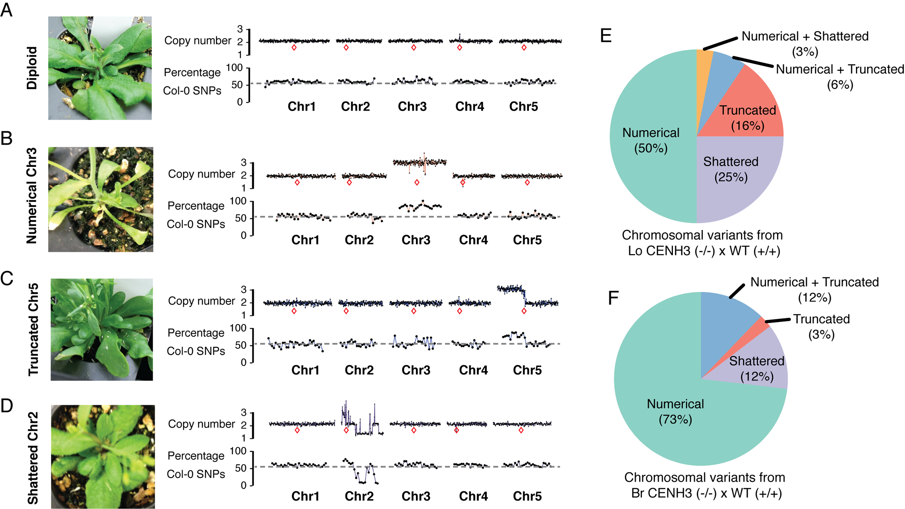
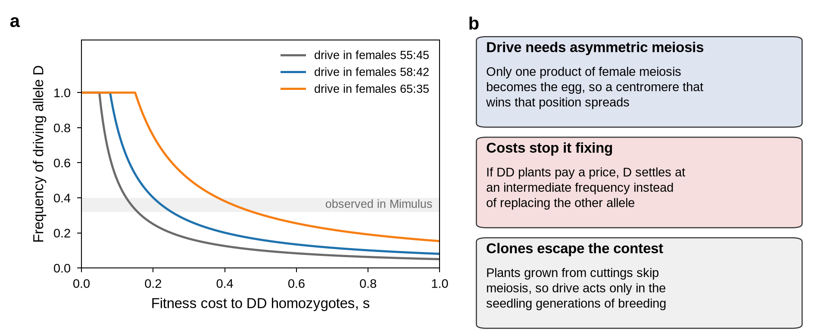

# 第 25 章 着丝粒驱动

**地位：雌性减数分裂中的着丝粒驱动，部分验证（已在小鼠和沟酸浆中证明）；作为着丝粒快速进化的普遍解释，有争议。** 着丝粒在所有真核生物中承担同样的工作，但它们的 DNA 和部分蛋白质进化得非常快。着丝粒驱动假说用雌性减数分裂的不对称来解释这一悖论：四个产物中只有一个成为卵细胞，因此一个更牢固地附着在纺锤体卵细胞一侧的着丝粒，会被传给一半以上的后代。不断扩张的卫星重复序列可能在这种竞争中获胜，着丝粒蛋白随后进化以恢复公平分离。较强着丝粒的偏向传递现已在小鼠中从细胞层面得到证明，一个与着丝粒相关的驱动等位基因也已在野生植物群体中测得。驱动及其抑制能否解释大部分着丝粒进化，仍未定论。

本仓库相关条目：[selfish-dna](../../theories/selfish-dna/THEORY.md)、[molecular-drive](../../theories/molecular-drive/THEORY.md)、[bateson-dobzhansky-muller-incompatibilities](../../theories/bateson-dobzhansky-muller-incompatibilities/THEORY.md)。

## 25.1 内容与历史

Henikoff、Ahmad 和 Malik 描述了着丝粒悖论：染色体分离机器高度保守，但着丝粒染色质特有的 DNA 和蛋白质进化很快，而且着丝粒被认为由染色质而不是 DNA 序列决定 [1]。他们提出，快速进化的着丝粒组分之间的不亲和，可能塑造着丝粒区域的组织，并造成新物种之间的生殖隔离 [1]。证据来自着丝粒组蛋白的适应性进化。果蝇的着丝粒 H3 即 Cid，在 *D. melanogaster* 与 *D. simulans* 之间固定了过多的氨基酸替换，Malik 和 Henikoff 将其解释为对不断变化的卫星重复的响应 [2]。拟南芥的着丝粒 H3 变体 HTR12 在 N 端尾部表现出同样的适应性进化格局 [3]；CENP-C 蛋白在植物和哺乳动物中适应性进化，在酵母中则没有 [4]。

Talbert、Bryson 和 Henikoff 提出，CENP-C 和部分 CenH3 在雌性减数分裂中抑制着丝粒的减数分裂驱动，这可以解释为什么与真菌相比，植物和动物的着丝粒 DNA 进化快而且复杂 [4]。着丝粒 DNA 重复因此可以被看作争夺进入卵细胞的自私元件 [5]。Malik 总结了这一模型：着丝粒在不对称减数分裂中陷入争夺传递的冲突，作弊的着丝粒可能造成性比偏斜或雄性不育，着丝粒蛋白则进化来抑制这些代价 [6]。

这一想法汇入了更早的减数分裂驱动文献。Pardo-Manuel de Villena 和 Sapienza 综述了非随机分离，并归纳出三个条件：不对称的减数分裂、纺锤体两极功能上的不对称，以及介导染色体与纺锤体附着的位点在功能上杂合 [7]。在玉米中，有人提出异常 10 号染色体的驱动系统使异染色质结节扩散到整个基因组 [8]。

## 25.2 预测

- **偏向传递。** 在雌性减数分裂中，卫星重复或动粒蛋白更多的着丝粒，应当比其较弱的同源着丝粒更常进入卵细胞 [9, 10]。
- **纺锤体不对称。** 雌性减数分裂纺锤体的两极应当不同，使一侧把染色体留在卵细胞中 [7, 11]。
- **代价与平衡。** 驱动着丝粒应当带有限制其扩散的适合度代价（图 25.2）[12, 13]。
- **着丝粒蛋白的适应性进化。** 在有不对称雌性减数分裂的谱系中，CenH3 和 CENP-C 应当反复受到正选择 [2, 4]。
- **核型变化。** 驱动应当影响哪些染色体重排被固定，并塑造核型进化 [14, 15]。
- **杂种问题。** 着丝粒组分分化后，应当在杂种中造成分离错误 [1, 16]。

## 25.3 支持证据

- **小鼠：着丝粒强度决定驱动方向。** 较强的着丝粒，即动粒蛋白更多、与纺锤体微管相互作用改变的着丝粒，优先留在卵细胞中。在实验室小鼠中，着丝粒较弱的罗伯逊融合染色体进入极体；而在积累了融合染色体的野生家鼠群体中，融合着丝粒更强 [10]。
- **重复越多，CENP-A 越多。** 卫星重复更多的着丝粒含有更多 CENP-A 核小体，并偏向分离到卵细胞 [9]。
- **纺锤体是不对称的。** 来自卵母细胞皮层的 CDC42 信号改变纺锤体一侧的微管酪氨酸化，而非孟德尔分离依赖这种不对称 [11]。扩张的着丝粒招募微管去稳定因子，使自身脱离那些会把它们带向极体的微管；驱动还依赖较慢的减数分裂进程 [17, 18]。
- **野生植物中的驱动着丝粒。** 在沟酸浆杂种中，*Mimulus guttatus* 的等位基因 D 通过雌性减数分裂以 98:2 的比例传递，很可能是因为着丝粒相关重复的分化。在 *M. guttatus* 种内，D 具有 58:42 的优势，而纯合子花粉活力下降，提示存在平衡选择 [12]。在 Iron Mountain 群体中，D 的频率为 32–40%；野外测得的隐性结实代价加上雄性代价，预测平衡频率为 38%，接近观测值 [13]。
- **玉米结节。** Ab10 把异染色质结节转变为新着丝粒，并使其优先传入卵细胞；这需要一组驱动蛋白基因 Kindr，而 Ab10 驱动被认为造成了 500 Mb 以上结节重复的积累 [19]。野生玉蜀黍属（*Zea*）中结节的大小、频率和位置符合减数分裂驱动模型 [8]。
- **核型。** 对 1170 个哺乳动物核型的分析表明，核型进化由雌性减数分裂中的非随机分离驱动 [14]。在 1000 多种哺乳动物中，核型全部为双臂或全部为单臂染色体的物种，染色体数目进化较慢，符合驱动极性会发生转换的解释 [15]。

## 25.4 反面证据与难点

- **没有不对称着丝粒也有适应性进化。** 全着丝粒（holocentric）染色体原本被认为能阻止着丝粒驱动，但全着丝粒的莎草科 35 个物种的 CenH3 受正选择的频率与单着丝粒类群相当 [20]。要么驱动也作用于全着丝粒染色体，要么 CenH3 因其他原因进化。
- **卫星更替的其他原因。** 拟南芥着丝粒通过卫星同质化和 ATHILA 反转录转座子入侵的循环而进化 [21, 22]。由基因转换、不等交换和转座子入侵造成的更替并不需要驱动。
- **被证明的驱动实例很少。** 着丝粒驱动的直接测量来自小鼠模型和沟酸浆；对大多数物种，推断依赖分子进化证据 [6, 13]。
- **与杂种的联系是间接的。** 在拟南芥杂交中，分化的 CENH3 造成分离错误和基因组消除 [16, 23]，但这只说明着丝粒分化能够引起杂种问题，并不说明分化由驱动造成。

## 25.5 地位与理由

**雌性减数分裂中的着丝粒驱动：部分验证。作为着丝粒快速进化的普遍解释：有争议。** 机制的各个部分已被证明：卫星扩张增加 CENP-A 并使分离产生偏向 [9]，纺锤体是不对称的 [11]，野生植物中一个着丝粒相关的驱动等位基因被测得的代价维持在平衡频率 [13]。但认为驱动及其抑制解释了真核生物中 CenH3 和 CENP-C 的适应性进化，仍是一种推断 [4, 6]；全着丝粒植物中 CenH3 的正选择 [20] 和转座子驱动的着丝粒循环 [22] 说明还有其他力量在起作用。

## 25.6 植物、作物与葡萄

- **沟酸浆和玉米。** 植物中最好的两个驱动实例，是沟酸浆的着丝粒相关驱动等位基因 [12, 13] 和玉米的 Ab10 结节系统 [8, 19]。
- **CENH3 与单倍体诱导。** 改造过的拟南芥 CENH3 与野生型杂交时会产生单倍体，因为突变体的染色体被消除；这可以加快植物育种 [23]。远至玉米的 CENH3 也能替代拟南芥的蛋白，但变体在杂交中造成分离错误和基因组消除，原因在于快速进化的 N 端尾部（图 25.1）[16]。
- **着丝粒的面貌。** 长读长组装把植物着丝粒解析为兆碱基规模的卫星阵列，它们高度甲基化，并被反转录转座子入侵 [21, 22]。来自 282 个物种的串联重复表明，高拷贝着丝粒重复几乎存在于所有动植物基因组中，但超过约 5000 万年的分化后几乎没有序列保守性 [24]。
- **葡萄。** 葡萄参考基因型 PN40024 的端粒到端粒组装注释了 19 个着丝粒 [25]，无缺口的无核白（Thompson Seedless）组装预测了全部端粒和着丝粒 [26]。在 23 个黑比诺克隆之间，结构变异主要与重复 DNA 有关，其中包括着丝粒重复 [27]。
- **无性繁殖。** 驱动只发生在雌性减数分裂中。用插条保存的葡萄品种不经过减数分裂，因此着丝粒在克隆中无法驱动，只能在育种的实生世代中驱动；克隆之间的着丝粒差异，例如黑比诺克隆之间发现的差异，必然产生于有丝分裂 [27]。

## 25.7 用公开数据检验

- **数据。** 解析了着丝粒的端粒到端粒和长读长基因组组装 [21, 22, 25]；串联重复目录 [24]；跨物种的 CenH3 和 CENP-C 序列 [4, 20]；已发表的杂交分离数据 [12]。
- **工具。** 在组装中识别着丝粒和端粒的工具，例如 quarTeT 的 CentroMiner [28]；检测正选择的密码子替换模型 [20]；染色体数目的系统发育模型 [15]。
- **分析。** (1) 比较同源着丝粒的卫星阵列大小，并检验较大阵列在杂交中是否被过度传递 [9, 12]。(2) 在有和没有不对称雌性减数分裂的类群中检验 CenH3 的正选择 [4, 20]。(3) 在系统发育上把核型变化与着丝粒类型联系起来 [15]。脚本 [`scripts/ch25_centromere_drive_figures.py`](../scripts/ch25_centromere_drive_figures.py) 计算纯合子承担适合度代价时驱动等位基因最终稳定的频率（图 25.2）。
- **什么结果会推翻理论。** 在许多物种中，大小差异悬殊的同源着丝粒仍按孟德尔比例分离；而且在没有不对称减数分裂的谱系中，CenH3 的适应性进化同样常见。

## 25.8 未解决的问题

- 在小鼠、沟酸浆和玉米之外，着丝粒驱动有多普遍 [6]？
- 全着丝粒植物是否经历驱动？如果没有，它们的 CenH3 为什么会适应性进化 [20]？
- 在着丝粒更替中，驱动与转座子入侵如何相互作用 [22]？
- 分化的着丝粒是否促成物种之间的生殖隔离 [1, 16]？

## 25.9 常见错误

- 把卫星 DNA 的快速进化当作驱动的证据；同质化和转座子入侵也会改变它 [22]。
- 忘记驱动需要不对称的减数分裂和纺锤体不对称 [7, 11]。
- 忽略适合度代价，而代价可以把驱动等位基因维持在中间频率 [13]。
- 把 CENH3 引起的单倍体诱导当作驱动；它是受精后的基因组消除 [23]。

## 图

**图 25.1.** 用全基因组测序鉴定非整倍体基因型。图中给出单株植物的照片，以及它在五条染色体上的 100 kb 区间剂量图和 1 Mb 区间 SNP 分析。红框表示着丝粒的相对位置。(A) 由 LoCENH3 介导的基因组消除杂交得到的二倍体 Col-0/Ler 杂种个体。(B–D) 三类主要非整倍体的例子：数目非整倍体染色体 (B)、截短的非整倍体染色体 (C) 和破碎的非整倍体染色体 (D)。(E–F) LoCENH3 (E) 和 BrCENH3 (F) 基因组消除杂交得到的非整倍体中，各类染色体变异所占的百分比。原样转载自 Maheshwari S, Tan EH, West A, et al. (2015) Naturally occurring differences in CENH3 affect chromosome segregation in zygotic mitosis of hybrids. *PLoS Genetics* 11:e1004970, Figure 3. https://doi.org/10.1371/journal.pgen.1004970。许可：CC BY 4.0（https://creativecommons.org/licenses/by/4.0/）。

**图 25.2.** (a) 驱动等位基因 D 最终稳定的频率。D 被传给杂合雌性卵细胞的比例为 k，经雄性正常传递，并使 DD 纯合子在两性中的育性降低 s；图中分别为 55:45、58:42 和 65:35 的驱动。灰带表示野生 *Mimulus guttatus* 群体中 58:42 驱动等位基因 32–40% 的频率 [13]。代价模型经过简化，数值仅作示意。(b) 模型说明了什么。用 [`scripts/ch25_centromere_drive_figures.py`](../scripts/ch25_centromere_drive_figures.py) 生成；计算是确定性的。

## 参考文献

1. Henikoff S, Ahmad K, Malik HS (2001) The Centromere Paradox: Stable Inheritance with Rapidly Evolving DNA. *Science* 293:1098-1102. https://doi.org/10.1126/science.1062939
2. Malik HS, Henikoff S (2001) Adaptive Evolution of Cid, a Centromere-Specific Histone in Drosophila. *Genetics* 157:1293-1298. https://doi.org/10.1093/genetics/157.3.1293
3. Talbert PB, Masuelli R, Tyagi AP, et al. (2002) Centromeric Localization and Adaptive Evolution of an Arabidopsis Histone H3 Variant. *The Plant Cell* 14:1053-1066. https://doi.org/10.1105/tpc.010425
4. Talbert PB, Bryson TD, Henikoff S (2004) Adaptive evolution of centromere proteins in plants and animals. *Journal of Biology* 3:18. https://doi.org/10.1186/jbiol11
5. Henikoff S, Malik HS (2002) Centromeres: Selfish drivers. *Nature* 417:227. https://doi.org/10.1038/417227a
6. Malik HS (2009) The Centromere-Drive Hypothesis: A Simple Basis for Centromere Complexity. *Progress in Molecular and Subcellular Biology* 48:33-52. https://doi.org/10.1007/978-3-642-00182-6_2
7. Pardo-Manuel de Villena F, Sapienza C (2001) Nonrandom segregation during meiosis: the unfairness of females. *Mammalian Genome* 12:331-339. https://doi.org/10.1007/s003350040003
8. Buckler ES, Phelps-Durr TL, Buckler CSK, et al. (1999) Meiotic Drive of Chromosomal Knobs Reshaped the Maize Genome. *Genetics* 153:415-426. https://doi.org/10.1093/genetics/153.1.415
9. Iwata-Otsubo A, Dawicki-McKenna JM, Akera T, et al. (2017) Expanded Satellite Repeats Amplify a Discrete CENP-A Nucleosome Assembly Site on Chromosomes that Drive in Female Meiosis. *Current Biology* 27:2365-2373.e8. https://doi.org/10.1016/j.cub.2017.06.069
10. Chmátal L, Gabriel SI, Mitsainas GP, et al. (2014) Centromere Strength Provides the Cell Biological Basis for Meiotic Drive and Karyotype Evolution in Mice. *Current Biology* 24:2295-2300. https://doi.org/10.1016/j.cub.2014.08.017
11. Akera T, Chmátal L, Trimm E, et al. (2017) Spindle asymmetry drives non-Mendelian chromosome segregation. *Science* 358:668-672. https://doi.org/10.1126/science.aan0092
12. Fishman L, Saunders A (2008) Centromere-Associated Female Meiotic Drive Entails Male Fitness Costs in Monkeyflowers. *Science* 322:1559-1562. https://doi.org/10.1126/science.1161406
13. Fishman L, Kelly JK (2015) Centromere-associated meiotic drive and female fitness variation in Mimulus. *Evolution* 69:1208-1218. https://doi.org/10.1111/evo.12661
14. Pardo-Manuel de Villena F, Sapienza C (2001) Female Meiosis Drives Karyotypic Evolution in Mammals. *Genetics* 159:1179-1189. https://doi.org/10.1093/genetics/159.3.1179
15. Blackmon H, Justison J, Mayrose I, et al. (2019) Meiotic drive shapes rates of karyotype evolution in mammals. *Evolution* 73:511-523. https://doi.org/10.1111/evo.13682
16. Maheshwari S, Tan EH, West A, et al. (2015) Naturally Occurring Differences in CENH3 Affect Chromosome Segregation in Zygotic Mitosis of Hybrids. *PLOS Genetics* 11:e1004970. https://doi.org/10.1371/journal.pgen.1004970
17. Akera T, Trimm E, Lampson MA (2019) Molecular Strategies of Meiotic Cheating by Selfish Centromeres. *Cell* 178:1132-1144.e10. https://doi.org/10.1016/j.cell.2019.07.001
18. Lampson MA, Black BE (2017) Cellular and Molecular Mechanisms of Centromere Drive. *Cold Spring Harbor Symposia on Quantitative Biology* 82:249-257. https://doi.org/10.1101/sqb.2017.82.034298
19. Dawe RK, Lowry EG, Gent JI, et al. (2018) A Kinesin-14 Motor Activates Neocentromeres to Promote Meiotic Drive in Maize. *Cell* 173:839-850.e18. https://doi.org/10.1016/j.cell.2018.03.009
20. Krátká M, Šmerda J, Lojdová K, et al. (2021) Holocentric Chromosomes Probably Do Not Prevent Centromere Drive in Cyperaceae. *Frontiers in Plant Science* 12:642661. https://doi.org/10.3389/fpls.2021.642661
21. Naish M, Alonge M, Wlodzimierz P, et al. (2021) The genetic and epigenetic landscape of the Arabidopsis centromeres. *Science* 374:eabi7489. https://doi.org/10.1126/science.abi7489
22. Wlodzimierz P, Rabanal FA, Burns R, et al. (2023) Cycles of satellite and transposon evolution in Arabidopsis centromeres. *Nature* 618:557-565. https://doi.org/10.1038/s41586-023-06062-z
23. Ravi M, Chan SWL (2010) Haploid plants produced by centromere-mediated genome elimination. *Nature* 464:615-618. https://doi.org/10.1038/nature08842
24. Melters DP, Bradnam KR, Young HA, et al. (2013) Comparative analysis of tandem repeats from hundreds of species reveals unique insights into centromere evolution. *Genome Biology* 14:R10. https://doi.org/10.1186/gb-2013-14-1-r10
25. Shi X, Cao S, Wang X, et al. (2023) The complete reference genome for grapevine (Vitis vinifera L.) genetics and breeding. *Horticulture Research* 10:uhad061. https://doi.org/10.1093/hr/uhad061
26. Wang X, Tu M, Wang Y, et al. (2024) Telomere-to-telomere and gap-free genome assembly of a susceptible grapevine species (Thompson Seedless) to facilitate grape functional genomics. *Horticulture Research* 11:uhad260. https://doi.org/10.1093/hr/uhad260
27. Callipo P, Robinson H, Schmidt M, et al. (2026) A dual genome-methylome map of clonal evolution in grapevine. *Genome Biology* 27:221. https://doi.org/10.1186/s13059-026-04184-x
28. Lin Y, Ye C, Li X, et al. (2023) quarTeT: a telomere-to-telomere toolkit for gap-free genome assembly and centromeric repeat identification. *Horticulture Research* 10:uhad127. https://doi.org/10.1093/hr/uhad127
